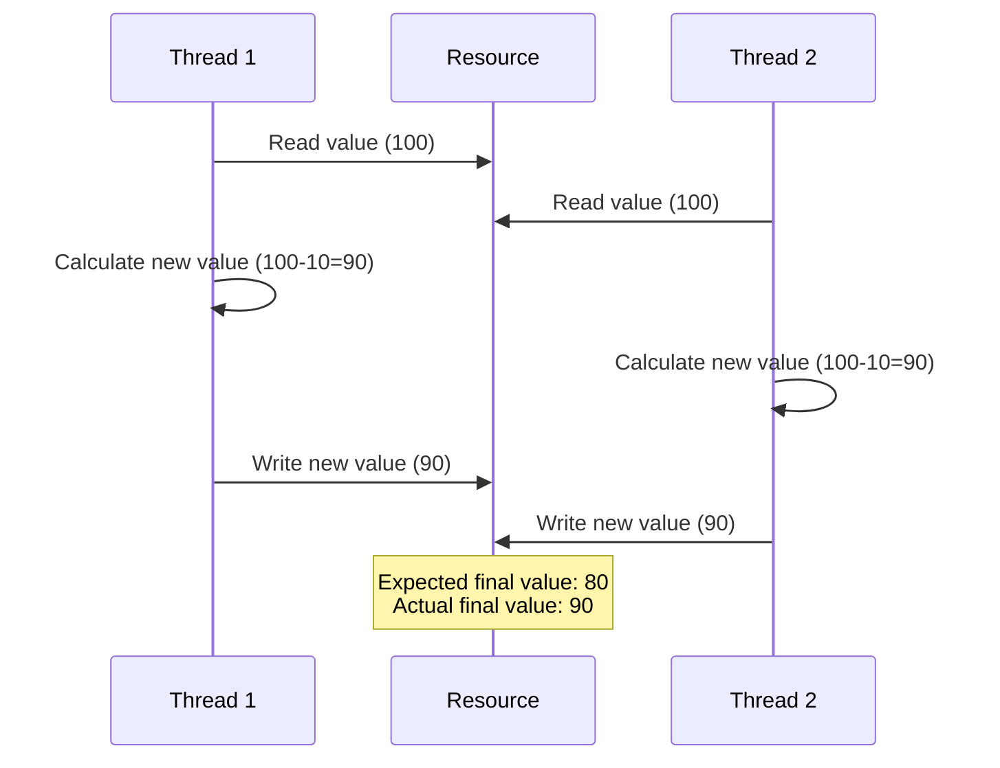
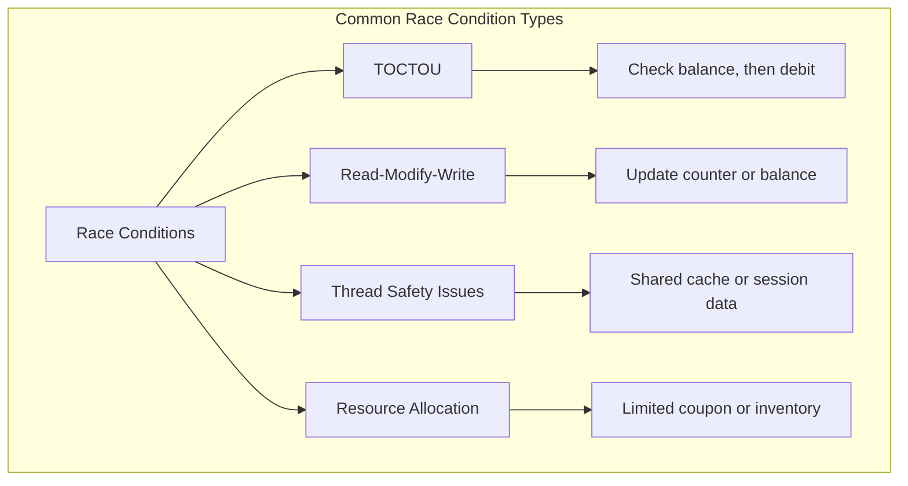
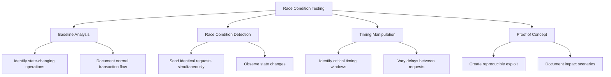
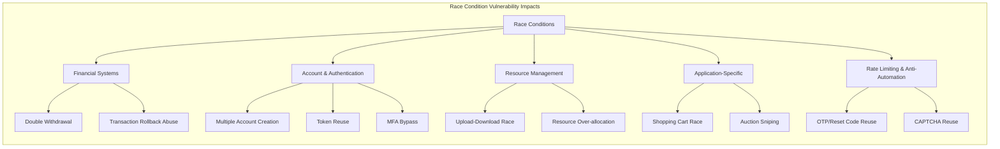
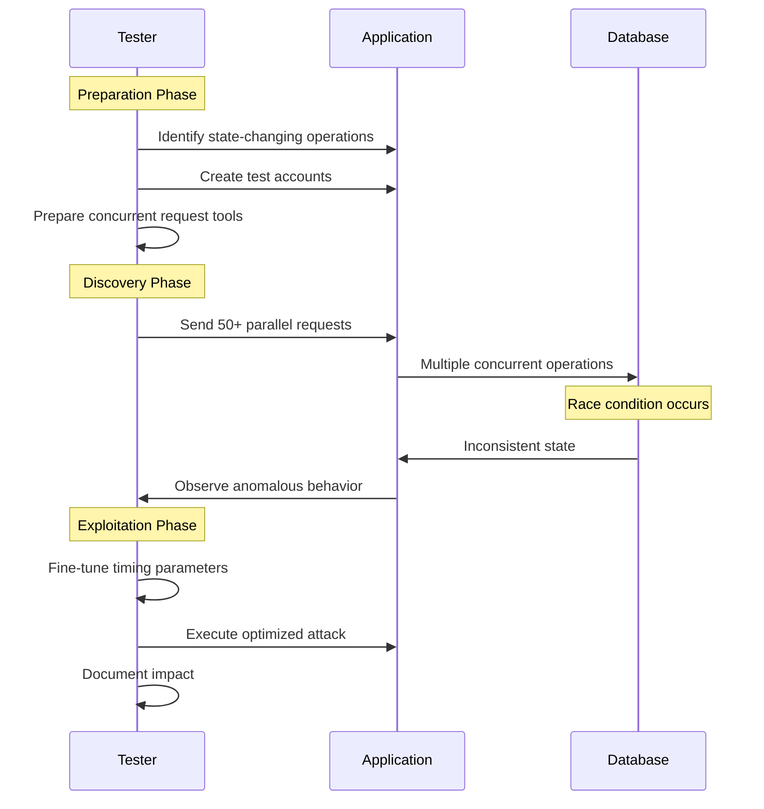

## Crown Jewel Targets

Denial of service is highest-value when ONE attacker request or ONE stored field changes the availability of a resource for MANY other users. The study pack's strongest reports share that shape: a single poisoned cache entry, one oversized stored filename, one 50-byte P2P message. Priority targets:

- **Caching layers and CDNs** — anything where an attacker-controlled header or URL is reflected into a cached response. A poisoned 404/403/empty body blocks the real asset for every visitor.
  - Evidence: #1695604 (backslash/forward-slash confusion -> cached 404 on cdn.shopify.com), #409370 (`X-Forwarded-Port` / `X-Forwarded-Host` -> broken redirects), #1160407 (`x-http-method-override` + Varnish -> empty JS file), #1173153 (crafted `Authorization` -> cached 403 on downloads), #1096609 (`Host` header with arbitrary port).
  - Why crown jewel: one request, site-wide, persistent until cache expiry; trivially reproducible with a cachebuster control.

- **Stored strings reflected on many pages** — profile names, filenames, post titles, comments. A 3MB profile-picture name in a GraphQL JSON response slowed every page that fetched user info (#764434); a very long `hey.com` name both 500'd the server and crashed the Android app (#1018037); a whitespace filename made ActiveStorage throw on every page that rendered the avatar (#713407).
  - The same field is read by the profile page, directory, activity feed and another user's view — that is what converts self-DoS into a reportable finding.
  - Look for values embedded in JSON blobs fetched by many endpoints, not just the one that accepted the input.

- **Markdown / template / renderer engines** — Mermaid diagrams (#470067), 50,000 nested markdown links (#557154), hash-collision markdown parsers (#1341957), self-referential dashboard panels, template injection in reset forms (#1265344).
  - Both server-side renderers (issue previews, PDF/screenshot generators) and client-side renderers count when a shared page becomes unusable for every viewer.
  - Renderers are attractive because they accept ordinary user content (comments, posts) and perform disproportionate work on it.

- **Search, filter, sort, and page-size parameters** — `?size=`, `limit`, `page`, `per_page`, `count`, `length` — parameters that control returned volume or feed a parser (#993582, #300391, #203388).
  - A parameter that "controls size of returned page" is a direct resource dial (#300391).
  - The 607-report frequency table puts `search-filter-sort` at 200 reports — the second most common recon surface.

- **Image / media processing pipelines** — pixel-flood uploads (#126826, #970760), oversized `security.txt` fetched by AJAX (#290955), GIF/PNG decompression bombs, ffmpeg URL handling (#115978).
  - Decode work is expensive and often bounded only by the file's declared dimensions, not by a policy limit.
  - Image proxies and camo-style fetchers amplify one attacker fetch into large egress (#507525).

- **Protocol and parser surfaces** — ReDoS in regex-heavy conversions (#1023899, #1746098), PHP stream filters (#505278), multipart/Range/header parsing (the curl, Rack, Django and Node.js CVE clusters), HTTP/2 CONTINUATION floods (#2334401, #2453328), WebSocket fragmentation (#3303765), QUIC zero-length datagrams (#3783438).
  - These are usually CVE-flavoured: public code search maps a version to a ready-made PoC against a live asset.
  - One frame or a few bytes can exhaust CPU, memory, workers or file descriptors — no bandwidth required.

- **Cloud control planes and disk quotas** — Kubernetes pods writing `/etc/hosts` to fill node disk (#867699), API servers fed many ~1MB resources through a validating webhook (#1096907), blockchain consensus messages that OOM validators (#3510161), JSON-RPC debug methods enabled by default (#324021).
  - Control-plane DoS has a large blast radius: an entire cluster or validator set, not one user.
  - Look for fields that are trusted as allocation sizes or counts without validation.

- **Auth, login, password, OTP and reset endpoints** — no rate limit means brute force plus resource exhaustion (#3085889 Critical 9.8, #223854, #1243009), password-reset email replay floods (#126364), WordPress repair/cron endpoints left public (#2786591, #1888723).
  - Missing throttling turns a cheap request into account-wide abuse; some programs rate this Critical.
  - Self-service endpoints are accessible pre-auth, so the attacker need not control a victim account.

- **SSO / OIDC flows** — logic that lets an attacker break or redirect an entire organization's login (#976603 $10,500 — DoS plus an account-takeover door).
  - Auth-path DoS is crown-jewel territory because availability loss and an identity-boundary failure can share one primitive.

Severity climbs when the primitive is (a) persistent, (b) affects other accounts or all users, (c) needs only a single request or tiny payload, and (d) sits on a critical path (auth, CDN asset, consensus). Pure "self-DoS" where only the attacker's own tab or account is harmed is routinely closed at $0 (#290955, #1382448, #970760's own uncertainty about scope).

---

## Attack Surface Signals

### URL / Endpoint Patterns to Hunt
```
/wp-admin/load-scripts.php          # CVE-2018-6389: non-auth ~3MB amplification (#752010)
/wp-json/                           # CORS Origin reflection into cached response (#591302, #921704)
/wp-admin/maint/repair.php          # unauthenticated DB repair DoS (#2786591)
/wp-cron.php                        # public cron DoS (#1888723)
/xmlrpc.php                         # pingback amplification / brute force (#752073, #325040, #884756)
/api/skin/search                    # single-request search-bar DoS (#993582)
/graphql                            # mutation aliasing, circular introspection (#3287208, #2048725)
/i/moments/edit/{id}                # character-limit bypass -> 500 + app slow (#819088)
/console/auth?consumer_key=...      # cookie injection via GET params (#1005421)
/security.txt                       # oversized file processed by extension (#290955)
/download / static asset paths      # cache poisoning of CDN asset (#1695604, #1160407, #1173153)
/releases/*.zip?cachebuster=...      # always test with cachebusters, never poison live
/api/*/preview, /api/*/render       # server-side rendering of attacker content
/webhooks, /endpointproxy           # attacker-controlled URL fetchers
/password/reset, /login, /otp       # missing rate limits (#3085889, #862681)
/admin/*, /debug/*, /maint/*        # expensive functions without auth (#2786591, #324021)
```

### Parameter & Header Signals
```
name=, filename=, title=, display_name=, image name       # unbounded stored strings
size=, limit=, page=, per_page=, count=, length=           # controls returned volume
q=, search=, filter=, sort=, order=, locale=               # parser / ReDoS entry points
redirect_to= (duplicated), url=, target=, uri=              # redirect loops / SSRF-adjacent
Origin, Referer, Access-Control-Allow-Origin                # CORS cache poisoning
X-Forwarded-Host, X-Forwarded-Port, X-Forwarded-For         # cache-key / redirect poisoning
Host: target:1337                                           # arbitrary-port cache poisoning
Authorization: SharedKeyLite ...                            # cached 403 poisoning
x-http-method-override                                      # method-override cache poisoning
Accept-Encoding, User-Agent                                 # crafted request -> 502 delay (#861170)
Range:, Content-Length:, Transfer-Encoding:                 # parser / resource exhaustion
Content-Type: application/json (very large body)            # JSON parse OOM (#303632)
__proto__ (as a header name)                                # uncaught TypeError crash (#3560402)
consumer_key=, consumer_secret= (GET/POST)                  # Set-Cookie injection (#1005421)
```

### Response / Behavior Signals
- A request that returns **500 / Out Of Memory / 502 after a long delay** instead of a normal response (#819088, #861170, #1043372).
- The **same stored value reflected on many different pages** — profile, reports, directory, thanked section (#764434, #713407).
- A **cache hit that returns a different status or body** than a cache-busted request (404/403/empty vs 200).
- Latency that grows **superlinearly** with input length — the signature of ReDoS, hash collision or nested-structure parsing.
- A browser tab that hangs or OOMs when loading a page containing a user-controlled payload (#470067, #1043372).
- "It works only for other users / after deletion / on a shared link" — the hallmark of a persistent cross-user primitive (#975827, #1077136, #1005421).
- A 504 that appears only when a parameter is **duplicated** (#449818) — a parser doing the same work twice or looping.
- A reset/OTP email that arrives many times from a single replayed request (#126364) — missing idempotency and rate limiting.
- An API server that "just goes away" when fed many ~1MB resources (#1096907) — an inbound size limit is missing.

### Tech Stack Signals
- **WordPress / PHP** — `xmlrpc.php`, `load-scripts.php`, `wp-cron.php`, `wp-json`, `repair.php`; PHP iconv/stream filters. The CVE-2018-6389 amplification pattern hit many programs (#752010, #753491, #1511628, #1186985).
- **Varnish / Cloudflare / CDN + GCP origin** — cache poisoning is the default DoS primitive; check for cache-key components and origin-specific header handling.
- **Node.js / Express / Fastify / http2** — large JSON, `allErrors: true`, `__proto__` headers, HTTP/2 frame floods, mruby/type confusion, unfinished HTTP/1.1 requests.
- **Ruby / Rails** — Money-type ReDoS, Action Pack exception handling, globalid/underscore ReDoS, ActiveStorage filename handling, multipart parsing.
- **Python / Django** — locale-parameter ReDoS, multipart parser, `dedotdotify()` URL normalization, header concatenation quadratic CPU (#3426417).
- **Kubernetes / GKE** — pod disk writes, validating webhook inbound size, client-go jsonpath fuzz crashes, large deployment scaling cost (#831654).
- **GraphQL** — mutation aliasing, circular/introspection queries, query-cost controls, large payloads on unauthenticated endpoints (#1619604).
- **Blockchain / P2P (CometBFT, RSKJ, Monero, HyperLedger)** — tiny network messages that trigger huge allocations or loops; JSON-RPC debug methods (#2338094, #324021).

### DoS Subclass Taxonomy (with real exemplars)

Use this table to name the subclass in your report; triage treats them differently.

| Subclass | Mechanism | Real exemplars |
|---|---|---|
| Persistent web-cache poisoning | Reflected header/URL becomes a cached error page served to everyone | #1695604, #409370, #1160407, #1173153, #1096609 |
| Stored oversized string | Unbounded value stored then reflected on many pages | #764434, #1018037, #713407 |
| Algorithmic complexity / ReDoS | Superlinear time from a short or moderately long input | #1341957, #1023899, #1746098, #505278 |
| Memory exhaustion / OOM | Tiny input drives a huge allocation or an unbounded buffer | #3510161, #3303765, #303632, #1043372 |
| Disk / storage exhaustion | Unbounded writes fill a shared filesystem | #867699, #3250490 |
| Renderer / client DoS | A shared page becomes unusable in every viewer's browser | #470067, #1077136, #290955 |
| Missing rate limiting | No throttle on login, reset, OTP or expensive endpoint | #3085889, #249319, #126364, #223854 |
| Missing auth on costly function | Repair/cron/debug endpoint reachable pre-auth | #2786591, #1888723, #324021 |
| Amplification / third-party abuse | One request multiplied into many (pingback, proxy, email) | #752073, #752010, #507525, #126364 |
| Parser / protocol state crash | Frames, boundaries, chunk extensions exhaust workers | #2334401, #2453328, #3783438, #1904097 |
| Cross-user logic DoS | One user's lifecycle action permanently breaks another | #975827, #649533, #1005421 |
| Type confusion / prototype pollution | Memory corruption or prototype crash in a sandbox | #181871, #181321, #3560402, #869574 |

The most-paid reports in the corpus cluster in the first three rows: persistent cache poisoning, stored oversized strings, and algorithmic complexity. If you can only test one thing on a new target, test those.

---

## Discovery Patterns From 607 Full Reports

### Where Researchers Start (ranked recon surfaces from the study pack frequency table)

Counts are the number of full reports in the 607-report corpus containing each signal. The ranking reflects where researchers actually begin, not a theoretical taxonomy.

1. **dos-resource (438)** — what to look for: any input that can consume CPU, memory, disk or worker time without bound. Start here; every other signal is a route into this outcome. Ask: "what is the most expensive thing this endpoint can be made to do per request?"
2. **search-filter-sort (200)** — what to look for: search bars, filters, sort keys, `size`/`limit`/`page` params, locale strings. These feed parsers and control returned volume; they are usually unauthenticated and cheap to probe.
3. **public-code-search (146)** — what to look for: GitHub repos named in the program's scope, `package.json` / `Gemfile` versions, known-CVE functions (`load-scripts.php`, `dedotdotify`, `urlize`). A matching version hands you a ready-made PoC.
4. **image-processing (122)** — what to look for: upload endpoints, avatar/resize/thumbnail pipelines, pixel dimensions, decompression paths, `security.txt` fetchers. Check whether dimensions are capped before decode.
5. **api-endpoint (114)** — what to look for: REST/JSON endpoints accepting arrays, nested objects, huge bodies; check whether auth is required. Large JSON without a body-size cap is a known Fastify/Rails failure mode.
6. **server-side-rendering (86)** — what to look for: Markdown/Mermaid/template rendering, PDF/screenshot generators, issue previews. Anything that turns stored text into HTML or an image is a candidate.
7. **internal-network (80)** — what to look for: SSRF-adjacent fetchers, webhook targets, internal RPC/P2P message handlers. Peer-supplied size/count fields are especially dangerous.
8. **comment-injection (79)** — what to look for: comments that are stored and rendered to other users; nested-link and HTML-injection payloads (#557154, #1077136). A comment is the cheapest way to persist a payload.
9. **js-source-review (75)** — what to look for: client bundles that fetch untrusted files, AJAX without timeout, DOM-clobberable `name=` attributes (#1077136, #290955).
10. **debug-error-leak (68)** — what to look for: errors that reveal parser internals, stack traces, file paths, or confirm a crash occurred server-side rather than only in the browser.
11. **admin-internal (65)** — what to look for: admin/repair/debug endpoints exposed without auth (#2786591, #324021). Try direct GET/POST before assuming a login is needed.
12. **dependency-confusion (57)** — what to look for: vulnerable library versions reachable through a public endpoint; CVEs in Rack, Rails, curl, Django, Fastify, lodash, hoek.
13. **cache-layer (54)** — what to look for: CDN/Varnish/Cloudflare headers and cache keys; any reflected header or URL segment. Always test with a cachebuster first.
14. **xml-parser (54)** — what to look for: XML/XLSX/import uploads; entity expansion and billion laughs (#105434, #754117, #72272).
15. **redirect-handling (53)** — what to look for: duplicated `redirect_to`, unbounded redirect chains, newline-in-URL loops (#449818, #1382448).
16. **cookie-handling (48)** — what to look for: GET/POST params that set cookie attributes, control-code characters in cookie names/values (#1005421, #1613943).
17. **filter-bypass (47)** — what to look for: length limits measured after normalization; multi-byte UTF-8 expansion (#350847), overlong encodings, double decoding.
18. **proxy-feature (43)** — what to look for: fetch/proxy endpoints that accept attacker hosts; amplification via camo/image proxies (#507525).

### Feature-Based Discovery Signals (frequency-ranked)

| Signal (reports) | Why it matters | What to probe |
|---|---|---|
| dos-resource (438) | The outcome class itself — unbounded consumption | 1 request; measure latency, memory, worker count |
| search-filter-sort (200) | Parsers + volume controls sit directly on user input | Oversized `q`, regex metacharacters, `size=999999999`, `locale=` |
| public-code-search (146) | Source reveals exact vulnerable call sites and limits | Grep scoped repo for regex, `gsub`, `new URL()`, file reads |
| image-processing (122) | Decode/fetch work is expensive and often unbounded | 10k×10k pixel flood, huge `security.txt`, GIF bombs |
| api-endpoint (114) | JSON arrays/objects are cheap to send, expensive to parse | Very large JSON, deep nesting, duplicate keys, aliased mutations |
| server-side-rendering (86) | Rendering runs on shared infrastructure or every viewer's browser | Nested markdown, Mermaid, template expressions, huge diagrams |
| internal-network (80) | Internal handlers trust peer-supplied sizes/counts | Tiny P2P/RPC messages with extreme integer fields |
| comment-injection (79) | Stored payload hits every viewer, not just the sender | `[a](/a/...×50000)`, ``, HTML in links |
| js-source-review (75) | Client-side DoS counts when it blocks shared pages | AJAX with no timeout; `document.<name>` clobbering |
| debug-error-leak (68) | Confirms server-side crash vs client-side rendering only | Force 500, read body/headers, compare cache-busted |
| admin-internal (65) | Missing auth on destructive/expensive functions | Direct GET/POST to repair/cron/RPC-debug endpoints |
| dependency-confusion (57) | Known CVE gives a ready-made PoC against a live asset | Match version fingerprints, replay advisory payload |
| cache-layer (54) | One poisoned entry = site-wide persistent DoS | Cachebuster control, then reflected header/URL variants |
| xml-parser (54) | Entity expansion is a classic 1-request amplifier | `<!ENTITY xxe ...>`, nested entities, external DTD |
| redirect-handling (53) | Redirect loops tie up workers and caches | Duplicate `redirect_to=`, `%0a`-injected Location |
| cookie-handling (48) | Cookies drive auth decisions on all pages | `Max-Age=1e18`, control chars, `consumer_key=` injection |
| filter-bypass (47) | Length checks measured post-decode are expandable | Multi-byte UTF-8, double encoding, overlong sequences |
| proxy-feature (43) | Proxy amplifies one attacker fetch into huge egress | Camo/image proxy URL params, concurrent fetches |
| brute-otp-reset (30) | Reset/OTP endpoints replayed without throttling | Replay the reset POST; count emails and worker time |
| blind-oob (30) | Fetchers reached via callbacks also accept oversized responses | Point fetcher at a slow/infinite response host |
| json-body (23) | Body parsers often buffer fully before size checks | Multi-megabyte `application/json` body |
| prototype-pollution (20) | Polluted prototypes crash unrelated code paths | `__proto__` in JSON and in header names |
| graphql (8) | Query shape multiplies work without large input | Aliased mutations, circular introspection, huge arrays |

### Verbatim Discovery Clues (18 real researcher quotes)

These are the researchers' own "how I found it" lines, reproduced from the study pack. They show that DoS is usually found while doing something else — testing upload, testing SSRF, reading source, or simply noticing a slow page.

- [#764434] "I was checking the profile picture upload feature of hackerone and found out that there is no text limitation for image name, You can provide as much long image name as you want."
- [#764434] "profile page, reports page, invited reports page and I noticed that all the pages are taking significantly much more amount of time to load as they were taking before and some were even failing to load and crashing my browser."
- [#819088] "I started up BurpSuite to investigate how the creation of this Moments work."
- [#819088] "I tried one request after the other with more and more characters until I've got a 500 Internal Server Error Response."
- [#1018037] "after trying to change my initial name to something long i found out that their are no limits to how long it can be , so i directly changed it to something very long which caused my account to really slow down when accessing it and in **the android app , it just keeps crashing** when"
- [#713407] "I was playing with the profile picture upload feature, then i observed that when we change the name of our profile picture to `+` , `%0d%0a` , or `%20` and then refresh the profile page, it would give an internal server error."
- [#1043372] "The issue happened with me when I was clicking on a notification telling that `Clario has updated their bounty table`."
- [#1160407] "Since the CDN is using Varnish to cache files, I was able to combine the GCP behaviour and poison the cache into returning an empty resource, inherenetly causing a denial of service on gitlab."
- [#1382448] "At first i saw this code at site: <a href=\"URL/path\">someting</a> and tried XSS but site was filtered \" and '."
- [#1382448] "So i tried with new line command (%0a) and the site gave 301 and again and again."
- [#1198434] "The vulnerability was discovered when I was testing for SSRF in the host header field."
- [#249319] "I discovered that the Federalist API doesn't have rate limiting in place, and executes any amount of request to the endpoint in parallel mode."
- [#223854] "Hence, I tried with a big payload and everytime server responded me with a 500 internal server error."
- [#970760] "I had gone through your policy and I saw that DoS is out of scope but I am not sure about Application level DoS."
- [#1096907] "However, as I started sending these 1MB secrets, I found that the API server would just go away."
- [#831654] "I found out that it took quite some resources to process a larger deployment, especially when scaling it."
- [#350847] "However, even though I found that the length restriction was 1024 bytes, I managed to bypass this length restriction by using multi-byte UTF-8 characters, which get expanded into up to 12 URL-encoded bytes, which results in me being able to poison"
- [#1888723] "I found this vulnerability at https://████████ endpoint."

### Probe Checklist (15 concrete probes)

1. Set the profile/name/filename field to 1MB, then 3MB of `A`s — check every page that reflects it, not just the edit page (#764434).
2. Set a stored filename to `+`, `%0d%0a`, `%20` and reload every reflecting page; look for 500s (#713407).
3. Send a search request with a 1MB body and time it; try regex metacharacters `(`, `[`, `|`, `\d` and trailing `!` (#993582, #1023899).
4. Post `[a](/a/a/a/...)` with 50,000 nested segments to a comment endpoint via the raw HTTP request (#557154).
5. Change `size`/`limit`/`page` to extreme integers and observe returned volume and latency (#300391).
6. Add `Origin: https://evil.example` to a `/wp-json/` response, then re-request without it and compare cached bodies (#591302).
7. Send `X-Forwarded-Port: 123` and `X-Forwarded-Host: target:123` to a redirecting URL with a cachebuster, then fetch the clean URL (#409370).
8. Request a static asset with backslashes replacing slashes; compare cache-busted vs normal fetch (#1695604).
9. Send `Host: target:1337` and `x-http-method-override: GET` to a static asset; check for cached 404/empty file (#1096609, #1160407).
10. Upload a 10,000×10,000 pixel PNG/JPEG as an avatar and measure request time and server timeouts (#126826, #970760).
11. Send a `<!DOCTYPE foo [<!ENTITY xxe SYSTEM "file:///etc/passwd">]>` XLSX/XML import; observe entity expansion (billion-laughs variant) (#105434, #754117).
12. Duplicate a redirect parameter (`?redirect_to=a&redirect_to=b`) and look for a 504 after a long delay (#449818).
13. Hit login/password/reset endpoints without CSRF token/cookies in a loop; measure whether any throttling appears (#3085889, #249319, #126364).
14. Fuzz a P2P/RPC message field with `2^32-1` and watch for an immediate huge allocation / OOM (#3510161).
15. Send HTTP/2 CONTINUATION frames, WebSocket continuation floods, or unbounded chunk extensions against a fingerprinted stack (#2334401, #3303765, #2375446).

---

## Step-by-Step Hunting Methodology

1. **Inventory unbounded inputs.**
   - Spider JS bundles, API docs, upload forms, comment boxes and admin panels.
   - Flag every field that is stored and later displayed to other users, every parameter that controls a count/size, and every parser entry point (search, locale, XML, markdown, URL).
   - The frequency table says `dos-resource` (438) + `search-filter-sort` (200) dominate — start there.

2. **Establish a baseline.**
   - Record normal response time, status code and body size for the endpoint.
   - Record the normal time to load the page where the value is reflected, from a second account.
   - Without a baseline you cannot show the latency/500/OOM delta that triage needs (#819088 escalated by repeatedly measuring "more and more characters").

3. **Binary-search the length boundary.**
   - Grow the payload until the first 500/502/OOM or latency spike, then shrink to find the exact threshold.
   - Test 1×, 10× and 100× the apparent UI limit — client-side limits are frequently absent or post-decode only (#819088 bypassed a character limit; #350847 bypassed 1024 bytes with multi-byte UTF-8).
   - Repeat the boundary test from an unauthenticated context if the endpoint allows it.

4. **Follow the stored value to every reflection point.**
   - A name or filename that only affects your own profile is self-DoS; the same value in a GraphQL JSON blob, directory, activity feed or another user's view is a cross-user finding (#764434, #713407, #975827).
   - Enumerate every endpoint that returns the object containing the field, not just the one that accepted it.
   - Check mobile clients too — #1018037 crashed the Android app while the web app merely slowed.

5. **Test special characters, not just length.**
   - Whitespace, `+`, `%0d%0a`, `%00`, `%xx`, invalid hex and overlong UTF-8 reliably crash specific parsers and clients (#713407, #500686, #921286, #903740).
   - Try the same character set in headers (cookie names, `Origin`, `Host`) as well as bodies (#1613943, #1005421).
   - Watch for repeated 301s or 504s rather than a single error — that indicates a loop (#1382448, #449818).

6. **Probe cache layers with strict cachebuster discipline.**
   - Use `?cb=<random>` on every poisonous request so you never affect live users, then remove it and fetch the clean URL to see the poisoned result.
   - Test reflected `Origin`, `X-Forwarded-*`, `Host: target:port`, `Authorization`, `x-http-method-override`, and path normalization (backslash vs slash).
   - This is the dominant persistent-DoS primitive (#591302, #409370, #1695604, #1173153, #1160407, #1096609, #326639, #1322732).
   - Always include an explicit disclaimer in the report that testing used cachebusters and did not disrupt the service (#1173153, #1160407).

7. **Measure algorithmic complexity.**
   - Feed increasingly long/degenerate strings to regex and parser endpoints and plot time vs length: linear is normal; quadratic or worse is ReDoS/hash-collision.
   - Typical amplifiers: `-$` + many digits + `.00` (#1023899), a long locale string treated as a regex (#1746098), crafted reference labels in markdown (#1341957).
   - A POST body makes long inputs easy to deliver without URL-length restrictions (#1023899 explicitly notes this).

8. **Exercise renderers with adversarial structures.**
   - Nested markdown links, Mermaid diagrams, deeply nested JSON, circular GraphQL introspection and mutation aliasing turn one request into huge work (#557154, #470067, #3287208, #2048725, #303632).
   - If the UI blocks the payload, send the raw request with Burp (#557154).
   - Test both the rendering request and the later page load — the cost may fall on every viewer rather than the poster.

9. **Test media pipelines with bombs, not just big files.**
   - Pixel floods and oversized fetched text abuse decode/AJAX work that lacks a timeout (#126826, #970760, #290955).
   - Always use your own account and a file you host; never point a production fetcher at a third party.
   - Note whether the resulting failure is a 504 at the edge, a worker timeout, or a client OOM — each maps to a different root cause.

10. **Check auth, rate limits and expensive admin functions.**
    - Remove CSRF token/cookies from login requests; replay password/OTP/reset requests; directly request repair/cron/RPC-debug endpoints.
    - Missing throttling converts a cheap request into account-wide abuse (#3085889 Critical, #223854, #1243009, #2786591, #1888723, #324021, #126364).
    - Check whether a fix on one endpoint was applied to sibling endpoints (#1322732 bypassed the fix from #1198434).

11. **For protocol/stack targets, replay the advisory.**
    - When public code search identifies a library version with a known CVE, reproduce the published PoC against the live fingerprint: HTTP/2 CONTINUATION floods, WebSocket continuation frames, multipart/Range/header parsing, JSON `__proto__`, QUIC zero-length datagrams (#2334401, #2453328, #3303765, #3783438, #3560402, #868834).
    - Keep the PoC bounded and non-destructive; a crash that requires a restart is still evidence, but avoid repeated crashes on production.

12. **Prove cross-user impact and clean up.**
    - Repeat from a second account/observer, confirm the poisoned cache entry or stored payload affects them, then clear your poison (cachebuster, delete test data, restore cookies).
    - Document the exact request sequence, latency numbers and affected population before reporting.
    - Check the program's DoS scope: application-level DoS is often in scope while network flooding is not (#970760).

---

## Payload & Detection Patterns

### Unbounded Stored Strings
```text
# Oversized profile-picture filename — 3MB of 'A' prepended to a normal name (#764434)
AAAA...(≈3,000,000 chars)...original.png

# Special-char filenames that make ActiveStorage throw on every reflecting page (#713407)
filename="+"
filename="%0d%0a"
filename="%20"

# Long display name — repeated requests each with a very long name (#1018037)
name=<100000 x 'A'>

# Moment title/description character-limit bypass -> 500 + Android heavy load (#819088)
{"title":"<tens of thousands of chars>","description":"<tens of thousands>"}

# Password field with no length restriction -> 500 (#223854, #1243009, #840598)
password=<very long string>
```
What to observe: status transition 200 -> 500, latency growth, and identical failure on a second account viewing the stored value. The 3MB filename in #764434 mattered because it appeared in a GraphQL JSON response fetched on many pages.

### Markdown / Renderer / Template Amplifiers
```text
# 50,000 nested markdown links posted as an issue comment (#557154)
[a](/a/a/a/a/a/a/a/a/a/a/a/...(50000 times))

# Mermaid diagram pasted into a comment -> screen freeze, issue unusable (#470067)
```mermaid
graph TD; A-->B; ... (large payload)
```

# Circular introspection / mutation aliasing on GraphQL (#2048725, #3287208)
query { __schema { types { fields { type { fields { ... } } } } } }
mutation { a: verifyPhone(input:{...}){...} b: verifyPhone(input:{...}){...} ... }

# HTML injection in a post link that clobbers document functions (#1077136)
<a href="x" name="xyz">...</a>   # name shadowing document.<fn>
```
What to observe: the cost may land on the viewer rather than the sender. #557154 also included a shell loop that posted the comment repeatedly with `curl` and `-b '_gitlab_session=...'` to exhaust server resources.

### Cache Poisoning (ALWAYS use a cachebuster while testing)
```bash
# CORS allow-origin reflection into cached WP-JSON response (#591302, #921704)
curl -s -H 'Origin: https://evil.example' \
  'https://target/wp-json/?cb=RANDOM' -D -
# then: curl -s 'https://target/wp-json/' -D -   # check cached ACAO + body

# Forwarded header -> broken redirect cached site-wide (#409370)
curl -H 'X-Forwarded-Port: 123' 'https://target/index.php?dontpoisoneveryone=1&cb=RANDOM'
curl -H 'X-Forwarded-Host: target:123' 'https://target/index.php?dontpoisoneveryone=1&cb=RANDOM'

# Backslash/forward-slash confusion -> cached 404 on CDN asset (#1695604)
https://cdn.example.com\static\js\bundle.js?cb=RANDOM
# vs normal: https://cdn.example.com/static/js/bundle.js

# Crafted Authorization -> cached 403 on download asset (#1173153)
curl -H 'Authorization: SharedKeyLite account:KEY=' \
  'https://downloads.example.com/file.zip?cb=RANDOM'

# Arbitrary Host port + method override (#1096609, #1160407)
curl -H 'Host: target:1337' 'https://target/?cb=RANDOM'
curl -H 'x-http-method-override: GET' 'https://assets.example.com/app.js?cb=RANDOM'

# Invalid HTTP parameters / overlong request line (#326639, #350847)
# multi-byte UTF-8 in URI expands past the 1024-byte post-decode limit
```
Success criterion: the clean URL (no cachebuster) now returns the poisoned status/body, and a second observer sees the same thing. Restore by requesting the clean URL again after forcing a fresh cache entry.

### Parser / ReDoS / Resource Exhaustion
```text
# Quadratic-time regex (ActiveRecord PostgreSQL Money type) (#1023899)
value = "-$" + "9"*N + ".00"    # /^-?\D*[\d,]+\.\d{2}$/ grows quadratically with N

# Django locale parameter treated as a regex (#1746098)
GET /i18n/setlang/?locale=(a+)+$  with a long 'a' string

# PHP stream filter endless loop (#505278)
stream_filter_append($fh,'convert.iconv.iso-10646/utf8//IGNORE',STREAM_FILTER_READ,[]);

# XML entity expansion / billion laughs (#105434, #754117, #72272)
<!DOCTYPE foo [ <!ELEMENT foo ANY><!ENTITY xxe SYSTEM "file:///etc/passwd"> ]>

# JSON body without size limit (#303632)
Content-Type: application/json  +  very large payload string

# Fastify / Node header DoS (#3560402)
__proto__: <header name that throws TypeError in req.headersDistinct>

# P2P / RPC extreme integer (#3510161)
ProposalMessage.PartSetHeader.Total = 4294967295   # -> 512MB alloc -> OOM

# Multipart parser and Range header (#1904097, #2520679, #2307813)
Content-Type: multipart/form-data with malformed/excessive boundaries
Range: bytes=0-<huge>
```

### Cookie / Session / Config Poisoning
```text
# GET params controlling Set-Cookie attributes (#1005421)
/console/auth?consumer_key=x;%20domain=tumblr.com;%20Max-Age=1000000000000000000000
                  &consumer_secret=x;%20domain=tumblr.com;%20Max-Age=1000000000000000000000

# Control code in cookie name/value on save (#1613943, #1686935)
Cookie: <control-character-name>=<value>

# Locking a victim out by pre-registering/2FA-ing their email (#649533)
# attacker signs up with victim email, logs in without verification, enables 2FA
```

### Protocol-Level Floods
```text
# HTTP/2 CONTINUATION flood (#2334401, #2453328): many HEADERS/CONTINUATION
#   frames with END_HEADERS withheld -> server memory/CPU exhaustion
# WebSocket fragmentation flood (#3303765): FIN=0 then a flood of continuation
#   frames -> unbounded buffer until OOM
# QUIC zero-length UDP datagrams busy-loop (#3783438)
# Unbounded chunk extension on HTTP/1.1 (#2375446, #868834)
# Unfinished HTTP/1.1 requests eating worker slots (#868834)
# Slowloris-style header delay (#868834)
# Range header DoS (#2520679, #2307813) and multipart parser DoS (#1904097)
# WordPress pingback / load-scripts amplification (#752073, #752010, #507525)
# HTTP multi-header compression (#1826048), Set-Cookie DoS (#1614328)
```

### Slow Requests, Unfinished Streams and Worker Holding
```text
# Unfinished HTTP/1.1 requests / slow headers holding worker slots (#868834)
#   open a connection, send a partial request line, never finish -> workers exhausted
#   note: headersTimeout only helps when the delay is in the headers phase

# Passive FTPS handshake with no timeout blocks curl_multi_perform() (#4122567)
#   slow server holds the multi handle indefinitely

# Curl shutdown timer not armed for silent servers (#4125065)
#   connection-shutdown timeout bypass -> resources never released
```
What to observe: the endpoint stops responding for unrelated users while the half-open connections are held. Measure from a second client, not the one holding the sockets.

### Email / Notification / Reset Floods
```text
# Replay a password-reset POST to flood a victim inbox (#126364)
#   OWASP ZAP: generate forgot-password link, replay the packet N times

# Automatic response message amplified into a DoS (#1680241)
#   trigger an auto-responder loop between two accounts

# Missing rate limit on contact/signup forms (#223542, #862681)
#   repeated requests -> mail queue and worker saturation
```
What to observe: number of messages generated per single crafted request, and whether any throttle, idempotency key or cooldown exists. This is a cross-user resource primitive even when no server crashes.

### Disk, Deployment and Scaling Exhaustion
```text
# Pod writes to /etc/hosts, /etc/hostname, /etc/resolv.conf (#867699)
kubectl exec -it $POD -- dd if=/dev/zero of=/etc/hosts count=1000000 bs=10M
#   df -h /var/lib/kubelet shows available space shrinking to full

# Large deployment scaling consumes cluster resources (#831654)
#   create/deploy a large manifest repeatedly, watch metrics spike

# Many ~1MB resources sent to a validating webhook (#1096907)
#   API server becomes unresponsive / "goes away"
```
What to observe: a shared resource (disk, control plane, worker pool) is consumed by one tenant and other tenants degrade. That is the cross-user proof.

### Prototype Pollution and Native Crashes
```text
# lodash / hoek prototype pollution reachable from JSON input (#864701, #310439, #869574)
{"__proto__": {"polluted": true}}
lod.setWith({}, "__proto__[test]", "123")

# mruby type confusion / use-after-free in sandboxed scripts (#181871, #181321)
NoMethodError.define_singleton_method(:new) do "waat" end; Object.q
a = []; a.to_ary  # array length modified during callback -> use-after-free
```
What to observe: a crash of the whole process/worker, not just a handled error. A single bad input that takes down a shared runtime is a DoS even without a memory-corruption exploit.

### Detection / Measurement Helper
```python
import time, requests
for n in (10**3, 10**4, 10**5, 10**6, 3*10**6):
    t = time.time()
    r = requests.post(URL, data={"name": "A"*n}, timeout=30)
    print(n, r.status_code, round(time.time()-t, 3), len(r.content))
    if r.status_code >= 500 or time.time()-t > 10:
        print("threshold reached"); break
```
Interpretation:
- `200` with flat timing -> not a finding; increase the size or change the character class.
- `500/502/504` or superlinear timing -> resource exhaustion; now prove the cross-user effect.
- For cache tests, always compare a cachebusted request against the clean URL and diff status/body; a difference is the signal.
- For stored values, load the reflecting page as a second user and record the same metrics there.

---

## Common Root Causes

1. **No length/size validation on stored fields.** Names, filenames and titles are stored and echoed wherever the object appears (#764434, #1018037, #713407, #223854). The fix is a server-side maximum, not a UI attribute.

2. **UI/client-side limit only.** The browser restricts input but the API accepts arbitrary length; bypassing the front end produces 500s (#819088, #1243009). Always test the raw request.

3. **Length checked after decoding/normalization.** Multi-byte UTF-8 expands to up to 12 URL-encoded bytes, defeating a 1024-byte post-decode check (#350847). Overlong and double encodings work similarly.

4. **Unbounded regex / algorithmic complexity.** Quadratic or worse patterns in money parsing, locale handling, markdown reference collisions and date parsing (#1023899, #1746098, #1341957, #1404789). A POST body makes the long input easy to deliver.

5. **Reflected input cached as a shared resource.** `Origin`, `X-Forwarded-*`, `Host`, `Authorization` or path segments enter the cache key/response and a poisoned error page is served to everyone (#591302, #409370, #1160407, #1173153, #1096609, #1695604).

6. **Parser state machines without byte/frame/worker limits** — HTTP/2 CONTINUATION, WebSocket continuation frames, QUIC zero-length datagrams, multipart/Range/chunked parsing (#2334401, #3303765, #3783438, #1904097, #2375446, #868834).

7. **Expensive work with no timeout** — AJAX fetches of huge files, ffmpeg/URL probes, image decode of giant pixel dimensions (#290955, #115978, #126826). A `xhr.timeout` or decode dimension cap would fix these.

8. **Missing authentication / rate limiting on costly endpoints** — DB repair, cron, JSON-RPC debug, login, password reset (#2786591, #1888723, #324021, #3085889, #126364). Filesystem writes by pods to shared host paths (#867699) are the same class of missing boundary.

9. **Trusting peer-supplied fields for allocation size** — `PartSetHeader.Total = 2^32-1` drives a 512MB allocation with no validation before use (#3510161); RSKJ PeerExplorer similarly trusts pending request maps (#363636).

10. **Prototype pollution / type confusion in sandboxes** — `__proto__` headers crash Node processes; mruby type confusion and use-after-free crash the VM (#3560402, #181871, #181321, #869574).

11. **Permanent cross-user side effects from one user's action** — deleting an account leaves messages that brick the victim (#975827); cookie injection durable across a domain (#1005421); a pre-registered email with 2FA blocks the real owner (#649533).

### Root cause -> fastest detection shortcut

| Root cause | Fastest confirmation |
|---|---|
| No length validation | Send 1MB then 3MB; watch for 500 and check a second viewer |
| Client-side-only limit | Replay the raw request with the value the browser refused |
| Post-decode length check | Multi-byte UTF-8 / double encoding past the stated limit |
| Unbounded regex | Time 1k/10k/100k inputs; look for quadratic growth |
| Reflected input in cache | Cachebusted request vs clean URL; diff status/body |
| Parser without limits | Replay the CVE PoC against the version fingerprint |
| No timeout on expensive work | Point the fetcher at a slow host; measure held workers |
| Missing auth / rate limit | Direct request to admin path; replay reset/login N times |
| Trusted peer size field | Set the integer to `2^32-1`; watch for OOM kill |
| Type confusion / pollution | `__proto__` in JSON/header; observe process crash |

---

## Bypass Techniques

### Length / Filter Bypasses
- **Multi-byte UTF-8 expansion** — a 1024-byte post-decode limit is beaten by characters that expand to up to 12 URL-encoded bytes (#350847).
- **Overlong encoding / double encoding** — send the same value encoded twice; compare where the limit is measured vs where the parser reads it.
- **Raw HTTP when the browser blocks** — post directly with Burp/curl when the UI refuses long content (#557154: "if you can not post the comment from the browser, send the HTTP request directly").
- **Repeated cheap requests instead of one big one** — many oversized name changes or empty moments each consume worker time (#1018037, #819088).
- **Unicode / control-code edge cases** — `%0A`, `%00`, invalid hex `%xx`, and control characters in cookies and URLs crash specific clients and proxies (#1382448, #500686, #921286, #1613943).

### Cache-Layer Bypasses
- **Path normalization confusion** — cache server treats `\` as `/`, origin 404s; the 404 gets cached (#1695604).
- **Arbitrary port in `Host` / forwarded headers** — cache stores an absolute URL/redirect with a dead port, breaking it for all users (#1096609, #409370, #350847).
- **Method override** — `x-http-method-override` against an origin that honors it makes the cache store an empty body (#1160407).
- **Reflected `Origin` into `Access-Control-Allow-Origin`** — cache serves one victim origin's ACAO/body to everyone (#591302, #921704, #1621540).
- **Invalid HTTP parameters / request-line tricks** — poison the cache with parameters the origin rejects but the cache keys on (#326639, #350847).
- **Bypassing a prior fix** — a poison technique fixed once can reappear on another path or domain (#1322732 explicitly bypassed the fix from #1198434).

### Structure / Logic Bypasses
- **GraphQL mutation aliasing** — one HTTP request executes many expensive mutations by aliasing fields (#3287208 $12,500); circular introspection multiplies work (#2048725).
- **Duplicated parameters** — two `redirect_to=` values trigger the long 504 (#449818).
- **Redirect loops via newline injection** — `%0a` in a URL yields repeated 301s (#1382448).
- **Request smuggling** — `[space]Transfer-Encoding: chunked` desynchronizes front/back end and can both leak secrets and exhaust the backend (#753939).
- **Amplification through third parties** — WordPress pingback/`xmlrpc.php` turns one request into a botnet-grade flood (#752073, #752010, #507525).
- **Self-DoS -> cross-user pivot** — a payload that first appears to only hurt you becomes reportable once shown to persist for other users (#764434, #975827, #1077136).
- **Pre-auth vs post-auth retest** — if the expensive endpoint requires login, remove CSRF/cookies and test whether the server still performs the work before rejecting (#3085889).
- **Forgotten sibling endpoints** — a fix applied to one asset host or path often misses another; retest every subdomain and route (#1160407, #1322732, #728664).
- **Character-class switch** — when long `A`s are accepted harmlessly, switch to `%0A`, `%00`, whitespace or regex metacharacters; the crash is often in the parser, not the length (#713407, #500686, #1023899).
- **Second-order delivery** — store the payload in one place (comment, filename, email field) and trigger it on a different page or in another user's client (#1265344, #557154, #1077136).
- **Amplification instead of volume** — use pingback, proxy or auto-responder features so the server multiplies one request rather than sending many yourself (#752073, #507525, #1680241).
- **Cookie persistence** — make the poison survive logout by injecting durable cookie attributes rather than relying on a single session (#1005421, #1613943, #861521).

---

## Gate 0 Validation

Before writing the report, confirm all three:

1. **What can the attacker do right now?**
   - Show a measurable delta: latency before/after, a 500/502/OOM response, a filled disk, a cached 404/403, or another account's broken page.
   - Distinguish **self-DoS** (only your own tab/account — likely $0 or N/A) from **cross-user/persistent DoS** (all visitors, other accounts, a whole org's SSO, a consensus network).
   - "The server is slow once" is insufficient — quantify with numbers and show the affected population.
   - Confirm the primitive survives a clean session: log out, use a second observer, and re-run.

2. **What does the victim LOSE?**
   - Every visitor blocked from a CDN asset or download (#1695604, #1173153)?
   - All members of an organization unable to log in (#976603)?
   - A node/OOM kill halting a validator set or consensus (#3510161)?
   - Another user permanently locked out of their account (#975827, #649533)?
   - If the only loss is your own convenience, downgrade or do not submit.

3. **Can it be reproduced in 10 minutes from scratch, safely?**
   - Is the endpoint still live and the parameter still unbounded?
   - Does a second account/observer see the same effect from a clean session?
   - Can you restore state (cachebuster, delete stored data, clear cookies) so no live user is harmed?
   - Many accepted reports explicitly state "no actual DoS was caused; all testing used cache-busters" (#1173153, #1160407) — make that your standard too.
   - Check the program's DoS scope first; application-level DoS is sometimes in scope while network flooding is not (#970760 asked exactly this question).

Common rejection reasons to avoid:
- **Self-DoS only** — no evidence that anyone else is affected (#290955, #1382448).
- **Unbounded request volume as the "vulnerability"** — "if I send many requests the server gets slow" is expected; the bug is one request or one stored field causing disproportionate work.
- **Client-only rendering with no shared page** — a payload that crashes only your own browser with no other viewer is weak (#500686-style cases were still paid, but only because the URL was shareable and broke followers' feeds).
- **No measurement** — include before/after numbers, status codes and the exact request; "it seems slow" will not triage.
- **Persistent damage left behind** — always clean up poisoned caches and deleted/modified test data.

### Evidence template to paste into the report

Keep the report to the facts triage needs. One paragraph per item:

```text
Vulnerable endpoint:  POST /api/... (or GET .../wp-json/)
Parameter / header:   name= (stored, reflected on N pages)
Auth context:         unauthenticated / low-privileged
Payload:              <exact value, length, encoding>
Baseline:             HTTP 200, 0.21s, 1.2KB body, page loads normally
With payload:         HTTP 500, 8.4s, 0KB body; second account sees same 500
Cross-user proof:     observer account B loading /profile/<attacker> OOMs at 3MB
Persistence:          survives logout and a fresh session; cached entry until TTL
Cleanup performed:    cachebuster used, test data deleted, no live users affected
Scope check:          application-level DoS in scope; no network flooding used
```

If any line cannot be filled in with a concrete value, you are not ready to submit. In particular, "cross-user proof" and "cleanup performed" are what separate an accepted application-level DoS from a closed self-DoS.

---

## Real Impact Examples

### Scenario A: One Poisoned CDN Entry Blocks Every User (Cache Poisoning Pattern)
An attacker requested a JavaScript asset with backslashes instead of slashes. The cache server normalized `\` to `/` and treated the requests as identical, but the origin returned **404 Not Found** for the backslash form. The 404 was cached, so every legitimate visitor received a 404 for that asset until the cache expired (#1695604, $3,800). Variants: `X-Forwarded-Port: 123` poisoning all of `www.hackerone.com`'s redirects (#409370, $2,500); a crafted `Authorization` header poisoning downloads for all Exodus users (#1173153); `Host: target:1337` poisoning `themes.shopify.com` (#1096609, $2,900). One request, site-wide, persistent.

### Scenario B: One Stored Filename OOMs Every Page That Fetches It (Long-String Pattern)
A researcher uploaded a profile picture with a ~3MB filename. Because the filename was embedded in the JSON response of GraphQL queries fetching user info, the profile page, reports page, invited-reports page and others loaded far more slowly and some crashed the browser (#764434). A long `hey.com` name both produced server-side 500s under repeated changes and crashed the Android app for any account that displayed it (#1018037, $1,000). A whitespace/CRLF filename made ActiveStorage throw on every page that rendered the avatar (#713407). The primitive is cross-user because the stored value is read by many views.

### Scenario C: 50 Bytes Halts a Consensus Network (Tiny-Message Memory Exhaustion)
In CometBFT v1.0.1, a malicious `ProposalMessage` with `PartSetHeader.Total = 2^32-1` made the receiving node immediately allocate 512MB and be killed by the OOM killer (#3510161). For a 69-validator chain, crashing 23 validators (34%) halts consensus with only ~1.15KB of total bandwidth. The root cause is trusting a peer-supplied size field with no validation before allocation.

### Scenario D: One Degenerate String eats a Worker Forever (Algorithmic Complexity)
A quadratic regex in ActiveRecord's PostgreSQL Money type meant a long string in a POST body caused execution time to grow with the square of input length (#1023899). Reddit's markdown parser had a hash-collision algorithmic-complexity DoS (#1341957). A PHP `convert.iconv.iso-10646/utf8//IGNORE` stream filter put a process into an endless loop, exhausting CPU or the entire PHP process pool (#505278). Each is a single request with no distributed bandwidth required.

### Scenario E: Broken SSO Opens a Takeover Door (Auth-Logic DoS)
A researcher could DOS any organization's SSO integration so nobody in that org could log in, and additionally get users to inadvertently SSO into an attacker-controlled organization (#976603, $10,500). This shows why auth-path DoS is crown-jewel territory: availability loss plus an identity-boundary failure in the same primitive.

### Scenario F: One User's Deletion Bricks Another User (Persistent Logic DoS)
A user messaged a victim and then deleted their own account. The deleted user's messages left the victim's mailbox in a state where the victim could not use the account again (#975827). No payload size and no cache were involved — just a lifecycle assumption that one user's action must not permanently destroy another's access.

### Scenario G: A Single Search Request pins the Server (Search API Pattern)
On `3d.cs.money`, a specially crafted payload in the search API (`POST /api/skin/search`) produced a multi-second denial from a single request from a single machine; payload size could vary the duration (#993582). A related pattern let a POST parameter control the size of the returned page and hence the server load (#300391). These are the `search-filter-sort` signal in its purest form.

### Scenario H: A Giant Image Times Out the Upload Pipeline (Pixel-Flood Pattern)
Uploading `lottapixel.jpg` as a profile picture caused the service to time out with `HTTP/1.1 504 Gateway Time-out` from nginx (#126826). The file itself was modest in bytes; its declared pixel dimensions made the resize/decode stage consume the request worker until the edge gave up. Chrome extensions and other clients that fetch an attacker-hosted `security.txt` of 1–2GB hung or crashed the tab (#290955) for the same reason — expensive work on untrusted input with no timeout.

### Scenario I: One GraphQL Request Executes Hundreds of Mutations (Aliasing Pattern)
A GraphQL account-recovery phone-verification API allowed mutation aliasing: a single HTTP request could be made to execute the expensive mutation hundreds of times under different aliases (#3287208, $12,500). Circular introspection queries produced comparable single-request cost on other GraphQL endpoints (#2048725). These are the highest-value modern DoS shape: small request, large backend work, no bandwidth required, and often reachable pre-auth.

---

## Disclosed Report Citations (30 real reports — IDs verified against the study pack / TOPDOS.md)

Every ID below appears in the 607-report study pack or in `TOPDOS.md`; none are invented. Titles are reproduced verbatim from those sources.

1. **HackerOne — profile-picture name parameter with large value lead to DoS for other users and programs on the platform** ([H1 #764434](https://hackerone.com/reports/764434)) — app-level resource exhaustion, oversized stored filename reflected via GraphQL, 2019/$0
   - Lesson: trace the stored value to every page that reflects it; size alone is not the finding.
2. **Automattic — Denial of service to WP-JSON API by cache poisoning the CORS allow origin header** ([H1 #591302](https://hackerone.com/reports/591302)) — cache poisoning, CORS `Origin` reflection, 2019/$0
   - Lesson: any reflected header that enters a cached response is a persistent site-wide primitive.
3. **Shopify — DoS Vulnerability via Cache Poisoning on cdn.shopify.com and shopify-assets.shopifycdn.com** ([H1 #1695604](https://hackerone.com/reports/1695604)) — cache poisoning, backslash/forward-slash confusion -> cached 404, 2022/$3,800
   - Lesson: normalization differences between cache and origin turn a benign URL into a cached 404.
4. **Superhuman (formerly Grammarly) — Ability to DOS any organization's SSO and open up the door to account takeovers** ([H1 #976603](https://hackerone.com/reports/976603)) — auth-logic DoS, SSO/OIDC integration, 2020/$10,500
   - Lesson: auth-path DoS can combine availability loss with an identity-boundary failure.
5. **HackerOne — Denial of service via cache poisoning** ([H1 #409370](https://hackerone.com/reports/409370)) — cache poisoning, `X-Forwarded-Port`/`X-Forwarded-Host`, 2018/$2,500
   - Lesson: X-Forwarded headers feeding redirect generation get cached as absolute URLs.
6. **Kubernetes — Node disk DOS by writing to container /etc/hosts** ([H1 #867699](https://hackerone.com/reports/867699)) — disk exhaustion, `dd` to `/etc/hosts` in a pod, 2020/$1,000
   - Lesson: a shared filesystem is a cross-user resource; one tenant filling it degrades the node.
7. **GitLab — DoS on the Issue page by exploiting Mermaid.** ([H1 #470067](https://hackerone.com/reports/470067)) — renderer DoS, Mermaid in Markdown comments, 2018/$3,000
   - Lesson: renderer abuse makes a shared page unusable for every viewer, not just the poster.
8. **Basecamp — a very long name in hey.com can prevent anyone from accessing their contacts and probably can cause denial of service** ([H1 #1018037](https://hackerone.com/reports/1018037)) — long stored name, server 500 + client crash, 2020/$1,000
   - Lesson: test the mobile client too; the same value can crash it while the web app only slows.
9. **Slack — Denial of Service via Hyperlinks in Posts** ([H1 #1077136](https://hackerone.com/reports/1077136)) — DOM clobbering, HTML injection in post link, 2021/$1,500
   - Lesson: name attributes in injected HTML can shadow document functions for all viewers.
10. **Exodus — Cache Poisoning DoS on downloads.exodus.com** ([H1 #1173153](https://hackerone.com/reports/1173153)) — cache poisoning, crafted `Authorization` -> cached 403, 2021/$0
   - Lesson: an attacker header that yields a 403 gets cached into a download asset for everyone.
11. **GitLab — Cache poisoning Denial of Service affecting assets.gitlab-static.net** ([H1 #1160407](https://hackerone.com/reports/1160407)) — cache poisoning, `x-http-method-override` + Varnish, 2021/$0
   - Lesson: origin-specific method handling plus a CDN cache yields an empty shared asset.
12. **Shopify — https://themes.shopify.com::: Host header web cache poisoning lead to DoS** ([H1 #1096609](https://hackerone.com/reports/1096609)) — cache poisoning, arbitrary port in `Host`, 2021/$2,900
   - Lesson: a non-default port in the Host header can be cached into the site redirects.
13. **Nord Security — DoS of https://nordvpn.com/ via CVE-2018-6389 exploitation** ([H1 #752010](https://hackerone.com/reports/752010)) — amplification, `/wp-admin/load-scripts.php`, 2019/$0
   - Lesson: a known CVE in a public script gives a ready-made amplification PoC against a live asset.
14. **Lichess — Weak Rate Limiting Controls in the (LOGIN) page Expose System to Brute Force and DoS Attacks** ([H1 #3085889](https://hackerone.com/reports/3085889)) — missing rate limiting, login brute force, 2025/$0 (Critical CVSS 9.8)
   - Lesson: missing throttling on login is both brute force and resource exhaustion.
15. **WordPress — Unauthenticated WordPress Database Repair DoS** ([H1 #2786591](https://hackerone.com/reports/2786591)) — missing auth + resource consumption, `repair.php`, 2024/$0 (High CVSS 8.0)
   - Lesson: check expensive admin functions for a direct unauthenticated GET.
16. **Reddit — Hash-Collision Denial-of-Service Vulnerability in Markdown Parser** ([H1 #1341957](https://hackerone.com/reports/1341957)) — algorithmic complexity, `snudown` markdown hash collision, 2021/$0
   - Lesson: algorithmic complexity is proven by timing growth, not by input size alone.
17. **Ruby on Rails — Regular expression denial of service in ActiveRecord's PostgreSQL Money type** ([H1 #1023899](https://hackerone.com/reports/1023899)) — ReDoS, quadratic money-parsing regex, 2020/$0
   - Lesson: a quadratic regex in a POST body is easy to deliver without URL-length limits.
18. **Cosmos — Memory Exhaustion in CometBFT v1.0.1 via malicious ProposalMessage leads to network-wide denial of service** ([H1 #3510161](https://hackerone.com/reports/3510161)) — memory exhaustion, `PartSetHeader.Total = 2^32-1`, 2026/$0
   - Lesson: missing validation on a peer-supplied size field is a single-message network DoS.
19. **curl — WebSocket Fragmentation DoS on Curl Client** ([H1 #3303765](https://hackerone.com/reports/3303765)) — unbounded buffering, continuation-frame flood -> OOM, 2025/$0
   - Lesson: unbounded buffering is enough; no protocol exploit is needed to reach OOM.
20. **Internet Bug Bounty — DOS in stream filters** ([H1 #505278](https://hackerone.com/reports/505278)) — endless loop, PHP `convert.iconv` stream filter, 2019/$0
   - Lesson: an endless loop in one parser exhausts the entire process pool.
21. **GitLab — DoS attack via comment on Issue** ([H1 #557154](https://hackerone.com/reports/557154)) — parser resource exhaustion, 50,000 nested markdown links, 2019/$1,000
   - Lesson: when the UI refuses the payload, send the raw request; nesting depth is the amplifier.
22. **Automattic — [api.tumblr.com] Denial of Service by cookies manipulation** ([H1 #1005421](https://hackerone.com/reports/1005421)) — cookie injection, `consumer_key`/`consumer_secret` GET params, 2020/$0
   - Lesson: GET parameters that set cookie attributes can brick a victim session domain-wide.
23. **Automattic — Permanent DoS with one click.** ([H1 #975827](https://hackerone.com/reports/975827)) — persistent cross-user logic, deleted user's messages brick victim, 2020/$0
   - Lesson: lifecycle bugs can be permanent and cross-user without any large payload.
24. **HackerOne — ActiveStorage throws exception when using whitespace as filename, may lead to denial of service of multiple pages** ([H1 #713407](https://hackerone.com/reports/713407)) — filename handling, `+`/`%0d%0a`/`%20` -> 500, 2019/$0
   - Lesson: special characters in filenames break the renderer even when length is acceptable.
25. **HackerOne — Denial Of Service (Out Of Memory) on Updating Bounty Table [Urgent]** ([H1 #1043372](https://hackerone.com/reports/1043372)) — browser OOM, corrupted bounty-table view, 2020/$0
   - Lesson: a stored corrupted view can OOM the browser of everyone who opens it.
26. **PortSwigger Web Security — HTML Injection in Swing can disclose netNTLM hash or cause DoS** ([H1 #1054382](https://hackerone.com/reports/1054382)) — client-side hidden requests, HTML injection in `img`/`link`, 2020/$1,000
   - Lesson: client-side hidden requests can leak netNTLM or crash the tool viewing attacker content.
27. **Valve — Arbitrary file creation with semi-controlled content (leads to DoS, EoP and others) at Steam Windows Client** ([H1 #682774](https://hackerone.com/reports/682774)) — path traversal/file write, registry `InstallPath`, 2019/$1,250
   - Lesson: a writable path plus semi-controlled file content turns into DoS and privilege escalation.
28. **Nextcloud — Memory Leak in OCUtil.dll library in Desktop client can lead to DoS** ([H1 #588562](https://hackerone.com/reports/588562)) — memory leak, `IsChildFile()` unfreed allocation, 2019/$100
   - Lesson: a memory leak in a shared desktop library makes repeated normal actions exhaust RAM.
29. **CS Money — Application DOS via specially crafted payload on 3d.cs.money** ([H1 #993582](https://hackerone.com/reports/993582)) — single-request search-API resource exhaustion, 2020/$0
   - Lesson: a single request whose cost scales with a parameter is the cleanest application-level DoS.
30. **Ed — Chrome Extension is vulnerable to the self-DOS issues in case it process the security.txt with a big size** ([H1 #290955](https://hackerone.com/reports/290955)) — client-side self-DoS, 1–2GB `security.txt` AJAX fetch, 2017/$0
   - Lesson: self-DoS is real but low severity; cross-user proof is what lifts a report.

Coverage map of the 30 citations (so you can see which primitive each represents):
- Cache poisoning / CDN: 2, 3, 5, 10, 11, 12
- Stored oversized strings / filename handling: 1, 8, 24, 25
- Renderer / markdown / DOM: 7, 9, 16, 21
- ReDoS / algorithmic complexity: 16, 17, 20
- Memory exhaustion / OOM / leak: 18, 19, 25, 28
- Auth / rate limiting / admin exposure: 4, 14, 15
- Protocol, amplification, infrastructure: 6, 13, 27
- Logic / client-side / search API: 22, 23, 26, 29, 30

---

## Related Skills & Chains

- **`hunt-ssrf`** — Several DoS reports are SSRF-adjacent: ffmpeg URL handling caused SSRF/LFI/DoS (#115978), and host-header SSRF testing uncovered a cache-poisoning DoS (#1198434). Chain primitive: SSRF into internal fetcher -> oversized or looping resource -> availability impact.
- **`hunt-graphql`** — Mutation aliasing (#3287208 $12,500) and circular introspection (#2048725) turn one GraphQL request into enormous backend cost. Chain primitive: aliases/circular queries -> query-cost exhaustion -> single-request DoS.
- **`hunt-cache-poisoning`** — The dominant persistent primitive in this corpus. Chain primitive: reflected header/URL in cache key -> cached error page -> site-wide denial of service.
- **`hunt-file-upload`** — Oversized/special filenames (#764434, #713407) and pixel floods (#126826, #970760) are upload-driven. Chain primitive: unbounded upload metadata/dimensions -> parser or storage exhaustion.
- **`hunt-regex-redos`** — Dedicated ReDoS/algorithmic-complexity hunting (#1023899, #1341957, #1746098, #1404789). Chain primitive: user-controlled regex input -> superlinear CPU -> worker exhaustion.
- **`hunt-api`** — Large JSON bodies (#303632), extreme `size`/`page` params (#300391) and search endpoints (#993582) are API-surface DoS. Chain primitive: permissive body/param limits -> parse/volume exhaustion.
- **`hunt-cloud-misconfig`** — Public repair/cron/RPC-debug endpoints (#2786591, #1888723, #324021) and writable pod `/etc/hosts` (#867699). Chain primitive: missing access control on expensive functions -> resource exhaustion.
- **`hunt-rce`** — Prototype pollution and type confusion can crash or execute (#3560402, #181871, #181321, #869574). Chain primitive: memory-corruption primitive -> process crash (DoS) or code execution.
- **`security-arsenal`** — Load the ReDoS pattern library, the cache-poisoning header checklist and the XML entity-expansion payload table before testing.
- **`triage-validation`** — Apply the Gate 0 test: prove cross-user impact, quantify the latency/status delta, and keep all testing non-disruptive with cachebusters and second-account verification.


---

## Merged Source Knowledge

This section consolidates **96 unique knowledge blocks** from 10 curated source skills in `hunt-skills/`, `normal-skills/`, and `offensive-skills/`. Blocks overlapping the report-mined sections above were dropped; the complete, globally deduplicated source corpus is archived at `references/source-knowledge.md` (104 unique sections). No source section appears in more than one hunt skill.


### From `hunt-skills/bountyforge/skills/fizz/agents/invariant-discovery/adversarial-profit-maximizer.md`

# Agent 4: Adversarial Profit Maximizer

**Discovery approach**: Think like an attacker. What would maximize extracted value? What sequence breaks liveness? What edge conditions create exploitable state?

**Spawn config**: `general-purpose` agent, `model: "{AGENT_MODEL}"` (see SKILL.md "Subagent Model" section — defaults to `sonnet`, `opus` under `--max`).

---

## Your Discovery Method

Instead of asking 'what should hold?', ask:
1. 'How would I extract value from this protocol?'
2. 'How would I brick this protocol so users can't withdraw?'
3. 'What edge states would break core assumptions?'

Then write properties that DETECT these attacks. If the fuzzer can violate the property, the attack is real.

### Pattern E — First-Depositor / Share Inflation
`After any sequence of operations: shares_minted_for_deposit(1e18) > 0`

### Pattern F — Flash Loan Profit
`Within a single transaction context: user cannot end with more value than they started`

### Pattern G — Zero State Safety
`After all users withdraw everything: totalSupply == 0 AND totalAssets == 0`
`Empty protocol is re-enterable: deposit after full withdrawal works correctly`

### Pattern H — Dust State Safety
`Positions with dust amounts (1 wei) can still be closed/liquidated/exited`

### Pattern I — Boundary-Value Exploits

Test four boundary directions — bugs cluster where clamped handlers don't reach:

**I-a: Near-zero / sub-unit truncation**
`When a code path divides or scales, values below the divisor truncate to zero — user pays nothing`
Grep for division, `mulDiv`, decimal scaling (`10**`, `1eN`), conversion functions. For each, write a property: `if user receives X tokens, user must have paid > 0`. Generate a handler that inputs values near and below the divisor.

**I-b: Type-narrowing overflow**
`When uint256 arithmetic is stored in a narrower type, large accumulations truncate silently`
Grep for storage declared as `uint80`, `uint96`, `uint128`, `uint160`, or packed struct fields. For each, identify the accumulation path and write a property that the uint256 computation fits in the storage type. Generate a handler that pushes values toward the type boundary.

**I-c: Full-amount operations**
`Performing an operation on the ENTIRE balance/debt/supply in one call must not break invariants`
For each core operation, write a handler that uses the maximum available amount from current state (full balance, full debt, full supply). Write a property that invariants hold after full-amount operations.

**I-d: Cumulative bypass**
`Per-call validation passes but the aggregate violates an invariant after repeated calls`
When a function checks limits per-call but doesn't track cumulative totals, repeated calls bypass the cap. Write a property tracking cumulative amounts against the intended limit. Generate a handler designed for high-frequency repeated calls.

### Pattern J — Privilege Escalation
`Non-admin calling admin functions always reverts`
`User A cannot operate on User B's position without approval`

## Step 5: Protocol-Specific Adversarial Thinking

For each external dependency: 'What if this returns an unexpected value?'
For each economic flow: 'What if someone front-runs this?'

## Output Format
Write each property as:
```
PROPERTY_ID: [ADV-XX]
TYPE: GLOBAL or SPECIFIC
ENGLISH: [plain English — frame as 'an attacker cannot...']
SOLIDITY_SKETCH: [pseudocode]
GHOST_NEEDS: [ghost variables needed in Base.sol Ghosts struct]
SNAPSHOT_NEEDS: [state needed in Snapshots.sol]
PRIORITY: HIGH / MEDIUM / LOW (liveness is always HIGH)
GUARANTEE: SHOULD-HOLD or EXPLORATORY
EVIDENCE: [if SHOULD-HOLD: the doc quote / standard clause / math identity that guarantees it; otherwise "none — inferred"]
RATIONALE: [what attack this detects]
```

SCOPE: Write ONLY adversarial/attack properties. Do NOT write conservation, rounding, or state transition properties.


### From `hunt-skills/bountyforge/skills/smart-contract-audit/anchor-checks.md`

## Solana/Anchor Program Tricks

- Check if PDA derivations use all required seeds and verify bump seeds are canonical
- Look for CPI calls that don't validate the target program ID matches expected program
- Verify if account validation checks both owner and discriminator for all account types
- Search for instructions that don't verify signer authority for accounts being modified
- Check if account reallocation properly handles rent exemption calculations
- Look for missing close constraints that leave accounts with non-zero data accessible
- Verify if program-derived addresses validate all derivation parameters
- Check Token-2022 token transfers use `transfer_checked` not legacy `spl_token::transfer`; confirm transfer hook account is included in CPI and the hook program is not None
- Verify compute budget instructions (`SetComputeUnitLimit`) in transaction cannot be injected or overridden by users ahead of business-logic instructions; compute exhaustion is a DoS vector
- Search all `invoke_signed` call sites for seeds derived from attacker-controlled account data; seeds must be validated before use as a signer identity
- Look for oracle price reads missing any of: staleness check against clock sysvar, confidence interval check, status/trading-halt check, and circuit breaker for extreme price deviation
- Verify reward and staking accumulator index values are updated before any balance or share change in the same instruction; index-after-balance ordering allows reward theft

### Account Constraints & Validation

- Missing or incorrect `#[account]` constraints
- Lack of `has_one`, `init`, `close`, or signer checks
- Mutable accounts without proper authority enforcement
- Trying to modify an account without checking if it's writeable
- Trying to access account data without ownership checks
- Usage of UncheckedAccount without manual ownership check
- Usage of UncheckedAccount without manual signer check
- No is_initialized check when operating on an account
- Missing account constraints
- Using ctx.remaining_accounts without non-zero data check
- No reload after account mutation
- Not validating a set address

### PDA & Seed Safety

- Seed collisions or reused seeds across programs
- Missing `bump` seeds or derivations that can be hijacked
- Missing PDA initialization check
- Forced seed de-bump
- Exposed PDA seeds
- Lack of proper PDA validation for signers

### CPI & Instruction Safety

- Unchecked CPI calls to untrusted programs
- Incorrect handling of cross-program invocations
- Dangerous use of `invoke_signed` without control validation
- Signing arbitrary programs without privilege checks
- Insecure CPIs using unchecked accounts
- Passing owner-checked accounts in CPI
- Reusing instruction parameters leading to exploits
- Missing signer checks in CPIs
- Account confusion with system program

### Deserialization & Instruction Data

- Use of unchecked `AccountInfo` directly
- Manual deserialization from instruction data without checks
- Logic depending on instruction index or ordering

### Error Handling

- Missing error checks after operations
- Improper error propagation
- Lack of meaningful error messages

### Token Operations

- Improper token mint/burn operations
- Missing token account validation
- Incorrect authority checks for token operations

### System Account Validation

- Missing system account checks
- Improper account initialization
- Rent exemption violations

### Closing Accounts

- Closing accounts without zeroing data and setting a closed discriminator
- Operations on accounts marked as closed
- Unintended closure by close constraint

### Oracle & Price Feeds

- Oracle price read without staleness check against `Clock` sysvar
- Confidence interval not validated against an acceptable threshold
- Oracle status or trading-halt flag not checked before use
- Using on-chain spot price instead of a TWAP or aggregated feed
- Accepting oracle accounts not matching a hardcoded expected address (fake oracle injection)
- Retroactive oracle price applied to a transaction that occurred in a different slot
- Flash loan used to manipulate on-chain oracle within a single transaction

### DeFi Patterns

- Vault share issuance using total supply before accruing pending interest or rewards
- Deposit-then-immediate-withdraw round trip extracting value via rounding gap
- Missing minimum deposit or withdrawal fee to make precision-gap attacks uneconomical
- Slippage tolerance of 0 or derived from on-chain state in the same transaction
- Lamport balance invariant not preserved across CPI chains
- Reward accumulator index updated after balance change allowing reward theft
- Cooldown or unlock period bypassable via flash loan entering and exiting in one slot

### Token-2022 Extensions

- Token-2022 transfer hook not invoked or hook account missing from CPI
- Interest-bearing mint balance read without normalizing for accrued interest rate
- Transfer fee not accounted for when computing expected received amount
- Freeze authority on accepted mint not verified to be revoked
- Close authority on Token-2022 mint can brick protocol positions

### Compute & Program Management

- Compute budget limit instruction injected ahead of business-logic instructions in the same transaction, causing DoS
- Vec or array initialization with declared capacity but uninitialized elements accessed as if populated
- Upgrade authority on a dependency program not pinned or audited; silent behavior change after upgrade
- Log output truncated by compute limit, hiding security-relevant events from off-chain monitors

## Knowledge Base References

For detailed vulnerability patterns, read the relevant README then drill into case files:
- `cat $SKILL_DIR/reference/anchor/fv-anc-1-arithmetic-operations/readme.md` - Math overflow/underflow
- `cat $SKILL_DIR/reference/anchor/fv-anc-2-signer-checks/readme.md` - Signer validation issues
- `cat $SKILL_DIR/reference/anchor/fv-anc-3-account-ownership-validations/readme.md` - Account validation
- `cat $SKILL_DIR/reference/anchor/fv-anc-4-pda-security/readme.md` - PDA vulnerabilities
- `cat $SKILL_DIR/reference/anchor/fv-anc-5-cross-program-invocation-cpi/readme.md` - CPI security
- `cat $SKILL_DIR/reference/anchor/fv-anc-6-error-handling/readme.md` - Error handling patterns
- `cat $SKILL_DIR/reference/anchor/fv-anc-7-token-operations/readme.md` - Token security including Token-2022
- `cat $SKILL_DIR/reference/anchor/fv-anc-8-system-account-validation/readme.md` - System account checks
- `cat $SKILL_DIR/reference/anchor/fv-anc-9-type-cosplay/readme.md` - Type confusion
- `cat $SKILL_DIR/reference/anchor/fv-anc-10-closing-accounts/readme.md` - Account closure security
- `cat $SKILL_DIR/reference/anchor/fv-anc-11-state-management/readme.md` - Slippage, lamport invariant, DoS, time units, reward accumulator ordering
- `cat $SKILL_DIR/reference/anchor/fv-anc-13-program-management/readme.md` - Compute budget, upgrade authority, program init

For protocol-type-specific DeFi audit context (preconditions, historical findings, remediation):
- `cat $SKILL_DIR/reference/anchor/protocols/oracle.md` - Oracle integration patterns
- `cat $SKILL_DIR/reference/anchor/protocols/lending.md` - Lending and vault protocols
- `cat $SKILL_DIR/reference/anchor/protocols/staking.md` - Staking and reward protocols
- `cat $SKILL_DIR/reference/anchor/protocols/amm-dex.md` - AMM and DEX protocols
- `cat $SKILL_DIR/reference/anchor/protocols/governance.md` - Governance and authority management


### From `hunt-skills/bountyforge/skills/smart-contract-audit/reference/anchor/fv-anc-11-state-management/fv-anc-11-cl4-unbounded-account-collection-causing-dos.md`

## TLDR

Instructions that iterate over a variable-length collection stored in an account (a Vec of positions, orders, or members) can exhaust compute units when the collection grows large. An attacker can repeatedly add entries to grow the collection to a size that makes all dependent instructions fail due to compute budget exhaustion, effectively bricking any protocol operation that touches that account.

## Detection Heuristics

**Iteration Over User-Controlled Vec**
- Instruction iterates over `account.positions`, `account.orders`, or similar Vec fields with no cap on collection length
- Vec is extended by user-callable instructions without a maximum length constraint (`require!(list.len() < MAX_ITEMS)`)
- Gas or compute cost of the iteration grows linearly with collection size and can be pushed above 1.4M compute units

**Missing Collection Size Cap**
- `Vec::push` called in a user-accessible instruction without checking current length against a protocol-defined maximum
- Protocol documentation mentions a maximum but the on-chain check is absent or uses an incorrect bound
- A separate attacker-controlled account's Vec is iterated in the same instruction that processes the victim's main operation, doubling the iteration work

**Cleanup Path Also Blocked**
- The only way to remove entries from the collection is via an instruction that also iterates the full collection; once the collection is large enough to DoS the iteration, entries cannot be removed either, making the DoS permanent
- No privileged admin function to forcibly truncate or migrate oversized collections

## False Positives

- Collection length is bounded by a `require!` check at every append site and the maximum is low enough that compute budget is never exhausted
- Protocol charges a fee per entry that makes unbounded growth economically irrational
- Fixed-size arrays used instead of Vec; the size is a compile-time constant that bounds compute cost


### From `hunt-skills/bountyforge/skills/smart-contract-audit/reference/anchor/fv-anc-11-state-management/readme.md`

## Classifications

Run `cat $SKILL_DIR/reference/anchor/fv-anc-11-state-management/<filename>` to read any case file listed below.


### From `hunt-skills/bountyforge/skills/smart-contract-audit/reference/anchor/fv-anc-13-program-management/fv-anc-13-cl1-compute-budget-dos-via-user-injected-limit-instruction.md`

## TLDR

Solana transactions can include a `SetComputeUnitLimit` instruction that caps the compute units available for the entire transaction. A malicious user can prepend a `SetComputeUnitLimit` with a very low value before calling a protocol instruction, causing the instruction to exhaust compute units and fail. If a critical operation (liquidation, settlement, position close) can be DoS'd this way, it creates a window for economic exploitation.

## Detection Heuristics

**Protocol Does Not Read or Validate Compute Budget**
- Protocol has no mechanism to detect or reject transactions where a `SetComputeUnitLimit` instruction has set the limit below the instruction's required compute units
- Instruction whose compute cost varies with input size (e.g., iterating over positions) does not enforce a minimum compute budget at entry
- Critical operations (liquidation, forced settlement) executable by anyone have predictable compute costs that can be targeted with a precise low compute limit

**No Protection on Critical Paths**
- Liquidation, position close, or settlement instruction does not set its own compute request via a CPI to the Compute Budget program to ensure sufficient units are reserved
- Protocol documentation does not mention compute budget injection as a known DoS vector despite having instructions with variable compute cost
- No transaction simulation or compute budget check in off-chain keeper infrastructure that submits critical transactions

**Keeper Infrastructure Gap**
- Keeper that triggers liquidations uses a fixed compute budget that can be undercut by a user who adds a lower `SetComputeUnitLimit` before the keeper's instruction in the same bundle

## False Positives

- All critical instructions are only callable by a trusted keeper or admin that submits transactions via a private relay; no public user can prepend instructions
- Protocol's critical instructions have bounded, low, fixed compute costs that cannot be targeted effectively with a compute limit attack


### From `hunt-skills/bountyforge/skills/smart-contract-audit/reference/anchor/fv-anc-13-program-management/readme.md`

## Classifications

Run `cat $SKILL_DIR/reference/anchor/fv-anc-13-program-management/<filename>` to read any case file listed below.


### From `hunt-skills/bountyforge/skills/smart-contract-audit/reference/move/fv-mov-5-arithmetic-errors/fv-mov-5-cl2-division-and-underflow.md`

## TLDR

Move has no floating-point types. Early division truncates precision: `(amount / total) * price` can round to zero for small amounts, enabling dust exploits. Division by zero causes an abort, which can permanently DoS critical operations. Subtraction without a bounds check aborts on underflow in debug, wraps in release.

## Detection Heuristics

- Search for division operators (`/`) and check whether they appear before any multiplication in the same expression
- Safe pattern: multiply first - `(amount * price) / total` - use u128 intermediates for u64 inputs to prevent overflow
- For any divisor that can reach zero (total supply, pool balance, total shares), verify an explicit `assert!(divisor > 0)` or early return
- Empty pool scenarios are high-risk: `total_supply == 0` is valid state in many protocols at launch or after full withdrawal
- Search for subtraction expressions involving user balances, collected fees, or pool reserves - trace whether the left side can be less than the right side under any input combination

## False Positives

- Multiply-before-divide pattern used consistently
- Zero divisor guard present: `assert!(total_supply > 0, EZeroSupply)` or equivalent
- Checked subtraction: `assert!(a >= b)` before `a - b`
- Saturating or checked math library handles all edge cases


### From `hunt-skills/bountyforge/skills/smart-contract-audit/reference/move/fv-mov-8-advanced-patterns/fv-mov-8-cl2-table-collection-bugs.md`

## TLDR

`table::add` aborts on duplicate keys - missing existence checks cause DoS when a user interacts a second time. Move vectors are limited to ~1000 entries - unbounded vectors DoS when full. Both create permanent denial-of-service.

## Detection Heuristics

- Search for every `table::add` and `dynamic_field::add` call - verify a preceding `table::contains` / `dynamic_field::exists_` check
- Safe pattern: `if (table::contains(&t, key)) { table::remove(&t, key); }; table::add(&mut t, key, value)` for upsert semantics
- For user registration, staking position tracking, or whitelist patterns: check whether the same user can trigger an add twice (e.g., via two deposits before first is settled)
- Identify all `vector<T>` used for unbounded user data (registrations, positions, orders) - these should be `sui::table_vec::TableVec<T>` or `sui::table::Table` instead
- Verify loops over vectors in public functions have a bounded count - loops over growing unbounded vectors eventually exceed gas limits and become permanently uncallable

## False Positives

- `table::contains` check present before every `table::add`
- `TableVec` or `Table` used instead of plain `vector` for unbounded user data
- Vector size explicitly capped with `assert!(vector::length(&v) < MAX_SIZE)` before push


### From `hunt-skills/bountyforge/skills/smart-contract-audit/reference/move/fv-mov-8-advanced-patterns/readme.md`

# FV-MOV-8: Advanced Patterns and Real-World Exploits

This category captures patterns that emerged from 1141 real findings across 200+ Move audits, including named exploits (Cetus, Baptswap, Bluefin, KriyaDEX, Thala Labs). These are high-signal, high-severity patterns confirmed in production codebases.

## Cases

- [fv-mov-8-cl1-generic-type-confusion.md](fv-mov-8-cl1-generic-type-confusion.md) - Unvalidated generic `T` allows fake token injection (Navi, Econia pattern)
- [fv-mov-8-cl2-table-collection-bugs.md](fv-mov-8-cl2-table-collection-bugs.md) - Table duplicate key DoS, vector size limits, orphaned collections
- [fv-mov-8-cl3-flash-loan-receipt-binding.md](fv-mov-8-cl3-flash-loan-receipt-binding.md) - Receipt without pool_id binding; nested start resets snapshot (Cetus, Dexlyn)
- [fv-mov-8-cl4-real-world-exploits.md](fv-mov-8-cl4-real-world-exploits.md) - Transposed return values, self-referential assertions, accumulator ordering (KriyaDEX, Hop, Thala)


### From `offensive-skills/offensive-race-condition/SKILL.md`

## Metadata
- **Skill Name**: race-condition
- **Folder**: offensive-race-condition
- **Source**: https://github.com/SnailSploit/offensive-checklist/blob/main/race-condition.md

## Description
Race condition (TOCTOU) testing checklist: identifying timing windows, Burp Suite Turbo Intruder, Last-Byte sync technique, rate limit bypass, double-spend attacks, and concurrent request exploitation. Use for web app race condition testing or bug bounty time-of-check-to-time-of-use bugs.

## Trigger Phrases
Use this skill when the conversation involves any of:
`race condition, TOCTOU, timing attack, Turbo Intruder, last-byte sync, rate limit bypass, double spend, concurrent request, race window, time of check, time of use`

## Shortcut

- Spot the features prone to race conditions in the target application and copy the corresponding requests.
- Send multiple of these critical requests to the server simultaneously. You should craft requests that should be allowed once but not allowed multiple times.
- Check the results to see if your attack has succeeded. And try to execute the attack multiple times to maximize the chance of success.
- Consider the impact of the race condition you just found.

## Mechanisms

Race conditions occur when the behavior of a system depends on the relative timing or sequence of events that can happen in different orders. In web application security, race conditions happen when multiple concurrent processes or threads access and manipulate the same resource simultaneously without proper synchronization.



A race condition becomes a security vulnerability when it affects security controls or business logic. The critical types include:

- Time-of-Check to Time-of-Use (TOCTOU): When a check is performed, but circumstances change before the result of the check is used
- Read-Modify-Write: When multiple processes read, modify, and write back a shared resource without coordination
- Thread Safety Issues: When multithreaded applications improperly handle shared resources
- Resource Allocation Races: Competition for limited resources like database connections or memory



Common vulnerable scenarios include:

- Account Balance Manipulation: Making multiple withdrawals/transfers simultaneously
- Coupon/Promotion Code Reuse: Using a single-use code multiple times
- File Upload Processing: Uploading and accessing temporary files before validation completes
- Registration Processes: Creating multiple accounts with the same unique identifier
- Token Verification: Using authentication tokens multiple times before they're invalidated

#### Target Functionality Selection

Focus on features handling state changes, limited resources, or critical operations:

- Financial Transactions: Fund transfers, withdrawals, purchases
- Inventory Systems: Stock allocation, reservation systems
- Coupon/Points Systems: Redeeming coupons, points, or rewards
- Voting/Rating Systems: Likes, upvotes, downvotes, polls
- Membership/Subscription Actions: Inviting users, joining/leaving groups, following/unfollowing users
- Registration Systems: Account creation with unique attributes
- Resource Management: Uploading, processing, or accessing resources
- Rate-Limited Actions: Password resets, login attempts, API endpoints with usage limits

#### Testing Prerequisites

1. Tools for sending parallel requests:
   - Burp Suite Turbo Intruder or Repeater (multi-threaded)
   - Custom scripts with threading capabilities
   - Race condition testing frameworks (e.g., Racepwn)

2. Request capturing and analysis capabilities:
   - HTTP proxy for intercepting and modifying traffic
   - Response analysis tools for detecting race-related anomalies

3. Network Proximity: Consider the physical or network location of your testing infrastructure relative to the target server. Minimizing latency (e.g., using a VPS in the same region/provider as the target) can significantly increase the chances of winning a race condition.

#### Testing Methodology



1. Baseline Behavior Analysis:
   - Identify state-changing operations
   - Understand normal request/response patterns
   - Document application's standard transaction flow

2. Race Condition Detection:
   - Send identical requests simultaneously (10-100 threads)
   - Observe effects on application state
   - Look for anomalies in responses or state changes

3. Timing Manipulation:
   - Identify critical timing windows
   - Target synchronization points
   - Test with varying delays between requests

#### API-Based Race Condition Testing

1. Identify stateful API endpoints
2. Create automated scripts for parallel API requests:

```python
import requests
import threading

def make_request():
    requests.post('https://target.com/api/redeem',
                  json={'coupon_code': 'ONCE123'},
                  headers={'Authorization': 'Bearer token'})

threads = []
for _ in range(20):
    t = threading.Thread(target=make_request)
    threads.append(t)
    t.start()

for t in threads:
    t.join()
```

#### Transaction-Based Race Condition Testing

1. Identify multi-step transactions
2. Find the critical state change requests
3. Execute the final step in parallel before state updates propagate:
   ```
   Step 1: Start purchase (single request)
   Step 2: Apply coupon (single request)
   Step 3: Send 20 simultaneous "confirm order" requests
   ```

#### Thread Synchronization Testing

Create coordinated attacks that target specific timing windows:

```python
import requests
import threading
import time

start_gate = threading.Event()

def synchronized_request():
    start_gate.wait()  # All threads wait here until flag is set
    requests.post('https://target.com/api/withdraw',
                  json={'amount': '100'},
                  headers={'Authorization': 'Bearer token'})

threads = []
for _ in range(50):
    t = threading.Thread(target=synchronized_request)
    t.daemon = True
    threads.append(t)
    t.start()

#### Network-Level Timing Manipulation

Beyond application-level threading, manipulating network-level timing can be effective:

- **HTTP/2 / HTTP/3 Single-Packet & Last-Byte-Sync Techniques**: Classic HTTP/1.1 pipelining is disabled on most servers. Modern testers rely on HTTP/2 multiplexing or HTTP/3 streams to achieve micro-second concurrency. Burp Repeater (2023.9+) and Turbo Intruder expose this as _Send group in parallel (single-packet attack)_.
- **Last-Byte-Sync / Request Splitting**: Open multiple connections, send almost-complete requests, then flush the final bytes simultaneously. In Burp, send each tab using the _single packet attack_ gate; or in Turbo Intruder:

```python
def queueRequests(target, wordlists):
    engine = RequestEngine(
        endpoint=target.endpoint,
        concurrentConnections=1,
        engine=Engine.BURP2)

    for _ in range(20):
        engine.queue(target.req, gate='race')

    engine.openGate('race')
```

#### Rate-Limiter and CAPTCHA Races

- Send concurrent login or OTP requests across multiple sessions/IPs to probe shared counters.
- Look for global vs per-user vs per-IP buckets; test burst vs sustained patterns.

### Common Race Condition Vulnerability Patterns



#### Financial Systems Vulnerabilities

- Double Withdrawal: Processing the same withdrawal request twice
- Transaction Rollback Abuse: Initiating a transaction rollback while completing the transaction
- Balance Check Bypass: Racing between balance verification and transaction processing

#### Account and Authentication Vulnerabilities

- Multiple Account Creation: Creating accounts with the same unique identifier
- Token Reuse: Using one-time tokens multiple times
- Session Fixation Race: Racing between session creation and authentication
- MFA Bypass: Racing between MFA checks and authenticated resource access

#### Resource Management Vulnerabilities

- Upload-Download Race: Accessing uploaded files before security checks complete
- Resource Allocation Race: Over-allocating limited resources
- Temporary File Races: Operating on temporary files during processing

#### Specific Application Patterns

- Shopping Cart Race Conditions: Adding items at specific discount windows
- Auction Sniping Race: Timing bids to bypass minimum increments
- Reservation System Races: Double-booking limited inventory

### Time-Sensitive Vulnerabilities

1. Send parallel password reset requests for the same account
2. Check if reset tokens are identical
3. Test by changing victim's username in one request
4. Analyze response times for potential race conditions

### Session Handling Bypass

Some application frameworks (like PHP with default session handling) lock session files when `session_start()` is called, preventing concurrent requests from the _same_ session from executing simultaneously. If the application allows a user to have multiple active sessions, this can be bypassed:

1.  Authenticate multiple times to obtain several valid session identifiers (e.g., `PHPSESSID`).
2.  Assign a unique session ID to each concurrent request in your race condition attack. This makes the server treat each request as originating from a different session, circumventing the session lock.

### Database Isolation Level Testing

Different database isolation levels handle concurrency differently. Test each level to identify race vulnerabilities:

**PostgreSQL Isolation Levels:**

```sql
-- READ UNCOMMITTED (treats as READ COMMITTED in PostgreSQL)
BEGIN TRANSACTION ISOLATION LEVEL READ UNCOMMITTED;

-- READ COMMITTED (default) - prone to races
BEGIN TRANSACTION ISOLATION LEVEL READ COMMITTED;
SELECT balance FROM accounts WHERE id = 123;
-- Race window here
UPDATE accounts SET balance = balance - 100 WHERE id = 123;
COMMIT;

-- REPEATABLE READ - prevents some races
BEGIN TRANSACTION ISOLATION LEVEL REPEATABLE READ;

-- SERIALIZABLE - strongest protection
BEGIN TRANSACTION ISOLATION LEVEL SERIALIZABLE;
```

**Testing Strategy:**

1. Identify critical transactions in the application
2. Send concurrent requests during the transaction window
3. Check if inconsistent state occurs
4. Test with explicit table locking:
   ```sql
   SELECT * FROM table FOR UPDATE;  -- Row-level lock
   LOCK TABLE table IN EXCLUSIVE MODE;  -- Table-level lock
   ```

**MySQL/MariaDB:**

```sql
-- Test for missing row locks
START TRANSACTION;
SELECT balance FROM accounts WHERE id = 123;
-- Send parallel transactions here
UPDATE accounts SET balance = balance - 100 WHERE id = 123;
COMMIT;

-- Test with explicit locking
SELECT * FROM accounts WHERE id = 123 FOR UPDATE;
```

**Testing for Advisory Locks:**

```sql
-- PostgreSQL advisory locks
SELECT pg_try_advisory_lock(12345);

-- Test if application uses them
-- Send parallel requests and monitor pg_locks table
SELECT * FROM pg_locks WHERE locktype = 'advisory';
```

### WebSocket Race Conditions

WebSocket connections maintain persistent state and can be vulnerable to race conditions:

**Message Processing Races:**

```javascript
// Send concurrent WebSocket messages
const ws = new WebSocket("wss://target.com/socket");

ws.onopen = () => {
  // Send multiple messages rapidly
  for (let i = 0; i < 50; i++) {
    ws.send(
      JSON.stringify({
        action: "transfer",
        amount: 100,
        to: "attacker",
      }),
    );
  }
};
```

**Connection Upgrade Races:**

```bash

# Multiple simultaneous WebSocket handshakes
for i in {1..20}; do
  curl -i -N \
    -H "Connection: Upgrade" \
    -H "Upgrade: websocket" \
    -H "Sec-WebSocket-Key: SGVsbG8sIHdvcmxkIQ==" \
    -H "Sec-WebSocket-Version: 13" \
    https://target.com/socket &
done
wait
```

**Testing Scenarios:**

- Concurrent authentication messages
- Simultaneous room/channel joins
- Parallel state-changing commands
- Race between disconnect and final message processing

#### AWS Lambda Specific

**Concurrent Execution Testing:**

```python
import boto3
import concurrent.futures

lambda_client = boto3.client('lambda')

def invoke_lambda():
    return lambda_client.invoke(
        FunctionName='vulnerable-function',
        InvocationType='RequestResponse',
        Payload='{"action": "redeem_coupon", "code": "SAVE50"}'
    )

# Test concurrent invocations
with concurrent.futures.ThreadPoolExecutor(max_workers=50) as executor:
    futures = [executor.submit(invoke_lambda) for _ in range(50)]
    results = [f.result() for f in futures]
```

**Reserved Concurrency Bypass:**

- Check if Lambda has reserved concurrency limits
- Test if multiple accounts/regions bypass limits
- Monitor CloudWatch for ConcurrentExecutions metric

**DynamoDB Conditional Write Testing:**

```python
import boto3
from boto3.dynamodb.conditions import Attr

dynamodb = boto3.resource('dynamodb')
table = dynamodb.Table('coupons')

# Test if conditional writes are used
def redeem_coupon():
    table.update_item(
        Key={'code': 'SAVE50'},
        UpdateExpression='SET used = :val',
        ConditionExpression=Attr('used').eq(False),  # Should prevent races
        ExpressionAttributeValues={':val': True}
    )
```

# Test HTTP-triggered Cloud Functions
for i in {1..50}; do
  curl -X POST https://region-project.cloudfunctions.net/function \
    -H "Content-Type: application/json" \
    -d '{"action": "claim_reward"}' &
done
wait
```

#### Azure Functions

**Singleton Testing:**

```csharp
// Check if Azure Functions use Singleton attribute
[Singleton] // Should prevent concurrent execution
public static void Run([QueueTrigger("queue")] string msg) { }
```

### Protocol-specific attack primitives

- **Single-Packet Attack (HTTP/2)** and **Last-Byte-Sync (HTTP/1)** research (PortSwigger Black Hat 2023) enables ≤ 4 µs request skew; both are now directly supported in Burp Repeater and Turbo Intruder.

### GraphQL & gRPC considerations

- GraphQL batch mutations can bypass conventional CSRF and rate-limit controls. Replay a single POST body containing 20 identical mutations to test for duplicated state changes.
- For gRPC, open multiple concurrent `SendMsg` frames before the backend commits state.

### Cloud & serverless concurrency

- Serverless functions (AWS Lambda, GCP Cloud Run, Azure Functions) may process the same event in parallel. Mitigate with idempotency keys or reserved-concurrency settings.

### Observability & detection

- Enable distributed tracing (OpenTelemetry, Jaeger) and emit duplicate-call metrics within the same trace span to surface race-condition symptoms.

### Modern defensive patterns

- Use atomic **UPSERT / ON CONFLICT** statements for write-once semantics.
- Implement **Idempotency-Key** headers (IETF draft 2024) with short-TTL storage.
- Employ Redis/etcd Redlock or PostgreSQL advisory locks for cross-service resource locking.

### Additional resources

- PortSwigger white-paper _Smashing the State Machine_ + labs (Black Hat 2023).
- OWASP ASVS v5 (2024) section 7.6 "Concurrency Controls".

#### Critical Impact Scenarios

- **Financial Loss**: Double spending, incorrect account balances
- **Privilege Escalation**: Bypassing authentication or authorization
- **Data Integrity Violations**: Corrupting database state
- **Denial of Service**: Exhausting limited resources
- **Information Disclosure**: Accessing partially processed data

#### Example Exploits

1. **Banking Application Double-Withdrawal**:
   - Initial balance: $1000
   - Send 10 simultaneous withdrawal requests for $100 each
   - Result: $1000 debited but balance only decreases once
2. **E-commerce Coupon Reuse**:
   - Single-use coupon provides $50 discount
   - Send 5 parallel requests using the same coupon
   - Result: Multiple $50 discounts applied

3. **Account Registration Email Verification Bypass**:
   - Send multiple verification requests with different tokens
   - Race between verification and account provision
   - Result: Account verified without valid email

#### Race Condition Testing Tools

- **Burp Suite Extensions**:
  - Turbo Intruder: High-volume parallel request sender.
  - Authorize: Manipulation of tokens/session data
  - Collaborator: For detecting out-of-band effects

- **Specialized Tools**:
  - Racepwn: Purpose-built race condition testing framework
  - Race-the-Web: Web application race condition finder
  - Raceocat: CLI scanner that replays raw-socket requests for µs-precision
  - URL-Race-Condition-Scanner: Generates and races endpoints from Burp history
  - OWASP ZAP with parallel request scripts

#### Custom Scripting

- **Python with Threading/Asyncio**:

```python
import asyncio
import aiohttp

async def make_request(session):
    async with session.post('https://target.com/api/action',
                           data={'param': 'value'}) as response:
        return await response.text()

async def main():
    async with aiohttp.ClientSession() as session:
        tasks = [make_request(session) for _ in range(50)]
        responses = await asyncio.gather(*tasks)
        # Analyze responses

asyncio.run(main())
```

- **Multi-threaded Testing with Go**:

```go
package main

import (
    "net/http"
    "sync"
)

func main() {
    var wg sync.WaitGroup
    for i := 0; i < 50; i++ {
        wg.Add(1)
        go func() {
            http.Post("https://target.com/api/action",
                      "application/json",
                      strings.NewReader(`{"param":"value"}`))
            wg.Done()
        }()
    }
    wg.Wait()
}
```

#### Comprehensive Race Condition Test Methodology



1. **Preparation Phase**:
   - Map application functionality with state changes
   - Create multiple test accounts
   - Prepare parallel request tools and monitoring

2. **Discovery Phase**:
   - Test for TOCTOU issues in all critical functions
   - Test multi-step transactions with simultaneous final steps
   - Look for resource contention vulnerabilities
   - Test file operations for race conditions

3. **Exploitation Phase**:
   - Fine-tune timing and concurrency parameters
   - Create proof-of-concept exploits for confirmed issues
   - Measure impact with controlled exploitation
   - Document findings with clear reproduction steps

4. **Verification Phase**:
   - Test different concurrency levels (10, 50, 100 requests)
   - Vary timing patterns (synchronized vs staggered)
   - Test across different network conditions

#### E-commerce Application Testing

1. Add limited stock item to cart
2. Send 20 simultaneous checkout requests
3. Verify if multiple purchases succeed despite limited inventory

#### Banking Application Testing

1. Identify fund transfer functionality
2. Create 50 simultaneous transfer requests for the same amount
3. Verify account balance after transfers complete
4. Check for transaction logs inconsistencies

#### API Testing for Race Conditions

1. Identify stateful API endpoints
2. Create requests that modify shared resources
3. Execute requests simultaneously from multiple clients
4. Verify resource state consistency

### Multi-Endpoint Race Conditions

When functionality chains with multiple requests, for example in e-commerce:

```
- /product --> for the product
- /cart    --> Add to cart that product
- /cart/checkout  --> Buy that product
```

1. Send all required requests to Burp repeater in sequence
2. Create tabs for each request
3. Use "Send Parallel (single Packet Attack)" for execution

### Single-Endpoint Race Conditions

Common in email change functionality:

1. Setup:
   ```
   Account A: Attacker --> attacker@email.com
   Account B: Victim --> victim@email.com
   ```
2. When application updates email in database before confirmation
3. Send parallel requests changing email between attacker and victim addresses
4. If application generates confirmation links simultaneously, both may be sent to the same email
5. Impact: Potential for Account Takeover

## Remediation Recommendations

- **Transaction Isolation**: Implement proper database transaction isolation levels
- **Pessimistic Locking**: Lock resources before operations
- **Optimistic Concurrency Control**: Use version numbers or timestamps
- **Atomic Operations**: Use atomic operations where supported
- **Idempotent APIs**: Design APIs to be safely retried
- **Distributed Locks**: Implement distributed locking for microservices
- **Queue-Based Architecture**: Process requests sequentially through queues
- **Rate Limiting**: Enforce reasonable request rates per user
- **Stateful Synchronization**: Maintain consistent application state
- **Unique Constraint Enforcement**: Database-level constraint validation

### Connection Pool Exhaustion Races

Applications using connection pools (database, Redis, HTTP clients) can be vulnerable:

```python

# Test connection pool exhaustion
import requests
import threading

def hold_connection():
    # Keep connection open without releasing
    r = requests.get('https://target.com/long-running-query', stream=True)
    # Don't close, hold for 30 seconds
    time.sleep(30)

# Exhaust pool
threads = []
for _ in range(100):  # More than pool size
    t = threading.Thread(target=hold_connection)
    threads.append(t)
    t.start()

# Now test if race conditions occur in queue processing
```

**Testing Strategy:**

1. Identify endpoints that hold connections (long-running queries, file downloads)
2. Exhaust the pool with held connections
3. Test critical operations during exhaustion
4. Check if timeouts cause race conditions in cleanup logic

### CI/CD Pipeline Race Conditions

Deployment processes can have race conditions affecting security:

**Artifact Deployment Races:**

- Multiple pipelines deploying same artifact simultaneously
- Race between artifact upload and deployment
- Container image tag races (`latest` tag pointing to old image)

**Database Migration Races:**

```bash

# Test concurrent schema changes
```

**Configuration Deployment:**

- Race between config update and application reload
- Multiple instances reading stale configuration
- Secret rotation during active requests

**Testing Approach:**

1. Trigger multiple simultaneous deployments
2. Monitor for corrupted artifacts or partial deployments
3. Check database migration logs for conflicts
4. Verify configuration consistency across instances

### Notable Race Condition Vulnerabilities

1. **CVE-2023-6690 - GitHub Enterprise Server**:
   - GraphQL mutation race condition
   - Low-privileged users could grant themselves site-admin privileges
   - Impact: Complete administrative takeover

2. **CVE-2021-41091 - Docker (Moby)**:
   - Race condition in permission check during container removal
   - Allowed non-root users to delete arbitrary files
   - Impact: Host system compromise

3. **CVE-2019-5736 - runc Container Escape**:
   - Race condition in container runtime
   - Attacker could overwrite host runc binary
   - Impact: Container escape to host

4. **CVE-2016-5195 - Dirty COW (Linux Kernel)**:
   - Race condition in memory management (Copy-on-Write)
   - Allowed privilege escalation to root
   - Impact: Complete system compromise

5. **PayPal - Double Payment Race Condition**:
   - Concurrent payment requests processed twice
   - User charged once but vendor paid twice
   - Impact: Financial loss

6. **Shopify - Gift Card Race Condition**:
   - Single-use gift cards redeemed multiple times
   - Race in balance check and deduction logic
   - Impact: Financial fraud

7. **Uber - Promotional Code Race**:
   - One-time promo codes used multiple times
   - Concurrent ride requests with same code
   - Impact: Revenue loss

### HackerOne Reports

1. **Flag Submission**: Race condition allowing multiple submissions of the same CTF flag, increasing user points unfairly
2. **Invite System**: Race condition allowing invitation of same member multiple times to a single team
3. **Retest Payment**: Race condition allowing multiple payments for a single retest
4. **Group Member Management**: Race condition preventing admin from removing group members
5. **User Following**: Race condition allowing multiple follows of the same user
6. **Report Voting**: Race condition enabling multiple upvotes/downvotes on a single report
7. **CTF Group Joining**: Race condition allowing multiple joins to the same CTF group
8. **Invitation Limit Bypass**: Race condition bypassing the invitation limit restriction
9. **Gift Card Redemption**: Race condition enabling multiple redemptions of the same gift card
10. **OAuth Token Generation**: Race during token generation allowed multiple valid tokens for single authorization code

### Impact Categories

- **Critical**: Financial loss, privilege escalation, data corruption
- **High**: Business logic bypass, resource exhaustion, unauthorized access
- **Medium**: Rate limit bypass, duplicate operations, inconsistent state
- **Low**: UI glitches, non-security-impacting inconsistencies

### Using Burp 2023.9.x or Higher

1. Send the request to repeater for multiple instances
2. Create tabs for all requests and select "Send Parallel (single Packet Attack)"
3. Execute and analyze results

### Using Turbo Intruder for Rate Limit Testing

```python
def queueRequests(target, wordlists):
    engine = RequestEngine(endpoint=target.endpoint,
                         concurrentConnections=1,
                         engine=Engine.BURP2)

    passwords = wordlists.clipboard

    for password in passwords:
        engine.queue(target.req, password, gate='1')

    engine.openGate('1')

def handleResponse(req, interesting):
    table.add(req)
```
