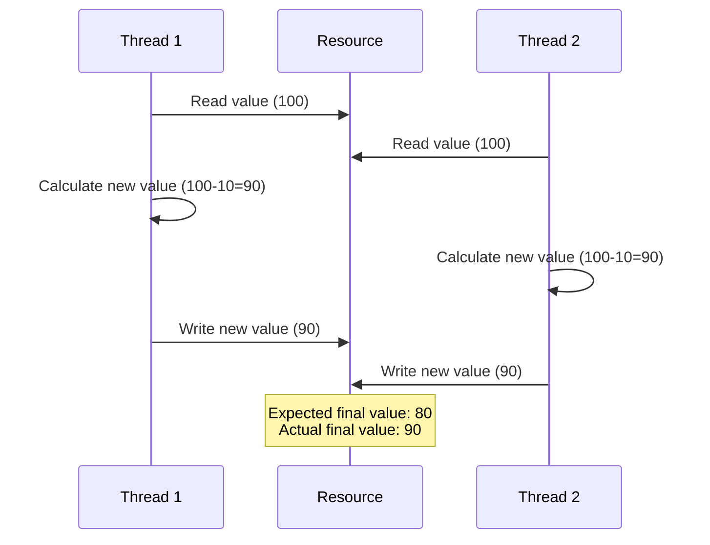
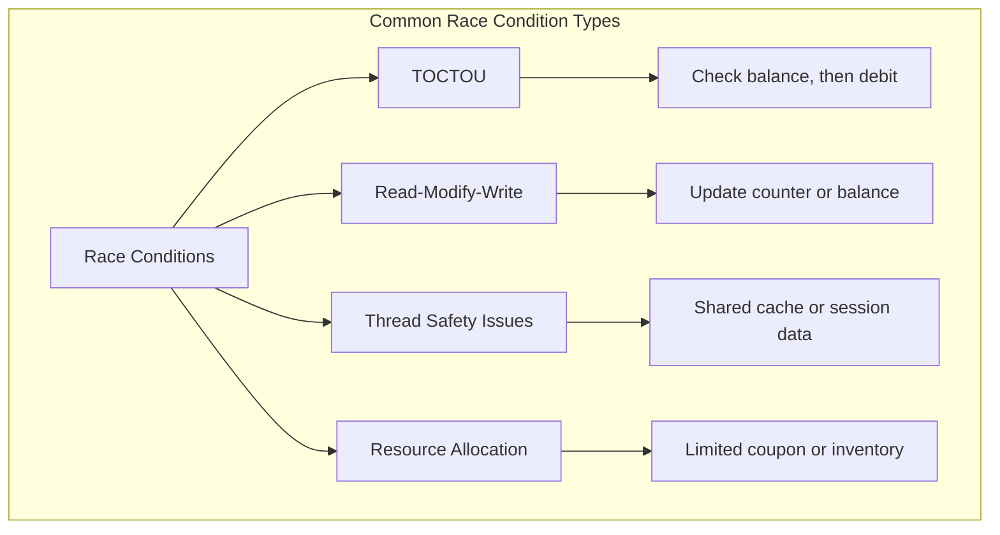
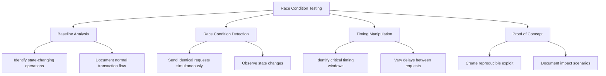
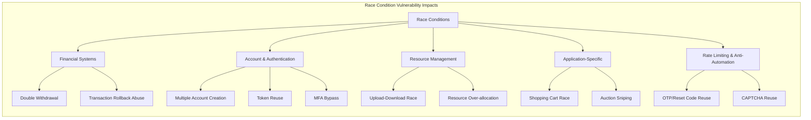
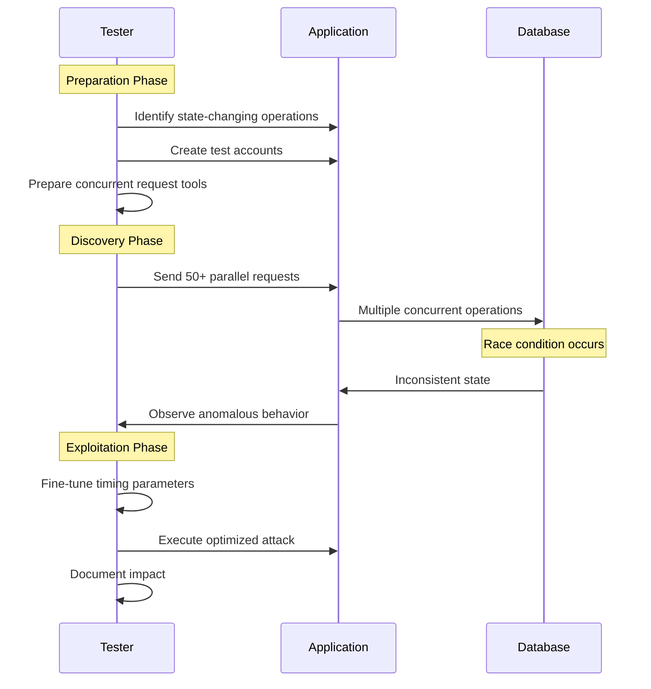

# MERGED SOURCE KNOWLEDGE: dos

104 unique sections from 10 source files. Each section appears in exactly one target.


## SOURCE: hunt-skills/bountyforge/skills/fizz/agents/invariant-discovery/adversarial-profit-maximizer.md

# Agent 4: Adversarial Profit Maximizer

**Discovery approach**: Think like an attacker. What would maximize extracted value? What sequence breaks liveness? What edge conditions create exploitable state?

**Spawn config**: `general-purpose` agent, `model: "{AGENT_MODEL}"` (see SKILL.md "Subagent Model" section — defaults to `sonnet`, `opus` under `--max`).

---

## Prompt

You are the Adversarial Profit Maximizer — you think like an attacker, not a tester.

## Your Discovery Method

Instead of asking 'what should hold?', ask:
1. 'How would I extract value from this protocol?'
2. 'How would I brick this protocol so users can't withdraw?'
3. 'What edge states would break core assumptions?'

Then write properties that DETECT these attacks. If the fuzzer can violate the property, the attack is real.

### Pattern A — Universal Withdrawal Liveness
`For every actor with balance > 0: withdrawal of their full balance must not revert`

### Pattern B — Liquidation Liveness
`For every actor whose position is unhealthy: liquidation must not revert`

### Pattern C — Critical Function Liveness
`For each critical function: if valid preconditions are met, the call must succeed`

### Pattern D — No Free Profit
`attacker_balance_after <= attacker_balance_before + epsilon`

### Pattern E — First-Depositor / Share Inflation
`After any sequence of operations: shares_minted_for_deposit(1e18) > 0`

### Pattern F — Flash Loan Profit
`Within a single transaction context: user cannot end with more value than they started`

### Pattern G — Zero State Safety
`After all users withdraw everything: totalSupply == 0 AND totalAssets == 0`
`Empty protocol is re-enterable: deposit after full withdrawal works correctly`

### Pattern H — Dust State Safety
`Positions with dust amounts (1 wei) can still be closed/liquidated/exited`

### Pattern I — Boundary-Value Exploits

Test four boundary directions — bugs cluster where clamped handlers don't reach:

**I-a: Near-zero / sub-unit truncation**
`When a code path divides or scales, values below the divisor truncate to zero — user pays nothing`
Grep for division, `mulDiv`, decimal scaling (`10**`, `1eN`), conversion functions. For each, write a property: `if user receives X tokens, user must have paid > 0`. Generate a handler that inputs values near and below the divisor.

**I-b: Type-narrowing overflow**
`When uint256 arithmetic is stored in a narrower type, large accumulations truncate silently`
Grep for storage declared as `uint80`, `uint96`, `uint128`, `uint160`, or packed struct fields. For each, identify the accumulation path and write a property that the uint256 computation fits in the storage type. Generate a handler that pushes values toward the type boundary.

**I-c: Full-amount operations**
`Performing an operation on the ENTIRE balance/debt/supply in one call must not break invariants`
For each core operation, write a handler that uses the maximum available amount from current state (full balance, full debt, full supply). Write a property that invariants hold after full-amount operations.

**I-d: Cumulative bypass**
`Per-call validation passes but the aggregate violates an invariant after repeated calls`
When a function checks limits per-call but doesn't track cumulative totals, repeated calls bypass the cap. Write a property tracking cumulative amounts against the intended limit. Generate a handler designed for high-frequency repeated calls.

### Pattern J — Privilege Escalation
`Non-admin calling admin functions always reverts`
`User A cannot operate on User B's position without approval`

### Pattern K — Self-Destructive Operations
`A user cannot intentionally make their own position unliquidatable`

## Step 5: Protocol-Specific Adversarial Thinking

For each external dependency: 'What if this returns an unexpected value?'
For each economic flow: 'What if someone front-runs this?'

## Output Format
Write each property as:
```
PROPERTY_ID: [ADV-XX]
TYPE: GLOBAL or SPECIFIC
ENGLISH: [plain English — frame as 'an attacker cannot...']
SOLIDITY_SKETCH: [pseudocode]
GHOST_NEEDS: [ghost variables needed in Base.sol Ghosts struct]
SNAPSHOT_NEEDS: [state needed in Snapshots.sol]
PRIORITY: HIGH / MEDIUM / LOW (liveness is always HIGH)
GUARANTEE: SHOULD-HOLD or EXPLORATORY
EVIDENCE: [if SHOULD-HOLD: the doc quote / standard clause / math identity that guarantees it; otherwise "none — inferred"]
RATIONALE: [what attack this detects]
```

SCOPE: Write ONLY adversarial/attack properties. Do NOT write conservation, rounding, or state transition properties.


## SOURCE: hunt-skills/bountyforge/skills/smart-contract-audit/anchor-checks.md

## Solana/Anchor Program Tricks

- Check if PDA derivations use all required seeds and verify bump seeds are canonical
- Look for CPI calls that don't validate the target program ID matches expected program
- Verify if account validation checks both owner and discriminator for all account types
- Search for instructions that don't verify signer authority for accounts being modified
- Check if account reallocation properly handles rent exemption calculations
- Look for missing close constraints that leave accounts with non-zero data accessible
- Verify if program-derived addresses validate all derivation parameters
- Check Token-2022 token transfers use `transfer_checked` not legacy `spl_token::transfer`; confirm transfer hook account is included in CPI and the hook program is not None
- Verify compute budget instructions (`SetComputeUnitLimit`) in transaction cannot be injected or overridden by users ahead of business-logic instructions; compute exhaustion is a DoS vector
- Search all `invoke_signed` call sites for seeds derived from attacker-controlled account data; seeds must be validated before use as a signer identity
- Look for oracle price reads missing any of: staleness check against clock sysvar, confidence interval check, status/trading-halt check, and circuit breaker for extreme price deviation
- Verify reward and staking accumulator index values are updated before any balance or share change in the same instruction; index-after-balance ordering allows reward theft

### Account Constraints & Validation

- Missing or incorrect `#[account]` constraints
- Lack of `has_one`, `init`, `close`, or signer checks
- Mutable accounts without proper authority enforcement
- Trying to modify an account without checking if it's writeable
- Trying to access account data without ownership checks
- Usage of UncheckedAccount without manual ownership check
- Usage of UncheckedAccount without manual signer check
- No is_initialized check when operating on an account
- Missing account constraints
- Using ctx.remaining_accounts without non-zero data check
- No reload after account mutation
- Not validating a set address

### PDA & Seed Safety

- Seed collisions or reused seeds across programs
- Missing `bump` seeds or derivations that can be hijacked
- Missing PDA initialization check
- Forced seed de-bump
- Exposed PDA seeds
- Lack of proper PDA validation for signers

### CPI & Instruction Safety

- Unchecked CPI calls to untrusted programs
- Incorrect handling of cross-program invocations
- Dangerous use of `invoke_signed` without control validation
- Signing arbitrary programs without privilege checks
- Insecure CPIs using unchecked accounts
- Passing owner-checked accounts in CPI
- Reusing instruction parameters leading to exploits
- Missing signer checks in CPIs
- Account confusion with system program

### Deserialization & Instruction Data

- Use of unchecked `AccountInfo` directly
- Manual deserialization from instruction data without checks
- Logic depending on instruction index or ordering

### Error Handling

- Missing error checks after operations
- Improper error propagation
- Lack of meaningful error messages

### Token Operations

- Improper token mint/burn operations
- Missing token account validation
- Incorrect authority checks for token operations

### System Account Validation

- Missing system account checks
- Improper account initialization
- Rent exemption violations

### Type Cosplay

- Account type confusion
- Missing discriminator checks
- Improper account casting

### Closing Accounts

- Closing accounts without zeroing data and setting a closed discriminator
- Operations on accounts marked as closed
- Unintended closure by close constraint

### Oracle & Price Feeds

- Oracle price read without staleness check against `Clock` sysvar
- Confidence interval not validated against an acceptable threshold
- Oracle status or trading-halt flag not checked before use
- Using on-chain spot price instead of a TWAP or aggregated feed
- Accepting oracle accounts not matching a hardcoded expected address (fake oracle injection)
- Retroactive oracle price applied to a transaction that occurred in a different slot
- Flash loan used to manipulate on-chain oracle within a single transaction

### DeFi Patterns

- Vault share issuance using total supply before accruing pending interest or rewards
- Deposit-then-immediate-withdraw round trip extracting value via rounding gap
- Missing minimum deposit or withdrawal fee to make precision-gap attacks uneconomical
- Slippage tolerance of 0 or derived from on-chain state in the same transaction
- Lamport balance invariant not preserved across CPI chains
- Reward accumulator index updated after balance change allowing reward theft
- Cooldown or unlock period bypassable via flash loan entering and exiting in one slot

### Token-2022 Extensions

- Token-2022 transfer hook not invoked or hook account missing from CPI
- Interest-bearing mint balance read without normalizing for accrued interest rate
- Transfer fee not accounted for when computing expected received amount
- Freeze authority on accepted mint not verified to be revoked
- Close authority on Token-2022 mint can brick protocol positions

### Compute & Program Management

- Compute budget limit instruction injected ahead of business-logic instructions in the same transaction, causing DoS
- Vec or array initialization with declared capacity but uninitialized elements accessed as if populated
- Upgrade authority on a dependency program not pinned or audited; silent behavior change after upgrade
- Log output truncated by compute limit, hiding security-relevant events from off-chain monitors

## Knowledge Base References

For detailed vulnerability patterns, read the relevant README then drill into case files:
- `cat $SKILL_DIR/reference/anchor/fv-anc-1-arithmetic-operations/readme.md` - Math overflow/underflow
- `cat $SKILL_DIR/reference/anchor/fv-anc-2-signer-checks/readme.md` - Signer validation issues
- `cat $SKILL_DIR/reference/anchor/fv-anc-3-account-ownership-validations/readme.md` - Account validation
- `cat $SKILL_DIR/reference/anchor/fv-anc-4-pda-security/readme.md` - PDA vulnerabilities
- `cat $SKILL_DIR/reference/anchor/fv-anc-5-cross-program-invocation-cpi/readme.md` - CPI security
- `cat $SKILL_DIR/reference/anchor/fv-anc-6-error-handling/readme.md` - Error handling patterns
- `cat $SKILL_DIR/reference/anchor/fv-anc-7-token-operations/readme.md` - Token security including Token-2022
- `cat $SKILL_DIR/reference/anchor/fv-anc-8-system-account-validation/readme.md` - System account checks
- `cat $SKILL_DIR/reference/anchor/fv-anc-9-type-cosplay/readme.md` - Type confusion
- `cat $SKILL_DIR/reference/anchor/fv-anc-10-closing-accounts/readme.md` - Account closure security
- `cat $SKILL_DIR/reference/anchor/fv-anc-11-state-management/readme.md` - Slippage, lamport invariant, DoS, time units, reward accumulator ordering
- `cat $SKILL_DIR/reference/anchor/fv-anc-13-program-management/readme.md` - Compute budget, upgrade authority, program init

For protocol-type-specific DeFi audit context (preconditions, historical findings, remediation):
- `cat $SKILL_DIR/reference/anchor/protocols/oracle.md` - Oracle integration patterns
- `cat $SKILL_DIR/reference/anchor/protocols/lending.md` - Lending and vault protocols
- `cat $SKILL_DIR/reference/anchor/protocols/staking.md` - Staking and reward protocols
- `cat $SKILL_DIR/reference/anchor/protocols/amm-dex.md` - AMM and DEX protocols
- `cat $SKILL_DIR/reference/anchor/protocols/governance.md` - Governance and authority management


## SOURCE: hunt-skills/bountyforge/skills/smart-contract-audit/reference/anchor/fv-anc-11-state-management/fv-anc-11-cl4-unbounded-account-collection-causing-dos.md

## TLDR

Instructions that iterate over a variable-length collection stored in an account (a Vec of positions, orders, or members) can exhaust compute units when the collection grows large. An attacker can repeatedly add entries to grow the collection to a size that makes all dependent instructions fail due to compute budget exhaustion, effectively bricking any protocol operation that touches that account.

## Detection Heuristics

**Iteration Over User-Controlled Vec**
- Instruction iterates over `account.positions`, `account.orders`, or similar Vec fields with no cap on collection length
- Vec is extended by user-callable instructions without a maximum length constraint (`require!(list.len() < MAX_ITEMS)`)
- Gas or compute cost of the iteration grows linearly with collection size and can be pushed above 1.4M compute units

**Missing Collection Size Cap**
- `Vec::push` called in a user-accessible instruction without checking current length against a protocol-defined maximum
- Protocol documentation mentions a maximum but the on-chain check is absent or uses an incorrect bound
- A separate attacker-controlled account's Vec is iterated in the same instruction that processes the victim's main operation, doubling the iteration work

**Cleanup Path Also Blocked**
- The only way to remove entries from the collection is via an instruction that also iterates the full collection; once the collection is large enough to DoS the iteration, entries cannot be removed either, making the DoS permanent
- No privileged admin function to forcibly truncate or migrate oversized collections

## False Positives

- Collection length is bounded by a `require!` check at every append site and the maximum is low enough that compute budget is never exhausted
- Protocol charges a fee per entry that makes unbounded growth economically irrational
- Fixed-size arrays used instead of Vec; the size is a compile-time constant that bounds compute cost


## SOURCE: hunt-skills/bountyforge/skills/smart-contract-audit/reference/anchor/fv-anc-11-state-management/readme.md

## Classifications

Run `cat $SKILL_DIR/reference/anchor/fv-anc-11-state-management/<filename>` to read any case file listed below.


## SOURCE: hunt-skills/bountyforge/skills/smart-contract-audit/reference/anchor/fv-anc-13-program-management/fv-anc-13-cl1-compute-budget-dos-via-user-injected-limit-instruction.md

## TLDR

Solana transactions can include a `SetComputeUnitLimit` instruction that caps the compute units available for the entire transaction. A malicious user can prepend a `SetComputeUnitLimit` with a very low value before calling a protocol instruction, causing the instruction to exhaust compute units and fail. If a critical operation (liquidation, settlement, position close) can be DoS'd this way, it creates a window for economic exploitation.

## Detection Heuristics

**Protocol Does Not Read or Validate Compute Budget**
- Protocol has no mechanism to detect or reject transactions where a `SetComputeUnitLimit` instruction has set the limit below the instruction's required compute units
- Instruction whose compute cost varies with input size (e.g., iterating over positions) does not enforce a minimum compute budget at entry
- Critical operations (liquidation, forced settlement) executable by anyone have predictable compute costs that can be targeted with a precise low compute limit

**No Protection on Critical Paths**
- Liquidation, position close, or settlement instruction does not set its own compute request via a CPI to the Compute Budget program to ensure sufficient units are reserved
- Protocol documentation does not mention compute budget injection as a known DoS vector despite having instructions with variable compute cost
- No transaction simulation or compute budget check in off-chain keeper infrastructure that submits critical transactions

**Keeper Infrastructure Gap**
- Keeper that triggers liquidations uses a fixed compute budget that can be undercut by a user who adds a lower `SetComputeUnitLimit` before the keeper's instruction in the same bundle

## False Positives

- All critical instructions are only callable by a trusted keeper or admin that submits transactions via a private relay; no public user can prepend instructions
- Protocol's critical instructions have bounded, low, fixed compute costs that cannot be targeted effectively with a compute limit attack


## SOURCE: hunt-skills/bountyforge/skills/smart-contract-audit/reference/anchor/fv-anc-13-program-management/readme.md

## Classifications

Run `cat $SKILL_DIR/reference/anchor/fv-anc-13-program-management/<filename>` to read any case file listed below.


## SOURCE: hunt-skills/bountyforge/skills/smart-contract-audit/reference/move/fv-mov-5-arithmetic-errors/fv-mov-5-cl2-division-and-underflow.md

## TLDR

Move has no floating-point types. Early division truncates precision: `(amount / total) * price` can round to zero for small amounts, enabling dust exploits. Division by zero causes an abort, which can permanently DoS critical operations. Subtraction without a bounds check aborts on underflow in debug, wraps in release.

## Detection Heuristics

- Search for division operators (`/`) and check whether they appear before any multiplication in the same expression
- Safe pattern: multiply first - `(amount * price) / total` - use u128 intermediates for u64 inputs to prevent overflow
- For any divisor that can reach zero (total supply, pool balance, total shares), verify an explicit `assert!(divisor > 0)` or early return
- Empty pool scenarios are high-risk: `total_supply == 0` is valid state in many protocols at launch or after full withdrawal
- Search for subtraction expressions involving user balances, collected fees, or pool reserves - trace whether the left side can be less than the right side under any input combination

## False Positives

- Multiply-before-divide pattern used consistently
- Zero divisor guard present: `assert!(total_supply > 0, EZeroSupply)` or equivalent
- Checked subtraction: `assert!(a >= b)` before `a - b`
- Saturating or checked math library handles all edge cases


## SOURCE: hunt-skills/bountyforge/skills/smart-contract-audit/reference/move/fv-mov-8-advanced-patterns/fv-mov-8-cl2-table-collection-bugs.md

## TLDR

`table::add` aborts on duplicate keys - missing existence checks cause DoS when a user interacts a second time. Move vectors are limited to ~1000 entries - unbounded vectors DoS when full. Both create permanent denial-of-service.

## Detection Heuristics

- Search for every `table::add` and `dynamic_field::add` call - verify a preceding `table::contains` / `dynamic_field::exists_` check
- Safe pattern: `if (table::contains(&t, key)) { table::remove(&t, key); }; table::add(&mut t, key, value)` for upsert semantics
- For user registration, staking position tracking, or whitelist patterns: check whether the same user can trigger an add twice (e.g., via two deposits before first is settled)
- Identify all `vector<T>` used for unbounded user data (registrations, positions, orders) - these should be `sui::table_vec::TableVec<T>` or `sui::table::Table` instead
- Verify loops over vectors in public functions have a bounded count - loops over growing unbounded vectors eventually exceed gas limits and become permanently uncallable

## False Positives

- `table::contains` check present before every `table::add`
- `TableVec` or `Table` used instead of plain `vector` for unbounded user data
- Vector size explicitly capped with `assert!(vector::length(&v) < MAX_SIZE)` before push


## SOURCE: hunt-skills/bountyforge/skills/smart-contract-audit/reference/move/fv-mov-8-advanced-patterns/readme.md

# FV-MOV-8: Advanced Patterns and Real-World Exploits

This category captures patterns that emerged from 1141 real findings across 200+ Move audits, including named exploits (Cetus, Baptswap, Bluefin, KriyaDEX, Thala Labs). These are high-signal, high-severity patterns confirmed in production codebases.

## Cases

- [fv-mov-8-cl1-generic-type-confusion.md](fv-mov-8-cl1-generic-type-confusion.md) - Unvalidated generic `T` allows fake token injection (Navi, Econia pattern)
- [fv-mov-8-cl2-table-collection-bugs.md](fv-mov-8-cl2-table-collection-bugs.md) - Table duplicate key DoS, vector size limits, orphaned collections
- [fv-mov-8-cl3-flash-loan-receipt-binding.md](fv-mov-8-cl3-flash-loan-receipt-binding.md) - Receipt without pool_id binding; nested start resets snapshot (Cetus, Dexlyn)
- [fv-mov-8-cl4-real-world-exploits.md](fv-mov-8-cl4-real-world-exploits.md) - Transposed return values, self-referential assertions, accumulator ordering (KriyaDEX, Hop, Thala)


## SOURCE: offensive-skills/offensive-race-condition/SKILL.md

## Metadata
- **Skill Name**: race-condition
- **Folder**: offensive-race-condition
- **Source**: https://github.com/SnailSploit/offensive-checklist/blob/main/race-condition.md

## Description
Race condition (TOCTOU) testing checklist: identifying timing windows, Burp Suite Turbo Intruder, Last-Byte sync technique, rate limit bypass, double-spend attacks, and concurrent request exploitation. Use for web app race condition testing or bug bounty time-of-check-to-time-of-use bugs.

## Trigger Phrases
Use this skill when the conversation involves any of:
`race condition, TOCTOU, timing attack, Turbo Intruder, last-byte sync, rate limit bypass, double spend, concurrent request, race window, time of check, time of use`

## Shortcut

- Spot the features prone to race conditions in the target application and copy the corresponding requests.
- Send multiple of these critical requests to the server simultaneously. You should craft requests that should be allowed once but not allowed multiple times.
- Check the results to see if your attack has succeeded. And try to execute the attack multiple times to maximize the chance of success.
- Consider the impact of the race condition you just found.

## Mechanisms

Race conditions occur when the behavior of a system depends on the relative timing or sequence of events that can happen in different orders. In web application security, race conditions happen when multiple concurrent processes or threads access and manipulate the same resource simultaneously without proper synchronization.



A race condition becomes a security vulnerability when it affects security controls or business logic. The critical types include:

- Time-of-Check to Time-of-Use (TOCTOU): When a check is performed, but circumstances change before the result of the check is used
- Read-Modify-Write: When multiple processes read, modify, and write back a shared resource without coordination
- Thread Safety Issues: When multithreaded applications improperly handle shared resources
- Resource Allocation Races: Competition for limited resources like database connections or memory



Common vulnerable scenarios include:

- Account Balance Manipulation: Making multiple withdrawals/transfers simultaneously
- Coupon/Promotion Code Reuse: Using a single-use code multiple times
- File Upload Processing: Uploading and accessing temporary files before validation completes
- Registration Processes: Creating multiple accounts with the same unique identifier
- Token Verification: Using authentication tokens multiple times before they're invalidated

#### Target Functionality Selection

Focus on features handling state changes, limited resources, or critical operations:

- Financial Transactions: Fund transfers, withdrawals, purchases
- Inventory Systems: Stock allocation, reservation systems
- Coupon/Points Systems: Redeeming coupons, points, or rewards
- Voting/Rating Systems: Likes, upvotes, downvotes, polls
- Membership/Subscription Actions: Inviting users, joining/leaving groups, following/unfollowing users
- Registration Systems: Account creation with unique attributes
- Resource Management: Uploading, processing, or accessing resources
- Rate-Limited Actions: Password resets, login attempts, API endpoints with usage limits

#### Testing Prerequisites

1. Tools for sending parallel requests:
   - Burp Suite Turbo Intruder or Repeater (multi-threaded)
   - Custom scripts with threading capabilities
   - Race condition testing frameworks (e.g., Racepwn)

2. Request capturing and analysis capabilities:
   - HTTP proxy for intercepting and modifying traffic
   - Response analysis tools for detecting race-related anomalies

3. Network Proximity: Consider the physical or network location of your testing infrastructure relative to the target server. Minimizing latency (e.g., using a VPS in the same region/provider as the target) can significantly increase the chances of winning a race condition.

#### Testing Methodology



1. Baseline Behavior Analysis:
   - Identify state-changing operations
   - Understand normal request/response patterns
   - Document application's standard transaction flow

2. Race Condition Detection:
   - Send identical requests simultaneously (10-100 threads)
   - Observe effects on application state
   - Look for anomalies in responses or state changes

3. Timing Manipulation:
   - Identify critical timing windows
   - Target synchronization points
   - Test with varying delays between requests

#### API-Based Race Condition Testing

1. Identify stateful API endpoints
2. Create automated scripts for parallel API requests:

```python
import requests
import threading

def make_request():
    requests.post('https://target.com/api/redeem',
                  json={'coupon_code': 'ONCE123'},
                  headers={'Authorization': 'Bearer token'})

threads = []
for _ in range(20):
    t = threading.Thread(target=make_request)
    threads.append(t)
    t.start()

for t in threads:
    t.join()
```

#### Transaction-Based Race Condition Testing

1. Identify multi-step transactions
2. Find the critical state change requests
3. Execute the final step in parallel before state updates propagate:
   ```
   Step 1: Start purchase (single request)
   Step 2: Apply coupon (single request)
   Step 3: Send 20 simultaneous "confirm order" requests
   ```

#### Thread Synchronization Testing

Create coordinated attacks that target specific timing windows:

```python
import requests
import threading
import time

start_gate = threading.Event()

def synchronized_request():
    start_gate.wait()  # All threads wait here until flag is set
    requests.post('https://target.com/api/withdraw',
                  json={'amount': '100'},
                  headers={'Authorization': 'Bearer token'})

threads = []
for _ in range(50):
    t = threading.Thread(target=synchronized_request)
    t.daemon = True
    threads.append(t)
    t.start()

# Release all threads simultaneously
time.sleep(2)  # Ensure all threads are waiting
start_gate.set()
```

#### Network-Level Timing Manipulation

Beyond application-level threading, manipulating network-level timing can be effective:

- **HTTP/2 / HTTP/3 Single-Packet & Last-Byte-Sync Techniques**: Classic HTTP/1.1 pipelining is disabled on most servers. Modern testers rely on HTTP/2 multiplexing or HTTP/3 streams to achieve micro-second concurrency. Burp Repeater (2023.9+) and Turbo Intruder expose this as _Send group in parallel (single-packet attack)_.
- **Last-Byte-Sync / Request Splitting**: Open multiple connections, send almost-complete requests, then flush the final bytes simultaneously. In Burp, send each tab using the _single packet attack_ gate; or in Turbo Intruder:

```python
def queueRequests(target, wordlists):
    engine = RequestEngine(
        endpoint=target.endpoint,
        concurrentConnections=1,
        engine=Engine.BURP2)

    for _ in range(20):
        engine.queue(target.req, gate='race')

    engine.openGate('race')
```

#### Rate-Limiter and CAPTCHA Races

- Send concurrent login or OTP requests across multiple sessions/IPs to probe shared counters.
- Look for global vs per-user vs per-IP buckets; test burst vs sustained patterns.

### Common Race Condition Vulnerability Patterns



#### Financial Systems Vulnerabilities

- Double Withdrawal: Processing the same withdrawal request twice
- Transaction Rollback Abuse: Initiating a transaction rollback while completing the transaction
- Balance Check Bypass: Racing between balance verification and transaction processing

#### Account and Authentication Vulnerabilities

- Multiple Account Creation: Creating accounts with the same unique identifier
- Token Reuse: Using one-time tokens multiple times
- Session Fixation Race: Racing between session creation and authentication
- MFA Bypass: Racing between MFA checks and authenticated resource access

#### Resource Management Vulnerabilities

- Upload-Download Race: Accessing uploaded files before security checks complete
- Resource Allocation Race: Over-allocating limited resources
- Temporary File Races: Operating on temporary files during processing

#### Specific Application Patterns

- Shopping Cart Race Conditions: Adding items at specific discount windows
- Auction Sniping Race: Timing bids to bypass minimum increments
- Reservation System Races: Double-booking limited inventory

### Time-Sensitive Vulnerabilities

1. Send parallel password reset requests for the same account
2. Check if reset tokens are identical
3. Test by changing victim's username in one request
4. Analyze response times for potential race conditions

### Session Handling Bypass

Some application frameworks (like PHP with default session handling) lock session files when `session_start()` is called, preventing concurrent requests from the _same_ session from executing simultaneously. If the application allows a user to have multiple active sessions, this can be bypassed:

1.  Authenticate multiple times to obtain several valid session identifiers (e.g., `PHPSESSID`).
2.  Assign a unique session ID to each concurrent request in your race condition attack. This makes the server treat each request as originating from a different session, circumventing the session lock.

### Database Isolation Level Testing

Different database isolation levels handle concurrency differently. Test each level to identify race vulnerabilities:

**PostgreSQL Isolation Levels:**

```sql
-- READ UNCOMMITTED (treats as READ COMMITTED in PostgreSQL)
BEGIN TRANSACTION ISOLATION LEVEL READ UNCOMMITTED;

-- READ COMMITTED (default) - prone to races
BEGIN TRANSACTION ISOLATION LEVEL READ COMMITTED;
SELECT balance FROM accounts WHERE id = 123;
-- Race window here
UPDATE accounts SET balance = balance - 100 WHERE id = 123;
COMMIT;

-- REPEATABLE READ - prevents some races
BEGIN TRANSACTION ISOLATION LEVEL REPEATABLE READ;

-- SERIALIZABLE - strongest protection
BEGIN TRANSACTION ISOLATION LEVEL SERIALIZABLE;
```

**Testing Strategy:**

1. Identify critical transactions in the application
2. Send concurrent requests during the transaction window
3. Check if inconsistent state occurs
4. Test with explicit table locking:
   ```sql
   SELECT * FROM table FOR UPDATE;  -- Row-level lock
   LOCK TABLE table IN EXCLUSIVE MODE;  -- Table-level lock
   ```

**MySQL/MariaDB:**

```sql
-- Test for missing row locks
START TRANSACTION;
SELECT balance FROM accounts WHERE id = 123;
-- Send parallel transactions here
UPDATE accounts SET balance = balance - 100 WHERE id = 123;
COMMIT;

-- Test with explicit locking
SELECT * FROM accounts WHERE id = 123 FOR UPDATE;
```

**Testing for Advisory Locks:**

```sql
-- PostgreSQL advisory locks
SELECT pg_try_advisory_lock(12345);

-- Test if application uses them
-- Send parallel requests and monitor pg_locks table
SELECT * FROM pg_locks WHERE locktype = 'advisory';
```

### WebSocket Race Conditions

WebSocket connections maintain persistent state and can be vulnerable to race conditions:

**Message Processing Races:**

```javascript
// Send concurrent WebSocket messages
const ws = new WebSocket("wss://target.com/socket");

ws.onopen = () => {
  // Send multiple messages rapidly
  for (let i = 0; i < 50; i++) {
    ws.send(
      JSON.stringify({
        action: "transfer",
        amount: 100,
        to: "attacker",
      }),
    );
  }
};
```

**Connection Upgrade Races:**

```bash

# Multiple simultaneous WebSocket handshakes
for i in {1..20}; do
  curl -i -N \
    -H "Connection: Upgrade" \
    -H "Upgrade: websocket" \
    -H "Sec-WebSocket-Key: SGVsbG8sIHdvcmxkIQ==" \
    -H "Sec-WebSocket-Version: 13" \
    https://target.com/socket &
done
wait
```

**Testing Scenarios:**

- Concurrent authentication messages
- Simultaneous room/channel joins
- Parallel state-changing commands
- Race between disconnect and final message processing

#### AWS Lambda Specific

**Concurrent Execution Testing:**

```python
import boto3
import concurrent.futures

lambda_client = boto3.client('lambda')

def invoke_lambda():
    return lambda_client.invoke(
        FunctionName='vulnerable-function',
        InvocationType='RequestResponse',
        Payload='{"action": "redeem_coupon", "code": "SAVE50"}'
    )

# Test concurrent invocations
with concurrent.futures.ThreadPoolExecutor(max_workers=50) as executor:
    futures = [executor.submit(invoke_lambda) for _ in range(50)]
    results = [f.result() for f in futures]
```

**Reserved Concurrency Bypass:**

- Check if Lambda has reserved concurrency limits
- Test if multiple accounts/regions bypass limits
- Monitor CloudWatch for ConcurrentExecutions metric

**DynamoDB Conditional Write Testing:**

```python
import boto3
from boto3.dynamodb.conditions import Attr

dynamodb = boto3.resource('dynamodb')
table = dynamodb.Table('coupons')

# Test if conditional writes are used
def redeem_coupon():
    table.update_item(
        Key={'code': 'SAVE50'},
        UpdateExpression='SET used = :val',
        ConditionExpression=Attr('used').eq(False),  # Should prevent races
        ExpressionAttributeValues={':val': True}
    )
```

# Test HTTP-triggered Cloud Functions
for i in {1..50}; do
  curl -X POST https://region-project.cloudfunctions.net/function \
    -H "Content-Type: application/json" \
    -d '{"action": "claim_reward"}' &
done
wait
```

#### Azure Functions

**Singleton Testing:**

```csharp
// Check if Azure Functions use Singleton attribute
[Singleton] // Should prevent concurrent execution
public static void Run([QueueTrigger("queue")] string msg) { }
```

### Protocol-specific attack primitives

- **Single-Packet Attack (HTTP/2)** and **Last-Byte-Sync (HTTP/1)** research (PortSwigger Black Hat 2023) enables ≤ 4 µs request skew; both are now directly supported in Burp Repeater and Turbo Intruder.

### GraphQL & gRPC considerations

- GraphQL batch mutations can bypass conventional CSRF and rate-limit controls. Replay a single POST body containing 20 identical mutations to test for duplicated state changes.
- For gRPC, open multiple concurrent `SendMsg` frames before the backend commits state.

### Cloud & serverless concurrency

- Serverless functions (AWS Lambda, GCP Cloud Run, Azure Functions) may process the same event in parallel. Mitigate with idempotency keys or reserved-concurrency settings.

### Observability & detection

- Enable distributed tracing (OpenTelemetry, Jaeger) and emit duplicate-call metrics within the same trace span to surface race-condition symptoms.

### Modern defensive patterns

- Use atomic **UPSERT / ON CONFLICT** statements for write-once semantics.
- Implement **Idempotency-Key** headers (IETF draft 2024) with short-TTL storage.
- Employ Redis/etcd Redlock or PostgreSQL advisory locks for cross-service resource locking.

### Additional resources

- PortSwigger white-paper _Smashing the State Machine_ + labs (Black Hat 2023).
- OWASP ASVS v5 (2024) section 7.6 "Concurrency Controls".

#### Critical Impact Scenarios

- **Financial Loss**: Double spending, incorrect account balances
- **Privilege Escalation**: Bypassing authentication or authorization
- **Data Integrity Violations**: Corrupting database state
- **Denial of Service**: Exhausting limited resources
- **Information Disclosure**: Accessing partially processed data

#### Example Exploits

1. **Banking Application Double-Withdrawal**:
   - Initial balance: $1000
   - Send 10 simultaneous withdrawal requests for $100 each
   - Result: $1000 debited but balance only decreases once
2. **E-commerce Coupon Reuse**:
   - Single-use coupon provides $50 discount
   - Send 5 parallel requests using the same coupon
   - Result: Multiple $50 discounts applied

3. **Account Registration Email Verification Bypass**:
   - Send multiple verification requests with different tokens
   - Race between verification and account provision
   - Result: Account verified without valid email

#### Race Condition Testing Tools

- **Burp Suite Extensions**:
  - Turbo Intruder: High-volume parallel request sender.
  - Authorize: Manipulation of tokens/session data
  - Collaborator: For detecting out-of-band effects

- **Specialized Tools**:
  - Racepwn: Purpose-built race condition testing framework
  - Race-the-Web: Web application race condition finder
  - Raceocat: CLI scanner that replays raw-socket requests for µs-precision
  - URL-Race-Condition-Scanner: Generates and races endpoints from Burp history
  - OWASP ZAP with parallel request scripts

#### Custom Scripting

- **Python with Threading/Asyncio**:

```python
import asyncio
import aiohttp

async def make_request(session):
    async with session.post('https://target.com/api/action',
                           data={'param': 'value'}) as response:
        return await response.text()

async def main():
    async with aiohttp.ClientSession() as session:
        tasks = [make_request(session) for _ in range(50)]
        responses = await asyncio.gather(*tasks)
        # Analyze responses

asyncio.run(main())
```

- **Multi-threaded Testing with Go**:

```go
package main

import (
    "net/http"
    "sync"
)

func main() {
    var wg sync.WaitGroup
    for i := 0; i < 50; i++ {
        wg.Add(1)
        go func() {
            http.Post("https://target.com/api/action",
                      "application/json",
                      strings.NewReader(`{"param":"value"}`))
            wg.Done()
        }()
    }
    wg.Wait()
}
```

#### Comprehensive Race Condition Test Methodology



1. **Preparation Phase**:
   - Map application functionality with state changes
   - Create multiple test accounts
   - Prepare parallel request tools and monitoring

2. **Discovery Phase**:
   - Test for TOCTOU issues in all critical functions
   - Test multi-step transactions with simultaneous final steps
   - Look for resource contention vulnerabilities
   - Test file operations for race conditions

3. **Exploitation Phase**:
   - Fine-tune timing and concurrency parameters
   - Create proof-of-concept exploits for confirmed issues
   - Measure impact with controlled exploitation
   - Document findings with clear reproduction steps

4. **Verification Phase**:
   - Test different concurrency levels (10, 50, 100 requests)
   - Vary timing patterns (synchronized vs staggered)
   - Test across different network conditions

#### E-commerce Application Testing

1. Add limited stock item to cart
2. Send 20 simultaneous checkout requests
3. Verify if multiple purchases succeed despite limited inventory

#### Banking Application Testing

1. Identify fund transfer functionality
2. Create 50 simultaneous transfer requests for the same amount
3. Verify account balance after transfers complete
4. Check for transaction logs inconsistencies

#### API Testing for Race Conditions

1. Identify stateful API endpoints
2. Create requests that modify shared resources
3. Execute requests simultaneously from multiple clients
4. Verify resource state consistency

### Multi-Endpoint Race Conditions

When functionality chains with multiple requests, for example in e-commerce:

```
- /product --> for the product
- /cart    --> Add to cart that product
- /cart/checkout  --> Buy that product
```

1. Send all required requests to Burp repeater in sequence
2. Create tabs for each request
3. Use "Send Parallel (single Packet Attack)" for execution

### Single-Endpoint Race Conditions

Common in email change functionality:

1. Setup:
   ```
   Account A: Attacker --> attacker@email.com
   Account B: Victim --> victim@email.com
   ```
2. When application updates email in database before confirmation
3. Send parallel requests changing email between attacker and victim addresses
4. If application generates confirmation links simultaneously, both may be sent to the same email
5. Impact: Potential for Account Takeover

## Remediation Recommendations

- **Transaction Isolation**: Implement proper database transaction isolation levels
- **Pessimistic Locking**: Lock resources before operations
- **Optimistic Concurrency Control**: Use version numbers or timestamps
- **Atomic Operations**: Use atomic operations where supported
- **Idempotent APIs**: Design APIs to be safely retried
- **Distributed Locks**: Implement distributed locking for microservices
- **Queue-Based Architecture**: Process requests sequentially through queues
- **Rate Limiting**: Enforce reasonable request rates per user
- **Stateful Synchronization**: Maintain consistent application state
- **Unique Constraint Enforcement**: Database-level constraint validation

### Connection Pool Exhaustion Races

Applications using connection pools (database, Redis, HTTP clients) can be vulnerable:

```python

# Test connection pool exhaustion
import requests
import threading

def hold_connection():
    # Keep connection open without releasing
    r = requests.get('https://target.com/long-running-query', stream=True)
    # Don't close, hold for 30 seconds
    time.sleep(30)

# Exhaust pool
threads = []
for _ in range(100):  # More than pool size
    t = threading.Thread(target=hold_connection)
    threads.append(t)
    t.start()

# Now test if race conditions occur in queue processing
```

**Testing Strategy:**

1. Identify endpoints that hold connections (long-running queries, file downloads)
2. Exhaust the pool with held connections
3. Test critical operations during exhaustion
4. Check if timeouts cause race conditions in cleanup logic

### CI/CD Pipeline Race Conditions

Deployment processes can have race conditions affecting security:

**Artifact Deployment Races:**

- Multiple pipelines deploying same artifact simultaneously
- Race between artifact upload and deployment
- Container image tag races (`latest` tag pointing to old image)

**Database Migration Races:**

```bash

# Test concurrent schema changes
```

**Configuration Deployment:**

- Race between config update and application reload
- Multiple instances reading stale configuration
- Secret rotation during active requests

**Testing Approach:**

1. Trigger multiple simultaneous deployments
2. Monitor for corrupted artifacts or partial deployments
3. Check database migration logs for conflicts
4. Verify configuration consistency across instances

### Notable Race Condition Vulnerabilities

1. **CVE-2023-6690 - GitHub Enterprise Server**:
   - GraphQL mutation race condition
   - Low-privileged users could grant themselves site-admin privileges
   - Impact: Complete administrative takeover

2. **CVE-2021-41091 - Docker (Moby)**:
   - Race condition in permission check during container removal
   - Allowed non-root users to delete arbitrary files
   - Impact: Host system compromise

3. **CVE-2019-5736 - runc Container Escape**:
   - Race condition in container runtime
   - Attacker could overwrite host runc binary
   - Impact: Container escape to host

4. **CVE-2016-5195 - Dirty COW (Linux Kernel)**:
   - Race condition in memory management (Copy-on-Write)
   - Allowed privilege escalation to root
   - Impact: Complete system compromise

5. **PayPal - Double Payment Race Condition**:
   - Concurrent payment requests processed twice
   - User charged once but vendor paid twice
   - Impact: Financial loss

6. **Shopify - Gift Card Race Condition**:
   - Single-use gift cards redeemed multiple times
   - Race in balance check and deduction logic
   - Impact: Financial fraud

7. **Uber - Promotional Code Race**:
   - One-time promo codes used multiple times
   - Concurrent ride requests with same code
   - Impact: Revenue loss

### HackerOne Reports

1. **Flag Submission**: Race condition allowing multiple submissions of the same CTF flag, increasing user points unfairly
2. **Invite System**: Race condition allowing invitation of same member multiple times to a single team
3. **Retest Payment**: Race condition allowing multiple payments for a single retest
4. **Group Member Management**: Race condition preventing admin from removing group members
5. **User Following**: Race condition allowing multiple follows of the same user
6. **Report Voting**: Race condition enabling multiple upvotes/downvotes on a single report
7. **CTF Group Joining**: Race condition allowing multiple joins to the same CTF group
8. **Invitation Limit Bypass**: Race condition bypassing the invitation limit restriction
9. **Gift Card Redemption**: Race condition enabling multiple redemptions of the same gift card
10. **OAuth Token Generation**: Race during token generation allowed multiple valid tokens for single authorization code

### Impact Categories

- **Critical**: Financial loss, privilege escalation, data corruption
- **High**: Business logic bypass, resource exhaustion, unauthorized access
- **Medium**: Rate limit bypass, duplicate operations, inconsistent state
- **Low**: UI glitches, non-security-impacting inconsistencies

### Using Burp 2023.9.x or Higher

1. Send the request to repeater for multiple instances
2. Create tabs for all requests and select "Send Parallel (single Packet Attack)"
3. Execute and analyze results

### Using Turbo Intruder for Rate Limit Testing

```python
def queueRequests(target, wordlists):
    engine = RequestEngine(endpoint=target.endpoint,
                         concurrentConnections=1,
                         engine=Engine.BURP2)

    passwords = wordlists.clipboard

    for password in passwords:
        engine.queue(target.req, password, gate='1')

    engine.openGate('1')

def handleResponse(req, interesting):
    table.add(req)
```
